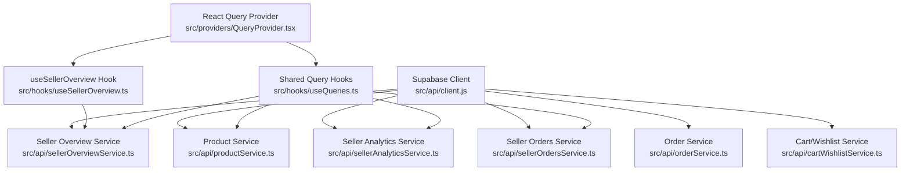
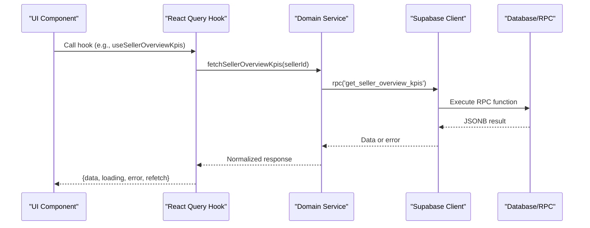
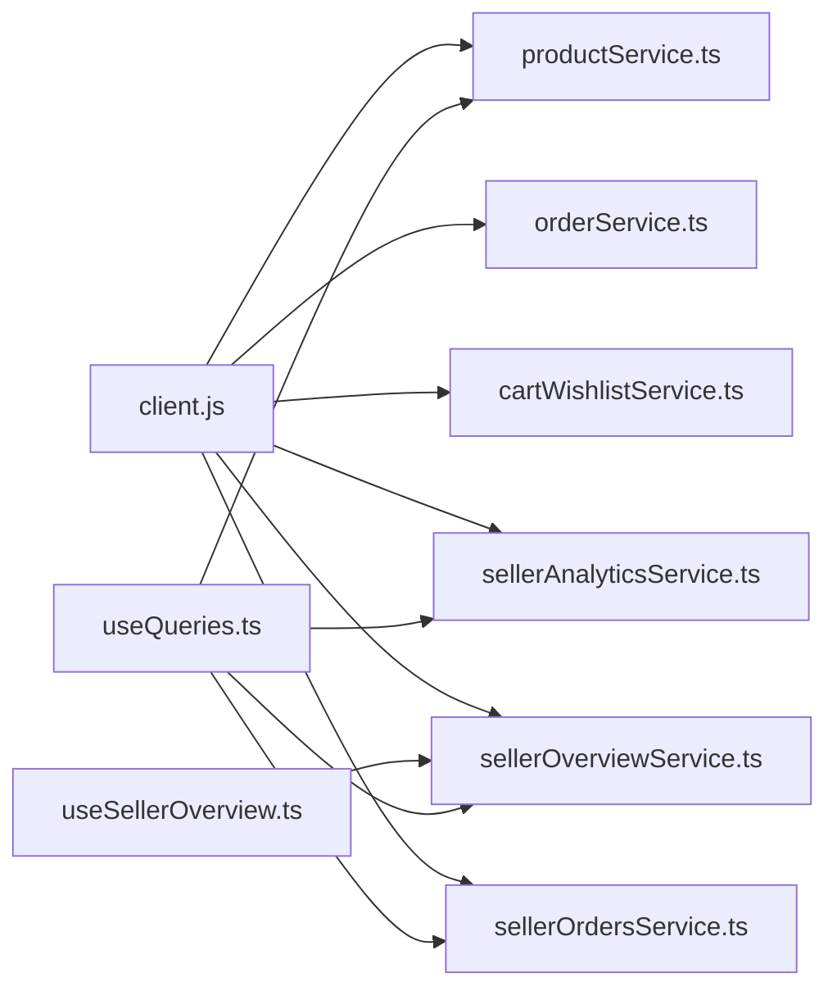

# API Integration

<cite>
**Referenced Files in This Document**
- [client.js](file://src/api/client.js)
- [QueryProvider.tsx](file://src/providers/QueryProvider.tsx)
- [useAuth.ts](file://src/hooks/useAuth.ts)
- [productService.ts](file://src/api/productService.ts)
- [orderService.ts](file://src/api/orderService.ts)
- [cartWishlistService.ts](file://src/api/cartWishlistService.ts)
- [sellerAnalyticsService.ts](file://src/api/sellerAnalyticsService.ts)
- [sellerOverviewService.ts](file://src/api/sellerOverviewService.ts)
- [sellerOrdersService.ts](file://src/api/sellerOrdersService.ts)
- [useSellerOverview.ts](file://src/hooks/useSellerOverview.ts)
- [useQueries.ts](file://src/hooks/useQueries.ts)
- [supabase_seller_overview_rpc.sql](file://supabase_seller_overview_rpc.sql)
</cite>

## Table of Contents
1. [Introduction](#introduction)
2. [Project Structure](#project-structure)
3. [Core Components](#core-components)
4. [Architecture Overview](#architecture-overview)
5. [Detailed Component Analysis](#detailed-component-analysis)
6. [Dependency Analysis](#dependency-analysis)
7. [Performance Considerations](#performance-considerations)
8. [Troubleshooting Guide](#troubleshooting-guide)
9. [Conclusion](#conclusion)

## Introduction
This document explains the API integration layer for the application. It covers how Supabase is configured, how domain-specific services encapsulate data access, how RPC functions are called and handled, how data is transformed into UI-friendly shapes, and how React Query provides caching and state synchronization. It also documents authentication context usage, error propagation strategies, and performance optimization techniques used across product, order, cart/wishlist, and seller analytics flows.

## Project Structure
The API integration layer lives under `src/api` and is consumed by hooks under `src/hooks`. The Supabase client is centralized, while each domain has its own service file:

- Supabase client configuration: `src/api/client.js`
- React Query provider: `src/providers/QueryProvider.tsx`
- Authentication hook: `src/hooks/useAuth.ts`
- Product service: `src/api/productService.ts`
- Order service: `src/api/orderService.ts`
- Cart and wishlist service: `src/api/cartWishlistService.ts`
- Seller analytics service: `src/api/sellerAnalyticsService.ts`
- Seller overview service: `src/api/sellerOverviewService.ts`
- Seller orders service: `src/api/sellerOrdersService.ts`
- React Query hooks: `src/hooks/useSellerOverview.ts`, `src/hooks/useQueries.ts`
- Seller overview RPC migration: `supabase_seller_overview_rpc.sql`

**Diagram sources**
- [client.js:1-8](file://src/api/client.js#L1-L8)
- [productService.ts:1-10](file://src/api/productService.ts#L1-L10)
- [orderService.ts:1-10](file://src/api/orderService.ts#L1-L10)
- [cartWishlistService.ts:1-10](file://src/api/cartWishlistService.ts#L1-L10)
- [sellerAnalyticsService.ts:1-10](file://src/api/sellerAnalyticsService.ts#L1-L10)
- [sellerOverviewService.ts:1-10](file://src/api/sellerOverviewService.ts#L1-L10)
- [sellerOrdersService.ts:1-10](file://src/api/sellerOrdersService.ts#L1-L10)
- [QueryProvider.tsx:1-25](file://src/providers/QueryProvider.tsx#L1-L25)
- [useSellerOverview.ts:1-20](file://src/hooks/useSellerOverview.ts#L1-L20)
- [useQueries.ts:1-20](file://src/hooks/useQueries.ts#L1-L20)

**Section sources**
- [client.js:1-8](file://src/api/client.js#L1-L8)
- [QueryProvider.tsx:1-25](file://src/providers/QueryProvider.tsx#L1-L25)

## Core Components
- Supabase client: A single exported client initialized with environment variables for URL and anonymous key. All services import this client to interact with Supabase tables, storage, and RPC functions.
- React Query provider: Wraps the app with a `QueryClient` that sets global defaults such as stale time and refetch behavior.
- Authentication hook: Provides typed access to auth context; it throws if used outside an auth provider.

Key responsibilities:
- Centralize network configuration (Supabase client).
- Provide consistent caching defaults (React Query provider).
- Expose authenticated user context to services and hooks.

**Section sources**
- [client.js:1-8](file://src/api/client.js#L1-L8)
- [QueryProvider.tsx:1-25](file://src/providers/QueryProvider.tsx#L1-L25)
- [useAuth.ts:1-13](file://src/hooks/useAuth.ts#L1-L13)

## Architecture Overview
The integration architecture follows a layered approach:

- Services: Domain-specific modules encapsulating all Supabase interactions, including RPC calls, table queries, and storage operations. They transform raw database responses into typed, UI-ready structures.
- Hooks: Thin wrappers around services using React Query. They manage query keys, stale times, loading states, errors, and refetch triggers.
- RPC fallback strategy: Many services attempt RPC calls first for performance and server-side logic, then fall back to PostgREST queries when RPCs are unavailable or return unexpected results.
- Error handling: Services normalize database and storage errors into user-friendly messages and propagate them consistently to hooks and components.

**Diagram sources**
- [useSellerOverview.ts:27-46](file://src/hooks/useSellerOverview.ts#L27-L46)
- [sellerOverviewService.ts:90-114](file://src/api/sellerOverviewService.ts#L90-L114)
- [supabase_seller_overview_rpc.sql:36-159](file://supabase_seller_overview_rpc.sql#L36-L159)

## Detailed Component Analysis

### Supabase Client Configuration
- Initializes a Supabase client using environment variables for URL and anonymous key.
- Exported as a default singleton so all services share the same configuration.

Configuration notes:
- Uses Next.js environment variables prefixed with `NEXT_PUBLIC_`.
- No custom headers or middleware are attached at the client level; authentication context is provided elsewhere.

**Section sources**
- [client.js:1-8](file://src/api/client.js#L1-L8)

### React Query Provider and Caching Defaults
- Creates a `QueryClient` with global defaults:
  - Stale time set globally to 60 seconds.
  - Refetch on window focus disabled by default.
- Providers wrap the app tree to enable consistent caching behavior across hooks.

Usage patterns:
- Domain hooks override stale time where needed (for example, product detail queries use longer stale times).
- Mutations explicitly invalidate relevant query keys to keep cache synchronized after writes.

**Section sources**
- [QueryProvider.tsx:1-25](file://src/providers/QueryProvider.tsx#L1-L25)
- [useQueries.ts:48-66](file://src/hooks/useQueries.ts#L48-L66)
- [useQueries.ts:159-193](file://src/hooks/useQueries.ts#L159-L193)

### Authentication Context and Headers
- The application exposes an authentication hook that reads from a context provider.
- The Supabase client does not attach custom authorization headers directly; instead, Row Level Security policies and session-based access control are enforced at the database level.
- For demo mode, some services accept non-UUID identifiers and return mock or fallback data.

Implications:
- Ensure the Supabase project has RLS policies enabled for sensitive tables.
- When integrating custom JWT or bearer tokens, attach them via Supabase client options or a wrapper around the client.

**Section sources**
- [useAuth.ts:1-13](file://src/hooks/useAuth.ts#L1-L13)
- [supabase_seller_overview_rpc.sql:1-35](file://supabase_seller_overview_rpc.sql#L1-L35)

### Product Service
Responsibilities:
- Create products with robust client-side validation, image processing, hashing, deduplication, concurrent uploads, and atomic RPC invocation.
- Fetch product information with relationship resilience and fallbacks.
- Normalize database errors into friendly messages.

Key implementation highlights:
- Image pipeline:
  - Resolves various input types (File, Blob, data URLs, remote URLs).
  - Computes SHA-256 hashes to deduplicate images.
  - Compresses and resizes images on the browser canvas.
  - Uploads unique images concurrently with a bounded worker pool.
  - Rolls back uploaded files on failure.
- Atomic creation:
  - Builds a payload matching the RPC contract.
  - Calls `create_product_with_variants` RPC.
  - Recovers from network timeouts by checking product existence.
  - Cleans up storage paths on failure.
- Error normalization:
  - Maps database codes and messages to user-facing guidance.
  - Handles missing RPC functions, constraint violations, foreign key issues, and permission errors.

Data transformation patterns:
- Converts gallery images and variation option images into structured references.
- Maps category attribute values and custom specifications into arrays expected by the RPC.
- Produces a normalized result object with success flag and optional recovered status.

Example usage pattern:
- Call `createProduct(input)` from a mutation hook.
- Handle `{ success, data, error }` in the component.
- Invalidate product listing queries on success.

Request/response schema summary:
- Input:
  - User ID, category ID, title, description, defect, gallery images, simple product pricing/quantity, spec values, custom specs, variation config.
- Output:
  - Success boolean, optional data payload, optional error string.

Error handling strategy:
- Throws user-friendly errors for invalid inputs, unsupported image formats, size limits, and database constraints.
- Logs warnings for storage cleanup failures but continues to surface primary errors.

Performance considerations:
- Concurrency-limited uploads reduce bandwidth contention.
- Content-addressed storage paths avoid duplicate uploads.
- Fallback checks prevent orphaned storage objects.

**Section sources**
- [productService.ts:1-10](file://src/api/productService.ts#L1-L10)
- [productService.ts:42-94](file://src/api/productService.ts#L42-L94)
- [productService.ts:96-156](file://src/api/productService.ts#L96-L156)
- [productService.ts:158-250](file://src/api/productService.ts#L158-L250)
- [productService.ts:252-292](file://src/api/productService.ts#L252-L292)
- [productService.ts:294-707](file://src/api/productService.ts#L294-L707)
- [productService.ts:709-800](file://src/api/productService.ts#L709-L800)

### Order Service
Responsibilities:
- Place orders with stock verification, variant/color resolution, price recalculation, and multi-table inserts.
- Manage payment proof uploads and signed/public URL resolution.
- Provide helpers for extracting storage paths and generating display URLs.

Key implementation highlights:
- Stock verification:
  - Re-fetches latest product variants and colors.
  - Validates availability per selected size/color combination.
  - Tracks variant-level stock deductions.
- Pricing:
  - Uses original retail price as primary price, falling back to surplus selling price.
  - Calculates per-seller subtotals and shipping amounts.
- Order creation:
  - Inserts main order record.
  - Inserts order items grouped by seller.
  - Inserts seller orders with payment method mapping and proof URLs.
  - Deducts variant quantities and updates product status to sold out when appropriate.
  - Clears purchased cart items for authenticated users.
- Payment proofs:
  - Validates file type and size.
  - Generates signed URLs with expiration, with public URL fallback.
  - Supports rollback deletion of uploaded proofs.

Data transformation patterns:
- Maps frontend checkout info to database fields.
- Normalizes payment methods to internal constants.
- Resolves size and color names from product variants and colors.

Example usage pattern:
- Call `placeOrder({ userId, customerInfo, cartItems, sellerPayments })`.
- Handle `{ success, orderId, orderNumber, createdOrders, error }`.
- Invalidate product and order queries on success.

Request/response schema summary:
- Input:
  - Optional user ID, customer info, cart items, per-seller payment data.
- Output:
  - Success boolean, optional order ID, order number, created orders, error string, and order item details.

Error handling strategy:
- Returns structured results with descriptive error messages for empty carts, stock shortages, and database insert failures.
- Logs detailed errors for debugging without exposing internals to users.

Performance considerations:
- Single pass over products and variants for stock checks.
- Minimal re-renders by batching mutations and invalidating only necessary queries.

**Section sources**
- [orderService.ts:1-10](file://src/api/orderService.ts#L1-L10)
- [orderService.ts:47-108](file://src/api/orderService.ts#L47-L108)
- [orderService.ts:110-163](file://src/api/orderService.ts#L110-L163)
- [orderService.ts:165-255](file://src/api/orderService.ts#L165-L255)
- [orderService.ts:257-395](file://src/api/orderService.ts#L257-L395)
- [orderService.ts:397-760](file://src/api/orderService.ts#L397-L760)

### Cart and Wishlist Service
Responsibilities:
- Manage user wishlists and cart items in the database.
- Toggle wishlist entries and sync cart changes.
- Merge guest cart items into the authenticated user’s cart upon login.

Key implementation highlights:
- Wishlist:
  - Fetches product IDs from the user’s wishlist.
  - Toggles items by creating a wishlist row if missing and inserting/removing wishlist items.
- Cart:
  - Ensures a cart row exists for the user.
  - Upserts cart items based on quantity.
  - Removes items when quantity is zero or less.
- Guest merge:
  - Iterates guest items and merges quantities into existing DB cart rows.

Data transformation patterns:
- Converts UI cart items into DB-compatible records.
- Normalizes timestamps and ensures consistent field presence.

Example usage pattern:
- Call `toggleDbWishlist(userId, productId)` to add/remove from wishlist.
- Call `syncCartItemToDb(userId, productId, quantity, price)` to persist cart changes.
- Call `mergeGuestCartToDb(userId, guestItems)` after login.

Error handling strategy:
- Logs errors and returns safe defaults (empty arrays or void) to avoid breaking UI flows.

Performance considerations:
- Avoids unnecessary network calls by checking existence before inserts.
- Batches merges during login to minimize round trips.

**Section sources**
- [cartWishlistService.ts:1-31](file://src/api/cartWishlistService.ts#L1-L31)
- [cartWishlistService.ts:33-88](file://src/api/cartWishlistService.ts#L33-L88)
- [cartWishlistService.ts:90-163](file://src/api/cartWishlistService.ts#L90-L163)
- [cartWishlistService.ts:165-223](file://src/api/cartWishlistService.ts#L165-L223)

### Seller Analytics Service
Responsibilities:
- Fetch and aggregate seller analytics metrics from multiple tables.
- Support date range filtering and in-memory filtering by city and brand.
- Provide fallback mock data for demo mode or empty datasets.

Key implementation highlights:
- Parallel queries:
  - Fetches order items, seller orders, products, and reviews concurrently.
- Aggregation:
  - Computes KPIs like total revenue, average order value, active/sold-out products, pending/cancelled orders, cancellation rate, average rating, and approved review count.
  - Builds five-day revenue buckets.
  - Calculates revenue by city with default city fill-ins.
  - Splits payments by COD vs online with counts and amounts.
  - Ranks top brands and computes stitching status splits.
  - Identifies low-stock and sold-out items.
  - Summarizes rating distribution and recent reviews.

Data transformation patterns:
- Normalizes raw relational data into typed analytics structures.
- Ensures consistent output shape even when data is sparse.

Example usage pattern:
- Call `fetchSellerAnalyticsData({ sellerId, dateRange, selectedCity, selectedBrand })`.
- Handle rich analytics response including KPIs, trends, breakdowns, and lists.

Error handling strategy:
- Falls back to mock analytics on errors or non-UUID seller IDs.
- Logs errors for observability.

Performance considerations:
- Uses parallel queries to reduce latency.
- Performs in-memory filtering after fetching minimal required data.

**Section sources**
- [sellerAnalyticsService.ts:1-95](file://src/api/sellerAnalyticsService.ts#L1-L95)
- [sellerAnalyticsService.ts:96-190](file://src/api/sellerAnalyticsService.ts#L96-L190)
- [sellerAnalyticsService.ts:191-567](file://src/api/sellerAnalyticsService.ts#L191-L567)
- [sellerAnalyticsService.ts:569-721](file://src/api/sellerAnalyticsService.ts#L569-L721)

### Seller Overview Service
Responsibilities:
- Provide two-phase dashboard data: fast KPIs followed by detailed graphs and recent orders.
- Attempt RPC calls first, then fall back to direct PostgREST queries.

Key implementation highlights:
- Phase 1:
  - Calls `get_seller_overview_kpis` RPC.
  - Adds average rating fallback if missing.
- Phase 2:
  - Calls `get_seller_overview_details` RPC.
  - Computes daily revenue trajectory, order volume, status breakdown, top products, payment method share, and recent orders in fallback.

Data transformation patterns:
- Maps JSONB RPC results to strongly typed interfaces.
- Ensures consistent structure for charts and tables.

Example usage pattern:
- Call `fetchSellerOverviewKpis(sellerId)` for quick metrics.
- Call `fetchSellerOverviewDetails(sellerId)` for detailed views.
- Wrap both in React Query hooks for caching and refetching.

Error handling strategy:
- Warns when RPCs are unavailable and switches to fallback logic.
- Returns safe default structures on errors.

Performance considerations:
- Two-phase loading improves perceived performance by rendering KPIs quickly.
- Fallback logic avoids blocking UI when RPCs are down.

**Section sources**
- [sellerOverviewService.ts:1-81](file://src/api/sellerOverviewService.ts#L1-L81)
- [sellerOverviewService.ts:82-139](file://src/api/sellerOverviewService.ts#L82-L139)
- [sellerOverviewService.ts:141-268](file://src/api/sellerOverviewService.ts#L141-L268)
- [sellerOverviewService.ts:270-441](file://src/api/sellerOverviewService.ts#L270-L441)
- [supabase_seller_overview_rpc.sql:36-159](file://supabase_seller_overview_rpc.sql#L36-L159)
- [supabase_seller_overview_rpc.sql:166-354](file://supabase_seller_overview_rpc.sql#L166-L354)

### Seller Orders Service
Responsibilities:
- Fetch paginated seller orders with filters, search, sorting, and item aggregation.
- Fetch full order details with RPC-first fallback.
- Update order status with transition validation and optional courier details.
- Cancel orders and handle refund workflows with image uploads.

Key implementation highlights:
- Listing:
  - Queries `seller_orders` joined with `orders`.
  - Separately fetches `order_items` scoped to the seller and aggregates items per order.
  - Applies status filters and client-side search.
- Detail:
  - Attempts RPC `get_seller_order_detail`.
  - Backfills missing size/color/category fields from related tables.
  - Falls back to relational queries if RPC fails.
- Status update:
  - Validates allowed transitions using workflow constants.
  - Attempts RPC `update_seller_order_status`.
  - Updates table directly with timestamp fields for shipped/delivered states.
- Cancellation:
  - Validates current status and reason.
  - Updates order to cancelled with timestamps.
- Refund:
  - Validates current status and note.
  - Uploads parcel image to storage.
  - Updates order to refund with image and note, handling case variations.

Data transformation patterns:
- Normalizes order statuses for display.
- Aggregates item strings and quantities per order.
- Maps RPC outputs to detailed order structures.

Example usage pattern:
- Call `fetchSellerOrders({ sellerId, statusFilter, search, page, pageSize, sortBy, sortOrder })`.
- Call `fetchSellerOrderDetail(sellerId, orderId)`.
- Call `updateSellerOrderStatus(sellerOrderId, sellerId, newStatus, courierDetails)`.
- Call `cancelSellerOrder(sellerOrderId, sellerId, reason)`.
- Call `refundSellerOrder(sellerOrderId, sellerId, parcelFile, note)`.

Error handling strategy:
- Returns structured results with clear error messages for invalid parameters, forbidden transitions, and database failures.
- Logs warnings for RPC unavailability and falls back gracefully.

Performance considerations:
- Pagination reduces payload size.
- Separate item queries avoid heavy joins and allow targeted filtering.

**Section sources**
- [sellerOrdersService.ts:1-28](file://src/api/sellerOrdersService.ts#L1-L28)
- [sellerOrdersService.ts:30-198](file://src/api/sellerOrdersService.ts#L30-L198)
- [sellerOrdersService.ts:200-349](file://src/api/sellerOrdersService.ts#L200-L349)
- [sellerOrdersService.ts:351-449](file://src/api/sellerOrdersService.ts#L351-L449)
- [sellerOrdersService.ts:451-511](file://src/api/sellerOrdersService.ts#L451-L511)
- [sellerOrdersService.ts:513-644](file://src/api/sellerOrdersService.ts#L513-L644)

### React Query Integration
- Global provider sets default stale time and refetch behavior.
- Domain hooks wrap service functions with `useQuery` and `useMutation`.
- Query keys include domain identifiers (for example, seller ID, product ID, timeframe) to ensure proper cache isolation.
- Mutations invalidate relevant queries to synchronize state after writes.

Examples:
- `useSellerOverviewKpis` and `useSellerOverviewDetails` provide phase-aware dashboard data.
- Shared hooks cover product details, collections, seller listings, analytics, orders, wallet, profile, storefront, categories, and attributes.

Caching strategy:
- Short-lived queries for dynamic dashboards (60 seconds).
- Longer-lived queries for static reference data (10 minutes).
- Immediate refetch for edit flows (`refetchOnMount: 'always'`).

**Section sources**
- [useSellerOverview.ts:1-73](file://src/hooks/useSellerOverview.ts#L1-L73)
- [useQueries.ts:1-360](file://src/hooks/useQueries.ts#L1-L360)

## Dependency Analysis
The following diagram shows how services depend on the Supabase client and how hooks depend on services:

**Diagram sources**
- [client.js:1-8](file://src/api/client.js#L1-L8)
- [productService.ts:1-10](file://src/api/productService.ts#L1-L10)
- [orderService.ts:1-10](file://src/api/orderService.ts#L1-L10)
- [cartWishlistService.ts:1-10](file://src/api/cartWishlistService.ts#L1-L10)
- [sellerAnalyticsService.ts:1-10](file://src/api/sellerAnalyticsService.ts#L1-L10)
- [sellerOverviewService.ts:1-10](file://src/api/sellerOverviewService.ts#L1-L10)
- [sellerOrdersService.ts:1-10](file://src/api/sellerOrdersService.ts#L1-L10)
- [useSellerOverview.ts:1-20](file://src/hooks/useSellerOverview.ts#L1-L20)
- [useQueries.ts:1-20](file://src/hooks/useQueries.ts#L1-L20)

Coupling and cohesion:
- Each service is cohesive around a domain and depends only on the shared Supabase client.
- Hooks have low coupling to services, focusing on caching and state management.
- RPC dependencies are isolated within services, making it easy to swap implementations or add fallbacks.

Potential circular dependencies:
- None observed; services do not import each other.
- Hooks import services but not vice versa.

External dependencies:
- Supabase JS client for database, storage, and RPC.
- React Query for caching and state synchronization.
- Environment variables for Supabase configuration.

**Section sources**
- [client.js:1-8](file://src/api/client.js#L1-L8)
- [useSellerOverview.ts:1-20](file://src/hooks/useSellerOverview.ts#L1-L20)
- [useQueries.ts:1-20](file://src/hooks/useQueries.ts#L1-L20)

## Performance Considerations
- Two-phase dashboard loading: Render KPIs immediately, then load detailed graphs to improve perceived performance.
- Concurrency-limited image uploads: Prevents overwhelming the network and storage backend.
- Content-addressed storage paths: Avoids duplicate uploads and enables efficient cleanup.
- Parallel queries: Fetch unrelated datasets concurrently to reduce overall latency.
- Cached reference data: Long stale times for stable reference data (categories, departments, brand names).
- Selective field selection: Only request needed columns to minimize payload sizes.
- Mutation-driven cache invalidation: Invalidate specific query keys after writes to keep UI consistent without full refetches.

[No sources needed since this section provides general guidance]

## Troubleshooting Guide
Common issues and resolutions:

- Missing RPC functions:
  - Symptom: Errors indicating functions not found in schema cache.
  - Resolution: Ensure the corresponding SQL migrations are executed in the Supabase SQL editor.
  - Related code: Product service error normalization maps missing RPC functions to actionable messages.

- Storage upload failures:
  - Symptom: Errors during image or payment proof uploads.
  - Resolution: Check bucket permissions, file size/type limits, and network connectivity. Review logs for cleanup notices.
  - Related code: Product service rolls back uploaded paths on failure; order service supports signed/public URL fallbacks.

- Permission denied or RLS policy violations:
  - Symptom: Database errors indicating insufficient permissions.
  - Resolution: Verify RLS policies and ensure the authenticated user matches the seller scope.
  - Related code: Product service maps permission errors to user-friendly messages; seller overview RPC includes RLS policies.

- Invalid order status transitions:
  - Symptom: Errors when updating order status to an invalid next state.
  - Resolution: Validate transitions using workflow constants before calling update functions.
  - Related code: Seller orders service validates transitions and returns descriptive errors.

- Empty or inconsistent analytics data:
  - Symptom: Dashboard shows mock data or zero metrics.
  - Resolution: Confirm seller ID validity and data presence in order items, seller orders, products, and reviews.
  - Related code: Seller analytics service falls back to mock data when data is absent or errors occur.

**Section sources**
- [productService.ts:252-292](file://src/api/productService.ts#L252-L292)
- [productService.ts:633-707](file://src/api/productService.ts#L633-L707)
- [orderService.ts:165-255](file://src/api/orderService.ts#L165-L255)
- [sellerOrdersService.ts:351-449](file://src/api/sellerOrdersService.ts#L351-L449)
- [sellerAnalyticsService.ts:569-721](file://src/api/sellerAnalyticsService.ts#L569-L721)
- [supabase_seller_overview_rpc.sql:1-35](file://supabase_seller_overview_rpc.sql#L1-L35)

## Conclusion
The API integration layer provides a clean separation between data access and UI concerns. Domain services encapsulate complex workflows such as product creation, order placement, cart/wishlist synchronization, and seller analytics aggregation. RPC calls are attempted first for performance, with robust fallbacks to ensure reliability. React Query standardizes caching, loading states, and error handling across the application. By centralizing Supabase configuration and enforcing consistent error normalization, the system remains maintainable, performant, and resilient to backend changes.

[No sources needed since this section summarizes without analyzing specific files]