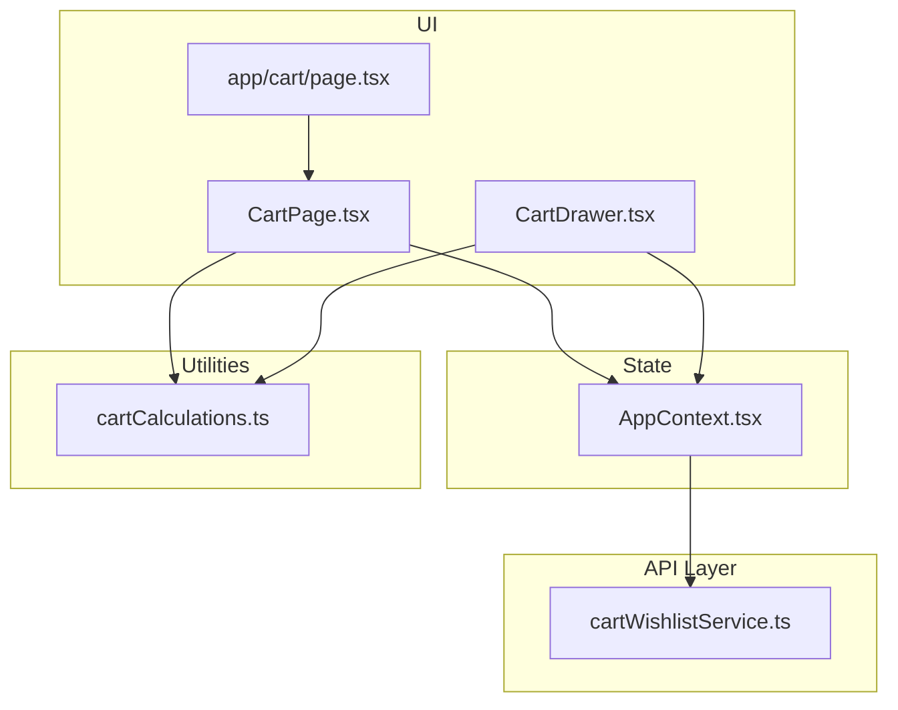
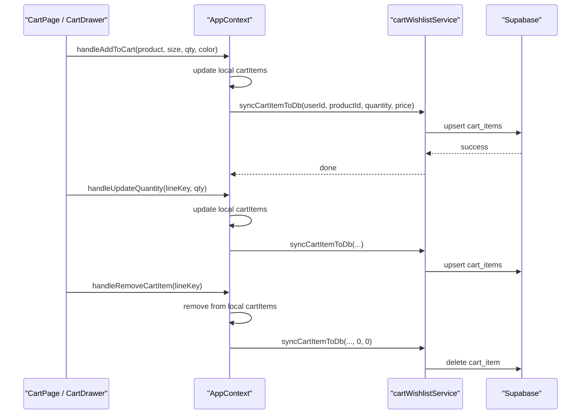
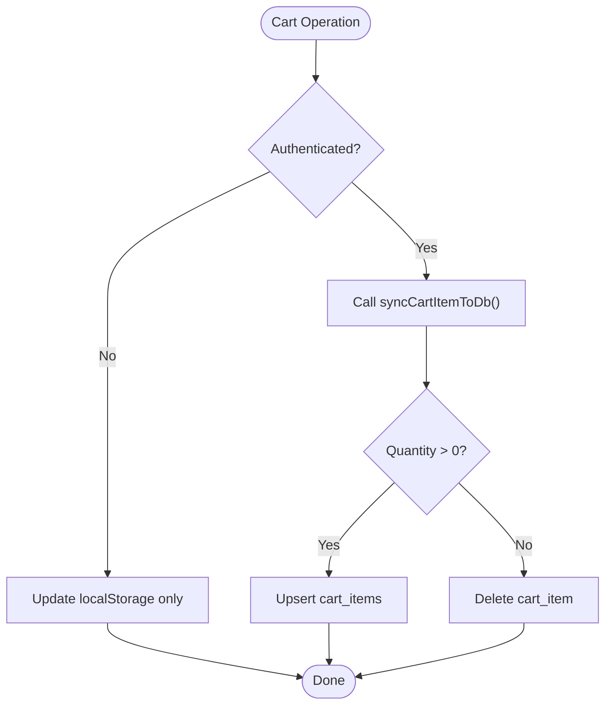
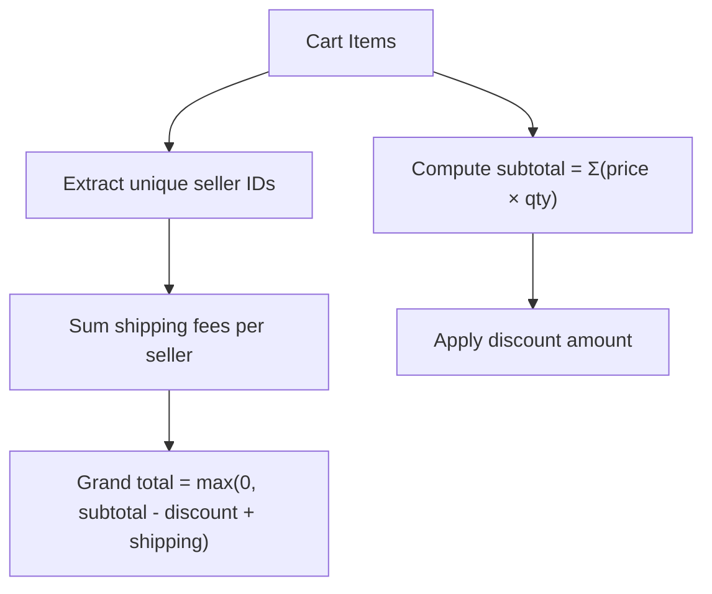
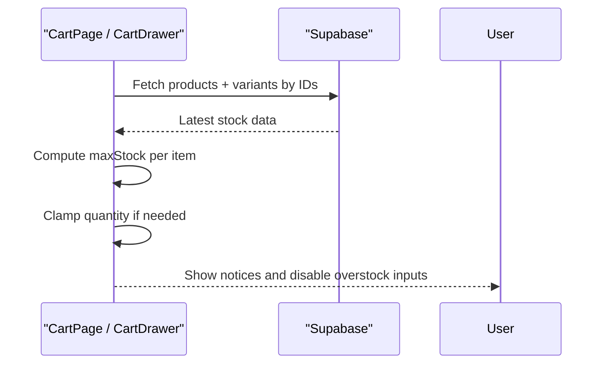
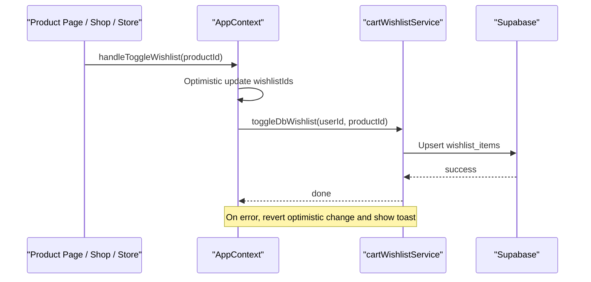
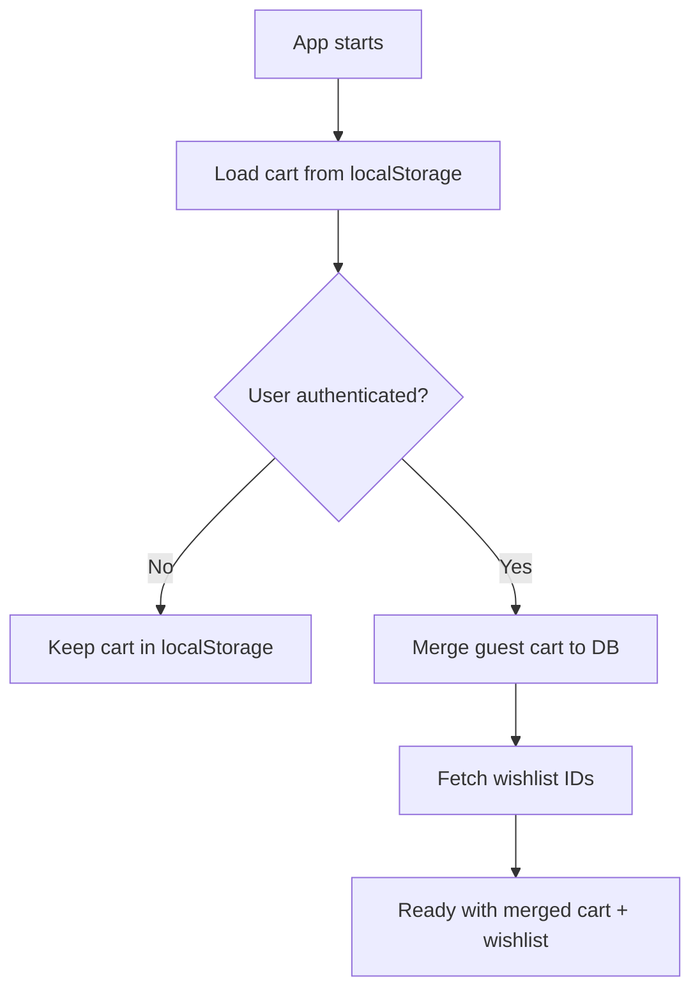
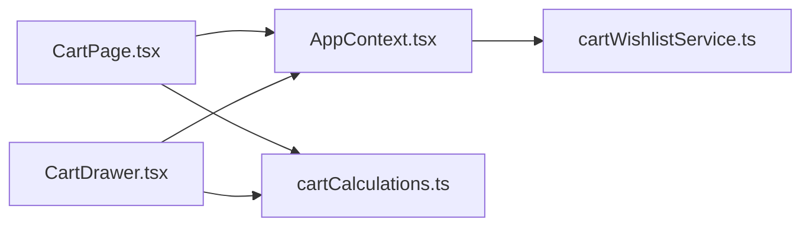

# Cart & Wishlist Service

<cite>
**Referenced Files in This Document**   
- [cartWishlistService.ts](file://src/api/cartWishlistService.ts)
- [AppContext.tsx](file://components/context/AppContext.tsx)
- [CartPage.tsx](file://components/CartPage.tsx)
- [CartDrawer.tsx](file://components/CartDrawer.tsx)
- [cartCalculations.ts](file://src/utils/cartCalculations.ts)
- [page.tsx](file://app/cart/page.tsx)
</cite>

## Table of Contents
1. [Introduction](#introduction)
2. [Project Structure](#project-structure)
3. [Core Components](#core-components)
4. [Architecture Overview](#architecture-overview)
5. [Detailed Component Analysis](#detailed-component-analysis)
6. [Dependency Analysis](#dependency-analysis)
7. [Performance Considerations](#performance-considerations)
8. [Troubleshooting Guide](#troubleshooting-guide)
9. [Conclusion](#conclusion)

## Introduction
This document explains the cart and wishlist service layer for the application. It covers:
- Shopping cart operations: adding, removing, updating quantities, price calculations, and persistence across sessions.
- Wishlist functionality: saving favorite products, synchronizing with the database, and integrating with authentication.
- Cart state management, real-time stock validation, user session handling, and integration with authentication systems.
- Performance considerations and data consistency patterns for cart operations.

The implementation uses a React context for client-side state, Supabase for persistence, and Next.js pages for routing.

## Project Structure
The cart and wishlist features span UI components, a shared calculation utility, and an API service layer:
- `src/api/cartWishlistService.ts`: Database operations for cart and wishlist.
- `components/context/AppContext.tsx`: Client-side cart and wishlist state, persistence to localStorage, and DB synchronization on login.
- `components/CartPage.tsx` and `components/CartDrawer.tsx`: Cart UI with stock validation and totals.
- `src/utils/cartCalculations.ts`: Totals and seller-based shipping logic.
- `app/cart/page.tsx`: Route page wiring the cart UI to the context.

**Diagram sources**
- [CartPage.tsx:1-498](file://components/CartPage.tsx#L1-L498)
- [CartDrawer.tsx:1-349](file://components/CartDrawer.tsx#L1-L349)
- [page.tsx:1-33](file://app/cart/page.tsx#L1-L33)
- [AppContext.tsx:1-367](file://components/context/AppContext.tsx#L1-L367)
- [cartCalculations.ts:1-86](file://src/utils/cartCalculations.ts#L1-L86)
- [cartWishlistService.ts:1-223](file://src/api/cartWishlistService.ts#L1-L223)

**Section sources**
- [cartWishlistService.ts:1-223](file://src/api/cartWishlistService.ts#L1-L223)
- [AppContext.tsx:1-367](file://components/context/AppContext.tsx#L1-L367)
- [CartPage.tsx:1-498](file://components/CartPage.tsx#L1-L498)
- [CartDrawer.tsx:1-349](file://components/CartDrawer.tsx#L1-L349)
- [cartCalculations.ts:1-86](file://src/utils/cartCalculations.ts#L1-L86)
- [page.tsx:1-33](file://app/cart/page.tsx#L1-L33)

## Core Components
- Cart API service: functions to sync individual cart changes and merge guest carts into the database.
- Wishlist API service: functions to fetch wishlisted product IDs and toggle items in the database.
- App context: manages cart and wishlist state, persists cart to localStorage, merges guest cart on login, and exposes handlers for add/update/remove/toggle.
- Cart UI: validates stock against fresh product data, clamps quantities, computes totals including per-seller shipping, and supports promo discounts.
- Calculation utility: computes subtotal, shipping total (per unique seller), grand total, and extracts seller IDs robustly.

Key responsibilities:
- Persistence: localStorage for guests; Supabase for authenticated users.
- Real-time stock validation: fetches latest product and variant stock when cart is opened or updated.
- Totals: accurate subtotal, shipping aggregation by unique sellers, discount support.
- Wishlist: optimistic UI updates with rollback on failure.

**Section sources**
- [cartWishlistService.ts:1-223](file://src/api/cartWishlistService.ts#L1-L223)
- [AppContext.tsx:59-367](file://components/context/AppContext.tsx#L59-L367)
- [CartPage.tsx:1-498](file://components/CartPage.tsx#L1-L498)
- [CartDrawer.tsx:1-349](file://components/CartDrawer.tsx#L1-L349)
- [cartCalculations.ts:1-86](file://src/utils/cartCalculations.ts#L1-L86)

## Architecture Overview
The system follows a layered architecture:
- UI layers render cart/wishlist interactions and delegate to the context.
- Context holds state, persists to localStorage, and calls API services for DB operations.
- API services perform Supabase queries for cart and wishlist tables.
- Calculation utilities compute totals and derive seller information.

**Diagram sources**
- [AppContext.tsx:165-295](file://components/context/AppContext.tsx#L165-L295)
- [cartWishlistService.ts:96-163](file://src/api/cartWishlistService.ts#L96-L163)

## Detailed Component Analysis

### Cart Operations
- Add to cart:
  - Computes a line key based on product, size, and color.
  - Merges quantities if the same line exists.
  - Persists to localStorage immediately.
  - For authenticated users, syncs to DB via `syncCartItemToDb`.
- Update quantity:
  - Clamps to minimum 1; zero triggers removal.
  - Updates local state and persists to localStorage.
  - Syncs to DB for authenticated users.
- Remove item:
  - Removes from local state and localStorage.
  - Syncs deletion to DB for authenticated users.
- Guest-to-user migration:
  - On login, merges guest cart items into DB cart, summing existing quantities.

**Diagram sources**
- [AppContext.tsx:165-295](file://components/context/AppContext.tsx#L165-L295)
- [cartWishlistService.ts:96-163](file://src/api/cartWishlistService.ts#L96-L163)

**Section sources**
- [AppContext.tsx:165-295](file://components/context/AppContext.tsx#L165-L295)
- [cartWishlistService.ts:96-163](file://src/api/cartWishlistService.ts#L96-L163)

### Price Calculations and Shipping
- Subtotal: sum of price × quantity across all items.
- Seller extraction: robust fallbacks to find seller ID from multiple fields.
- Shipping total: one fee per unique seller present in the cart.
- Grand total: subtotal minus discount plus shipping total.

**Diagram sources**
- [cartCalculations.ts:12-85](file://src/utils/cartCalculations.ts#L12-L85)

**Section sources**
- [cartCalculations.ts:1-86](file://src/utils/cartCalculations.ts#L1-L86)
- [CartPage.tsx:80-118](file://components/CartPage.tsx#L80-L118)
- [CartPage.tsx:243-246](file://components/CartPage.tsx#L243-L246)

### Real-Time Stock Validation
- When the cart page or drawer opens, it fetches fresh product and variant stock from the database.
- If a cart item’s requested quantity exceeds available stock, the UI clamps the quantity and shows a notice.
- Quantity controls are disabled at maximum stock when fresh data is available.

**Diagram sources**
- [CartPage.tsx:120-196](file://components/CartPage.tsx#L120-L196)
- [CartDrawer.tsx:29-105](file://components/CartDrawer.tsx#L29-L105)

**Section sources**
- [CartPage.tsx:120-196](file://components/CartPage.tsx#L120-L196)
- [CartDrawer.tsx:29-105](file://components/CartDrawer.tsx#L29-L105)

### Wishlist Functionality
- Fetching wishlist:
  - Loads product IDs saved under the authenticated user’s wishlist record.
- Toggling wishlist:
  - Optimistically updates local state.
  - Calls `toggleDbWishlist` to add or remove the item from the database.
  - Reverts local state on failure and shows a toast.

**Diagram sources**
- [AppContext.tsx:304-331](file://components/context/AppContext.tsx#L304-L331)
- [cartWishlistService.ts:36-88](file://src/api/cartWishlistService.ts#L36-L88)

**Section sources**
- [AppContext.tsx:304-331](file://components/context/AppContext.tsx#L304-L331)
- [cartWishlistService.ts:9-88](file://src/api/cartWishlistService.ts#L9-L88)

### Session Handling and Authentication Integration
- Guest cart persistence:
  - Cart is stored in localStorage and loaded after hydration.
  - Data is validated before being set into state.
- Authenticated session:
  - On user load, the app fetches the user’s wishlist IDs and merges any guest cart items into the DB cart.
  - All subsequent cart mutations are synced to the DB for authenticated users.

**Diagram sources**
- [AppContext.tsx:84-163](file://components/context/AppContext.tsx#L84-L163)
- [cartWishlistService.ts:168-222](file://src/api/cartWishlistService.ts#L168-L222)

**Section sources**
- [AppContext.tsx:84-163](file://components/context/AppContext.tsx#L84-L163)
- [cartWishlistService.ts:168-222](file://src/api/cartWishlistService.ts#L168-L222)

### Converting Wishlist Items to Cart Entries
- The current codebase does not include a direct “add all wishlist items to cart” action.
- To implement this feature, you can:
  - Read the user’s wishlist IDs from `fetchUserWishlistIds`.
  - Resolve full product details using those IDs.
  - Call `handleAddToCart` for each product (with default size/color or user-selected options).
  - Optionally batch DB syncs or rely on per-item sync already implemented in `syncCartItemToDb`.

[No sources needed since this section proposes future implementation without analyzing specific files]

## Dependency Analysis
- UI components depend on:
  - `AppContext` for cart/wishlist state and actions.
  - `cartCalculations` for totals and seller extraction.
  - `stockUtils` and `colorUtils` for stock and line-key computation.
- `AppContext` depends on:
  - `useAuth` for user identity.
  - `cartWishlistService` for DB operations.
- `cartWishlistService` depends on:
  - Supabase client for querying/inserting/updating/deleting cart and wishlist tables.

**Diagram sources**
- [CartPage.tsx:1-498](file://components/CartPage.tsx#L1-L498)
- [CartDrawer.tsx:1-349](file://components/CartDrawer.tsx#L1-L349)
- [AppContext.tsx:1-367](file://components/context/AppContext.tsx#L1-L367)
- [cartCalculations.ts:1-86](file://src/utils/cartCalculations.ts#L1-L86)
- [cartWishlistService.ts:1-223](file://src/api/cartWishlistService.ts#L1-L223)

**Section sources**
- [CartPage.tsx:1-498](file://components/CartPage.tsx#L1-L498)
- [CartDrawer.tsx:1-349](file://components/CartDrawer.tsx#L1-L349)
- [AppContext.tsx:1-367](file://components/context/AppContext.tsx#L1-L367)
- [cartCalculations.ts:1-86](file://src/utils/cartCalculations.ts#L1-L86)
- [cartWishlistService.ts:1-223](file://src/api/cartWishlistService.ts#L1-L223)

## Performance Considerations
- Minimize redundant network requests:
  - Bulk-fetch product and variant stock once per cart open/update rather than per item.
  - Cache seller shipping charges keyed by seller IDs present in the cart.
- Avoid unnecessary re-renders:
  - Use memoization for derived values like seller IDs and totals.
- Efficient DB writes:
  - Upsert cart items instead of delete+insert where possible.
  - Batch merge guest cart items upon login.
- Defensive computations:
  - Treat missing/null/NaN shipping amounts safely as zero.
  - Clamp negative or invalid quantities to safe defaults.

[No sources needed since this section provides general guidance]

## Troubleshooting Guide
- Cart not persisting:
  - Ensure localStorage is accessible and not blocked by browser settings.
  - Verify that `isCartLoaded` is true before syncing to localStorage.
- Cart not syncing to DB:
  - Confirm the user is authenticated before calling `syncCartItemToDb`.
  - Check Supabase RLS policies for `carts` and `cart_items`.
- Wishlist toggle failing:
  - The context reverts optimistic state on error; check console logs for errors from `toggleDbWishlist`.
  - Ensure `wishlists` and `wishlist_items` tables exist and are accessible.
- Stock mismatch:
  - Validate that product and variant queries return correct quantities.
  - Ensure UI clamps quantities and shows notices when stock is insufficient.

**Section sources**
- [AppContext.tsx:84-163](file://components/context/AppContext.tsx#L84-L163)
- [AppContext.tsx:304-331](file://components/context/AppContext.tsx#L304-L331)
- [cartWishlistService.ts:96-222](file://src/api/cartWishlistService.ts#L96-L222)
- [CartPage.tsx:120-196](file://components/CartPage.tsx#L120-L196)
- [CartDrawer.tsx:29-105](file://components/CartDrawer.tsx#L29-L105)

## Conclusion
The cart and wishlist service layer combines a lightweight client-side state manager with robust server-side persistence. It supports:
- Accurate cart operations with real-time stock validation.
- Per-seller shipping aggregation and promo discount support.
- Wishlist toggling with optimistic UI and rollback on failure.
- Seamless guest-to-authenticated session migration.

For further enhancements, consider implementing wishlist-to-cart conversion, caching strategies for product data, and more granular error reporting for DB operations.