# Data Transformation Patterns

<cite>
**Referenced Files in This Document**
- [cartCalculations.ts](file://src/utils/cartCalculations.ts)
- [colorUtils.ts](file://src/utils/colorUtils.ts)
- [computeUpdatePatch.ts](file://src/utils/computeUpdatePatch.ts)
- [stockUtils.ts](file://src/utils/stockUtils.ts)
- [productService.ts](file://src/api/productService.ts)
- [collectionService.ts](file://src/api/collectionService.ts)
- [categoryService.ts](file://src/api/categoryService.ts)
- [cartWishlistService.ts](file://src/api/cartWishlistService.ts)
- [types.ts](file://types.ts)
</cite>

## Table of Contents
1. [Introduction](#introduction)
2. [Project Structure](#project-structure)
3. [Core Components](#core-components)
4. [Architecture Overview](#architecture-overview)
5. [Detailed Component Analysis](#detailed-component-analysis)
6. [Dependency Analysis](#dependency-analysis)
7. [Performance Considerations](#performance-considerations)
8. [Troubleshooting Guide](#troubleshooting-guide)
9. [Conclusion](#conclusion)

## Introduction
This document explains the data transformation and utility patterns used across the API integration layer. It focuses on:
- Normalizing raw API responses into application-ready models.
- Validating and transforming user input for product creation and updates.
- Computing stock, cart totals, color swatches, and update patches.
- Mapping between database schemas and frontend models.
- Error handling strategies during transformations.
- Performance optimizations for large datasets and image-heavy payloads.

The goal is to make these patterns understandable for both developers and non-technical readers while preserving code-level traceability.

## Project Structure
The relevant transformation logic lives primarily under `src/utils` and `src/api`, with shared type definitions in `types.ts`.

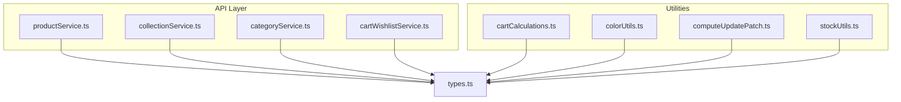

**Diagram sources**
- [productService.ts:1-30](file://src/api/productService.ts#L1-L30)
- [collectionService.ts:1-25](file://src/api/collectionService.ts#L1-L25)
- [categoryService.ts:1-22](file://src/api/categoryService.ts#L1-L22)
- [cartWishlistService.ts:1-3](file://src/api/cartWishlistService.ts#L1-L3)
- [cartCalculations.ts:1-8](file://src/utils/cartCalculations.ts#L1-L8)
- [colorUtils.ts:1-38](file://src/utils/colorUtils.ts#L1-L38)
- [computeUpdatePatch.ts:1-59](file://src/utils/computeUpdatePatch.ts#L1-L59)
- [stockUtils.ts:1-6](file://src/utils/stockUtils.ts#L1-L6)
- [types.ts:1-65](file://types.ts#L1-L65)

**Section sources**
- [productService.ts:1-30](file://src/api/productService.ts#L1-L30)
- [collectionService.ts:1-25](file://src/api/collectionService.ts#L1-L25)
- [categoryService.ts:1-22](file://src/api/categoryService.ts#L1-L22)
- [cartWishlistService.ts:1-3](file://src/api/cartWishlistService.ts#L1-L3)
- [cartCalculations.ts:1-8](file://src/utils/cartCalculations.ts#L1-L8)
- [colorUtils.ts:1-38](file://src/utils/colorUtils.ts#L1-L38)
- [computeUpdatePatch.ts:1-59](file://src/utils/computeUpdatePatch.ts#L1-L59)
- [stockUtils.ts:1-6](file://src/utils/stockUtils.ts#L1-L6)
- [types.ts:1-65](file://types.ts#L1-L65)

## Core Components
This section summarizes the main transformation utilities and their responsibilities.

- Cart calculations: normalize seller IDs, compute subtotal/shipping/grand total, and derive unique sellers per cart.
- Color utilities: resolve CSS-safe colors from database color codes or names, including fashion-specific mappings; generate stable cart line keys.
- Update patch computation: compare baseline database state with draft UI state and produce a minimal patch describing only changed sections.
- Stock utilities: calculate available stock for products with variants or simple inventory modes.
- API services: transform raw Supabase responses into typed frontend models, apply filters, handle fallbacks, and format display fields.
- Category service: normalize attribute options and fetch category metadata.
- Cart/wishlist service: sync and merge cart items and wishlist entries with the database.

**Section sources**
- [cartCalculations.ts:10-85](file://src/utils/cartCalculations.ts#L10-L85)
- [colorUtils.ts:40-126](file://src/utils/colorUtils.ts#L40-L126)
- [computeUpdatePatch.ts:133-564](file://src/utils/computeUpdatePatch.ts#L133-L564)
- [stockUtils.ts:3-33](file://src/utils/stockUtils.ts#L3-L33)
- [collectionService.ts:156-320](file://src/api/collectionService.ts#L156-L320)
- [categoryService.ts:24-72](file://src/api/categoryService.ts#L24-L72)
- [cartWishlistService.ts:96-222](file://src/api/cartWishlistService.ts#L96-L222)

## Architecture Overview
The API integration layer follows a consistent pattern:
1. Fetch raw data from Supabase (tables or RPCs).
2. Normalize and validate inputs.
3. Transform into application models defined in `types.ts`.
4. Compute derived values such as stock, discounts, shipping totals, and update patches.
5. Return structured results to UI components.

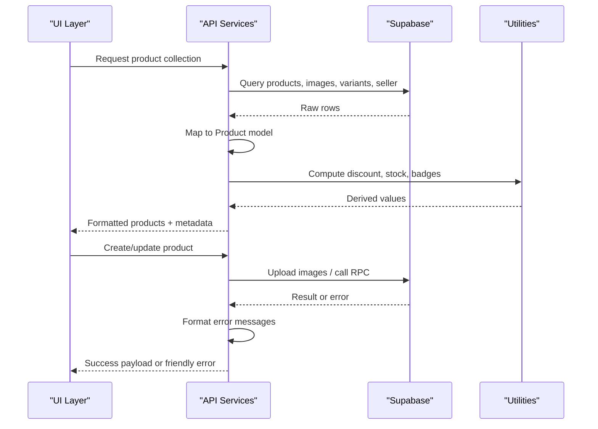

**Diagram sources**
- [collectionService.ts:156-320](file://src/api/collectionService.ts#L156-L320)
- [productService.ts:302-706](file://src/api/productService.ts#L302-L706)
- [cartCalculations.ts:52-85](file://src/utils/cartCalculations.ts#L52-L85)
- [stockUtils.ts:7-33](file://src/utils/stockUtils.ts#L7-L33)

## Detailed Component Analysis

### Cart Totals and Seller Grouping
Cart totals are computed by:
- Extracting normalized seller IDs from each item using multiple possible paths.
- Deduplicating seller IDs.
- Summing product prices multiplied by quantities.
- Adding one shipping fee per unique seller present in the cart.
- Applying discount amounts and ensuring non-negative totals.

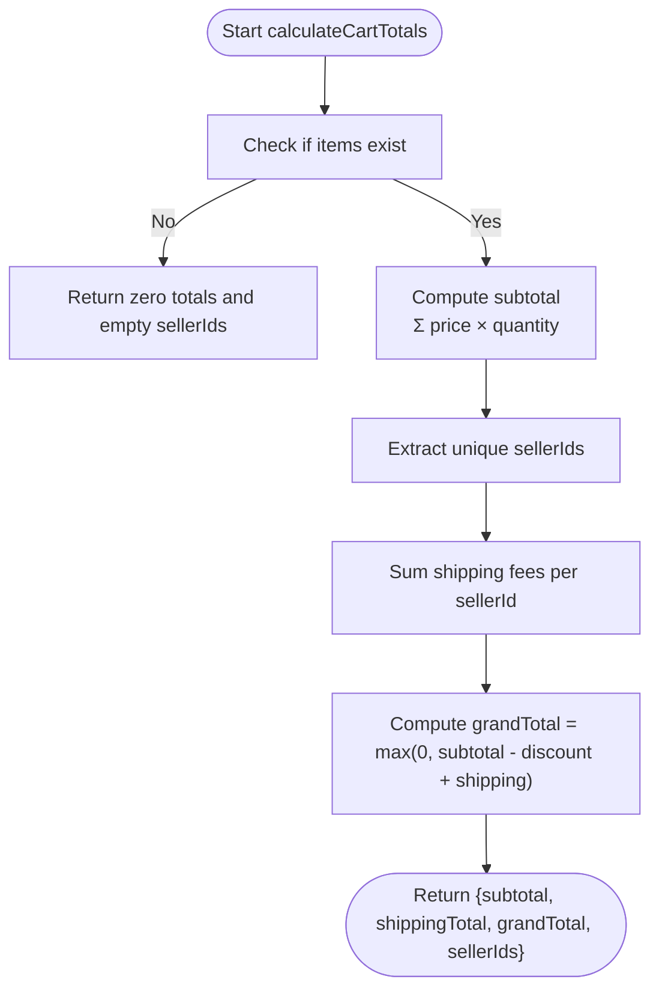

**Diagram sources**
- [cartCalculations.ts:52-85](file://src/utils/cartCalculations.ts#L52-L85)

Key behaviors:
- Missing or invalid numeric values are treated safely as zero.
- Shipping fees are clamped to non-negative values.
- Seller ID resolution supports multiple property shapes for resilience.

**Section sources**
- [cartCalculations.ts:10-85](file://src/utils/cartCalculations.ts#L10-L85)

### Color Processing Helpers
Color processing resolves a valid CSS color string from either:
- A hex color code.
- A standard CSS named color.
- A fashion-specific color name mapped to hex.

It also generates stable cart line keys based on product ID, size, and color ID.

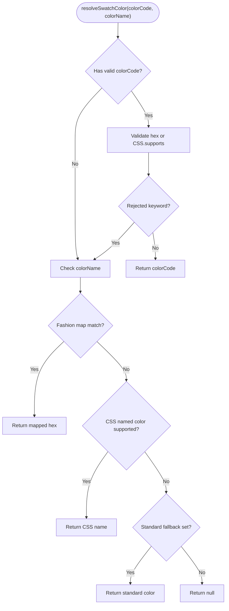

**Diagram sources**
- [colorUtils.ts:40-103](file://src/utils/colorUtils.ts#L40-L103)

Additional helper:
- `getCartLineKey` produces a stable key like `${productId}:${size}:${colorId}` to distinguish different sizes and colors of the same product.

**Section sources**
- [colorUtils.ts:40-126](file://src/utils/colorUtils.ts#L40-L126)

### Patch Computation Logic
The patch computation compares a baseline snapshot of database state with a draft state from the UI. It returns only what has changed, grouped by dirty sections:
- Product details: title, description, defect.
- Simple product pricing and stock: selling price, compare-at price, quantity delta.
- Images: desired sequence and deletions.
- Custom specifications: upserts and removals by ID.
- Attribute values: upserts and removals by attribute ID.
- Variations: option/value renames, new values, removed values, variant changes, new variants, deactivated variants.

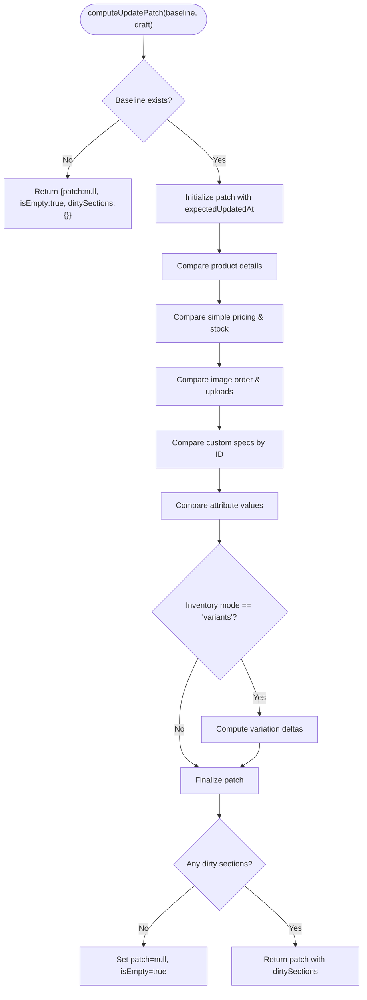

**Diagram sources**
- [computeUpdatePatch.ts:195-564](file://src/utils/computeUpdatePatch.ts#L195-L564)

Normalization helpers ensure robust comparisons:
- Text normalization trims and coerces types.
- Money normalization rounds to two decimals and rejects invalid values.
- Integer normalization floors and rejects negatives.
- Attribute value equality handles arrays, booleans, numbers, and strings.

**Section sources**
- [computeUpdatePatch.ts:133-564](file://src/utils/computeUpdatePatch.ts#L133-L564)

### Stock Calculation Utilities
Stock calculation determines available stock for a product:
- If variants exist, it selects the appropriate variant by size and color.
- For unstitched categories, it prefers an Unstitched variant.
- If no matching variant is found, it falls back to the product’s top-level quantity.
- Returns a non-negative integer.

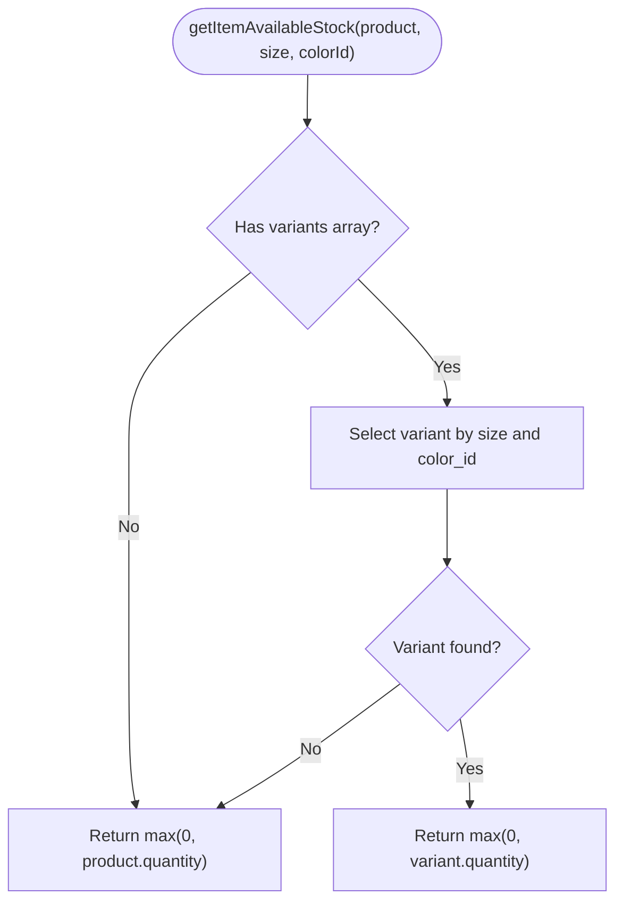

**Diagram sources**
- [stockUtils.ts:7-33](file://src/utils/stockUtils.ts#L7-L33)

**Section sources**
- [stockUtils.ts:3-33](file://src/utils/stockUtils.ts#L3-L33)

### API Response Transformation to Application Models

#### Collection Products
The collection fetcher:
- Builds a single query with filters, sorting, and pagination.
- Batch-fetches thumbnail images to avoid heavy base64 serialization.
- Maps raw rows to `Product` models, computing discount percentages, total stock, and seller information.
- Provides graceful fallbacks when relationships fail.

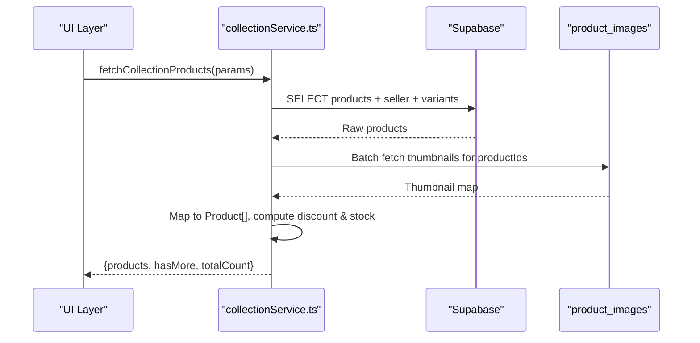

**Diagram sources**
- [collectionService.ts:156-320](file://src/api/collectionService.ts#L156-L320)

Key mapping details:
- Title defaults to a safe fallback if missing.
- Price fields are normalized from multiple columns.
- Discount percentage is calculated when original retail price exceeds surplus selling price.
- In-stock status depends on active listing and total variant stock.

**Section sources**
- [collectionService.ts:156-320](file://src/api/collectionService.ts#L156-L320)

#### Product Detail
The product detail fetcher:
- Retrieves product, seller, images, variants, colors, and reviews in a single query.
- Formats reviews with user names and dates.
- Computes discount and stock similarly to collection mapping.
- Returns a fully formed `Product` plus related reviews.

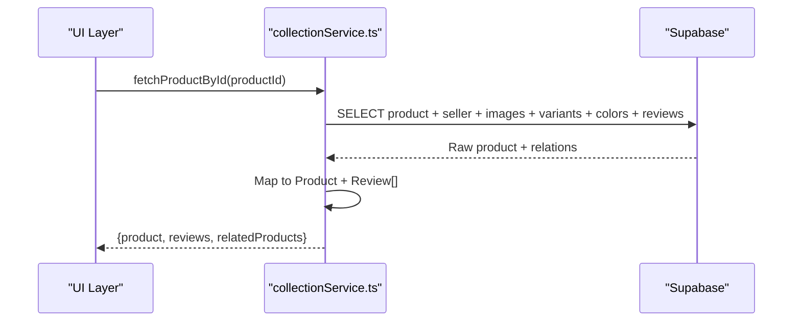

**Diagram sources**
- [collectionService.ts:332-476](file://src/api/collectionService.ts#L332-L476)

**Section sources**
- [collectionService.ts:332-476](file://src/api/collectionService.ts#L332-L476)

#### Product Creation and Updates
Product creation orchestrates:
- Client-side validation of required fields and constraints.
- SHA-256 hashing and deduplication of images.
- Browser-based compression and resizing.
- Concurrent storage uploads with concurrency limits and rollback tracking.
- Atomic RPC invocation to create product and variants.
- Friendly error formatting for database constraints and schema issues.

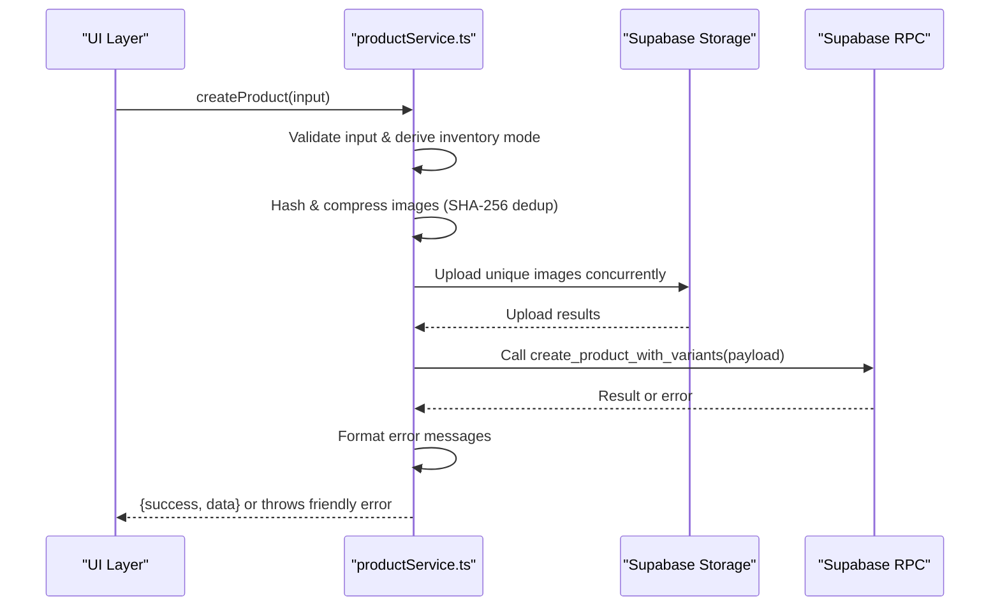

**Diagram sources**
- [productService.ts:302-706](file://src/api/productService.ts#L302-L706)

Error handling highlights:
- Network timeouts trigger existence checks to recover partial successes.
- Constraint violations map to user-friendly messages.
- Storage cleanup removes uploaded files on failure.

**Section sources**
- [productService.ts:302-706](file://src/api/productService.ts#L302-L706)

#### Category Attributes and Options
Category attributes support flexible option formats:
- JSON arrays, stringified JSON, comma-separated strings, or objects with label/value/name.
- Normalization trims, deduplicates case-insensitively, and drops empties.
- Fetch functions return active categories and attribute definitions ordered consistently.

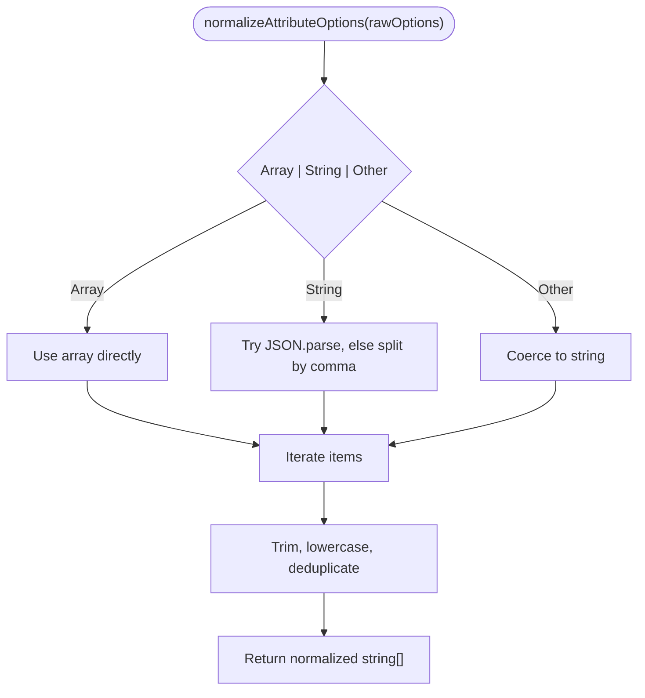

**Diagram sources**
- [categoryService.ts:24-72](file://src/api/categoryService.ts#L24-L72)

**Section sources**
- [categoryService.ts:24-158](file://src/api/categoryService.ts#L24-L158)

#### Cart and Wishlist Sync
Cart and wishlist services synchronize client state with the database:
- Fetch wishlist IDs for a user.
- Toggle wishlist items by creating or removing entries.
- Sync cart items by upserting or deleting rows.
- Merge guest cart items into the authenticated user’s cart upon login.

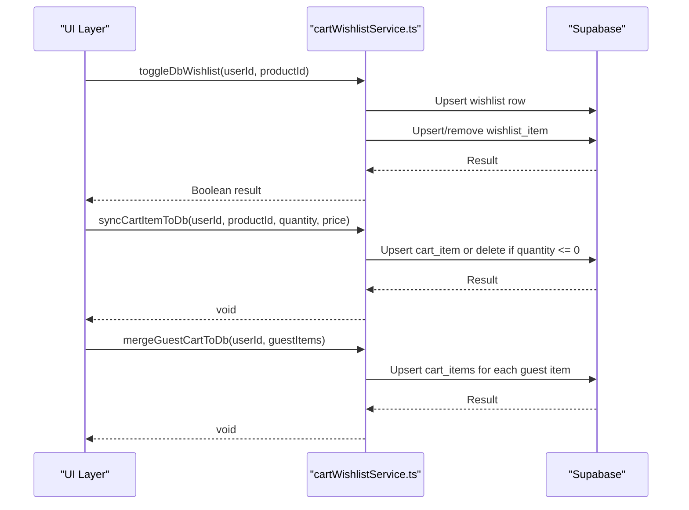

**Diagram sources**
- [cartWishlistService.ts:9-88](file://src/api/cartWishlistService.ts#L9-L88)
- [cartWishlistService.ts:96-222](file://src/api/cartWishlistService.ts#L96-L222)

**Section sources**
- [cartWishlistService.ts:9-88](file://src/api/cartWishlistService.ts#L9-L88)
- [cartWishlistService.ts:96-222](file://src/api/cartWishlistService.ts#L96-L222)

## Dependency Analysis
The following diagram shows how core modules depend on shared types and utilities.

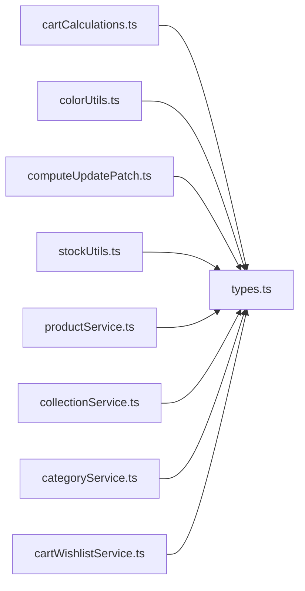

**Diagram sources**
- [types.ts:1-65](file://types.ts#L1-L65)
- [cartCalculations.ts:1-8](file://src/utils/cartCalculations.ts#L1-L8)
- [colorUtils.ts:1-38](file://src/utils/colorUtils.ts#L1-L38)
- [computeUpdatePatch.ts:1-59](file://src/utils/computeUpdatePatch.ts#L1-L59)
- [stockUtils.ts:1-6](file://src/utils/stockUtils.ts#L1-L6)
- [productService.ts:1-30](file://src/api/productService.ts#L1-L30)
- [collectionService.ts:1-25](file://src/api/collectionService.ts#L1-L25)
- [categoryService.ts:1-22](file://src/api/categoryService.ts#L1-L22)
- [cartWishlistService.ts:1-3](file://src/api/cartWishlistService.ts#L1-L3)

Coupling and cohesion observations:
- Utilities are cohesive around specific domains: cart math, color resolution, patch diffs, stock calculation.
- API services depend on shared types but remain decoupled from UI logic.
- Minimal cross-imports among utilities reduce circular dependencies.

**Section sources**
- [types.ts:1-65](file://types.ts#L1-L65)
- [cartCalculations.ts:1-8](file://src/utils/cartCalculations.ts#L1-L8)
- [colorUtils.ts:1-38](file://src/utils/colorUtils.ts#L1-L38)
- [computeUpdatePatch.ts:1-59](file://src/utils/computeUpdatePatch.ts#L1-L59)
- [stockUtils.ts:1-6](file://src/utils/stockUtils.ts#L1-L6)
- [productService.ts:1-30](file://src/api/productService.ts#L1-L30)
- [collectionService.ts:1-25](file://src/api/collectionService.ts#L1-L25)
- [categoryService.ts:1-22](file://src/api/categoryService.ts#L1-L22)
- [cartWishlistService.ts:1-3](file://src/api/cartWishlistService.ts#L1-L3)

## Performance Considerations
- Batch fetching thumbnails avoids serializing heavy base64 strings and reduces network payload size.
- Concurrency-limited image uploads prevent overwhelming storage endpoints and improve throughput.
- SHA-256 hashing deduplicates identical images across gallery and variations, minimizing redundant uploads.
- Canvas-based compression resizes oversized images and converts to efficient formats while preserving PNG when necessary.
- Database-level filtering and sorting reduce client-side processing overhead.
- Safe numeric coercions and rounding prevent floating-point drift in financial calculations.

[No sources needed since this section provides general guidance]

## Troubleshooting Guide
Common issues and resolutions:
- Schema cache errors indicate missing RPC functions; run the corresponding migration scripts in Supabase SQL editor.
- Unique constraint violations suggest duplicate listings or options; review input uniqueness.
- Foreign key constraint failures imply invalid references; verify selected categories or options exist.
- Row-level security errors indicate insufficient permissions; ensure operations are scoped to the current seller account.
- Storage upload failures trigger cleanup of partially uploaded files; check storage policies and file size limits.

**Section sources**
- [productService.ts:255-292](file://src/api/productService.ts#L255-L292)
- [productService.ts:638-706](file://src/api/productService.ts#L638-L706)

## Conclusion
The API integration layer employs consistent transformation patterns:
- Normalize and validate raw inputs before use.
- Map database rows to typed frontend models with defensive defaults.
- Compute derived values like stock, discounts, shipping totals, and update patches.
- Handle errors gracefully with user-friendly messages and recovery mechanisms.
- Optimize performance through batching, concurrency control, and server-side filtering.

These practices ensure reliable data flow from backend to frontend while maintaining clarity and maintainability.

[No sources needed since this section summarizes without analyzing specific files]