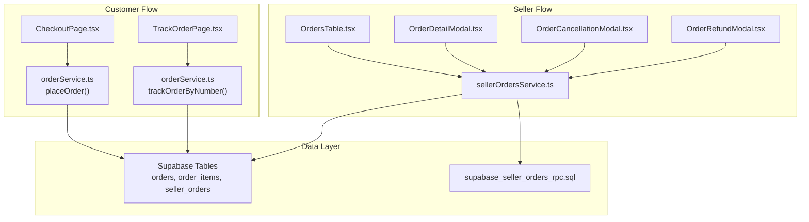
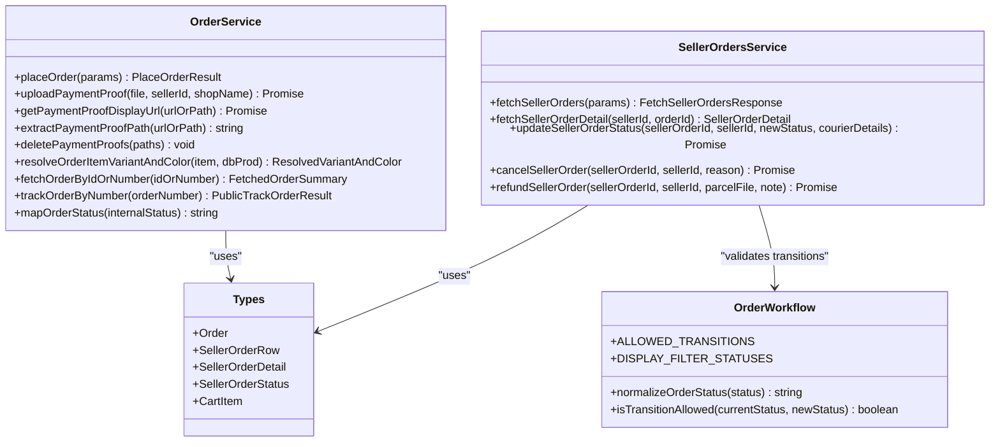
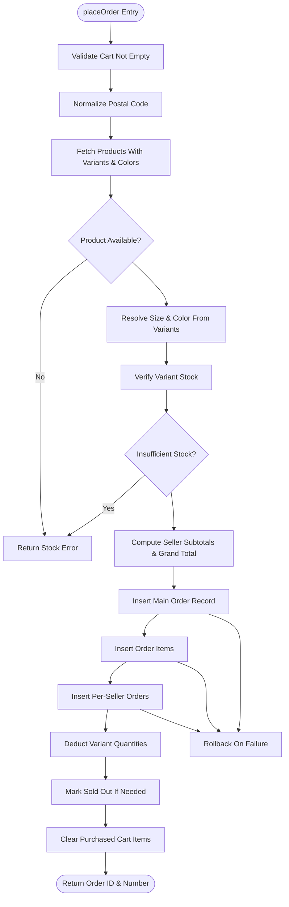
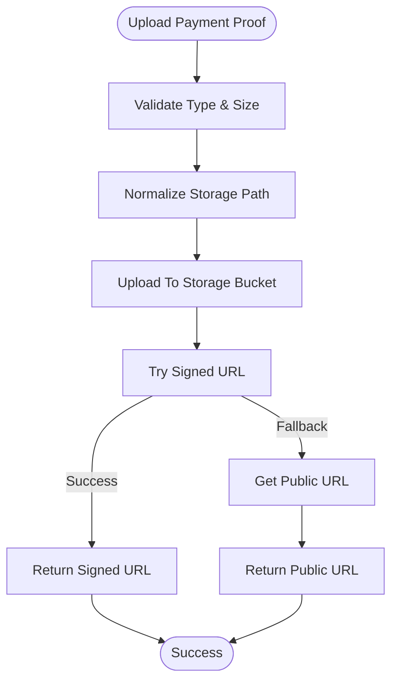
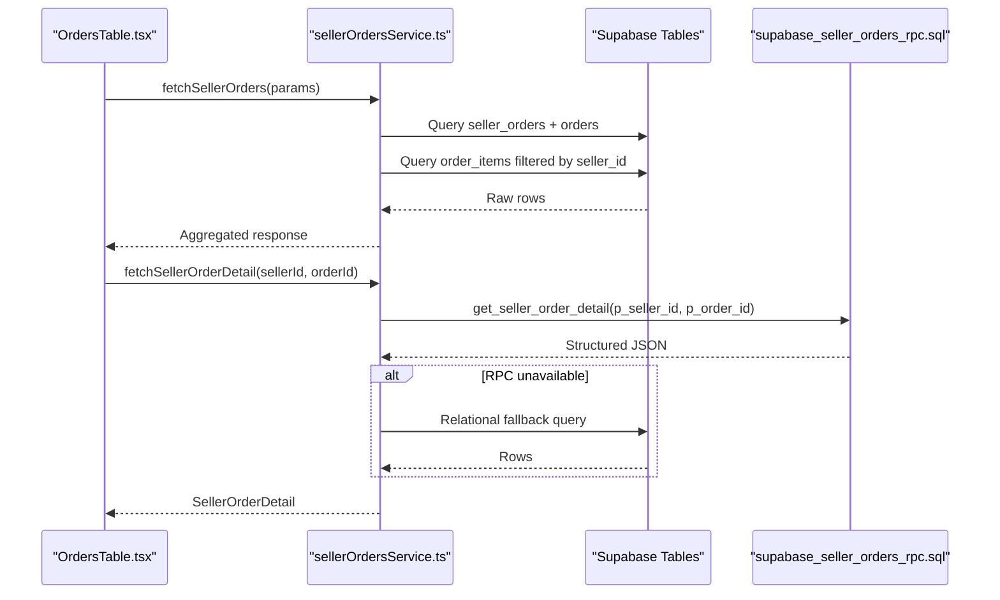
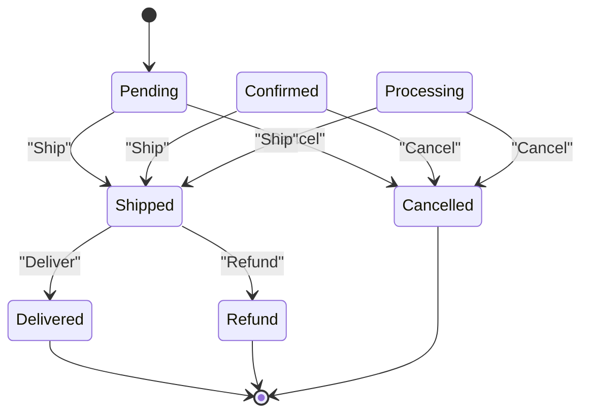
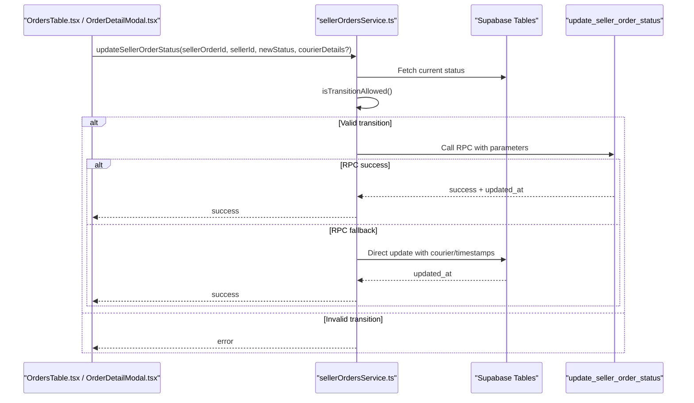
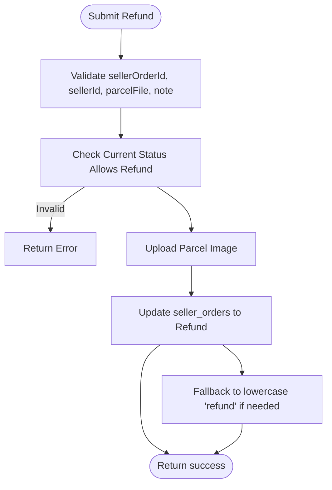
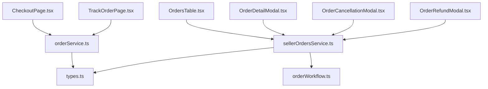

# Order Service

<cite>
**Referenced Files in This Document**
- [orderService.ts](file://src/api/orderService.ts)
- [sellerOrdersService.ts](file://src/api/sellerOrdersService.ts)
- [orderWorkflow.ts](file://src/constants/orderWorkflow.ts)
- [types.ts](file://types.ts)
- [supabase_seller_orders_rpc.sql](file://supabase_seller_orders_rpc.sql)
- [CheckoutPage.tsx](file://components/CheckoutPage.tsx)
- [TrackOrderPage.tsx](file://components/TrackOrderPage.tsx)
- [OrdersTable.tsx](file://components/reseller/components/OrdersTable.tsx)
- [OrderDetailModal.tsx](file://components/reseller/components/OrderDetailModal.tsx)
- [OrderCancellationModal.tsx](file://components/reseller/components/OrderCancellationModal.tsx)
- [OrderRefundModal.tsx](file://components/reseller/components/OrderRefundModal.tsx)
</cite>

## Table of Contents
1. [Introduction](#introduction)
2. [Project Structure](#project-structure)
3. [Core Components](#core-components)
4. [Architecture Overview](#architecture-overview)
5. [Detailed Component Analysis](#detailed-component-analysis)
6. [Dependency Analysis](#dependency-analysis)
7. [Performance Considerations](#performance-considerations)
8. [Troubleshooting Guide](#troubleshooting-guide)
9. [Conclusion](#conclusion)

## Introduction
This document describes the order service layer for a multi-seller marketplace application. It covers customer-facing order placement, seller-side order management, status transitions, shipping and tracking, payment proof handling, refund workflows, and public order tracking. The system is implemented as a client-side service layer that interacts with Supabase tables and optional server-side RPC functions, while UI components orchestrate user flows such as checkout, seller order operations, and order tracking.

The order lifecycle spans:
- Customer checkout and order creation
- Per-seller order grouping and payment method handling
- Seller order status updates through allowed transitions
- Shipping coordination with courier and tracking fields
- Refund submission with parcel image evidence
- Public order tracking using only non-sensitive data

## Project Structure
The order-related code is split between API services, constants, types, database migrations/RPCs, and UI components:

- API services:
  - `src/api/orderService.ts`: Customer order placement, variant resolution, payment proof upload helpers, order lookup, and public tracking.
  - `src/api/sellerOrdersService.ts`: Seller order listing, detail retrieval, status updates, cancellation, and refund submission.
- Constants:
  - `src/constants/orderWorkflow.ts`: Allowed status transitions, display filters, and normalization utilities.
- Types:
  - `types.ts`: Shared TypeScript interfaces for orders, sellers, items, and status enums.
- Database layer:
  - `supabase_seller_orders_rpc.sql`: Row-level security policies and RPC functions for seller order queries, details, and status updates.
- UI:
  - `components/CheckoutPage.tsx`: Checkout flow, per-seller payment proof upload, and calling `placeOrder`.
  - `components/TrackOrderPage.tsx`: Public order tracking page using `trackOrderByNumber`.
  - `components/reseller/components/OrdersTable.tsx`: Seller order dashboard with filtering, sorting, pagination, and modal interception.
  - `components/reseller/components/OrderDetailModal.tsx`: Detailed view of a seller order.
  - `components/reseller/components/OrderCancellationModal.tsx`: Cancellation reason capture and API call.
  - `components/reseller/components/OrderRefundModal.tsx`: Refund submission with parcel image upload.

**Diagram sources**
- [CheckoutPage.tsx:541-579](file://components/CheckoutPage.tsx#L541-L579)
- [orderService.ts:403-760](file://src/api/orderService.ts#L403-L760)
- [orderService.ts:936-1043](file://src/api/orderService.ts#L936-L1043)
- [sellerOrdersService.ts:35-198](file://src/api/sellerOrdersService.ts#L35-L198)
- [sellerOrdersService.ts:203-349](file://src/api/sellerOrdersService.ts#L203-L349)
- [sellerOrdersService.ts:355-449](file://src/api/sellerOrdersService.ts#L355-L449)
- [sellerOrdersService.ts:455-511](file://src/api/sellerOrdersService.ts#L455-L511)
- [sellerOrdersService.ts:518-642](file://src/api/sellerOrdersService.ts#L518-L642)
- [supabase_seller_orders_rpc.sql:54-151](file://supabase_seller_orders_rpc.sql#L54-L151)
- [supabase_seller_orders_rpc.sql:157-237](file://supabase_seller_orders_rpc.sql#L157-L237)
- [supabase_seller_orders_rpc.sql:243-309](file://supabase_seller_orders_rpc.sql#L243-L309)

**Section sources**
- [orderService.ts:1-1046](file://src/api/orderService.ts#L1-L1046)
- [sellerOrdersService.ts:1-644](file://src/api/sellerOrdersService.ts#L1-L644)
- [orderWorkflow.ts:1-37](file://src/constants/orderWorkflow.ts#L1-L37)
- [types.ts:122-223](file://types.ts#L122-L223)
- [supabase_seller_orders_rpc.sql:1-310](file://supabase_seller_orders_rpc.sql#L1-L310)
- [CheckoutPage.tsx:541-579](file://components/CheckoutPage.tsx#L541-L579)
- [TrackOrderPage.tsx:188-213](file://components/TrackOrderPage.tsx#L188-L213)
- [OrdersTable.tsx:1-643](file://components/reseller/components/OrdersTable.tsx#L1-L643)
- [OrderDetailModal.tsx:1-347](file://components/reseller/components/OrderDetailModal.tsx#L1-L347)
- [OrderCancellationModal.tsx:1-137](file://components/reseller/components/OrderCancellationModal.tsx#L1-L137)
- [OrderRefundModal.tsx:1-200](file://components/reseller/components/OrderRefundModal.tsx#L1-L200)

## Core Components
This section summarizes the primary responsibilities of each core component.

- Customer order placement:
  - Validates cart, resolves product variants and colors, verifies stock, calculates pricing, creates main order, inserts order items, groups per-seller orders, deducts variant stock, updates product status when sold out, and clears purchased cart items.
  - Supports mock fallback for non-database items.
- Payment proof handling:
  - Uploads seller payment screenshots to a storage bucket, generates signed or public URLs, normalizes legacy URL formats, and provides rollback deletion on failure.
- Seller order management:
  - Lists orders with filtering, search, pagination, and sorting.
  - Fetches detailed order information via RPC with relational fallback.
  - Updates order status with transition validation and optional courier/tracking metadata.
  - Cancels orders with required reason and timestamp.
  - Submits refunds with parcel image upload and note.
- Public order tracking:
  - Exposes a secure, privacy-preserving endpoint returning only non-sensitive order summary and item list by order number.

**Section sources**
- [orderService.ts:403-760](file://src/api/orderService.ts#L403-L760)
- [orderService.ts:118-237](file://src/api/orderService.ts#L118-L237)
- [sellerOrdersService.ts:35-198](file://src/api/sellerOrdersService.ts#L35-L198)
- [sellerOrdersService.ts:203-349](file://src/api/sellerOrdersService.ts#L203-L349)
- [sellerOrdersService.ts:355-449](file://src/api/sellerOrdersService.ts#L355-L449)
- [sellerOrdersService.ts:455-511](file://src/api/sellerOrdersService.ts#L455-L511)
- [sellerOrdersService.ts:518-642](file://src/api/sellerOrdersService.ts#L518-L642)
- [orderService.ts:936-1043](file://src/api/orderService.ts#L936-L1043)

## Architecture Overview
The order service architecture separates customer-facing and seller-facing concerns while sharing common data models and workflow rules.

**Diagram sources**
- [orderService.ts:27-45](file://src/api/orderService.ts#L27-L45)
- [orderService.ts:257-395](file://src/api/orderService.ts#L257-L395)
- [orderService.ts:791-893](file://src/api/orderService.ts#L791-L893)
- [orderService.ts:898-1043](file://src/api/orderService.ts#L898-L1043)
- [sellerOrdersService.ts:9-24](file://src/api/sellerOrdersService.ts#L9-L24)
- [sellerOrdersService.ts:355-449](file://src/api/sellerOrdersService.ts#L355-L449)
- [orderWorkflow.ts:1-37](file://src/constants/orderWorkflow.ts#L1-L37)
- [types.ts:122-223](file://types.ts#L122-L223)

## Detailed Component Analysis

### Customer Order Placement
The customer order placement flow validates inputs, resolves product options, checks inventory, computes totals, persists order records, and performs cleanup.

Key behaviors:
- Input validation: empty cart returns an error.
- Postal code fallback prevents constraint violations.
- Product fetching re-validates availability and stock at checkout time.
- Variant and color resolution uses product variants and colors to determine size/color without inventing defaults.
- Stock verification tracks variant quantities and reports insufficient stock errors.
- Pricing uses the original retail price when available; otherwise falls back to surplus selling price or cart price.
- Order persistence:
  - Creates main order record with initial statuses.
  - Inserts order items with seller-scoped data.
  - Groups per-seller orders with payment method mapping and shipping fees.
  - Deducts variant quantities and marks products sold out if all variants reach zero.
  - Clears purchased items from the authenticated user’s cart.
- Rollback helper removes partial records if later steps fail.

**Diagram sources**
- [orderService.ts:403-760](file://src/api/orderService.ts#L403-L760)

**Section sources**
- [orderService.ts:403-760](file://src/api/orderService.ts#L403-L760)

### Payment Proof Handling
Payment proofs are uploaded for advance payment methods (full advance or delivery charges). The service normalizes various legacy URL formats, uploads files securely, and generates signed or public URLs.

Key behaviors:
- File type and size validation.
- Path normalization for legacy URLs and storage paths.
- Signed URL generation with expiration; fallback to public URL.
- Best-effort deletion of uploaded files during rollback.

**Diagram sources**
- [orderService.ts:118-237](file://src/api/orderService.ts#L118-L237)

**Section sources**
- [orderService.ts:118-237](file://src/api/orderService.ts#L118-L237)

### Seller Order Listing and Detail
Seller order listing aggregates data from `seller_orders`, `orders`, and `order_items`, supporting filtering, search, pagination, and sorting. Detail retrieval prefers an RPC function and falls back to relational queries.

Key behaviors:
- Filtering supports “All”, “Actionable”, specific statuses, and refund states.
- Search applies to order number, customer name, and aggregated items.
- Pagination uses offset/range.
- Detail RPC returns structured JSON including customer, shipping, payment, and items.
- Fallback ensures missing size/color/category fields are populated.

**Diagram sources**
- [sellerOrdersService.ts:35-198](file://src/api/sellerOrdersService.ts#L35-L198)
- [sellerOrdersService.ts:203-349](file://src/api/sellerOrdersService.ts#L203-L349)
- [supabase_seller_orders_rpc.sql:54-151](file://supabase_seller_orders_rpc.sql#L54-L151)
- [supabase_seller_orders_rpc.sql:157-237](file://supabase_seller_orders_rpc.sql#L157-L237)

**Section sources**
- [sellerOrdersService.ts:35-198](file://src/api/sellerOrdersService.ts#L35-L198)
- [sellerOrdersService.ts:203-349](file://src/api/sellerOrdersService.ts#L203-L349)

### Status Transitions and Workflow
Order status transitions are strictly validated using a defined set of allowed transitions. Normalization maps internal statuses like “Confirmed” and “Processing” to “Pending” for display and transition logic.

Allowed transitions:
- Pending -> Shipped, Cancelled
- Confirmed -> Shipped, Cancelled
- Processing -> Shipped, Cancelled
- Shipped -> Delivered, Refund
- Delivered -> Terminal
- Refund -> Terminal
- Cancelled -> Terminal

**Diagram sources**
- [orderWorkflow.ts:3-12](file://src/constants/orderWorkflow.ts#L3-L12)

**Section sources**
- [orderWorkflow.ts:1-37](file://src/constants/orderWorkflow.ts#L1-L37)

### Seller Order Status Updates
Status updates enforce transition rules, support RPC execution, and handle courier/tracking metadata for shipping-related transitions.

Key behaviors:
- Current status fetched and validated before update.
- Transition allowed check prevents invalid state changes.
- RPC preferred; direct table update fallback.
- For “Shipped” and “Delivered”, courier name, tracking number, and timestamps are updated.

**Diagram sources**
- [sellerOrdersService.ts:355-449](file://src/api/sellerOrdersService.ts#L355-L449)
- [orderWorkflow.ts:31-36](file://src/constants/orderWorkflow.ts#L31-L36)
- [supabase_seller_orders_rpc.sql:243-309](file://supabase_seller_orders_rpc.sql#L243-L309)

**Section sources**
- [sellerOrdersService.ts:355-449](file://src/api/sellerOrdersService.ts#L355-L449)

### Order Cancellation
Cancellation requires a reason and enforces transition rules. It sets cancellation timestamp and reason.

Key behaviors:
- Parameter validation.
- Current status check.
- Transition validation.
- Database update with audit fields.

**Section sources**
- [sellerOrdersService.ts:455-511](file://src/api/sellerOrdersService.ts#L455-L511)
- [OrderCancellationModal.tsx:28-47](file://components/reseller/components/OrderCancellationModal.tsx#L28-L47)

### Refund Submission
Refund submission requires a parcel image and note. It uploads the image and updates the order status to refund with pending refund status.

Key behaviors:
- Parameter validation.
- Current status check.
- Image upload to storage with fallback URL handling.
- Database update with refund metadata.
- Fallback to lowercase refund status if constraint requires it.

**Diagram sources**
- [sellerOrdersService.ts:518-642](file://src/api/sellerOrdersService.ts#L518-L642)

**Section sources**
- [sellerOrdersService.ts:518-642](file://src/api/sellerOrdersService.ts#L518-L642)
- [OrderRefundModal.tsx:45-63](file://components/reseller/components/OrderRefundModal.tsx#L45-L63)

### Public Order Tracking
Public tracking exposes minimal order data without sensitive PII. It maps internal order status to customer-facing labels and formats payment method based on seller orders.

Key behaviors:
- Input validation.
- Secure relational query joining orders, seller_orders, order_items, products, and product_images.
- Non-sensitive projection.
- Status mapping to “ORDER PLACED”, “SHIPPED”, “DELIVERED”, “CANCELLED”.
- Payment method formatting across single or multi-seller orders.

**Section sources**
- [orderService.ts:936-1043](file://src/api/orderService.ts#L936-L1043)
- [TrackOrderPage.tsx:188-213](file://components/TrackOrderPage.tsx#L188-L213)

### Checkout Integration
The checkout page orchestrates per-seller payment proof uploads, constructs seller payment data, and calls `placeOrder`. On failure, it cleans up uploaded files.

Key behaviors:
- Per-seller payment method selection.
- Screenshot upload for advance payments.
- Construction of `sellerPayments` map.
- Calling `placeOrder` and handling completion callback.
- Cleanup of uploaded paths on error.

**Section sources**
- [CheckoutPage.tsx:541-579](file://components/CheckoutPage.tsx#L541-L579)
- [CheckoutPage.tsx:677-689](file://components/CheckoutPage.tsx#L677-L689)

## Dependency Analysis
The order service layer has clear dependencies:

- `orderService.ts` depends on:
  - Supabase client for database and storage operations.
  - `types.ts` for shared interfaces.
  - Checkout UI for initiating order placement.
- `sellerOrdersService.ts` depends on:
  - `orderWorkflow.ts` for transition validation.
  - `types.ts` for shared interfaces.
  - Supabase RPC functions for optimized queries and updates.
- UI components depend on:
  - API services for data fetching and mutations.
  - Modal components for user interactions.

**Diagram sources**
- [orderService.ts:1-3](file://src/api/orderService.ts#L1-L3)
- [sellerOrdersService.ts:1-8](file://src/api/sellerOrdersService.ts#L1-L8)
- [OrdersTable.tsx:1-13](file://components/reseller/components/OrdersTable.tsx#L1-L13)
- [OrderDetailModal.tsx:1-6](file://components/reseller/components/OrderDetailModal.tsx#L1-L6)
- [OrderCancellationModal.tsx:1-4](file://components/reseller/components/OrderCancellationModal.tsx#L1-L4)
- [OrderRefundModal.tsx:1-4](file://components/reseller/components/OrderRefundModal.tsx#L1-L4)
- [CheckoutPage.tsx:541-579](file://components/CheckoutPage.tsx#L541-L579)
- [TrackOrderPage.tsx:188-213](file://components/TrackOrderPage.tsx#L188-L213)

**Section sources**
- [orderService.ts:1-1046](file://src/api/orderService.ts#L1-L1046)
- [sellerOrdersService.ts:1-644](file://src/api/sellerOrdersService.ts#L1-L644)
- [orderWorkflow.ts:1-37](file://src/constants/orderWorkflow.ts#L1-L37)
- [types.ts:122-223](file://types.ts#L122-L223)
- [OrdersTable.tsx:1-643](file://components/reseller/components/OrdersTable.tsx#L1-L643)
- [OrderDetailModal.tsx:1-347](file://components/reseller/components/OrderDetailModal.tsx#L1-L347)
- [OrderCancellationModal.tsx:1-137](file://components/reseller/components/OrderCancellationModal.tsx#L1-L137)
- [OrderRefundModal.tsx:1-200](file://components/reseller/components/OrderRefundModal.tsx#L1-L200)
- [CheckoutPage.tsx:541-579](file://components/CheckoutPage.tsx#L541-L579)
- [TrackOrderPage.tsx:188-213](file://components/TrackOrderPage.tsx#L188-L213)

## Performance Considerations
- Client-side transaction safety:
  - Order placement performs multiple database writes; rollback logic mitigates partial state.
- Efficient querying:
  - Seller order listing uses RPC where available to reduce client-side aggregation.
  - Relational fallbacks ensure resilience when RPC is unavailable.
- Storage operations:
  - Payment proof uploads use signed URLs for private buckets with public URL fallback.
  - Best-effort deletion reduces orphaned files on rollback.
- Caching and pagination:
  - Orders table uses TanStack Query with stale time and pagination to limit payload size.
- Status normalization:
  - Centralized normalization avoids repeated conditional logic across UI and services.

[No sources needed since this section provides general guidance]

## Troubleshooting Guide
Common issues and resolutions:

- Empty cart checkout:
  - Symptom: Checkout fails immediately.
  - Cause: No items in cart.
  - Resolution: Add items before proceeding.
- Product unavailable or out of stock:
  - Symptom: Stock verification error returned.
  - Cause: Product status not active or insufficient variant quantity.
  - Resolution: Refresh product catalog or adjust requested quantity.
- Payment proof upload failure:
  - Symptom: Error message about file type, size, or storage upload.
  - Cause: Invalid file format, oversized file, or storage permission issue.
  - Resolution: Use supported image formats under size limit; verify storage configuration.
- Invalid status transition:
  - Symptom: Cannot update order status.
  - Cause: Transition not allowed by workflow rules.
  - Resolution: Follow allowed transitions; e.g., ship before delivering, cancel only from pending-like states.
- Cancellation without reason:
  - Symptom: Cancellation fails.
  - Cause: Missing cancellation reason.
  - Resolution: Provide a valid reason text.
- Refund submission failure:
  - Symptom: Refund submission error after image upload.
  - Cause: Database constraint or permission issue.
  - Resolution: Ensure status allows refund; verify storage and database permissions; retry with valid image and note.
- Public tracking not found:
  - Symptom: Order tracking returns null.
  - Cause: Invalid or non-existent order number.
  - Resolution: Verify order number format and existence.

**Section sources**
- [orderService.ts:403-411](file://src/api/orderService.ts#L403-L411)
- [orderService.ts:486-521](file://src/api/orderService.ts#L486-L521)
- [orderService.ts:173-237](file://src/api/orderService.ts#L173-L237)
- [sellerOrdersService.ts:368-385](file://src/api/sellerOrdersService.ts#L368-L385)
- [sellerOrdersService.ts:463-484](file://src/api/sellerOrdersService.ts#L463-L484)
- [sellerOrdersService.ts:524-551](file://src/api/sellerOrdersService.ts#L524-L551)
- [orderService.ts:936-940](file://src/api/orderService.ts#L936-L940)

## Conclusion
The order service layer provides a robust, multi-seller order management system with clear separation between customer and seller workflows. It enforces strict inventory validation, supports flexible payment methods with proof handling, and implements safe status transitions. Seller operations include comprehensive listing, detail retrieval, shipping coordination, cancellation, and refund workflows. Public tracking offers a secure, privacy-preserving interface for customers to monitor order progress. The architecture leverages both direct database operations and server-side RPC functions for performance and reliability, with fallback mechanisms ensuring resilience.

[No sources needed since this section summarizes without analyzing specific files]