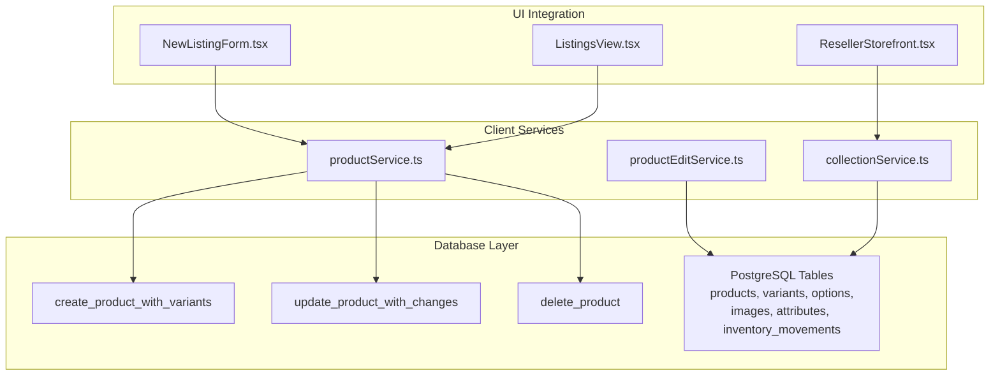
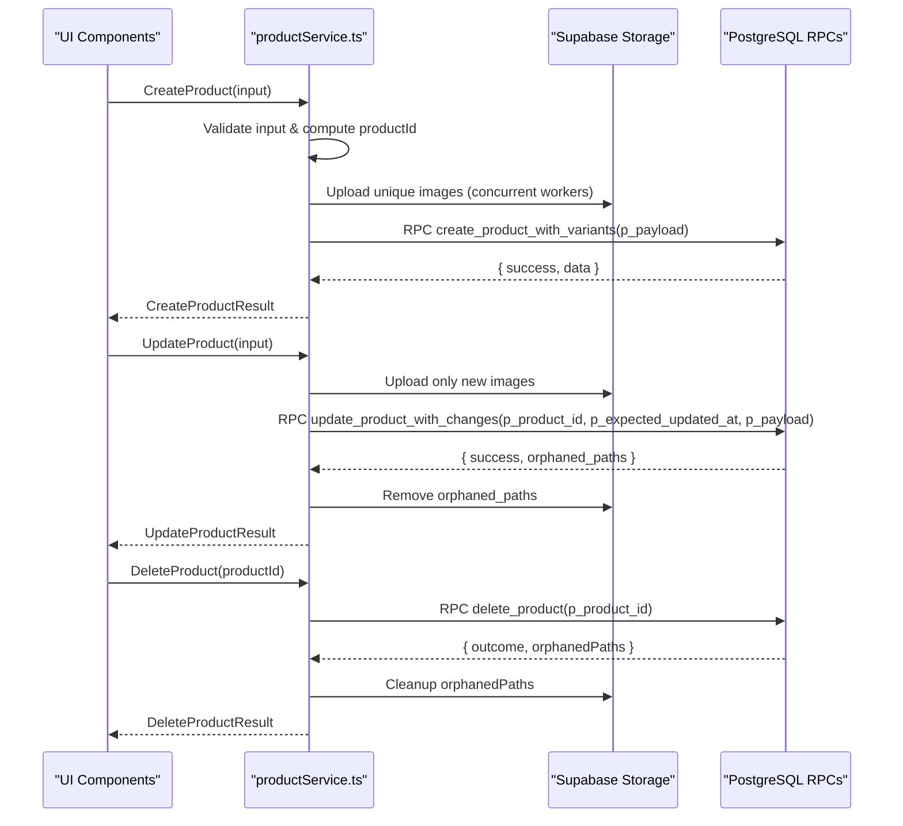
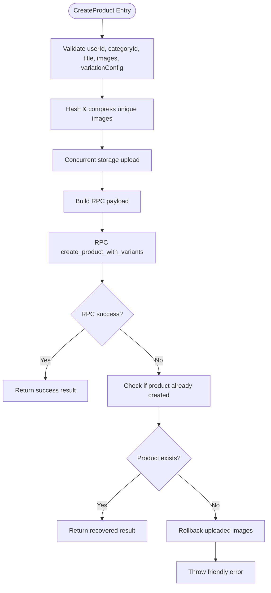
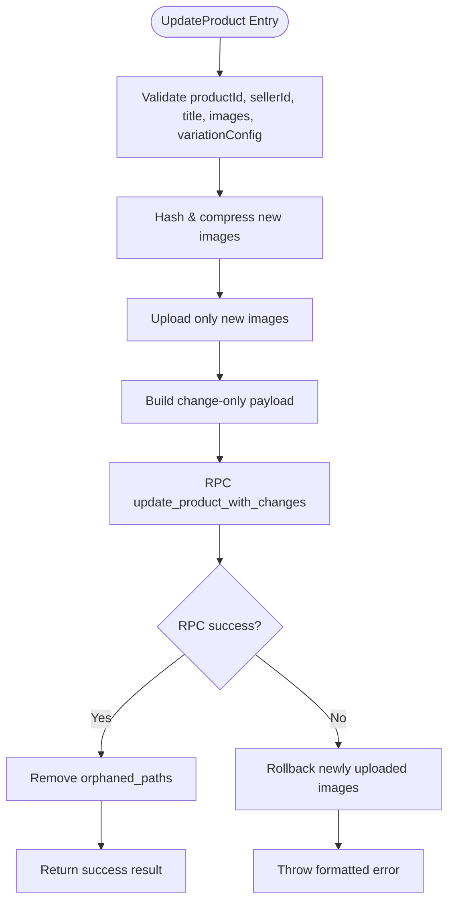
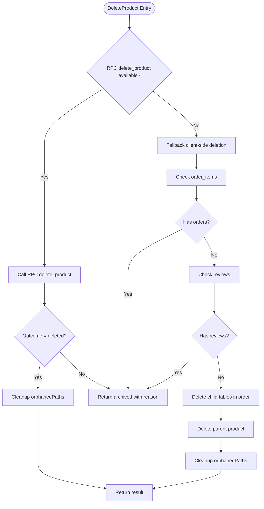
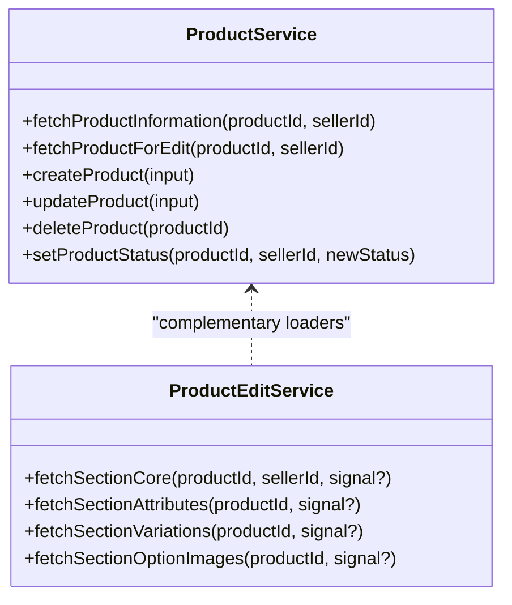
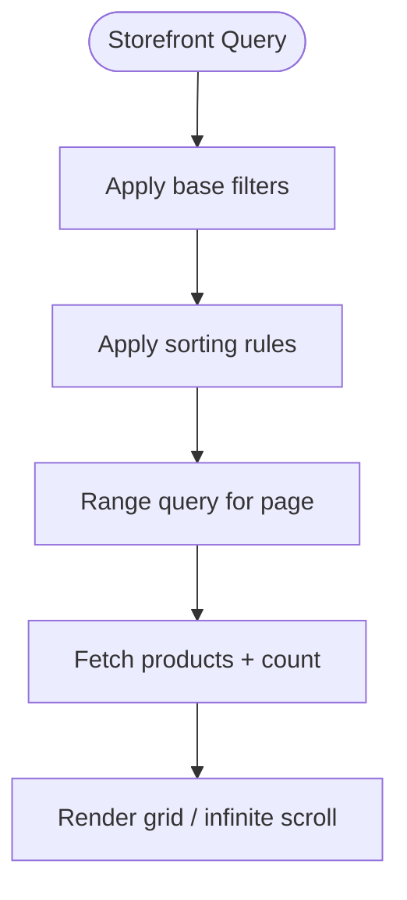
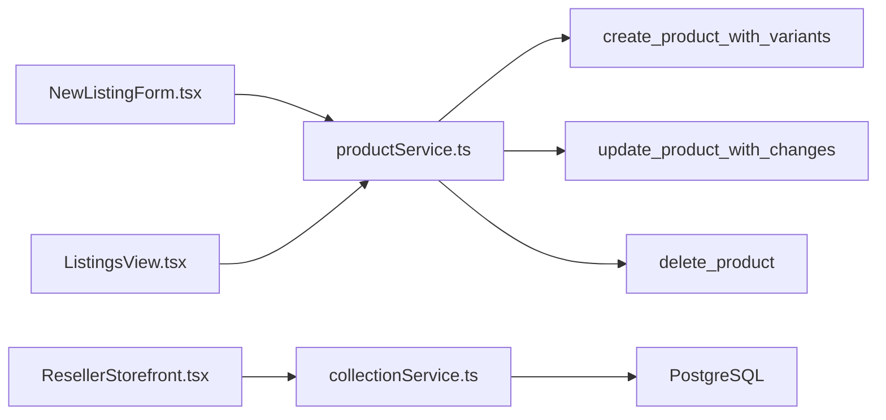

# Product Service

<cite>
**Referenced Files in This Document**
- [productService.ts](file://src/api/productService.ts)
- [productEditService.ts](file://src/api/productEditService.ts)
- [collectionService.ts](file://src/api/collectionService.ts)
- [NewListingForm.tsx](file://components/reseller/components/NewListingForm.tsx)
- [ListingsView.tsx](file://components/reseller/components/ListingsView.tsx)
- [ResellerStorefront.tsx](file://components/ResellerStorefront.tsx)
- [20261105_all_in_one_product_creation.sql](file://supabase/migrations/20261105_all_in_one_product_creation.sql)
- [20261106_update_product_with_changes_rpc.sql](file://supabase/migrations/20261106_update_product_with_changes_rpc.sql)
- [20261107_fix_product_deletion_rpc.sql](file://supabase/migrations/20261107_fix_product_deletion_rpc.sql)
</cite>

## Table of Contents
1. Introduction
2. Project Structure
3. Core Components
4. Architecture Overview
5. Detailed Component Analysis
6. Dependency Analysis
7. Performance Considerations
8. Troubleshooting Guide
9. Conclusion

## Introduction
This document describes the product service layer responsible for creating, reading, updating, and deleting products; managing variants and options; assigning category attributes; associating images; and integrating with inventory movements. It also documents how storefront listing queries are filtered, sorted, and paginated, and how RPCs enforce atomicity, ownership, and data integrity.

## Project Structure
The product service layer is implemented as client-side API services that call Supabase PostgREST endpoints and database RPC functions. The main files are:
- Product creation, update, deletion, status management, and information retrieval: src/api/productService.ts
- Product edit section loaders (core, attributes, variations, option images): src/api/productEditService.ts
- Storefront product listing query with filtering and pagination: src/api/collectionService.ts
- UI integration points for create/update flows and listing views: components/reseller/components/NewListingForm.tsx, components/reseller/components/ListingsView.tsx, components/ResellerStorefront.tsx
- Database migrations defining RPCs and constraints: supabase/migrations/*.sql

**Diagram sources**
- [productService.ts:302-707](file://src/api/productService.ts#L302-L707)
- [productService.ts:1200-1637](file://src/api/productService.ts#L1200-L1637)
- [productService.ts:1946-1985](file://src/api/productService.ts#L1946-L1985)
- [productEditService.ts:60-108](file://src/api/productEditService.ts#L60-L108)
- [collectionService.ts:170-221](file://src/api/collectionService.ts#L170-L221)
- [NewListingForm.tsx:1560-1595](file://components/reseller/components/NewListingForm.tsx#L1560-L1595)
- [ListingsView.tsx:241-263](file://components/reseller/components/ListingsView.tsx#L241-L263)
- [ResellerStorefront.tsx:546-582](file://components/ResellerStorefront.tsx#L546-L582)

**Section sources**
- [productService.ts:1-800](file://src/api/productService.ts#L1-L800)
- [productEditService.ts:1-362](file://src/api/productEditService.ts#L1-L362)
- [collectionService.ts:170-221](file://src/api/collectionService.ts#L170-L221)
- [NewListingForm.tsx:1560-1595](file://components/reseller/components/NewListingForm.tsx#L1560-L1595)
- [ListingsView.tsx:241-263](file://components/reseller/components/ListingsView.tsx#L241-L263)
- [ResellerStorefront.tsx:546-582](file://components/ResellerStorefront.tsx#L546-L582)

## Core Components
- Product creation via RPC: Orchestrates image hashing/compression, storage upload, payload construction, and atomic database transaction.
- Product update via RPC: Validates changes, uploads only new images, builds a change-only payload, enforces optimistic concurrency, and cleans up orphaned storage paths.
- Product deletion via RPC or fallback: Enforces seller ownership, archives when orders/reviews exist, deletes child rows safely, and performs post-commit storage cleanup.
- Product information and edit loaders: Fetches product core data, attributes, options, variants, and option images with resilient PostgREST embedding and fallbacks.
- Storefront listing query: Applies base filters, sorts by price/newest/ratings, and paginates using range queries.

Key responsibilities and behaviors:
- Image handling: SHA-256 deduplication, compression, safe delete checks, concurrent uploads with rollback.
- Variant management: Options and values, combination keys, SKU generation, inventory delta tracking.
- Category attribute assignment: Validation against definitions, multi-select JSON support.
- Inventory management: Delta-based movements on updates, archiving instead of hard-delete when policies prevent deletion.

**Section sources**
- [productService.ts:302-707](file://src/api/productService.ts#L302-L707)
- [productService.ts:1200-1637](file://src/api/productService.ts#L1200-L1637)
- [productService.ts:1946-1985](file://src/api/productService.ts#L1946-L1985)
- [productEditService.ts:60-108](file://src/api/productEditService.ts#L60-L108)
- [productEditService.ts:200-343](file://src/api/productEditService.ts#L200-L343)
- [collectionService.ts:170-221](file://src/api/collectionService.ts#L170-L221)

## Architecture Overview
The product service layer integrates three primary layers:
- Client services: TypeScript functions encapsulating validation, image processing, and RPC calls.
- Database RPCs: Atomic transactions enforcing business rules, ownership, and integrity.
- Storage: Content-addressed image bucket with safe deletion and cleanup.

**Diagram sources**
- [productService.ts:302-707](file://src/api/productService.ts#L302-L707)
- [productService.ts:1200-1637](file://src/api/productService.ts#L1200-L1637)
- [productService.ts:1946-1985](file://src/api/productService.ts#L1946-L1985)
- [20261105_all_in_one_product_creation.sql:224-300](file://supabase/migrations/20261105_all_in_one_product_creation.sql#L224-L300)
- [20261106_update_product_with_changes_rpc.sql:28-200](file://supabase/migrations/20261106_update_product_with_changes_rpc.sql#L28-L200)
- [20261107_fix_product_deletion_rpc.sql:101-213](file://supabase/migrations/20261107_fix_product_deletion_rpc.sql#L101-L213)

## Detailed Component Analysis

### Product Creation Flow
- Input validation: Ensures user identity, category selection, title length, image limits, variation dimension limits, row counts, pricing and stock validity.
- Image pipeline: Resolves inputs to blobs, computes SHA-256 hashes, compresses once per unique hash, constructs content-addressed storage paths, and uploads concurrently with worker limit.
- Payload assembly: Builds custom specs, category attribute values, options/values, and variants payloads matching the RPC contract.
- Atomic RPC: Calls create_product_with_variants; handles network timeouts by verifying product existence; rolls back uploaded images on failure.

**Diagram sources**
- [productService.ts:302-707](file://src/api/productService.ts#L302-L707)
- [20261105_all_in_one_product_creation.sql:224-300](file://supabase/migrations/20261105_all_in_one_product_creation.sql#L224-L300)

**Section sources**
- [productService.ts:302-707](file://src/api/productService.ts#L302-L707)
- [NewListingForm.tsx:1560-1595](file://components/reseller/components/NewListingForm.tsx#L1560-L1595)

### Product Update Flow
- Optimistic concurrency: Requires expectedUpdatedAt; server rejects conflicts.
- Change-only writes: Only new images are hashed and uploaded; existing references preserved.
- Mode conversion: Allows simple-to-variants and variants-to-simple conversions with explicit confirmation and constraint checks.
- Orphan cleanup: Server returns orphaned storage paths; client removes them after successful commit.

**Diagram sources**
- [productService.ts:1200-1637](file://src/api/productService.ts#L1200-L1637)
- [20261106_update_product_with_changes_rpc.sql:28-200](file://supabase/migrations/20261106_update_product_with_changes_rpc.sql#L28-L200)

**Section sources**
- [productService.ts:1200-1637](file://src/api/productService.ts#L1200-L1637)

### Product Deletion Flow
- Ownership verification: Uses auth.uid() and locks product row FOR UPDATE.
- Archive strategy: Archives product when order history or reviews exist, or when DELETE policies are missing.
- Safe child deletion: Deletes child tables in FK-safe order; inventory_movements removed first due to RESTRICT constraints.
- Storage cleanup: Best-effort removal of orphaned paths with retry logic.

**Diagram sources**
- [productService.ts:1946-1985](file://src/api/productService.ts#L1946-L1985)
- [20261107_fix_product_deletion_rpc.sql:101-213](file://supabase/migrations/20261107_fix_product_deletion_rpc.sql#L101-L213)

**Section sources**
- [productService.ts:1946-1985](file://src/api/productService.ts#L1946-L1985)

### Product Information and Edit Loaders
- fetchProductInformation: Retrieves product details, custom attributes, category attribute values, and variants; includes fallback for PostgREST relationship resolution.
- fetchProductForEdit: Loads full edit context including category/department names, sorted images/custom specs, mapped option images, and variant option_value_ids.
- Section loaders: Separate functions for attributes, variations, and option images with abort signal support and fallbacks.

**Diagram sources**
- [productService.ts:759-898](file://src/api/productService.ts#L759-L898)
- [productService.ts:1020-1189](file://src/api/productService.ts#L1020-L1189)
- [productEditService.ts:60-108](file://src/api/productEditService.ts#L60-L108)
- [productEditService.ts:200-343](file://src/api/productEditService.ts#L200-L343)

**Section sources**
- [productService.ts:759-898](file://src/api/productService.ts#L759-L898)
- [productService.ts:1020-1189](file://src/api/productService.ts#L1020-L1189)
- [productEditService.ts:60-108](file://src/api/productEditService.ts#L60-L108)
- [productEditService.ts:200-343](file://src/api/productEditService.ts#L200-L343)

### Storefront Listing Query and Filtering
- Base filters: Applied through helper function to constrain dataset.
- Sorting: Supports price-low/high, newest, best-discount, defaulting to rating then date.
- Pagination: Uses range queries with exact count for infinite scroll.

**Diagram sources**
- [collectionService.ts:170-221](file://src/api/collectionService.ts#L170-L221)
- [ResellerStorefront.tsx:546-582](file://components/ResellerStorefront.tsx#L546-L582)

**Section sources**
- [collectionService.ts:170-221](file://src/api/collectionService.ts#L170-L221)
- [ResellerStorefront.tsx:546-582](file://components/ResellerStorefront.tsx#L546-L582)

## Dependency Analysis
- Client services depend on Supabase client for PostgREST and Storage APIs.
- RPCs enforce business rules and ownership; they reference multiple product-related tables and triggers.
- UI components trigger mutations and invalidate caches to keep listings consistent.

**Diagram sources**
- [NewListingForm.tsx:1560-1595](file://components/reseller/components/NewListingForm.tsx#L1560-L1595)
- [ListingsView.tsx:241-263](file://components/reseller/components/ListingsView.tsx#L241-L263)
- [ResellerStorefront.tsx:546-582](file://components/ResellerStorefront.tsx#L546-L582)
- [productService.ts:302-707](file://src/api/productService.ts#L302-L707)
- [productService.ts:1200-1637](file://src/api/productService.ts#L1200-L1637)
- [productService.ts:1946-1985](file://src/api/productService.ts#L1946-L1985)
- [collectionService.ts:170-221](file://src/api/collectionService.ts#L170-L221)

**Section sources**
- [productService.ts:302-707](file://src/api/productService.ts#L302-L707)
- [productService.ts:1200-1637](file://src/api/productService.ts#L1200-L1637)
- [productService.ts:1946-1985](file://src/api/productService.ts#L1946-L1985)
- [collectionService.ts:170-221](file://src/api/collectionService.ts#L170-L221)

## Performance Considerations
- Image optimization:
  - SHA-256 deduplication avoids redundant uploads.
  - Canvas-based compression reduces bandwidth and storage costs.
  - Concurrent upload workers capped at a small number to balance throughput and stability.
- Query efficiency:
  - Use range queries for pagination to avoid offset penalties.
  - Leverage exact counts for infinite scroll termination.
  - Prefer server-side sorting and filtering where possible.
- Concurrency control:
  - Optimistic concurrency via expectedUpdatedAt prevents lost updates.
  - Atomic RPCs reduce round-trips and ensure consistency.
- Caching strategies:
  - Invalidate relevant query keys after mutations to refresh listings and detail views.
  - Consider adding application-level caching for read-heavy storefront pages if needed.

[No sources needed since this section provides general guidance]

## Troubleshooting Guide
Common errors and resolutions:
- Missing RPC functions:
  - Ensure migration scripts are executed in Supabase SQL editor for create_product_with_variants, update_product_with_changes, and delete_product.
- Unique or exclusion constraint violations:
  - Run fix_on_conflict_rpc migration to handle ON CONFLICT scenarios robustly.
- Foreign key or check constraint errors:
  - Validate category attribute definitions and required fields; ensure inventory and pricing meet constraints before activation.
- Permission denied:
  - Verify RLS policies and seller ownership; only sellers can manage their own listings.
- Storage cleanup warnings:
  - Non-fatal warnings during orphaned path removal do not block operations; retries are attempted.

Actionable steps:
- Execute all referenced migration scripts in order.
- Validate product data (title, images, pricing, stock, attributes).
- Confirm seller authentication and correct seller_id association.
- Review error messages mapped by formatDatabaseError and mapStatusUpdateError for user-friendly feedback.

**Section sources**
- [productService.ts:255-292](file://src/api/productService.ts#L255-L292)
- [productService.ts:1600-1621](file://src/api/productService.ts#L1600-L1621)
- [productService.ts:2030-2060](file://src/api/productService.ts#L2030-L2060)
- [20261105_all_in_one_product_creation.sql:224-300](file://supabase/migrations/20261105_all_in_one_product_creation.sql#L224-L300)
- [20261106_update_product_with_changes_rpc.sql:28-200](file://supabase/migrations/20261106_update_product_with_changes_rpc.sql#L28-L200)
- [20261107_fix_product_deletion_rpc.sql:101-213](file://supabase/migrations/20261107_fix_product_deletion_rpc.sql#L101-L213)

## Conclusion
The product service layer provides a robust, atomic, and secure foundation for product lifecycle management. It combines client-side validation and image optimization with server-side RPCs that enforce ownership, integrity, and performance. Storefront listing queries are optimized for large catalogs through efficient filtering, sorting, and pagination. Proper execution of database migrations and adherence to validation rules ensures reliable operation across creation, updates, deletions, and inventory management.

[No sources needed since this section summarizes without analyzing specific files]