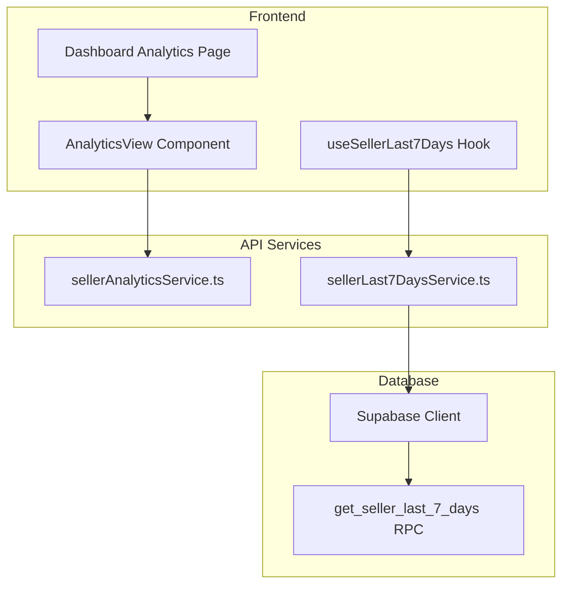
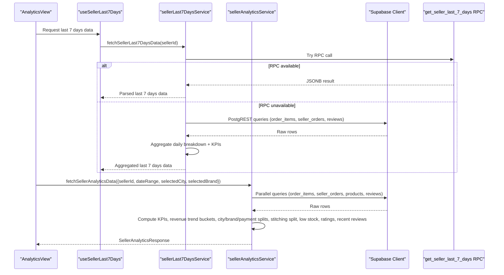
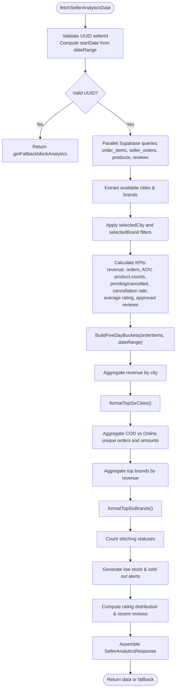
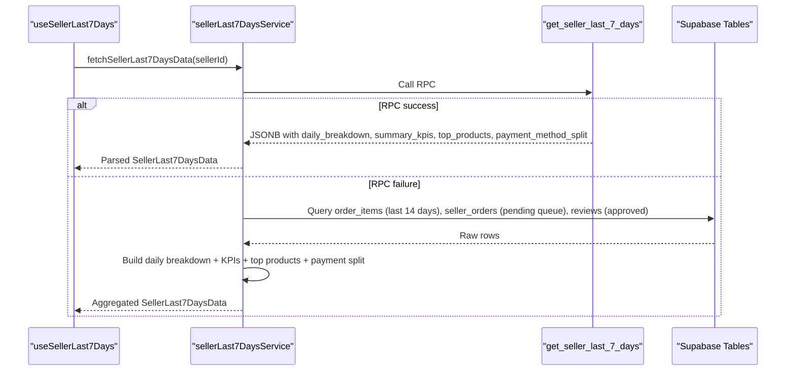

# Seller Analytics Service

<cite>
**Referenced Files in This Document**
- [sellerAnalyticsService.ts](file://src/api/sellerAnalyticsService.ts)
- [sellerLast7DaysService.ts](file://src/api/sellerLast7DaysService.ts)
- [useSellerLast7Days.ts](file://src/hooks/useSellerLast7Days.ts)
- [AnalyticsView.tsx](file://components/reseller/components/AnalyticsView.tsx)
- [analytics page.tsx](file://app/dashboard/analytics/page.tsx)
- [supabase_seller_last_7_days_rpc.sql](file://supabase_seller_last_7_days_rpc.sql)
</cite>

## Table of Contents
1. [Introduction](#introduction)
2. [Project Structure](#project-structure)
3. [Core Components](#core-components)
4. [Architecture Overview](#architecture-overview)
5. [Detailed Component Analysis](#detailed-component-analysis)
6. [Dependency Analysis](#dependency-analysis)
7. [Performance Considerations](#performance-considerations)
8. [Troubleshooting Guide](#troubleshooting-guide)
9. [Conclusion](#conclusion)

## Introduction
This document explains the seller analytics and reporting service layer. It covers sales metrics calculation, performance KPIs, revenue tracking, and business intelligence features. It also documents analytics data aggregation, time-based reporting for last 7 days, monthly, yearly, and all-time ranges, dashboard data preparation, example analytics queries, data transformation for visualization components, performance optimization strategies, data accuracy considerations, real-time update patterns, and caching strategies.

The system provides two main analytics capabilities:
- Comprehensive seller analytics with multi-range filtering, city and brand breakdowns, payment method splits, product inventory insights, and review analytics.
- Last 7 days performance reporting with daily breakdowns, summary KPIs, top products, and payment method split.

## Project Structure
The analytics feature is implemented across API services, React hooks, UI components, and a database RPC function:
- API services compute or fetch analytics data from Supabase.
- A React hook caches and refetches last 7 days analytics.
- The analytics dashboard UI renders KPI cards, charts, filters, and export functionality.
- A PostgreSQL RPC aggregates last 7 days data server-side when available.

**Diagram sources**
- [analytics page.tsx:1-9](file://app/dashboard/analytics/page.tsx#L1-L9)
- [AnalyticsView.tsx:183-204](file://components/reseller/components/AnalyticsView.tsx#L183-L204)
- [useSellerLast7Days.ts:15-34](file://src/hooks/useSellerLast7Days.ts#L15-L34)
- [sellerAnalyticsService.ts:195-207](file://src/api/sellerAnalyticsService.ts#L195-L207)
- [sellerLast7DaysService.ts:83-114](file://src/api/sellerLast7DaysService.ts#L83-L114)
- [supabase_seller_last_7_days_rpc.sql:5-178](file://supabase_seller_last_7_days_rpc.sql#L5-L178)

**Section sources**
- [analytics page.tsx:1-9](file://app/dashboard/analytics/page.tsx#L1-L9)
- [AnalyticsView.tsx:183-204](file://components/reseller/components/AnalyticsView.tsx#L183-L204)
- [useSellerLast7Days.ts:15-34](file://src/hooks/useSellerLast7Days.ts#L15-L34)
- [sellerAnalyticsService.ts:195-207](file://src/api/sellerAnalyticsService.ts#L195-L207)
- [sellerLast7DaysService.ts:83-114](file://src/api/sellerLast7DaysService.ts#L83-L114)
- [supabase_seller_last_7_days_rpc.sql:5-178](file://supabase_seller_last_7_days_rpc.sql#L5-L178)

## Core Components
- Seller Analytics Service: Computes comprehensive analytics including KPIs, revenue trends, city and brand breakdowns, payment method split, stitching status distribution, low stock alerts, rating distribution, and recent reviews. Supports date range filters (last 7 days, 30 days, 90 days, all time) and optional city and brand filters.
- Last 7 Days Service: Provides daily breakdowns, summary KPIs, top products, and payment method split. Prefers an atomic Supabase RPC; falls back to client-side aggregation if RPC is unavailable.
- useSellerLast7Days Hook: Wraps last 7 days fetching with React Query caching, error handling, and refetch capability.
- AnalyticsView Component: Renders the analytics dashboard with KPI cards, charts, filters, tabs, and CSV export.

Key responsibilities:
- Data acquisition from Supabase tables and RPC functions.
- In-memory aggregation and formatting for visualization.
- Fallback mock data generation for demo mode or empty datasets.
- Dashboard state management for date range, city, brand, dark mode, and active tab.

**Section sources**
- [sellerAnalyticsService.ts:3-94](file://src/api/sellerAnalyticsService.ts#L3-L94)
- [sellerLast7DaysService.ts:3-65](file://src/api/sellerLast7DaysService.ts#L3-L65)
- [useSellerLast7Days.ts:8-13](file://src/hooks/useSellerLast7Days.ts#L8-L13)
- [AnalyticsView.tsx:46-175](file://components/reseller/components/AnalyticsView.tsx#L46-L175)

## Architecture Overview
The analytics architecture combines server-side aggregation via RPC and client-side computation with robust fallbacks:

**Diagram sources**
- [AnalyticsView.tsx:193-204](file://components/reseller/components/AnalyticsView.tsx#L193-L204)
- [useSellerLast7Days.ts:19-34](file://src/hooks/useSellerLast7Days.ts#L19-L34)
- [sellerLast7DaysService.ts:83-114](file://src/api/sellerLast7DaysService.ts#L83-L114)
- [sellerAnalyticsService.ts:292-302](file://src/api/sellerAnalyticsService.ts#L292-L302)
- [supabase_seller_last_7_days_rpc.sql:5-178](file://supabase_seller_last_7_days_rpc.sql#L5-L178)

## Detailed Component Analysis

### Seller Analytics Service
Responsibilities:
- Validate seller ID and determine date threshold based on selected range.
- Fetch order items, seller orders, products, and reviews concurrently.
- Filter by city and brand in memory after initial retrieval.
- Calculate overview KPIs: total revenue, total orders, average order value, active and sold-out products, pending and cancelled orders, cancellation rate, average rating, approved reviews count.
- Build five-day revenue buckets for the selected date range.
- Compute revenue by city (top six with default fallback cities).
- Compute payment method split (COD vs online unique order counts and amounts).
- Compute top brands by revenue (minimum six with default fallback brands).
- Compute stitching status split (unstitched, stitched, semi-stitched, ready-to-wear).
- Generate low stock and sold out alert items.
- Compute rating distribution and recent reviews.
- Provide available cities and brands for filter options.
- Return fallback mock analytics for demo mode or empty results.

**Diagram sources**
- [sellerAnalyticsService.ts:195-207](file://src/api/sellerAnalyticsService.ts#L195-L207)
- [sellerAnalyticsService.ts:292-302](file://src/api/sellerAnalyticsService.ts#L292-L302)
- [sellerAnalyticsService.ts:331-359](file://src/api/sellerAnalyticsService.ts#L331-L359)
- [sellerAnalyticsService.ts:361-378](file://src/api/sellerAnalyticsService.ts#L361-L378)
- [sellerAnalyticsService.ts:380-420](file://src/api/sellerAnalyticsService.ts#L380-L420)
- [sellerAnalyticsService.ts:422-438](file://src/api/sellerAnalyticsService.ts#L422-L438)
- [sellerAnalyticsService.ts:440-487](file://src/api/sellerAnalyticsService.ts#L440-L487)
- [sellerAnalyticsService.ts:489-500](file://src/api/sellerAnalyticsService.ts#L489-L500)
- [sellerAnalyticsService.ts:502-533](file://src/api/sellerAnalyticsService.ts#L502-L533)
- [sellerAnalyticsService.ts:535-566](file://src/api/sellerAnalyticsService.ts#L535-L566)

Key implementation details:
- Date thresholds are computed per range: last 7 days, 30 days, 90 days, or none for all time.
- Five-day bucketing adapts label format and interval length depending on range.
- City and brand lists ensure consistent dashboard presentation even when actual data is sparse.
- Payment method split uses unique order IDs to avoid double-counting multiple items per order.
- Stitching status normalization handles variations like “Ready to Wear” and “Ready-To-Wear”.
- Rating distribution clamps values to 1–5 stars and computes percentages.
- Recent reviews are limited to ten entries and formatted for display.

Example analytics queries:
- Order items joined with orders for city, payment method, and order status.
- Seller orders for seller-level status and revenue totals.
- Products for current inventory state and stitching status.
- Reviews joined with products and users for moderation and rating analysis.

Data transformation for visualization:
- Revenue trend array with date labels, total revenue, COD revenue, online revenue, and order counts.
- Top six cities with revenue and order counts.
- Payment method split with percentage, count, amount, and color.
- Top brands with revenue and suits sold.
- Stitching split with percentage, count, and color.
- Low stock alerts with product identifiers, titles, stock levels, status, and brand.
- Rating distribution with star categories, counts, and percentages.
- Recent reviews with customer names, product titles, ratings, comments, dates, and moderation status.

Performance considerations:
- Parallel queries reduce latency.
- In-memory filtering avoids additional round trips.
- Default fallbacks ensure stable chart dimensions.
- Avoid unnecessary computations by early returns for demo mode.

Error handling:
- Catches errors during Supabase calls and returns fallback mock analytics.
- Logs errors for debugging.

**Section sources**
- [sellerAnalyticsService.ts:99-119](file://src/api/sellerAnalyticsService.ts#L99-L119)
- [sellerAnalyticsService.ts:121-189](file://src/api/sellerAnalyticsService.ts#L121-L189)
- [sellerAnalyticsService.ts:195-207](file://src/api/sellerAnalyticsService.ts#L195-L207)
- [sellerAnalyticsService.ts:209-302](file://src/api/sellerAnalyticsService.ts#L209-L302)
- [sellerAnalyticsService.ts:304-329](file://src/api/sellerAnalyticsService.ts#L304-L329)
- [sellerAnalyticsService.ts:331-359](file://src/api/sellerAnalyticsService.ts#L331-L359)
- [sellerAnalyticsService.ts:361-378](file://src/api/sellerAnalyticsService.ts#L361-L378)
- [sellerAnalyticsService.ts:380-420](file://src/api/sellerAnalyticsService.ts#L380-L420)
- [sellerAnalyticsService.ts:422-438](file://src/api/sellerAnalyticsService.ts#L422-L438)
- [sellerAnalyticsService.ts:440-487](file://src/api/sellerAnalyticsService.ts#L440-L487)
- [sellerAnalyticsService.ts:489-500](file://src/api/sellerAnalyticsService.ts#L489-L500)
- [sellerAnalyticsService.ts:502-533](file://src/api/sellerAnalyticsService.ts#L502-L533)
- [sellerAnalyticsService.ts:535-566](file://src/api/sellerAnalyticsService.ts#L535-L566)
- [sellerAnalyticsService.ts:569-619](file://src/api/sellerAnalyticsService.ts#L569-L619)
- [sellerAnalyticsService.ts:621-720](file://src/api/sellerAnalyticsService.ts#L621-L720)

### Last 7 Days Service
Responsibilities:
- Prefer atomic Supabase RPC `get_seller_last_7_days` for accurate and efficient aggregation.
- Fall back to client-side PostgREST queries when RPC is unavailable.
- Generate daily breakdowns for the last seven days with revenue, order counts, units sold, order status counts, and payment method counts.
- Compute summary KPIs including total revenue, previous window revenue, order counts, average order value, trend percentages, units sold, pending fulfillment count, new reviews count, and average rating.
- Identify top five products by units sold within the last seven days.
- Compute payment method split with counts and percentages.
- Determine best and worst days by revenue.
- Provide fallback mock data for demo mode.

**Diagram sources**
- [sellerLast7DaysService.ts:83-114](file://src/api/sellerLast7DaysService.ts#L83-L114)
- [sellerLast7DaysService.ts:116-310](file://src/api/sellerLast7DaysService.ts#L116-L310)
- [supabase_seller_last_7_days_rpc.sql:5-178](file://supabase_seller_last_7_days_rpc.sql#L5-L178)

Key implementation details:
- RPC usage reduces client-side processing and ensures consistency.
- Fallback logic constructs daily buckets by iterating over the last seven days and aggregating order items.
- Pending fulfillment count is derived from current seller orders queue without date restriction.
- New reviews count considers only approved reviews created within the last seven days.
- Average rating is computed across all approved reviews for the seller’s products.
- Best and worst day selection scans the daily breakdown array.

Example analytics queries:
- RPC function generates daily breakdown using a series of dates and joins order_items, orders, and seller_orders.
- Summary KPIs compare current and previous windows for revenue and orders.
- Top products group by product title and brand, summing quantity and subtotal.
- Payment method split counts distinct orders by COD and Online methods.

**Section sources**
- [sellerLast7DaysService.ts:67-77](file://src/api/sellerLast7DaysService.ts#L67-L77)
- [sellerLast7DaysService.ts:83-114](file://src/api/sellerLast7DaysService.ts#L83-L114)
- [sellerLast7DaysService.ts:116-310](file://src/api/sellerLast7DaysService.ts#L116-L310)
- [sellerLast7DaysService.ts:313-335](file://src/api/sellerLast7DaysService.ts#L313-L335)
- [sellerLast7DaysService.ts:337-351](file://src/api/sellerLast7DaysService.ts#L337-L351)
- [sellerLast7DaysService.ts:353-396](file://src/api/sellerLast7DaysService.ts#L353-L396)
- [supabase_seller_last_7_days_rpc.sql:17-72](file://supabase_seller_last_7_days_rpc.sql#L17-L72)
- [supabase_seller_last_7_days_rpc.sql:74-121](file://supabase_seller_last_7_days_rpc.sql#L74-L121)
- [supabase_seller_last_7_days_rpc.sql:123-147](file://supabase_seller_last_7_days_rpc.sql#L123-L147)
- [supabase_seller_last_7_days_rpc.sql:149-165](file://supabase_seller_last_7_days_rpc.sql#L149-L165)
- [supabase_seller_last_7_days_rpc.sql:167-178](file://supabase_seller_last_7_days_rpc.sql#L167-L178)

### useSellerLast7Days Hook
Responsibilities:
- Resolve seller ID from authentication context or explicit parameter.
- Use React Query to fetch last 7 days data with caching and stale time configuration.
- Expose loading, error, and refetch states to consumers.

Key behaviors:
- Query key includes seller ID to isolate cache per seller.
- Stale time set to one minute balances freshness and performance.
- Error messages are normalized for UI display.

**Section sources**
- [useSellerLast7Days.ts:15-34](file://src/hooks/useSellerLast7Days.ts#L15-L34)

### AnalyticsView Component
Responsibilities:
- Render KPI cards with formatting, trends, icons, and dark mode support.
- Manage dashboard state: date range, city, brand, dark mode, active tab.
- Fetch analytics data using React Query with query key including filters.
- Provide refresh, export CSV, and filter controls.
- Display sales and revenue charts, product and inventory charts, and review analytics.

Key behaviors:
- Horizontal scrollable action buttons prevent wrapping on small screens.
- Active filter chips show current selections and allow clearing.
- Tabs switch between Sales & Revenue, Product & Inventory, and Reviews & Rating sections.
- Charts use Recharts with responsive containers and tooltips.
- CSV export serializes revenue trend data for offline analysis.

**Section sources**
- [AnalyticsView.tsx:46-175](file://components/reseller/components/AnalyticsView.tsx#L46-L175)
- [AnalyticsView.tsx:183-204](file://components/reseller/components/AnalyticsView.tsx#L183-L204)
- [AnalyticsView.tsx:208-221](file://components/reseller/components/AnalyticsView.tsx#L208-L221)
- [AnalyticsView.tsx:225-335](file://components/reseller/components/AnalyticsView.tsx#L225-L335)
- [AnalyticsView.tsx:337-356](file://components/reseller/components/AnalyticsView.tsx#L337-L356)
- [AnalyticsView.tsx:358-363](file://components/reseller/components/AnalyticsView.tsx#L358-L363)
- [AnalyticsView.tsx:365-485](file://components/reseller/components/AnalyticsView.tsx#L365-L485)
- [AnalyticsView.tsx:488-510](file://components/reseller/components/AnalyticsView.tsx#L488-L510)
- [AnalyticsView.tsx:512-635](file://components/reseller/components/AnalyticsView.tsx#L512-L635)
- [AnalyticsView.tsx:638-731](file://components/reseller/components/AnalyticsView.tsx#L638-L731)
- [AnalyticsView.tsx:734-781](file://components/reseller/components/AnalyticsView.tsx#L734-L781)

## Dependency Analysis
Component relationships and dependencies:

```mermaid
classDiagram
class AnalyticsView {
+state dateRange
+state selectedCity
+state selectedBrand
+state isDarkMode
+state activeTab
+renderKpiCards()
+renderCharts()
+exportToCSV()
}
class SellerAnalyticsService {
+fetchSellerAnalyticsData(params)
-buildFiveDayBuckets(items, range)
-formatTopSixCities(map)
-formatTopSixBrands(map)
-getFallbackMockAnalytics(range, city, brand)
}
class SellerLast7DaysService {
+fetchSellerLast7DaysData(sellerId)
-findBestDay(daily)
-findWorstDay(daily)
-getFallbackMock7DaysData()
}
class UseSellerLast7DaysHook {
+data
+loading
+error
+refetch()
}
AnalyticsView --> SellerAnalyticsService : "uses"
UseSellerLast7DaysHook --> SellerLast7DaysService : "uses"
```

**Diagram sources**
- [AnalyticsView.tsx:183-204](file://components/reseller/components/AnalyticsView.tsx#L183-L204)
- [sellerAnalyticsService.ts:195-207](file://src/api/sellerAnalyticsService.ts#L195-L207)
- [sellerLast7DaysService.ts:83-114](file://src/api/sellerLast7DaysService.ts#L83-L114)
- [useSellerLast7Days.ts:15-34](file://src/hooks/useSellerLast7Days.ts#L15-L34)

Coupling and cohesion:
- AnalyticsView depends on SellerAnalyticsService for comprehensive analytics data.
- useSellerLast7DaysHook depends on SellerLast7DaysService for last 7 days data.
- Services encapsulate data fetching and aggregation logic, promoting cohesion.
- No circular dependencies observed between services and UI components.

External dependencies:
- Supabase client for database access.
- React Query for caching and state management.
- Recharts for chart rendering.
- Lucide icons for visual indicators.

Potential risks:
- Heavy client-side aggregation in fallback path may impact performance with large datasets.
- Reliance on RPC availability requires robust fallback logic.

**Section sources**
- [AnalyticsView.tsx:183-204](file://components/reseller/components/AnalyticsView.tsx#L183-L204)
- [sellerAnalyticsService.ts:195-207](file://src/api/sellerAnalyticsService.ts#L195-L207)
- [sellerLast7DaysService.ts:83-114](file://src/api/sellerLast7DaysService.ts#L83-L114)
- [useSellerLast7Days.ts:15-34](file://src/hooks/useSellerLast7Days.ts#L15-L34)

## Performance Considerations
Optimization strategies:
- Prefer RPC aggregation for last 7 days to minimize client-side processing and network overhead.
- Use parallel queries in comprehensive analytics to reduce total latency.
- Cache analytics data with React Query staleTime to balance freshness and performance.
- Limit chart data size by computing top N items (cities, brands, products) and using default fallbacks.
- Avoid redundant computations by early returning for demo mode or empty datasets.
- Normalize and clamp numeric values to prevent unexpected chart behavior.
- Use Set structures for unique order counting to improve aggregation efficiency.

Real-time updates:
- Refresh button triggers refetch of analytics data.
- Hook exposes refetch function for programmatic updates.
- StaleTime configured to periodically refresh cached data.

Caching strategies:
- React Query caches last 7 days data keyed by seller ID.
- Analytics data cached with query key including date range, city, and brand filters.
- Fallback mock data ensures UI remains functional when live data is unavailable.

Data accuracy:
- Server-side RPC ensures consistent aggregation across clients.
- Client-side fallback replicates server logic closely but may differ slightly due to rounding and ordering.
- Unique order counting prevents double-counting across multiple line items.

[No sources needed since this section provides general guidance]

## Troubleshooting Guide
Common issues and resolutions:
- RPC unavailable: The last 7 days service logs a warning and falls back to PostgREST queries. Verify RPC deployment and permissions.
- Empty analytics data: If no orders, products, or seller orders exist, the service returns fallback mock analytics. Check seller ID and data population.
- Incorrect date range: Ensure date threshold calculation matches expected range. Verify timezone handling and date formatting.
- Chart rendering issues: Confirm that arrays passed to charts are non-empty and properly structured. Use fallback defaults to maintain layout stability.
- Filter not applied: Verify that selectedCity and selectedBrand filters are correctly applied to rawOrderItems and rawSellerOrders.

Debugging tips:
- Inspect console logs for RPC warnings and Supabase errors.
- Validate seller ID format (UUID) to avoid unintended demo mode.
- Review aggregated maps and sets for correctness before final response assembly.

**Section sources**
- [sellerLast7DaysService.ts:112-114](file://src/api/sellerLast7DaysService.ts#L112-L114)
- [sellerLast7DaysService.ts:307-310](file://src/api/sellerLast7DaysService.ts#L307-L310)
- [sellerAnalyticsService.ts:563-566](file://src/api/sellerAnalyticsService.ts#L563-L566)

## Conclusion
The seller analytics service layer provides robust sales metrics, performance KPIs, revenue tracking, and business intelligence features. It supports flexible time-based reporting, comprehensive data aggregation, and dashboard-ready transformations. The architecture leverages server-side RPC for accuracy and efficiency while maintaining resilient client-side fallbacks. With careful caching, performance optimizations, and clear error handling, the system delivers reliable analytics for sellers across various contexts and data volumes.

[No sources needed since this section summarizes without analyzing specific files]