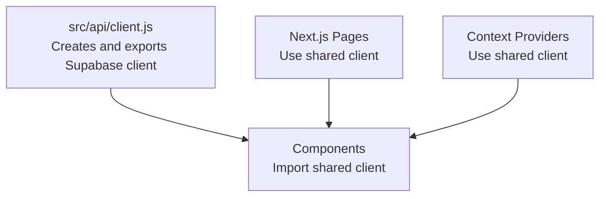
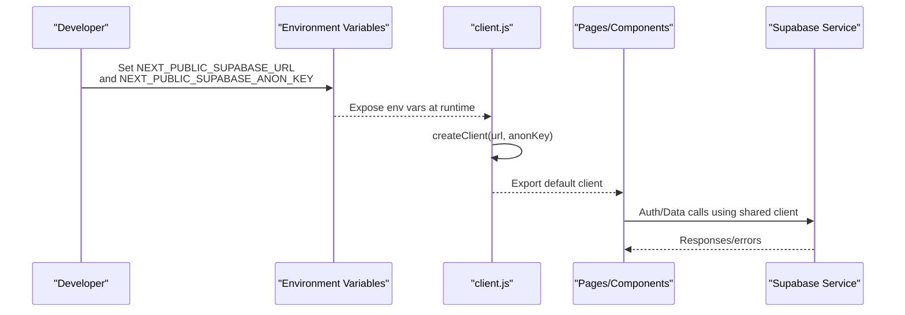
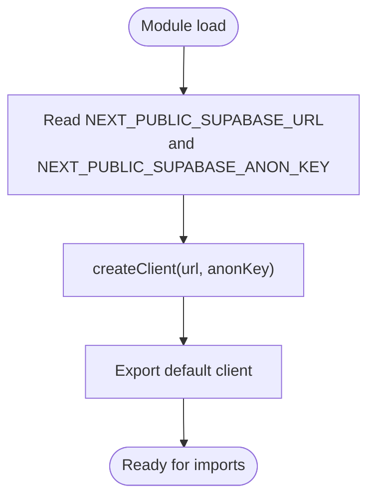
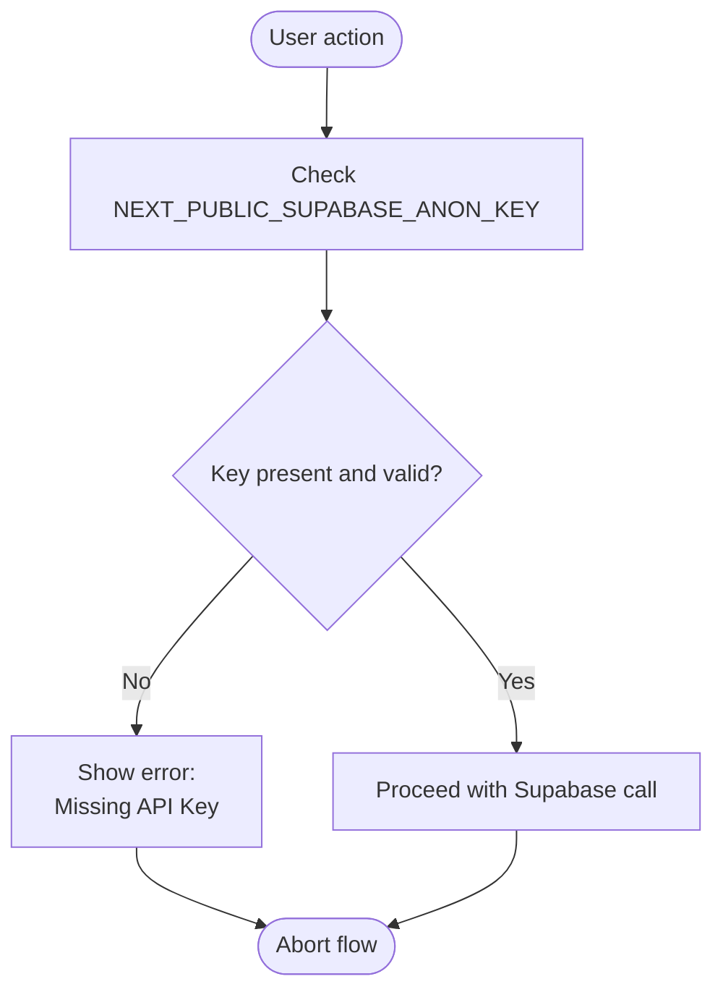
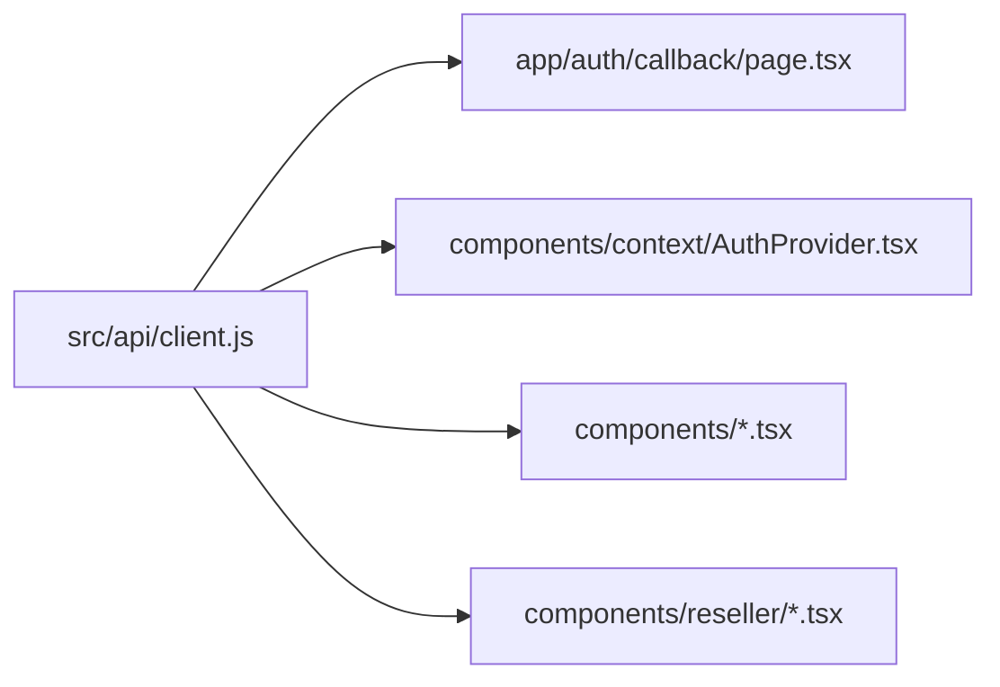
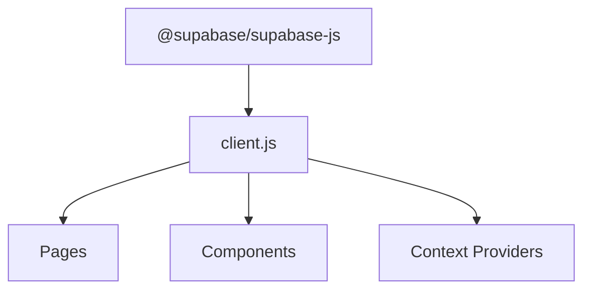

# Supabase Client Configuration

<cite>
**Referenced Files in This Document**
- [client.js](file://src/api/client.js)
- [ResellerSignup.tsx](file://components/reseller/ResellerSignup.tsx)
- [resellerFgtPass.tsx](file://components/reseller/resellerFgtPass.tsx)
- [page.tsx](file://app/auth/callback/page.tsx)
- [AuthProvider.tsx](file://components/context/AuthProvider.tsx)
- [package.json](file://package.json)
</cite>

## Table of Contents
1. [Introduction](#introduction)
2. [Project Structure](#project-structure)
3. [Core Components](#core-components)
4. [Architecture Overview](#architecture-overview)
5. [Detailed Component Analysis](#detailed-component-analysis)
6. [Dependency Analysis](#dependency-analysis)
7. [Performance Considerations](#performance-considerations)
8. [Troubleshooting Guide](#troubleshooting-guide)
9. [Conclusion](#conclusion)

## Introduction
This document explains how the Supabase client is configured and initialized in this Next.js application, focusing on environment variables, client instance creation, usage patterns across components, and security considerations for the anonymous key. It also provides best practices for managing credentials in development, staging, and production environments.

## Project Structure
The Supabase client is created once and exported as a singleton. Other modules import this shared client to interact with Supabase services (Auth, Database, Storage).

**Diagram sources**
- [client.js:1-8](file://src/api/client.js#L1-L8)
- [page.tsx:5-5](file://app/auth/callback/page.tsx#L5-L5)
- [AuthProvider.tsx:4-4](file://components/context/AuthProvider.tsx#L4-L4)

**Section sources**
- [client.js:1-8](file://src/api/client.js#L1-L8)

## Core Components
- Supabase client initialization: The client is created using `createClient` from `@supabase/supabase-js`, passing the project URL and anonymous key from environment variables.
- Environment variables:
  - NEXT_PUBLIC_SUPABASE_URL
  - NEXT_PUBLIC_SUPABASE_ANON_KEY
- Usage pattern: Multiple pages and components import the default-exported client to perform authentication and data operations.

Key responsibilities:
- Centralized configuration: All Supabase connections use the same client instance.
- Environment-driven setup: Credentials are injected at build time via Next.js public environment variables.

**Section sources**
- [client.js:1-8](file://src/api/client.js#L1-L8)

## Architecture Overview
The following diagram shows how the Supabase client is initialized and consumed by various parts of the app.

**Diagram sources**
- [client.js:1-8](file://src/api/client.js#L1-L8)
- [page.tsx:5-5](file://app/auth/callback/page.tsx#L5-L5)
- [AuthProvider.tsx:4-4](file://components/context/AuthProvider.tsx#L4-L4)

## Detailed Component Analysis

### Supabase Client Initialization
- File: src/api/client.js
- Behavior:
  - Imports `createClient` from `@supabase/supabase-js`.
  - Instantiates a client with `process.env.NEXT_PUBLIC_SUPABASE_URL` and `process.env.NEXT_PUBLIC_SUPABASE_ANON_KEY`.
  - Exports the client as the default module export for reuse across the app.

**Diagram sources**
- [client.js:1-8](file://src/api/client.js#L1-L8)

**Section sources**
- [client.js:1-8](file://src/api/client.js#L1-L8)

### Environment Variable Validation in User Flows
Certain user flows validate the presence of the anonymous key before proceeding with Supabase operations.

- Reseller signup flow:
  - Validates that `NEXT_PUBLIC_SUPABASE_ANON_KEY` exists and is not a placeholder value.
  - If missing or invalid, displays an error message and aborts the operation.

- Reseller forgot password flow:
  - Performs the same validation before attempting a password reset.

**Diagram sources**
- [ResellerSignup.tsx:419-425](file://components/reseller/ResellerSignup.tsx#L419-L425)
- [resellerFgtPass.tsx:52-58](file://components/reseller/resellerFgtPass.tsx#L52-L58)

**Section sources**
- [ResellerSignup.tsx:419-425](file://components/reseller/ResellerSignup.tsx#L419-L425)
- [resellerFgtPass.tsx:52-58](file://components/reseller/resellerFgtPass.tsx#L52-L58)

### Client Consumption Across the App
- Pages and components import the shared client to perform actions such as authentication callbacks, profile updates, and data queries.
- Examples of consumers include:
  - Authentication callback page
  - Context providers for auth state
  - Various UI components interacting with Supabase

**Diagram sources**
- [client.js:1-8](file://src/api/client.js#L1-L8)
- [page.tsx:5-5](file://app/auth/callback/page.tsx#L5-L5)
- [AuthProvider.tsx:4-4](file://components/context/AuthProvider.tsx#L4-L4)

**Section sources**
- [page.tsx:5-5](file://app/auth/callback/page.tsx#L5-L5)
- [AuthProvider.tsx:4-4](file://components/context/AuthProvider.tsx#L4-L4)

## Dependency Analysis
- External dependency:
  - `@supabase/supabase-js` is used to initialize the client.
- Internal dependencies:
  - Many components depend on the centralized client module.

**Diagram sources**
- [client.js:1-8](file://src/api/client.js#L1-L8)
- [package.json:1-200](file://package.json#L1-L200)

**Section sources**
- [client.js:1-8](file://src/api/client.js#L1-L8)
- [package.json:1-200](file://package.json#L1-L200)

## Performance Considerations
- Singleton client: Creating one client instance avoids repeated initialization overhead.
- Build-time env exposure: Using Next.js public environment variables ensures credentials are available at runtime without additional configuration steps.
- Network efficiency: Reusing the same client allows connection pooling and consistent session handling where applicable.

[No sources needed since this section provides general guidance]

## Troubleshooting Guide
Common issues and resolutions:

- Missing or invalid anonymous key:
  - Symptom: User flows show an error indicating the API key is missing or invalid.
  - Cause: NEXT_PUBLIC_SUPABASE_ANON_KEY is not set or contains a placeholder value.
  - Resolution: Ensure both NEXT_PUBLIC_SUPABASE_URL and NEXT_PUBLIC_SUPABASE_ANON_KEY are correctly set in your environment.

- Client not connecting:
  - Verify that the URL points to the correct Supabase project.
  - Confirm that the anonymous key has appropriate permissions for the intended tables and storage buckets.

- Environment variable not available:
  - In Next.js, only variables prefixed with NEXT_PUBLIC_ are exposed to the browser.
  - Ensure you are using NEXT_PUBLIC_SUPABASE_URL and NEXT_PUBLIC_SUPABASE_ANON_KEY.

**Section sources**
- [ResellerSignup.tsx:419-425](file://components/reseller/ResellerSignup.tsx#L419-L425)
- [resellerFgtPass.tsx:52-58](file://components/reseller/resellerFgtPass.tsx#L52-L58)

## Conclusion
The application centralizes Supabase configuration in a single client module that reads the project URL and anonymous key from Next.js public environment variables. This approach simplifies credential management, enables consistent usage across the app, and supports straightforward validation in critical user flows. For secure and reliable deployments, ensure that environment variables are properly configured per environment and that the anonymous key is scoped with minimal necessary permissions.

[No sources needed since this section summarizes without analyzing specific files]