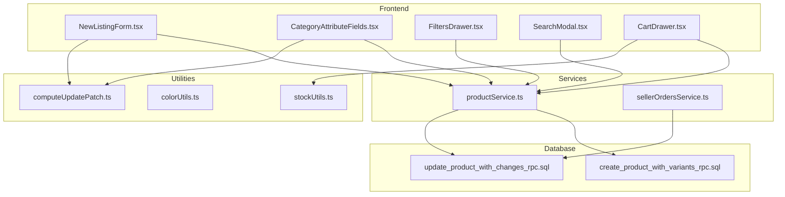
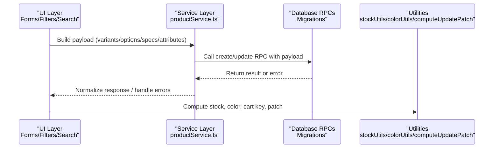
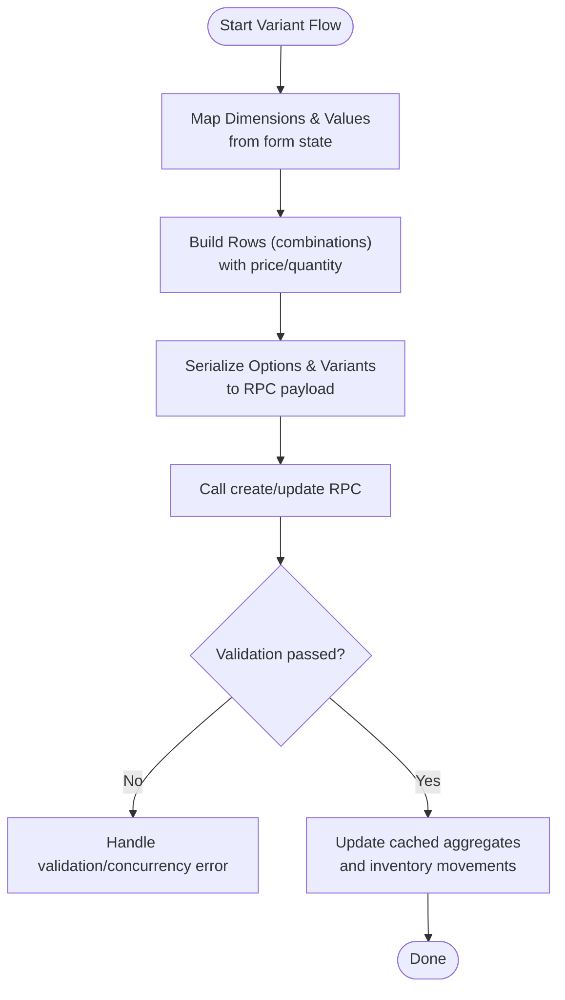
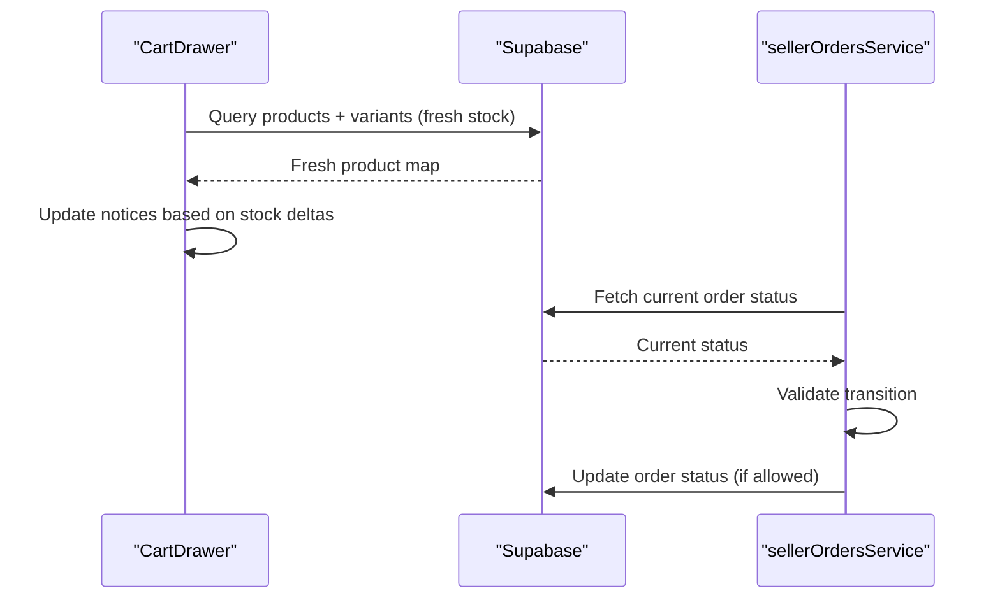
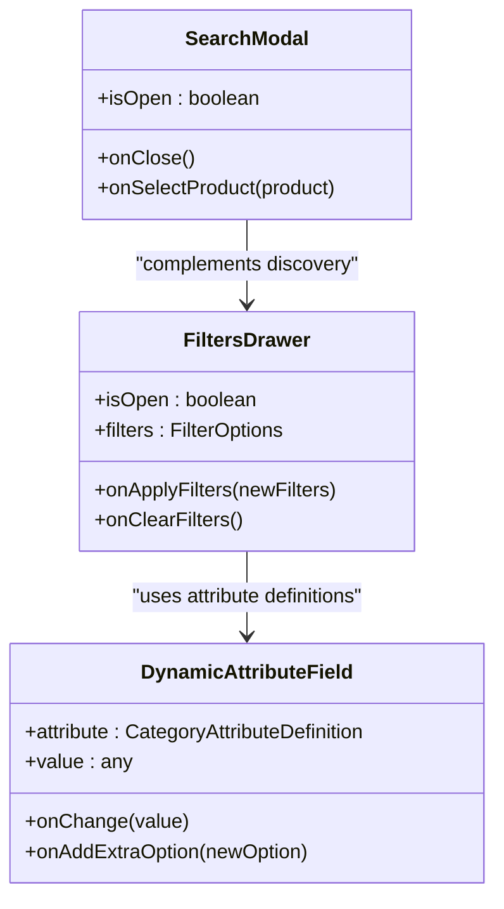
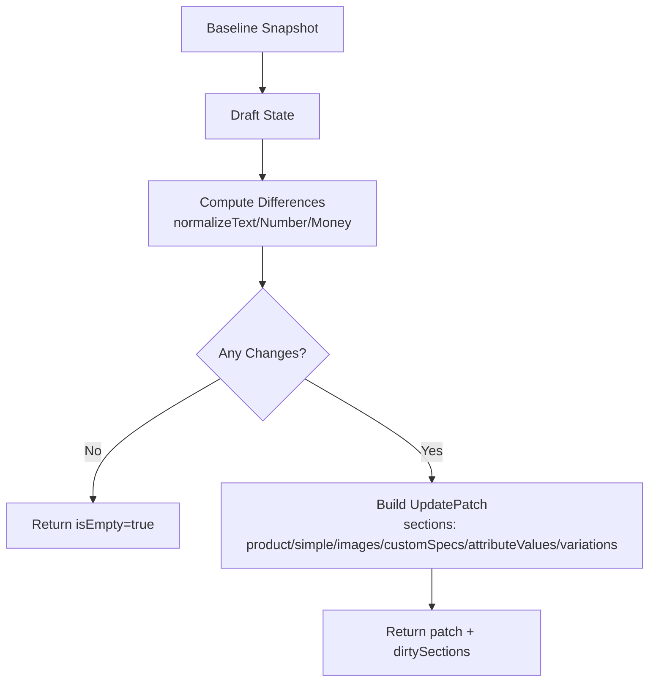
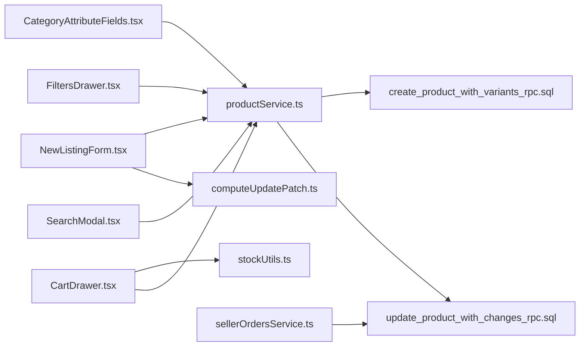

# Advanced Features

<cite>
**Referenced Files in This Document**
- [productService.ts](file://src/api/productService.ts)
- [stockUtils.ts](file://src/utils/stockUtils.ts)
- [colorUtils.ts](file://src/utils/colorUtils.ts)
- [computeUpdatePatch.ts](file://src/utils/computeUpdatePatch.ts)
- [NewListingForm.tsx](file://components/reseller/components/NewListingForm.tsx)
- [CategoryAttributeFields.tsx](file://components/reseller/components/CategoryAttributeFields.tsx)
- [FiltersDrawer.tsx](file://components/FiltersDrawer.tsx)
- [SearchModal.tsx](file://components/SearchModal.tsx)
- [CartDrawer.tsx](file://components/CartDrawer.tsx)
- [sellerOrdersService.ts](file://src/api/sellerOrdersService.ts)
- [20261105_create_product_with_variants_rpc.sql](file://supabase/migrations/20261105_create_product_with_variants_rpc.sql)
- [20261106_update_product_with_changes_rpc.sql](file://supabase/migrations/20261106_update_product_with_changes_rpc.sql)
</cite>

## Table of Contents
1. [Introduction](#introduction)
2. [Project Structure](#project-structure)
3. [Core Components](#core-components)
4. [Architecture Overview](#architecture-overview)
5. [Detailed Component Analysis](#detailed-component-analysis)
6. [Dependency Analysis](#dependency-analysis)
7. [Performance Considerations](#performance-considerations)
8. [Troubleshooting Guide](#troubleshooting-guide)
9. [Conclusion](#conclusion)

## Introduction
This document explains the advanced platform features that power complex product variants, real-time inventory and order workflows, dynamic attribute handling, and robust utility functions for stock management, color calculations, and data patching. It also outlines performance optimization techniques, caching strategies, and scalability considerations for large catalogs and high traffic volumes.

## Project Structure
The advanced features span UI components, API services, database migrations, and utility modules:
- Product creation and updates are handled by a service layer that builds payloads for atomic RPCs.
- Variant and option definitions are modeled through dimensions, values, and rows.
- Dynamic category attributes render different input types based on schema-defined data types.
- Filters and search provide user-facing discovery capabilities.
- Utilities compute available stock, resolve swatch colors, generate stable cart keys, and diff changes into minimal patches.
- Database migrations enforce validation, concurrency control, and maintain cached aggregates.

**Diagram sources**
- [productService.ts:540-739](file://src/api/productService.ts#L540-L739)
- [productService.ts:1460-1659](file://src/api/productService.ts#L1460-L1659)
- [sellerOrdersService.ts:171-385](file://src/api/sellerOrdersService.ts#L171-L385)
- [stockUtils.ts:1-34](file://src/utils/stockUtils.ts#L1-L34)
- [colorUtils.ts:1-127](file://src/utils/colorUtils.ts#L1-L127)
- [computeUpdatePatch.ts:1-565](file://src/utils/computeUpdatePatch.ts#L1-L565)
- [NewListingForm.tsx:385-410](file://components/reseller/components/NewListingForm.tsx#L385-L410)
- [CategoryAttributeFields.tsx:613-809](file://components/reseller/components/CategoryAttributeFields.tsx#L613-L809)
- [FiltersDrawer.tsx:1-552](file://components/FiltersDrawer.tsx#L1-L552)
- [SearchModal.tsx:1-120](file://components/SearchModal.tsx#L1-L120)
- [CartDrawer.tsx:33-63](file://components/CartDrawer.tsx#L33-L63)
- [20261105_create_product_with_variants_rpc.sql:850-1049](file://supabase/migrations/20261105_create_product_with_variants_rpc.sql#L850-L1049)
- [20261106_update_product_with_changes_rpc.sql:280-479](file://supabase/migrations/20261106_update_product_with_changes_rpc.sql#L280-L479)

**Section sources**
- [productService.ts:540-739](file://src/api/productService.ts#L540-L739)
- [productService.ts:1460-1659](file://src/api/productService.ts#L1460-L1659)
- [stockUtils.ts:1-34](file://src/utils/stockUtils.ts#L1-L34)
- [colorUtils.ts:1-127](file://src/utils/colorUtils.ts#L1-L127)
- [computeUpdatePatch.ts:1-565](file://src/utils/computeUpdatePatch.ts#L1-L565)
- [NewListingForm.tsx:385-410](file://components/reseller/components/NewListingForm.tsx#L385-L410)
- [CategoryAttributeFields.tsx:613-809](file://components/reseller/components/CategoryAttributeFields.tsx#L613-L809)
- [FiltersDrawer.tsx:1-552](file://components/FiltersDrawer.tsx#L1-L552)
- [SearchModal.tsx:1-120](file://components/SearchModal.tsx#L1-L120)
- [CartDrawer.tsx:33-63](file://components/CartDrawer.tsx#L33-L63)
- [sellerOrdersService.ts:171-385](file://src/api/sellerOrdersService.ts#L171-L385)
- [20261105_create_product_with_variants_rpc.sql:850-1049](file://supabase/migrations/20261105_create_product_with_variants_rpc.sql#L850-L1049)
- [20261106_update_product_with_changes_rpc.sql:280-479](file://supabase/migrations/20261106_update_product_with_changes_rpc.sql#L280-L479)

## Core Components
- Complex product variants system: Multi-dimensional options (e.g., size, color, custom specifications), with dimension/value mapping, row-based combinations, and variant-level pricing and quantity.
- Real-time order and inventory synchronization: Client-side refresh of stock levels, order status transitions with workflow validation, and fallback queries when RPCs are unavailable.
- Advanced search and filtering: Category-driven filters (brand, fabric, price range, size, rating), plus a modal search over product titles, categories, and fabrics.
- Utility functions: Stock availability calculation across simple and variant modes, color resolution for swatches, stable cart line key generation, and change detection to produce minimal update patches.

**Section sources**
- [NewListingForm.tsx:385-410](file://components/reseller/components/NewListingForm.tsx#L385-L410)
- [productService.ts:540-739](file://src/api/productService.ts#L540-L739)
- [productService.ts:1460-1659](file://src/api/productService.ts#L1460-L1659)
- [cartDrawer.tsx:33-63](file://components/CartDrawer.tsx#L33-L63)
- [sellerOrdersService.ts:171-385](file://src/api/sellerOrdersService.ts#L171-L385)
- [FiltersDrawer.tsx:1-552](file://components/FiltersDrawer.tsx#L1-L552)
- [SearchModal.tsx:1-120](file://components/SearchModal.tsx#L1-L120)
- [stockUtils.ts:1-34](file://src/utils/stockUtils.ts#L1-L34)
- [colorUtils.ts:1-127](file://src/utils/colorUtils.ts#L1-L127)
- [computeUpdatePatch.ts:1-565](file://src/utils/computeUpdatePatch.ts#L1-L565)

## Architecture Overview
The system uses a layered architecture:
- UI layers (forms, filters, search, cart) build structured data models.
- Service layer serializes these models into RPC payloads.
- Database RPCs perform atomic transactions, validate business rules, and maintain cached aggregates.
- Utilities encapsulate reusable logic for stock, colors, and diffs.

**Diagram sources**
- [productService.ts:540-739](file://src/api/productService.ts#L540-L739)
- [productService.ts:1460-1659](file://src/api/productService.ts#L1460-L1659)
- [stockUtils.ts:1-34](file://src/utils/stockUtils.ts#L1-L34)
- [colorUtils.ts:1-127](file://src/utils/colorUtils.ts#L1-L127)
- [computeUpdatePatch.ts:1-565](file://src/utils/computeUpdatePatch.ts#L1-L565)

## Detailed Component Analysis

### Complex Product Variants System
- Dimensions and Values: The listing form maps multi-dimensional attributes (e.g., size, color, custom specs) to option values and constructs rows representing variant combinations.
- Payload Construction: The service transforms dimensions and rows into options and variants payloads, including optional images per option value.
- Atomic Creation/Update: RPCs enforce constraints (e.g., total quantity > 0), update cached aggregates (min/max price, total quantity), and manage image ordering and security checks.

**Diagram sources**
- [NewListingForm.tsx:385-410](file://components/reseller/components/NewListingForm.tsx#L385-L410)
- [productService.ts:540-739](file://src/api/productService.ts#L540-L739)
- [productService.ts:1460-1659](file://src/api/productService.ts#L1460-L1659)
- [20261105_create_product_with_variants_rpc.sql:850-1049](file://supabase/migrations/20261105_create_product_with_variants_rpc.sql#L850-L1049)
- [20261106_update_product_with_changes_rpc.sql:280-479](file://supabase/migrations/20261106_update_product_with_changes_rpc.sql#L280-L479)

**Section sources**
- [NewListingForm.tsx:385-410](file://components/reseller/components/NewListingForm.tsx#L385-L410)
- [productService.ts:540-739](file://src/api/productService.ts#L540-L739)
- [productService.ts:1460-1659](file://src/api/productService.ts#L1460-L1659)
- [20261105_create_product_with_variants_rpc.sql:850-1049](file://supabase/migrations/20261105_create_product_with_variants_rpc.sql#L850-L1049)
- [20261106_update_product_with_changes_rpc.sql:280-479](file://supabase/migrations/20261106_update_product_with_changes_rpc.sql#L280-L479)

### Real-Time Order Updates and Inventory Synchronization
- Live Inventory Sync: The cart drawer fetches fresh product and variant quantities from the database and updates notices accordingly.
- Order Status Transitions: Order service validates allowed transitions before updating status, with fallback relational queries if RPCs fail.

**Diagram sources**
- [CartDrawer.tsx:33-63](file://components/CartDrawer.tsx#L33-L63)
- [sellerOrdersService.ts:171-385](file://src/api/sellerOrdersService.ts#L171-L385)

**Section sources**
- [CartDrawer.tsx:33-63](file://components/CartDrawer.tsx#L33-L63)
- [sellerOrdersService.ts:171-385](file://src/api/sellerOrdersService.ts#L171-L385)

### Advanced Search and Filtering with Dynamic Attributes
- Filters Drawer: Provides brand, fabric, price range, size, reseller rating, and other filters; supports toggling sections and applying/clearing filters.
- Search Modal: Performs client-side search across product title, category, and fabric fields, with popular suggestions.
- Dynamic Attribute Fields: Renders inputs based on attribute data type (text, number, boolean, select, multi-select), enabling flexible product metadata capture.

**Diagram sources**
- [FiltersDrawer.tsx:1-552](file://components/FiltersDrawer.tsx#L1-L552)
- [SearchModal.tsx:1-120](file://components/SearchModal.tsx#L1-L120)
- [CategoryAttributeFields.tsx:613-809](file://components/reseller/components/CategoryAttributeFields.tsx#L613-L809)

**Section sources**
- [FiltersDrawer.tsx:1-552](file://components/FiltersDrawer.tsx#L1-L552)
- [SearchModal.tsx:1-120](file://components/SearchModal.tsx#L1-L120)
- [CategoryAttributeFields.tsx:613-809](file://components/reseller/components/CategoryAttributeFields.tsx#L613-L809)

### Utility Functions: Stock Management, Color Calculations, Data Patching
- Stock Availability: Computes available stock for a product item considering variant selection and category-specific logic.
- Color Resolution: Resolves CSS-safe colors from hex codes or fashion color names, with safe SSR fallbacks.
- Cart Line Key: Generates stable unique keys for cart lines using product ID, size, and color ID.
- Update Patch Diffing: Compares baseline snapshot with draft state to produce minimal patches for product details, simple inventory, images, custom specs, attribute values, and variations.

**Diagram sources**
- [stockUtils.ts:1-34](file://src/utils/stockUtils.ts#L1-L34)
- [colorUtils.ts:1-127](file://src/utils/colorUtils.ts#L1-L127)
- [computeUpdatePatch.ts:1-565](file://src/utils/computeUpdatePatch.ts#L1-L565)

**Section sources**
- [stockUtils.ts:1-34](file://src/utils/stockUtils.ts#L1-L34)
- [colorUtils.ts:1-127](file://src/utils/colorUtils.ts#L1-L127)
- [computeUpdatePatch.ts:1-565](file://src/utils/computeUpdatePatch.ts#L1-L565)

## Dependency Analysis
Key dependencies and relationships:
- NewListingForm depends on productService for creating/updating products and on computeUpdatePatch for generating minimal diffs.
- CategoryAttributeFields provides dynamic attribute inputs consumed by forms and persisted via productService.
- FiltersDrawer and SearchModal drive discovery flows but do not directly mutate data.
- CartDrawer performs live stock sync against Supabase and relies on stockUtils for consistent stock computation.
- sellerOrdersService orchestrates order status transitions and falls back to relational queries when needed.
- Database migrations define RPCs that enforce validation, concurrency controls, and maintain cached aggregates.

**Diagram sources**
- [NewListingForm.tsx:385-410](file://components/reseller/components/NewListingForm.tsx#L385-L410)
- [productService.ts:540-739](file://src/api/productService.ts#L540-L739)
- [productService.ts:1460-1659](file://src/api/productService.ts#L1460-L1659)
- [categoryAttributeFields.tsx:613-809](file://components/reseller/components/CategoryAttributeFields.tsx#L613-L809)
- [filtersDrawer.tsx:1-552](file://components/FiltersDrawer.tsx#L1-L552)
- [searchModal.tsx:1-120](file://components/SearchModal.tsx#L1-L120)
- [cartDrawer.tsx:33-63](file://components/CartDrawer.tsx#L33-L63)
- [stockUtils.ts:1-34](file://src/utils/stockUtils.ts#L1-L34)
- [sellerOrdersService.ts:171-385](file://src/api/sellerOrdersService.ts#L171-L385)
- [20261105_create_product_with_variants_rpc.sql:850-1049](file://supabase/migrations/20261105_create_product_with_variants_rpc.sql#L850-L1049)
- [20261106_update_product_with_changes_rpc.sql:280-479](file://supabase/migrations/20261106_update_product_with_changes_rpc.sql#L280-L479)

**Section sources**
- [NewListingForm.tsx:385-410](file://components/reseller/components/NewListingForm.tsx#L385-L410)
- [productService.ts:540-739](file://src/api/productService.ts#L540-L739)
- [productService.ts:1460-1659](file://src/api/productService.ts#L1460-L1659)
- [CategoryAttributeFields.tsx:613-809](file://components/reseller/components/CategoryAttributeFields.tsx#L613-L809)
- [FiltersDrawer.tsx:1-552](file://components/FiltersDrawer.tsx#L1-L552)
- [SearchModal.tsx:1-120](file://components/SearchModal.tsx#L1-L120)
- [CartDrawer.tsx:33-63](file://components/CartDrawer.tsx#L33-L63)
- [stockUtils.ts:1-34](file://src/utils/stockUtils.ts#L1-L34)
- [sellerOrdersService.ts:171-385](file://src/api/sellerOrdersService.ts#L171-L385)
- [20261105_create_product_with_variants_rpc.sql:850-1049](file://supabase/migrations/20261105_create_product_with_variants_rpc.sql#L850-L1049)
- [20261106_update_product_with_changes_rpc.sql:280-479](file://supabase/migrations/20261106_update_product_with_changes_rpc.sql#L280-L479)

## Performance Considerations
- Server-Side Aggregates: Cached columns for min/max variant price and total variant quantity reduce repeated aggregation queries and speed up catalog listings.
- Atomic Transactions: RPCs consolidate multiple writes (images, attributes, variants) into single transactions, minimizing partial states and improving consistency.
- Compare-and-Set Concurrency: Stock updates include baseline checks to prevent lost updates under concurrent edits.
- Minimal Patches: computeUpdatePatch reduces network payload by sending only changed sections, lowering bandwidth and server processing.
- Client-Side Caching: CartDrawer fetches fresh stock selectively for items in the cart, avoiding full catalog reloads.
- Image Handling: Two-phase image reordering and security path validation minimize constraint collisions and ensure safe storage operations.

[No sources needed since this section provides general guidance]

## Troubleshooting Guide
Common issues and resolutions:
- Missing RPC Function Error: If the database function is not found, ensure the migration scripts have been executed and the schema cache is refreshed.
- Validation Errors: RPCs raise explicit validation exceptions (e.g., required attributes missing, invalid quantity). Surface these messages to users.
- Concurrency Conflicts: When stock changes between load and save, the system raises a conflict error; prompt users to reload the latest version.
- Storage Cleanup Failures: On RPC failure, the service attempts to remove uploaded images; log cleanup warnings if removal fails.

**Section sources**
- [productService.ts:1460-1659](file://src/api/productService.ts#L1460-L1659)
- [20261106_update_product_with_changes_rpc.sql:280-479](file://supabase/migrations/20261106_update_product_with_changes_rpc.sql#L280-L479)

## Conclusion
The platform’s advanced features combine a robust variants model, real-time inventory and order workflows, dynamic attribute handling, and precise utilities for stock, color, and patching. With atomic RPCs, cached aggregates, compare-and-set concurrency, and minimal patching, the system scales effectively for large catalogs and high traffic while maintaining data integrity and user experience.

[No sources needed since this section summarizes without analyzing specific files]