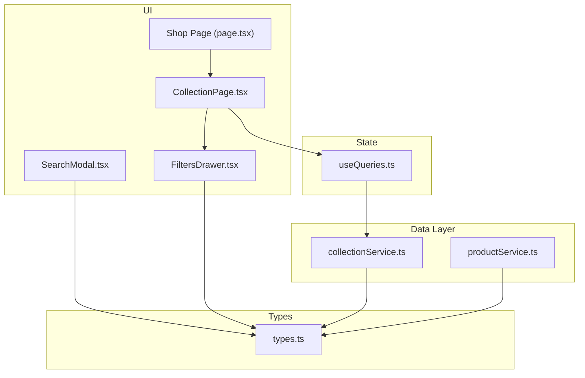
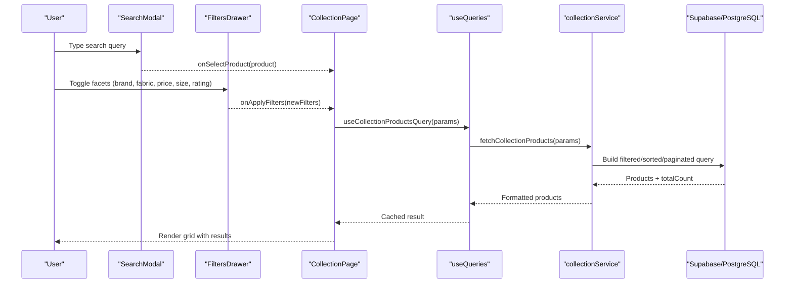
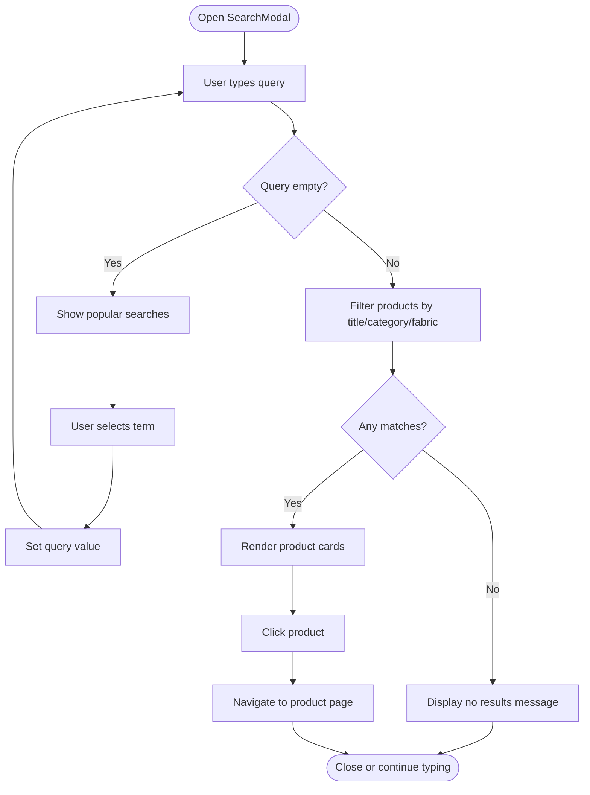
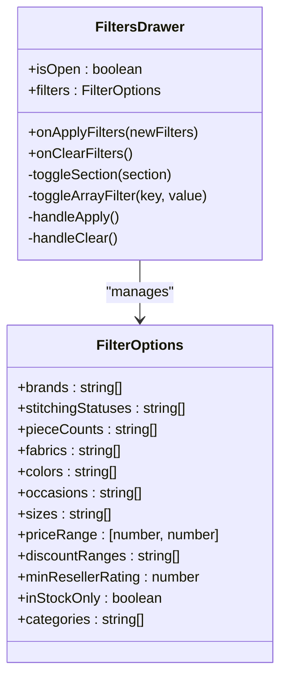
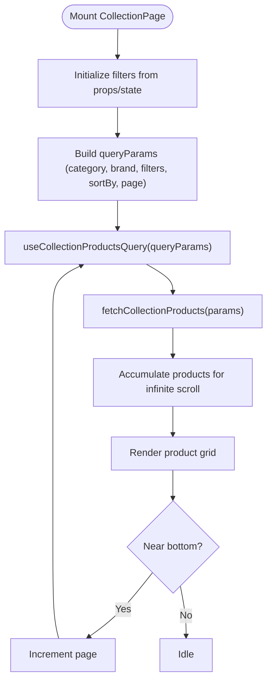
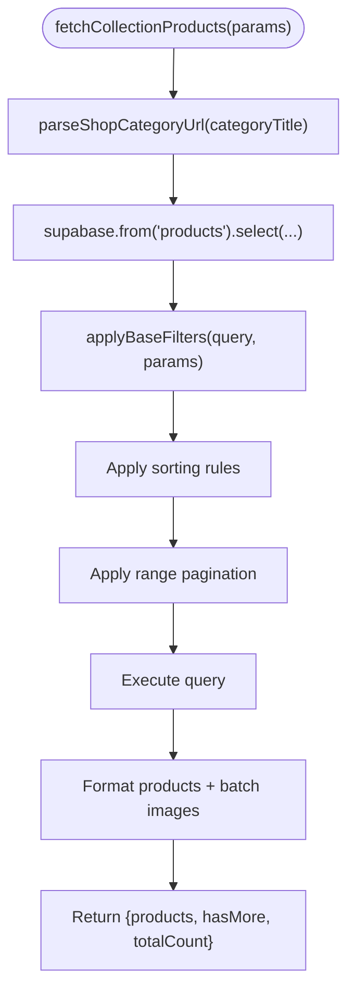
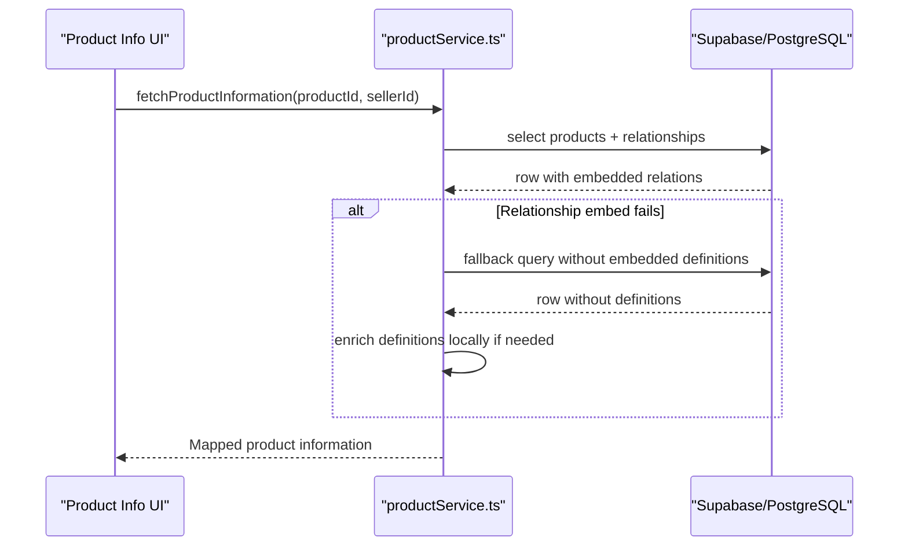
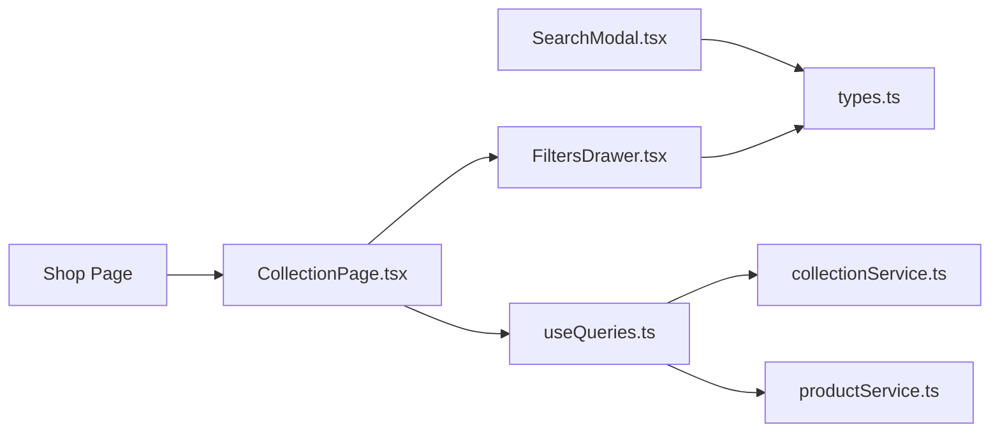

# Advanced Search & Filtering

<cite>
**Referenced Files in This Document**   
- [SearchModal.tsx](file://components/SearchModal.tsx)
- [FiltersDrawer.tsx](file://components/FiltersDrawer.tsx)
- [CollectionPage.tsx](file://components/CollectionPage.tsx)
- [collectionService.ts](file://src/api/collectionService.ts)
- [useQueries.ts](file://src/hooks/useQueries.ts)
- [productService.ts](file://src/api/productService.ts)
- [types.ts](file://types.ts)
- [shop/page.tsx](file://app/shop/page.tsx)
</cite>

## Table of Contents
1. [Introduction](#introduction)
2. [Project Structure](#project-structure)
3. [Core Components](#core-components)
4. [Architecture Overview](#architecture-overview)
5. [Detailed Component Analysis](#detailed-component-analysis)
6. [Dependency Analysis](#dependency-analysis)
7. [Performance Considerations](#performance-considerations)
8. [Troubleshooting Guide](#troubleshooting-guide)
9. [Conclusion](#conclusion)

## Introduction
This document explains the advanced search and filtering system for product discovery, including:
- Faceted filtering by brand, price range, size, color, category, and custom attributes
- Dynamic filter generation based on product categories
- Search modal with autocomplete and fuzzy matching
- Database-level query composition for performance at scale
- Integration with Supabase and PostgreSQL query optimization techniques

The implementation combines a client-side search modal with server-side faceted queries, ensuring responsive UI while delegating heavy lifting to the database.

## Project Structure
The search and filtering features are implemented across UI components, services, hooks, and types:
- UI layer: Search modal and filters drawer
- Page orchestration: Shop page and collection page
- Data layer: Collection service and product service
- State/cache: React Query hooks
- Types: Product and FilterOptions models

**Diagram sources**
- [SearchModal.tsx:1-120](file://components/SearchModal.tsx#L1-L120)
- [FiltersDrawer.tsx:1-552](file://components/FiltersDrawer.tsx#L1-L552)
- [CollectionPage.tsx:1-725](file://components/CollectionPage.tsx#L1-L725)
- [collectionService.ts:1-800](file://src/api/collectionService.ts#L1-L800)
- [productService.ts:754-868](file://src/api/productService.ts#L754-L868)
- [useQueries.ts:72-82](file://src/hooks/useQueries.ts#L72-L82)
- [types.ts:226-239](file://types.ts#L226-L239)
- [shop/page.tsx:1-72](file://app/shop/page.tsx#L1-L72)

**Section sources**
- [SearchModal.tsx:1-120](file://components/SearchModal.tsx#L1-L120)
- [FiltersDrawer.tsx:1-552](file://components/FiltersDrawer.tsx#L1-L552)
- [CollectionPage.tsx:1-725](file://components/CollectionPage.tsx#L1-L725)
- [collectionService.ts:1-800](file://src/api/collectionService.ts#L1-L800)
- [useQueries.ts:72-82](file://src/hooks/useQueries.ts#L72-L82)
- [types.ts:226-239](file://types.ts#L226-L239)
- [shop/page.tsx:1-72](file://app/shop/page.tsx#L1-L72)

## Core Components
- SearchModal: Client-side search with autocomplete suggestions and fuzzy substring matching against title, category, and fabric fields.
- FiltersDrawer: Faceted filter UI supporting brand, fabric, price range, size, rating, and more.
- CollectionPage: Orchestrates filters, sorting, pagination, and infinite scroll; composes query parameters and renders results.
- collectionService: Builds Supabase queries with base filters, sorting, and pagination; formats products and images.
- useQueries: Provides cached queries for collections and product information.
- productService: Handles product data retrieval and dynamic attribute handling for product details.
- types: Defines Product and FilterOptions structures used throughout the app.

**Section sources**
- [SearchModal.tsx:1-120](file://components/SearchModal.tsx#L1-L120)
- [FiltersDrawer.tsx:1-552](file://components/FiltersDrawer.tsx#L1-L552)
- [CollectionPage.tsx:1-725](file://components/CollectionPage.tsx#L1-L725)
- [collectionService.ts:1-800](file://src/api/collectionService.ts#L1-L800)
- [productService.ts:754-868](file://src/api/productService.ts#L754-L868)
- [useQueries.ts:72-82](file://src/hooks/useQueries.ts#L72-L82)
- [types.ts:15-65](file://types.ts#L15-L65)
- [types.ts:226-239](file://types.ts#L226-L239)

## Architecture Overview
The search and filtering architecture follows a layered approach:
- UI layer: SearchModal and FiltersDrawer collect user input.
- Orchestration: CollectionPage manages state, builds query params, and triggers data fetching.
- Data layer: collectionService composes Supabase queries with filters, sorts, and pagination.
- Caching: useQueries provides TanStack Query caching for efficient re-renders.
- Types: Shared interfaces ensure consistent data shapes.

**Diagram sources**
- [SearchModal.tsx:12-28](file://components/SearchModal.tsx#L12-L28)
- [FiltersDrawer.tsx:49-108](file://components/FiltersDrawer.tsx#L49-L108)
- [CollectionPage.tsx:37-101](file://components/CollectionPage.tsx#L37-L101)
- [useQueries.ts:72-82](file://src/hooks/useQueries.ts#L72-L82)
- [collectionService.ts:156-221](file://src/api/collectionService.ts#L156-L221)

## Detailed Component Analysis

### Search Modal (Autocomplete and Fuzzy Matching)
- Autocomplete: Popular search terms are presented when the input is empty.
- Fuzzy matching: Substring matching across title, category, and fabric fields.
- Result selection: Clicking a result navigates to the product detail page.

**Diagram sources**
- [SearchModal.tsx:17-28](file://components/SearchModal.tsx#L17-L28)
- [SearchModal.tsx:61-84](file://components/SearchModal.tsx#L61-L84)
- [SearchModal.tsx:85-113](file://components/SearchModal.tsx#L85-L113)

**Section sources**
- [SearchModal.tsx:1-120](file://components/SearchModal.tsx#L1-L120)

### Filters Drawer (Faceted Filtering)
- Supported facets: Brand, Fabric, Price Range, Size, Reseller Rating, plus optional stitching status, piece count, color, occasion, discount ranges, and stock availability.
- Local state management: Each facet toggles values and updates local filters before applying.
- Apply/Clear actions: Submit filters to parent component or reset to defaults.

**Diagram sources**
- [FiltersDrawer.tsx:49-108](file://components/FiltersDrawer.tsx#L49-L108)
- [types.ts:226-239](file://types.ts#L226-L239)

**Section sources**
- [FiltersDrawer.tsx:1-552](file://components/FiltersDrawer.tsx#L1-L552)
- [types.ts:226-239](file://types.ts#L226-L239)

### Collection Page (Orchestration and Infinite Scroll)
- Manages active filters, sorting options, and grid layout.
- Composes query parameters and triggers paginated fetch via useQueries.
- Implements infinite scroll by incrementing page index when near bottom.
- Displays active filter chips and allows removal per facet.

**Diagram sources**
- [CollectionPage.tsx:37-101](file://components/CollectionPage.tsx#L37-L101)
- [CollectionPage.tsx:107-121](file://components/CollectionPage.tsx#L107-L121)
- [useQueries.ts:72-82](file://src/hooks/useQueries.ts#L72-L82)

**Section sources**
- [CollectionPage.tsx:1-725](file://components/CollectionPage.tsx#L1-L725)
- [useQueries.ts:72-82](file://src/hooks/useQueries.ts#L72-L82)

### Collection Service (Database-Level Filtering and Sorting)
- Parses URL category into database category/subcategory.
- Applies base filters: status, category, subcategory, brand, fabrics, stitching statuses, piece counts, price range, min reseller rating.
- Supports sorting by featured/newest/price-low/high/best-discount/most-popular.
- Paginates using range and returns hasMore and totalCount.
- Formats products, calculates discounts, aggregates variant stock, and batches image fetching.

**Diagram sources**
- [collectionService.ts:33-73](file://src/api/collectionService.ts#L33-L73)
- [collectionService.ts:79-136](file://src/api/collectionService.ts#L79-L136)
- [collectionService.ts:156-221](file://src/api/collectionService.ts#L156-L221)
- [collectionService.ts:228-316](file://src/api/collectionService.ts#L228-L316)

**Section sources**
- [collectionService.ts:1-800](file://src/api/collectionService.ts#L1-L800)

### Product Information and Dynamic Attributes
- Retrieves product details including custom attributes, category attribute values, and variants.
- Uses PostgREST embedding with fallback logic for relationship resolution issues.
- Maps raw rows to display-ready structures with sorted attributes and variants.

**Diagram sources**
- [productService.ts:754-868](file://src/api/productService.ts#L754-L868)

**Section sources**
- [productService.ts:754-868](file://src/api/productService.ts#L754-L868)

### Shop Page (URL-Based Brand Filtering)
- Reads category and brand from URL search params.
- Updates route when brand changes, syncing category title accordingly.
- Passes brand filter down to CollectionPage.

**Section sources**
- [shop/page.tsx:1-72](file://app/shop/page.tsx#L1-L72)

## Dependency Analysis
Key dependencies and relationships:
- SearchModal depends on Product type and mock data for suggestions.
- FiltersDrawer depends on FilterOptions type and provides UI for facets.
- CollectionPage depends on FiltersDrawer, useQueries, and collectionService.
- useQueries wraps collectionService and productService for caching.
- collectionService interacts with Supabase and formats data for UI.
- productService handles product details and dynamic attributes.

**Diagram sources**
- [SearchModal.tsx:1-120](file://components/SearchModal.tsx#L1-L120)
- [FiltersDrawer.tsx:1-552](file://components/FiltersDrawer.tsx#L1-L552)
- [CollectionPage.tsx:1-725](file://components/CollectionPage.tsx#L1-L725)
- [useQueries.ts:72-82](file://src/hooks/useQueries.ts#L72-L82)
- [collectionService.ts:1-800](file://src/api/collectionService.ts#L1-L800)
- [productService.ts:754-868](file://src/api/productService.ts#L754-L868)
- [shop/page.tsx:1-72](file://app/shop/page.tsx#L1-L72)

**Section sources**
- [SearchModal.tsx:1-120](file://components/SearchModal.tsx#L1-L120)
- [FiltersDrawer.tsx:1-552](file://components/FiltersDrawer.tsx#L1-L552)
- [CollectionPage.tsx:1-725](file://components/CollectionPage.tsx#L1-L725)
- [useQueries.ts:72-82](file://src/hooks/useQueries.ts#L72-L82)
- [collectionService.ts:1-800](file://src/api/collectionService.ts#L1-L800)
- [productService.ts:754-868](file://src/api/productService.ts#L754-L868)
- [shop/page.tsx:1-72](file://app/shop/page.tsx#L1-L72)

## Performance Considerations
- Database-level filtering: All major facets (brand, fabric, stitching, piece count, price range, rating) are applied server-side to reduce payload size and improve response times.
- Pagination and infinite scroll: Range-based pagination prevents loading entire catalogs; infinite scroll loads additional pages as users scroll.
- Image batching: Thumbnail images are fetched separately for selected products to avoid large serialized payloads.
- Caching: TanStack Query caches collection results for 3 minutes, reducing redundant network requests.
- Sorting: Server-side sorting leverages indexed columns (e.g., created_at, average_rating, surplus_selling_price).

Recommendations for further optimization:
- Add database indexes on frequently filtered columns: brand, category, subcategory, fabric, surplus_selling_price, average_rating.
- Implement full-text search using tsvector/tsquery for title/description fields to support fuzzy matching at scale.
- Use materialized views or precomputed aggregations for high-cardinality facets like brands and fabrics.
- Leverage Postgres GIN indexes for JSONB attributes if expanding dynamic attributes significantly.

[No sources needed since this section provides general guidance]

## Troubleshooting Guide
Common issues and resolutions:
- Empty results after applying filters: Verify that filter values match database entries; consider broadening criteria or clearing filters.
- Slow initial load: Ensure database indexes exist on filtered columns; check network latency and payload sizes.
- Incorrect category mapping: Confirm parseShopCategoryUrl logic aligns with URL patterns and database category names.
- Missing images: Batch image fetching may fail for some products; fallback logic should provide default images.

**Section sources**
- [collectionService.ts:79-136](file://src/api/collectionService.ts#L79-L136)
- [collectionService.ts:228-316](file://src/api/collectionService.ts#L228-L316)

## Conclusion
The advanced search and filtering system combines a responsive client-side search modal with robust server-side faceted queries. The architecture ensures scalability through database-level filtering, pagination, and caching. Future enhancements can include full-text search indexing and expanded dynamic attribute support to handle larger catalogs efficiently.

[No sources needed since this section summarizes without analyzing specific files]