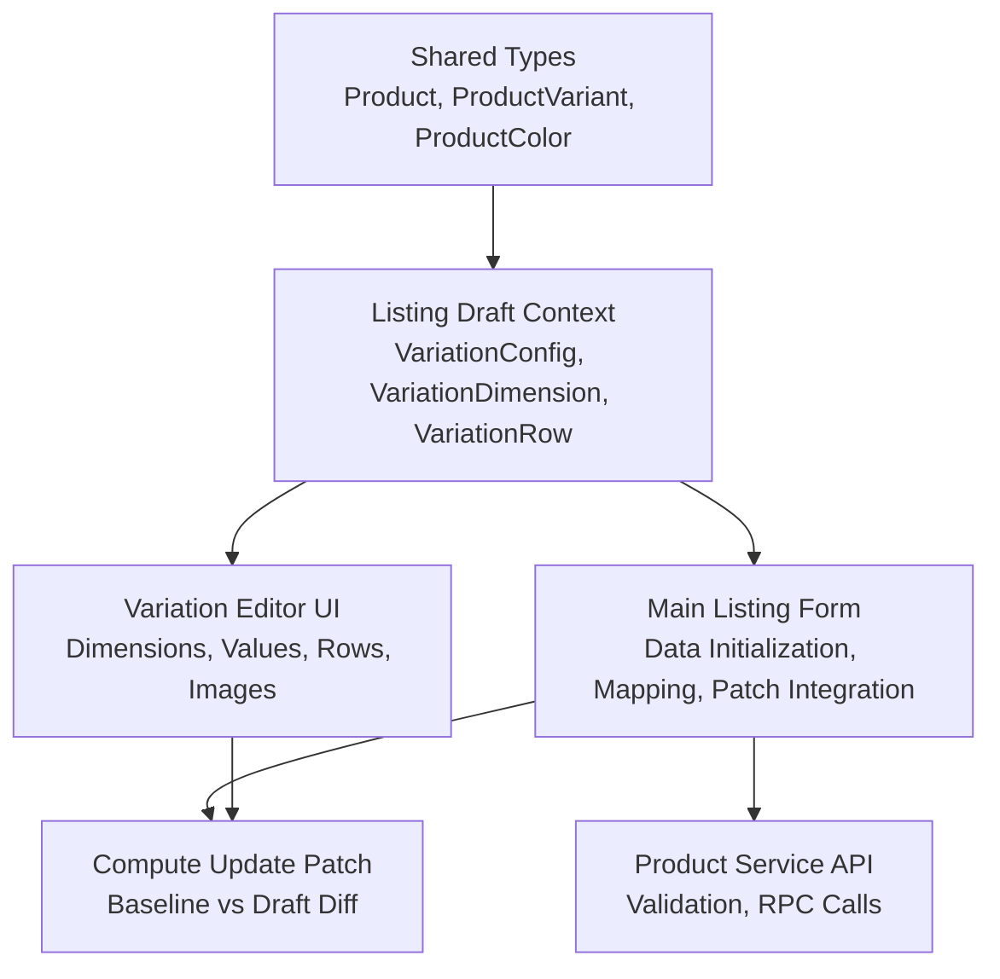
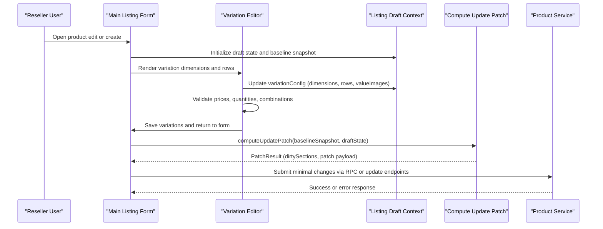
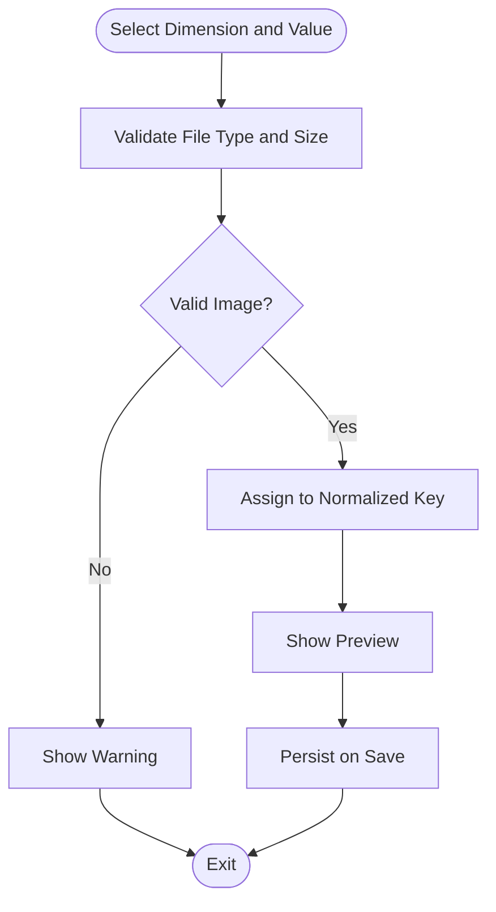
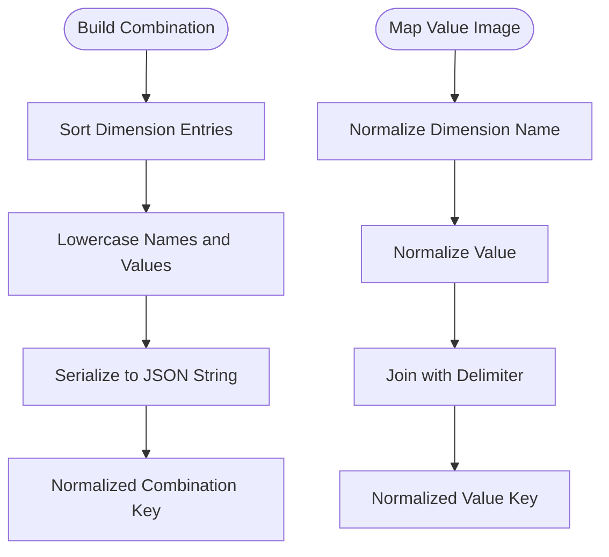
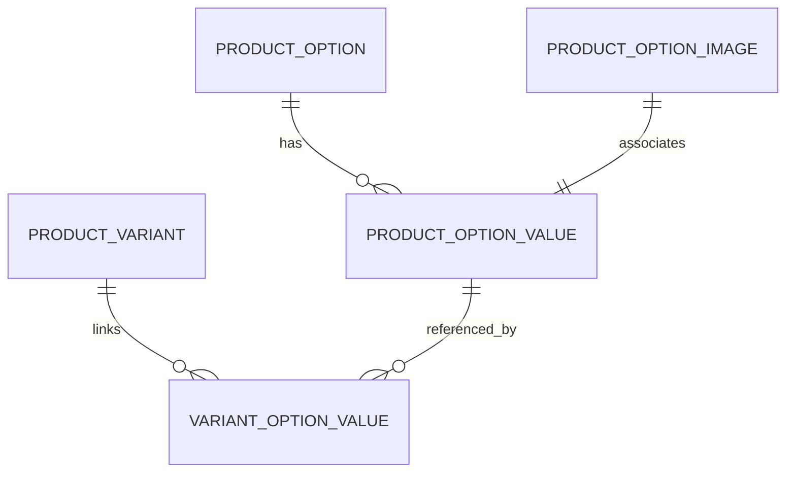
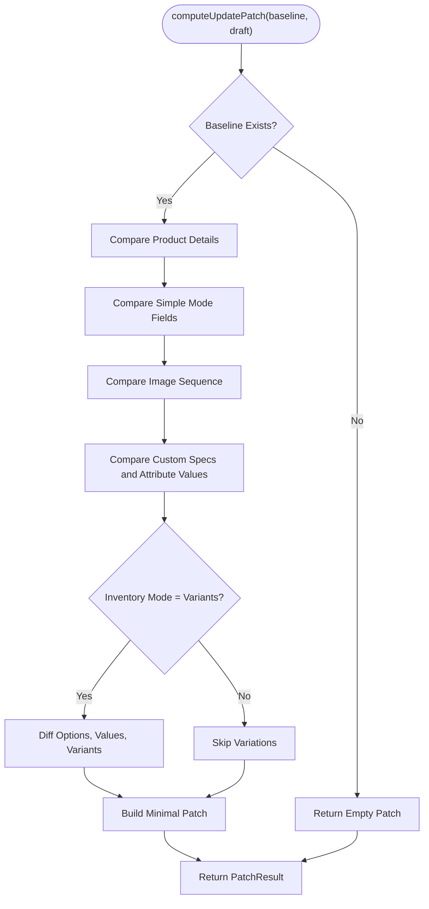
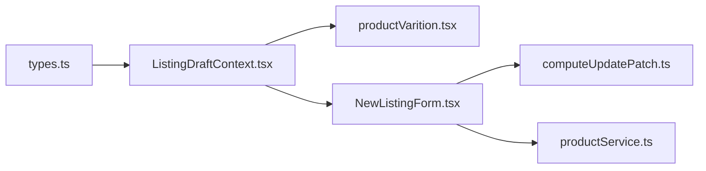

# Product Variants System

<cite>
**Referenced Files in This Document**
- [types.ts](file://types.ts)
- [ListingDraftContext.tsx](file://components/reseller/context/ListingDraftContext.tsx)
- [productVarition.tsx](file://components/reseller/components/productVarition.tsx)
- [NewListingForm.tsx](file://components/reseller/components/NewListingForm.tsx)
- [computeUpdatePatch.ts](file://src/utils/computeUpdatePatch.ts)
- [productService.ts](file://src/api/productService.ts)
</cite>

## Table of Contents
1. [Introduction](#introduction)
2. [Project Structure](#project-structure)
3. [Core Components](#core-components)
4. [Architecture Overview](#architecture-overview)
5. [Detailed Component Analysis](#detailed-component-analysis)
6. [Dependency Analysis](#dependency-analysis)
7. [Performance Considerations](#performance-considerations)
8. [Troubleshooting Guide](#troubleshooting-guide)
9. [Conclusion](#conclusion)

## Introduction
This document explains the advanced product variants system used by the reseller listing and editing flows. It covers multi-dimensional attributes such as size, color, and custom specifications; dimension-based filtering; value image associations; normalization of variation keys; variant-specific pricing and inventory tracking; and efficient data synchronization through a patch computation utility.

The system supports:
- Multi-dimensional product configurations using Cartesian combinations of enabled dimensions.
- Variant rows with per-combination selling price and quantity.
- Special handling for “Unstitched” products where size is not applicable.
- Option-value images associated with specific dimension values.
- A normalized key strategy to avoid collisions across dimensions and values.
- A computeUpdatePatch utility that compares baseline snapshots against draft state and emits only changed sections.

## Project Structure
The variants system spans several layers:
- Type definitions and shared utilities define the core interfaces and helpers.
- The listing draft context holds form state, variation configuration, and section loading status.
- The variation editor UI manages dimensions, values, combination rows, validation, and value images.
- The main listing form initializes legacy and new schema data, maps database options/values to variation structures, and integrates patch computation.
- The product service enforces server-side constraints for variation creation and updates.



**Diagram sources**
- [types.ts:1-65](file://types.ts#L1-L65)
- [ListingDraftContext.tsx:34-76](file://components/reseller/context/ListingDraftContext.tsx#L34-L76)
- [productVarition.tsx:32-48](file://components/reseller/components/productVarition.tsx#L32-L48)
- [NewListingForm.tsx:336-430](file://components/reseller/components/NewListingForm.tsx#L336-L430)
- [computeUpdatePatch.ts:195-564](file://src/utils/computeUpdatePatch.ts#L195-L564)
- [productService.ts:1245-1273](file://src/api/productService.ts#L1245-L1273)

**Section sources**
- [types.ts:1-65](file://types.ts#L1-L65)
- [ListingDraftContext.tsx:34-76](file://components/reseller/context/ListingDraftContext.tsx#L34-L76)
- [productVarition.tsx:32-48](file://components/reseller/components/productVarition.tsx#L32-L48)
- [NewListingForm.tsx:336-430](file://components/reseller/components/NewListingForm.tsx#L336-L430)
- [computeUpdatePatch.ts:195-564](file://src/utils/computeUpdatePatch.ts#L195-L564)
- [productService.ts:1245-1273](file://src/api/productService.ts#L1245-L1273)

## Core Components
This section documents the primary types and their roles in the variants system.

- VariationDimension: Represents a single attribute dimension (e.g., Color, Size, Material). It includes an identifier, display name, enabled flag, list of values, optional database identifiers, reference metadata, and a mapping from value text to database ID.
- VariationRow: Represents one combination row derived from enabled dimensions. It carries a normalized key, optional color and size shortcuts, full attributes map, per-row price and quantity, optional database ID, active state, and optional image reference.
- VariationConfig: Holds the complete variation configuration including dimensions, selected image dimension, value-to-image mappings, rows, and backward-compatible flags for color and size usage plus legacy arrays.

These types are defined centrally and consumed by both the variation editor and the listing form.

```mermaid
classDiagram
class VariationDimension {
+string id
+string name
+boolean enabled
+string[] values
+string dbId
+string ref
+Record~string,string~ valueIds
}
class VariationRow {
+string key
+string color
+string size
+Record~string,string~ attributes
+number|'' price
+number|'' quantity
+string image
+string dbId
+boolean isActive
}
class VariationConfig {
+VariationDimension[] dimensions
+string imageDimension
+Record~string,{ file?, storagePath?, imageUrl?, previewUrl?, id? } valueImages
+VariationRow[] rows
+boolean useColor
+boolean useSize
+string[] colors
+string[] sizes
}
VariationConfig --> VariationDimension : "contains"
VariationConfig --> VariationRow : "contains"
```

**Diagram sources**
- [ListingDraftContext.tsx:34-76](file://components/reseller/context/ListingDraftContext.tsx#L34-L76)

**Section sources**
- [ListingDraftContext.tsx:34-76](file://components/reseller/context/ListingDraftContext.tsx#L34-L76)

## Architecture Overview
The variants architecture connects user interactions in the listing forms to normalized data structures and backend persistence.



**Diagram sources**
- [NewListingForm.tsx:606-681](file://components/reseller/components/NewListingForm.tsx#L606-L681)
- [productVarition.tsx:679-778](file://components/reseller/components/productVarition.tsx#L679-L778)
- [computeUpdatePatch.ts:195-564](file://src/utils/computeUpdatePatch.ts#L195-L564)
- [productService.ts:1245-1273](file://src/api/productService.ts#L1245-L1273)

## Detailed Component Analysis

### VariationConfig Interface
VariationConfig centralizes all variation-related state:
- Dimensions: Array of VariationDimension objects describing available attribute axes.
- Image Dimension: Selected dimension whose values can have associated images.
- Value Images: Map from normalized dimension+value keys to image metadata (File, storage path, URL, preview URL, DB ID).
- Rows: Array of VariationRow representing each valid combination.
- Legacy Compatibility: Flags and arrays for useColor/useSize and colors/sizes to support older schemas.

Key responsibilities:
- Provide a single source of truth for variation structure during editing.
- Support migration from legacy color/size fields to generic dimensions.
- Carry value images for option-level thumbnails.

**Section sources**
- [ListingDraftContext.tsx:56-76](file://components/reseller/context/ListingDraftContext.tsx#L56-L76)
- [productVarition.tsx:140-164](file://components/reseller/components/productVarition.tsx#L140-L164)
- [productVarition.tsx:765-774](file://components/reseller/components/productVarition.tsx#L765-L774)

### VariationDimension Structure
VariationDimension models a single attribute axis:
- Identifier and display name.
- Enabled flag controlling whether it participates in combination generation.
- List of string values.
- Optional database ID and reference metadata.
- Value-to-database-ID mapping for existing products.

Usage patterns:
- New dimensions can be added dynamically unless the product already has database-backed variations.
- Values are validated for uniqueness, length, and projected combination limits.
- Removing or toggling a dimension recomputes rows while preserving existing row metadata when possible.

**Section sources**
- [ListingDraftContext.tsx:34-42](file://components/reseller/context/ListingDraftContext.tsx#L34-L42)
- [productVarition.tsx:399-485](file://components/reseller/components/productVarition.tsx#L399-L485)
- [productVarition.tsx:487-564](file://components/reseller/components/productVarition.tsx#L487-L564)

### VariationRow Management
VariationRow represents a concrete combination:
- Normalized key ensures stable identity across dimension/value permutations.
- Convenience fields for color and size extraction.
- Full attributes map for arbitrary dimension names and values.
- Per-row price and quantity with validation rules.
- Optional database ID and active state for existing variants.

Combination generation:
- Cartesian product of enabled dimensions produces all combinations.
- Existing row metadata (price, quantity, DB ID, active state) is preserved when dimensions change.
- Row keys are built by sorting dimension entries and lowercasing both names and values to prevent collisions.

Validation:
- Every row must have a positive price.
- Total quantity across rows must be greater than zero.
- Price inputs accept decimal numbers up to two places and enforce upper bounds.
- Quantity inputs accept integers and sanitize non-numeric characters.

**Section sources**
- [ListingDraftContext.tsx:44-54](file://components/reseller/context/ListingDraftContext.tsx#L44-L54)
- [productVarition.tsx:225-279](file://components/reseller/components/productVarition.tsx#L225-L279)
- [productVarition.tsx:629-677](file://components/reseller/components/productVarition.tsx#L629-L677)
- [productVarition.tsx:679-778](file://components/reseller/components/productVarition.tsx#L679-L778)

### Complex Product Configurations and Pricing Strategies
The system supports multiple attribute combinations:
- For example, Size × Color generates a grid of rows where each cell corresponds to a unique combination.
- Each row can have its own selling price and stock quantity.
- The real-time price range is computed from valid row prices, independent of the parent product’s base price.

Special cases:
- “Unstitched” products do not require a size dimension. The listing form defines a sentinel value for no-size scenarios and provides collection type options tailored to unstitched categories.
- When converting between simple and variant modes, the system preserves relevant data and validates constraints before submission.

**Section sources**
- [NewListingForm.tsx:122-233](file://components/reseller/components/NewListingForm.tsx#L122-L233)
- [productVarition.tsx:395-397](file://components/reseller/components/productVarition.tsx#L395-L397)
- [productService.ts:1245-1273](file://src/api/productService.ts#L1245-L1273)

### Dimension-Based Filtering and Value Image Associations
Dimension-based filtering:
- Only enabled dimensions with at least one value participate in combination generation.
- Adding a value triggers projection of total combinations to enforce maximum limits.
- Removing or disabling a dimension recalculates rows and cleans up related value images.

Value image associations:
- Users can associate one image per option value.
- Images can be uploaded directly or selected from the gallery.
- On edit mode, the system loads existing option images from the database and maps them back to dimension+value keys.
- The first saved image per option value is retained when duplicates exist.



**Diagram sources**
- [productVarition.tsx:566-627](file://components/reseller/components/productVarition.tsx#L566-L627)
- [productVarition.tsx:287-354](file://components/reseller/components/productVarition.tsx#L287-L354)

**Section sources**
- [productVarition.tsx:566-627](file://components/reseller/components/productVarition.tsx#L566-L627)
- [productVarition.tsx:287-354](file://components/reseller/components/productVarition.tsx#L287-L354)

### Normalization Process for Variation Keys
Normalization ensures consistent identification of combinations and value images:
- Combination keys are generated by sorting dimension entries alphabetically and lowercasing both dimension names and values, then serializing to JSON.
- Value image keys follow a pattern combining normalized dimension name and value separated by a delimiter.
- This approach prevents collisions when dimension order changes or when different casing is used.



**Diagram sources**
- [productVarition.tsx:241-248](file://components/reseller/components/productVarition.tsx#L241-L248)
- [ListingDraftContext.tsx:78-84](file://components/reseller/context/ListingDraftContext.tsx#L78-L84)

**Section sources**
- [productVarition.tsx:241-248](file://components/reseller/components/productVarition.tsx#L241-L248)
- [ListingDraftContext.tsx:78-84](file://components/reseller/context/ListingDraftContext.tsx#L78-L84)

### Database Schema Relationships: Options, Values, and Variants
The frontend maps database entities to variation structures:
- Product options represent dimensions.
- Product option values represent dimension values.
- Product variants represent combinations linking multiple option values.
- Option images link option values to images.

Frontend mapping highlights:
- Dimensions are constructed from product options, including value lists and value-to-ID mappings.
- Rows are constructed from product variants, resolving option value IDs to dimension names and values.
- If a legacy combination key exists, it is parsed to reconstruct attributes.
- Active variants are filtered to determine which option values are considered in use.



**Diagram sources**
- [NewListingForm.tsx:341-430](file://components/reseller/components/NewListingForm.tsx#L341-L430)
- [NewListingForm.tsx:771-839](file://components/reseller/components/NewListingForm.tsx#L771-L839)
- [productVarition.tsx:287-354](file://components/reseller/components/productVarition.tsx#L287-L354)

**Section sources**
- [NewListingForm.tsx:341-430](file://components/reseller/components/NewListingForm.tsx#L341-L430)
- [NewListingForm.tsx:771-839](file://components/reseller/components/NewListingForm.tsx#L771-L839)
- [productVarition.tsx:287-354](file://components/reseller/components/productVarition.tsx#L287-L354)

### computeUpdatePatch Utility
The computeUpdatePatch utility computes minimal changes between a baseline snapshot and current draft state:
- Compares product details (title, description, defect).
- Compares simple product pricing and stock if inventory mode is simple.
- Compares image sequences and detects additions or deletions.
- Compares custom specifications and attribute values by ID.
- Compares variations when inventory mode is variants, detecting option renames, value renames, new values, removed values, variant price/quantity changes, new variants, and deactivated variants.

It returns:
- A patch object containing only changed sections.
- A boolean indicating whether the patch is empty.
- A set of dirty section names for targeted UI updates.



**Diagram sources**
- [computeUpdatePatch.ts:195-564](file://src/utils/computeUpdatePatch.ts#L195-L564)

**Section sources**
- [computeUpdatePatch.ts:195-564](file://src/utils/computeUpdatePatch.ts#L195-L564)

### Examples: Creating Products with Multiple Dimensions
Example scenario: Size × Color
- Add two dimensions: Size and Color.
- Add values like S/M/L/XL for Size and Red/Green/Blue for Color.
- The system generates all combinations and creates rows with default or inherited prices and quantities.
- Users can adjust per-row prices and stock.
- Optionally assign images to specific color values.

Handling “Unstitched” products
- Use the “Unstitched” product type to indicate no size requirement.
- The listing form provides specialized collection type options for unstitched categories.
- Size dimension may be omitted or disabled, and the system treats the product as a single-variant item without size selection.

Managing variant-specific images and pricing
- Select a dimension for value images (e.g., Color).
- Upload or select an image for each color value.
- Set per-row prices and quantities for each combination.
- Save variations to persist the configuration and images.

**Section sources**
- [productVarition.tsx:399-564](file://components/reseller/components/productVarition.tsx#L399-L564)
- [productVarition.tsx:566-778](file://components/reseller/components/productVarition.tsx#L566-L778)
- [NewListingForm.tsx:122-233](file://components/reseller/components/NewListingForm.tsx#L122-L233)

## Dependency Analysis
The variants system exhibits clear layering and separation of concerns:
- Shared types provide a stable contract between components.
- The listing draft context centralizes state and exposes hooks for consumers.
- The variation editor depends on the context and performs local validation and UI logic.
- The main listing form orchestrates data initialization, mapping, and integration with the patch utility and product service.
- The product service enforces server-side constraints and interacts with the database via RPCs.



**Diagram sources**
- [types.ts:1-65](file://types.ts#L1-L65)
- [ListingDraftContext.tsx:34-76](file://components/reseller/context/ListingDraftContext.tsx#L34-L76)
- [productVarition.tsx:18-26](file://components/reseller/components/productVarition.tsx#L18-L26)
- [NewListingForm.tsx:36-50](file://components/reseller/components/NewListingForm.tsx#L36-L50)
- [computeUpdatePatch.ts:1-51](file://src/utils/computeUpdatePatch.ts#L1-L51)
- [productService.ts:1245-1273](file://src/api/productService.ts#L1245-L1273)

**Section sources**
- [types.ts:1-65](file://types.ts#L1-L65)
- [ListingDraftContext.tsx:34-76](file://components/reseller/context/ListingDraftContext.tsx#L34-L76)
- [productVarition.tsx:18-26](file://components/reseller/components/productVarition.tsx#L18-L26)
- [NewListingForm.tsx:36-50](file://components/reseller/components/NewListingForm.tsx#L36-L50)
- [computeUpdatePatch.ts:1-51](file://src/utils/computeUpdatePatch.ts#L1-L51)
- [productService.ts:1245-1273](file://src/api/productService.ts#L1245-L1273)

## Performance Considerations
- Cartesian combination generation scales multiplicatively with enabled dimensions and values. Enforce maximum limits to prevent excessive row counts.
- Normalization operations (sorting, lowercasing, JSON serialization) are lightweight but should be applied consistently to avoid redundant computations.
- Image processing should validate file types and sizes early to reduce memory overhead.
- Patch computation avoids unnecessary network calls by emitting only changed sections.
- Preserve existing row metadata when dimensions change to minimize re-renders and user effort.

[No sources needed since this section provides general guidance]

## Troubleshooting Guide
Common issues and resolutions:
- Missing dimensions or values: Ensure at least one enabled dimension with values before saving variations.
- Invalid prices: Every row must have a positive numeric price; decimals are allowed up to two places.
- Zero total quantity: At least one row must have a positive integer quantity.
- Exceeded combination limit: Adding a value may exceed the maximum number of combinations; remove values or disable dimensions.
- Existing product restrictions: For products with database-backed variations, adding/removing dimensions or disabling them is restricted to preserve SKU integrity.
- Image upload errors: Validate file type and size; ensure only one image per option value.

**Section sources**
- [productVarition.tsx:679-778](file://components/reseller/components/productVarition.tsx#L679-L778)
- [productService.ts:1245-1273](file://src/api/productService.ts#L1245-L1273)

## Conclusion
The advanced product variants system provides a robust framework for managing multi-dimensional product configurations. It combines flexible dimension management, precise normalization strategies, rich value image associations, and efficient patch computation to deliver a responsive and reliable editing experience. By adhering to validation rules and leveraging the provided interfaces, resellers can configure complex products with accurate pricing and inventory tracking while maintaining data consistency across the frontend and backend.

[No sources needed since this section summarizes without analyzing specific files]