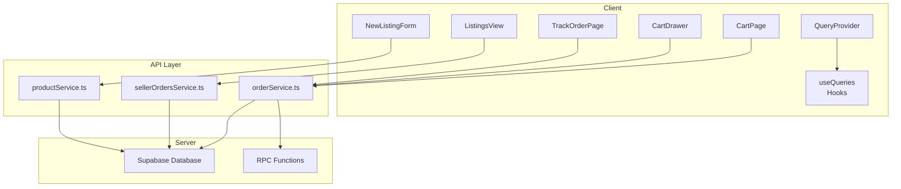
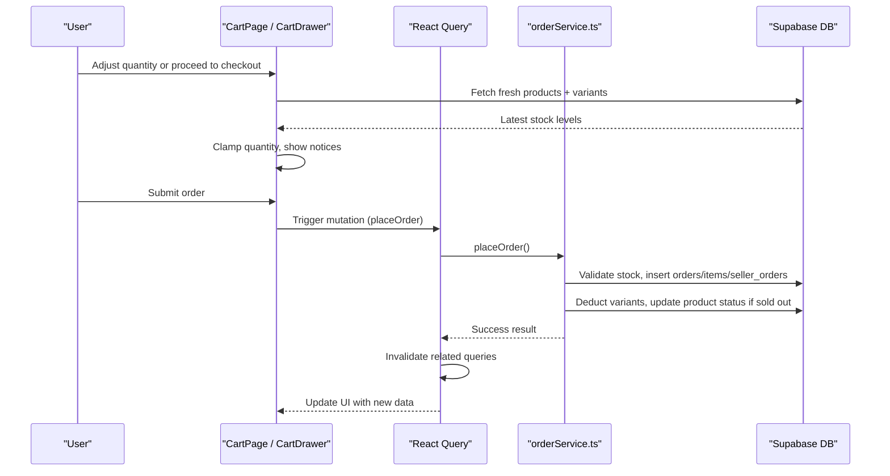
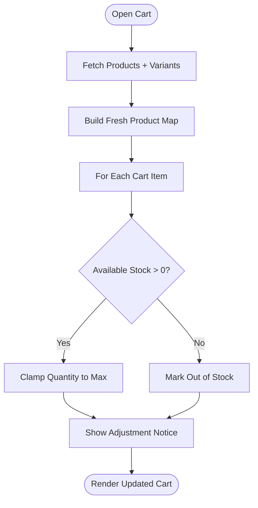
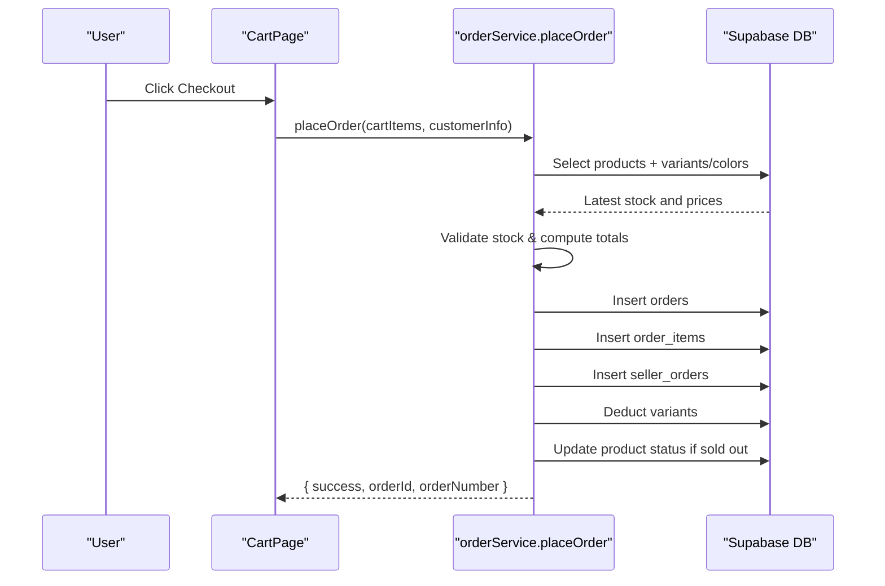
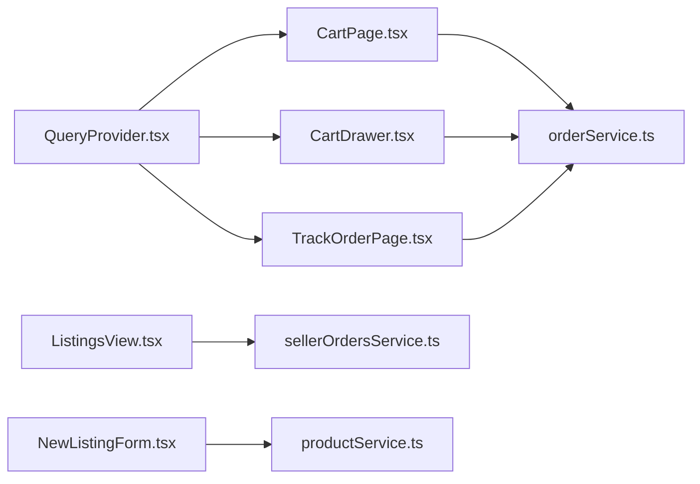

# Real-time Features

<cite>
**Referenced Files in This Document**
- [QueryProvider.tsx](file://src/providers/QueryProvider.tsx)
- [page.tsx (Product Page)](file://app/product/[id]/page.tsx)
- [useQueries.ts](file://src/hooks/useQueries.ts)
- [CartPage.tsx](file://components/CartPage.tsx)
- [CartDrawer.tsx](file://components/CartDrawer.tsx)
- [orderService.ts](file://src/api/orderService.ts)
- [sellerOrdersService.ts](file://src/api/sellerOrdersService.ts)
- [TrackOrderPage.tsx](file://components/TrackOrderPage.tsx)
- [ListingsView.tsx](file://components/reseller/components/ListingsView.tsx)
- [NewListingForm.tsx](file://components/reseller/components/NewListingForm.tsx)
- [productService.ts](file://src/api/productService.ts)
</cite>

## Table of Contents
1. [Introduction](#introduction)
2. [Project Structure](#project-structure)
3. [Core Components](#core-components)
4. [Architecture Overview](#architecture-overview)
5. [Detailed Component Analysis](#detailed-component-analysis)
6. [Dependency Analysis](#dependency-analysis)
7. [Performance Considerations](#performance-considerations)
8. [Troubleshooting Guide](#troubleshooting-guide)
9. [Conclusion](#conclusion)

## Introduction
This document explains how the platform implements real-time-like experiences for live order updates, inventory synchronization, and notifications using React Query, optimistic UI patterns, and server-driven data flows. It also provides guidance on handling concurrent modifications, conflict resolution, state synchronization across multiple users, WebSocket-based push notifications, error handling, reconnection strategies, and performance optimization for high-frequency updates.

The codebase currently uses:
- React Query for caching, background refetching, and cache invalidation
- Direct Supabase client calls for stock validation and order operations
- RPC fallbacks for order status updates
- Server-side prefetching with hydration for product pages

Where native WebSockets are not yet implemented, this document outlines recommended integration points to enable true real-time updates.

## Project Structure
Real-time features span several layers:
- Providers and hooks configure React Query caching and query lifecycles
- Pages and components perform stock checks, cart validations, and order tracking
- API services encapsulate database interactions, RPC calls, and error mapping
- Reseller dashboards invalidate caches after mutations to keep views consistent

**Diagram sources**
- [QueryProvider.tsx:6-24](file://src/providers/QueryProvider.tsx#L6-L24)
- [useQueries.ts:76-82](file://src/hooks/useQueries.ts#L76-L82)
- [CartPage.tsx:120-196](file://components/CartPage.tsx#L120-L196)
- [CartDrawer.tsx:30-105](file://components/CartDrawer.tsx#L30-L105)
- [orderService.ts:403-759](file://src/api/orderService.ts#L403-L759)
- [sellerOrdersService.ts:387-413](file://src/api/sellerOrdersService.ts#L387-L413)
- [productService.ts:1600-1637](file://src/api/productService.ts#L1600-L1637)

**Section sources**
- [QueryProvider.tsx:6-24](file://src/providers/QueryProvider.tsx#L6-L24)
- [useQueries.ts:76-82](file://src/hooks/useQueries.ts#L76-L82)
- [CartPage.tsx:120-196](file://components/CartPage.tsx#L120-L196)
- [CartDrawer.tsx:30-105](file://components/CartDrawer.tsx#L30-L105)
- [orderService.ts:403-759](file://src/api/orderService.ts#L403-L759)
- [sellerOrdersService.ts:387-413](file://src/api/sellerOrdersService.ts#L387-L413)
- [productService.ts:1600-1637](file://src/api/productService.ts#L1600-L1637)

## Core Components
- React Query Provider: Initializes a QueryClient with default staleTime and refetchOnWindowFocus settings.
- Product page hydration: Prefetches product details server-side and hydrates the client with HydrationBoundary.
- Inventory sync in cart: Fetches fresh product and variant stock, clamps quantities, and shows notices when stock changes.
- Order placement: Validates stock, calculates pricing, inserts orders/items/seller_orders, deducts variants, and clears cart items.
- Order tracking: Public endpoint that returns sanitized order details and maps statuses for display.
- Seller order status update: Attempts RPC first, then falls back to direct table update.
- Cache invalidation: After mutations, invalidates relevant queries to refresh listings and storefront views.

**Section sources**
- [QueryProvider.tsx:6-24](file://src/providers/QueryProvider.tsx#L6-L24)
- [page.tsx (Product Page):10-29](file://app/product/[id]/page.tsx#L10-L29)
- [CartPage.tsx:120-196](file://components/CartPage.tsx#L120-L196)
- [CartDrawer.tsx:30-105](file://components/CartDrawer.tsx#L30-L105)
- [orderService.ts:403-759](file://src/api/orderService.ts#L403-L759)
- [orderService.ts:936-1042](file://src/api/orderService.ts#L936-L1042)
- [sellerOrdersService.ts:387-413](file://src/api/sellerOrdersService.ts#L387-L413)
- [ListingsView.tsx:257-263](file://components/reseller/components/ListingsView.tsx#L257-L263)
- [NewListingForm.tsx:1591-1595](file://components/reseller/components/NewListingForm.tsx#L1591-L1595)

## Architecture Overview
The system follows a client-server architecture with React Query as the data coordination layer. Real-time-like behavior is achieved through:
- Background refetching and stale-time policies
- Optimistic UI updates followed by cache invalidation
- Stock validation at checkout time
- Status mapping for public order tracking

**Diagram sources**
- [CartPage.tsx:120-196](file://components/CartPage.tsx#L120-L196)
- [CartDrawer.tsx:30-105](file://components/CartDrawer.tsx#L30-L105)
- [orderService.ts:403-759](file://src/api/orderService.ts#L403-L759)

## Detailed Component Analysis

### React Query Provider Configuration
- Global defaults: staleTime set to 60 seconds; refetchOnWindowFocus disabled.
- Provides QueryClient instance via QueryClientProvider.

Recommendations for real-time:
- Add retry and retryDelay for network resilience.
- Use online/offline managers to pause/restart queries.
- Configure per-query staleTimes for high-frequency data.

**Section sources**
- [QueryProvider.tsx:6-24](file://src/providers/QueryProvider.tsx#L6-L24)

### Server-Side Data Prefetching and Hydration
- Product page creates a per-request QueryClient and prefetches product data.
- Hydrates the client with dehydrated state for fast initial render.

Best practices:
- Keep query keys stable and scoped to resource identifiers.
- Use HydrationBoundary to avoid double-fetching.

**Section sources**
- [page.tsx (Product Page):10-29](file://app/product/[id]/page.tsx#L10-L29)

### Inventory Synchronization in Cart
- On mount/open, fetches latest product and variant stock.
- Clamps item quantities to available stock and displays notices.
- Uses local state to track fresh product map and adjusted notices.

Optimization tips:
- Debounce rapid quantity changes.
- Batch product IDs into a single query.
- Consider polling or WebSocket updates for live stock.

**Diagram sources**
- [CartPage.tsx:120-196](file://components/CartPage.tsx#L120-L196)
- [CartDrawer.tsx:30-105](file://components/CartDrawer.tsx#L30-L105)

**Section sources**
- [CartPage.tsx:120-196](file://components/CartPage.tsx#L120-L196)
- [CartDrawer.tsx:30-105](file://components/CartDrawer.tsx#L30-L105)

### Order Placement Flow and Conflict Handling
- Validates stock against current DB records.
- Calculates pricing from DB fields and aggregates seller totals.
- Inserts orders, order_items, and seller_orders atomically.
- Deducts variant quantities and updates product status to Sold Out if needed.
- Clears purchased items from user’s cart.

Conflict handling:
- Client-side stock validation prevents overselling.
- RPC errors and validation messages are surfaced to users.

**Diagram sources**
- [orderService.ts:403-759](file://src/api/orderService.ts#L403-L759)

**Section sources**
- [orderService.ts:403-759](file://src/api/orderService.ts#L403-L759)

### Live Order Tracking
- Public tracking endpoint returns sanitized order details without sensitive PII.
- Maps internal order statuses to user-facing labels.
- Handles errors gracefully and returns user-friendly messages.

Implementation notes:
- Use rate limiting at the infrastructure level to prevent enumeration.
- Consider adding a small cache for frequent tracking lookups.

**Section sources**
- [orderService.ts:936-1042](file://src/api/orderService.ts#L936-L1042)
- [TrackOrderPage.tsx:46-63](file://components/TrackOrderPage.tsx#L46-L63)

### Seller Order Status Updates
- Attempts RPC update_seller_order_status first.
- Falls back to direct table update if RPC is unavailable.
- Logs warnings and continues with fallback.

Operational considerations:
- Ensure RPC functions are deployed and schema cache refreshed.
- Centralize error handling and user feedback.

**Section sources**
- [sellerOrdersService.ts:387-413](file://src/api/sellerOrdersService.ts#L387-L413)

### Cache Invalidation Strategies
- After creating or editing listings, invalidates queries such as:
  - ['seller-products', sellerId]
  - ['products']
  - ['storefront']
- Ensures dashboards and storefront reflect latest changes.

Recommended patterns:
- Invalidate by query key prefixes to scope updates.
- Combine optimistic updates with targeted invalidations.

**Section sources**
- [ListingsView.tsx:257-263](file://components/reseller/components/ListingsView.tsx#L257-L263)
- [NewListingForm.tsx:1591-1595](file://components/reseller/components/NewListingForm.tsx#L1591-L1595)

### Concurrent Modifications and Conflict Resolution
- Product edit flow surfaces conflicts when another tab/window modifies the listing.
- Validation errors from RPC are mapped to friendly messages.
- Orphaned storage cleanup occurs post-commit.

Guidance:
- Prompt users to reload when conflicts occur.
- Preserve unsaved edits locally until resolved.

**Section sources**
- [productService.ts:1600-1637](file://src/api/productService.ts#L1600-L1637)

### Real-time Cart Updates (Example Scenario)
- When stock changes externally, the cart validates and adjusts quantities automatically.
- Notices inform users of adjustments or out-of-stock conditions.

To make it truly real-time:
- Subscribe to product stock changes via WebSocket or Supabase realtime.
- On message, invalidate or update the relevant query key.

**Section sources**
- [CartPage.tsx:120-196](file://components/CartPage.tsx#L120-L196)
- [CartDrawer.tsx:30-105](file://components/CartDrawer.tsx#L30-L105)

### Live Order Tracking (Example Scenario)
- User enters an order number; the system fetches and displays non-sensitive order details.
- Status is mapped to user-friendly labels.

To add real-time tracking:
- Emit order status changes via WebSocket.
- Update the tracking view immediately upon receiving events.

**Section sources**
- [orderService.ts:936-1042](file://src/api/orderService.ts#L936-L1042)
- [TrackOrderPage.tsx:46-63](file://components/TrackOrderPage.tsx#L46-L63)

### Collaborative Editing Scenarios (Example Scenario)
- Multiple sellers editing the same listing should see conflict prompts.
- The system preserves local edits and asks users to reconcile after reload.

To implement collaborative editing:
- Broadcast field-level changes via WebSocket.
- Merge incoming changes with local draft state.
- Resolve conflicts using last-write-wins or manual merge UI.

**Section sources**
- [productService.ts:1600-1637](file://src/api/productService.ts#L1600-L1637)

## Dependency Analysis
Key dependencies and relationships:
- React Query Provider configures global caching behavior.
- Product page prefetches and hydrates data.
- Cart components depend on stock validation logic and Supabase queries.
- Order service depends on database tables and optional RPC functions.
- Seller order status update depends on RPC availability.
- Listings and forms invalidate queries to maintain consistency.

**Diagram sources**
- [QueryProvider.tsx:6-24](file://src/providers/QueryProvider.tsx#L6-L24)
- [CartPage.tsx:120-196](file://components/CartPage.tsx#L120-L196)
- [CartDrawer.tsx:30-105](file://components/CartDrawer.tsx#L30-L105)
- [orderService.ts:403-759](file://src/api/orderService.ts#L403-L759)
- [sellerOrdersService.ts:387-413](file://src/api/sellerOrdersService.ts#L387-L413)
- [ListingsView.tsx:257-263](file://components/reseller/components/ListingsView.tsx#L257-L263)
- [NewListingForm.tsx:1591-1595](file://components/reseller/components/NewListingForm.tsx#L1591-L1595)
- [productService.ts:1600-1637](file://src/api/productService.ts#L1600-L1637)

**Section sources**
- [QueryProvider.tsx:6-24](file://src/providers/QueryProvider.tsx#L6-L24)
- [CartPage.tsx:120-196](file://components/CartPage.tsx#L120-L196)
- [CartDrawer.tsx:30-105](file://components/CartDrawer.tsx#L30-L105)
- [orderService.ts:403-759](file://src/api/orderService.ts#L403-L759)
- [sellerOrdersService.ts:387-413](file://src/api/sellerOrdersService.ts#L387-L413)
- [ListingsView.tsx:257-263](file://components/reseller/components/ListingsView.tsx#L257-L263)
- [NewListingForm.tsx:1591-1595](file://components/reseller/components/NewListingForm.tsx#L1591-L1595)
- [productService.ts:1600-1637](file://src/api/productService.ts#L1600-L1637)

## Performance Considerations
- Use appropriate staleTime per query type:
  - Product catalog: longer staleTime to reduce network load.
  - Cart stock checks: shorter staleTime or event-driven updates.
- Avoid unnecessary refetches:
  - Disable refetchOnWindowFocus where not needed.
  - Use enabled flags to defer queries until required.
- Optimize queries:
  - Batch product IDs.
  - Select only necessary fields.
- Handle high-frequency updates:
  - Debounce user inputs.
  - Coalesce WebSocket messages before updating state.
- Reduce re-renders:
  - Memoize derived values.
  - Use stable query keys.

[No sources needed since this section provides general guidance]

## Troubleshooting Guide
Common issues and resolutions:
- Network interruptions:
  - Implement retry options in QueryClient defaults.
  - Pause queries while offline and resume when online.
- Reconnection strategies:
  - Use online/offline managers to auto-refetch critical queries.
  - Exponential backoff for retries.
- RPC unavailability:
  - Ensure RPC functions are deployed and schema cache refreshed.
  - Fall back to direct table updates with clear logging.
- Conflict detection:
  - Surface friendly messages when concurrent edits occur.
  - Prompt users to reload and reconcile changes.

**Section sources**
- [sellerOrdersService.ts:387-413](file://src/api/sellerOrdersService.ts#L387-L413)
- [productService.ts:1600-1637](file://src/api/productService.ts#L1600-L1637)

## Conclusion
The platform achieves near real-time experiences through React Query caching, stock validation, and cache invalidation. For full real-time capabilities, integrate WebSocket connections to broadcast order status changes, inventory adjustments, and push notifications. Apply optimistic updates with targeted cache invalidations, robust error handling, and reconnection strategies to ensure a responsive and reliable user experience across multiple users and devices.

[No sources needed since this section summarizes without analyzing specific files]