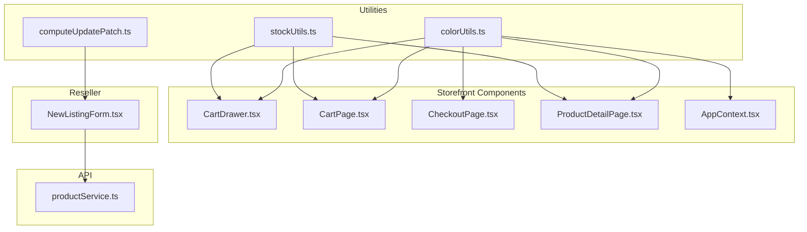
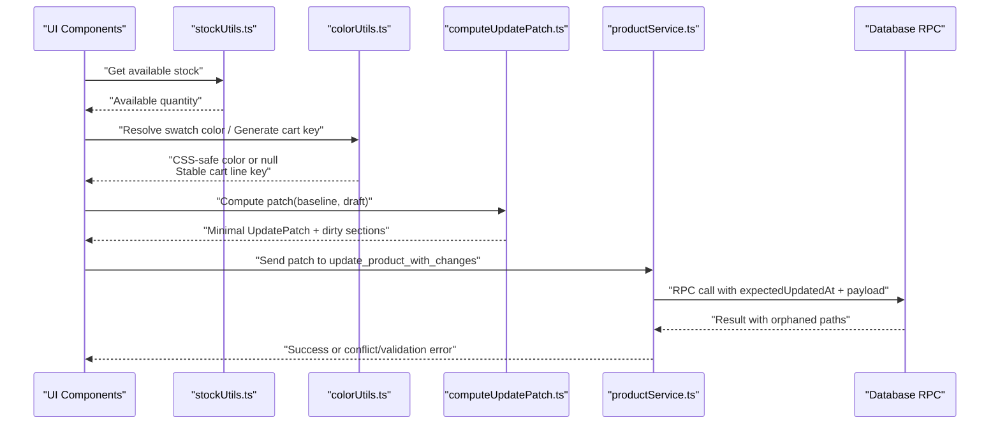
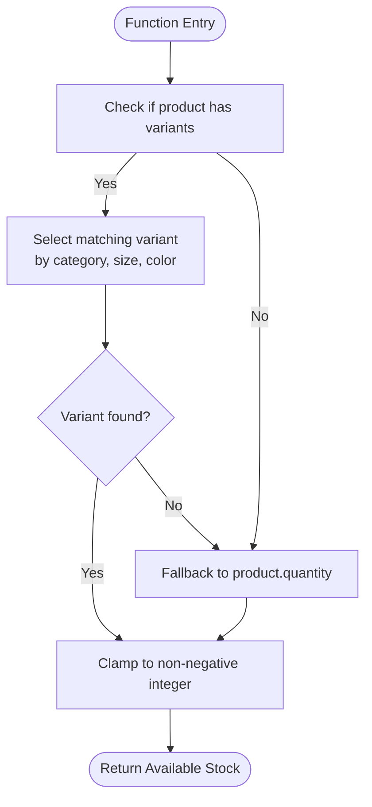
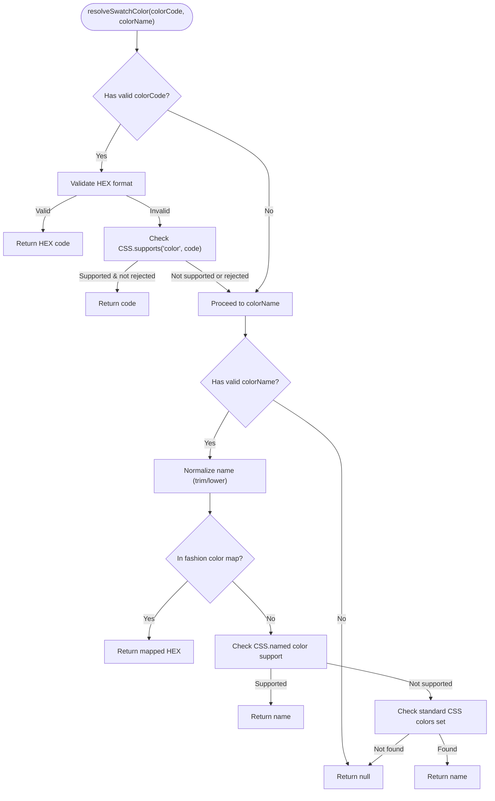
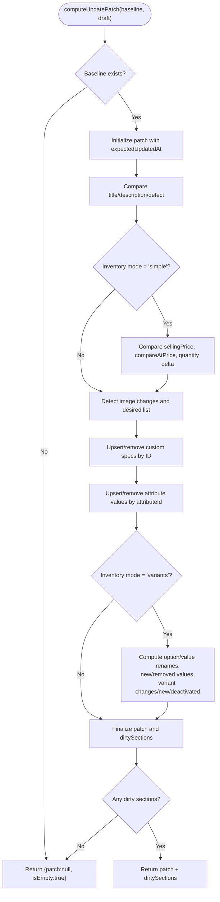
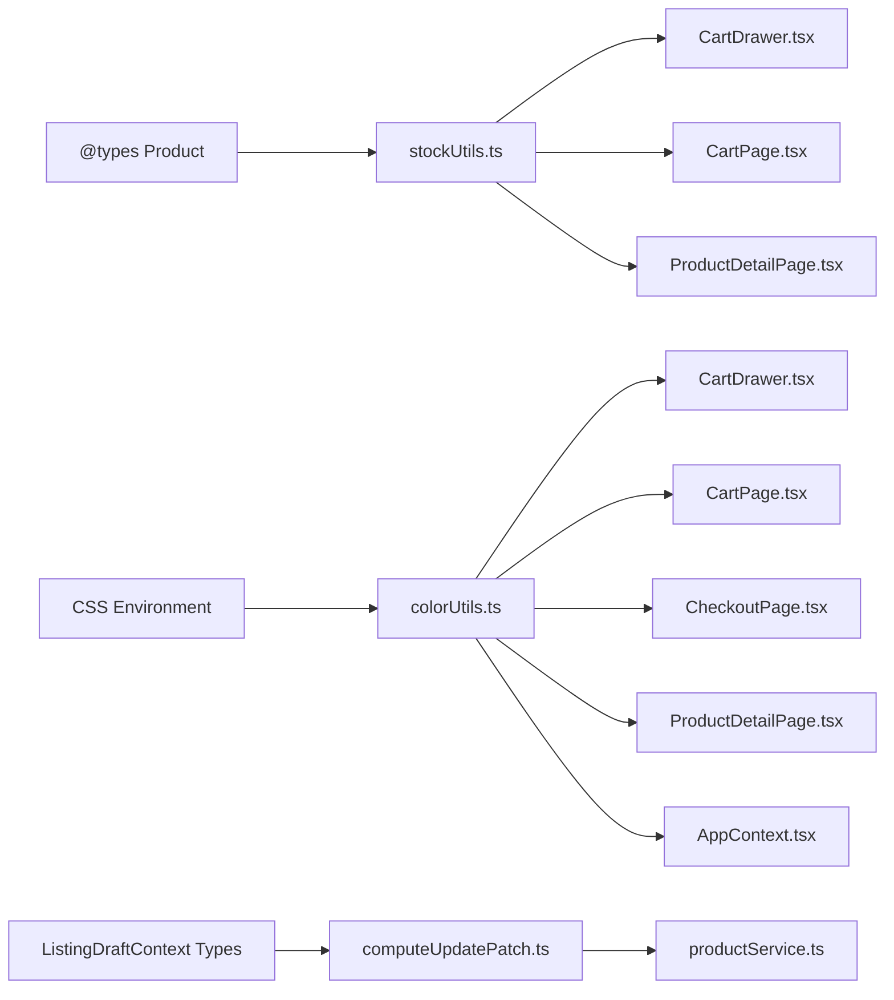

# Utility Functions

<cite>
**Referenced Files in This Document**
- [stockUtils.ts](file://src/utils/stockUtils.ts)
- [colorUtils.ts](file://src/utils/colorUtils.ts)
- [computeUpdatePatch.ts](file://src/utils/computeUpdatePatch.ts)
- [CartDrawer.tsx](file://components/CartDrawer.tsx)
- [CartPage.tsx](file://components/CartPage.tsx)
- [CheckoutPage.tsx](file://components/CheckoutPage.tsx)
- [ProductDetailPage.tsx](file://components/ProductDetailPage.tsx)
- [AppContext.tsx](file://components/context/AppContext.tsx)
- [NewListingForm.tsx](file://components/reseller/components/NewListingForm.tsx)
- [productService.ts](file://src/api/productService.ts)
</cite>

## Table of Contents
1. [Introduction](#introduction)
2. [Project Structure](#project-structure)
3. [Core Components](#core-components)
4. [Architecture Overview](#architecture-overview)
5. [Detailed Component Analysis](#detailed-component-analysis)
6. [Dependency Analysis](#dependency-analysis)
7. [Performance Considerations](#performance-considerations)
8. [Troubleshooting Guide](#troubleshooting-guide)
9. [Conclusion](#conclusion)
10. [Appendices](#appendices)

## Introduction
This document explains the utility functions that power inventory tracking, color handling, and efficient data synchronization across the platform:
- Stock management utilities for inventory tracking, quantity calculations, and availability checks.
- Color utilities for resolving swatch colors, generating stable cart keys, and supporting visual representation.
- Data patching logic for computing minimal update patches, delta calculations, and change detection before database operations.

These utilities are used by storefront components (cart, checkout, product detail), reseller listing forms, and API services to ensure consistent behavior, safe updates, and efficient network payloads.

## Project Structure
The utility modules live under `src/utils` and are consumed by UI components and services:
- `src/utils/stockUtils.ts`: Inventory availability helper.
- `src/utils/colorUtils.ts`: Color resolution and cart line key generation.
- `src/utils/computeUpdatePatch.ts`: Minimal patch computation for product edits.

**Diagram sources**
- [stockUtils.ts:1-34](file://src/utils/stockUtils.ts#L1-L34)
- [colorUtils.ts:1-127](file://src/utils/colorUtils.ts#L1-L127)
- [computeUpdatePatch.ts:1-565](file://src/utils/computeUpdatePatch.ts#L1-L565)
- [CartDrawer.tsx:1-63](file://components/CartDrawer.tsx#L1-L63)
- [CartPage.tsx:1-10](file://components/CartPage.tsx#L1-L10)
- [CheckoutPage.tsx:1-40](file://components/CheckoutPage.tsx#L1-L40)
- [ProductDetailPage.tsx:1-30](file://components/ProductDetailPage.tsx#L1-L30)
- [AppContext.tsx:1-10](file://components/context/AppContext.tsx#L1-L10)
- [NewListingForm.tsx:1-50](file://components/reseller/components/NewListingForm.tsx#L1-L50)
- [productService.ts:1570-1637](file://src/api/productService.ts#L1570-L1637)

**Section sources**
- [stockUtils.ts:1-34](file://src/utils/stockUtils.ts#L1-L34)
- [colorUtils.ts:1-127](file://src/utils/colorUtils.ts#L1-L127)
- [computeUpdatePatch.ts:1-565](file://src/utils/computeUpdatePatch.ts#L1-L565)

## Core Components
- stockUtils: Provides a single source of truth for available stock, handling both simple products and variant-based products.
- colorUtils: Resolves CSS-safe colors from database values and fashion names; generates stable cart line keys.
- computeUpdatePatch: Computes minimal, structured update patches comparing baseline data with draft state, including product details, pricing, images, custom specs, attribute values, and variations.

Key responsibilities:
- Inventory accuracy and availability checks.
- Safe color rendering across environments (SSR-safe).
- Efficient, idempotent updates to reduce network payload and avoid unnecessary writes.

**Section sources**
- [stockUtils.ts:1-34](file://src/utils/stockUtils.ts#L1-L34)
- [colorUtils.ts:1-127](file://src/utils/colorUtils.ts#L1-L127)
- [computeUpdatePatch.ts:1-565](file://src/utils/computeUpdatePatch.ts#L1-L565)

## Architecture Overview
The utilities integrate into the application as follows:
- Storefront components use stock and color utilities to display accurate inventory and correct swatches.
- The reseller listing form uses computeUpdatePatch to generate minimal changes before calling the product service RPC.
- The product service sends the computed patch to the database function for atomic updates.

**Diagram sources**
- [stockUtils.ts:1-34](file://src/utils/stockUtils.ts#L1-L34)
- [colorUtils.ts:1-127](file://src/utils/colorUtils.ts#L1-L127)
- [computeUpdatePatch.ts:195-564](file://src/utils/computeUpdatePatch.ts#L195-L564)
- [productService.ts:1570-1637](file://src/api/productService.ts#L1570-L1637)

## Detailed Component Analysis

### Stock Management Utilities
Purpose:
- Provide a single source of truth for calculating available stock for a product item, handling both simple products and variant-based products.

Key behaviors:
- If variants exist, select the appropriate variant based on category and size/color filters.
- For Unstitched category, match by size “Unstitched” and optional color_id.
- For other categories, match by size (case-insensitive) and optional color_id.
- Return non-negative integer stock; fallback to product-level quantity if no variant matches.

Complexity:
- O(V) where V is number of variants due to find operations.
- Constant-time fallback when no variants exist.

Usage examples:
- Cart drawer and cart page check availability per item.
- Product detail page shows real-time stock status.

Best practices:
- Always pass size and colorId when dealing with varianted products.
- Treat returned value as non-negative; clamp at zero internally.

**Diagram sources**
- [stockUtils.ts:7-33](file://src/utils/stockUtils.ts#L7-L33)

**Section sources**
- [stockUtils.ts:1-34](file://src/utils/stockUtils.ts#L1-L34)
- [CartDrawer.tsx:1-63](file://components/CartDrawer.tsx#L1-L63)
- [CartPage.tsx:1-10](file://components/CartPage.tsx#L1-L10)
- [ProductDetailPage.tsx:1-30](file://components/ProductDetailPage.tsx#L1-L30)

### Color Utilities
Purpose:
- Resolve swatch colors safely from database-provided color codes or names.
- Generate stable unique keys for cart lines to distinguish different sizes/colors of the same product.

Key behaviors:
- resolveSwatchColor:
  - Accepts color_code and color_name.
  - Validates hex codes via regex.
  - Uses CSS.supports for named colors when available.
  - Rejects unsafe keywords like transparent/inherit.
  - Supports a fashion color map for common fabric/fashion terms.
  - Returns a valid CSS color string or null.
- getCartLineKey:
  - Produces a stable key combining productId, size, and color.id.
  - Normalizes missing size to “Unstitched”.

Complexity:
- resolveSwatchColor: O(1) average due to set/map lookups and regex.
- getCartLineKey: O(1) string construction.

Usage examples:
- Product detail page resolves swatch color for display.
- Cart drawer/cart page/checkout use cart line key for merging items.

Best practices:
- Prefer color_code when available; fall back to normalized color_name.
- Use getCartLineKey consistently across cart state to avoid duplicate entries.

**Diagram sources**
- [colorUtils.ts:44-103](file://src/utils/colorUtils.ts#L44-L103)

**Section sources**
- [colorUtils.ts:1-127](file://src/utils/colorUtils.ts#L1-L127)
- [ProductDetailPage.tsx:1-30](file://components/ProductDetailPage.tsx#L1-L30)
- [CartDrawer.tsx:1-63](file://components/CartDrawer.tsx#L1-L63)
- [CartPage.tsx:1-10](file://components/CartPage.tsx#L1-L10)
- [CheckoutPage.tsx:1-40](file://components/CheckoutPage.tsx#L1-L40)
- [AppContext.tsx:1-10](file://components/context/AppContext.tsx#L1-L10)

### Data Patching Operations
Purpose:
- Compute minimal, structured update patches comparing baseline data with draft state.
- Track dirty sections to inform UI and backend about what changed.

Key responsibilities:
- Normalize text, money, integers, and attribute values.
- Compare product details (title, description, defect).
- Handle simple inventory mode (selling price, compare-at price, quantity delta).
- Detect image sequence changes and desired image list.
- Upsert/remove custom specifications by ID.
- Upsert/remove attribute values by attributeId.
- Compute variation deltas: option renames, value renames, new values, removed values, variant changes, new variants, deactivated variants.

Complexity:
- Linear in the number of specs, attributes, dimensions, values, and rows.
- Uses Maps and Sets for O(1) lookups.

Usage examples:
- Reseller NewListingForm computes patch and calls productService.updateProductWithChanges.
- productService handles RPC errors, conflicts, validation messages, and storage cleanup.

Best practices:
- Always provide a baseline snapshot with expectedUpdatedAt for optimistic concurrency.
- Keep draft state normalized before computing patch.
- Avoid sending empty sections; rely on isEmpty and dirtySections.

**Diagram sources**
- [computeUpdatePatch.ts:195-564](file://src/utils/computeUpdatePatch.ts#L195-L564)

**Section sources**
- [computeUpdatePatch.ts:1-565](file://src/utils/computeUpdatePatch.ts#L1-L565)
- [NewListingForm.tsx:1-50](file://components/reseller/components/NewListingForm.tsx#L1-L50)
- [productService.ts:1570-1637](file://src/api/productService.ts#L1570-L1637)

## Dependency Analysis
- stockUtils depends on Product type from types.
- colorUtils depends on CSS environment APIs and provides pure helpers.
- computeUpdatePatch depends on ListingDraftContext types and produces UpdatePatch consumed by productService.

**Diagram sources**
- [stockUtils.ts:1-34](file://src/utils/stockUtils.ts#L1-L34)
- [colorUtils.ts:1-127](file://src/utils/colorUtils.ts#L1-L127)
- [computeUpdatePatch.ts:1-565](file://src/utils/computeUpdatePatch.ts#L1-L565)
- [productService.ts:1570-1637](file://src/api/productService.ts#L1570-L1637)
- [CartDrawer.tsx:1-63](file://components/CartDrawer.tsx#L1-L63)
- [CartPage.tsx:1-10](file://components/CartPage.tsx#L1-L10)
- [CheckoutPage.tsx:1-40](file://components/CheckoutPage.tsx#L1-L40)
- [ProductDetailPage.tsx:1-30](file://components/ProductDetailPage.tsx#L1-L30)
- [AppContext.tsx:1-10](file://components/context/AppContext.tsx#L1-L10)

**Section sources**
- [stockUtils.ts:1-34](file://src/utils/stockUtils.ts#L1-L34)
- [colorUtils.ts:1-127](file://src/utils/colorUtils.ts#L1-L127)
- [computeUpdatePatch.ts:1-565](file://src/utils/computeUpdatePatch.ts#L1-L565)
- [productService.ts:1570-1637](file://src/api/productService.ts#L1570-L1637)

## Performance Considerations
- stockUtils:
  - Variant selection scans variants once; consider caching variant maps for large catalogs.
  - Clamping ensures safe numeric returns without extra processing.
- colorUtils:
  - CSS.supports checks are guarded and only executed when needed.
  - Fashion color map and standard color sets are small constant structures.
- computeUpdatePatch:
  - Uses Maps and Sets for efficient lookups; complexity scales linearly with input size.
  - Avoids unnecessary writes by returning null patch when no changes detected.
- Integration:
  - productService handles RPC errors and storage cleanup efficiently; avoid redundant uploads by relying on desired image lists.

[No sources needed since this section provides general guidance]

## Troubleshooting Guide
Common issues and resolutions:
- Incorrect stock displayed:
  - Ensure size and colorId are passed correctly to getItemAvailableStock.
  - Verify product.category and variant fields match expectations.
- Swatch color not rendering:
  - Confirm color_code is a valid hex or recognized CSS color.
  - For fashion names, ensure they exist in the fashion color map or are standard CSS names.
- No updates applied:
  - Check baseline.expectedUpdatedAt matches server version.
  - Inspect dirtySections to confirm which sections changed.
  - Review productService error handling for CONFLICT or VALIDATION messages.

**Section sources**
- [stockUtils.ts:7-33](file://src/utils/stockUtils.ts#L7-L33)
- [colorUtils.ts:44-103](file://src/utils/colorUtils.ts#L44-L103)
- [computeUpdatePatch.ts:195-564](file://src/utils/computeUpdatePatch.ts#L195-L564)
- [productService.ts:1570-1637](file://src/api/productService.ts#L1570-L1637)

## Conclusion
The utility modules provide robust, reusable building blocks for inventory tracking, color handling, and efficient data synchronization:
- stockUtils centralizes stock calculation logic for both simple and varianted products.
- colorUtils ensures safe, predictable color rendering and stable cart keys.
- computeUpdatePatch enables minimal, reliable updates with clear change tracking.

Adopt these utilities consistently across components and services to maintain data integrity, improve performance, and simplify maintenance.

[No sources needed since this section summarizes without analyzing specific files]

## Appendices

### Usage Examples

- Calculating total inventory:
  - Sum available stock across items using getItemAvailableStock with appropriate size and colorId.
  - Reference: [stockUtils.ts:7-33](file://src/utils/stockUtils.ts#L7-L33)

- Comparing color differences:
  - Resolve two colors via resolveSwatchColor and compare resulting strings or convert to RGB for difference metrics.
  - Reference: [colorUtils.ts:44-103](file://src/utils/colorUtils.ts#L44-L103)

- Generating minimal update patches:
  - Build baseline snapshot and draft state, then call computeUpdatePatch to obtain UpdatePatch and dirtySections.
  - Send patch via productService.updateProductWithChanges.
  - References: [computeUpdatePatch.ts:195-564](file://src/utils/computeUpdatePatch.ts#L195-L564), [productService.ts:1570-1637](file://src/api/productService.ts#L1570-L1637)

**Section sources**
- [stockUtils.ts:7-33](file://src/utils/stockUtils.ts#L7-L33)
- [colorUtils.ts:44-103](file://src/utils/colorUtils.ts#L44-L103)
- [computeUpdatePatch.ts:195-564](file://src/utils/computeUpdatePatch.ts#L195-L564)
- [productService.ts:1570-1637](file://src/api/productService.ts#L1570-L1637)