# Architecture Overview

<cite>
**Referenced Files in This Document**
- [README.md](file://README.md)
- [package.json](file://package.json)
- [next.config.ts](file://next.config.ts)
- [app/layout.tsx](file://app/layout.tsx)
- [app/page.tsx](file://app/page.tsx)
- [components/MainLayoutShell.tsx](file://components/MainLayoutShell.tsx)
- [components/context/AppContext.tsx](file://components/context/AppContext.tsx)
- [components/context/AuthProvider.tsx](file://components/context/AuthProvider.tsx)
- [src/providers/QueryProvider.tsx](file://src/providers/QueryProvider.tsx)
- [src/api/client.js](file://src/api/client.js)
- [src/hooks/useAuth.ts](file://src/hooks/useAuth.ts)
- [src/api/cartWishlistService.ts](file://src/api/cartWishlistService.ts)
- [src/api/productService.ts](file://src/api/productService.ts)
- [types.ts](file://types.ts)
- [app/dashboard/layout.tsx](file://app/dashboard/layout.tsx)
</cite>

## Table of Contents
1. [Introduction](#introduction)
2. [Project Structure](#project-structure)
3. [Core Components](#core-components)
4. [Architecture Overview](#architecture-overview)
5. [Detailed Component Analysis](#detailed-component-analysis)
6. [Dependency Analysis](#dependency-analysis)
7. [Performance Considerations](#performance-considerations)
8. [Troubleshooting Guide](#troubleshooting-guide)
9. [Conclusion](#conclusion)

## Introduction
This document describes the architecture of the Zebaish e-commerce platform. The application is a Next.js App Router project that renders a customer storefront and a reseller dashboard. It uses React components, TypeScript, Tailwind CSS, TanStack React Query for data fetching and caching, and Supabase as the backend for authentication, database operations, and storage.

Key architectural goals:
- Separate customer storefront from reseller dashboard boundaries
- Provide consistent layout shells and global state providers
- Centralize API access through service modules
- Use optimistic UI patterns with server synchronization
- Support server-side rendering via Next.js App Router

[No sources needed since this section summarizes without analyzing specific files]

## Project Structure
The repository follows a feature-oriented structure under `app` for routes and `components` for UI logic. Shared services live under `src/api`, hooks under `src/hooks`, and providers under `src/providers`. Database migrations are maintained under `supabase/migrations`.

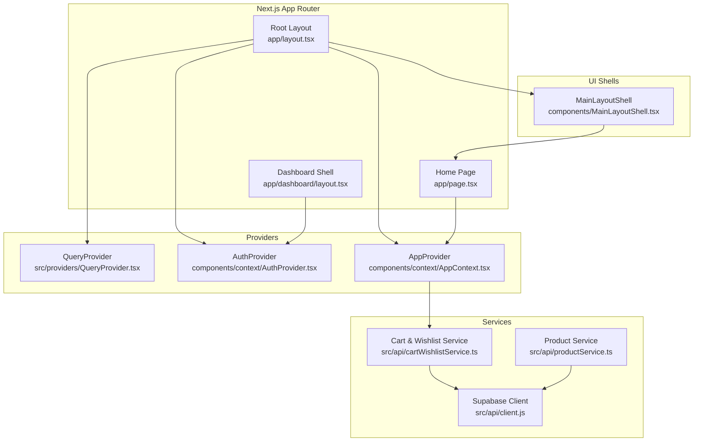

**Diagram sources**
- [app/layout.tsx:20-47](file://app/layout.tsx#L20-L47)
- [components/MainLayoutShell.tsx:13-145](file://components/MainLayoutShell.tsx#L13-L145)
- [src/providers/QueryProvider.tsx:6-24](file://src/providers/QueryProvider.tsx#L6-L24)
- [components/context/AuthProvider.tsx:76-321](file://components/context/AuthProvider.tsx#L76-L321)
- [components/context/AppContext.tsx:59-357](file://components/context/AppContext.tsx#L59-L357)
- [src/api/client.js:1-8](file://src/api/client.js#L1-L8)
- [src/api/cartWishlistService.ts:1-223](file://src/api/cartWishlistService.ts#L1-L223)
- [src/api/productService.ts:1-800](file://src/api/productService.ts#L1-L800)

**Section sources**
- [README.md:1-37](file://README.md#L1-L37)
- [package.json:1-34](file://package.json#L1-L34)
- [next.config.ts:1-12](file://next.config.ts#L1-L12)
- [app/layout.tsx:1-51](file://app/layout.tsx#L1-L51)

## Core Components
- Root layout wires global providers and analytics, then wraps content in the main layout shell.
- MainLayoutShell provides public navigation, footer, drawers, modals, and toast notifications.
- AppProvider manages cart, wishlist, drawer/modal visibility, and toast messages. It persists cart to localStorage and synchronizes with Supabase when authenticated.
- AuthProvider manages Supabase session, user profiles, role resolution, and logout.
- QueryProvider configures TanStack React Query client globally.
- Services encapsulate Supabase calls for cart/wishlist and product creation.

**Section sources**
- [app/layout.tsx:20-47](file://app/layout.tsx#L20-L47)
- [components/MainLayoutShell.tsx:13-145](file://components/MainLayoutShell.tsx#L13-L145)
- [components/context/AppContext.tsx:59-357](file://components/context/AppContext.tsx#L59-L357)
- [components/context/AuthProvider.tsx:76-321](file://components/context/AuthProvider.tsx#L76-L321)
- [src/providers/QueryProvider.tsx:6-24](file://src/providers/QueryProvider.tsx#L6-L24)
- [src/api/cartWishlistService.ts:1-223](file://src/api/cartWishlistService.ts#L1-L223)
- [src/api/productService.ts:1-800](file://src/api/productService.ts#L1-L800)

## Architecture Overview
Zebaish separates two primary user journeys:
- Customer storefront: browses products, manages cart and wishlist, and checks out.
- Reseller dashboard: manages listings, orders, analytics, payouts, and settings.

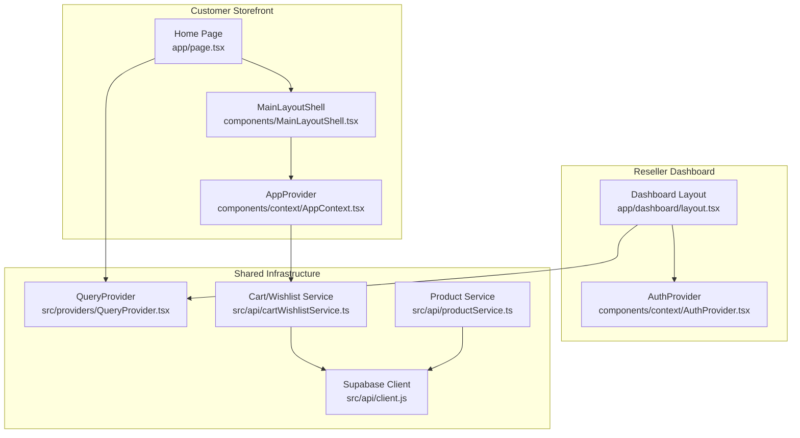

**Diagram sources**
- [app/page.tsx:17-96](file://app/page.tsx#L17-L96)
- [components/MainLayoutShell.tsx:13-145](file://components/MainLayoutShell.tsx#L13-L145)
- [components/context/AppContext.tsx:59-357](file://components/context/AppContext.tsx#L59-L357)
- [app/dashboard/layout.tsx:12-80](file://app/dashboard/layout.tsx#L12-L80)
- [components/context/AuthProvider.tsx:76-321](file://components/context/AuthProvider.tsx#L76-L321)
- [src/providers/QueryProvider.tsx:6-24](file://src/providers/QueryProvider.tsx#L6-L24)
- [src/api/cartWishlistService.ts:1-223](file://src/api/cartWishlistService.ts#L1-L223)
- [src/api/productService.ts:1-800](file://src/api/productService.ts#L1-L800)
- [src/api/client.js:1-8](file://src/api/client.js#L1-L8)

## Detailed Component Analysis

### Root Layout and Providers
The root layout sets metadata, fonts, and global providers. It wraps the app with QueryProvider, AuthProvider, AppProvider, and MainLayoutShell. Analytics is enabled at the root level.

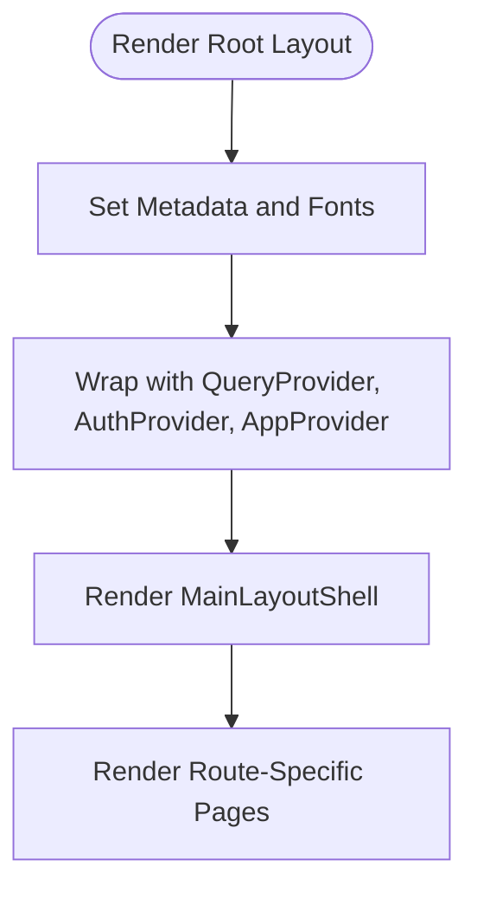

**Diagram sources**
- [app/layout.tsx:10-47](file://app/layout.tsx#L10-L47)

**Section sources**
- [app/layout.tsx:1-51](file://app/layout.tsx#L1-51)

### Main Layout Shell
MainLayoutShell controls public header/footer visibility, route-based behavior (e.g., dark hero on home), and shared interactive overlays like cart drawer, mega menu, search modal, quick view modal, and toast notifications. It also orchestrates navigation to shop, product detail, and checkout.

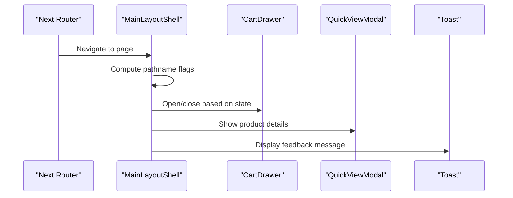

**Diagram sources**
- [components/MainLayoutShell.tsx:13-145](file://components/MainLayoutShell.tsx#L13-L145)

**Section sources**
- [components/MainLayoutShell.tsx:13-145](file://components/MainLayoutShell.tsx#L13-L145)

### App Context: Cart, Wishlist, and UI State
AppProvider centralizes:
- Cart persistence to localStorage and sync to Supabase for authenticated users
- Wishlist state and optimistic updates with DB synchronization
- Global UI toggles for drawers/modals and toast messaging

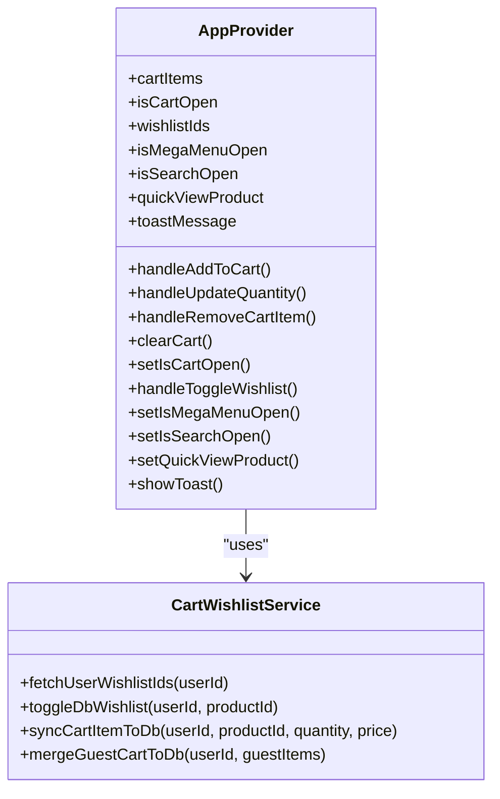

**Diagram sources**
- [components/context/AppContext.tsx:59-357](file://components/context/AppContext.tsx#L59-L357)
- [src/api/cartWishlistService.ts:1-223](file://src/api/cartWishlistService.ts#L1-L223)

**Section sources**
- [components/context/AppContext.tsx:59-357](file://components/context/AppContext.tsx#L59-L357)
- [src/api/cartWishlistService.ts:1-223](file://src/api/cartWishlistService.ts#L1-L223)

### Authentication Provider and Role Resolution
AuthProvider manages:
- Supabase session and auth state changes
- Fetching reseller and customer profiles
- Auto-creating customer profile if missing
- Role determination (seller vs customer) and seller status
- Logout flow

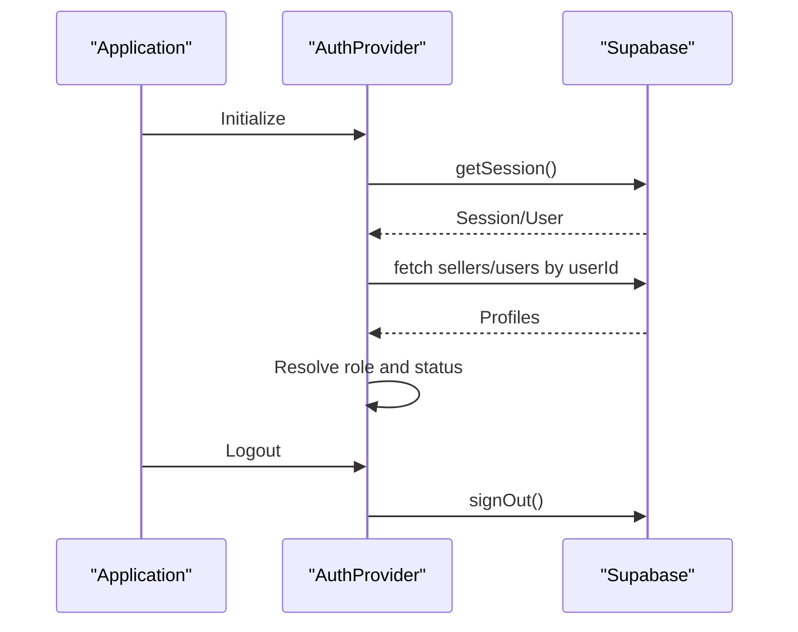

**Diagram sources**
- [components/context/AuthProvider.tsx:76-321](file://components/context/AuthProvider.tsx#L76-L321)
- [src/hooks/useAuth.ts:1-13](file://src/hooks/useAuth.ts#L1-L13)

**Section sources**
- [components/context/AuthProvider.tsx:76-321](file://components/context/AuthProvider.tsx#L76-L321)
- [src/hooks/useAuth.ts:1-13](file://src/hooks/useAuth.ts#L1-L13)

### Data Flow: Add to Cart and Wishlist
This sequence shows how user interactions propagate through context to local state and then to the database.

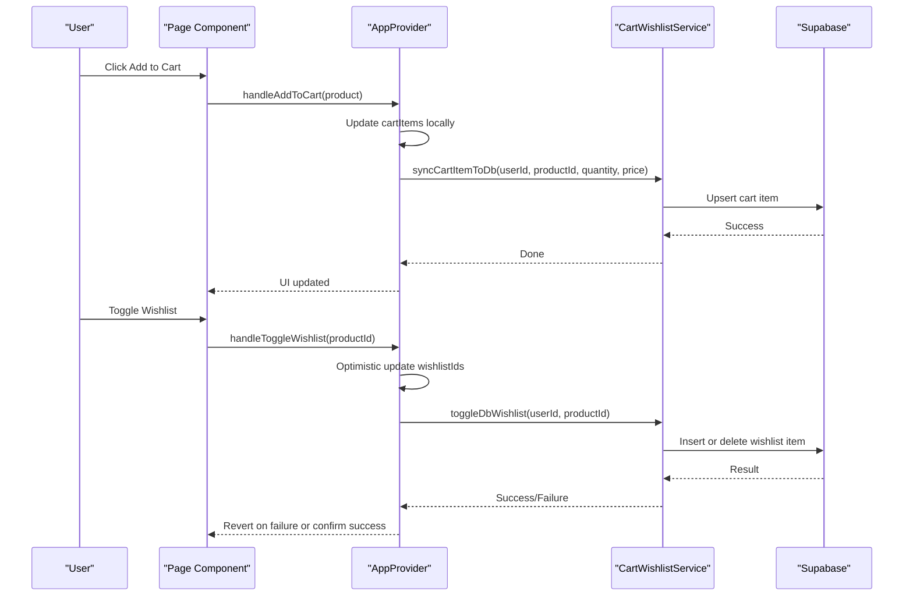

**Diagram sources**
- [components/context/AppContext.tsx:165-331](file://components/context/AppContext.tsx#L165-L331)
- [src/api/cartWishlistService.ts:36-88](file://src/api/cartWishlistService.ts#L36-L88)
- [src/api/cartWishlistService.ts:96-163](file://src/api/cartWishlistService.ts#L96-L163)

**Section sources**
- [components/context/AppContext.tsx:165-331](file://components/context/AppContext.tsx#L165-L331)
- [src/api/cartWishlistService.ts:36-88](file://src/api/cartWishlistService.ts#L36-L88)
- [src/api/cartWishlistService.ts:96-163](file://src/api/cartWishlistService.ts#L96-L163)

### Product Creation Flow
Product creation validates inputs, processes images, uploads to storage, and calls an RPC to persist product data atomically.

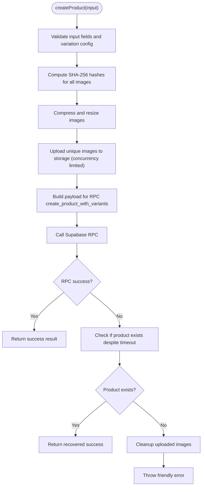

**Diagram sources**
- [src/api/productService.ts:302-707](file://src/api/productService.ts#L302-L707)

**Section sources**
- [src/api/productService.ts:302-707](file://src/api/productService.ts#L302-L707)

### Reseller Dashboard Boundary
The dashboard layout enforces authentication and role checks, renders sidebar/header, and wraps pages with reseller-specific providers.

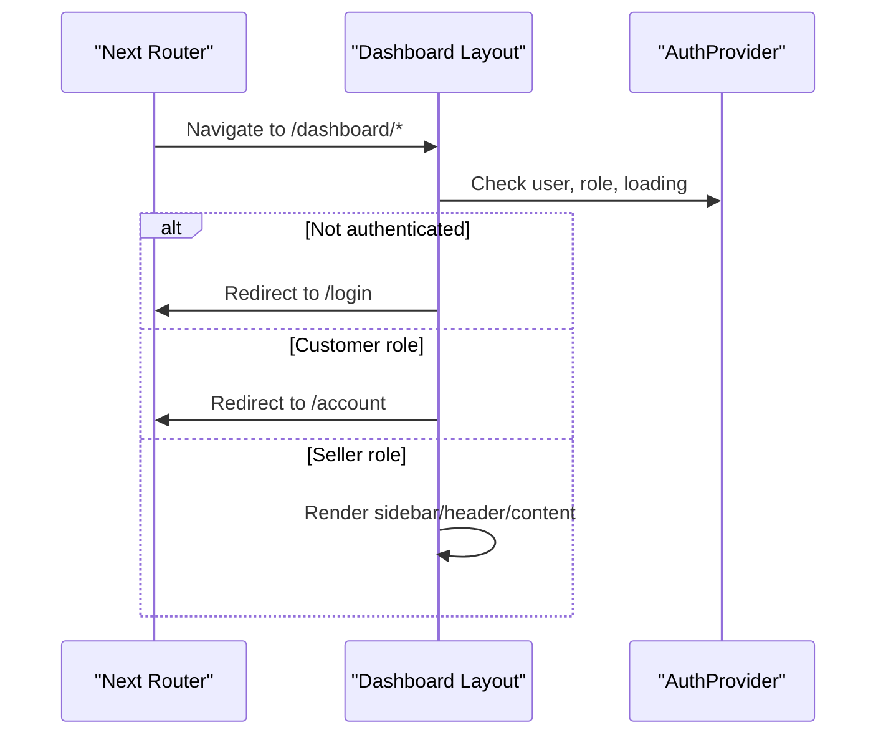

**Diagram sources**
- [app/dashboard/layout.tsx:12-80](file://app/dashboard/layout.tsx#L12-L80)
- [components/context/AuthProvider.tsx:76-321](file://components/context/AuthProvider.tsx#L76-L321)

**Section sources**
- [app/dashboard/layout.tsx:12-80](file://app/dashboard/layout.tsx#L12-L80)

### Conceptual Overview
At a high level:
- Next.js App Router handles routing and SSR/SSG where applicable
- React components compose UI and interact with context providers
- TanStack React Query caches and invalidates data across the app
- Supabase provides auth, database, and storage APIs
- Services abstract Supabase calls and encapsulate business logic

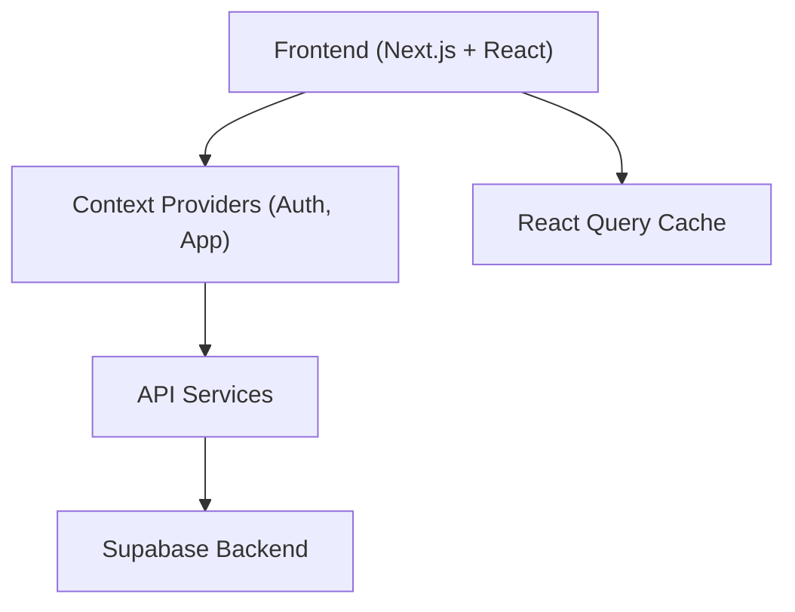

[No sources needed since this diagram shows conceptual workflow, not actual code structure]

## Dependency Analysis
The following diagram maps key dependencies between core modules.

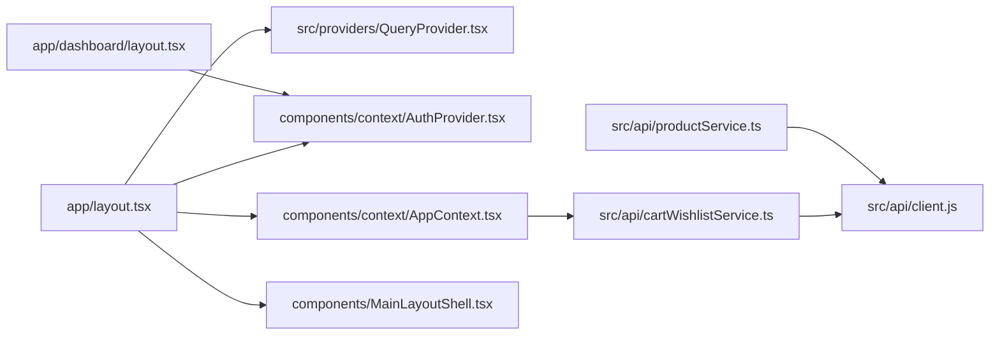

**Diagram sources**
- [app/layout.tsx:20-47](file://app/layout.tsx#L20-L47)
- [components/context/AppContext.tsx:59-357](file://components/context/AppContext.tsx#L59-L357)
- [src/api/cartWishlistService.ts:1-223](file://src/api/cartWishlistService.ts#L1-L223)
- [src/api/productService.ts:1-800](file://src/api/productService.ts#L1-L800)
- [src/api/client.js:1-8](file://src/api/client.js#L1-L8)
- [app/dashboard/layout.tsx:12-80](file://app/dashboard/layout.tsx#L12-L80)

**Section sources**
- [app/layout.tsx:20-47](file://app/layout.tsx#L20-L47)
- [components/context/AppContext.tsx:59-357](file://components/context/AppContext.tsx#L59-L357)
- [src/api/cartWishlistService.ts:1-223](file://src/api/cartWishlistService.ts#L1-L223)
- [src/api/productService.ts:1-800](file://src/api/productService.ts#L1-L800)
- [src/api/client.js:1-8](file://src/api/client.js#L1-L8)
- [app/dashboard/layout.tsx:12-80](file://app/dashboard/layout.tsx#L12-L80)

## Performance Considerations
- Image handling: Product creation compresses and resizes images, deduplicates by SHA-256 hash, and limits upload concurrency to reduce bandwidth and improve reliability.
- Query caching: React Query default staleTime reduces frequent refetches; window focus refetch is disabled to avoid unnecessary network calls.
- LocalStorage cart: Cart persistence avoids repeated server loads and supports offline continuity until login.
- Package optimizations: Next.js experimental optimizePackageImports targets heavy libraries like lucide-react and recharts.

Recommendations:
- Keep image compression thresholds aligned with product gallery requirements
- Tune React Query cache policies per feature area if needed
- Monitor Supabase storage costs and retention policies

[No sources needed since this section provides general guidance]

## Troubleshooting Guide
Common issues and resolutions:
- Missing database functions: If RPC errors mention schema cache or missing functions, ensure the relevant migration scripts have been executed in Supabase SQL editor.
- Permission denied: Row-level security or foreign key constraints may block operations; verify RLS policies and referential integrity.
- Duplicate keys: Unique constraint violations indicate existing records; adjust inputs or conflict handling.
- Storage cleanup failures: On RPC failure, the system attempts to remove uploaded images; check logs for cleanup warnings.

Operational tips:
- Verify environment variables for Supabase URL and anon key
- Confirm table existence and migrations before running features that depend on them
- Use optimistic UI with rollback on failure to maintain consistent state

**Section sources**
- [src/api/productService.ts:255-292](file://src/api/productService.ts#L255-L292)
- [src/api/productService.ts:633-707](file://src/api/productService.ts#L633-L707)
- [components/context/AuthProvider.tsx:104-138](file://components/context/AuthProvider.tsx#L104-L138)

## Conclusion
Zebaish’s architecture combines Next.js App Router routing with layered providers and service modules. The customer storefront and reseller dashboard share infrastructure but enforce distinct boundaries and permissions. AppProvider and AuthProvider manage local and authenticated state, while services encapsulate Supabase interactions. The design emphasizes optimistic UI, robust error handling, and performance-conscious image processing.

[No sources needed since this section summarizes without analyzing specific files]