# Backend Integration

<cite>
**Referenced Files in This Document**   
- [client.js](file://src/api/client.js)
- [QueryProvider.tsx](file://src/providers/QueryProvider.tsx)
- [productService.ts](file://src/api/productService.ts)
- [useProductEditQueries.ts](file://src/hooks/useProductEditQueries.ts)
- [20261105_all_in_one_product_creation.sql](file://supabase/migrations/20261105_all_in_one_product_creation.sql)
- [20261105_create_product_with_variants_rpc.sql](file://supabase/migrations/20261105_create_product_with_variants_rpc.sql)
- [20261105_fix_variant_option_values.sql](file://supabase/migrations/20261105_fix_variant_option_values.sql)
- [20261105_product_option_images_fk.sql](file://supabase/migrations/20261105_product_option_images_fk.sql)
- [20261106_update_product_with_changes_rpc.sql](file://supabase/migrations/20261106_update_product_with_changes_rpc.sql)
- [20261107_inventory_movements_delete_policy.sql](file://supabase/migrations/20261107_inventory_movements_delete_policy.sql)
- [supabase_seller_overview_rpc.sql](file://supabase_seller_overview_rpc.sql)
- [supabase_seller_orders_rpc.sql](file://supabase_seller_orders_rpc.sql)
- [supabase_wallet_payout_rpc.sql](file://supabase_wallet_payout_rpc.sql)
- [supabase_seller_last_7_days_rpc.sql](file://supabase_seller_last_7_days_rpc.sql)
</cite>

## Table of Contents
1. [Introduction](#introduction)
2. [Project Structure](#project-structure)
3. [Core Components](#core-components)
4. [Architecture Overview](#architecture-overview)
5. [Detailed Component Analysis](#detailed-component-analysis)
6. [Dependency Analysis](#dependency-analysis)
7. [Performance Considerations](#performance-considerations)
8. [Troubleshooting Guide](#troubleshooting-guide)
9. [Conclusion](#conclusion)

## Introduction
This document explains the backend integration for the Zebaish platform. It covers how the Next.js frontend connects to Supabase, how server state is managed with React Query, how complex product and analytics operations are implemented through PostgreSQL RPC functions, and how security, error handling, retry behavior, and offline-friendly patterns are structured.

The system follows a clear separation:
- The browser client handles image processing, hashing, deduplication, and optimistic UI.
- Supabase Postgres enforces business rules, data integrity, and seller isolation through RLS policies and transactional RPCs.
- React Query provides caching, background refetching, and mutation coordination.

## Project Structure
At a high level, the relevant backend integration code lives under:
- `src/api/client.js`: Supabase client initialization.
- `src/providers/QueryProvider.tsx`: Global React Query configuration.
- `src/api/productService.ts`: Product creation, storage orchestration, RPC invocation, and error formatting.
- `src/hooks/useProductEditQueries.ts`: React Query hooks for product editing sections.
- `supabase/migrations/*`: Database schema fixes, constraints, triggers, and RPC definitions.
- Root-level SQL files: Analytics, orders, wallet, and payout RPC migrations.

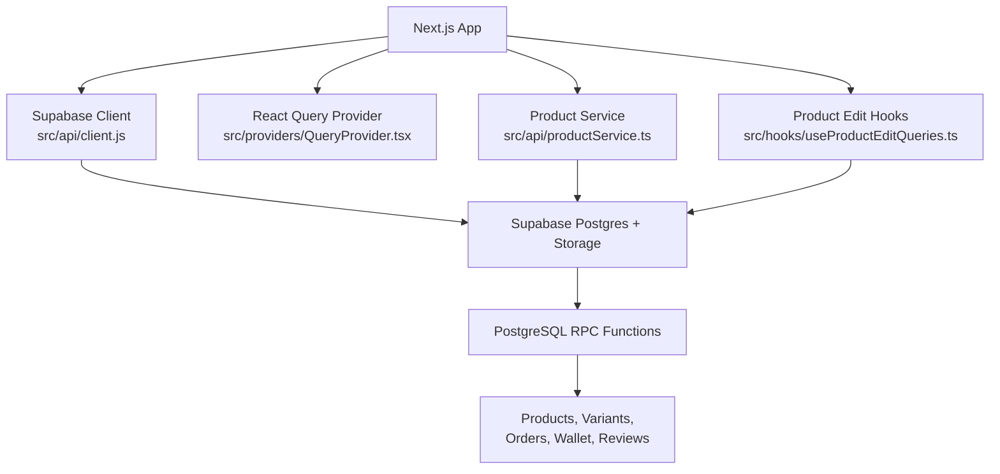

**Diagram sources**
- [client.js:1-8](file://src/api/client.js#L1-L8)
- [QueryProvider.tsx:1-25](file://src/providers/QueryProvider.tsx#L1-L25)
- [productService.ts:1-30](file://src/api/productService.ts#L1-L30)
- [useProductEditQueries.ts:1-28](file://src/hooks/useProductEditQueries.ts#L1-L28)

**Section sources**
- [client.js:1-8](file://src/api/client.js#L1-L8)
- [QueryProvider.tsx:1-25](file://src/providers/QueryProvider.tsx#L1-L25)

## Core Components
### Supabase Client Configuration
The Supabase client is created once using environment variables for the project URL and anonymous key. This client is then imported by API services and used for both database queries and storage operations.

Key responsibilities:
- Centralized connection configuration.
- Shared authentication context via Supabase session.
- Access to PostgREST endpoints and Supabase Storage.

**Section sources**
- [client.js:1-8](file://src/api/client.js#L1-L8)

### React Query Setup and Caching Strategy
The global `QueryProvider` creates a single `QueryClient` with:
- A default stale time of 60 seconds.
- Disabled automatic refetch on window focus.

Per-query overrides exist in product edit hooks:
- Stale time of 5 minutes.
- Garbage collection cache time of 15 minutes.
- Disabled refetch on window focus and reconnect.

This design reduces unnecessary network calls while keeping dashboard data reasonably fresh.

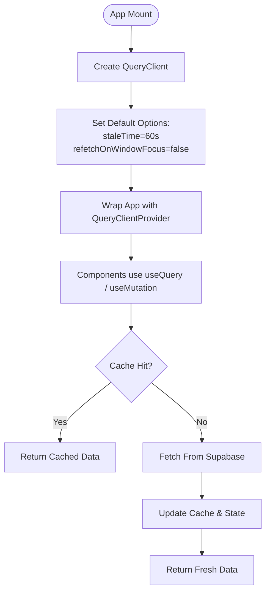

**Diagram sources**
- [QueryProvider.tsx:6-23](file://src/providers/QueryProvider.tsx#L6-L23)
- [useProductEditQueries.ts:30-32](file://src/hooks/useProductEditQueries.ts#L30-L32)
- [useProductEditQueries.ts:42-56](file://src/hooks/useProductEditQueries.ts#L42-L56)

**Section sources**
- [QueryProvider.tsx:1-25](file://src/providers/QueryProvider.tsx#L1-L25)
- [useProductEditQueries.ts:30-32](file://src/hooks/useProductEditQueries.ts#L30-L32)
- [useProductEditQueries.ts:42-56](file://src/hooks/useProductEditQueries.ts#L42-L56)

## Architecture Overview
The backend integration uses a hybrid approach:
- Simple reads can use direct table queries through PostgREST.
- Complex writes and analytics calculations are encapsulated in PostgreSQL RPC functions.
- Security is enforced at the database layer using Row Level Security (RLS).
- Storage operations are handled by Supabase Storage with content-addressed paths.

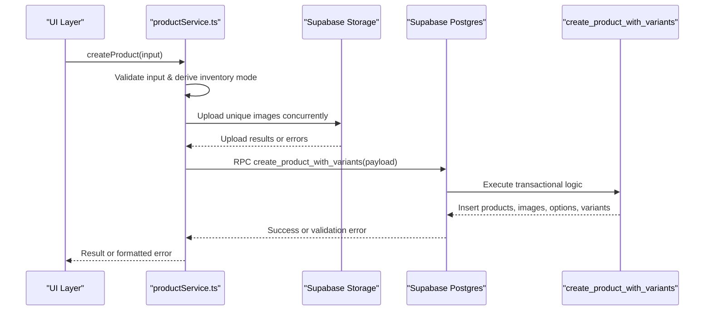

**Diagram sources**
- [productService.ts:302-707](file://src/api/productService.ts#L302-L707)
- [20261105_all_in_one_product_creation.sql:221-503](file://supabase/migrations/20261105_all_in_one_product_creation.sql#L221-L503)

**Section sources**
- [productService.ts:302-707](file://src/api/productService.ts#L302-L707)
- [20261105_all_in_one_product_creation.sql:221-503](file://supabase/migrations/20261105_all_in_one_product_creation.sql#L221-L503)

## Detailed Component Analysis

### Supabase Client Connection Management
The client is initialized with:
- `NEXT_PUBLIC_SUPABASE_URL`
- `NEXT_PUBLIC_SUPABASE_ANON_KEY`

This means all requests from the browser use the anonymous key, relying on Supabase Auth and RLS policies to enforce permissions. For server-side contexts, a separate service role client would be required; this repository’s client is browser-facing.

Operational implications:
- Authentication state must be established before calling RPCs that require a seller identity.
- Storage uploads and database mutations are subject to RLS policies defined in migrations.

**Section sources**
- [client.js:1-8](file://src/api/client.js#L1-L8)

### Product Creation Flow and RPC Contract
The product creation flow is orchestrated by `createProduct` in `productService.ts`. It performs:
1. Client-side validation for title, category, gallery images, simple pricing, and variation dimensions.
2. Client-generated product ID using `crypto.randomUUID()`.
3. Image resolution, compression, resizing, and SHA-256 hashing.
4. Content-addressed storage path construction: `{userId}/{productId}/{hash}.{ext}`.
5. Concurrent image upload with concurrency limit and rollback tracking.
6. Construction of an RPC payload matching the PostgreSQL function contract.
7. Invocation of `create_product_with_variants`.
8. Network timeout recovery by checking whether the product already exists.
9. Cleanup of uploaded images if the RPC fails.

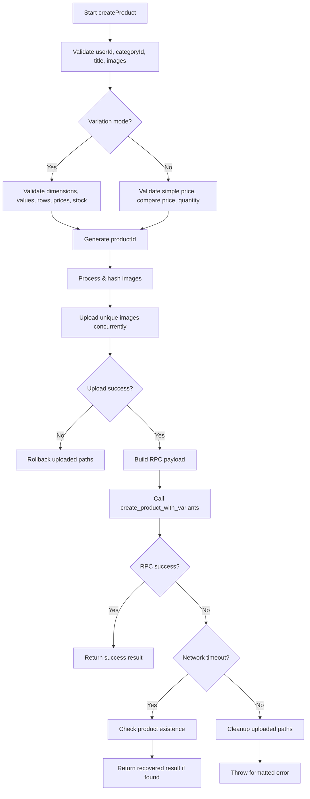

**Diagram sources**
- [productService.ts:302-707](file://src/api/productService.ts#L302-L707)

**Section sources**
- [productService.ts:302-707](file://src/api/productService.ts#L302-L707)

### PostgreSQL RPC: Atomic Product Creation
The RPC `create_product_with_variants` enforces:
- Seller authentication and ownership verification.
- Payload validation for simple vs variant modes.
- Gallery image validation and security isolation checks.
- Insertion of core product, images, custom specifications, and category attributes.
- Option dimension and value insertion.
- Variant combination validation and SKU generation.
- Inventory movement recording when quantities change.

Security considerations:
- Storage paths must start with `{sellerId}/{productId}/`.
- Image URLs must end with `productImages/<storage_path>`.
- Duplicate option names, duplicate values within a dimension, and duplicate combinations are rejected.

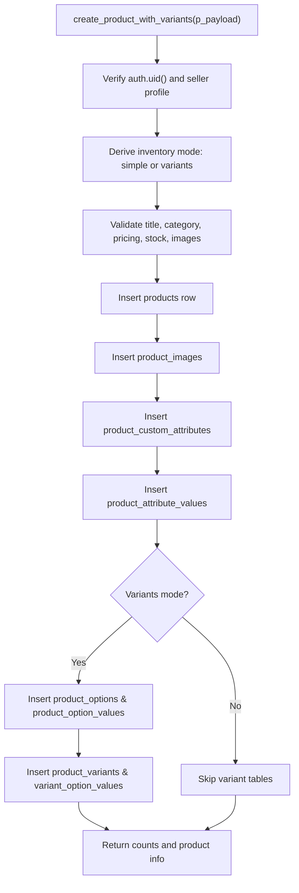

**Diagram sources**
- [20261105_all_in_one_product_creation.sql:221-503](file://supabase/migrations/20261105_all_in_one_product_creation.sql#L221-L503)
- [20261105_create_product_with_variants_rpc.sql:100-387](file://supabase/migrations/20261105_create_product_with_variants_rpc.sql#L100-L387)

**Section sources**
- [20261105_all_in_one_product_creation.sql:221-503](file://supabase/migrations/20261105_all_in_one_product_creation.sql#L221-L503)
- [20261105_create_product_with_variants_rpc.sql:100-387](file://supabase/migrations/20261105_create_product_with_variants_rpc.sql#L100-L387)

### Schema Fixes and Constraints
Several migrations harden the catalog schema:
- `20261105_fix_variant_option_values.sql` repairs mis-wired foreign keys and column names in `variant_option_values`, adds primary keys, and updates completeness triggers.
- `20261105_product_option_images_fk.sql` optionally adds unique constraints and foreign keys for `product_option_images`.
- `20261107_inventory_movements_delete_policy.sql` allows authenticated sellers to delete inventory movement records belonging to their own products during complete product deletion.

These migrations ensure referential integrity between products, options, values, variants, and images.

**Section sources**
- [20261105_fix_variant_option_values.sql:1-136](file://supabase/migrations/20261105_fix_variant_option_values.sql#L1-L136)
- [20261105_product_option_images_fk.sql:1-75](file://supabase/migrations/20261105_product_option_images_fk.sql#L1-L75)
- [20261107_inventory_movements_delete_policy.sql:1-17](file://supabase/migrations/20261107_inventory_movements_delete_policy.sql#L1-L17)

### Product Edit RPC: Transactional Updates
The RPC `update_product_with_changes` supports:
- Optimistic concurrency control via expected `updated_at`.
- Safe conversion between simple and variants modes with explicit confirmation.
- Two-phase image reordering and insertion.
- Upserting custom specifications and category attribute values.
- Stable ID handling for options, values, and variants.
- Inventory delta movements recorded in `inventory_movements`.
- Orphaned storage path detection for client cleanup.

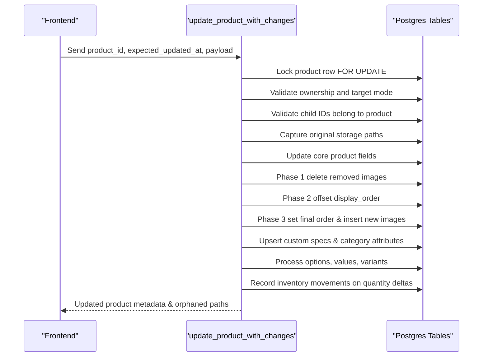

**Diagram sources**
- [20261106_update_product_with_changes_rpc.sql:20-140](file://supabase/migrations/20261106_update_product_with_changes_rpc.sql#L20-L140)
- [20261106_update_product_with_changes_rpc.sql:310-446](file://supabase/migrations/20261106_update_product_with_changes_rpc.sql#L310-L446)
- [20261106_update_product_with_changes_rpc.sql:538-800](file://supabase/migrations/20261106_update_product_with_changes_rpc.sql#L538-L800)

**Section sources**
- [20261106_update_product_with_changes_rpc.sql:20-140](file://supabase/migrations/20261106_update_product_with_changes_rpc.sql#L20-L140)
- [20261106_update_product_with_changes_rpc.sql:310-446](file://supabase/migrations/20261106_update_product_with_changes_rpc.sql#L310-L446)
- [20261106_update_product_with_changes_rpc.sql:538-800](file://supabase/migrations/20261106_update_product_with_changes_rpc.sql#L538-L800)

### Analytics and Dashboard RPCs
Several RPCs provide aggregated analytics for the seller dashboard:

- `get_seller_overview_kpis`: Fast phase 1 KPIs including total revenue, available payout, active listings, pending dispatch, delivered orders, and last 7-day metrics.
- `get_seller_overview_details`: Phase 2 details including daily revenue trajectory, order volume, status breakdown, top products, payment method share, and recent orders.
- `get_seller_last_7_days`: Daily breakdown, summary KPIs, top products, and payment method split over the last 7 days.

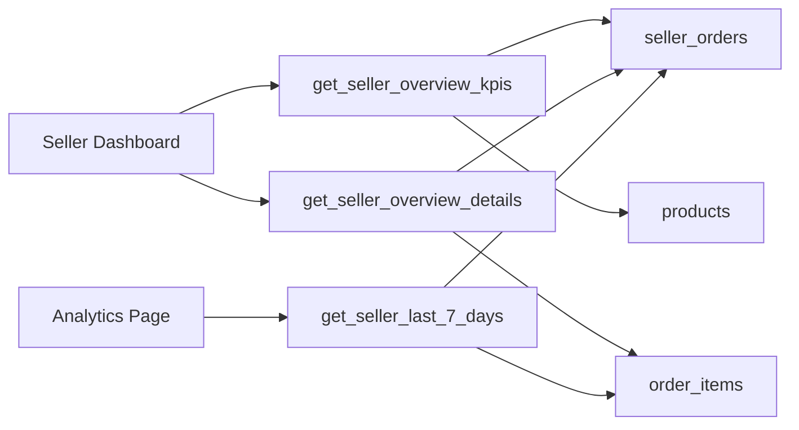

**Diagram sources**
- [supabase_seller_overview_rpc.sql:36-158](file://supabase_seller_overview_rpc.sql#L36-L158)
- [supabase_seller_overview_rpc.sql:166-353](file://supabase_seller_overview_rpc.sql#L166-L353)
- [supabase_seller_last_7_days_rpc.sql:5-178](file://supabase_seller_last_7_days_rpc.sql#L5-L178)

**Section sources**
- [supabase_seller_overview_rpc.sql:36-158](file://supabase_seller_overview_rpc.sql#L36-L158)
- [supabase_seller_overview_rpc.sql:166-353](file://supabase_seller_overview_rpc.sql#L166-L353)
- [supabase_seller_last_7_days_rpc.sql:5-178](file://supabase_seller_last_7_days_rpc.sql#L5-L178)

### Orders Management RPCs
The orders RPCs provide:
- Paginated seller orders with filtering, search, sorting, and aggregation.
- Full order detail modal data joining orders, seller orders, and order items.
- Inline status updates with courier name, tracking number, and dispatch timestamps.

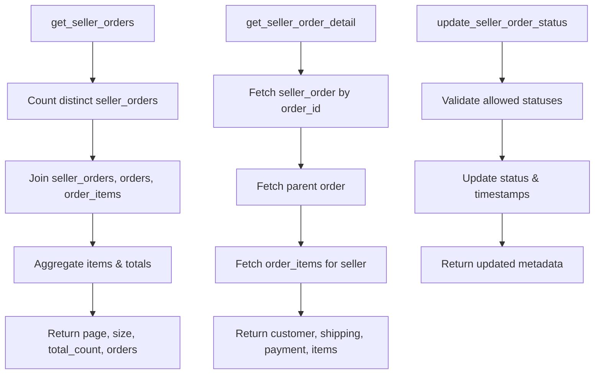

**Diagram sources**
- [supabase_seller_orders_rpc.sql:54-150](file://supabase_seller_orders_rpc.sql#L54-L150)
- [supabase_seller_orders_rpc.sql:157-237](file://supabase_seller_orders_rpc.sql#L157-L237)
- [supabase_seller_orders_rpc.sql:243-309](file://supabase_seller_orders_rpc.sql#L243-L309)

**Section sources**
- [supabase_seller_orders_rpc.sql:54-150](file://supabase_seller_orders_rpc.sql#L54-L150)
- [supabase_seller_orders_rpc.sql:157-237](file://supabase_seller_orders_rpc.sql#L157-L237)
- [supabase_seller_orders_rpc.sql:243-309](file://supabase_seller_orders_rpc.sql#L243-L309)

### Wallet and Payout RPCs
The wallet and payout system includes:
- Monthly commission cycles per seller.
- Seller payments linked to commission cycles.
- Commission cycle items linking orders to cycles.
- RLS policies restricting access to seller-owned data.
- RPCs for wallet KPIs, commission verification submission, paginated payment history, and payment detail with nested order pagination.

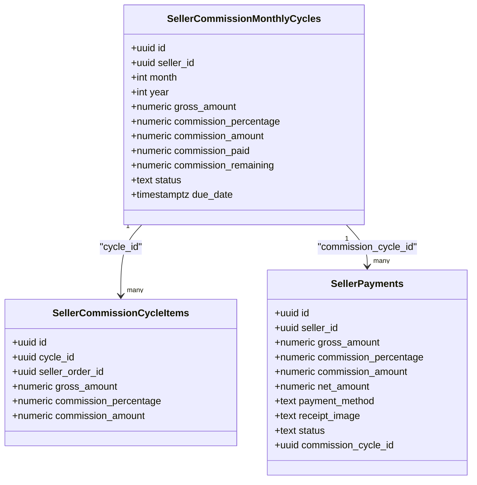

**Diagram sources**
- [supabase_wallet_payout_rpc.sql:11-64](file://supabase_wallet_payout_rpc.sql#L11-L64)
- [supabase_wallet_payout_rpc.sql:133-253](file://supabase_wallet_payout_rpc.sql#L133-L253)
- [supabase_wallet_payout_rpc.sql:259-369](file://supabase_wallet_payout_rpc.sql#L259-L369)
- [supabase_wallet_payout_rpc.sql:375-429](file://supabase_wallet_payout_rpc.sql#L375-L429)
- [supabase_wallet_payout_rpc.sql:435-539](file://supabase_wallet_payout_rpc.sql#L435-L539)

**Section sources**
- [supabase_wallet_payout_rpc.sql:11-64](file://supabase_wallet_payout_rpc.sql#L11-L64)
- [supabase_wallet_payout_rpc.sql:133-253](file://supabase_wallet_payout_rpc.sql#L133-L253)
- [supabase_wallet_payout_rpc.sql:259-369](file://supabase_wallet_payout_rpc.sql#L259-L369)
- [supabase_wallet_payout_rpc.sql:375-429](file://supabase_wallet_payout_rpc.sql#L375-L429)
- [supabase_wallet_payout_rpc.sql:435-539](file://supabase_wallet_payout_rpc.sql#L435-L539)

### React Query Hooks for Product Editing
The product edit hooks expose:
- Core product details query.
- Attribute values and custom specifications query.
- Variation dimensions, options, values, and active variants query.
- Option value images query.

Each hook defines stable query keys scoped by seller and product, enabling precise cache invalidation and conditional fetching.

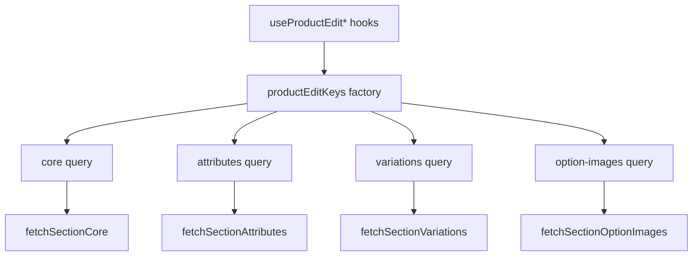

**Diagram sources**
- [useProductEditQueries.ts:17-28](file://src/hooks/useProductEditQueries.ts#L17-L28)
- [useProductEditQueries.ts:42-56](file://src/hooks/useProductEditQueries.ts#L42-L56)
- [useProductEditQueries.ts:63-77](file://src/hooks/useProductEditQueries.ts#L63-L77)
- [useProductEditQueries.ts:85-99](file://src/hooks/useProductEditQueries.ts#L85-L99)
- [useProductEditQueries.ts:106-119](file://src/hooks/useProductEditQueries.ts#L106-L119)

**Section sources**
- [useProductEditQueries.ts:17-28](file://src/hooks/useProductEditQueries.ts#L17-L28)
- [useProductEditQueries.ts:42-56](file://src/hooks/useProductEditQueries.ts#L42-L56)
- [useProductEditQueries.ts:63-77](file://src/hooks/useProductEditQueries.ts#L63-L77)
- [useProductEditQueries.ts:85-99](file://src/hooks/useProductEditQueries.ts#L85-L99)
- [useProductEditQueries.ts:106-119](file://src/hooks/useProductEditQueries.ts#L106-L119)

## Dependency Analysis
The frontend depends on:
- Supabase client for database and storage access.
- React Query for caching and mutation coordination.
- PostgreSQL RPCs for complex business logic.

The backend depends on:
- RLS policies for seller isolation.
- Triggers and constraints for data integrity.
- Indexes for performance-critical queries.

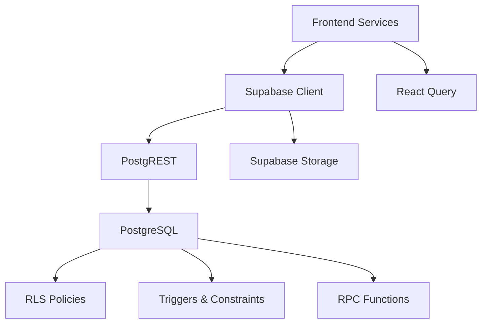

**Diagram sources**
- [client.js:1-8](file://src/api/client.js#L1-L8)
- [QueryProvider.tsx:1-25](file://src/providers/QueryProvider.tsx#L1-L25)
- [supabase_seller_orders_rpc.sql:18-48](file://supabase_seller_orders_rpc.sql#L18-L48)
- [supabase_wallet_payout_rpc.sql:69-97](file://supabase_wallet_payout_rpc.sql#L69-L97)

**Section sources**
- [client.js:1-8](file://src/api/client.js#L1-L8)
- [QueryProvider.tsx:1-25](file://src/providers/QueryProvider.tsx#L1-L25)
- [supabase_seller_orders_rpc.sql:18-48](file://supabase_seller_orders_rpc.sql#L18-L48)
- [supabase_wallet_payout_rpc.sql:69-97](file://supabase_wallet_payout_rpc.sql#L69-L97)

## Performance Considerations
- **Image Deduplication**: SHA-256 hashing ensures identical images are uploaded only once, reducing bandwidth and storage usage.
- **Concurrent Uploads**: Controlled concurrency limits prevent overwhelming the storage service while maintaining throughput.
- **Server-Side Aggregation**: Analytics RPCs compute summaries, trajectories, and breakdowns in Postgres, minimizing client-side processing.
- **Pagination**: Orders, payments, and related lists use server-side pagination to reduce payload sizes.
- **Caching**: React Query stale times and garbage collection reduce repeated network requests.
- **Indexes**: Commission and payment tables include indexes on seller and date columns to optimize common queries.

[No sources needed since this section provides general guidance]

## Troubleshooting Guide
Common issues and resolutions:

### Missing Database Function in Schema Cache
If PostgREST cannot find a function, the frontend formats a user-friendly message indicating which migration script needs to be executed.

Resolution steps:
1. Identify the missing function from the error message.
2. Run the corresponding migration script in the Supabase SQL editor.
3. Wait for PostgREST schema cache refresh.

Relevant mappings:
- `create_product_with_variants` → `supabase/migrations/20261105_all_in_one_product_creation.sql`
- `update_product_with_changes` → `supabase/migrations/20261106_update_product_with_changes_rpc.sql`
- `delete_product` → `supabase/migrations/20261107_fix_product_deletion_rpc.sql`

**Section sources**
- [productService.ts:255-292](file://src/api/productService.ts#L255-L292)

### Validation Errors from RPCs
RPCs return messages prefixed with `VALIDATION:` for business rule violations such as invalid pricing, missing required attributes, duplicate combinations, or unauthorized access.

Resolution steps:
1. Inspect the formatted error message returned by `formatDatabaseError`.
2. Correct the client-side input or confirm required actions like explicit mode conversion.
3. Retry the operation after fixing the payload.

**Section sources**
- [productService.ts:255-292](file://src/api/productService.ts#L255-L292)
- [20261105_all_in_one_product_creation.sql:320-447](file://supabase/migrations/20261105_all_in_one_product_creation.sql#L320-L447)
- [20261106_update_product_with_changes_rpc.sql:118-197](file://supabase/migrations/20261106_update_product_with_changes_rpc.sql#L118-L197)

### Storage Cleanup Failures
When RPC failures occur after partial uploads, the service attempts to remove uploaded paths. If cleanup fails, a warning is included in the thrown error.

Resolution steps:
1. Check the cleanup warning message.
2. Manually verify orphaned storage objects if necessary.
3. Re-attempt product creation after ensuring storage permissions and bucket policies are correct.

**Section sources**
- [productService.ts:654-700](file://src/api/productService.ts#L654-L700)

### Offline Support Patterns
The current implementation does not implement persistent offline queues. However, it includes:
- React Query caching for read-heavy data.
- Network timeout recovery for product creation by checking existing product rows.
- Idempotent image hashing to avoid duplicate uploads.

Recommended enhancements:
- Persist pending mutations in IndexedDB.
- Implement retry strategies with exponential backoff for transient network errors.
- Defer storage uploads until connectivity is restored.

[No sources needed since this section provides general guidance]

## Conclusion
Zebaish’s backend integration combines a robust Supabase client, thoughtful React Query caching, and transactional PostgreSQL RPCs to deliver secure, scalable, and maintainable product and analytics operations. The system emphasizes:
- Strong server-side validation and integrity.
- Seller isolation through RLS policies.
- Efficient image handling with deduplication and concurrency control.
- Clear error messaging and recovery strategies.
- Extensible RPC architecture for future features.

For new integrations, follow the established patterns:
- Validate inputs on the client and enforce business rules in RPCs.
- Use content-addressed storage paths.
- Leverage React Query keys for precise cache management.
- Keep analytics and complex writes in Postgres RPCs rather than client-side logic.