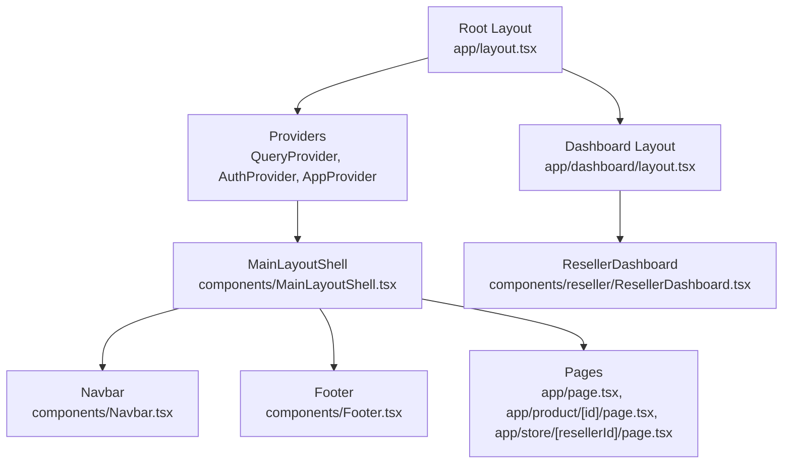
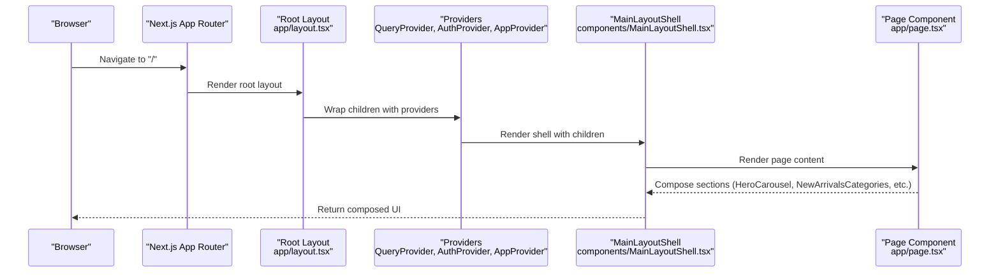
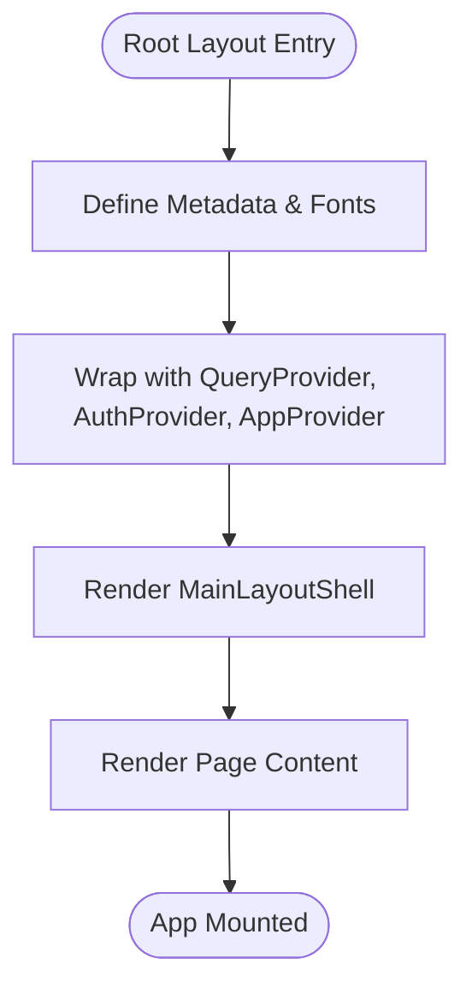
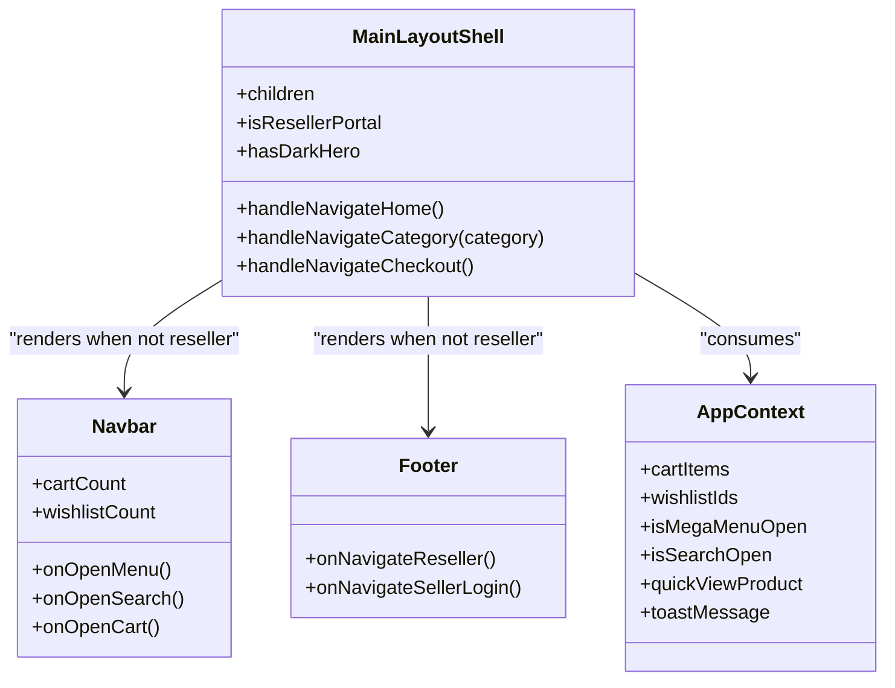
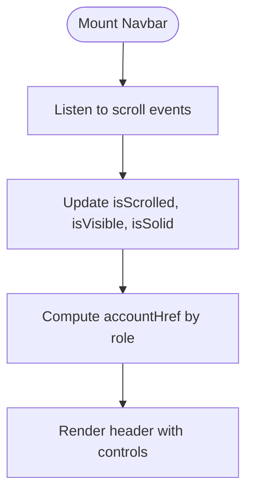
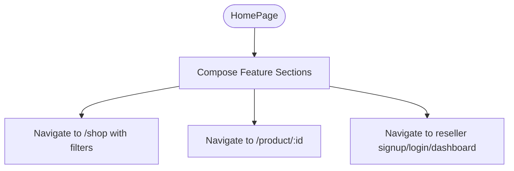
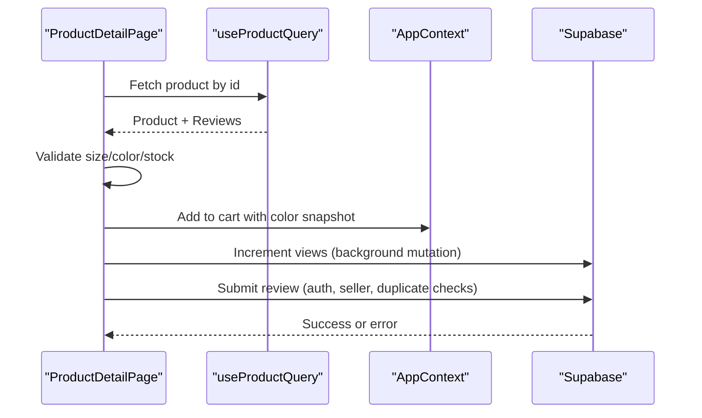
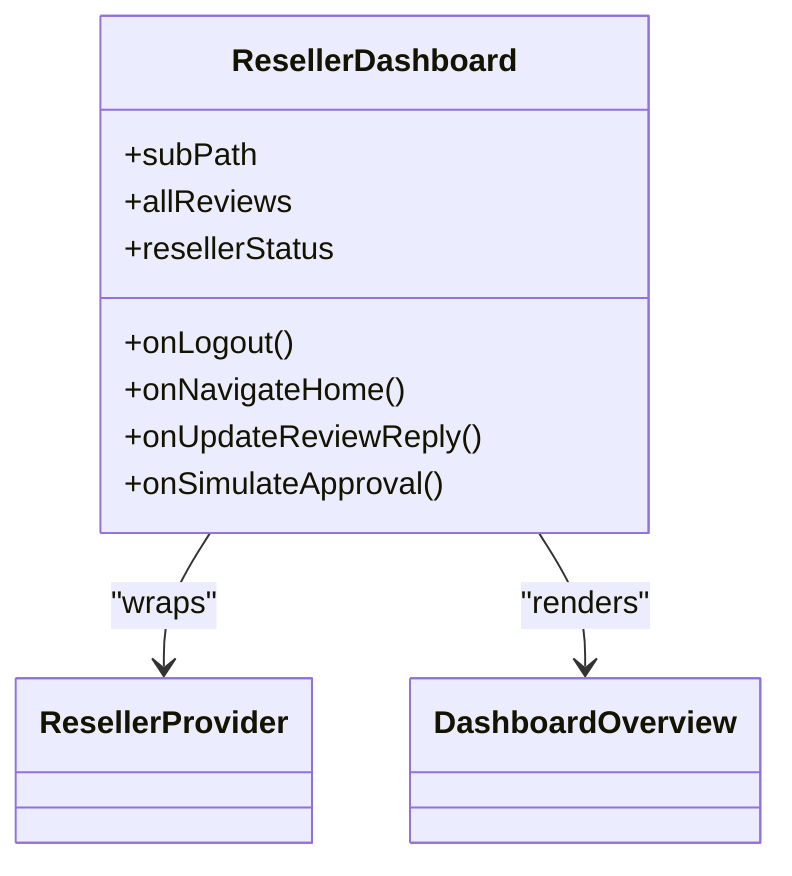
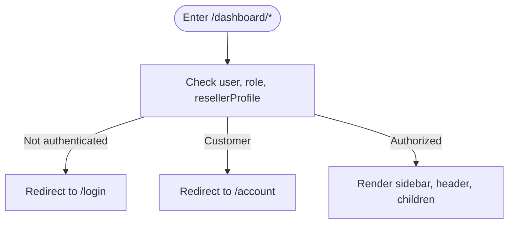
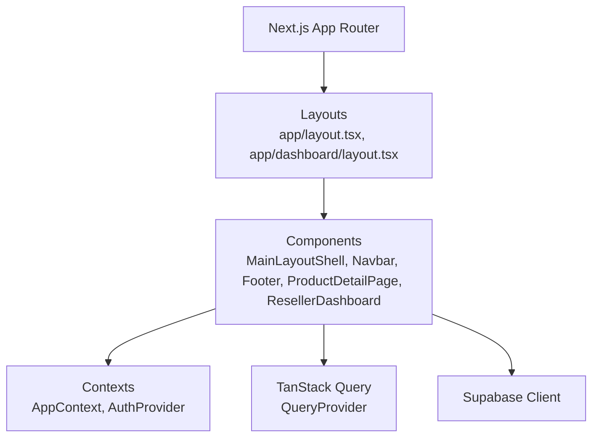

# Frontend Architecture

<cite>
**Referenced Files in This Document**
- [app/layout.tsx](file://app/layout.tsx)
- [app/page.tsx](file://app/page.tsx)
- [app/dashboard/layout.tsx](file://app/dashboard/layout.tsx)
- [next.config.ts](file://next.config.ts)
- [components/MainLayoutShell.tsx](file://components/MainLayoutShell.tsx)
- [components/Navbar.tsx](file://components/Navbar.tsx)
- [components/Footer.tsx](file://components/Footer.tsx)
- [components/ProductDetailPage.tsx](file://components/ProductDetailPage.tsx)
- [components/reseller/ResellerDashboard.tsx](file://components/reseller/ResellerDashboard.tsx)
- [components/context/AppContext.tsx](file://components/context/AppContext.tsx)
- [components/context/AuthProvider.tsx](file://components/context/AuthProvider.tsx)
- [src/providers/QueryProvider.tsx](file://src/providers/QueryProvider.tsx)
</cite>

## Table of Contents
1. [Introduction](#introduction)
2. [Project Structure](#project-structure)
3. [Core Components](#core-components)
4. [Architecture Overview](#architecture-overview)
5. [Detailed Component Analysis](#detailed-component-analysis)
6. [Dependency Analysis](#dependency-analysis)
7. [Performance Considerations](#performance-considerations)
8. [Troubleshooting Guide](#troubleshooting-guide)
9. [Conclusion](#conclusion)

## Introduction
This document explains the Zebaish frontend architecture built with Next.js App Router, React, and Tailwind CSS. It covers page-based routing, layout composition, component hierarchy from the global shell to feature pages like ProductDetailPage and ResellerDashboard, responsive design patterns, separation between customer-facing routes under app and shared components, route protection for the reseller dashboard, dynamic product and store routes, and performance considerations such as code splitting, image optimization, and bundle size management.

## Project Structure
The project follows a clear separation:
- Customer-facing pages live under app with file-system-based routing.
- Shared UI components live under components.
- Data fetching hooks and services live under src.
- Global providers wrap the application at the root layout.

**Diagram sources**
- [app/layout.tsx:20-49](file://app/layout.tsx#L20-L49)
- [components/MainLayoutShell.tsx:13-144](file://components/MainLayoutShell.tsx#L13-L144)
- [components/Navbar.tsx:20-186](file://components/Navbar.tsx#L20-L186)
- [components/Footer.tsx:10-90](file://components/Footer.tsx#L10-L90)
- [app/page.tsx:17-96](file://app/page.tsx#L17-L96)
- [app/dashboard/layout.tsx:12-80](file://app/dashboard/layout.tsx#L12-L80)
- [components/reseller/ResellerDashboard.tsx:16-37](file://components/reseller/ResellerDashboard.tsx#L16-L37)

**Section sources**
- [app/layout.tsx:1-51](file://app/layout.tsx#L1-L51)
- [app/page.tsx:1-97](file://app/page.tsx#L1-L97)
- [app/dashboard/layout.tsx:1-81](file://app/dashboard/layout.tsx#L1-L81)

## Core Components
- Root layout defines metadata, fonts, global styles, and provider nesting.
- MainLayoutShell composes public header, footer, drawers, modals, and conditional layouts for reseller portals.
- Navbar provides navigation, search, cart, wishlist, and account links with scroll-aware styling.
- Footer exposes site information, legal links, social links, and seller onboarding actions.
- AppContext manages cart, wishlist, drawer/modal state, and toast notifications.
- AuthProvider manages Supabase authentication, user roles, and profile data.
- QueryProvider configures TanStack Query defaults.

Key responsibilities:
- Routing and layout composition: app/layout.tsx, app/dashboard/layout.tsx
- Public shell and interactive overlays: components/MainLayoutShell.tsx
- Navigation and footer: components/Navbar.tsx, components/Footer.tsx
- Global client state: components/context/AppContext.tsx
- Authentication and role resolution: components/context/AuthProvider.tsx
- Data caching: src/providers/QueryProvider.tsx

**Section sources**
- [app/layout.tsx:10-49](file://app/layout.tsx#L10-L49)
- [components/MainLayoutShell.tsx:13-144](file://components/MainLayoutShell.tsx#L13-L144)
- [components/Navbar.tsx:20-186](file://components/Navbar.tsx#L20-L186)
- [components/Footer.tsx:10-90](file://components/Footer.tsx#L10-L90)
- [components/context/AppContext.tsx:59-367](file://components/context/AppContext.tsx#L59-L367)
- [components/context/AuthProvider.tsx:76-326](file://components/context/AuthProvider.tsx#L76-L326)
- [src/providers/QueryProvider.tsx:6-24](file://src/providers/QueryProvider.tsx#L6-L24)

## Architecture Overview
The application uses Next.js App Router with nested layouts:
- Root layout wraps all pages with providers and MainLayoutShell.
- Public pages render inside MainLayoutShell, which injects Navbar, Footer, CartDrawer, MegaMenuDrawer, SearchModal, QuickViewModal, and toast.
- Reseller portal has its own layout that enforces authentication and role checks before rendering dashboard content.

**Diagram sources**
- [app/layout.tsx:20-49](file://app/layout.tsx#L20-L49)
- [components/MainLayoutShell.tsx:64-144](file://components/MainLayoutShell.tsx#L64-L144)
- [app/page.tsx:65-96](file://app/page.tsx#L65-L96)

## Detailed Component Analysis

### Root Layout and Provider Composition
- Defines site metadata, icons, and preconnects for fonts.
- Wraps the app with QueryProvider, AuthProvider, AppProvider, Analytics, and MainLayoutShell.
- Applies global body classes for theme and typography.

**Diagram sources**
- [app/layout.tsx:10-49](file://app/layout.tsx#L10-L49)

**Section sources**
- [app/layout.tsx:1-51](file://app/layout.tsx#L1-L51)

### MainLayoutShell: Public Shell and Interactive Overlays
- Detects reseller portal paths and applies different header/footer visibility.
- Provides navigation helpers for home, category, checkout, and reseller signup/login.
- Renders CartDrawer, MegaMenuDrawer, SearchModal, QuickViewModal, and toast.
- Uses AppContext for cart, wishlist, modal states, and toast messages.

**Diagram sources**
- [components/MainLayoutShell.tsx:13-144](file://components/MainLayoutShell.tsx#L13-L144)
- [components/Navbar.tsx:20-186](file://components/Navbar.tsx#L20-L186)
- [components/Footer.tsx:10-90](file://components/Footer.tsx#L10-L90)
- [components/context/AppContext.tsx:59-367](file://components/context/AppContext.tsx#L59-L367)

**Section sources**
- [components/MainLayoutShell.tsx:1-145](file://components/MainLayoutShell.tsx#L1-L145)

### Navbar: Scroll-Aware Header and Navigation
- Hides/shows based on scroll direction and hero background.
- Provides links to account, wishlist, and cart; opens mega menu, search, and cart drawer.
- Computes account link based on user role.

**Diagram sources**
- [components/Navbar.tsx:29-69](file://components/Navbar.tsx#L29-L69)
- [components/Navbar.tsx:71-186](file://components/Navbar.tsx#L71-L186)

**Section sources**
- [components/Navbar.tsx:1-186](file://components/Navbar.tsx#L1-L186)

### Footer: Site Information and Seller Onboarding
- Displays contact details, policy links, track order, about, contact, terms, login.
- Exposes callbacks for becoming a seller or logging into seller portal.

**Section sources**
- [components/Footer.tsx:1-90](file://components/Footer.tsx#L1-L90)

### HomePage: Landing Page Composition
- Composes HeroCarousel, NewArrivalsCategories, FeaturedCollectionsGrid, MostTrending, ShopByCollection, CoutureSection, WornAndLoved, Newsletter.
- Handles navigation to shop with brand/category filters, product detail pages, and reseller flows.

**Diagram sources**
- [app/page.tsx:17-96](file://app/page.tsx#L17-L96)

**Section sources**
- [app/page.tsx:1-97](file://app/page.tsx#L1-L97)

### ProductDetailPage: Product Detail and Review Flow
- Loads product via TanStack Query hook and renders gallery, attributes, variants, stock, add-to-cart, and reviews.
- Validates review submission with multiple steps: authentication, seller check, duplicate prevention, order item resolution, and DB insertion with fallbacks.
- Integrates with AppContext for cart and wishlist operations.

**Diagram sources**
- [components/ProductDetailPage.tsx:68-83](file://components/ProductDetailPage.tsx#L68-L83)
- [components/ProductDetailPage.tsx:234-243](file://components/ProductDetailPage.tsx#L234-L243)
- [components/ProductDetailPage.tsx:286-338](file://components/ProductDetailPage.tsx#L286-L338)
- [components/ProductDetailPage.tsx:341-515](file://components/ProductDetailPage.tsx#L341-L515)
- [components/context/AppContext.tsx:166-210](file://components/context/AppContext.tsx#L166-L210)

**Section sources**
- [components/ProductDetailPage.tsx:1-800](file://components/ProductDetailPage.tsx#L1-L800)

### ResellerDashboard: Protected Dashboard Wrapper
- Wraps dashboard content with ResellerProvider and ListingDraftProvider.
- Delegates overview rendering to DashboardOverview and navigates to orders.

**Diagram sources**
- [components/reseller/ResellerDashboard.tsx:16-37](file://components/reseller/ResellerDashboard.tsx#L16-L37)

**Section sources**
- [components/reseller/ResellerDashboard.tsx:1-38](file://components/reseller/ResellerDashboard.tsx#L1-L38)

### Route Protection: Dashboard Layout
- Enforces authentication and role checks before rendering dashboard content.
- Redirects unauthenticated users to login and customers to account.
- Shows loading and redirecting states while resolving auth.

**Diagram sources**
- [app/dashboard/layout.tsx:12-54](file://app/dashboard/layout.tsx#L12-L54)

**Section sources**
- [app/dashboard/layout.tsx:1-81](file://app/dashboard/layout.tsx#L1-L81)

### Dynamic Routing Patterns
- Product detail: app/product/[id]/page.tsx resolves product by ID and composes ProductDetailPage.
- Storefront: app/store/[resellerId]/page.tsx renders ResellerStorefront for a specific reseller.
- Category filtering: app/shop/page.tsx supports query parameters for categories and brands.

These patterns leverage Next.js file-system routing with dynamic segments and query strings.

**Section sources**
- [app/page.tsx:26-59](file://app/page.tsx#L26-L59)

### Responsive Design with Tailwind CSS
- Mobile-first utilities are used throughout components for spacing, typography, grids, and visibility.
- Navbar adapts to hero background and scroll position using Tailwind classes and inline backdrop-filter.
- MainLayoutShell adjusts main content padding based on route and device breakpoints.
- ProductDetailPage uses responsive grid and typography scales across sizes.

Examples:
- Navbar scroll behavior and transparent/solid backgrounds.
- MainLayoutShell conditional padding for non-home routes.
- ProductDetailPage responsive gallery and buy box layout.

**Section sources**
- [components/Navbar.tsx:71-186](file://components/Navbar.tsx#L71-L186)
- [components/MainLayoutShell.tsx:64-91](file://components/MainLayoutShell.tsx#L64-L91)
- [components/ProductDetailPage.tsx:576-800](file://components/ProductDetailPage.tsx#L576-L800)

## Dependency Analysis
High-level dependencies:
- Next.js App Router drives routing and layout composition.
- React Context provides global client state (AppContext) and authentication (AuthProvider).
- TanStack Query powers data fetching and caching through QueryProvider.
- Supabase client integrates with authentication and database operations.

**Diagram sources**
- [app/layout.tsx:20-49](file://app/layout.tsx#L20-L49)
- [app/dashboard/layout.tsx:72-80](file://app/dashboard/layout.tsx#L72-L80)
- [components/context/AppContext.tsx:59-367](file://components/context/AppContext.tsx#L59-L367)
- [components/context/AuthProvider.tsx:76-326](file://components/context/AuthProvider.tsx#L76-L326)
- [src/providers/QueryProvider.tsx:6-24](file://src/providers/QueryProvider.tsx#L6-L24)

**Section sources**
- [app/layout.tsx:1-51](file://app/layout.tsx#L1-L51)
- [app/dashboard/layout.tsx:1-81](file://app/dashboard/layout.tsx#L1-L81)
- [components/context/AppContext.tsx:1-367](file://components/context/AppContext.tsx#L1-L367)
- [components/context/AuthProvider.tsx:1-326](file://components/context/AuthProvider.tsx#L1-L326)
- [src/providers/QueryProvider.tsx:1-25](file://src/providers/QueryProvider.tsx#L1-L25)

## Performance Considerations
- Code splitting: Next.js automatically splits code per route and component boundaries. The use of separate page files and modular components ensures efficient loading.
- Image optimization: Images in ProductDetailPage use lazy loading and decoding attributes to improve initial paint and reduce blocking resources.
- Bundle size management: next.config.ts enables optimizePackageImports for lucide-react and recharts to reduce unused icon/chart code.
- Caching: QueryProvider sets a default staleTime of 60 seconds and disables refetchOnWindowFocus to reduce unnecessary network requests.
- Local storage persistence: AppContext persists cart items to localStorage and validates entries to avoid hydration mismatches.

Recommendations:
- Continue using Next.js image optimization for product images and store avatars.
- Keep large components (like ProductDetailPage) split into smaller subcomponents where feasible.
- Monitor bundle size growth as new features are added; consider lazy-loading heavy modals or dashboards.

**Section sources**
- [next.config.ts:1-12](file://next.config.ts#L1-L12)
- [src/providers/QueryProvider.tsx:6-24](file://src/providers/QueryProvider.tsx#L6-L24)
- [components/context/AppContext.tsx:84-145](file://components/context/AppContext.tsx#L84-L145)
- [components/ProductDetailPage.tsx:597-610](file://components/ProductDetailPage.tsx#L597-L610)

## Troubleshooting Guide
Common issues and resolutions:
- Hydration mismatch due to cart state: Ensure cart initialization starts empty on server and loads from localStorage only after mount. AppContext handles this with an isCartLoaded flag and validation.
- Unauthenticated access to dashboard: Dashboard layout redirects to login or account if user is missing or role is not seller. Verify AuthProvider state and Supabase session.
- Review submission failures: ProductDetailPage includes multi-step validation and fallbacks for schema differences. Check console errors and ensure required tables exist.
- Navbar transparency vs solid background: Navbar toggles based on hero presence and scroll position. If visuals appear incorrect, verify hasDarkHero prop and scroll event handling.

Actionable checks:
- Confirm Supabase client configuration and session status.
- Validate localStorage contents for cart and ensure JSON structure matches expected types.
- Inspect browser console for API errors during review submission or view increment.

**Section sources**
- [components/context/AppContext.tsx:84-145](file://components/context/AppContext.tsx#L84-L145)
- [app/dashboard/layout.tsx:18-54](file://app/dashboard/layout.tsx#L18-L54)
- [components/ProductDetailPage.tsx:286-515](file://components/ProductDetailPage.tsx#L286-L515)
- [components/Navbar.tsx:34-69](file://components/Navbar.tsx#L34-L69)

## Conclusion
Zebaish’s frontend architecture leverages Next.js App Router for scalable routing, layered layouts for consistent shells, and robust context providers for global state and authentication. The separation between customer-facing pages and shared components keeps the codebase maintainable. Responsive design with Tailwind CSS ensures a mobile-first experience. Performance optimizations include automatic code splitting, image lazy loading, package import optimization, and sensible query caching. Route protection for the reseller dashboard ensures secure access, while dynamic routing patterns support flexible product and storefront experiences.