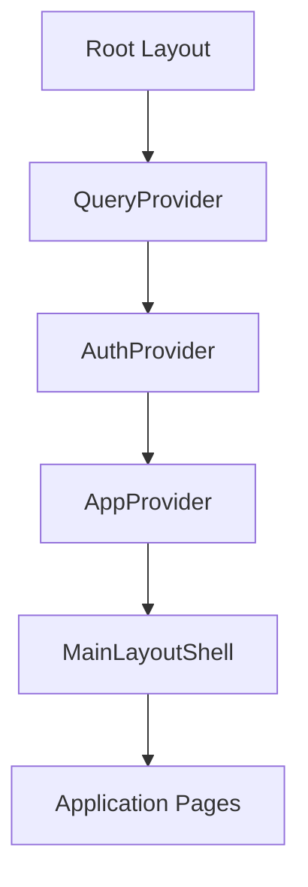
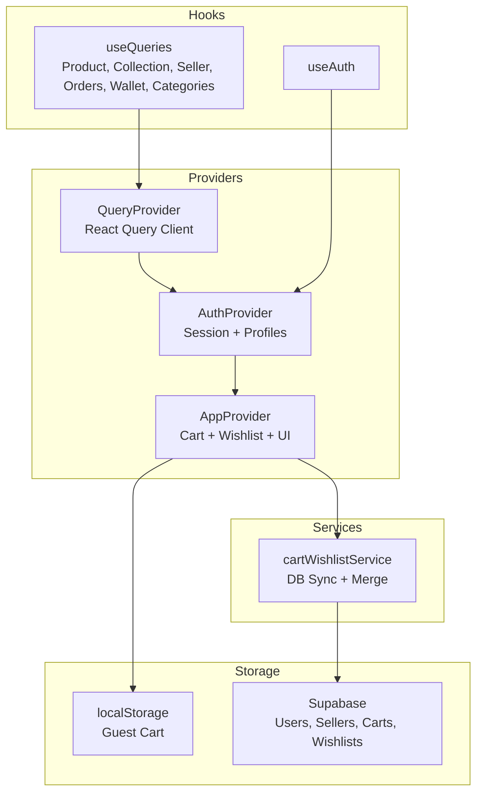
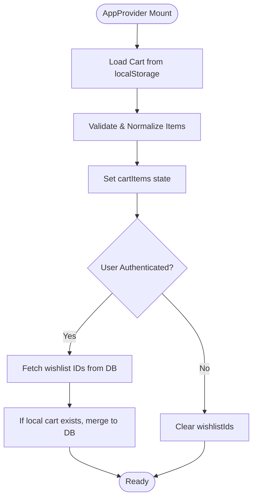
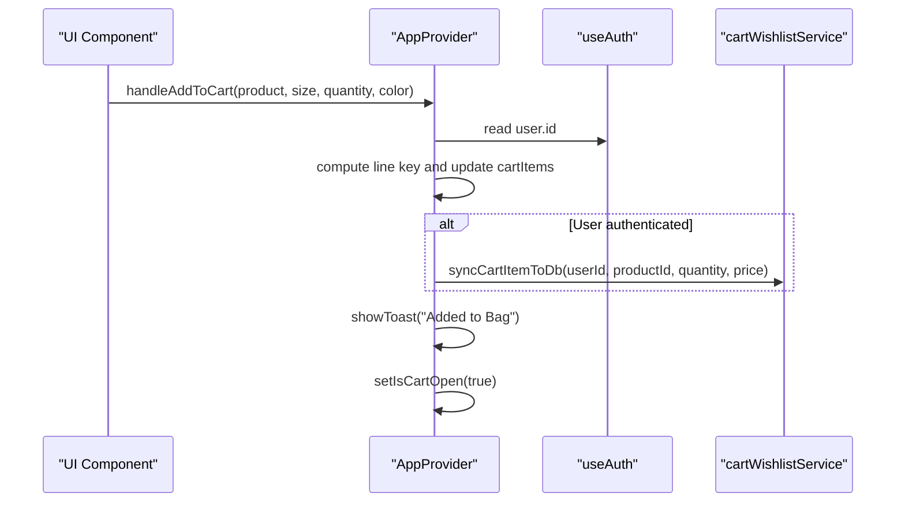
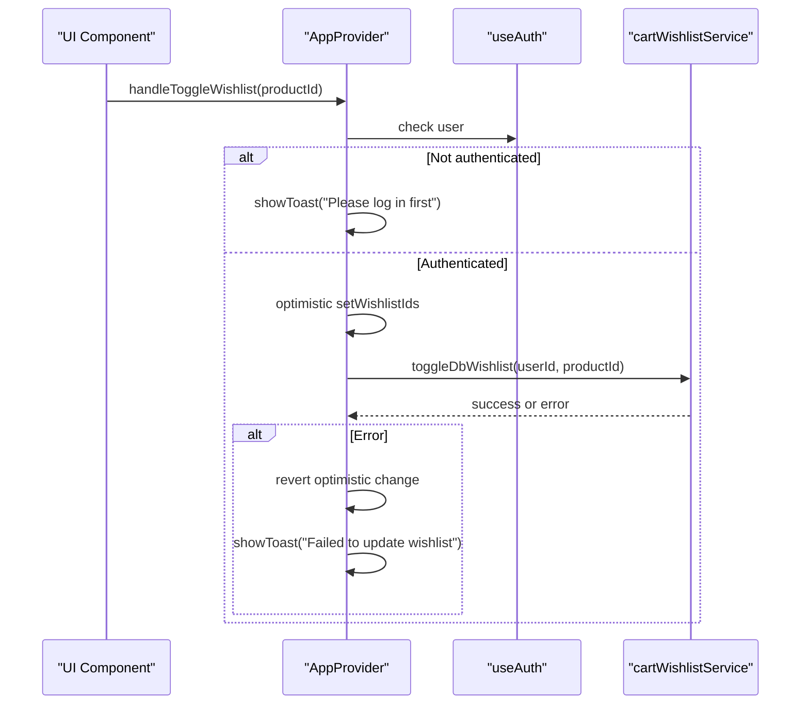
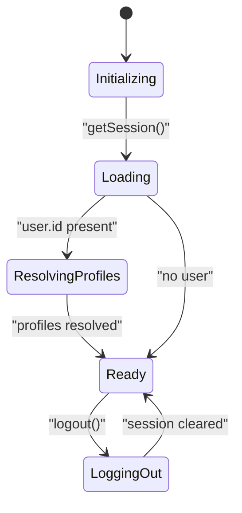
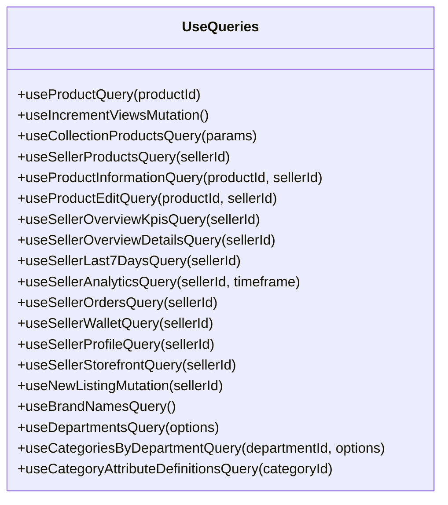
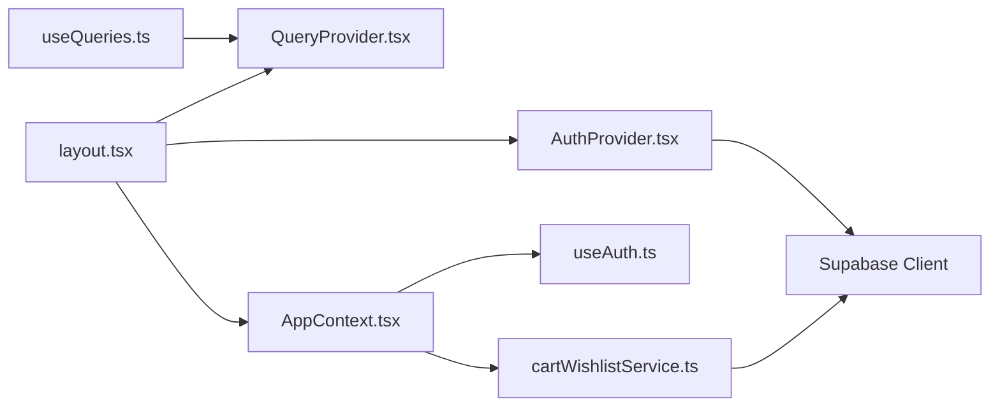

# State Management Patterns

<cite>
**Referenced Files in This Document**
- [layout.tsx](file://app/layout.tsx)
- [AppContext.tsx](file://components/context/AppContext.tsx)
- [AuthProvider.tsx](file://components/context/AuthProvider.tsx)
- [useAuth.ts](file://src/hooks/useAuth.ts)
- [useQueries.ts](file://src/hooks/useQueries.ts)
- [QueryProvider.tsx](file://src/providers/QueryProvider.tsx)
- [cartWishlistService.ts](file://src/api/cartWishlistService.ts)
</cite>

## Table of Contents
1. [Introduction](#introduction)
2. [Project Structure](#project-structure)
3. [Core Components](#core-components)
4. [Architecture Overview](#architecture-overview)
5. [Detailed Component Analysis](#detailed-component-analysis)
6. [Dependency Analysis](#dependency-analysis)
7. [Performance Considerations](#performance-considerations)
8. [Troubleshooting Guide](#troubleshooting-guide)
9. [Conclusion](#conclusion)

## Introduction
This document explains the Zebaish platform’s hybrid state management approach:
- React Context for UI and local application state (cart, wishlist, drawers, modals, toasts).
- TanStack React Query for server state (product data, seller dashboards, categories, orders, wallet, storefront).
- Supabase for authentication and persistence.

The root layout composes providers so that all pages can consume auth, app, and query state consistently.

## Project Structure
At the application root, providers are composed in a specific order:
- QueryProvider wraps the entire tree with TanStack React Query.
- AuthProvider manages authentication, session, and user profiles.
- AppProvider manages cart, wishlist, global UI interactions, and toast notifications.
- MainLayoutShell renders the page shell after providers.

**Diagram sources**
- [layout.tsx:39-46](file://app/layout.tsx#L39-L46)

**Section sources**
- [layout.tsx:1-51](file://app/layout.tsx#L1-L51)

## Core Components
- AppProvider: Manages cart items, wishlist IDs, drawer/modal visibility, quick view product, and toast messages. It persists cart to localStorage and synchronizes cart/wishlist with the database when authenticated.
- AuthProvider: Manages Supabase session, user object, reseller and customer profiles, role, seller status, loading state, logout, and profile refetch.
- useAuth: Typed hook to access AuthContext safely.
- useQueries: Centralized hooks for TanStack React Query covering products, collections, seller dashboards, orders, wallet, profile, storefront, categories, and mutations.
- QueryProvider: Configures global React Query defaults such as staleTime and window focus behavior.

**Section sources**
- [AppContext.tsx:14-53](file://components/context/AppContext.tsx#L14-L53)
- [AuthProvider.tsx:47-57](file://components/context/AuthProvider.tsx#L47-L57)
- [useAuth.ts:4-10](file://src/hooks/useAuth.ts#L4-L10)
- [useQueries.ts:48-55](file://src/hooks/useQueries.ts#L48-L55)
- [QueryProvider.tsx:6-17](file://src/providers/QueryProvider.tsx#L6-L17)

## Architecture Overview
The system separates concerns between client-side UI state and server state:
- UI state lives in React Context (AppProvider), including cart, wishlist, and UI toggles.
- Server state is cached and managed by React Query hooks (useQueries), with explicit stale times and cache lifetimes.
- Authentication state is centralized in AuthProvider and consumed via useAuth.
- Data persistence uses localStorage for guest cart and Supabase for authenticated cart/wishlist and profiles.

**Diagram sources**
- [layout.tsx:39-46](file://app/layout.tsx#L39-L46)
- [AppContext.tsx:59-357](file://components/context/AppContext.tsx#L59-L357)
- [AuthProvider.tsx:76-321](file://components/context/AuthProvider.tsx#L76-L321)
- [useAuth.ts:4-10](file://src/hooks/useAuth.ts#L4-L10)
- [useQueries.ts:48-357](file://src/hooks/useQueries.ts#L48-L357)
- [cartWishlistService.ts:9-222](file://src/api/cartWishlistService.ts#L9-L222)
- [QueryProvider.tsx:6-17](file://src/providers/QueryProvider.tsx#L6-L17)

## Detailed Component Analysis

### AppProvider: Cart, Wishlist, and Global UI State
Responsibilities:
- Cart state and operations: add, update quantity, remove, clear.
- Wishlist state and optimistic toggle with DB synchronization.
- Global UI flags: mega menu, search modal, quick view product.
- Toast notifications for user feedback.
- Persistence: load and save cart from/to localStorage.
- Auth-aware sync: merge guest cart to DB on login; sync cart changes and wishlist toggles to DB.

Key behaviors:
- Cart initialization avoids hydration mismatches by starting empty and hydrating after mount.
- Cart line keying supports size and color variants.
- Wishlist toggle is optimistic and reverts on failure.
- Toast auto-dismisses after a short delay.

**Diagram sources**
- [AppContext.tsx:84-163](file://components/context/AppContext.tsx#L84-L163)

Add-to-cart flow:

**Diagram sources**
- [AppContext.tsx:165-210](file://components/context/AppContext.tsx#L165-L210)
- [cartWishlistService.ts:96-163](file://src/api/cartWishlistService.ts#L96-L163)

Wishlist toggle flow:

**Diagram sources**
- [AppContext.tsx:304-331](file://components/context/AppContext.tsx#L304-L331)
- [cartWishlistService.ts:36-88](file://src/api/cartWishlistService.ts#L36-L88)

**Section sources**
- [AppContext.tsx:59-357](file://components/context/AppContext.tsx#L59-L357)
- [cartWishlistService.ts:9-222](file://src/api/cartWishlistService.ts#L9-L222)

### AuthProvider: Authentication and Profile Management
Responsibilities:
- Manage Supabase session and user object.
- Resolve user roles and profiles (reseller vs customer).
- Auto-create customer profile if missing.
- Provide logout and profile refetch capabilities.
- Listen to auth state changes and update context accordingly.

Key behaviors:
- On initialization, fetch current session and resolve profiles.
- On auth state change, update user/session and profiles.
- Gracefully handle missing tables or schema issues during profile resolution.

**Diagram sources**
- [AuthProvider.tsx:248-303](file://components/context/AuthProvider.tsx#L248-L303)
- [AuthProvider.tsx:231-246](file://components/context/AuthProvider.tsx#L231-L246)

**Section sources**
- [AuthProvider.tsx:76-321](file://components/context/AuthProvider.tsx#L76-L321)

### useAuth Hook
A typed wrapper around AuthContext that enforces usage within AuthProvider and returns the full auth context type.

Usage pattern:
- Consume user, session, role, profiles, loading, logout, and refetchProfile across components.

**Section sources**
- [useAuth.ts:4-10](file://src/hooks/useAuth.ts#L4-L10)

### useQueries: Server State Hooks
Centralized hooks encapsulating business logic for fetching and mutating server data:
- Product detail and views increment.
- Collection products with filtering/sorting/pagination.
- Seller products, product information, edit queries.
- Dashboard KPIs, last 7 days, analytics, orders, wallet, profile, storefront.
- Brand names, departments, child categories, attribute definitions.
- New listing mutation with cache invalidation.

Caching strategy highlights:
- Product detail: 3-minute stale time.
- Collections: 3-minute stale time.
- Seller products: 5-minute stale time, 10-minute GC.
- Product information/edit: 1-minute stale time, 5-minute GC.
- Dashboard metrics: 1-minute stale time.
- Categories/brands: 10-minute stale time.

Views increment mutation intentionally does not invalidate product queries to avoid unnecessary refetches.

**Diagram sources**
- [useQueries.ts:48-357](file://src/hooks/useQueries.ts#L48-L357)

**Section sources**
- [useQueries.ts:30-357](file://src/hooks/useQueries.ts#L30-L357)

### QueryProvider: Global React Query Configuration
Configures the React Query client with:
- Global default staleTime of 60 seconds.
- Disabling automatic refetch on window focus.

This ensures consistent caching behavior across all hooks unless overridden per-query.

**Section sources**
- [QueryProvider.tsx:6-17](file://src/providers/QueryProvider.tsx#L6-L17)

## Dependency Analysis
Provider composition and dependency relationships:
- Root layout composes QueryProvider, AuthProvider, and AppProvider.
- AppProvider depends on useAuth for user identity and on cartWishlistService for DB sync.
- useQueries depends on API services and Supabase client for server state.
- AuthProvider depends on Supabase client for session and profile operations.

**Diagram sources**
- [layout.tsx:39-46](file://app/layout.tsx#L39-L46)
- [AppContext.tsx:59-357](file://components/context/AppContext.tsx#L59-L357)
- [AuthProvider.tsx:76-321](file://components/context/AuthProvider.tsx#L76-L321)
- [useAuth.ts:4-10](file://src/hooks/useAuth.ts#L4-L10)
- [useQueries.ts:48-357](file://src/hooks/useQueries.ts#L48-L357)
- [cartWishlistService.ts:9-222](file://src/api/cartWishlistService.ts#L9-L222)

**Section sources**
- [layout.tsx:39-46](file://app/layout.tsx#L39-L46)
- [AppContext.tsx:59-357](file://components/context/AppContext.tsx#L59-L357)
- [AuthProvider.tsx:76-321](file://components/context/AuthProvider.tsx#L76-L321)
- [useQueries.ts:48-357](file://src/hooks/useQueries.ts#L48-L357)
- [cartWishlistService.ts:9-222](file://src/api/cartWishlistService.ts#L9-L222)

## Performance Considerations
- Hydration safety: Cart starts empty and hydrates after mount to prevent SSR/client mismatch.
- Optimistic updates: Wishlist toggle updates UI immediately and reverts on failure.
- Selective cache invalidation: Views increment mutation does not trigger product query refetch.
- Stale times tuned per domain:
  - Product detail and collections: 3 minutes.
  - Seller products: 5 minutes with 10-minute GC.
  - Dashboard metrics: 1 minute.
  - Categories/brands: 10 minutes.
- Global defaults: 60-second staleTime and disabled refetchOnWindowFocus reduce unnecessary network calls.
- Local storage persistence: Guest cart persisted to avoid data loss across sessions.

[No sources needed since this section provides general guidance]

## Troubleshooting Guide
Common issues and strategies:
- Missing provider errors:
  - Using useAuth outside AuthProvider throws an error; ensure components are wrapped by AuthProvider.
  - Using useApp outside AppProvider throws an error; ensure components are wrapped by AppProvider.
- Hydration mismatches:
  - Ensure cart initialization is safe for SSR; start empty and hydrate after mount.
- Auth state transitions:
  - If profiles fail due to missing tables, AuthProvider handles known error codes and continues gracefully.
- Wishlist toggle failures:
  - Revert optimistic state on DB errors and show user feedback via toast.
- Debugging:
  - Inspect localStorage for cart persistence.
  - Monitor React Query devtools for cache states and invalidations.
  - Review console logs for service errors in cart/wishlist sync and profile fetching.

**Section sources**
- [useAuth.ts:4-10](file://src/hooks/useAuth.ts#L4-L10)
- [AppContext.tsx:360-366](file://components/context/AppContext.tsx#L360-L366)
- [AuthProvider.tsx:104-138](file://components/context/AuthProvider.tsx#L104-L138)
- [AppContext.tsx:304-331](file://components/context/AppContext.tsx#L304-L331)

## Conclusion
Zebaish employs a clear separation of concerns:
- React Context for UI state and cross-cutting interactions.
- React Query for robust server state caching and invalidation.
- Supabase for authentication and persistence.

This hybrid model improves performance through caching and optimistic updates while maintaining simplicity and clarity in state flows. Provider composition at the root ensures consistent access to auth, app, and query state across the application.

[No sources needed since this section summarizes without analyzing specific files]