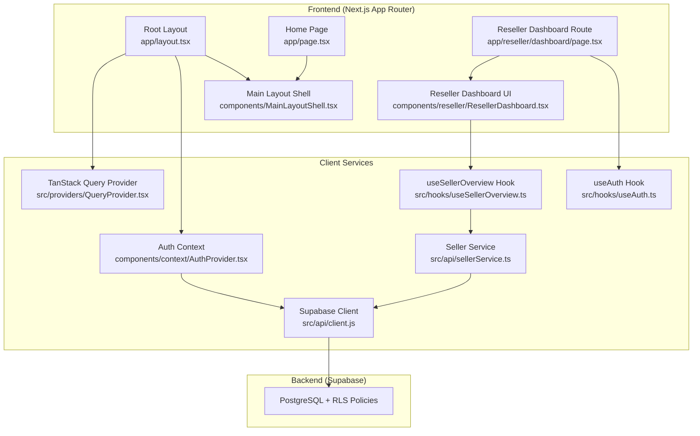
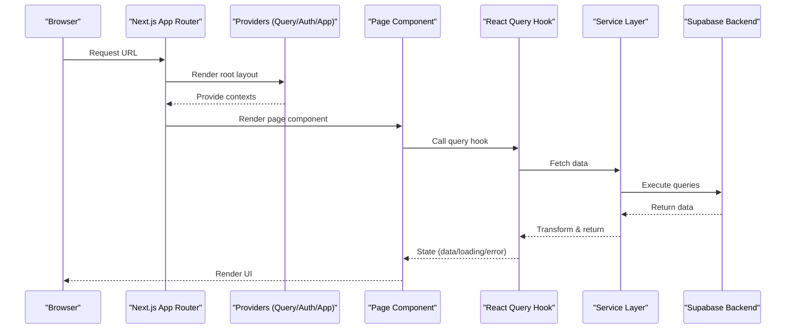
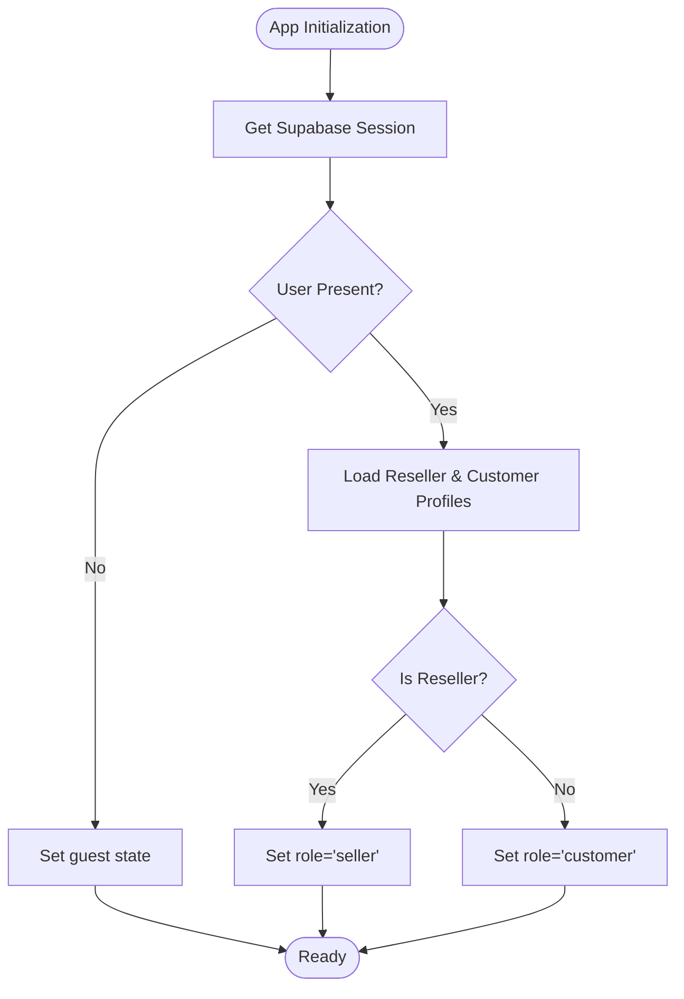
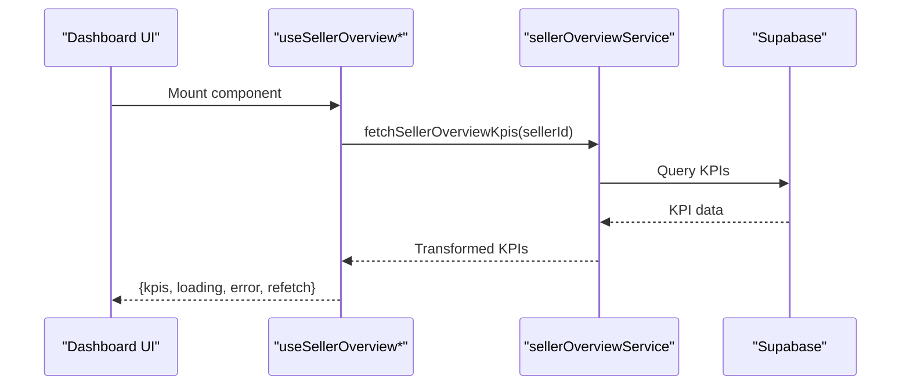
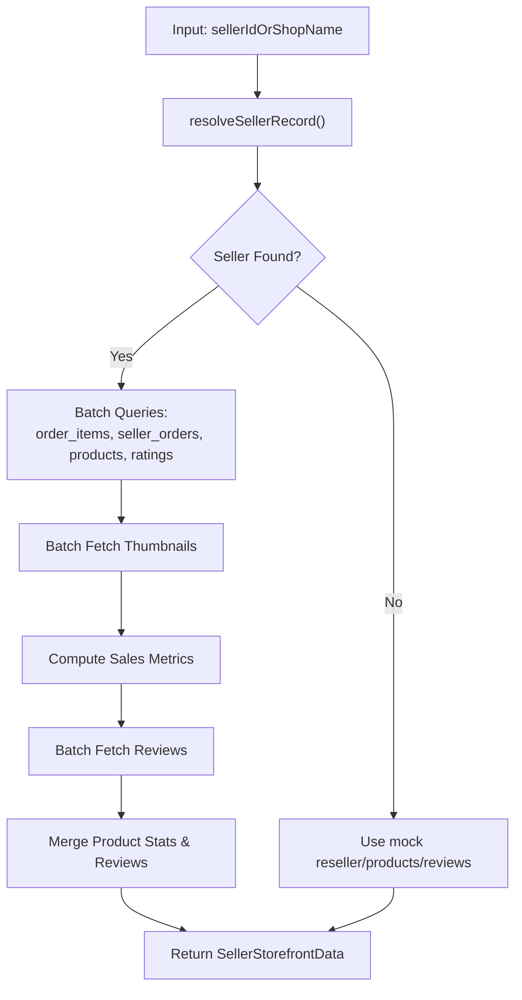
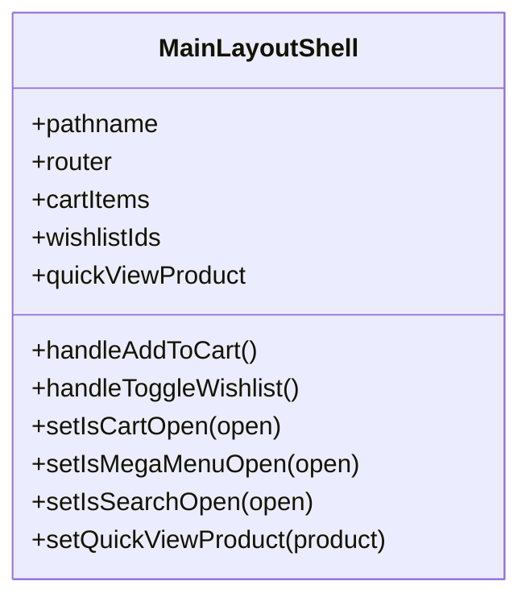
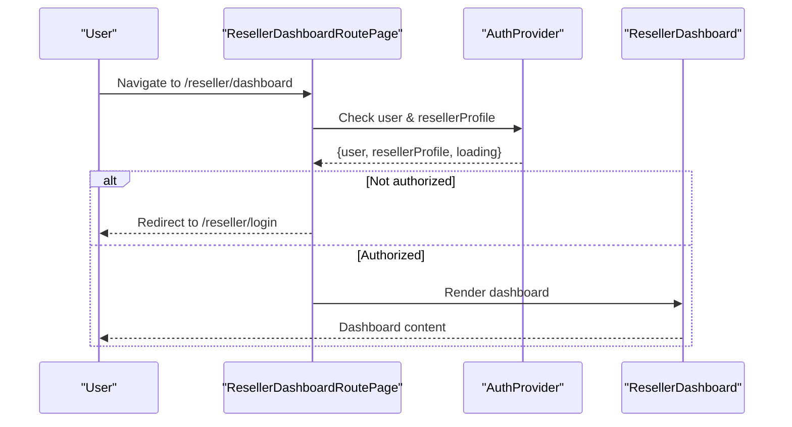
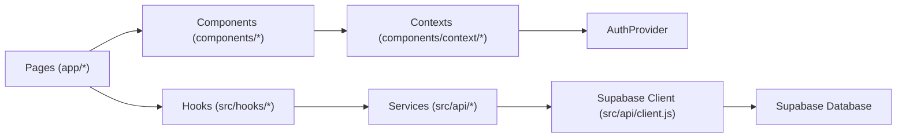

# System Architecture

<cite>
**Referenced Files in This Document**
- [README.md](file://README.md)
- [package.json](file://package.json)
- [next.config.ts](file://next.config.ts)
- [app/layout.tsx](file://app/layout.tsx)
- [app/page.tsx](file://app/page.tsx)
- [components/MainLayoutShell.tsx](file://components/MainLayoutShell.tsx)
- [components/context/AuthProvider.tsx](file://components/context/AuthProvider.tsx)
- [src/hooks/useAuth.ts](file://src/hooks/useAuth.ts)
- [src/providers/QueryProvider.tsx](file://src/providers/QueryProvider.tsx)
- [src/api/client.js](file://src/api/client.js)
- [src/api/sellerService.ts](file://src/api/sellerService.ts)
- [src/hooks/useSellerOverview.ts](file://src/hooks/useSellerOverview.ts)
- [app/reseller/dashboard/page.tsx](file://app/reseller/dashboard/page.tsx)
- [components/reseller/ResellerDashboard.tsx](file://components/reseller/ResellerDashboard.tsx)
- [supabase/migrations/20261106_create_users_table.sql](file://supabase/migrations/20261106_create_users_table.sql)
</cite>

## Table of Contents
1. [Introduction](#introduction)
2. [Project Structure](#project-structure)
3. [Core Components](#core-components)
4. [Architecture Overview](#architecture-overview)
5. [Detailed Component Analysis](#detailed-component-analysis)
6. [Dependency Analysis](#dependency-analysis)
7. [Performance Considerations](#performance-considerations)
8. [Troubleshooting Guide](#troubleshooting-guide)
9. [Conclusion](#conclusion)

## Introduction
This document describes the system architecture for the Zebaish e-commerce platform. The application is a Next.js App Router project with server-side rendering and client-side interactivity, built with React and TypeScript. It integrates Supabase as the backend service for authentication, data storage, and row-level security policies. The platform supports two user roles:
- Customer storefront: browsing products, cart, checkout, and account features.
- Reseller dashboard: managing listings, orders, analytics, payouts, and settings.

The deployment topology targets Vercel for hosting the Next.js frontend, with Supabase providing the database, auth, and storage services.

Key technologies:
- Frontend: Next.js (App Router), React, TypeScript, Tailwind CSS v4, TanStack React Query
- Backend: Supabase (PostgreSQL, Auth, Storage, RLS)
- Deployment: Vercel

**Section sources**
- [README.md:1-37](file://README.md#L1-L37)
- [package.json:13-31](file://package.json#L13-L31)

## Project Structure
The repository follows a feature-oriented structure under app/ for routes and components/, with a dedicated src/ layer for API clients, hooks, providers, and utilities.

Highlights:
- app/: Next.js App Router pages and layouts; includes customer storefront routes and reseller dashboard routes.
- components/: Shared UI components and contexts (e.g., MainLayoutShell, AuthProvider).
- src/: Service layer (Supabase clients and domain services), hooks (React Query wrappers), providers (QueryProvider), and utilities.
- supabase/migrations/: Database schema and RLS policies.

**Diagram sources**
- [app/layout.tsx:1-51](file://app/layout.tsx#L1-L51)
- [app/page.tsx:1-97](file://app/page.tsx#L1-L97)
- [components/MainLayoutShell.tsx:1-145](file://components/MainLayoutShell.tsx#L1-L145)
- [app/reseller/dashboard/page.tsx:1-46](file://app/reseller/dashboard/page.tsx#L1-L46)
- [components/reseller/ResellerDashboard.tsx:1-38](file://components/reseller/ResellerDashboard.tsx#L1-L38)
- [src/providers/QueryProvider.tsx:1-25](file://src/providers/QueryProvider.tsx#L1-L25)
- [components/context/AuthProvider.tsx:1-326](file://components/context/AuthProvider.tsx#L1-L326)
- [src/hooks/useAuth.ts:1-13](file://src/hooks/useAuth.ts#L1-L13)
- [src/api/client.js:1-8](file://src/api/client.js#L1-L8)
- [src/api/sellerService.ts:1-564](file://src/api/sellerService.ts#L1-L564)
- [src/hooks/useSellerOverview.ts:1-73](file://src/hooks/useSellerOverview.ts#L1-L73)

**Section sources**
- [app/layout.tsx:1-51](file://app/layout.tsx#L1-L51)
- [app/page.tsx:1-97](file://app/page.tsx#L1-L97)
- [components/MainLayoutShell.tsx:1-145](file://components/MainLayoutShell.tsx#L1-L145)
- [app/reseller/dashboard/page.tsx:1-46](file://app/reseller/dashboard/page.tsx#L1-L46)
- [components/reseller/ResellerDashboard.tsx:1-38](file://components/reseller/ResellerDashboard.tsx#L1-L38)
- [src/providers/QueryProvider.tsx:1-25](file://src/providers/QueryProvider.tsx#L1-L25)
- [components/context/AuthProvider.tsx:1-326](file://components/context/AuthProvider.tsx#L1-L326)
- [src/hooks/useAuth.ts:1-13](file://src/hooks/useAuth.ts#L1-L13)
- [src/api/client.js:1-8](file://src/api/client.js#L1-L8)
- [src/api/sellerService.ts:1-564](file://src/api/sellerService.ts#L1-L564)
- [src/hooks/useSellerOverview.ts:1-73](file://src/hooks/useSellerOverview.ts#L1-L73)

## Core Components
- Root layout and providers:
  - Root layout wraps the app with QueryProvider, AuthProvider, AppContext, Analytics, and MainLayoutShell.
  - Metadata and fonts are configured at the root level.
- Authentication context:
  - Manages Supabase session, user profiles (reseller and customer), role resolution, and logout.
  - Auto-creates customer profile if missing and handles table existence edge cases.
- Data fetching:
  - TanStack Query provider sets global defaults (staleTime, refetchOnWindowFocus).
  - Domain hooks wrap service functions to fetch seller overview KPIs and details.
- Service layer:
  - Supabase client initialized from environment variables.
  - Seller service resolves sellers by UUID or shop name, merges product stats, reviews, and images efficiently.

**Section sources**
- [app/layout.tsx:1-51](file://app/layout.tsx#L1-L51)
- [components/context/AuthProvider.tsx:1-326](file://components/context/AuthProvider.tsx#L1-L326)
- [src/providers/QueryProvider.tsx:1-25](file://src/providers/QueryProvider.tsx#L1-L25)
- [src/hooks/useSellerOverview.ts:1-73](file://src/hooks/useSellerOverview.ts#L1-L73)
- [src/api/client.js:1-8](file://src/api/client.js#L1-L8)
- [src/api/sellerService.ts:1-564](file://src/api/sellerService.ts#L1-L564)

## Architecture Overview
The platform uses a dual-user architecture:
- Customer storefront: public pages with interactive UI, cart, wishlist, quick view, search, and navigation.
- Reseller dashboard: protected area requiring authenticated reseller role, with dashboards for overview, orders, analytics, payouts, and settings.

Data flow:
- Pages render using Next.js App Router.
- Client components interact with TanStack Query hooks.
- Hooks call service functions that use the Supabase client.
- Supabase enforces RLS policies on tables like users and sellers.

**Diagram sources**
- [app/layout.tsx:1-51](file://app/layout.tsx#L1-L51)
- [src/providers/QueryProvider.tsx:1-25](file://src/providers/QueryProvider.tsx#L1-L25)
- [components/context/AuthProvider.tsx:1-326](file://components/context/AuthProvider.tsx#L1-L326)
- [src/hooks/useSellerOverview.ts:1-73](file://src/hooks/useSellerOverview.ts#L1-L73)
- [src/api/sellerService.ts:1-564](file://src/api/sellerService.ts#L1-L564)
- [src/api/client.js:1-8](file://src/api/client.js#L1-L8)

## Detailed Component Analysis

### Authentication and Role-Based Access Control
- AuthProvider manages:
  - Session lifecycle via Supabase auth.
  - Profile loading for resellers and customers.
  - Role resolution: 'seller' vs 'customer'.
  - Logout and state cleanup.
- useAuth provides typed access to auth state and helpers.
- Reseller dashboard route guards access based on presence of user and resellerProfile.

**Diagram sources**
- [components/context/AuthProvider.tsx:76-326](file://components/context/AuthProvider.tsx#L76-L326)
- [src/hooks/useAuth.ts:1-13](file://src/hooks/useAuth.ts#L1-L13)
- [app/reseller/dashboard/page.tsx:1-46](file://app/reseller/dashboard/page.tsx#L1-L46)

**Section sources**
- [components/context/AuthProvider.tsx:1-326](file://components/context/AuthProvider.tsx#L1-L326)
- [src/hooks/useAuth.ts:1-13](file://src/hooks/useAuth.ts#L1-L13)
- [app/reseller/dashboard/page.tsx:1-46](file://app/reseller/dashboard/page.tsx#L1-L46)

### Data Fetching and Caching Strategy
- TanStack Query provider configures default caching behavior.
- useSellerOverviewKpis and useSellerOverviewDetails wrap service calls with query keys and staleTime.
- Service functions perform batched Supabase queries and transform results into UI-friendly structures.

**Diagram sources**
- [src/providers/QueryProvider.tsx:1-25](file://src/providers/QueryProvider.tsx#L1-L25)
- [src/hooks/useSellerOverview.ts:1-73](file://src/hooks/useSellerOverview.ts#L1-L73)

**Section sources**
- [src/providers/QueryProvider.tsx:1-25](file://src/providers/QueryProvider.tsx#L1-L25)
- [src/hooks/useSellerOverview.ts:1-73](file://src/hooks/useSellerOverview.ts#L1-L73)

### Seller Storefront Data Aggregation
- resolveSellerRecord supports multiple identifier strategies (UUID, shop_name, slug variants).
- fetchSellerStorefrontData aggregates:
  - Order items and seller orders for sales metrics.
  - Products with variants and thumbnail images.
  - Reviews across all products with user names.
  - Computes weighted average rating and review counts.
- Graceful fallback to mock data when no real seller is found.

**Diagram sources**
- [src/api/sellerService.ts:49-115](file://src/api/sellerService.ts#L49-L115)
- [src/api/sellerService.ts:135-463](file://src/api/sellerService.ts#L135-L463)

**Section sources**
- [src/api/sellerService.ts:1-564](file://src/api/sellerService.ts#L1-L564)

### Layout and Navigation
- MainLayoutShell renders shared UI elements:
  - Navbar and Footer for customer storefront.
  - Drawers/modals for cart, mega menu, search, quick view.
  - Toast notifications.
- Detects reseller portal routes to conditionally render storefront chrome.

**Diagram sources**
- [components/MainLayoutShell.tsx:1-145](file://components/MainLayoutShell.tsx#L1-L145)

**Section sources**
- [components/MainLayoutShell.tsx:1-145](file://components/MainLayoutShell.tsx#L1-L145)

### Reseller Dashboard Entry Point
- Route page checks authentication and role before rendering dashboard UI.
- Provides logout handler and home navigation.

**Diagram sources**
- [app/reseller/dashboard/page.tsx:1-46](file://app/reseller/dashboard/page.tsx#L1-L46)
- [components/reseller/ResellerDashboard.tsx:1-38](file://components/reseller/ResellerDashboard.tsx#L1-L38)

**Section sources**
- [app/reseller/dashboard/page.tsx:1-46](file://app/reseller/dashboard/page.tsx#L1-L46)
- [components/reseller/ResellerDashboard.tsx:1-38](file://components/reseller/ResellerDashboard.tsx#L1-L38)

## Dependency Analysis
High-level dependencies:
- Next.js App Router pages depend on shared components and contexts.
- Client services depend on Supabase client.
- Hooks depend on both contexts and services.
- Database migrations define schema and RLS policies.

**Diagram sources**
- [app/layout.tsx:1-51](file://app/layout.tsx#L1-L51)
- [components/context/AuthProvider.tsx:1-326](file://components/context/AuthProvider.tsx#L1-L326)
- [src/hooks/useSellerOverview.ts:1-73](file://src/hooks/useSellerOverview.ts#L1-L73)
- [src/api/sellerService.ts:1-564](file://src/api/sellerService.ts#L1-L564)
- [src/api/client.js:1-8](file://src/api/client.js#L1-L8)

**Section sources**
- [app/layout.tsx:1-51](file://app/layout.tsx#L1-L51)
- [components/context/AuthProvider.tsx:1-326](file://components/context/AuthProvider.tsx#L1-L326)
- [src/hooks/useSellerOverview.ts:1-73](file://src/hooks/useSellerOverview.ts#L1-L73)
- [src/api/sellerService.ts:1-564](file://src/api/sellerService.ts#L1-L564)
- [src/api/client.js:1-8](file://src/api/client.js#L1-L8)

## Performance Considerations
- Server-side rendering: Next.js App Router enables SSR for initial page loads, improving SEO and perceived performance.
- Client interactivity: Client components handle dynamic interactions (cart, modals, search).
- Query caching: TanStack Query reduces redundant network requests with configurable staleTime.
- Efficient data aggregation: Seller service batches database operations and computes metrics in-memory to minimize N+1 queries.
- Image optimization: Thumbnail-only fetching for product images avoids heavy payloads.
- Package imports optimization: next.config.ts optimizes specific libraries for smaller bundles.

[No sources needed since this section provides general guidance]

## Troubleshooting Guide
Common issues and resolutions:
- Missing users table:
  - If the public.users table does not exist, profile creation and reads will be skipped gracefully. Ensure migration is applied.
- Row Level Security errors:
  - Verify RLS policies for users and other tables are enabled and correctly scoped to auth.uid().
- Authentication state not updating:
  - Confirm Supabase client env variables are set and session listeners are active.
- Dashboard redirect loops:
  - Ensure user has resellerProfile present; otherwise, route redirects to login.

**Section sources**
- [components/context/AuthProvider.tsx:104-138](file://components/context/AuthProvider.tsx#L104-L138)
- [supabase/migrations/20261106_create_users_table.sql:1-39](file://supabase/migrations/20261106_create_users_table.sql#L1-L39)

## Conclusion
Zebaish’s architecture combines Next.js App Router for SSR and routing, React components for UI, and Supabase for secure, scalable backend services. The dual-user model cleanly separates customer storefront and reseller dashboard experiences, with role-based access control enforced through context and route guards. Data fetching leverages TanStack Query for efficient caching, while service-layer logic performs batched operations and in-memory aggregation to optimize performance. Deploying on Vercel alongside Supabase provides a streamlined, reliable production environment.

[No sources needed since this section summarizes without analyzing specific files]