# Authentication & User Management

<cite>
**Referenced Files in This Document**
- [app/layout.tsx](file://app/layout.tsx)
- [components/context/AuthProvider.tsx](file://components/context/AuthProvider.tsx)
- [src/hooks/useAuth.ts](file://src/hooks/useAuth.ts)
- [app/login/page.tsx](file://app/login/page.tsx)
- [app/signup/page.tsx](file://app/signup/page.tsx)
- [app/reseller/login/page.tsx](file://app/reseller/login/page.tsx)
- [app/reseller/signup/page.tsx](file://app/reseller/signup/page.tsx)
- [components/users/UserLogin.tsx](file://components/users/UserLogin.tsx)
- [components/users/UserSignup.tsx](file://components/users/UserSignup.tsx)
- [components/reseller/ResellerSignup.tsx](file://components/reseller/ResellerSignup.tsx)
</cite>

## Table of Contents
1. Introduction
2. Project Structure
3. Core Components
4. Architecture Overview
5. Detailed Component Analysis
6. Dependency Analysis
7. Performance Considerations
8. Troubleshooting Guide
9. Conclusion

## Introduction
This document explains the authentication and user management system for both customers and resellers. It covers registration flows, email verification, login mechanisms, session management, role-based access control (RBAC), profile management, password handling, account settings, authentication hooks and context providers, security considerations, JWT token handling, and Supabase integration patterns.

## Project Structure
The authentication system is implemented as a Next.js application with:
- A root layout that wraps the app with global providers (Query, Auth, App).
- An AuthProvider that manages Supabase sessions, user profiles, roles, and status.
- Dedicated pages for customer and reseller sign-in/sign-up.
- Reusable UI components for login and signup forms.
- Hooks to consume auth state throughout the app.

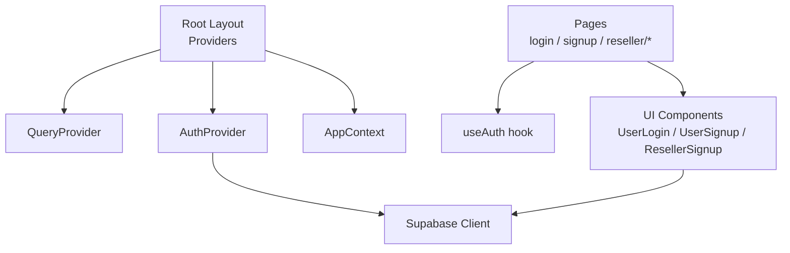

**Diagram sources**
- [app/layout.tsx:20-48](file://app/layout.tsx#L20-L48)
- [components/context/AuthProvider.tsx:76-322](file://components/context/AuthProvider.tsx#L76-L322)

**Section sources**
- [app/layout.tsx:1-51](file://app/layout.tsx#L1-L51)

## Core Components
- AuthProvider: Centralizes Supabase session and user state, resolves roles and profiles, and exposes logout and refetchProfile.
- useAuth: React hook to consume auth context safely across components.
- UserLogin: Customer login form with email/password and Google OAuth; handles validation, error messages, and post-login routing.
- UserSignup: Customer registration flow with pre-checks, Supabase signup, profile creation, and redirect to email verification.
- ResellerSignup: Reseller registration with business details, optional CNIC upload, duplicate checks, and seller profile creation.
- Route pages: Orchestrate redirects based on role and status after login or signup.

Key responsibilities:
- Session lifecycle and persistence via Supabase.
- Role resolution between customer and reseller.
- Profile auto-creation for customers when missing.
- Email verification redirection.
- RBAC-driven navigation to customer or reseller dashboards.

**Section sources**
- [components/context/AuthProvider.tsx:6-57](file://components/context/AuthProvider.tsx#L6-L57)
- [src/hooks/useAuth.ts:1-13](file://src/hooks/useAuth.ts#L1-L13)
- [components/users/UserLogin.tsx:1-370](file://components/users/UserLogin.tsx#L1-L370)
- [components/users/UserSignup.tsx:1-465](file://components/users/UserSignup.tsx#L1-L465)
- [components/reseller/ResellerSignup.tsx:1-800](file://components/reseller/ResellerSignup.tsx#L1-L800)

## Architecture Overview
The system uses Supabase for authentication and database operations. The client initializes sessions, listens for auth state changes, and maintains user profiles and roles in React context. Pages and components consume this context to enforce RBAC and render appropriate interfaces.

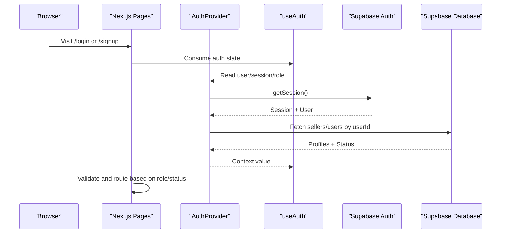

**Diagram sources**
- [components/context/AuthProvider.tsx:248-303](file://components/context/AuthProvider.tsx#L248-L303)
- [components/context/AuthProvider.tsx:85-216](file://components/context/AuthProvider.tsx#L85-L216)
- [src/hooks/useAuth.ts:1-13](file://src/hooks/useAuth.ts#L1-L13)

## Detailed Component Analysis

### Authentication Provider and Hooks
- Manages user, session, reseller profile, customer profile, role, seller status, loading state.
- Initializes session on mount and subscribes to auth state changes.
- Resolves role:
  - If a seller record exists, role is seller and status is taken from seller record.
  - Otherwise, role is customer.
- Auto-creates customer profile if missing using metadata from the authenticated user.
- Provides logout and refetchProfile functions.

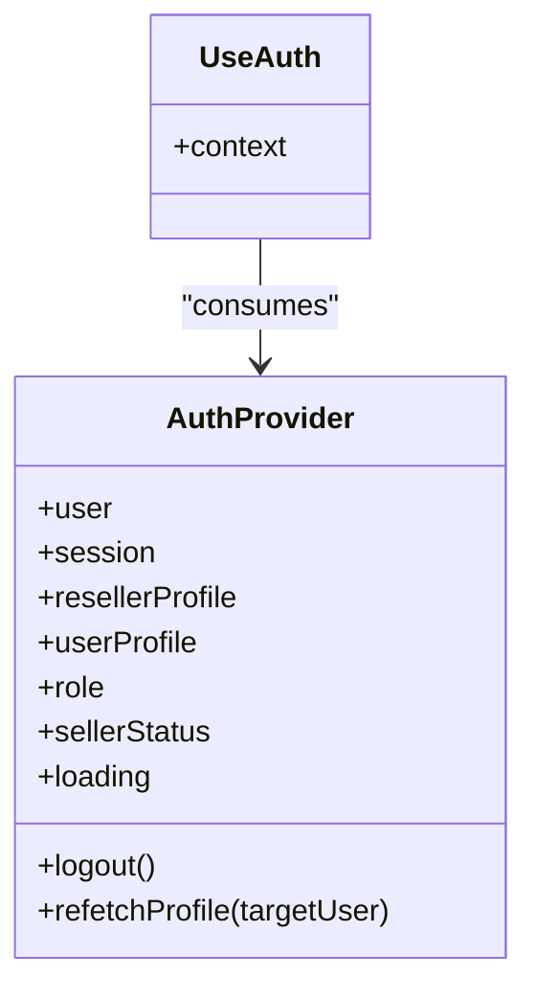

**Diagram sources**
- [components/context/AuthProvider.tsx:47-57](file://components/context/AuthProvider.tsx#L47-L57)
- [components/context/AuthProvider.tsx:76-322](file://components/context/AuthProvider.tsx#L76-L322)
- [src/hooks/useAuth.ts:1-13](file://src/hooks/useAuth.ts#L1-L13)

**Section sources**
- [components/context/AuthProvider.tsx:85-216](file://components/context/AuthProvider.tsx#L85-L216)
- [components/context/AuthProvider.tsx:248-303](file://components/context/AuthProvider.tsx#L248-L303)
- [src/hooks/useAuth.ts:1-13](file://src/hooks/useAuth.ts#L1-L13)

### Customer Registration Flow
- Validates input fields (name, phone, email, password).
- Pre-checks for existing email or phone in the users table.
- Creates Supabase auth user with metadata.
- Inserts a corresponding row into the users table.
- Refetches profiles and navigates to email verification page.

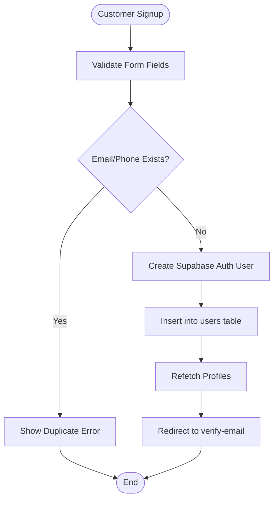

**Diagram sources**
- [components/users/UserSignup.tsx:115-160](file://components/users/UserSignup.tsx#L115-L160)
- [components/users/UserSignup.tsx:162-250](file://components/users/UserSignup.tsx#L162-L250)
- [app/signup/page.tsx:40-46](file://app/signup/page.tsx#L40-L46)

**Section sources**
- [components/users/UserSignup.tsx:14-53](file://components/users/UserSignup.tsx#L14-L53)
- [components/users/UserSignup.tsx:115-160](file://components/users/UserSignup.tsx#L115-L160)
- [components/users/UserSignup.tsx:162-250](file://components/users/UserSignup.tsx#L162-L250)
- [app/signup/page.tsx:1-50](file://app/signup/page.tsx#L1-L50)

### Reseller Registration Flow
- Validates credentials and business details (full name, shop name, CNIC, phone, city, address).
- Optionally uploads CNIC front/back images to storage with fallback to base64.
- Pre-checks for duplicates in sellers table (email, CNIC, phone).
- Creates Supabase auth user with redirect configured to dashboard overview.
- Upserts seller profile with all fields including CNIC image URLs.
- Clears local drafts, refetches profiles, and triggers email verification redirect.

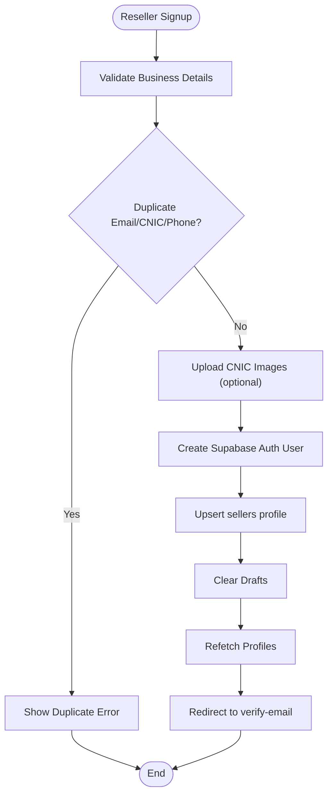

**Diagram sources**
- [components/reseller/ResellerSignup.tsx:286-370](file://components/reseller/ResellerSignup.tsx#L286-L370)
- [components/reseller/ResellerSignup.tsx:381-404](file://components/reseller/ResellerSignup.tsx#L381-L404)
- [components/reseller/ResellerSignup.tsx:406-563](file://components/reseller/ResellerSignup.tsx#L406-L563)
- [app/reseller/signup/page.tsx:31-37](file://app/reseller/signup/page.tsx#L31-L37)

**Section sources**
- [components/reseller/ResellerSignup.tsx:17-116](file://components/reseller/ResellerSignup.tsx#L17-L116)
- [components/reseller/ResellerSignup.tsx:286-370](file://components/reseller/ResellerSignup.tsx#L286-L370)
- [components/reseller/ResellerSignup.tsx:381-404](file://components/reseller/ResellerSignup.tsx#L381-L404)
- [components/reseller/ResellerSignup.tsx:406-563](file://components/reseller/ResellerSignup.tsx#L406-L563)
- [app/reseller/signup/page.tsx:1-39](file://app/reseller/signup/page.tsx#L1-L39)

### Login Mechanisms and Post-Login Routing
- Supports email/password and Google OAuth.
- On success, refetches profiles to determine role and status.
- For sellers: blocks access if suspended/inactive and logs out; otherwise routes to dashboard.
- For customers: routes to account page.
- Route-level guard shows loading states and redirects appropriately.

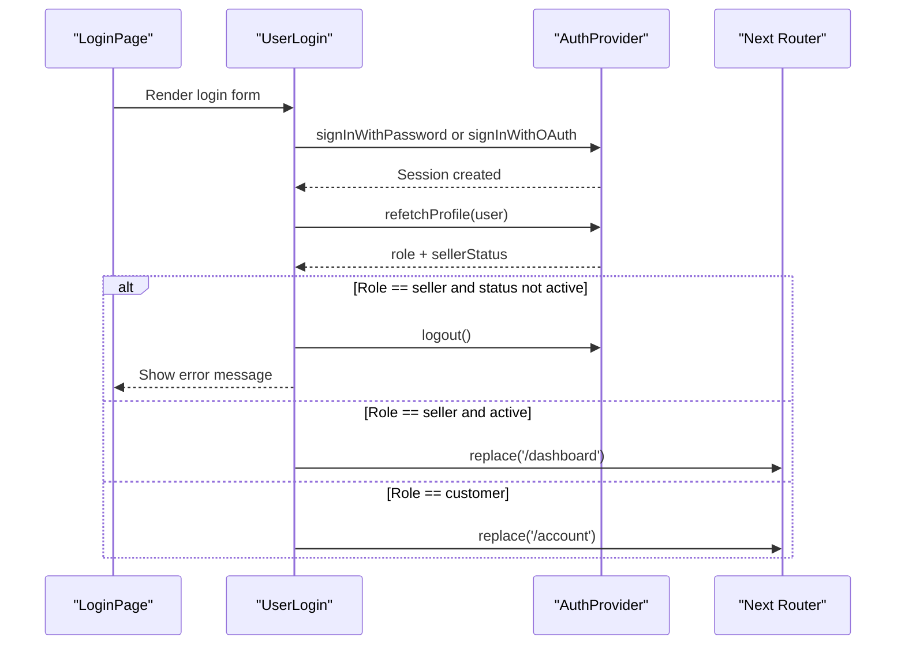

**Diagram sources**
- [components/users/UserLogin.tsx:106-171](file://components/users/UserLogin.tsx#L106-L171)
- [app/login/page.tsx:9-60](file://app/login/page.tsx#L9-L60)

**Section sources**
- [components/users/UserLogin.tsx:44-78](file://components/users/UserLogin.tsx#L44-L78)
- [components/users/UserLogin.tsx:106-171](file://components/users/UserLogin.tsx#L106-L171)
- [app/login/page.tsx:1-62](file://app/login/page.tsx#L1-L62)

### Email Verification Process
- After successful signup (customer or reseller), the UI redirects to an email verification page with the email parameter.
- The login component surfaces a specific error when the email is not confirmed, guiding users to check their inbox.

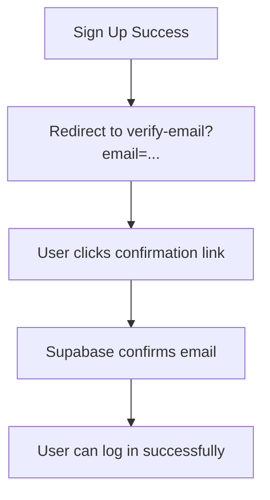

**Diagram sources**
- [app/signup/page.tsx:40-46](file://app/signup/page.tsx#L40-L46)
- [app/reseller/signup/page.tsx:31-37](file://app/reseller/signup/page.tsx#L31-L37)
- [components/users/UserLogin.tsx:123-135](file://components/users/UserLogin.tsx#L123-L135)

**Section sources**
- [app/signup/page.tsx:1-50](file://app/signup/page.tsx#L1-L50)
- [app/reseller/signup/page.tsx:1-39](file://app/reseller/signup/page.tsx#L1-L39)
- [components/users/UserLogin.tsx:123-135](file://components/users/UserLogin.tsx#L123-L135)

### Role-Based Access Control (RBAC)
- Roles:
  - seller: has a record in the sellers table.
  - customer: no seller record; may have a profile in the users table.
- Seller status controls access:
  - Suspended or inactive sellers are blocked from accessing the dashboard and are logged out.
- Navigation:
  - Sellers go to /dashboard.
  - Customers go to /account.

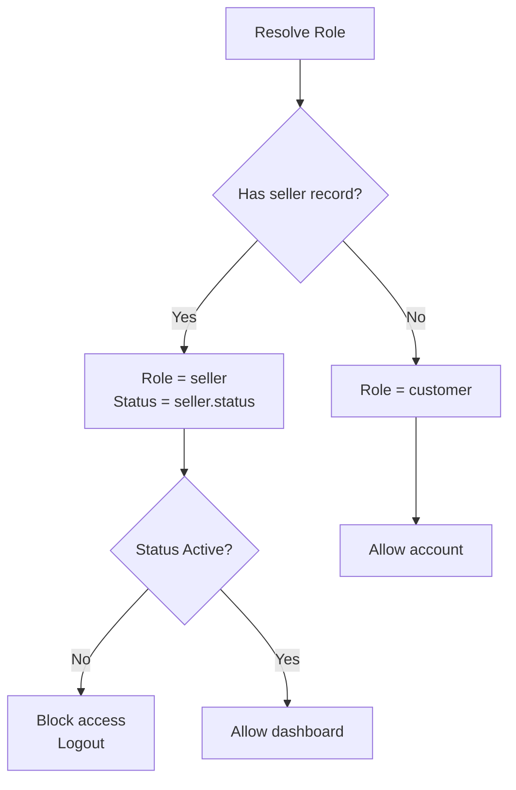

**Diagram sources**
- [components/context/AuthProvider.tsx:140-216](file://components/context/AuthProvider.tsx#L140-L216)
- [components/users/UserLogin.tsx:137-161](file://components/users/UserLogin.tsx#L137-L161)
- [app/login/page.tsx:13-22](file://app/login/page.tsx#L13-L22)

**Section sources**
- [components/context/AuthProvider.tsx:140-216](file://components/context/AuthProvider.tsx#L140-L216)
- [components/users/UserLogin.tsx:137-161](file://components/users/UserLogin.tsx#L137-L161)
- [app/login/page.tsx:1-62](file://app/login/page.tsx#L1-L62)

### Profile Management and Account Settings
- Customer profile:
  - Auto-created if missing during initial profile resolution.
  - Contains first_name, last_name, email, phone_no.
- Reseller profile:
  - Created during reseller signup with business details and optional CNIC images.
  - Includes fields such as full_name, shop_name, cnic, phone, city, address, bank info placeholders, status, and timestamps.
- Logout clears all auth state and profiles.

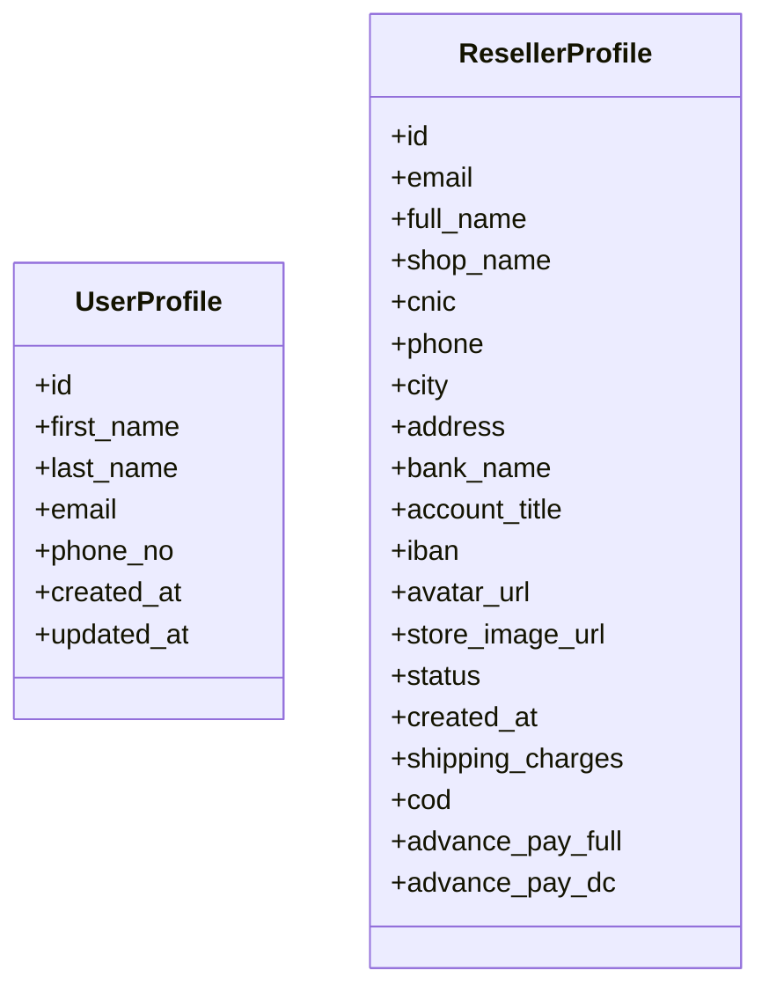

**Diagram sources**
- [components/context/AuthProvider.tsx:6-36](file://components/context/AuthProvider.tsx#L6-L36)

**Section sources**
- [components/context/AuthProvider.tsx:85-138](file://components/context/AuthProvider.tsx#L85-L138)
- [components/context/AuthProvider.tsx:140-216](file://components/context/AuthProvider.tsx#L140-L216)
- [components/context/AuthProvider.tsx:231-246](file://components/context/AuthProvider.tsx#L231-L246)

### Password Handling and Forgot Password
- Passwords are handled by Supabase Auth; minimum length enforced at the UI layer.
- Forgot password navigation is provided from the login UI to the reseller forgot-password route.
- Reseller login route supports recovery flow redirection to update password.

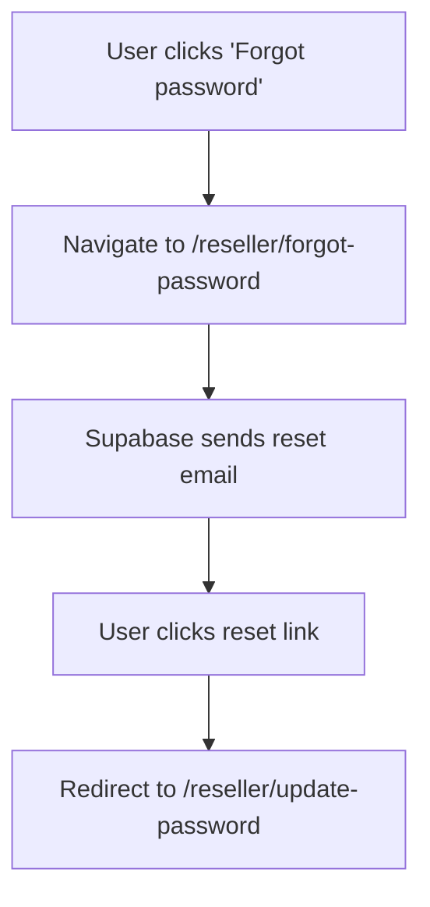

**Diagram sources**
- [components/users/UserLogin.tsx:173-179](file://components/users/UserLogin.tsx#L173-L179)
- [app/reseller/login/page.tsx:9-18](file://app/reseller/login/page.tsx#L9-L18)

**Section sources**
- [components/users/UserLogin.tsx:173-179](file://components/users/UserLogin.tsx#L173-L179)
- [app/reseller/login/page.tsx:1-22](file://app/reseller/login/page.tsx#L1-L22)

### Authentication Hooks and Context Providers
- Root layout mounts QueryProvider, AuthProvider, and AppProvider.
- AuthProvider provides user, session, profiles, role, sellerStatus, loading, logout, and refetchProfile.
- useAuth hook ensures components consume the context safely.

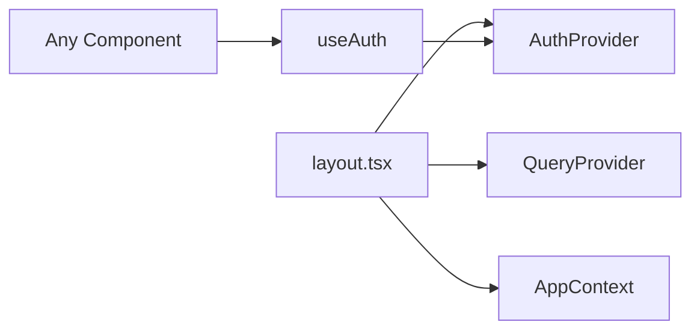

**Diagram sources**
- [app/layout.tsx:20-48](file://app/layout.tsx#L20-L48)
- [components/context/AuthProvider.tsx:305-322](file://components/context/AuthProvider.tsx#L305-L322)
- [src/hooks/useAuth.ts:1-13](file://src/hooks/useAuth.ts#L1-L13)

**Section sources**
- [app/layout.tsx:1-51](file://app/layout.tsx#L1-L51)
- [components/context/AuthProvider.tsx:305-322](file://components/context/AuthProvider.tsx#L305-L322)
- [src/hooks/useAuth.ts:1-13](file://src/hooks/useAuth.ts#L1-L13)

## Dependency Analysis
- Pages depend on useAuth to read current user/session and role.
- UI components call Supabase directly for auth and data operations.
- AuthProvider encapsulates Supabase client usage and centralizes profile fetching and role resolution.

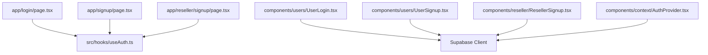

**Diagram sources**
- [app/login/page.tsx:1-62](file://app/login/page.tsx#L1-L62)
- [app/signup/page.tsx:1-50](file://app/signup/page.tsx#L1-L50)
- [app/reseller/signup/page.tsx:1-39](file://app/reseller/signup/page.tsx#L1-L39)
- [components/users/UserLogin.tsx:1-370](file://components/users/UserLogin.tsx#L1-L370)
- [components/users/UserSignup.tsx:1-465](file://components/users/UserSignup.tsx#L1-L465)
- [components/reseller/ResellerSignup.tsx:1-800](file://components/reseller/ResellerSignup.tsx#L1-L800)
- [components/context/AuthProvider.tsx:1-326](file://components/context/AuthProvider.tsx#L1-L326)

**Section sources**
- [app/login/page.tsx:1-62](file://app/login/page.tsx#L1-L62)
- [app/signup/page.tsx:1-50](file://app/signup/page.tsx#L1-L50)
- [app/reseller/signup/page.tsx:1-39](file://app/reseller/signup/page.tsx#L1-L39)
- [components/users/UserLogin.tsx:1-370](file://components/users/UserLogin.tsx#L1-L370)
- [components/users/UserSignup.tsx:1-465](file://components/users/UserSignup.tsx#L1-L465)
- [components/reseller/ResellerSignup.tsx:1-800](file://components/reseller/ResellerSignup.tsx#L1-L800)
- [components/context/AuthProvider.tsx:1-326](file://components/context/AuthProvider.tsx#L1-L326)

## Performance Considerations
- Avoid redundant profile fetches by leveraging refetchProfile only when needed (e.g., after login or signup).
- Batch operations where possible (e.g., parallel CNIC image uploads).
- Debounce or throttle repeated inputs that trigger local draft saves to prevent excessive writes.
- Keep UI loading states minimal and clear to reduce perceived latency.

[No sources needed since this section provides general guidance]

## Troubleshooting Guide
Common issues and resolutions:
- Google provider disabled:
  - Symptom: Error indicating provider is not enabled or unsupported.
  - Resolution: Enable Google provider in Supabase Dashboard under Authentication -> Providers.
- Email not confirmed:
  - Symptom: Login fails with “email not confirmed”.
  - Resolution: Direct user to check inbox and click confirmation link; then retry login.
- Duplicate email/phone/CNIC:
  - Symptom: Errors indicating already registered or unique constraint violations.
  - Resolution: Inform user to use different credentials or log in with existing account.
- Missing Supabase environment variables:
  - Symptom: Error indicating missing API key.
  - Resolution: Ensure NEXT_PUBLIC_SUPABASE_ANON_KEY is set correctly in .env.
- Network errors:
  - Symptom: Unable to connect to server.
  - Resolution: Check internet connection and retry; validate Supabase project configuration.

**Section sources**
- [components/users/UserLogin.tsx:44-78](file://components/users/UserLogin.tsx#L44-L78)
- [components/users/UserLogin.tsx:123-135](file://components/users/UserLogin.tsx#L123-L135)
- [components/users/UserSignup.tsx:14-53](file://components/users/UserSignup.tsx#L14-L53)
- [components/reseller/ResellerSignup.tsx:67-116](file://components/reseller/ResellerSignup.tsx#L67-L116)
- [components/reseller/ResellerSignup.tsx:419-425](file://components/reseller/ResellerSignup.tsx#L419-L425)

## Conclusion
The authentication and user management system integrates Supabase for secure identity management, provides robust registration flows for customers and resellers, enforces role-based access control, and offers clear UX for email verification and password recovery. The AuthProvider centralizes session and profile management, while dedicated UI components handle validation, error messaging, and navigation. Security best practices include relying on Supabase for credential handling, enforcing minimum password lengths, and validating inputs on the client side.

[No sources needed since this section summarizes without analyzing specific files]