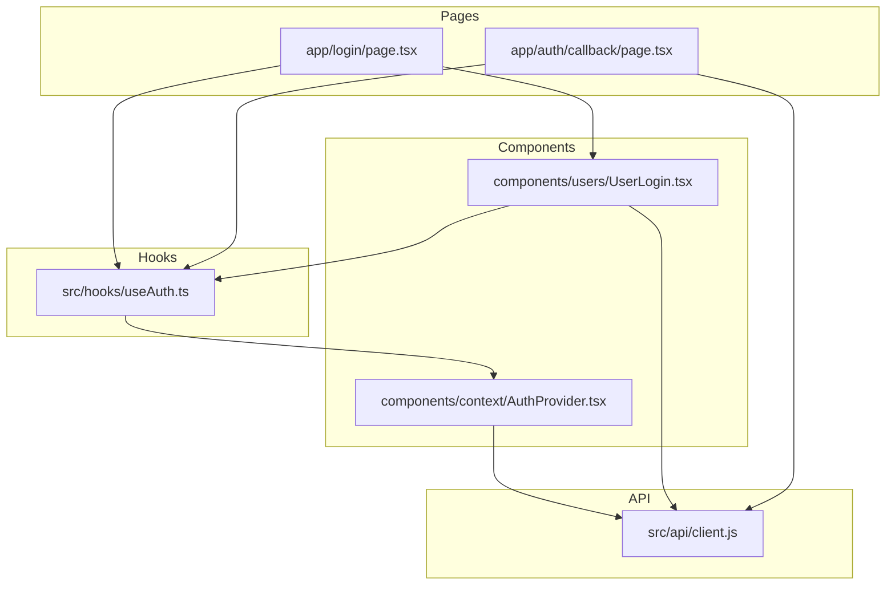
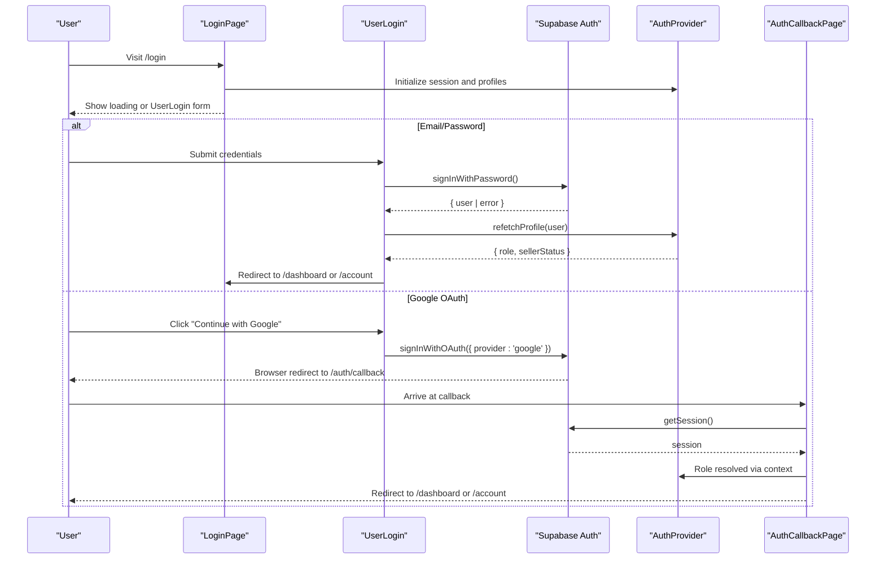
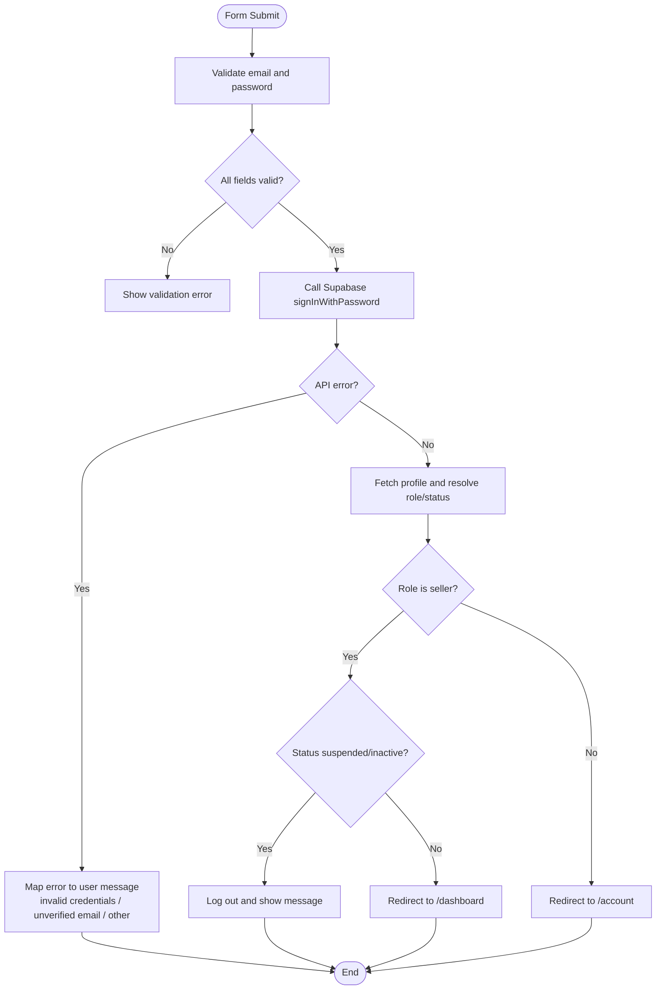
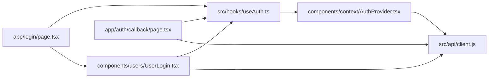

# Login & Authentication

<cite>
**Referenced Files in This Document**
- [app/login/page.tsx](file://app/login/page.tsx)
- [components/users/UserLogin.tsx](file://components/users/UserLogin.tsx)
- [src/hooks/useAuth.ts](file://src/hooks/useAuth.ts)
- [components/context/AuthProvider.tsx](file://components/context/AuthProvider.tsx)
- [app/auth/callback/page.tsx](file://app/auth/callback/page.tsx)
- [src/api/client.js](file://src/api/client.js)
</cite>

## Table of Contents
1. [Introduction](#introduction)
2. [Project Structure](#project-structure)
3. [Core Components](#core-components)
4. [Architecture Overview](#architecture-overview)
5. [Detailed Component Analysis](#detailed-component-analysis)
6. [Dependency Analysis](#dependency-analysis)
7. [Performance Considerations](#performance-considerations)
8. [Troubleshooting Guide](#troubleshooting-guide)
9. [Conclusion](#conclusion)

## Introduction
This document explains the login and authentication system for the application. It covers:
- The login form implementation and client-side validation
- Credential-based authentication using Supabase
- Google OAuth integration and callback handling
- Session management and global authentication state
- Error handling for invalid credentials, unverified emails, and network failures
- Post-login redirect logic based on user roles (seller vs customer)

## Project Structure
The authentication feature spans a few key pages and shared components:
- Login page entry point with role-aware redirects
- Reusable login form component with email/password and Google OAuth
- Global auth context provider that manages session, profiles, and role resolution
- OAuth callback page to finalize sign-in and route users
- Supabase client initialization

**Diagram sources**
- [app/login/page.tsx:1-62](file://app/login/page.tsx#L1-L62)
- [components/users/UserLogin.tsx:1-370](file://components/users/UserLogin.tsx#L1-L370)
- [src/hooks/useAuth.ts:1-13](file://src/hooks/useAuth.ts#L1-L13)
- [components/context/AuthProvider.tsx:1-326](file://components/context/AuthProvider.tsx#L1-L326)
- [app/auth/callback/page.tsx:1-69](file://app/auth/callback/page.tsx#L1-L69)
- [src/api/client.js:1-8](file://src/api/client.js#L1-L8)

**Section sources**
- [app/login/page.tsx:1-62](file://app/login/page.tsx#L1-L62)
- [components/users/UserLogin.tsx:1-370](file://components/users/UserLogin.tsx#L1-L370)
- [src/hooks/useAuth.ts:1-13](file://src/hooks/useAuth.ts#L1-L13)
- [components/context/AuthProvider.tsx:1-326](file://components/context/AuthProvider.tsx#L1-L326)
- [app/auth/callback/page.tsx:1-69](file://app/auth/callback/page.tsx#L1-L69)
- [src/api/client.js:1-8](file://src/api/client.js#L1-L8)

## Core Components
- Login Page: Orchestrates initial checks, shows loading states, and delegates UI to the reusable login form. It also performs post-login redirection based on role and seller status.
- UserLogin Form: Handles email/password submission, Google OAuth initiation, field validation, error display, and navigation to signup or forgot password flows.
- Auth Provider: Manages Supabase session, loads user profiles, resolves role and seller status, exposes logout and profile refetch, and listens to auth state changes.
- useAuth Hook: Provides typed access to the auth context throughout the app.
- Auth Callback Page: Finalizes OAuth flow by retrieving the session and routing users according to their resolved role.
- Supabase Client: Initializes the Supabase SDK with environment variables.

**Section sources**
- [app/login/page.tsx:1-62](file://app/login/page.tsx#L1-L62)
- [components/users/UserLogin.tsx:1-370](file://components/users/UserLogin.tsx#L1-L370)
- [src/hooks/useAuth.ts:1-13](file://src/hooks/useAuth.ts#L1-L13)
- [components/context/AuthProvider.tsx:1-326](file://components/context/AuthProvider.tsx#L1-L326)
- [app/auth/callback/page.tsx:1-69](file://app/auth/callback/page.tsx#L1-L69)
- [src/api/client.js:1-8](file://src/api/client.js#L1-L8)

## Architecture Overview
The authentication architecture combines Next.js App Router pages, React Context for global state, and Supabase for identity and sessions.

**Diagram sources**
- [components/users/UserLogin.tsx:44-78](file://components/users/UserLogin.tsx#L44-L78)
- [components/users/UserLogin.tsx:106-171](file://components/users/UserLogin.tsx#L106-L171)
- [app/auth/callback/page.tsx:14-40](file://app/auth/callback/page.tsx#L14-L40)
- [components/context/AuthProvider.tsx:140-229](file://components/context/AuthProvider.tsx#L140-L229)

## Detailed Component Analysis

### Login Page (app/login/page.tsx)
Responsibilities:
- Uses the auth context to check current user, role, seller status, and loading state.
- Shows a loading spinner while checking session.
- If already authenticated, redirects to the appropriate portal:
  - Seller: /dashboard unless suspended/inactive.
  - Customer: /account.
- Renders the UserLogin form when no active session exists.

Key behaviors:
- Post-login redirect function handles role-based routing and suspension checks.
- Effect triggers redirect once loading completes and user is present.

Error handling:
- Delegates credential and account status errors to the form and context layer.

Navigation:
- Provides callbacks for navigating to signup, reseller signup, home, and forgot password.

**Section sources**
- [app/login/page.tsx:9-60](file://app/login/page.tsx#L9-L60)

### Login Form (components/users/UserLogin.tsx)
Responsibilities:
- Renders an accessible login form with email and password fields.
- Performs client-side validation for required fields and email format.
- Submits credentials via Supabase email/password authentication.
- Initiates Google OAuth with a configured redirect URL.
- Displays user-facing error messages for various failure scenarios.
- Navigates to appropriate routes after successful login.

Validation:
- Validates email presence and format.
- Validates password presence.
- Clears per-field errors on input change and blur.

Credential Flow:
- Calls Supabase signInWithPassword.
- On success, fetches profile data to determine role and seller status.
- Blocks sellers with suspended or inactive statuses and logs them out.
- Redirects sellers to /dashboard and customers to /account.

Google OAuth Flow:
- Builds a redirect URL pointing to /auth/callback.
- Calls Supabase signInWithOAuth with provider set to Google.
- Handles configuration errors (provider disabled) and generic network errors.
- Disables button during OAuth initiation.

Error Handling:
- Invalid credentials: displays a clear message.
- Unverified email: instructs user to verify email.
- Network or unexpected errors: surfaces a friendly message.
- Suspended/inactive seller: informs user and logs out.

Navigation helpers:
- Forgot password, customer signup, and reseller signup are exposed via props or default routes.

**Section sources**
- [components/users/UserLogin.tsx:29-36](file://components/users/UserLogin.tsx#L29-L36)
- [components/users/UserLogin.tsx:44-78](file://components/users/UserLogin.tsx#L44-L78)
- [components/users/UserLogin.tsx:80-104](file://components/users/UserLogin.tsx#L80-L104)
- [components/users/UserLogin.tsx:106-171](file://components/users/UserLogin.tsx#L106-L171)
- [components/users/UserLogin.tsx:173-197](file://components/users/UserLogin.tsx#L173-L197)

#### Validation Flow

**Diagram sources**
- [components/users/UserLogin.tsx:80-104](file://components/users/UserLogin.tsx#L80-L104)
- [components/users/UserLogin.tsx:106-171](file://components/users/UserLogin.tsx#L106-L171)

### Auth Provider (components/context/AuthProvider.tsx)
Responsibilities:
- Manages Supabase session and user state.
- Loads reseller and customer profiles from the database.
- Resolves user role and seller status.
- Exposes logout and refetchProfile functions.
- Listens to auth state changes to keep UI in sync.

Data fetching:
- Reseller profile: queries sellers table by user id.
- Customer profile: queries users table; if missing, auto-creates a minimal profile using metadata.

Role resolution:
- If a reseller record exists, role is seller; otherwise customer.
- Seller status defaults to Active when not provided.

Session lifecycle:
- On app start, retrieves the current session and initializes state.
- Subscribes to auth state changes to update user/session and recompute profiles.

Logout:
- Signs out via Supabase and clears local state.

**Section sources**
- [components/context/AuthProvider.tsx:6-57](file://components/context/AuthProvider.tsx#L6-L57)
- [components/context/AuthProvider.tsx:85-138](file://components/context/AuthProvider.tsx#L85-L138)
- [components/context/AuthProvider.tsx:140-229](file://components/context/AuthProvider.tsx#L140-L229)
- [components/context/AuthProvider.tsx:231-246](file://components/context/AuthProvider.tsx#L231-L246)
- [components/context/AuthProvider.tsx:248-303](file://components/context/AuthProvider.tsx#L248-L303)

### useAuth Hook (src/hooks/useAuth.ts)
Responsibilities:
- Provides typed access to the AuthContext.
- Throws an error if used outside of AuthProvider.

Usage:
- Consumed by pages and components to read user, session, role, sellerStatus, and to call logout/refetchProfile.

**Section sources**
- [src/hooks/useAuth.ts:1-13](file://src/hooks/useAuth.ts#L1-L13)

### Auth Callback Page (app/auth/callback/page.tsx)
Responsibilities:
- Completes the OAuth flow by retrieving the session from Supabase.
- Handles errors and redirects back to login if needed.
- Waits for auth context to resolve role and then navigates:
  - Sellers to /dashboard/overview
  - Customers to /account

Flow highlights:
- Attempts to get session immediately.
- If no session but code/hash present, allows Supabase to handle exchange.
- Once role is available, performs role-based redirect.

**Section sources**
- [app/auth/callback/page.tsx:9-50](file://app/auth/callback/page.tsx#L9-L50)

### Supabase Client (src/api/client.js)
Responsibilities:
- Creates and exports a single Supabase client instance using environment variables.

Configuration:
- NEXT_PUBLIC_SUPABASE_URL
- NEXT_PUBLIC_SUPABASE_ANON_KEY

**Section sources**
- [src/api/client.js:1-8](file://src/api/client.js#L1-L8)

## Dependency Analysis
The following diagram maps how authentication-related modules depend on each other:

**Diagram sources**
- [app/login/page.tsx:1-62](file://app/login/page.tsx#L1-L62)
- [components/users/UserLogin.tsx:1-370](file://components/users/UserLogin.tsx#L1-L370)
- [src/hooks/useAuth.ts:1-13](file://src/hooks/useAuth.ts#L1-L13)
- [components/context/AuthProvider.tsx:1-326](file://components/context/AuthProvider.tsx#L1-L326)
- [app/auth/callback/page.tsx:1-69](file://app/auth/callback/page.tsx#L1-L69)
- [src/api/client.js:1-8](file://src/api/client.js#L1-L8)

**Section sources**
- [app/login/page.tsx:1-62](file://app/login/page.tsx#L1-L62)
- [components/users/UserLogin.tsx:1-370](file://components/users/UserLogin.tsx#L1-L370)
- [src/hooks/useAuth.ts:1-13](file://src/hooks/useAuth.ts#L1-L13)
- [components/context/AuthProvider.tsx:1-326](file://components/context/AuthProvider.tsx#L1-L326)
- [app/auth/callback/page.tsx:1-69](file://app/auth/callback/page.tsx#L1-L69)
- [src/api/client.js:1-8](file://src/api/client.js#L1-L8)

## Performance Considerations
- Minimize redundant profile fetches:
  - Profile resolution occurs on session initialization and on explicit refetch calls.
- Avoid unnecessary re-renders:
  - Keep auth state updates minimal and avoid heavy computations inside effects.
- Prefer client-side validation before network calls:
  - Reduces failed requests and improves perceived performance.
- Use role-based redirects early:
  - Prevents rendering protected content until role is known.

[No sources needed since this section provides general guidance]

## Troubleshooting Guide

Common issues and resolutions:
- Invalid credentials:
  - Symptom: Error message indicating invalid credentials.
  - Cause: Wrong email or password.
  - Resolution: Verify credentials and try again.
- Unverified email:
  - Symptom: Message instructing to verify email address.
  - Cause: Email confirmation not completed.
  - Resolution: Check inbox for verification link and complete verification.
- Google provider disabled:
  - Symptom: Error stating provider is not enabled or disabled.
  - Cause: Google provider not toggled ON in Supabase Dashboard.
  - Resolution: Enable Google provider in Supabase Authentication Providers settings.
- Network failures:
  - Symptom: Generic authentication error or connection failure.
  - Cause: Intermittent network issues or misconfiguration.
  - Resolution: Retry after ensuring connectivity; verify environment variables for Supabase URL and anon key.
- Suspended or inactive seller:
  - Symptom: Account blocked with a message to contact support.
  - Cause: Seller status is suspended or inactive.
  - Resolution: Contact support to review account status.

**Section sources**
- [components/users/UserLogin.tsx:63-77](file://components/users/UserLogin.tsx#L63-L77)
- [components/users/UserLogin.tsx:123-135](file://components/users/UserLogin.tsx#L123-L135)
- [components/users/UserLogin.tsx:140-153](file://components/users/UserLogin.tsx#L140-L153)

## Conclusion
The authentication system integrates a robust login form, Supabase-backed credential and OAuth flows, and a centralized auth context that resolves user roles and seller status. It provides clear error messaging, safe redirects, and consistent session management across the application. By following the documented flows and troubleshooting steps, developers can maintain a reliable and user-friendly authentication experience.

[No sources needed since this section summarizes without analyzing specific files]