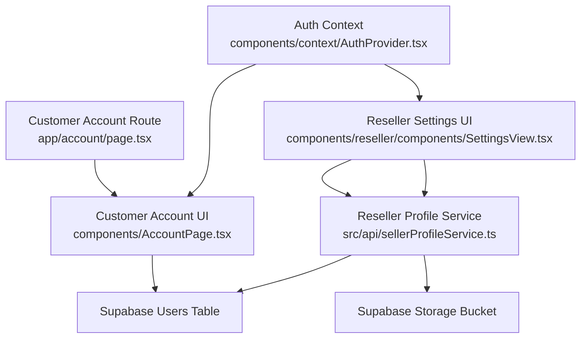
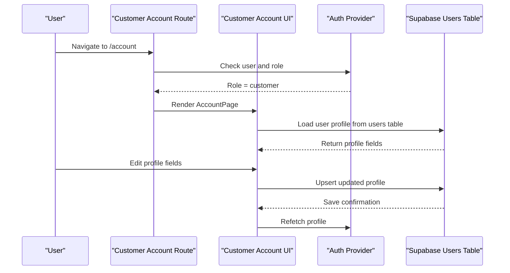
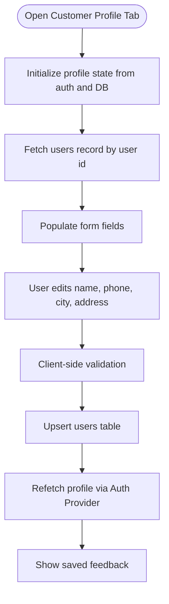
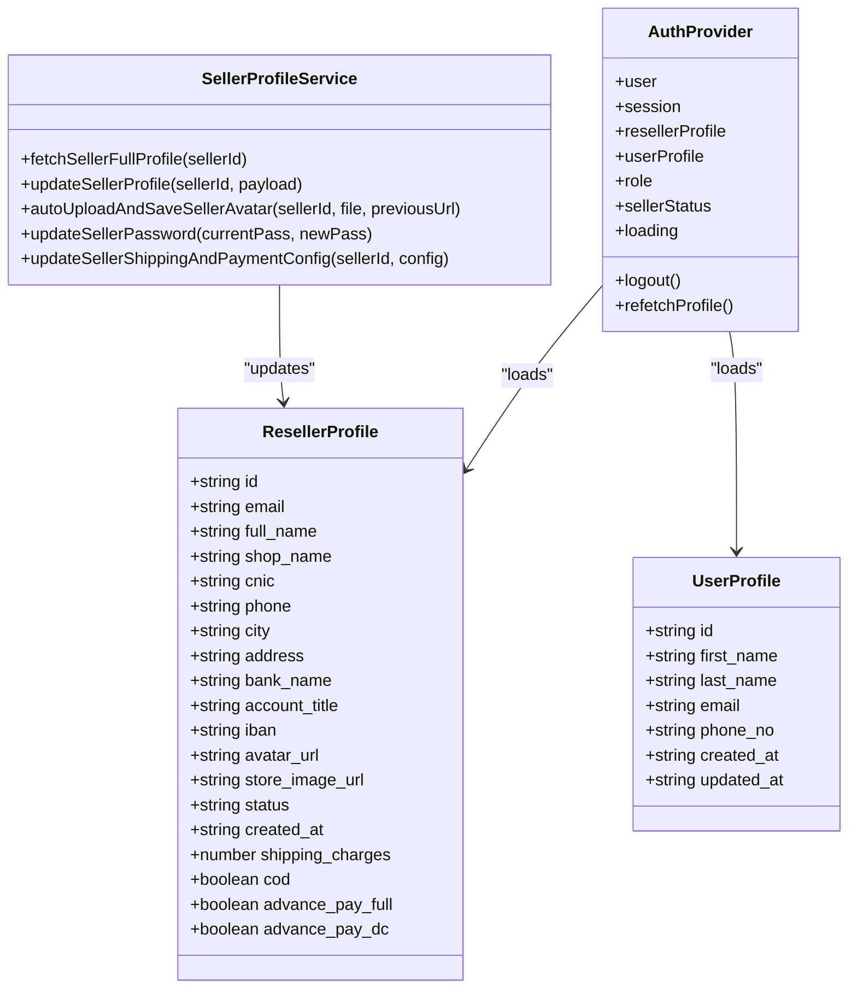
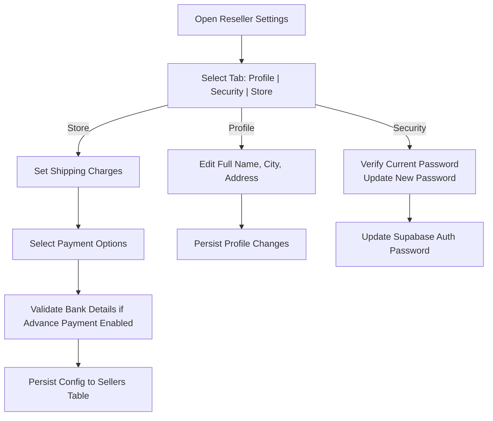
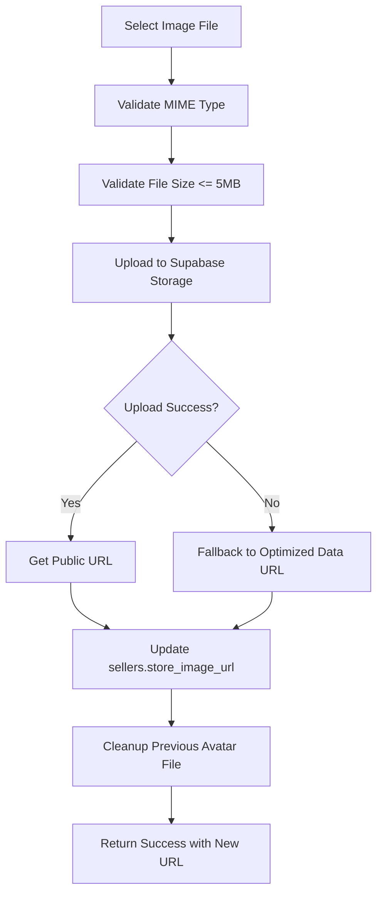
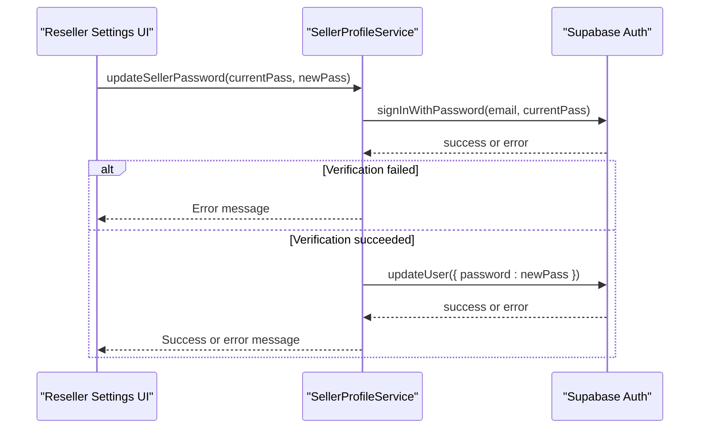
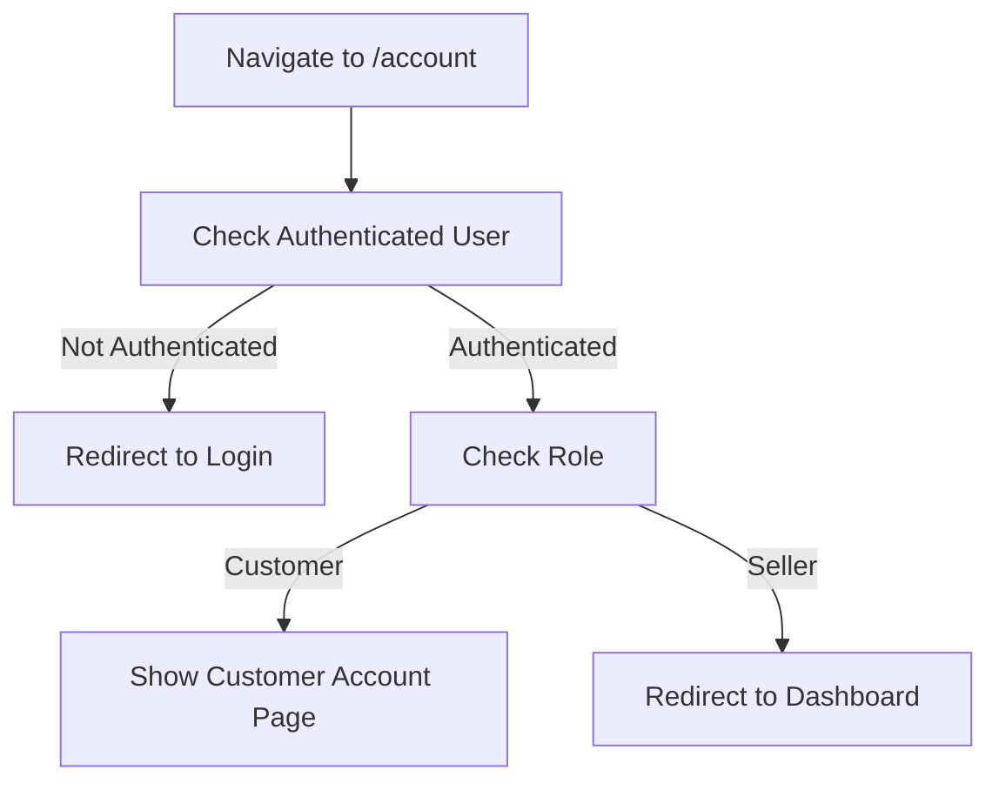
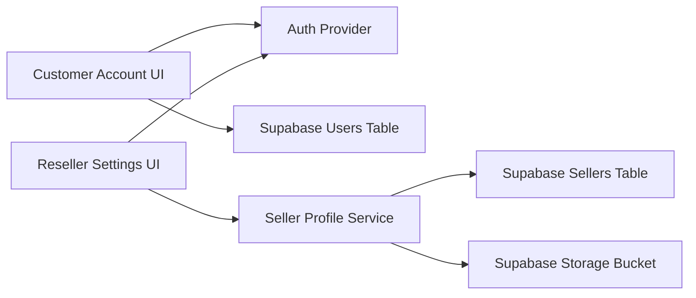

# Profile Management

<cite>
**Referenced Files in This Document**
- [AccountPage.tsx](file://components/AccountPage.tsx)
- [app/account/page.tsx](file://app/account/page.tsx)
- [AuthProvider.tsx](file://components/context/AuthProvider.tsx)
- [SettingsView.tsx](file://components/reseller/components/SettingsView.tsx)
- [sellerProfileService.ts](file://src/api/sellerProfileService.ts)
</cite>

## Table of Contents
1. [Introduction](#introduction)
2. [Project Structure](#project-structure)
3. [Core Components](#core-components)
4. [Architecture Overview](#architecture-overview)
5. [Detailed Component Analysis](#detailed-component-analysis)
6. [Dependency Analysis](#dependency-analysis)
7. [Performance Considerations](#performance-considerations)
8. [Troubleshooting Guide](#troubleshooting-guide)
9. [Conclusion](#conclusion)

## Introduction
This document explains the profile management system for both customer and reseller accounts. It covers:
- Customer profile data structure, editing, and persistence.
- Reseller profile fields, business information, verification-related fields, and status handling.
- Account settings interface for resellers, including personal/business details, security/password changes, and store configuration.
- Image upload functionality for reseller avatars/store images.
- Visibility and access controls that route users to the correct account or dashboard based on role.

The implementation uses a Next.js client-side account page for customers and a dedicated reseller settings view backed by a service layer that interacts with Supabase for database and storage operations.

## Project Structure
The profile management feature spans several layers:
- Route entry points for customer account pages.
- Customer-facing account UI for orders, wishlist, and profile editing.
- Reseller settings UI for profile, security, and store configuration.
- Authentication context that loads and synchronizes customer and reseller profiles.
- A reseller profile service for fetching, updating, uploading images, changing passwords, and managing shipping/payment configuration.

**Diagram sources**
- [app/account/page.tsx:11-78](file://app/account/page.tsx#L11-L78)
- [components/AccountPage.tsx:80-106](file://components/AccountPage.tsx#L80-L106)
- [components/reseller/components/SettingsView.tsx:1021-1041](file://components/reseller/components/SettingsView.tsx#L1021-L1041)
- [src/api/sellerProfileService.ts:76-156](file://src/api/sellerProfileService.ts#L76-L156)
- [components/context/AuthProvider.tsx:140-216](file://components/context/AuthProvider.tsx#L140-L216)

**Section sources**
- [app/account/page.tsx:11-78](file://app/account/page.tsx#L11-L78)
- [components/AccountPage.tsx:80-106](file://components/AccountPage.tsx#L80-L106)
- [components/reseller/components/SettingsView.tsx:1021-1041](file://components/reseller/components/SettingsView.tsx#L1021-L1041)
- [src/api/sellerProfileService.ts:76-156](file://src/api/sellerProfileService.ts#L76-L156)
- [components/context/AuthProvider.tsx:140-216](file://components/context/AuthProvider.tsx#L140-L216)

## Core Components
- Customer Account Page: Provides tabs for orders, wishlist, and profile editing. The profile tab allows editing first name, last name, phone, city, and address. Email is read-only.
- Reseller Settings View: Provides tabs for personal/business information, security (password), and store configuration (shipping charges, payment options, bank details).
- Auth Provider: Loads both reseller and customer profiles, determines user role, and exposes refetch capabilities.
- Seller Profile Service: Encapsulates reseller profile fetch/update logic, avatar upload, password update, and shipping/payment configuration updates.

Key responsibilities:
- Customer profile editing persists to the users table.
- Reseller profile editing persists to the sellers table with strict field scoping.
- Image uploads are validated, compressed, stored, and linked to the seller record.
- Password updates use Supabase Auth with current-password verification.
- Store configuration enforces validation rules for shipping charges, payment options, and bank details.

**Section sources**
- [components/AccountPage.tsx:95-106](file://components/AccountPage.tsx#L95-L106)
- [components/AccountPage.tsx:946-1027](file://components/AccountPage.tsx#L946-L1027)
- [components/reseller/components/SettingsView.tsx:94-141](file://components/reseller/components/SettingsView.tsx#L94-L141)
- [components/reseller/components/SettingsView.tsx:408-501](file://components/reseller/components/SettingsView.tsx#L408-L501)
- [components/context/AuthProvider.tsx:6-36](file://components/context/AuthProvider.tsx#L6-L36)
- [src/api/sellerProfileService.ts:158-215](file://src/api/sellerProfileService.ts#L158-L215)

## Architecture Overview
The profile management architecture separates concerns between UI, state, and data services:

- Route Layer:
  - Customer account route guards access and redirects sellers to the dashboard.
- UI Layer:
  - Customer Account UI renders editable profile form and order/wishlist views.
  - Reseller Settings UI renders profile, security, and store configuration forms.
- State Layer:
  - Auth Provider maintains user session, roles, and profile objects.
- Service Layer:
  - Seller Profile Service handles all reseller-specific API calls and storage operations.

**Diagram sources**
- [app/account/page.tsx:27-36](file://app/account/page.tsx#L27-L36)
- [components/AccountPage.tsx:270-307](file://components/AccountPage.tsx#L270-L307)
- [components/AccountPage.tsx:330-362](file://components/AccountPage.tsx#L330-L362)
- [components/context/AuthProvider.tsx:218-229](file://components/context/AuthProvider.tsx#L218-L229)

## Detailed Component Analysis

### Customer Profile Management
Customer profile management focuses on basic identity and contact information. The profile data structure includes:
- First name
- Last name
- Email (read-only)
- Phone number
- City
- Default shipping address

Update mechanism:
- The component initializes local state from the authenticated user metadata and the fetched customer profile.
- On save, it upserts the users table with trimmed values and an updated timestamp.
- After saving, it triggers a profile refetch to synchronize UI state.

Visibility controls:
- Email is disabled and read-only to prevent direct modification through this interface.
- The route guards redirect sellers to the reseller dashboard, ensuring only customers edit their profile here.

**Diagram sources**
- [components/AccountPage.tsx:95-106](file://components/AccountPage.tsx#L95-L106)
- [components/AccountPage.tsx:270-307](file://components/AccountPage.tsx#L270-L307)
- [components/AccountPage.tsx:330-362](file://components/AccountPage.tsx#L330-L362)
- [components/AccountPage.tsx:946-1027](file://components/AccountPage.tsx#L946-L1027)

**Section sources**
- [components/AccountPage.tsx:95-106](file://components/AccountPage.tsx#L95-L106)
- [components/AccountPage.tsx:270-307](file://components/AccountPage.tsx#L270-L307)
- [components/AccountPage.tsx:330-362](file://components/AccountPage.tsx#L330-L362)
- [components/AccountPage.tsx:946-1027](file://components/AccountPage.tsx#L946-L1027)
- [app/account/page.tsx:27-36](file://app/account/page.tsx#L27-L36)

### Reseller Profile Fields and Business Information
Reseller profiles include both personal and business fields:
- Personal: full name, email, phone, CNIC, city, address.
- Business: shop name, store image URL, status, created date.
- Financial: bank name, account title, IBAN.
- Operational: shipping charges, COD, advance payment options.

Editable fields:
- Full name, city, and store address are editable.
- Email, phone, CNIC, and shop name are read-only in the settings UI.

Persistence:
- Updates are sent to the sellers table using a constrained payload that excludes sensitive or non-editable fields like shop_name, cnic, email, and phone.
- The service normalizes numeric and boolean fields and validates ranges and mutual exclusivity for payment options.

Verification and status:
- The reseller profile includes a status field used for access control and display.
- CNIC and related identity fields exist in the profile but are not directly editable in the settings UI.

**Diagram sources**
- [components/context/AuthProvider.tsx:6-36](file://components/context/AuthProvider.tsx#L6-L36)
- [src/api/sellerProfileService.ts:76-156](file://src/api/sellerProfileService.ts#L76-L156)
- [src/api/sellerProfileService.ts:158-215](file://src/api/sellerProfileService.ts#L158-L215)
- [src/api/sellerProfileService.ts:391-425](file://src/api/sellerProfileService.ts#L391-L425)
- [src/api/sellerProfileService.ts:435-498](file://src/api/sellerProfileService.ts#L435-L498)

**Section sources**
- [components/context/AuthProvider.tsx:6-36](file://components/context/AuthProvider.tsx#L6-L36)
- [components/reseller/components/SettingsView.tsx:94-141](file://components/reseller/components/SettingsView.tsx#L94-L141)
- [components/reseller/components/SettingsView.tsx:150-217](file://components/reseller/components/SettingsView.tsx#L150-L217)
- [src/api/sellerProfileService.ts:76-156](file://src/api/sellerProfileService.ts#L76-L156)
- [src/api/sellerProfileService.ts:158-215](file://src/api/sellerProfileService.ts#L158-L215)

### Reseller Account Settings Interface
The reseller settings interface is organized into three main sections:
- Personal & Business Information: Editable fields for full name, city, and store address; read-only fields for email, phone, CNIC, and shop name.
- Security: Password change flow requiring current password verification before updating to a new password.
- Store Configuration: Shipping charges, payment options (COD, Advance Payment Full, Advance Payment Only DC), and conditional bank details.

Validation rules:
- Shipping charges must be between 0 and 500 PKR.
- At least one payment option must be selected.
- Advance Payment Full and Advance Payment Only DC are mutually exclusive.
- Bank Name, Account Title, and IBAN are required when any advance payment option is enabled.

**Diagram sources**
- [components/reseller/components/SettingsView.tsx:1021-1041](file://components/reseller/components/SettingsView.tsx#L1021-L1041)
- [components/reseller/components/SettingsView.tsx:150-217](file://components/reseller/components/SettingsView.tsx#L150-L217)
- [src/api/sellerProfileService.ts:391-425](file://src/api/sellerProfileService.ts#L391-L425)
- [src/api/sellerProfileService.ts:435-498](file://src/api/sellerProfileService.ts#L435-L498)

**Section sources**
- [components/reseller/components/SettingsView.tsx:1021-1041](file://components/reseller/components/SettingsView.tsx#L1021-L1041)
- [components/reseller/components/SettingsView.tsx:150-217](file://components/reseller/components/SettingsView.tsx#L150-L217)
- [components/reseller/components/SettingsView.tsx:408-501](file://components/reseller/components/SettingsView.tsx#L408-L501)
- [components/reseller/components/SettingsView.tsx:503-734](file://components/reseller/components/SettingsView.tsx#L503-L734)
- [src/api/sellerProfileService.ts:391-425](file://src/api/sellerProfileService.ts#L391-L425)
- [src/api/sellerProfileService.ts:435-498](file://src/api/sellerProfileService.ts#L435-L498)

### Image Upload Functionality
Reseller avatar/store image upload follows a robust pipeline:
- Client-side MIME type validation: JPEG, PNG, WebP allowed; SVG blocked.
- Size validation: maximum 5MB.
- Storage upload attempt to the products bucket under a seller-scoped path.
- Fallback to optimized base64 Data URL if storage upload fails.
- Database update to persist the image URL in the sellers table.
- Cleanup of previously uploaded avatar files when successful.

**Diagram sources**
- [src/api/sellerProfileService.ts:218-266](file://src/api/sellerProfileService.ts#L218-L266)
- [src/api/sellerProfileService.ts:277-378](file://src/api/sellerProfileService.ts#L277-L378)

**Section sources**
- [src/api/sellerProfileService.ts:218-266](file://src/api/sellerProfileService.ts#L218-L266)
- [src/api/sellerProfileService.ts:277-378](file://src/api/sellerProfileService.ts#L277-L378)

### Password Management
Reseller password management requires verifying the current password before allowing a new password update:
- The service retrieves the authenticated user’s email and attempts sign-in with the provided current password.
- If verification succeeds, it updates the password via Supabase Auth.
- Errors surface messages indicating verification failure or update errors.

**Diagram sources**
- [src/api/sellerProfileService.ts:391-425](file://src/api/sellerProfileService.ts#L391-L425)

**Section sources**
- [src/api/sellerProfileService.ts:391-425](file://src/api/sellerProfileService.ts#L391-L425)

### Profile Visibility Controls
Access control ensures users land in the appropriate portal:
- Customers can access the customer account page.
- Sellers attempting to access the customer account are redirected to the reseller dashboard.
- The authentication context resolves role and seller status, which gate navigation and UI rendering.

**Diagram sources**
- [app/account/page.tsx:27-36](file://app/account/page.tsx#L27-L36)
- [components/context/AuthProvider.tsx:196-216](file://components/context/AuthProvider.tsx#L196-L216)

**Section sources**
- [app/account/page.tsx:27-36](file://app/account/page.tsx#L27-L36)
- [components/context/AuthProvider.tsx:196-216](file://components/context/AuthProvider.tsx#L196-L216)

## Dependency Analysis
The profile management system has clear dependency boundaries:
- Customer Account UI depends on Auth Provider for user/session/profile state and on Supabase for reading/updating the users table.
- Reseller Settings UI depends on Auth Provider and the Seller Profile Service for all reseller-specific operations.
- Seller Profile Service depends on Supabase client for database queries and storage operations.

**Diagram sources**
- [components/AccountPage.tsx:270-307](file://components/AccountPage.tsx#L270-L307)
- [components/reseller/components/SettingsView.tsx:1021-1041](file://components/reseller/components/SettingsView.tsx#L1021-L1041)
- [src/api/sellerProfileService.ts:76-156](file://src/api/sellerProfileService.ts#L76-L156)

**Section sources**
- [components/AccountPage.tsx:270-307](file://components/AccountPage.tsx#L270-L307)
- [components/reseller/components/SettingsView.tsx:1021-1041](file://components/reseller/components/SettingsView.tsx#L1021-L1041)
- [src/api/sellerProfileService.ts:76-156](file://src/api/sellerProfileService.ts#L76-L156)

## Performance Considerations
- Customer profile loading uses a direct query to the users table and updates local state efficiently.
- Reseller settings use TanStack Query for caching and background refetching, reducing redundant network requests.
- Image uploads compress images to reduce payload size and provide fallbacks to avoid blocking the UI.
- Shipping and payment configuration updates invalidate relevant query caches to keep UI consistent without full page reloads.

[No sources needed since this section provides general guidance]

## Troubleshooting Guide
Common issues and resolutions:
- Customer profile save fails:
  - Ensure the users table exists and RLS policies allow updates.
  - Verify that email is read-only and not being modified unintentionally.
- Reseller profile update fails:
  - Confirm that only editable fields are included in the update payload.
  - Check for NOT NULL constraints on fields like city and address; pass empty strings instead of null where required.
- Image upload fails:
  - Validate MIME types and file size limits.
  - If storage upload is blocked, the fallback Data URL should still persist; verify database update succeeds.
- Password update fails:
  - Ensure the current password is correct; otherwise, verification will fail.
  - Check Supabase Auth configuration and error messages returned by the service.
- Store configuration validation errors:
  - Ensure at least one payment option is selected.
  - Avoid selecting both Advance Payment Full and Advance Payment Only DC simultaneously.
  - Provide bank details when any advance payment option is enabled.

**Section sources**
- [components/AccountPage.tsx:330-362](file://components/AccountPage.tsx#L330-L362)
- [components/reseller/components/SettingsView.tsx:150-217](file://components/reseller/components/SettingsView.tsx#L150-L217)
- [src/api/sellerProfileService.ts:277-378](file://src/api/sellerProfileService.ts#L277-L378)
- [src/api/sellerProfileService.ts:391-425](file://src/api/sellerProfileService.ts#L391-L425)
- [src/api/sellerProfileService.ts:435-498](file://src/api/sellerProfileService.ts#L435-L498)

## Conclusion
The profile management system provides a clear separation between customer and reseller experiences:
- Customers can manage basic identity and contact information through a simple, secure interface.
- Resellers have a comprehensive settings area covering personal/business details, security, and store configuration, with strong validation and safe update patterns.
- Image uploads are resilient, with compression, fallbacks, and cleanup mechanisms.
- Access controls ensure users are routed appropriately based on role, maintaining a clean and secure user journey.

[No sources needed since this section summarizes without analyzing specific files]