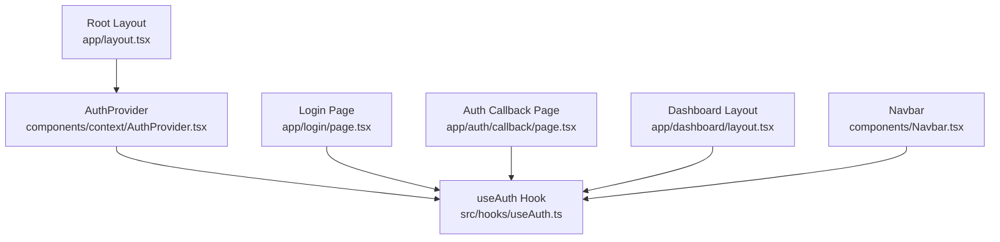
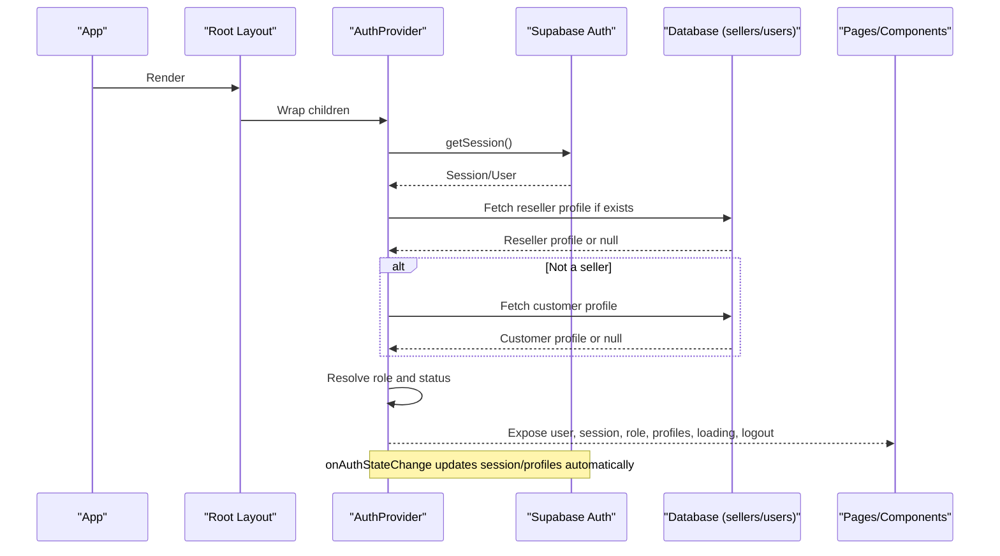
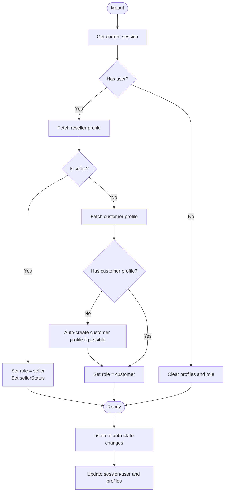
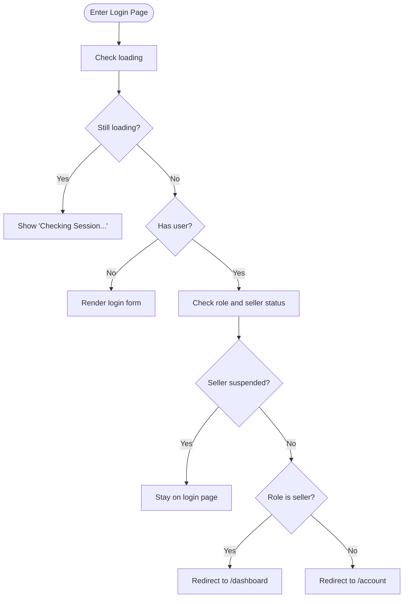
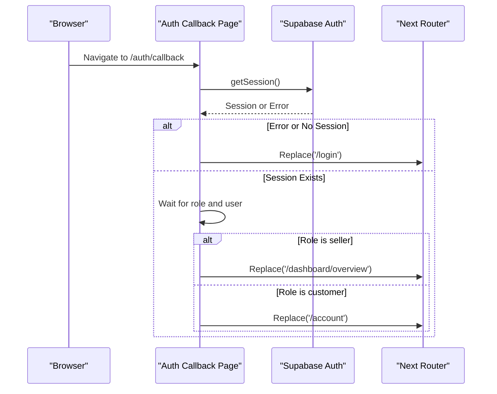
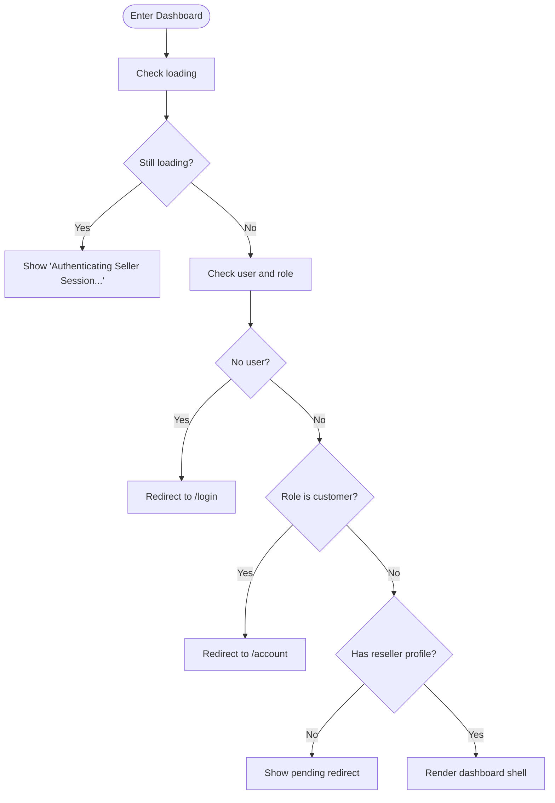
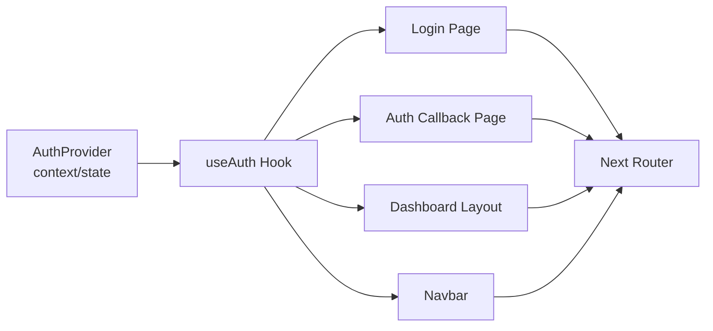

# Session Management

<cite>
**Referenced Files in This Document**
- [AuthProvider.tsx](file://components/context/AuthProvider.tsx)
- [useAuth.ts](file://src/hooks/useAuth.ts)
- [layout.tsx](file://app/layout.tsx)
- [page.tsx (Login)](file://app/login/page.tsx)
- [page.tsx (Auth Callback)](file://app/auth/callback/page.tsx)
- [layout.tsx (Dashboard)](file://app/dashboard/layout.tsx)
- [Navbar.tsx](file://components/Navbar.tsx)
</cite>

## Table of Contents
1. [Introduction](#introduction)
2. [Project Structure](#project-structure)
3. [Core Components](#core-components)
4. [Architecture Overview](#architecture-overview)
5. [Detailed Component Analysis](#detailed-component-analysis)
6. [Dependency Analysis](#dependency-analysis)
7. [Performance Considerations](#performance-considerations)
8. [Troubleshooting Guide](#troubleshooting-guide)
9. [Conclusion](#conclusion)

## Introduction
This document explains how user sessions and authentication context are managed across the application. It focuses on:
- How sessions are initialized, refreshed, and terminated
- The role of the AuthProvider component in managing authentication state, user profiles, and roles
- Logout behavior and automatic redirects based on authentication status
- Role-based access control for sellers and customers

The implementation uses a client-side React context to hold session and profile data, with Supabase as the identity provider.

## Project Structure
Authentication-related code is organized around a central provider and a small set of pages that handle login flows and protected routes.

**Diagram sources**
- [layout.tsx:38-46](file://app/layout.tsx#L38-L46)
- [AuthProvider.tsx:76-322](file://components/context/AuthProvider.tsx#L76-L322)
- [useAuth.ts:1-12](file://src/hooks/useAuth.ts#L1-L12)
- [page.tsx (Login):9-60](file://app/login/page.tsx#L9-L60)
- [page.tsx (Auth Callback):9-68](file://app/auth/callback/page.tsx#L9-L68)
- [layout.tsx (Dashboard):12-80](file://app/dashboard/layout.tsx#L12-L80)
- [Navbar.tsx:68-70](file://components/Navbar.tsx#L68-L70)

**Section sources**
- [layout.tsx:38-46](file://app/layout.tsx#L38-L46)
- [AuthProvider.tsx:76-322](file://components/context/AuthProvider.tsx#L76-L322)
- [useAuth.ts:1-12](file://src/hooks/useAuth.ts#L1-L12)

## Core Components
- AuthProvider: Centralizes session and profile state, subscribes to auth changes, resolves user roles, and exposes logout and refetchProfile.
- useAuth: A typed hook that reads from AuthContext and enforces usage within AuthProvider.
- Login page: Handles post-login redirect logic based on role and seller status.
- Auth callback page: Completes OAuth flow and redirects by role.
- Dashboard layout: Protects seller-only routes and handles logout.
- Navbar: Adjusts account navigation based on authentication and role.

Key responsibilities:
- Initialize session on app start
- Refresh state when auth changes
- Resolve role and profiles per user
- Provide logout and profile refresh utilities
- Enforce redirects based on authentication and role

**Section sources**
- [AuthProvider.tsx:47-83](file://components/context/AuthProvider.tsx#L47-L83)
- [AuthProvider.tsx:231-303](file://components/context/AuthProvider.tsx#L231-L303)
- [useAuth.ts:1-12](file://src/hooks/useAuth.ts#L1-L12)
- [page.tsx (Login):9-60](file://app/login/page.tsx#L9-L60)
- [page.tsx (Auth Callback):9-68](file://app/auth/callback/page.tsx#L9-L68)
- [layout.tsx (Dashboard):12-80](file://app/dashboard/layout.tsx#L12-L80)
- [Navbar.tsx:68-70](file://components/Navbar.tsx#L68-L70)

## Architecture Overview
The authentication architecture follows a provider-driven model:
- The root layout wraps the app with AuthProvider.
- AuthProvider initializes the session, listens for auth state changes, and resolves user roles and profiles.
- Pages and components consume the context via useAuth to render UI and enforce routing rules.

**Diagram sources**
- [layout.tsx:38-46](file://app/layout.tsx#L38-L46)
- [AuthProvider.tsx:248-303](file://components/context/AuthProvider.tsx#L248-L303)
- [AuthProvider.tsx:85-216](file://components/context/AuthProvider.tsx#L85-L216)

## Detailed Component Analysis

### AuthProvider: Session Lifecycle and Profile Resolution
AuthProvider manages:
- User and session state
- Reseller and customer profiles
- Role resolution (seller vs customer)
- Seller status tracking
- Logout and profile refetching
- Automatic rehydration on auth state changes

Session lifecycle:
- On mount, it retrieves the current session and sets user/session state.
- If a user exists, it fetches reseller and customer profiles and resolves role/status.
- It subscribes to auth state changes; any sign-in/sign-out triggers profile reload or cleanup.

Logout:
- Calls the backend sign-out method.
- Clears all local state (user, session, profiles, role, status).
- Resets loading state.

Profile resolution:
- Queries the sellers table to determine if the user is a seller.
- If not a seller, queries the users table for a customer profile.
- Auto-creates a customer profile if missing and schema allows.
- Sets role to 'seller' or 'customer' accordingly.

**Diagram sources**
- [AuthProvider.tsx:248-303](file://components/context/AuthProvider.tsx#L248-L303)
- [AuthProvider.tsx:85-216](file://components/context/AuthProvider.tsx#L85-L216)

**Section sources**
- [AuthProvider.tsx:47-83](file://components/context/AuthProvider.tsx#L47-L83)
- [AuthProvider.tsx:85-216](file://components/context/AuthProvider.tsx#L85-L216)
- [AuthProvider.tsx:231-303](file://components/context/AuthProvider.tsx#L231-L303)

### useAuth Hook
A thin wrapper around React’s useContext that returns the full AuthContextType and throws an error if used outside AuthProvider. This ensures consistent access to user, session, role, profiles, loading, logout, and refetchProfile.

**Section sources**
- [useAuth.ts:1-12](file://src/hooks/useAuth.ts#L1-L12)

### Login Page: Post-Login Redirects
Behavior:
- While loading, shows a session check indicator.
- Once authenticated, checks role and seller status:
  - Sellers are redirected to /dashboard unless suspended.
  - Customers are redirected to /account.
- Renders the login form if no user is present.

**Diagram sources**
- [page.tsx (Login):9-60](file://app/login/page.tsx#L9-L60)

**Section sources**
- [page.tsx (Login):9-60](file://app/login/page.tsx#L9-L60)

### Auth Callback Page: OAuth Flow Completion
Behavior:
- Attempts to retrieve the session after OAuth.
- If there is an error or no session, displays an error message and redirects to /login.
- Once the session is established and role is known, redirects:
  - Sellers to /dashboard/overview
  - Customers to /account

**Diagram sources**
- [page.tsx (Auth Callback):9-68](file://app/auth/callback/page.tsx#L9-L68)

**Section sources**
- [page.tsx (Auth Callback):9-68](file://app/auth/callback/page.tsx#L9-L68)

### Dashboard Layout: Protected Routes and Logout
Behavior:
- Guards seller-only routes:
  - Unauthenticated users are redirected to /login.
  - Authenticated customers are redirected to /account.
- Provides a logout handler that calls the context logout and navigates to /login.
- Shows a loading state while authentication is being resolved.

**Diagram sources**
- [layout.tsx (Dashboard):12-80](file://app/dashboard/layout.tsx#L12-L80)

**Section sources**
- [layout.tsx (Dashboard):12-80](file://app/dashboard/layout.tsx#L12-L80)

### Navbar: Role-Based Navigation
Behavior:
- Uses useAuth to determine the account link:
  - Unauthenticated users go to /login
  - Sellers go to /dashboard
  - Customers go to /account

**Section sources**
- [Navbar.tsx:68-70](file://components/Navbar.tsx#L68-L70)

## Dependency Analysis
The following diagram shows how components depend on the authentication context and where routing decisions occur.

**Diagram sources**
- [AuthProvider.tsx:76-322](file://components/context/AuthProvider.tsx#L76-L322)
- [useAuth.ts:1-12](file://src/hooks/useAuth.ts#L1-L12)
- [page.tsx (Login):9-60](file://app/login/page.tsx#L9-L60)
- [page.tsx (Auth Callback):9-68](file://app/auth/callback/page.tsx#L9-L68)
- [layout.tsx (Dashboard):12-80](file://app/dashboard/layout.tsx#L12-L80)
- [Navbar.tsx:68-70](file://components/Navbar.tsx#L68-L70)

**Section sources**
- [AuthProvider.tsx:76-322](file://components/context/AuthProvider.tsx#L76-L322)
- [useAuth.ts:1-12](file://src/hooks/useAuth.ts#L1-L12)
- [page.tsx (Login):9-60](file://app/login/page.tsx#L9-L60)
- [page.tsx (Auth Callback):9-68](file://app/auth/callback/page.tsx#L9-L68)
- [layout.tsx (Dashboard):12-80](file://app/dashboard/layout.tsx#L12-L80)
- [Navbar.tsx:68-70](file://components/Navbar.tsx#L68-L70)

## Performance Considerations
- Single source of truth: AuthProvider centralizes session and profile state, minimizing redundant auth checks across components.
- Event-driven updates: Using onAuthStateChange avoids polling and keeps UI in sync with backend auth events.
- Conditional profile fetching: Only fetches customer profile when the user is not a seller, reducing unnecessary database calls.
- Graceful fallbacks: Missing tables or schema issues are handled gracefully to avoid blocking the UI.

[No sources needed since this section provides general guidance]

## Troubleshooting Guide
Common issues and resolutions:
- Auth initialization errors:
  - Symptom: Console logs show initialization errors; UI remains in loading state.
  - Cause: Network or Supabase configuration issues during getSession().
  - Action: Verify Supabase credentials and network connectivity; check browser console for detailed errors.

- Missing user profiles:
  - Symptom: Role resolves correctly but profiles are null.
  - Cause: Database tables not created or RLS policies preventing access.
  - Action: Ensure migrations are applied and RLS policies allow read access for authenticated users.

- OAuth callback failures:
  - Symptom: Callback page shows an error and redirects to login.
  - Cause: Invalid or expired code, or missing session after OAuth.
  - Action: Re-attempt login; verify OAuth provider configuration and redirect URIs.

- Seller dashboard access denied:
  - Symptom: Customers are redirected away from /dashboard.
  - Cause: Intentional guard for seller-only routes.
  - Action: Log in as a seller or navigate to /account for customer features.

**Section sources**
- [AuthProvider.tsx:248-303](file://components/context/AuthProvider.tsx#L248-L303)
- [page.tsx (Auth Callback):14-40](file://app/auth/callback/page.tsx#L14-L40)
- [layout.tsx (Dashboard):18-27](file://app/dashboard/layout.tsx#L18-L27)

## Conclusion
The application’s session management centers on AuthProvider, which maintains a single source of truth for user sessions, profiles, and roles. It initializes sessions on app start, reacts to auth state changes, and provides logout and profile refresh capabilities. Pages like Login, Auth Callback, and Dashboard enforce role-based routing and protect sensitive areas. The Navbar adapts navigation based on authentication and role. Together, these pieces deliver a robust, maintainable authentication experience with clear separation of concerns and predictable redirects.

[No sources needed since this section summarizes without analyzing specific files]