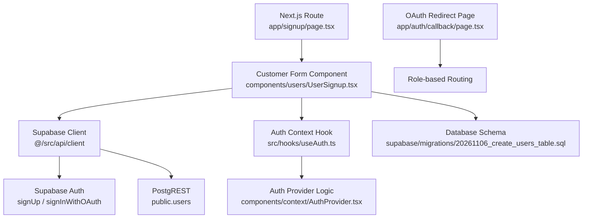
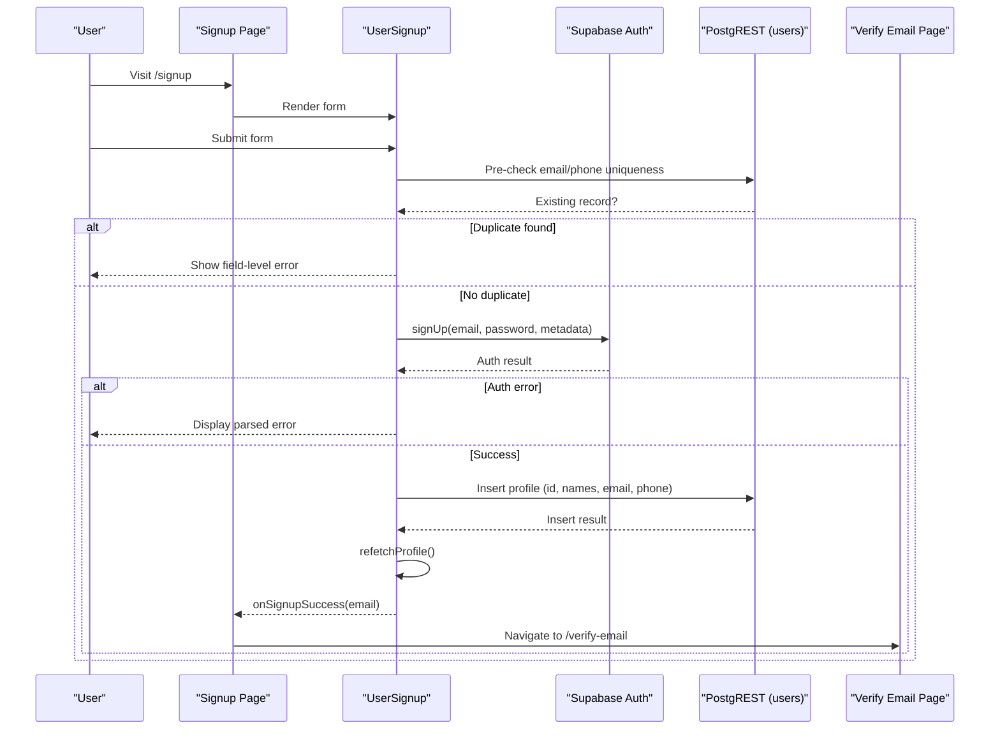
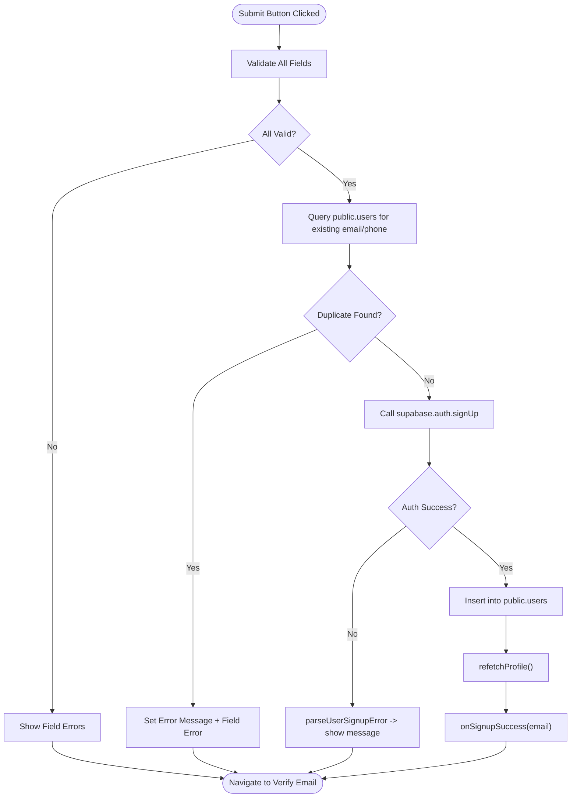
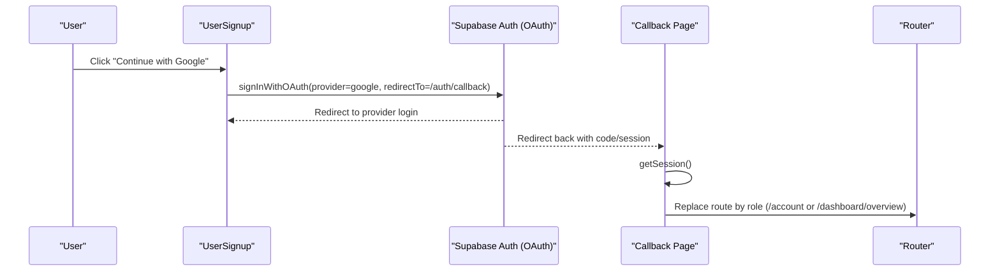
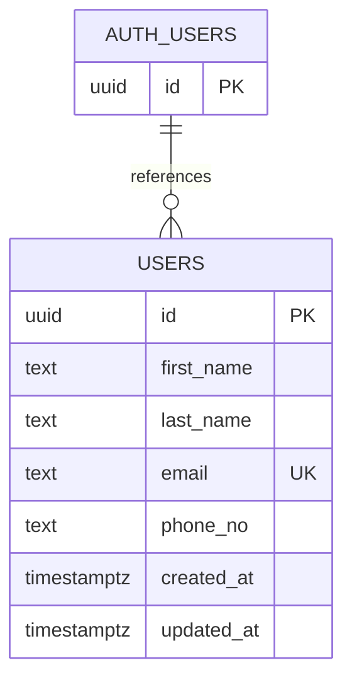
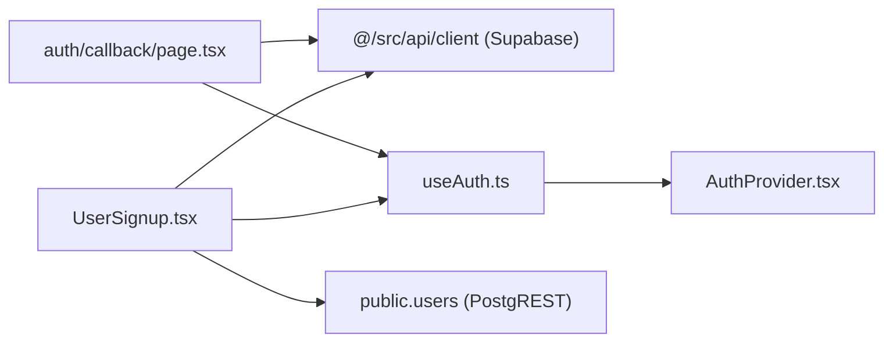

# Customer Signup

<cite>
**Referenced Files in This Document**
- [UserSignup.tsx](file://components/users/UserSignup.tsx)
- [page.tsx (signup route)](file://app/signup/page.tsx)
- [page.tsx (auth callback)](file://app/auth/callback/page.tsx)
- [useAuth.ts](file://src/hooks/useAuth.ts)
- [AuthProvider.tsx](file://components/context/AuthProvider.tsx)
- [20261106_create_users_table.sql](file://supabase/migrations/20261106_create_users_table.sql)
</cite>

## Table of Contents
1. [Introduction](#introduction)
2. [Project Structure](#project-structure)
3. [Core Components](#core-components)
4. [Architecture Overview](#architecture-overview)
5. [Detailed Component Analysis](#detailed-component-analysis)
6. [Dependency Analysis](#dependency-analysis)
7. [Performance Considerations](#performance-considerations)
8. [Troubleshooting Guide](#troubleshooting-guide)
9. [Conclusion](#conclusion)

## Introduction
This document explains the customer signup flow, focusing on the UserSignup component, form validation rules for first name, last name, phone number, email, and password, Google OAuth integration, error handling patterns, and user data storage in the users table. It also covers registration API calls to Supabase Auth and profile creation, with examples of submission workflow, duplicate account detection, and success/error states.

## Project Structure
The customer signup is implemented as a Next.js client page that renders the UserSignup component. The auth callback handles OAuth redirects after Google sign-in.

**Diagram sources**
- [page.tsx (signup route):1-50](file://app/signup/page.tsx#L1-L50)
- [UserSignup.tsx:1-465](file://components/users/UserSignup.tsx#L1-L465)
- [useAuth.ts:1-13](file://src/hooks/useAuth.ts#L1-L13)
- [AuthProvider.tsx:104-229](file://components/context/AuthProvider.tsx#L104-L229)
- [20261106_create_users_table.sql:1-39](file://supabase/migrations/20261106_create_users_table.sql#L1-L39)
- [page.tsx (auth callback):1-69](file://app/auth/callback/page.tsx#L1-L69)

**Section sources**
- [page.tsx (signup route):1-50](file://app/signup/page.tsx#L1-L50)
- [UserSignup.tsx:1-465](file://components/users/UserSignup.tsx#L1-L465)

## Core Components
- UserSignup: Renders the customer registration form, validates inputs, performs pre-checks for duplicates, registers via Supabase Auth, inserts a profile into public.users, refreshes the profile, and navigates to verification or home.
- Signup Page: Guards authenticated users, shows loading state, and passes navigation callbacks to UserSignup.
- Auth Callback: Completes OAuth session establishment and routes based on role.
- useAuth + AuthProvider: Provides current user, profile fetching, and role resolution logic.
- Database Migration: Defines the public.users schema and RLS policies.

**Section sources**
- [UserSignup.tsx:55-250](file://components/users/UserSignup.tsx#L55-L250)
- [page.tsx (signup route):8-47](file://app/signup/page.tsx#L8-L47)
- [page.tsx (auth callback):9-69](file://app/auth/callback/page.tsx#L9-L69)
- [useAuth.ts:1-13](file://src/hooks/useAuth.ts#L1-L13)
- [AuthProvider.tsx:104-229](file://components/context/AuthProvider.tsx#L104-L229)
- [20261106_create_users_table.sql:6-39](file://supabase/migrations/20261106_create_users_table.sql#L6-L39)

## Architecture Overview
The signup architecture combines client-side validation, Supabase Auth for identity management, and PostgREST for profile persistence.

**Diagram sources**
- [UserSignup.tsx:162-250](file://components/users/UserSignup.tsx#L162-L250)
- [page.tsx (signup route):40-47](file://app/signup/page.tsx#L40-L47)

## Detailed Component Analysis

### UserSignup Component
Responsibilities:
- Manage form state for firstName, lastName, phoneNo, email, password.
- Validate fields on blur and before submit.
- Pre-check duplicates against public.users.
- Register via Supabase Auth with user metadata.
- Create a profile row in public.users.
- Refresh profile and navigate to verification.
- Provide Google OAuth option.

Form Validation Rules:
- First name: required.
- Last name: required.
- Phone number: required; must match digits, plus, minus, spaces, parentheses; length between 7 and 20 characters.
- Email: required; standard email format.
- Password: required; minimum 6 characters.

Duplicate Account Detection:
- Before calling Supabase Auth, the component queries public.users for matching email or phone_no using an OR condition.
- If a match is found, it sets a top-level error message and a field-specific error, then aborts submission.

Registration API Calls:
- Supabase Auth: signUp with email, password, and options.data containing first_name, last_name, phone_no.
- Profile Creation: insert into public.users with id from auth.user, names, email, and phone_no.
- After successful auth and profile insertion, refetchProfile is called to update context.

Error Handling Patterns:
- parseUserSignupError normalizes errors from Supabase Auth into user-friendly messages and optional field mapping for email and phoneNo.
- Network-related errors are surfaced as connection issues.
- Google OAuth errors include guidance if the provider is disabled in Supabase.

Success/Error States:
- Loading states for both regular signup and Google OAuth.
- Global error banner for general failures.
- Field-level error messages below each input.
- On success, the parent page navigates to the email verification route.

**Diagram sources**
- [UserSignup.tsx:115-160](file://components/users/UserSignup.tsx#L115-L160)
- [UserSignup.tsx:162-250](file://components/users/UserSignup.tsx#L162-L250)
- [UserSignup.tsx:14-53](file://components/users/UserSignup.tsx#L14-L53)

**Section sources**
- [UserSignup.tsx:14-53](file://components/users/UserSignup.tsx#L14-L53)
- [UserSignup.tsx:55-250](file://components/users/UserSignup.tsx#L55-L250)

### Google OAuth Integration
Flow:
- User clicks “Continue with Google”.
- The component calls supabase.auth.signInWithOAuth with provider google and redirectTo set to /auth/callback.
- Query parameters include access_type offline and prompt consent.
- Errors are handled:
  - If provider is not enabled, a specific message instructs enabling Google in Supabase Dashboard.
  - Other errors display generic messages.
- After redirect, app/auth/callback/page.tsx establishes the session and routes by role.

**Diagram sources**
- [UserSignup.tsx:79-113](file://components/users/UserSignup.tsx#L79-L113)
- [page.tsx (auth callback):14-50](file://app/auth/callback/page.tsx#L14-L50)

**Section sources**
- [UserSignup.tsx:79-113](file://components/users/UserSignup.tsx#L79-L113)
- [page.tsx (auth callback):14-50](file://app/auth/callback/page.tsx#L14-L50)

### Data Model: Users Table
Schema:
- id: UUID primary key referencing auth.users(id) with cascade delete.
- first_name: text, not null.
- last_name: text, nullable.
- email: text, unique, not null.
- phone_no: text, nullable.
- created_at, updated_at: timestamps defaulting to now().

Security:
- Row Level Security enabled.
- Policies allow users to view, update, and insert their own profile rows.

**Diagram sources**
- [20261106_create_users_table.sql:6-14](file://supabase/migrations/20261106_create_users_table.sql#L6-L14)
- [20261106_create_users_table.sql:16-34](file://supabase/migrations/20261106_create_users_table.sql#L16-L34)

**Section sources**
- [20261106_create_users_table.sql:6-39](file://supabase/migrations/20261106_create_users_table.sql#L6-L39)

### Signup Page and Navigation
- Guards authenticated users and redirects to /account when user and userProfile are present.
- Shows a loading spinner while checking session.
- Passes onSignupSuccess to navigate to /verify-email with the email query parameter.
- Provides navigation to login and home.

**Section sources**
- [page.tsx (signup route):8-47](file://app/signup/page.tsx#L8-L47)

### Auth Context and Profile Fetching
- useAuth provides user, userProfile, role, and refetchProfile.
- AuthProvider fetches reseller and customer profiles, auto-creates customer profile if missing, resolves role, and exposes refetchProfile.

**Section sources**
- [useAuth.ts:1-13](file://src/hooks/useAuth.ts#L1-L13)
- [AuthProvider.tsx:104-229](file://components/context/AuthProvider.tsx#L104-L229)

## Dependency Analysis

**Diagram sources**
- [UserSignup.tsx:1-10](file://components/users/UserSignup.tsx#L1-L10)
- [useAuth.ts:1-13](file://src/hooks/useAuth.ts#L1-L13)
- [AuthProvider.tsx:104-229](file://components/context/AuthProvider.tsx#L104-L229)
- [page.tsx (auth callback):1-10](file://app/auth/callback/page.tsx#L1-L10)

**Section sources**
- [UserSignup.tsx:1-10](file://components/users/UserSignup.tsx#L1-L10)
- [useAuth.ts:1-13](file://src/hooks/useAuth.ts#L1-L13)
- [AuthProvider.tsx:104-229](file://components/context/AuthProvider.tsx#L104-L229)
- [page.tsx (auth callback):1-10](file://app/auth/callback/page.tsx#L1-L10)

## Performance Considerations
- Pre-check duplicates with a single query using an OR condition to minimize round trips.
- Avoid redundant re-renders by clearing per-field errors on input change.
- Use maybeSingle for duplicate checks to avoid array overhead.
- Defer profile refresh until after successful auth and profile insertion.

[No sources needed since this section provides general guidance]

## Troubleshooting Guide
Common Issues and Resolutions:
- Provider Not Enabled:
  - Symptom: Google OAuth error indicating provider is disabled.
  - Resolution: Enable Google provider in Supabase Dashboard under Authentication -> Providers.
- Duplicate Email:
  - Symptom: Error stating account already registered; field error shown for email.
  - Resolution: Ask user to log in instead of signing up again.
- Duplicate Phone Number:
  - Symptom: Error stating phone number already registered; field error shown for phoneNo.
  - Resolution: Prompt user to use a different phone number or contact support.
- Network Errors:
  - Symptom: Unable to connect to server.
  - Resolution: Check internet connectivity and retry.
- Short Password:
  - Symptom: Password too short error.
  - Resolution: Require at least 6 characters.

**Section sources**
- [UserSignup.tsx:14-53](file://components/users/UserSignup.tsx#L14-L53)
- [UserSignup.tsx:79-113](file://components/users/UserSignup.tsx#L79-L113)
- [UserSignup.tsx:162-250](file://components/users/UserSignup.tsx#L162-L250)

## Conclusion
The customer signup flow integrates client-side validation, Supabase Auth, and PostgREST to create secure, validated user accounts with profile records. It supports both email/password registration and Google OAuth, includes robust error handling and duplicate detection, and ensures consistent navigation to verification and account pages.

[No sources needed since this section summarizes without analyzing specific files]