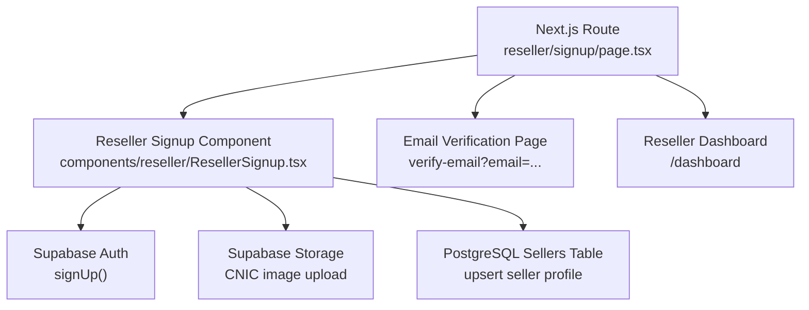
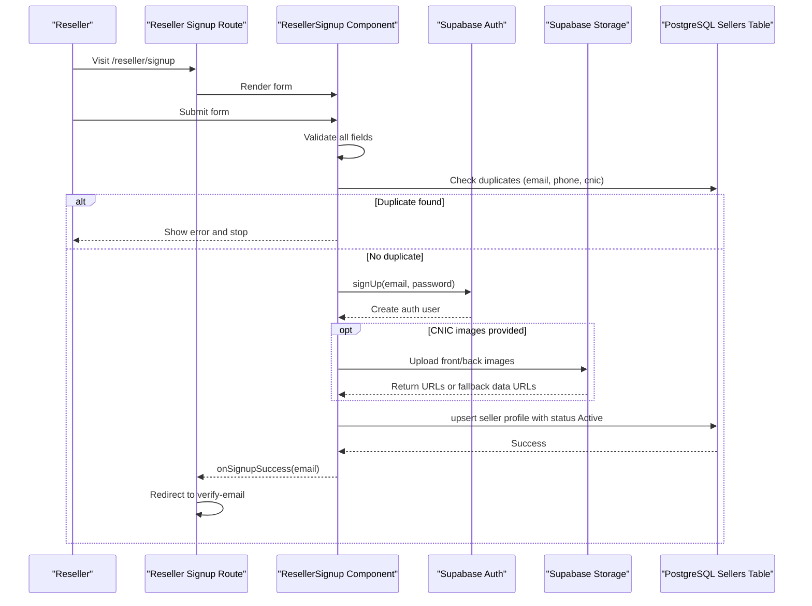
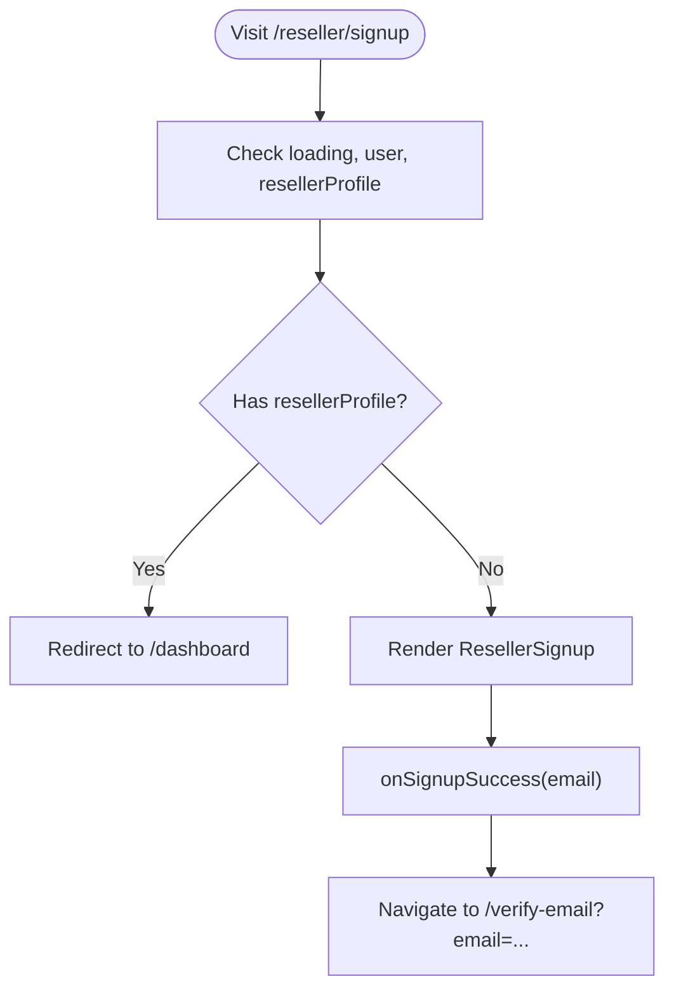
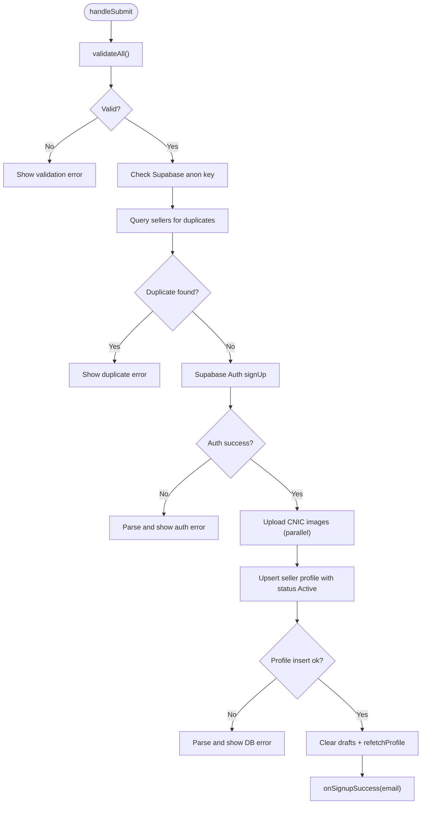
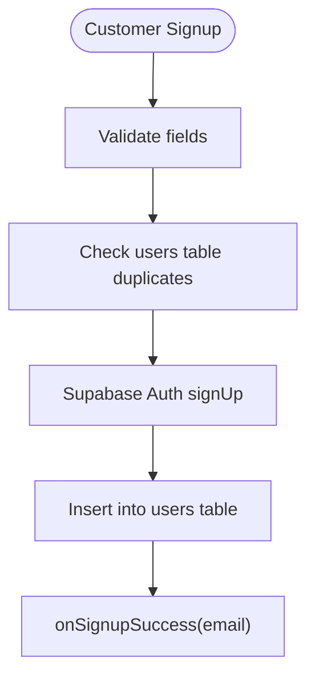
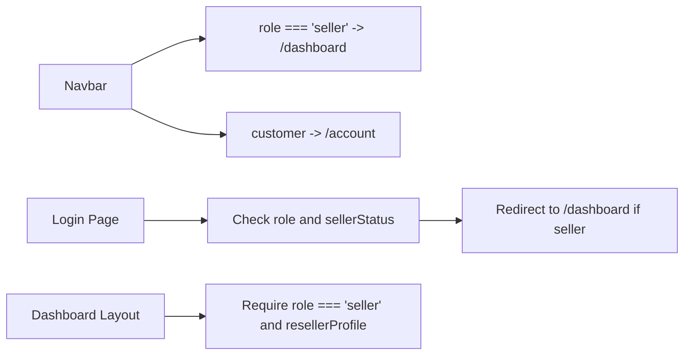
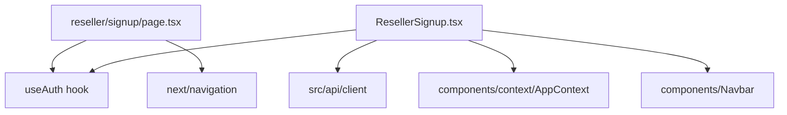

# Reseller Signup

<cite>
**Referenced Files in This Document**
- [app/reseller/signup/page.tsx](file://app/reseller/signup/page.tsx)
- [components/reseller/ResellerSignup.tsx](file://components/reseller/ResellerSignup.tsx)
- [app/signup/page.tsx](file://app/signup/page.tsx)
- [components/users/UserSignup.tsx](file://components/users/UserSignup.tsx)
- [app/dashboard/layout.tsx](file://app/dashboard/layout.tsx)
- [app/login/page.tsx](file://app/login/page.tsx)
- [components/Navbar.tsx](file://components/Navbar.tsx)
- [supabase_seller_shipping_payment_migration.sql](file://supabase_seller_shipping_payment_migration.sql)
</cite>

## Table of Contents
1. [Introduction](#introduction)
2. [Project Structure](#project-structure)
3. [Core Components](#core-components)
4. [Architecture Overview](#architecture-overview)
5. [Detailed Component Analysis](#detailed-component-analysis)
6. [Dependency Analysis](#dependency-analysis)
7. [Performance Considerations](#performance-considerations)
8. [Troubleshooting Guide](#troubleshooting-guide)
9. [Conclusion](#conclusion)

## Introduction
This document explains the reseller signup flow in the application. It focuses on the specialized registration process for resellers, which collects additional business information beyond basic user details, validates that data, persists a seller profile, and routes authenticated users to the reseller dashboard. It also contrasts this flow with the standard customer signup, documents validation rules, optional identity verification fields, and how role-based routing determines access to dashboards.

The reseller signup is not a simple account creation: it creates an authentication user, checks for duplicate seller identifiers, uploads optional CNIC images, inserts or updates a seller profile, and then redirects to email verification and eventually the reseller dashboard when applicable.

## Project Structure
The reseller signup spans two main layers:
- A Next.js route page that handles session checks and navigation.
- A React component that renders the form, validates input, performs Supabase operations, and manages UI state.

**Diagram sources**
- [app/reseller/signup/page.tsx:8-36](file://app/reseller/signup/page.tsx#L8-L36)
- [components/reseller/ResellerSignup.tsx:406-556](file://components/reseller/ResellerSignup.tsx#L406-L556)

**Section sources**
- [app/reseller/signup/page.tsx:1-38](file://app/reseller/signup/page.tsx#L1-L38)
- [components/reseller/ResellerSignup.tsx:1-1027](file://components/reseller/ResellerSignup.tsx#L1-L1027)

## Core Components
- **Reseller Signup Route**: Checks if the user already has a reseller profile and redirects to the dashboard; otherwise renders the reseller signup form and navigates to email verification after success.
- **Reseller Signup Component**: Renders the full reseller registration form, validates inputs, prevents duplicate sellers, creates an auth user, optionally uploads CNIC images, and persists a seller profile with status Active.
- **Customer Signup Route and Component**: Provide the baseline customer registration flow for comparison.

Key responsibilities:
- Form rendering and field formatting for Pakistani phone numbers and CNIC.
- Frontend validation for required fields and formats.
- Duplicate checks against the sellers table.
- Supabase authentication and database persistence.
- Draft persistence for interrupted signups.
- Error parsing and user-friendly messages.

**Section sources**
- [app/reseller/signup/page.tsx:8-36](file://app/reseller/signup/page.tsx#L8-L36)
- [components/reseller/ResellerSignup.tsx:146-563](file://components/reseller/ResellerSignup.tsx#L146-L563)
- [app/signup/page.tsx:8-46](file://app/signup/page.tsx#L8-L46)
- [components/users/UserSignup.tsx:55-250](file://components/users/UserSignup.tsx#L55-L250)

## Architecture Overview
The reseller signup architecture integrates three systems:
- Authentication via Supabase Auth.
- Data persistence via PostgreSQL through Supabase client.
- Optional file storage via Supabase Storage for CNIC images.

**Diagram sources**
- [components/reseller/ResellerSignup.tsx:406-556](file://components/reseller/ResellerSignup.tsx#L406-L556)
- [app/reseller/signup/page.tsx:31-36](file://app/reseller/signup/page.tsx#L31-L36)

## Detailed Component Analysis

### Reseller Signup Route
The route performs:
- Session and profile checks using `useAuth`.
- Redirect to `/dashboard` if the user already has a reseller profile.
- Rendering of the `ResellerSignup` component.
- Navigation to `/verify-email?email=...` on successful signup.

**Diagram sources**
- [app/reseller/signup/page.tsx:8-36](file://app/reseller/signup/page.tsx#L8-L36)

**Section sources**
- [app/reseller/signup/page.tsx:8-36](file://app/reseller/signup/page.tsx#L8-L36)

### Reseller Signup Component
The component implements:
- Field formatting utilities for CNIC and phone number.
- Draft persistence for text and image fields.
- Validation rules for email, password, full name, shop name, CNIC, phone, city, address, terms agreement, and optional CNIC images.
- Duplicate pre-checks against the sellers table.
- Supabase Auth signup with redirect configuration.
- Parallel CNIC image uploads with fallback to base64 data URLs.
- Upserting the seller profile with status Active.
- Cleanup of drafts and refetching profile before calling success callback.

**Diagram sources**
- [components/reseller/ResellerSignup.tsx:286-370](file://components/reseller/ResellerSignup.tsx#L286-L370)
- [components/reseller/ResellerSignup.tsx:381-404](file://components/reseller/ResellerSignup.tsx#L381-L404)
- [components/reseller/ResellerSignup.tsx:406-556](file://components/reseller/ResellerSignup.tsx#L406-L556)

**Section sources**
- [components/reseller/ResellerSignup.tsx:17-62](file://components/reseller/ResellerSignup.tsx#L17-L62)
- [components/reseller/ResellerSignup.tsx:118-144](file://components/reseller/ResellerSignup.tsx#L118-L144)
- [components/reseller/ResellerSignup.tsx:146-563](file://components/reseller/ResellerSignup.tsx#L146-L563)
- [components/reseller/ResellerSignup.tsx:847-961](file://components/reseller/ResellerSignup.tsx#L847-L961)

### Customer Signup Comparison
The customer signup is simpler:
- Collects first name, last name, phone number, email, and password.
- Performs duplicate checks against the users table.
- Creates an auth user and inserts into the users table.
- Does not collect business-specific fields like shop name, CNIC, or warehouse address.
- Does not upload CNIC images.
- Redirects to email verification upon success.

**Diagram sources**
- [components/users/UserSignup.tsx:115-160](file://components/users/UserSignup.tsx#L115-L160)
- [components/users/UserSignup.tsx:162-250](file://components/users/UserSignup.tsx#L162-L250)

**Section sources**
- [app/signup/page.tsx:8-46](file://app/signup/page.tsx#L8-L46)
- [components/users/UserSignup.tsx:55-250](file://components/users/UserSignup.tsx#L55-L250)

### Role Assignment and Dashboard Access
Role-based routing uses the user’s role and reseller profile to determine navigation:
- The navbar links to `/dashboard` for sellers and `/account` for customers.
- The login page redirects based on role and seller status.
- The dashboard layout guards access by requiring role seller and reseller profile.

**Diagram sources**
- [components/Navbar.tsx:69-69](file://components/Navbar.tsx#L69-L69)
- [app/login/page.tsx:10-22](file://app/login/page.tsx#L10-L22)
- [app/dashboard/layout.tsx:13-45](file://app/dashboard/layout.tsx#L13-L45)

**Section sources**
- [components/Navbar.tsx:69-69](file://components/Navbar.tsx#L69-L69)
- [app/login/page.tsx:10-22](file://app/login/page.tsx#L10-L22)
- [app/dashboard/layout.tsx:13-45](file://app/dashboard/layout.tsx#L13-L45)

### Business Verification and Approval Workflow
Current implementation notes:
- The reseller signup sets the seller profile status to Active immediately after successful profile insertion.
- There is no explicit approval workflow in the signup component itself.
- An optional CNIC identity verification section exists but is hidden by default via a flag.
- The broader system references seller statuses such as Active, Inactive, and Suspended in privacy and policy content, indicating potential future enforcement around fulfillment and compliance.

Implications:
- Resellers are onboarded as Active without manual approval in the current code path.
- If stricter verification is needed, the hidden CNIC section can be enabled and integrated with backend verification logic.
- Policy-driven restrictions may change status later based on operational rules.

**Section sources**
- [components/reseller/ResellerSignup.tsx:151-152](file://components/reseller/ResellerSignup.tsx#L151-L152)
- [components/reseller/ResellerSignup.tsx:516-535](file://components/reseller/ResellerSignup.tsx#L516-L535)
- [components/reseller/ResellerSignup.tsx:847-961](file://components/reseller/ResellerSignup.tsx#L847-L961)

## Dependency Analysis
The reseller signup depends on:
- Supabase client for authentication, database queries, and storage.
- Next.js router for navigation.
- Auth context for user state and profile refetch.
- App context for shared UI state like cart and search.

**Diagram sources**
- [app/reseller/signup/page.tsx:3-6](file://app/reseller/signup/page.tsx#L3-L6)
- [components/reseller/ResellerSignup.tsx:3-9](file://components/reseller/ResellerSignup.tsx#L3-L9)

**Section sources**
- [app/reseller/signup/page.tsx:3-6](file://app/reseller/signup/page.tsx#L3-L6)
- [components/reseller/ResellerSignup.tsx:3-9](file://components/reseller/ResellerSignup.tsx#L3-L9)

## Performance Considerations
- Duplicate checks run before auth signup to avoid unnecessary auth calls when conflicts exist.
- CNIC image uploads occur in parallel to reduce latency.
- Fallback to base64 data URLs ensures resilience if storage upload fails.
- Draft persistence avoids data loss during interruptions.
- Profile refetch occurs once after successful profile insertion.

[No sources needed since this section provides general guidance]

## Troubleshooting Guide
Common issues and handling:
- Missing or invalid Supabase anon key: The component shows a clear message instructing environment configuration.
- Duplicate email, CNIC, or phone: The component detects duplicates in the sellers table and displays field-specific errors.
- Auth errors: Errors from Supabase Auth are parsed into user-friendly messages and mapped to fields where possible.
- Database insert errors: Errors from seller profile upsert are parsed and surfaced to the UI.
- Network failures: Generic network error messages guide users to check connectivity.

Recommended steps:
- Verify environment variables for Supabase.
- Ensure unique email, CNIC, and phone values.
- Confirm storage bucket permissions if CNIC uploads fail.
- Review error messages for field-level feedback.

**Section sources**
- [components/reseller/ResellerSignup.tsx:67-116](file://components/reseller/ResellerSignup.tsx#L67-L116)
- [components/reseller/ResellerSignup.tsx:419-425](file://components/reseller/ResellerSignup.tsx#L419-L425)
- [components/reseller/ResellerSignup.tsx:431-465](file://components/reseller/ResellerSignup.tsx#L431-L465)
- [components/reseller/ResellerSignup.tsx:476-487](file://components/reseller/ResellerSignup.tsx#L476-L487)
- [components/reseller/ResellerSignup.tsx:537-546](file://components/reseller/ResellerSignup.tsx#L537-L546)

## Conclusion
The reseller signup flow is a specialized registration pathway that collects business-related information, enforces stricter validation, and persists a seller profile with Active status. It differs significantly from customer signup by including fields like shop name, CNIC, phone formatting, and optional CNIC image uploads. Role-based routing ensures sellers navigate to the dashboard while customers go to their account area. While the current implementation does not include a manual approval step, the system supports seller status management and policy-driven restrictions, allowing future enhancements for verification and compliance workflows.

[No sources needed since this section summarizes without analyzing specific files]