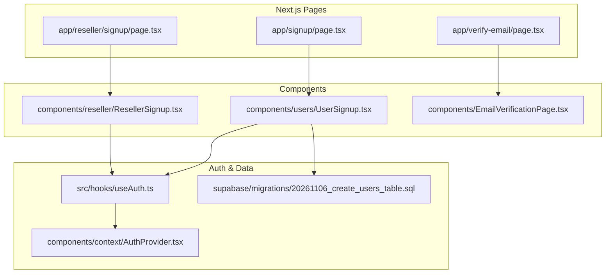
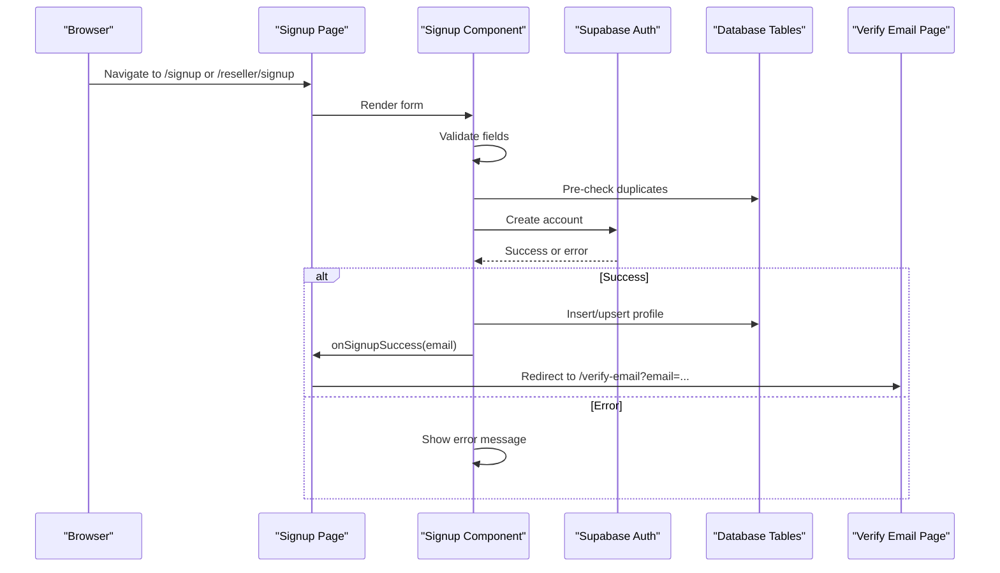
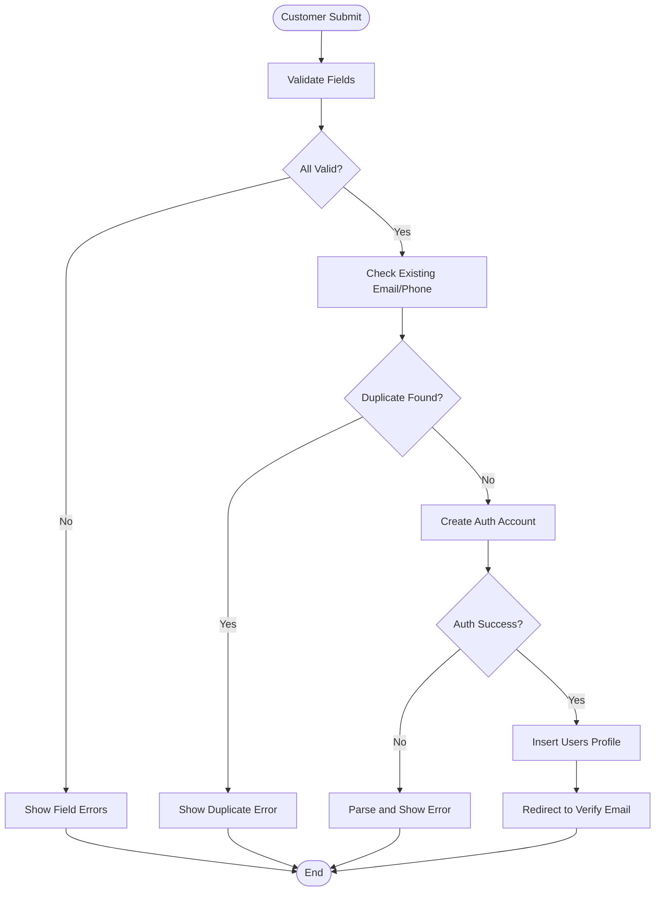
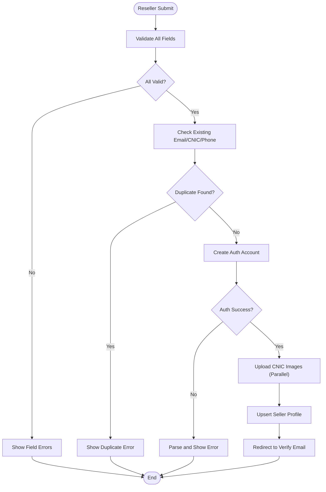
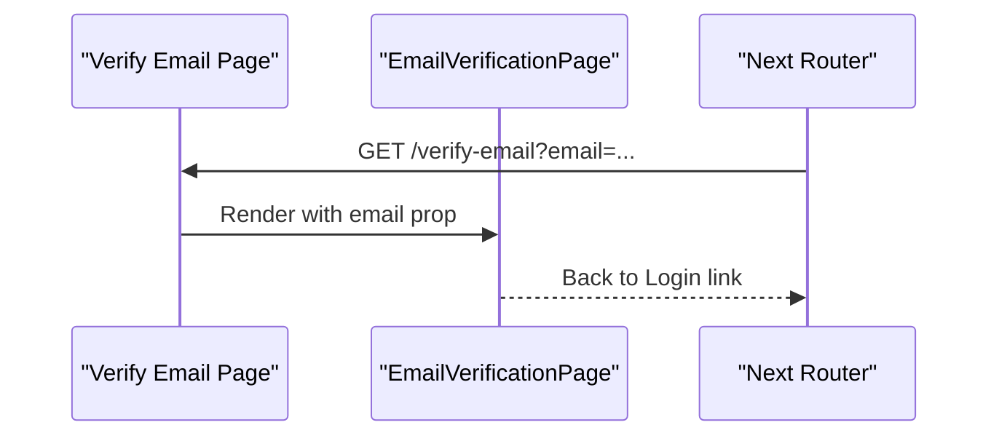
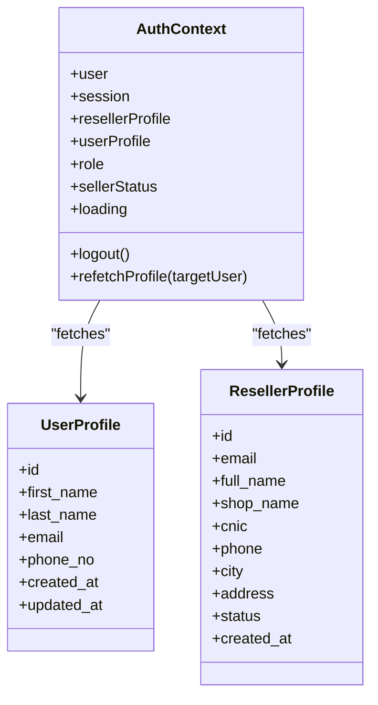
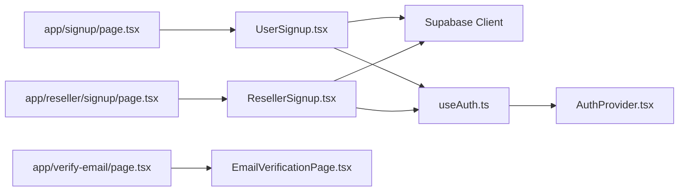

# User Registration

<cite>
**Referenced Files in This Document**
- [app/signup/page.tsx](file://app/signup/page.tsx)
- [app/reseller/signup/page.tsx](file://app/reseller/signup/page.tsx)
- [components/users/UserSignup.tsx](file://components/users/UserSignup.tsx)
- [components/reseller/ResellerSignup.tsx](file://components/reseller/ResellerSignup.tsx)
- [components/EmailVerificationPage.tsx](file://components/EmailVerificationPage.tsx)
- [app/verify-email/page.tsx](file://app/verify-email/page.tsx)
- [src/hooks/useAuth.ts](file://src/hooks/useAuth.ts)
- [components/context/AuthProvider.tsx](file://components/context/AuthProvider.tsx)
- [supabase/migrations/20261106_create_users_table.sql](file://supabase/migrations/20261106_create_users_table.sql)
</cite>

## Table of Contents
1. [Introduction](#introduction)
2. [Project Structure](#project-structure)
3. [Core Components](#core-components)
4. [Architecture Overview](#architecture-overview)
5. [Detailed Component Analysis](#detailed-component-analysis)
6. [Dependency Analysis](#dependency-analysis)
7. [Performance Considerations](#performance-considerations)
8. [Troubleshooting Guide](#troubleshooting-guide)
9. [Conclusion](#conclusion)

## Introduction
This document explains the user registration system for both customers and resellers. It covers:
- Customer registration flow, including form validation, account creation, and email verification navigation.
- Reseller registration flow, including extended profile data collection, identity fields, file uploads, role assignment, and email verification navigation.
- Email verification UI and routing.
- Differences between customer and reseller registration, including profile data and role handling.
- Validation rules, error handling patterns, and integration with Supabase authentication and database tables.

## Project Structure
The registration feature spans Next.js App Router pages, reusable React components, authentication context, and a database migration for customer profiles.

**Diagram sources**
- [app/signup/page.tsx:1-50](file://app/signup/page.tsx#L1-L50)
- [app/reseller/signup/page.tsx:1-39](file://app/reseller/signup/page.tsx#L1-L39)
- [components/users/UserSignup.tsx:1-465](file://components/users/UserSignup.tsx#L1-L465)
- [components/reseller/ResellerSignup.tsx:1-1027](file://components/reseller/ResellerSignup.tsx#L1-L1027)
- [components/EmailVerificationPage.tsx:1-71](file://components/EmailVerificationPage.tsx#L1-L71)
- [app/verify-email/page.tsx:1-21](file://app/verify-email/page.tsx#L1-L21)
- [src/hooks/useAuth.ts:1-13](file://src/hooks/useAuth.ts#L1-L13)
- [components/context/AuthProvider.tsx:1-326](file://components/context/AuthProvider.tsx#L1-L326)
- [supabase/migrations/20261106_create_users_table.sql:1-39](file://supabase/migrations/20261106_create_users_table.sql#L1-L39)

**Section sources**
- [app/signup/page.tsx:1-50](file://app/signup/page.tsx#L1-L50)
- [app/reseller/signup/page.tsx:1-39](file://app/reseller/signup/page.tsx#L1-L39)
- [components/EmailVerificationPage.tsx:1-71](file://components/EmailVerificationPage.tsx#L1-L71)
- [app/verify-email/page.tsx:1-21](file://app/verify-email/page.tsx#L1-L21)

## Core Components
- Customer registration page route: renders the customer signup component and redirects to email verification after success.
- Reseller registration page route: renders the reseller signup component and redirects to email verification after success.
- Customer signup component: handles form input, validation, duplicate checks, Supabase Auth signup, and customer profile insertion.
- Reseller signup component: handles extended form input, CNIC formatting, phone formatting, optional CNIC image upload, duplicate checks, Supabase Auth signup, and seller profile upsert.
- Email verification UI: displays instructions and optionally shows the target email address.
- Authentication context: provides current user, session, roles, and profile fetching logic.

**Section sources**
- [app/signup/page.tsx:1-50](file://app/signup/page.tsx#L1-L50)
- [app/reseller/signup/page.tsx:1-39](file://app/reseller/signup/page.tsx#L1-L39)
- [components/users/UserSignup.tsx:1-465](file://components/users/UserSignup.tsx#L1-L465)
- [components/reseller/ResellerSignup.tsx:1-1027](file://components/reseller/ResellerSignup.tsx#L1-L1027)
- [components/EmailVerificationPage.tsx:1-71](file://components/EmailVerificationPage.tsx#L1-L71)
- [components/context/AuthProvider.tsx:1-326](file://components/context/AuthProvider.tsx#L1-L326)

## Architecture Overview
The registration architecture separates routing, UI, and data concerns:
- Route pages handle session checks, loading states, and navigation to verification or dashboard.
- Signup components encapsulate validation, API calls, and user feedback.
- The authentication context centralizes user state, role resolution, and profile synchronization.
- Database schema defines customer profiles; reseller profiles are managed through a separate sellers table (used by reseller signup).

**Diagram sources**
- [app/signup/page.tsx:1-50](file://app/signup/page.tsx#L1-L50)
- [app/reseller/signup/page.tsx:1-39](file://app/reseller/signup/page.tsx#L1-L39)
- [components/users/UserSignup.tsx:162-250](file://components/users/UserSignup.tsx#L162-L250)
- [components/reseller/ResellerSignup.tsx:406-563](file://components/reseller/ResellerSignup.tsx#L406-L563)
- [components/EmailVerificationPage.tsx:1-71](file://components/EmailVerificationPage.tsx#L1-L71)

## Detailed Component Analysis

### Customer Registration Flow
Customer registration collects basic profile information and creates an authenticated account. After successful signup, the user is redirected to the email verification page.

Key behaviors:
- Form fields: first name, last name, phone number, email, password.
- Field-level validation with real-time feedback.
- Duplicate email and phone checks against the users table before signup.
- Supabase Auth signup with metadata for first name, last name, and phone.
- Post-authentication insertion into the public.users table.
- On success, navigate to `/verify-email` with the email query parameter.

Validation rules:
- First name: required.
- Last name: required.
- Phone number: required; format allows digits, plus, minus, spaces, parentheses; length constraints enforced.
- Email: required; standard email regex.
- Password: required; minimum length.

Error handling:
- Maps technical errors from Supabase to user-friendly messages.
- Highlights specific fields when duplicates or invalid inputs occur.
- Shows network-related errors and generic failure messages.

**Diagram sources**
- [components/users/UserSignup.tsx:115-160](file://components/users/UserSignup.tsx#L115-L160)
- [components/users/UserSignup.tsx:162-250](file://components/users/UserSignup.tsx#L162-L250)
- [components/users/UserSignup.tsx:14-53](file://components/users/UserSignup.tsx#L14-L53)

**Section sources**
- [components/users/UserSignup.tsx:1-465](file://components/users/UserSignup.tsx#L1-L465)
- [app/signup/page.tsx:1-50](file://app/signup/page.tsx#L1-L50)
- [supabase/migrations/20261106_create_users_table.sql:1-39](file://supabase/migrations/20261106_create_users_table.sql#L1-L39)

### Reseller Registration Flow
Reseller registration collects more extensive business and personal details, supports optional CNIC identity fields, and stores seller-specific data. After successful signup, the user is redirected to the email verification page.

Key behaviors:
- Form sections:
  - Account credentials: email and password.
  - Personal and business details: full name, shop name, CNIC (optional), phone, city, address.
  - Optional CNIC front/back image upload with size/type validation and fallback storage behavior.
  - Terms agreement checkbox.
- Input helpers:
  - CNIC formatting and cleaning utilities.
  - Phone formatting to +92 XXX XXXXXXX pattern.
- Duplicate checks against the sellers table for email, CNIC, and phone.
- Supabase Auth signup with redirect configuration.
- Parallel upload of CNIC images to storage with fallback to base64 if storage fails.
- Upsert seller profile with status set to Active.
- On success, navigate to `/verify-email` with the email query parameter.

Validation rules:
- Email: required; valid email format.
- Password: required; minimum length.
- Full name: required; letters and spaces only; length constraints.
- Shop name: required; minimum length.
- CNIC: optional; exactly 13 digits when provided.
- Phone: required; 10-digit mobile number after country code normalization.
- CNIC images: optional; must be images under 5MB when provided.
- Terms: required; must agree to terms.

Error handling:
- Maps technical errors from Supabase to user-friendly messages for email, CNIC, phone, shop name, and password.
- Handles storage upload failures gracefully with fallbacks.
- Shows network-related errors and generic failure messages.

**Diagram sources**
- [components/reseller/ResellerSignup.tsx:286-370](file://components/reseller/ResellerSignup.tsx#L286-L370)
- [components/reseller/ResellerSignup.tsx:406-563](file://components/reseller/ResellerSignup.tsx#L406-L563)
- [components/reseller/ResellerSignup.tsx:67-116](file://components/reseller/ResellerSignup.tsx#L67-L116)

**Section sources**
- [components/reseller/ResellerSignup.tsx:1-1027](file://components/reseller/ResellerSignup.tsx#L1-L1027)
- [app/reseller/signup/page.tsx:1-39](file://app/reseller/signup/page.tsx#L1-L39)

### Email Verification Implementation
Both customer and reseller registration flows redirect to a shared email verification page after successful signup. The verification page displays instructions and optionally shows the target email address.

Routing:
- `/verify-email` reads the email query parameter and renders the verification UI.

UI behavior:
- Displays a message instructing the user to check their inbox and click the verification link.
- Optionally shows the email address that received the verification email.
- Provides a link back to login.

Important note:
- The frontend does not implement automatic email confirmation logic; it relies on Supabase’s email verification flow configured in the backend.

**Diagram sources**
- [app/verify-email/page.tsx:1-21](file://app/verify-email/page.tsx#L1-L21)
- [components/EmailVerificationPage.tsx:1-71](file://components/EmailVerificationPage.tsx#L1-L71)

**Section sources**
- [app/verify-email/page.tsx:1-21](file://app/verify-email/page.tsx#L1-L21)
- [components/EmailVerificationPage.tsx:1-71](file://components/EmailVerificationPage.tsx#L1-L71)

### Role Assignment and Profile Data Collection
Role assignment is handled centrally in the authentication context:
- If a reseller profile exists for the current user, the role is set to seller and the seller status is read from the profile.
- Otherwise, the role is set to customer.
- Customer profiles are fetched from the users table; if missing, they can be auto-created using metadata from the authenticated user.

Profile data differences:
- Customer profile includes first name, last name, email, and phone number.
- Reseller profile includes full name, shop name, CNIC, phone, city, address, and optional bank details; status is explicitly set during registration.

**Diagram sources**
- [components/context/AuthProvider.tsx:6-57](file://components/context/AuthProvider.tsx#L6-L57)
- [components/context/AuthProvider.tsx:85-216](file://components/context/AuthProvider.tsx#L85-L216)

**Section sources**
- [components/context/AuthProvider.tsx:1-326](file://components/context/AuthProvider.tsx#L1-L326)
- [src/hooks/useAuth.ts:1-13](file://src/hooks/useAuth.ts#L1-L13)

## Dependency Analysis
Registration components depend on:
- Supabase client for authentication and database/storage operations.
- Authentication context for user state and profile synchronization.
- Next.js router for navigation to verification and dashboard routes.

**Diagram sources**
- [components/users/UserSignup.tsx:1-465](file://components/users/UserSignup.tsx#L1-L465)
- [components/reseller/ResellerSignup.tsx:1-1027](file://components/reseller/ResellerSignup.tsx#L1-L1027)
- [src/hooks/useAuth.ts:1-13](file://src/hooks/useAuth.ts#L1-L13)
- [components/context/AuthProvider.tsx:1-326](file://components/context/AuthProvider.tsx#L1-L326)
- [app/signup/page.tsx:1-50](file://app/signup/page.tsx#L1-L50)
- [app/reseller/signup/page.tsx:1-39](file://app/reseller/signup/page.tsx#L1-L39)
- [app/verify-email/page.tsx:1-21](file://app/verify-email/page.tsx#L1-L21)
- [components/EmailVerificationPage.tsx:1-71](file://components/EmailVerificationPage.tsx#L1-L71)

**Section sources**
- [components/users/UserSignup.tsx:1-465](file://components/users/UserSignup.tsx#L1-L465)
- [components/reseller/ResellerSignup.tsx:1-1027](file://components/reseller/ResellerSignup.tsx#L1-L1027)
- [src/hooks/useAuth.ts:1-13](file://src/hooks/useAuth.ts#L1-L13)
- [components/context/AuthProvider.tsx:1-326](file://components/context/AuthProvider.tsx#L1-L326)

## Performance Considerations
- Duplicate checks are performed before authentication to provide early feedback and reduce unnecessary server calls.
- Reseller CNIC image uploads are executed in parallel to minimize total upload time.
- Storage upload failures fall back to base64 encoding to avoid blocking registration.
- Draft persistence for reseller forms uses synchronous writes for text fields and asynchronous writes for images to balance responsiveness and reliability.
- Profile refetch occurs after successful registration to ensure consistent role and profile state.

[No sources needed since this section provides general guidance]

## Troubleshooting Guide
Common issues and resolutions:
- Missing or invalid Supabase environment key:
  - Reseller signup validates the presence of the anonymous key and shows a clear error if missing or dummy.
- Google OAuth not enabled:
  - Customer signup detects provider disabled errors and instructs enabling Google in Supabase Dashboard.
- Duplicate email, phone, CNIC, or shop name:
  - Both flows pre-check duplicates and map backend constraint errors to field-specific messages.
- Network connectivity issues:
  - Both flows detect network/fetch errors and display a friendly message.
- Email not confirmed:
  - Login flow recognizes unverified email errors and prompts users to check their inbox for the confirmation link.

**Section sources**
- [components/reseller/ResellerSignup.tsx:419-425](file://components/reseller/ResellerSignup.tsx#L419-L425)
- [components/users/UserSignup.tsx:98-112](file://components/users/UserSignup.tsx#L98-L112)
- [components/users/UserSignup.tsx:14-53](file://components/users/UserSignup.tsx#L14-L53)
- [components/reseller/ResellerSignup.tsx:67-116](file://components/reseller/ResellerSignup.tsx#L67-L116)

## Conclusion
The registration system provides two distinct flows:
- Customer registration focuses on minimal profile data and straightforward account creation.
- Reseller registration collects comprehensive business and identity information, supports optional CNIC image uploads, and assigns the seller role upon successful profile creation.
Both flows rely on Supabase authentication and database tables, with robust validation and error handling. Email verification is communicated via a dedicated page, while actual confirmation is handled by Supabase’s backend configuration.

[No sources needed since this section summarizes without analyzing specific files]