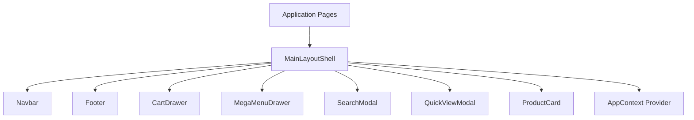
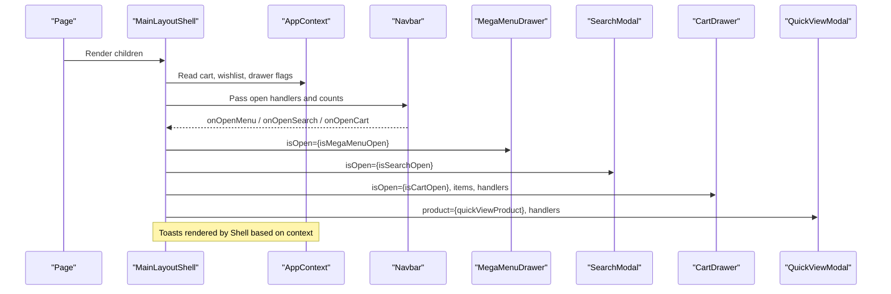
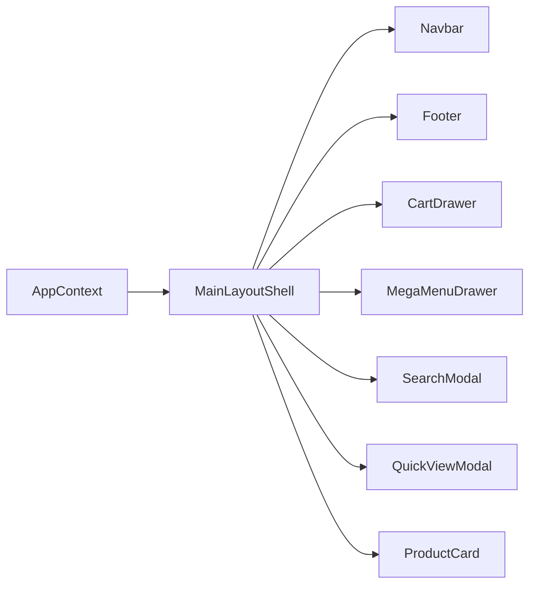

# Component Library

<cite>
**Referenced Files in This Document**
- [MainLayoutShell.tsx](file://components/MainLayoutShell.tsx)
- [Navbar.tsx](file://components/Navbar.tsx)
- [Footer.tsx](file://components/Footer.tsx)
- [ProductCard.tsx](file://components/ProductCard.tsx)
- [QuickViewModal.tsx](file://components/QuickViewModal.tsx)
- [SearchModal.tsx](file://components/SearchModal.tsx)
- [MegaMenuDrawer.tsx](file://components/MegaMenuDrawer.tsx)
- [CartDrawer.tsx](file://components/CartDrawer.tsx)
- [AppContext.tsx](file://components/context/AppContext.tsx)
- [ResponsiveTable.tsx](file://components/reseller/components/common/ResponsiveTable.tsx)
- [ConfirmDialog.tsx](file://components/reseller/components/common/ConfirmDialog.tsx)
</cite>

## Table of Contents
1. [Introduction](#introduction)
2. [Project Structure](#project-structure)
3. [Core Components](#core-components)
4. [Architecture Overview](#architecture-overview)
5. [Detailed Component Analysis](#detailed-component-analysis)
6. [Dependency Analysis](#dependency-analysis)
7. [Performance Considerations](#performance-considerations)
8. [Troubleshooting Guide](#troubleshooting-guide)
9. [Conclusion](#conclusion)

## Introduction
This document describes the reusable UI component library used across the application. It focuses on:
- Global layout components that provide structure and shared navigation
- Feature-specific components for product displays, modals, drawers, and tables
- Props, events, and customization options
- Usage patterns and integration guidelines
- Responsive design, accessibility, and cross-browser considerations
- Loading states and error handling patterns

The library is built with React, Next.js, Tailwind CSS, and Lucide icons. Shared state such as cart, wishlist, and drawer visibility is managed through a central context.

## Project Structure
The component library lives under `components/`. The most important parts are:
- Layout shell and global chrome: `MainLayoutShell`, `Navbar`, `Footer`
- Navigation overlays: `MegaMenuDrawer`, `SearchModal`
- Shopping flow: `CartDrawer`, `QuickViewModal`, `ProductCard`
- Shared state provider: `context/AppContext.tsx`
- Reseller utilities: `reseller/components/common/ResponsiveTable.tsx`, `ConfirmDialog.tsx`

**Diagram sources**
- [MainLayoutShell.tsx:13-145](file://components/MainLayoutShell.tsx#L13-L145)
- [Navbar.tsx:9-18](file://components/Navbar.tsx#L9-L18)
- [Footer.tsx:5-8](file://components/Footer.tsx#L5-L8)
- [CartDrawer.tsx:9-16](file://components/CartDrawer.tsx#L9-L16)
- [MegaMenuDrawer.tsx:6-11](file://components/MegaMenuDrawer.tsx#L6-L11)
- [SearchModal.tsx:6-10](file://components/SearchModal.tsx#L6-L10)
- [QuickViewModal.tsx:5-11](file://components/QuickViewModal.tsx#L5-L11)
- [ProductCard.tsx:7-16](file://components/ProductCard.tsx#L7-L16)
- [AppContext.tsx:14-53](file://components/context/AppContext.tsx#L14-L53)

**Section sources**
- [MainLayoutShell.tsx:13-145](file://components/MainLayoutShell.tsx#L13-L145)
- [AppContext.tsx:59-358](file://components/context/AppContext.tsx#L59-L358)

## Core Components
This section summarizes the primary components and their responsibilities.

- MainLayoutShell: Orchestrates global layout, conditional rendering of public header/footer, and manages interactive overlays like cart, mega menu, search, and quick view. It also renders toast notifications.
- Navbar: Provides top navigation with hamburger menu, search, account link, wishlist, and cart badge. It adapts to scroll position and hero theme.
- Footer: Displays contact information, links, social media, and seller onboarding actions.
- ProductCard: Displays product image, brand, title, pricing, discount badge, reseller info, rating, and quick actions (quick view, add to bag, wishlist).
- QuickViewModal: Presents a modal preview of a product with size selection, quantity, add-to-cart, and wishlist toggle.
- SearchModal: Full-screen search overlay with suggestions and filtered results.
- MegaMenuDrawer: Left-side navigation drawer with category accordions and quick links.
- CartDrawer: Slide-out shopping bag with stock-aware quantity controls, item removal, subtotal, and checkout.
- AppContext: Centralized state for cart, wishlist, drawer toggles, quick view product, and toast messages.

**Section sources**
- [MainLayoutShell.tsx:13-145](file://components/MainLayoutShell.tsx#L13-L145)
- [Navbar.tsx:9-186](file://components/Navbar.tsx#L9-L186)
- [Footer.tsx:5-90](file://components/Footer.tsx#L5-L90)
- [ProductCard.tsx:7-274](file://components/ProductCard.tsx#L7-L274)
- [QuickViewModal.tsx:5-166](file://components/QuickViewModal.tsx#L5-L166)
- [SearchModal.tsx:6-120](file://components/SearchModal.tsx#L6-L120)
- [MegaMenuDrawer.tsx:6-195](file://components/MegaMenuDrawer.tsx#L6-L195)
- [CartDrawer.tsx:9-349](file://components/CartDrawer.tsx#L9-L349)
- [AppContext.tsx:14-367](file://components/context/AppContext.tsx#L14-L367)

## Architecture Overview
The layout shell composes global UI and delegates interactions to feature components. Shared state flows from `AppContext` into these components via props or hooks.

**Diagram sources**
- [MainLayoutShell.tsx:13-145](file://components/MainLayoutShell.tsx#L13-L145)
- [AppContext.tsx:14-53](file://components/context/AppContext.tsx#L14-L53)

## Detailed Component Analysis

### MainLayoutShell
Responsibilities:
- Conditionally render public `Navbar` and `Footer` outside reseller routes
- Manage interactive overlays: cart, mega menu, search, quick view
- Provide navigation helpers and smooth scrolling
- Render toast notifications from context

Key props and behavior:
- Receives no direct props; it composes child pages and overlays
- Uses `usePathname` and `useRouter` for route-based logic
- Integrates with `AppContext` for cart, wishlist, drawer state, and toast

Usage example pattern:
- Wrap your page content with `MainLayoutShell` to get global header, footer, and overlays.
- For reseller dashboards, the shell omits public header/footer automatically.

Accessibility notes:
- Overlays use high z-index and backdrop layers
- Toast is visually prominent and auto-dismissed

**Section sources**
- [MainLayoutShell.tsx:13-145](file://components/MainLayoutShell.tsx#L13-L145)

### Navbar
Props:
- `onOpenMenu`: opens mega menu
- `onOpenSearch`: opens search modal
- `onOpenCart`: opens cart drawer
- `cartCount`: number displayed on cart icon
- `wishlistCount`: number displayed on wishlist link
- `onNavigateHome`: optional custom home navigation
- `hasDarkHero`: controls transparent vs solid header style

Behavior:
- Detects scroll position to switch between transparent and solid styles
- Hides/shows header based on scroll direction
- Renders user account link based on authentication state and role

Accessibility:
- Buttons include `aria-label` attributes
- Focus outlines are preserved

Responsive design:
- Icon sizes scale across breakpoints
- Account link visible on mobile

**Section sources**
- [Navbar.tsx:9-186](file://components/Navbar.tsx#L9-L186)

### Footer
Props:
- `onNavigateReseller`: navigate to reseller signup
- `onNavigateSellerLogin`: navigate to seller login

Behavior:
- Displays contact details, policy links, customer care links
- Social media links with external site safety attributes
- Seller onboarding button delegates to provided callbacks

Accessibility:
- External links use `rel="noopener noreferrer"` and descriptive labels

**Section sources**
- [Footer.tsx:5-90](file://components/Footer.tsx#L5-L90)

### ProductCard
Props:
- `product`: product data object
- `onQuickView`: callback to open quick view
- `onAddToCart`: callback to add product to cart
- `onToggleWishlist`: callback to toggle wishlist
- `isWishlisted`: current wishlist state
- `onSelectProduct`: override default product navigation
- `onSelectReseller`: override reseller store navigation
- `priority`: eager loading for priority images

Behavior:
- Computes discount and single badge to avoid overlapping badges
- Supports hover image swap on desktop
- Shows mobile floating add-to-bag button
- Handles reseller slug formatting and navigation
- Displays rating and review count

Accessibility:
- Image alt text uses product title
- Wishlist button has aria-label
- Keyboard focusable elements are styled appropriately

Performance:
- Uses `React.memo` to prevent unnecessary re-renders
- Lazy loads non-priority images

**Section sources**
- [ProductCard.tsx:7-274](file://components/ProductCard.tsx#L7-L274)

### QuickViewModal
Props:
- `product`: product to display (nullable)
- `onClose`: close handler
- `onAddToCart`: callback with product, selected size, and quantity
- `onToggleWishlist`: callback to toggle wishlist
- `isWishlisted`: current wishlist state

Behavior:
- Renders product image, description, fabric tag, size selector
- Add-to-cart feedback animation
- Backdrop click closes modal

Accessibility:
- Close button has clear action
- Modal content is structured semantically

**Section sources**
- [QuickViewModal.tsx:5-166](file://components/QuickViewModal.tsx#L5-L166)

### SearchModal
Props:
- `isOpen`: visibility control
- `onClose`: close handler
- `onSelectProduct`: select a product and navigate

Behavior:
- Filters products by title, category, and fabric
- Shows popular search suggestions when empty
- Clicking a result selects the product and closes modal

Accessibility:
- Input is auto-focused
- Clear button available

**Section sources**
- [SearchModal.tsx:6-120](file://components/SearchModal.tsx#L6-L120)

### MegaMenuDrawer
Props:
- `isOpen`: visibility control
- `onClose`: close handler
- `onSelectCategory`: navigate to category
- `onSelectProduct`: optional product selection

Behavior:
- Accordion categories with expand/collapse
- Quick links for new arrivals and sale
- Optional best-seller highlight block

Accessibility:
- Toggle buttons have aria-labels
- Drawer closes on backdrop click

**Section sources**
- [MegaMenuDrawer.tsx:6-195](file://components/MegaMenuDrawer.tsx#L6-L195)

### CartDrawer
Props:
- `isOpen`: visibility control
- `onClose`: close handler
- `items`: cart line items
- `onUpdateQuantity`: update quantity by line key or product id
- `onRemoveItem`: remove item by line key or product id
- `onCheckout`: proceed to checkout

Behavior:
- Syncs fresh stock from database on open
- Clamps quantities to available stock
- Shows low-stock and out-of-stock notices
- Calculates subtotal and free shipping threshold

Accessibility:
- Remove item button has title
- Quantity controls are keyboard accessible

Error handling:
- Gracefully handles DB sync errors and invalid data

**Section sources**
- [CartDrawer.tsx:9-349](file://components/CartDrawer.tsx#L9-L349)

### AppContext
State:
- Cart items, add/update/remove operations
- Wishlist IDs and toggle operation
- Drawer and modal flags
- Quick view product
- Toast message

Behavior:
- Persists cart to localStorage with validation
- Merges guest cart to DB on login
- Optimistic wishlist updates with rollback on failure
- Exposes `useApp` hook for consumers

Integration:
- Used by `MainLayoutShell` and other components to coordinate global UI

**Section sources**
- [AppContext.tsx:14-367](file://components/context/AppContext.tsx#L14-L367)

### ResponsiveTable (Reseller Utility)
Purpose:
- Generic table component with responsive card fallback for mobile
- Supports loading skeletons, empty states, and custom cell renderers

Props:
- `columns`: column definitions
- `data`: array of rows
- `keyExtractor`: unique key per row
- `isLoading`: show skeleton
- `emptyTitle/subtitle/icon`: customize empty state
- `mobileCardHeader/mobileCardFooter`: customize mobile cards
- `forceTableMode`: force table even on small screens

Usage example pattern:
- Define columns with headers and accessors
- Pass data and key extractor
- Show loading state while fetching

Accessibility:
- Semantic table structure when not in mobile mode

**Section sources**
- [ResponsiveTable.tsx:1-49](file://components/reseller/components/common/ResponsiveTable.tsx#L1-L49)

### ConfirmDialog (Reseller Utility)
Purpose:
- Accessible confirmation dialog with focus trap and keyboard support
- Prevents dismissal while pending actions

Accessibility:
- Escape key handling
- Tab focus trapping within dialog

**Section sources**
- [ConfirmDialog.tsx:90-135](file://components/reseller/components/common/ConfirmDialog.tsx#L90-L135)

## Dependency Analysis
The following diagram shows how components depend on shared state and each other.

**Diagram sources**
- [AppContext.tsx:14-367](file://components/context/AppContext.tsx#L14-L367)
- [MainLayoutShell.tsx:13-145](file://components/MainLayoutShell.tsx#L13-L145)

Coupling and cohesion:
- `MainLayoutShell` coordinates multiple overlays but remains thin
- `ProductCard` is self-contained and can be reused without context if handlers are provided
- `CartDrawer` depends on stock utilities and color utils for accurate line keys and availability
- `AppContext` centralizes cross-cutting concerns, reducing prop drilling

Potential circular dependencies:
- None observed among listed components
- All imports are one-directional from shell to feature components

External integrations:
- Supabase client used by `CartDrawer` for stock synchronization
- Next.js routing via `next/navigation`
- Icons from Lucide

**Section sources**
- [CartDrawer.tsx:1-349](file://components/CartDrawer.tsx#L1-L349)
- [MainLayoutShell.tsx:13-145](file://components/MainLayoutShell.tsx#L13-L145)

## Performance Considerations
- Use lazy loading for images in product grids; mark priority images as eager
- Avoid heavy computations inside render paths; memoize expensive lists where possible
- Debounce or throttle scroll listeners; the navbar already uses requestAnimationFrame
- Keep modal/drawer content minimal; render only what is needed
- Prefer controlled components for inputs to maintain predictable state

[No sources needed since this section provides general guidance]

## Troubleshooting Guide
Common issues and resolutions:

- Cart quantity exceeds stock:
  - The cart drawer clamps quantities to available stock and shows notices
  - Ensure `onUpdateQuantity` is implemented correctly and uses consistent line keys

- Wishlist toggle fails:
  - The context performs optimistic updates and rolls back on failure
  - Check network requests and user authentication status

- Modals do not close:
  - Verify `onClose` is passed and invoked on backdrop clicks
  - Ensure no blocking event listeners prevent closing

- Images fail to load:
  - Product card includes fallback image on error
  - Validate image URLs and CORS settings

- SSR hydration mismatch:
  - Initialize state safely and guard browser-only APIs
  - The app context avoids hydration errors by initializing cart state safely

**Section sources**
- [CartDrawer.tsx:29-105](file://components/CartDrawer.tsx#L29-L105)
- [AppContext.tsx:84-145](file://components/context/AppContext.tsx#L84-L145)
- [ProductCard.tsx:96-119](file://components/ProductCard.tsx#L96-L119)

## Conclusion
This component library provides a cohesive set of layout, navigation, product display, and interaction components. The architecture emphasizes composition, centralized state, and clear prop contracts. By following the usage patterns and accessibility guidelines outlined here, you can integrate these components consistently across the application while maintaining responsiveness and performance.

[No sources needed since this section summarizes without analyzing specific files]