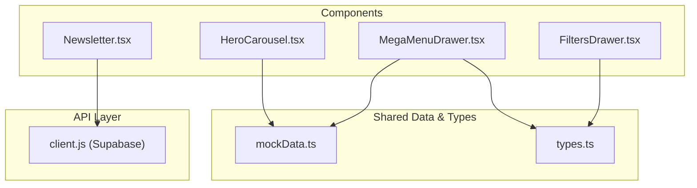
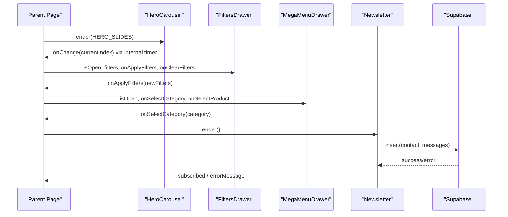
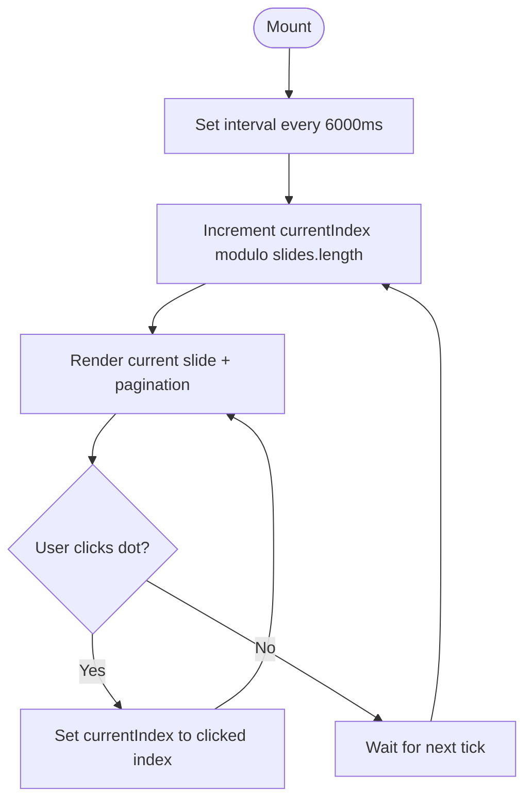
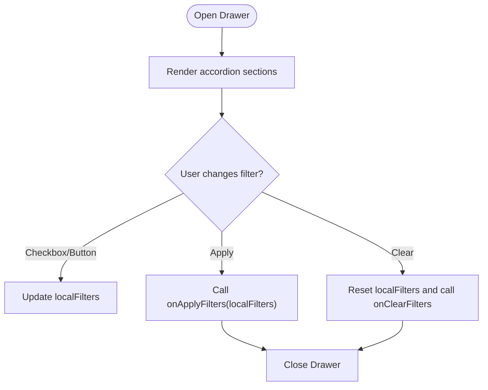
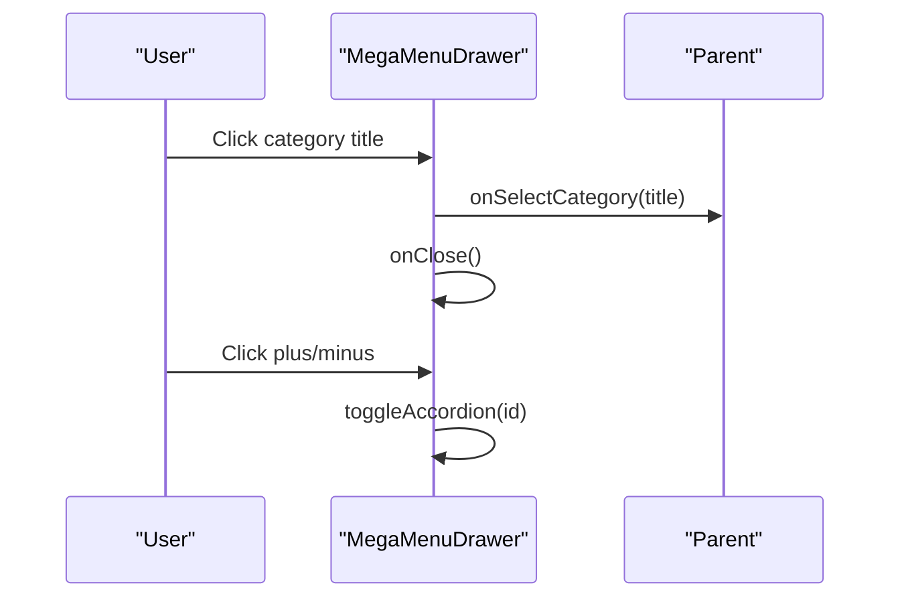
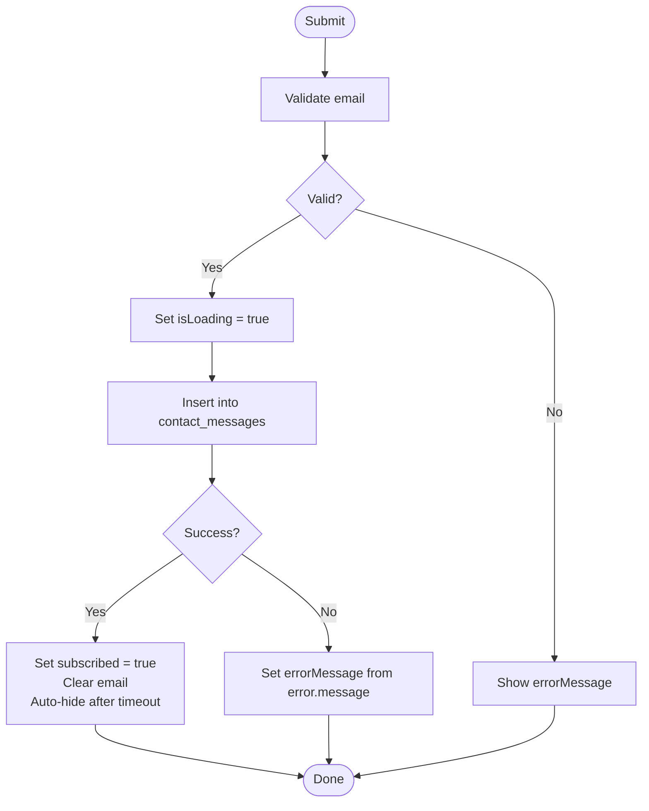
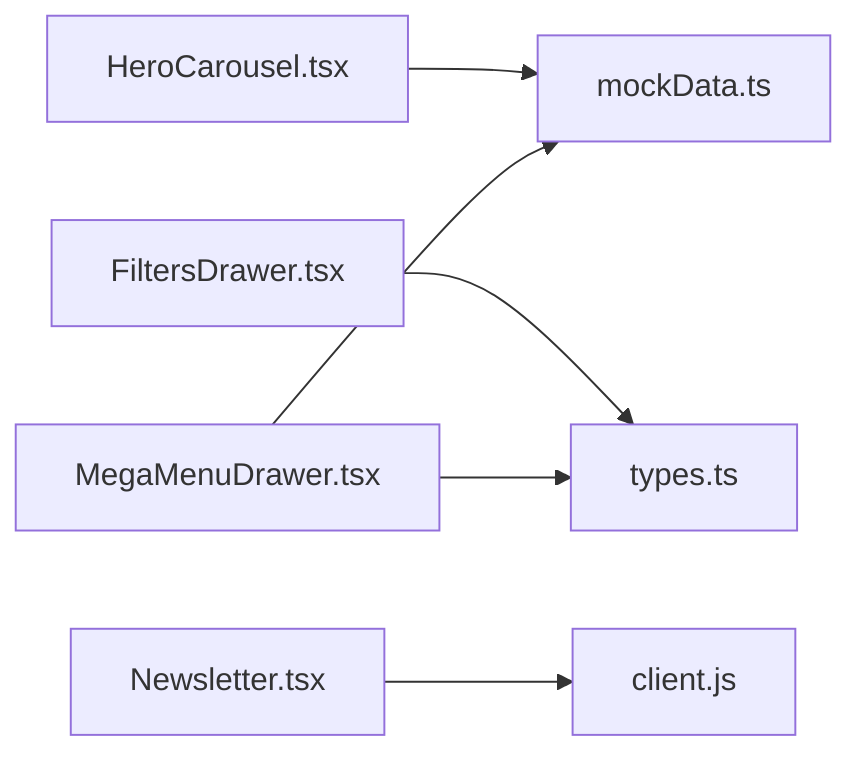

# Feature Components

<cite>
**Referenced Files in This Document**
- [HeroCarousel.tsx](file://components/HeroCarousel.tsx)
- [FiltersDrawer.tsx](file://components/FiltersDrawer.tsx)
- [MegaMenuDrawer.tsx](file://components/MegaMenuDrawer.tsx)
- [Newsletter.tsx](file://components/Newsletter.tsx)
- [mockData.ts](file://data/mockData.ts)
- [types.ts](file://types.ts)
- [client.js](file://src/api/client.js)
</cite>

## Table of Contents
1. [Introduction](#introduction)
2. [Project Structure](#project-structure)
3. [Core Components](#core-components)
4. [Architecture Overview](#architecture-overview)
5. [Detailed Component Analysis](#detailed-component-analysis)
6. [Dependency Analysis](#dependency-analysis)
7. [Performance Considerations](#performance-considerations)
8. [Troubleshooting Guide](#troubleshooting-guide)
9. [Conclusion](#conclusion)

## Introduction
This document provides a deep dive into four feature-specific components that implement complex user interactions and business logic:
- HeroCarousel: auto-play, pagination, and dynamic content loading from mock data.
- FiltersDrawer: product filtering with category selection, price ranges, and attribute-based filters.
- MegaMenuDrawer: nested navigation with accordion sections and optional search integration.
- Newsletter: subscription form with validation and API integration to Supabase.

The goal is to explain configuration options, event handling, state management patterns, and performance optimization techniques, along with practical examples for customization and extension.

## Project Structure
These components live under the components directory and consume shared types and mock data:
- HeroCarousel consumes HERO_SLIDES from mockData.
- FiltersDrawer uses FilterOptions type and local filter state.
- MegaMenuDrawer uses MEGA_MENU_CATEGORIES and Product type.
- Newsletter integrates with Supabase client to persist subscriptions.

**Diagram sources**
- [HeroCarousel.tsx:1-3](file://components/HeroCarousel.tsx#L1-L3)
- [MegaMenuDrawer.tsx:1-5](file://components/MegaMenuDrawer.tsx#L1-L5)
- [FiltersDrawer.tsx:1-4](file://components/FiltersDrawer.tsx#L1-L4)
- [Newsletter.tsx:1-4](file://components/Newsletter.tsx#L1-L4)
- [mockData.ts:416-438](file://data/mockData.ts#L416-L438)
- [types.ts:226-239](file://types.ts#L226-L239)
- [client.js](file://src/api/client.js)

**Section sources**
- [HeroCarousel.tsx:1-91](file://components/HeroCarousel.tsx#L1-L91)
- [FiltersDrawer.tsx:1-552](file://components/FiltersDrawer.tsx#L1-L552)
- [MegaMenuDrawer.tsx:1-195](file://components/MegaMenuDrawer.tsx#L1-L195)
- [Newsletter.tsx:1-113](file://components/Newsletter.tsx#L1-L113)
- [mockData.ts:388-438](file://data/mockData.ts#L388-L438)
- [types.ts:226-239](file://types.ts#L226-L239)

## Core Components
- HeroCarousel: Auto-advances slides every 6 seconds, renders images from HERO_SLIDES, and exposes clickable pagination dots.
- FiltersDrawer: Provides an overlay drawer with multiple filter categories (brand, fabric, price range, size, rating), local state for edits, and callbacks to apply or clear filters.
- MegaMenuDrawer: Renders a left-side drawer with quick links, category accordions, and optional product selection callback.
- Newsletter: Validates email input, shows loading/success/error states, and inserts records into Supabase contact_messages table.

**Section sources**
- [HeroCarousel.tsx:4-15](file://components/HeroCarousel.tsx#L4-L15)
- [FiltersDrawer.tsx:49-108](file://components/FiltersDrawer.tsx#L49-L108)
- [MegaMenuDrawer.tsx:13-31](file://components/MegaMenuDrawer.tsx#L13-L31)
- [Newsletter.tsx:5-52](file://components/Newsletter.tsx#L5-L52)

## Architecture Overview
The components follow a unidirectional data flow pattern:
- Parent components control visibility and pass props down.
- Child components manage local UI state and emit events via callbacks.
- Shared types define contracts for data structures like FilterOptions and Product.
- Mock data supplies static content for demonstration; real integrations can replace these sources.

**Diagram sources**
- [HeroCarousel.tsx:7-15](file://components/HeroCarousel.tsx#L7-L15)
- [FiltersDrawer.tsx:87-108](file://components/FiltersDrawer.tsx#L87-L108)
- [MegaMenuDrawer.tsx:24-31](file://components/MegaMenuDrawer.tsx#L24-L31)
- [Newsletter.tsx:33-51](file://components/Newsletter.tsx#L33-L51)

## Detailed Component Analysis

### HeroCarousel
HeroCarousel implements:
- Auto-play using setInterval advancing currentIndex cyclically over HERO_SLIDES.
- Pagination dots allowing manual navigation.
- Dynamic image resolution handling for both string and object image sources.

Key behaviors:
- Auto-advance interval: 6000ms.
- Slide transition: CSS opacity transitions with duration and easing.
- Accessibility: aria-labels for pagination buttons.

Configuration options:
- None exposed via props; behavior is internal.

Event handling:
- onClick on pagination dots updates currentIndex.

State management:
- Local state currentIndex controls active slide.

Performance considerations:
- Uses CSS transitions instead of JS animation loops.
- No touch/swipe support currently implemented.

Customization examples:
- Add swipe gestures by integrating a gesture library and updating currentIndex on swipe direction.
- Expose props for autoplay interval, pause on hover, and custom pagination indicators.

**Diagram sources**
- [HeroCarousel.tsx:7-15](file://components/HeroCarousel.tsx#L7-L15)
- [HeroCarousel.tsx:67-86](file://components/HeroCarousel.tsx#L67-L86)

**Section sources**
- [HeroCarousel.tsx:1-91](file://components/HeroCarousel.tsx#L1-L91)
- [mockData.ts:416-438](file://data/mockData.ts#L416-L438)

### FiltersDrawer
FiltersDrawer provides a comprehensive filtering interface:
- Accordion sections for brand, fabric, price range, size, reseller rating, and more.
- Local state mirrors parent-provided filters for editing before applying.
- Callbacks to apply or clear filters.

Key behaviors:
- toggleArrayFilter toggles array-based filters (brands, fabrics, sizes).
- handleApply calls onApplyFilters(localFilters) and closes the drawer.
- handleClear resets local filters to defaults and calls onClearFilters.

Configuration options:
- isOpen controls visibility.
- filters defines initial filter values.
- onApplyFilters and onClearFilters are required callbacks.
- totalResultsCount is provided but not rendered in current implementation.

Event handling:
- Clicking section headers toggles openSections.
- Checkboxes and buttons update localFilters accordingly.

State management:
- Local state includes localFilters and openSections.
- Parent owns canonical filter state; child syncs on mount via props.

Performance considerations:
- Avoids unnecessary re-renders by keeping local state isolated until apply.
- Some filter sections are commented out to reduce DOM complexity.

Customization examples:
- Enable color swatches by uncommenting the color section and wiring toggleArrayFilter('colors', name).
- Add debounced price range updates for smoother UX.
- Integrate server-side filtering by calling onApplyFilters with throttled updates.

**Diagram sources**
- [FiltersDrawer.tsx:74-108](file://components/FiltersDrawer.tsx#L74-L108)
- [FiltersDrawer.tsx:140-529](file://components/FiltersDrawer.tsx#L140-L529)

**Section sources**
- [FiltersDrawer.tsx:1-552](file://components/FiltersDrawer.tsx#L1-L552)
- [types.ts:226-239](file://types.ts#L226-L239)

### MegaMenuDrawer
MegaMenuDrawer renders a navigational drawer:
- Quick links for NEW ARRIVALS and SALE.
- Category accordions with expand/collapse behavior.
- Optional onSelectProduct callback for featured products.

Key behaviors:
- toggleAccordion manages openAccordion state.
- handleCategoryClick triggers onSelectCategory and closes the drawer.
- Best seller block is present but commented out; onSelectProduct is available if enabled.

Configuration options:
- isOpen controls visibility.
- onSelectCategory is required.
- onSelectProduct is optional.

Event handling:
- Clicking category title navigates via onSelectCategory.
- Clicking plus/minus toggles accordion expansion.

State management:
- Local state openAccordion tracks expanded category id.

Performance considerations:
- Only one accordion open at a time reduces layout shifts.
- Search box is commented out; enabling it would require additional state and possibly debounce.

Customization examples:
- Enable search by uncommenting the search input and adding a filtered view based on searchQuery.
- Integrate routing by replacing onSelectCategory with router.push('/category/:slug').
- Expand best seller block and wire onSelectProduct to navigate to product detail page.

**Diagram sources**
- [MegaMenuDrawer.tsx:24-31](file://components/MegaMenuDrawer.tsx#L24-L31)
- [MegaMenuDrawer.tsx:104-145](file://components/MegaMenuDrawer.tsx#L104-L145)

**Section sources**
- [MegaMenuDrawer.tsx:1-195](file://components/MegaMenuDrawer.tsx#L1-L195)
- [mockData.ts:388-414](file://data/mockData.ts#L388-L414)
- [types.ts:15-65](file://types.ts#L15-L65)

### Newsletter
Newsletter handles subscription form:
- Email validation using regex.
- Loading indicator during submission.
- Success message shown briefly after successful insertion.
- Error messages displayed when Supabase returns errors or exceptions occur.

Key behaviors:
- handleSubmit validates input, sets isLoading, and attempts supabase.from('contact_messages').insert({ email }).
- On success, sets subscribed flag and clears input; resets success after timeout.
- On error, sets errorMessage and logs details.

Configuration options:
- None exposed via props; component is self-contained.

Event handling:
- Form submit triggers validation and API call.
- Input change clears previous error messages.

State management:
- Local state includes email, subscribed, isLoading, errorMessage.

Integration points:
- Uses Supabase client imported from src/api/client.js.
- Inserts into contact_messages table.

Customization examples:
- Add CAPTCHA or honeypot field to prevent spam.
- Send confirmation emails via backend webhook triggered by Supabase.
- Persist preferences in localStorage to avoid duplicate submissions.

**Diagram sources**
- [Newsletter.tsx:11-52](file://components/Newsletter.tsx#L11-L52)
- [Newsletter.tsx:54-113](file://components/Newsletter.tsx#L54-L113)

**Section sources**
- [Newsletter.tsx:1-113](file://components/Newsletter.tsx#L1-L113)
- [client.js](file://src/api/client.js)

## Dependency Analysis
- HeroCarousel depends on mockData for slide content.
- FiltersDrawer depends on types.FilterOptions for shape consistency.
- MegaMenuDrawer depends on mockData for categories and types.Product for optional product selection.
- Newsletter depends on Supabase client for persistence.

**Diagram sources**
- [HeroCarousel.tsx:1-3](file://components/HeroCarousel.tsx#L1-L3)
- [FiltersDrawer.tsx:1-4](file://components/FiltersDrawer.tsx#L1-L4)
- [MegaMenuDrawer.tsx:1-5](file://components/MegaMenuDrawer.tsx#L1-L5)
- [Newsletter.tsx:1-4](file://components/Newsletter.tsx#L1-L4)

**Section sources**
- [HeroCarousel.tsx:1-91](file://components/HeroCarousel.tsx#L1-L91)
- [FiltersDrawer.tsx:1-552](file://components/FiltersDrawer.tsx#L1-L552)
- [MegaMenuDrawer.tsx:1-195](file://components/MegaMenuDrawer.tsx#L1-L195)
- [Newsletter.tsx:1-113](file://components/Newsletter.tsx#L1-L113)
- [mockData.ts:388-438](file://data/mockData.ts#L388-L438)
- [types.ts:226-239](file://types.ts#L226-L239)
- [client.js](file://src/api/client.js)

## Performance Considerations
- HeroCarousel:
  - Use CSS transitions for smoothness; avoid heavy JS animations.
  - Consider lazy-loading images if slides include large assets.
  - Pause autoplay on focus/hover for accessibility and battery savings.
- FiltersDrawer:
  - Debounce expensive operations like API calls triggered by onApplyFilters.
  - Keep only necessary filter sections visible to reduce DOM size.
  - Memoize computed counts (e.g., selected filter counts) if derived from large datasets.
- MegaMenuDrawer:
  - Limit number of items per category; virtualize if lists grow large.
  - Defer rendering of non-critical sections (e.g., best seller block) until needed.
- Newsletter:
  - Disable submit button while loading to prevent duplicate requests.
  - Handle network errors gracefully and provide retry mechanisms.

[No sources needed since this section provides general guidance]

## Troubleshooting Guide
- HeroCarousel:
  - If slides do not auto-advance, verify useEffect cleanup and interval timing.
  - Ensure HERO_SLIDES contains valid image paths or objects with src fields.
- FiltersDrawer:
  - If filters do not apply, confirm onApplyFilters is wired correctly in parent.
  - Verify FilterOptions structure matches expected shape.
- MegaMenuDrawer:
  - If categories do not expand, check openAccordion state and toggleAccordion logic.
  - Ensure onSelectCategory is provided and handled by parent.
- Newsletter:
  - If subscription fails, inspect Supabase RLS policies and table schema for contact_messages.
  - Validate email format and ensure Supabase client is initialized properly.

**Section sources**
- [HeroCarousel.tsx:7-15](file://components/HeroCarousel.tsx#L7-L15)
- [FiltersDrawer.tsx:87-108](file://components/FiltersDrawer.tsx#L87-L108)
- [MegaMenuDrawer.tsx:24-31](file://components/MegaMenuDrawer.tsx#L24-L31)
- [Newsletter.tsx:33-51](file://components/Newsletter.tsx#L33-L51)

## Conclusion
These four components demonstrate robust patterns for managing complex UI interactions and business logic:
- HeroCarousel showcases simple auto-play and pagination with minimal state.
- FiltersDrawer illustrates controlled local state with parent-driven application of filters.
- MegaMenuDrawer provides accessible navigation with accordion patterns and optional product selection.
- Newsletter integrates form validation with asynchronous API calls and user feedback.

By following the customization examples and performance recommendations, you can extend these components to meet specific use cases while maintaining clarity and efficiency.