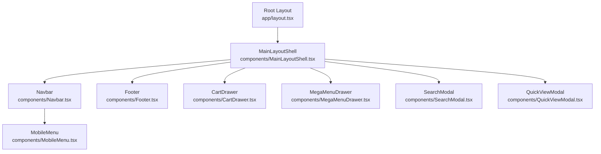
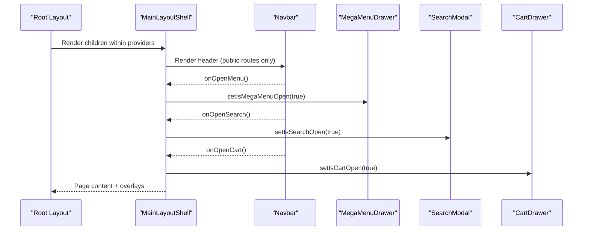
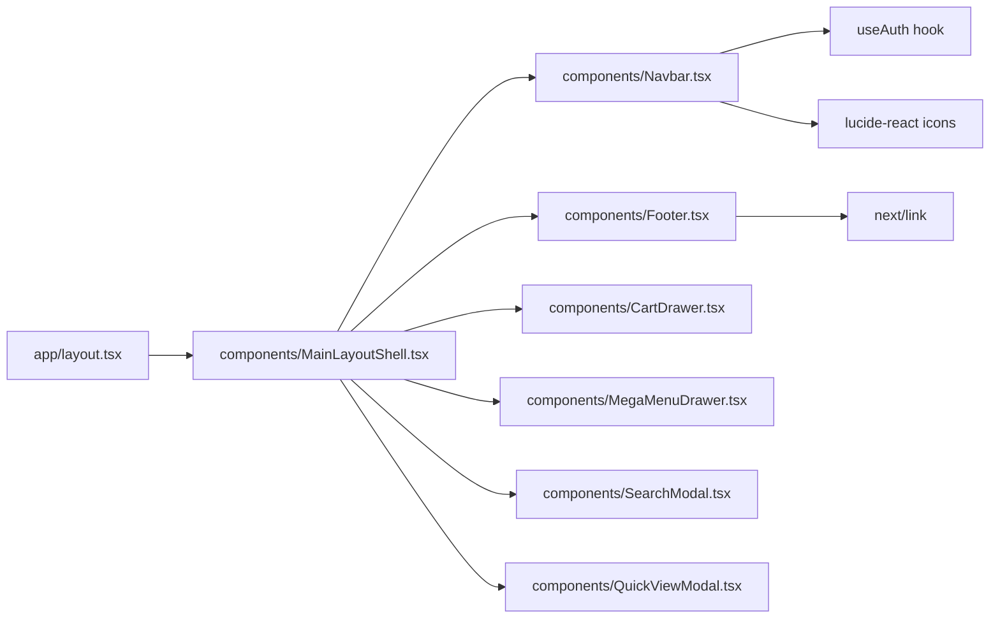

# Layout Components

<cite>
**Referenced Files in This Document**
- [app/layout.tsx](file://app/layout.tsx)
- [components/MainLayoutShell.tsx](file://components/MainLayoutShell.tsx)
- [components/Navbar.tsx](file://components/Navbar.tsx)
- [components/Footer.tsx](file://components/Footer.tsx)
- [components/MegaMenuDrawer.tsx](file://components/MegaMenuDrawer.tsx)
- [components/SearchModal.tsx](file://components/SearchModal.tsx)
- [components/CartDrawer.tsx](file://components/CartDrawer.tsx)
- [components/QuickViewModal.tsx](file://components/QuickViewModal.tsx)
- [components/MobileMenu.tsx](file://components/MobileMenu.tsx)
</cite>

## Table of Contents
1. [Introduction](#introduction)
2. [Project Structure](#project-structure)
3. [Core Components](#core-components)
4. [Architecture Overview](#architecture-overview)
5. [Detailed Component Analysis](#detailed-component-analysis)
6. [Dependency Analysis](#dependency-analysis)
7. [Performance Considerations](#performance-considerations)
8. [Troubleshooting Guide](#troubleshooting-guide)
9. [Conclusion](#conclusion)
10. [Appendices](#appendices)

## Introduction
This document explains the layout components that provide the global structure of the application. It focuses on:
- MainLayoutShell as the primary layout wrapper for page content, navigation, and footer sections
- Navbar functionality including responsive design, mobile menu integration, and navigation state management
- Footer structure, legal links, and social media integration
- How these components collaborate to deliver consistent layouts across all pages
- Props interfaces, customization options, and responsive behavior patterns
- Examples of extending layouts and integrating with Next.js App Router

## Project Structure
The layout system is rooted at the application’s root layout and composed from reusable UI components:
- Root layout wraps providers and renders MainLayoutShell
- MainLayoutShell composes Navbar, Footer, and shared interactive overlays (CartDrawer, MegaMenuDrawer, SearchModal, QuickViewModal)
- Navbar provides responsive header controls and integrates with MobileMenu or MegaMenuDrawer
- Footer exposes legal and contact information plus social links

**Diagram sources**
- [app/layout.tsx:20-47](file://app/layout.tsx#L20-L47)
- [components/MainLayoutShell.tsx:13-91](file://components/MainLayoutShell.tsx#L13-L91)
- [components/Navbar.tsx:20-88](file://components/Navbar.tsx#L20-L88)
- [components/Footer.tsx:10-87](file://components/Footer.tsx#L10-L87)
- [components/MegaMenuDrawer.tsx:13-44](file://components/MegaMenuDrawer.tsx#L13-L44)
- [components/SearchModal.tsx:12-39](file://components/SearchModal.tsx#L12-L39)
- [components/CartDrawer.tsx:18-155](file://components/CartDrawer.tsx#L18-L155)
- [components/QuickViewModal.tsx:13-43](file://components/QuickViewModal.tsx#L13-L43)
- [components/MobileMenu.tsx:24-40](file://components/MobileMenu.tsx#L24-L40)

**Section sources**
- [app/layout.tsx:20-47](file://app/layout.tsx#L20-L47)
- [components/MainLayoutShell.tsx:13-91](file://components/MainLayoutShell.tsx#L13-L91)

## Core Components
- MainLayoutShell: Orchestrates public vs reseller portal rendering, mounts shared drawers/modals, and manages global navigation actions.
- Navbar: Responsive header with scroll-aware styling, account routing, and event hooks for menu/search/cart.
- Footer: Contact info, legal links, seller CTA, and social media links.
- Shared Overlays: CartDrawer, MegaMenuDrawer, SearchModal, QuickViewModal are mounted by MainLayoutShell and driven by global app context.

Key responsibilities:
- Conditional rendering based on route segments (e.g., /reseller, /dashboard)
- Centralized navigation handlers (home, category, checkout)
- Consistent spacing and z-index layering for overlays

**Section sources**
- [components/MainLayoutShell.tsx:13-91](file://components/MainLayoutShell.tsx#L13-L91)
- [components/Navbar.tsx:20-88](file://components/Navbar.tsx#L20-L88)
- [components/Footer.tsx:10-87](file://components/Footer.tsx#L10-L87)

## Architecture Overview
The layout architecture follows a top-down composition model:
- Root layout initializes providers and injects MainLayoutShell
- MainLayoutShell composes Navbar and Footer for public routes and mounts shared overlays
- Navbar triggers events handled by MainLayoutShell to open MegaMenuDrawer, SearchModal, or CartDrawer
- Footer exposes callbacks for reseller signup/login flows

**Diagram sources**
- [app/layout.tsx:20-47](file://app/layout.tsx#L20-L47)
- [components/MainLayoutShell.tsx:64-133](file://components/MainLayoutShell.tsx#L64-L133)
- [components/Navbar.tsx:92-182](file://components/Navbar.tsx#L92-L182)
- [components/MegaMenuDrawer.tsx:13-44](file://components/MegaMenuDrawer.tsx#L13-L44)
- [components/SearchModal.tsx:12-39](file://components/SearchModal.tsx#L12-L39)
- [components/CartDrawer.tsx:18-155](file://components/CartDrawer.tsx#L18-L155)

## Detailed Component Analysis

### MainLayoutShell
Role:
- Primary layout wrapper that organizes page content, navigation, and footer sections
- Determines whether to render public layout or reseller portal layout
- Mounts shared interactive overlays (cart, mega menu, search, quick view)
- Provides centralized navigation helpers (home, category, checkout, reseller login)

Responsibilities:
- Route detection for reseller portal and hero style
- Event wiring between Navbar and overlays
- Global toast notification rendering

Props interface:
- children: React.ReactNode

Behavior highlights:
- Hides Navbar and Footer on reseller portal routes (/reseller, /dashboard)
- Applies top padding to main content when not on home page and not in reseller portal
- Scrolls to top on navigation actions

Extensibility:
- Add new overlays by mounting them inside MainLayoutShell and exposing toggle functions via app context
- Introduce additional route-based layout variants by extending pathname checks

**Section sources**
- [components/MainLayoutShell.tsx:13-91](file://components/MainLayoutShell.tsx#L13-L91)
- [components/MainLayoutShell.tsx:93-141](file://components/MainLayoutShell.tsx#L93-L141)

### Navbar
Role:
- Responsive header providing navigation entry points and user actions
- Scroll-aware visual state (solid background and blur after scrolling)
- Integrates with MobileMenu or MegaMenuDrawer through props

Props interface:
- onOpenMenu: () => void
- onOpenSearch: () => void
- onOpenCart: () => void
- cartCount: number
- wishlistCount: number
- onNavigateHome?: () => void
- onNavigateCategory?: (category: string) => void
- hasDarkHero?: boolean

Responsive behavior:
- On small screens, shows compact icons; on larger screens, reveals “Menu” label
- Account link is visible on mobile and desktop
- Badge counters adapt sizes per breakpoint

Navigation state management:
- Uses useAuth to determine account href based on user role
- Controls header appearance based on scroll position and hero theme

Integration points:
- Triggers MegaMenuDrawer via onOpenMenu
- Opens SearchModal via onOpenSearch
- Opens CartDrawer via onOpenCart

**Section sources**
- [components/Navbar.tsx:9-18](file://components/Navbar.tsx#L9-L18)
- [components/Navbar.tsx:20-88](file://components/Navbar.tsx#L20-L88)
- [components/Navbar.tsx:92-182](file://components/Navbar.tsx#L92-L182)

### Footer
Role:
- Provides contact details, legal links, customer care links, and social media integration
- Exposes callbacks for reseller signup and seller login flows

Props interface:
- onNavigateReseller?: () => void
- onNavigateSellerLogin?: () => void

Structure:
- Top section with columns for contact, information, and customer care/sellers
- Bottom section with copyright text
- Social links for YouTube, Instagram, TikTok

Legal and social:
- Links to Privacy Policy, Terms and Conditions, About, Contact, Track Order
- External social links with rel="noopener noreferrer"

Customization:
- Replace or add links in the Information and Customer Care columns
- Update social URLs and labels
- Adjust branding text and address

**Section sources**
- [components/Footer.tsx:5-8](file://components/Footer.tsx#L5-L8)
- [components/Footer.tsx:10-87](file://components/Footer.tsx#L10-L87)

### Interactive Overlays (Mounted by MainLayoutShell)
- MegaMenuDrawer: Full-screen left drawer with category accordion and quick links
- SearchModal: Centered modal with product search and popular suggestions
- CartDrawer: Right-side drawer with stock validation, quantity controls, and checkout
- QuickViewModal: Product quick-view dialog with size selection and add-to-cart

These overlays are controlled by flags exposed via app context and rendered unconditionally by MainLayoutShell.

**Section sources**
- [components/MegaMenuDrawer.tsx:6-11](file://components/MegaMenuDrawer.tsx#L6-L11)
- [components/SearchModal.tsx:6-10](file://components/SearchModal.tsx#L6-L10)
- [components/CartDrawer.tsx:9-16](file://components/CartDrawer.tsx#L9-L16)
- [components/QuickViewModal.tsx:5-11](file://components/QuickViewModal.tsx#L5-L11)

## Dependency Analysis
High-level dependencies among layout components:
- Root layout depends on MainLayoutShell
- MainLayoutShell depends on Navbar, Footer, and overlay components
- Navbar depends on authentication hook and icon library
- Footer uses Next.js Link and external social URLs
- Overlays depend on app context for state and data utilities

**Diagram sources**
- [app/layout.tsx:20-47](file://app/layout.tsx#L20-L47)
- [components/MainLayoutShell.tsx:1-11](file://components/MainLayoutShell.tsx#L1-L11)
- [components/Navbar.tsx:1-8](file://components/Navbar.tsx#L1-L8)
- [components/Footer.tsx:1-3](file://components/Footer.tsx#L1-L3)

**Section sources**
- [app/layout.tsx:20-47](file://app/layout.tsx#L20-L47)
- [components/MainLayoutShell.tsx:1-11](file://components/MainLayoutShell.tsx#L1-L11)
- [components/Navbar.tsx:1-8](file://components/Navbar.tsx#L1-L8)
- [components/Footer.tsx:1-3](file://components/Footer.tsx#L1-L3)

## Performance Considerations
- Navbar scroll handling uses requestAnimationFrame to avoid layout thrashing during frequent scroll events
- Overlays are conditionally rendered based on flags to minimize unnecessary DOM
- CartDrawer validates stock against fresh data on open to prevent invalid quantities
- Avoid heavy computations in render paths; keep list filtering minimal and memoize where appropriate

[No sources needed since this section provides general guidance]

## Troubleshooting Guide
Common issues and resolutions:
- Navbar not hiding on reseller routes: Ensure pathname checks include both /reseller and /dashboard
- Overlays not opening: Verify that event handlers from Navbar are wired to MainLayoutShell’s setters
- CartDrawer showing incorrect stock: Confirm that fresh product data is fetched and mapped correctly before rendering
- Footer seller CTA not working: Provide either onNavigateReseller or onNavigateSellerLogin from MainLayoutShell

Validation tips:
- Check console for errors when syncing stock in CartDrawer
- Validate aria-labels and accessibility attributes on interactive elements
- Ensure external links have rel="noopener noreferrer"

**Section sources**
- [components/MainLayoutShell.tsx:35-62](file://components/MainLayoutShell.tsx#L35-L62)
- [components/CartDrawer.tsx:29-105](file://components/CartDrawer.tsx#L29-L105)
- [components/Footer.tsx:49-75](file://components/Footer.tsx#L49-L75)

## Conclusion
The layout system centers around MainLayoutShell, which orchestrates Navbar, Footer, and shared overlays to deliver a consistent, responsive experience across public pages while excluding these elements in the reseller portal. Navbar provides scroll-aware visuals and integrates with mobile menus and overlays. Footer consolidates legal and social links and exposes seller-related navigation. Together, they form a cohesive foundation for the application’s global structure.

[No sources needed since this section summarizes without analyzing specific files]

## Appendices

### Props Interfaces Summary
- MainLayoutShell
  - children: React.ReactNode
- Navbar
  - onOpenMenu: () => void
  - onOpenSearch: () => void
  - onOpenCart: () => void
  - cartCount: number
  - wishlistCount: number
  - onNavigateHome?: () => void
  - onNavigateCategory?: (category: string) => void
  - hasDarkHero?: boolean
- Footer
  - onNavigateReseller?: () => void
  - onNavigateSellerLogin?: () => void
- MegaMenuDrawer
  - isOpen: boolean
  - onClose: () => void
  - onSelectCategory: (categoryName: string) => void
  - onSelectProduct?: (product: any) => void
- SearchModal
  - isOpen: boolean
  - onClose: () => void
  - onSelectProduct: (product: any) => void
- CartDrawer
  - isOpen: boolean
  - onClose: () => void
  - items: CartItem[]
  - onUpdateQuantity: (key: string, quantity: number, size?: string, colorId?: string | null) => void
  - onRemoveItem: (key: string, size?: string, colorId?: string | null) => void
  - onCheckout: () => void
- QuickViewModal
  - product: Product | null
  - onClose: () => void
  - onAddToCart: (product: Product, size: string, quantity: number) => void
  - onToggleWishlist: (productId: string) => void
  - isWishlisted: boolean

**Section sources**
- [components/MainLayoutShell.tsx:13-13](file://components/MainLayoutShell.tsx#L13-L13)
- [components/Navbar.tsx:9-18](file://components/Navbar.tsx#L9-L18)
- [components/Footer.tsx:5-8](file://components/Footer.tsx#L5-L8)
- [components/MegaMenuDrawer.tsx:6-11](file://components/MegaMenuDrawer.tsx#L6-L11)
- [components/SearchModal.tsx:6-10](file://components/SearchModal.tsx#L6-L10)
- [components/CartDrawer.tsx:9-16](file://components/CartDrawer.tsx#L9-L16)
- [components/QuickViewModal.tsx:5-11](file://components/QuickViewModal.tsx#L5-L11)

### Extending Layouts and Integrating with Next.js App Router
- Wrap your pages with MainLayoutShell via the root layout to ensure consistent headers and footers
- For custom routes requiring different layouts, create nested layouts under app folders and compose MainLayoutShell selectively
- Use pathname checks to conditionally render Navbar/Footer for public routes and alternative layouts for dashboards
- Integrate with App Router features like metadata and analytics at the root layout level

Example pattern:
- Root layout sets metadata, providers, and renders MainLayoutShell
- Pages import and render their content inside MainLayoutShell automatically

**Section sources**
- [app/layout.tsx:10-18](file://app/layout.tsx#L10-L18)
- [app/layout.tsx:20-47](file://app/layout.tsx#L20-L47)
- [components/MainLayoutShell.tsx:35-41](file://components/MainLayoutShell.tsx#L35-L41)