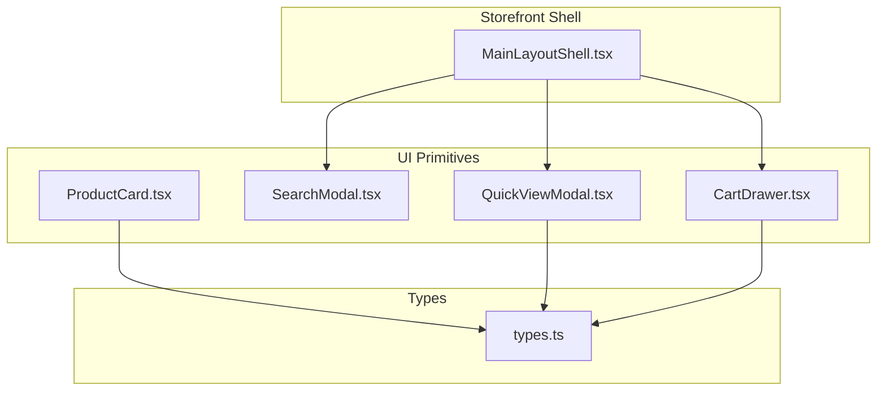
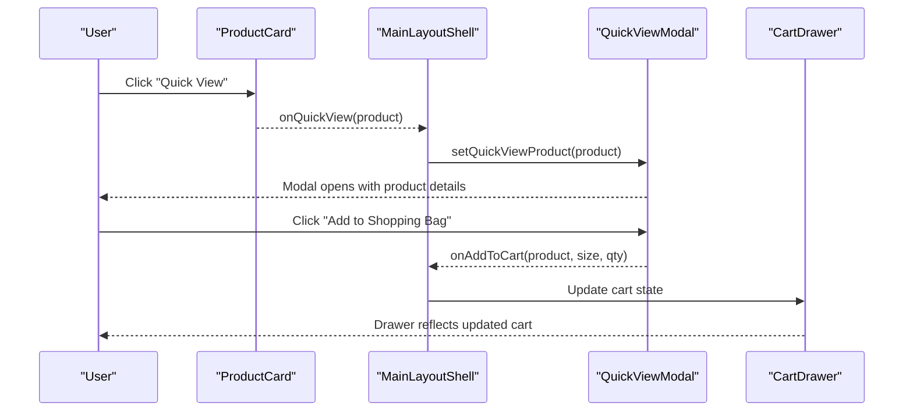
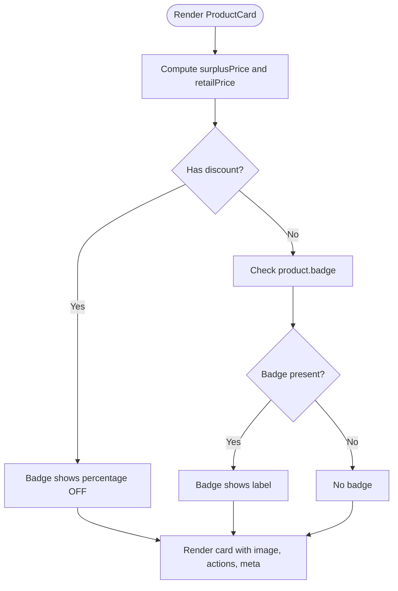
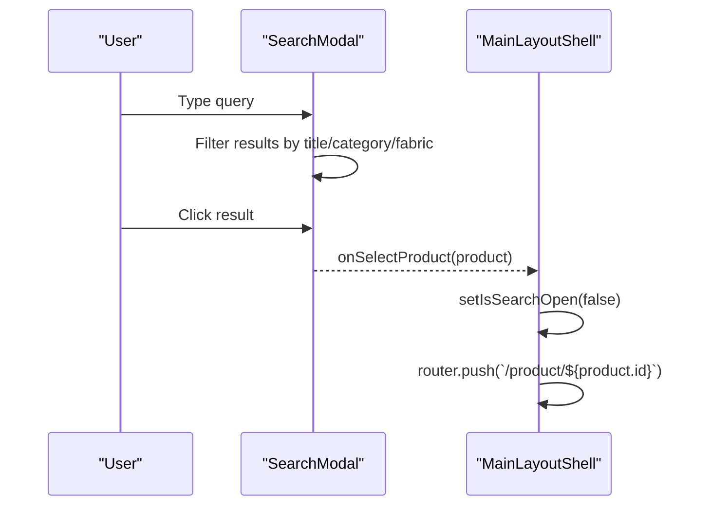
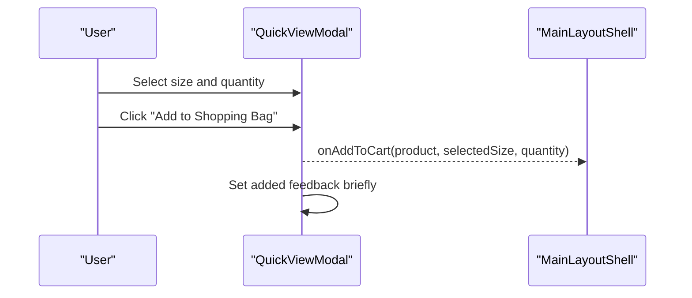
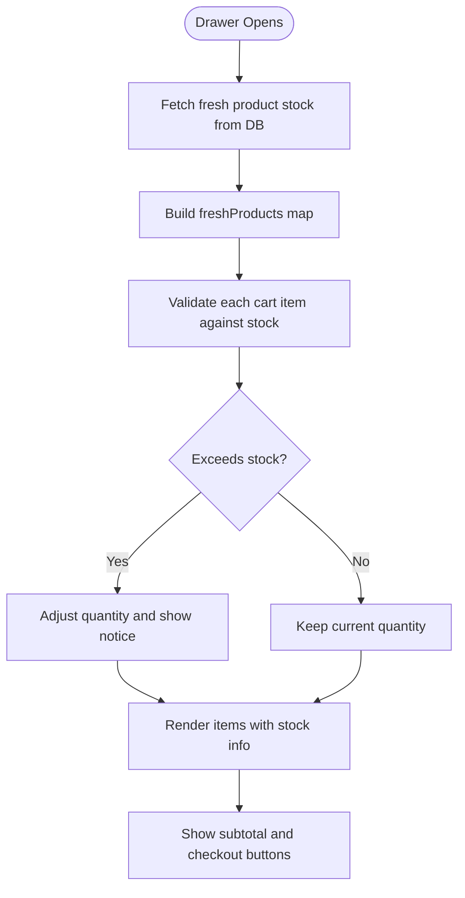
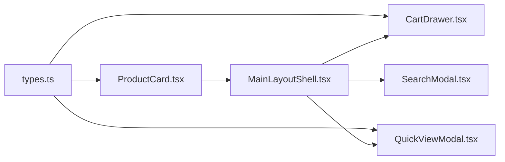

# UI Primitives

<cite>
**Referenced Files in This Document**
- [ProductCard.tsx](file://components/ProductCard.tsx)
- [SearchModal.tsx](file://components/SearchModal.tsx)
- [QuickViewModal.tsx](file://components/QuickViewModal.tsx)
- [CartDrawer.tsx](file://components/CartDrawer.tsx)
- [MainLayoutShell.tsx](file://components/MainLayoutShell.tsx)
- [types.ts](file://types.ts)
</cite>

## Table of Contents
1. [Introduction](#introduction)
2. [Project Structure](#project-structure)
3. [Core Components](#core-components)
4. [Architecture Overview](#architecture-overview)
5. [Detailed Component Analysis](#detailed-component-analysis)
6. [Dependency Analysis](#dependency-analysis)
7. [Performance Considerations](#performance-considerations)
8. [Troubleshooting Guide](#troubleshooting-guide)
9. [Conclusion](#conclusion)

## Introduction
This document describes the core UI primitive components that act as building blocks across the storefront: ProductCard, SearchModal, QuickViewModal, and CartDrawer. It explains their responsibilities, props, events, styling patterns, accessibility considerations, and integration points with parent components such as MainLayoutShell. The goal is to help developers compose these primitives consistently while maintaining responsive design, performance, and user experience.

## Project Structure
The UI primitives live under the components directory and are orchestrated by a layout shell that manages global state for modals, drawers, cart, search, and quick view interactions.

**Diagram sources**
- [MainLayoutShell.tsx:94-133](file://components/MainLayoutShell.tsx#L94-L133)
- [ProductCard.tsx:7-16](file://components/ProductCard.tsx#L7-L16)
- [SearchModal.tsx:6-10](file://components/SearchModal.tsx#L6-L10)
- [QuickViewModal.tsx:5-11](file://components/QuickViewModal.tsx#L5-L11)
- [CartDrawer.tsx:9-16](file://components/CartDrawer.tsx#L9-L16)
- [types.ts:15-65](file://types.ts#L15-L65)

**Section sources**
- [MainLayoutShell.tsx:1-145](file://components/MainLayoutShell.tsx#L1-L145)
- [types.ts:1-272](file://types.ts#L1-L272)

## Core Components
- ProductCard: Displays product image(s), pricing, badges, ratings, reseller link, and provides actions like quick view, add-to-cart, and wishlist toggle.
- SearchModal: Fullscreen overlay with search input, suggestions, and result list; navigates to product detail on selection.
- QuickViewModal: Overlay showing product details, size/option selection, quantity, add-to-cart, and wishlist toggle.
- CartDrawer: Slide-out panel displaying cart items, stock-aware quantity controls, subtotal, and checkout navigation.

These primitives are composed by MainLayoutShell, which wires up open/close states, data, and event handlers.

**Section sources**
- [ProductCard.tsx:7-16](file://components/ProductCard.tsx#L7-L16)
- [SearchModal.tsx:6-10](file://components/SearchModal.tsx#L6-L10)
- [QuickViewModal.tsx:5-11](file://components/QuickViewModal.tsx#L5-L11)
- [CartDrawer.tsx:9-16](file://components/CartDrawer.tsx#L9-L16)
- [MainLayoutShell.tsx:94-133](file://components/MainLayoutShell.tsx#L94-L133)

## Architecture Overview
The application uses a top-down composition model:
- MainLayoutShell owns global UI state (cart open, search open, quick view product).
- It renders CartDrawer, SearchModal, and QuickViewModal with appropriate props.
- ProductCard emits events to parent handlers for quick view, add-to-cart, and wishlist toggles.
- Types define shared contracts for Product, CartItem, and related structures.

**Diagram sources**
- [ProductCard.tsx:153-179](file://components/ProductCard.tsx#L153-L179)
- [MainLayoutShell.tsx:116-133](file://components/MainLayoutShell.tsx#L116-L133)
- [QuickViewModal.tsx:28-32](file://components/QuickViewModal.tsx#L28-L32)
- [CartDrawer.tsx:18-25](file://components/CartDrawer.tsx#L18-L25)

## Detailed Component Analysis

### ProductCard
Purpose:
- Display product imagery with optional hover image.
- Show pricing logic including surplus price, retail price, discount badge, currency, and rating.
- Provide interactive actions: navigate to product page, quick view, add to cart, wishlist toggle, and reseller store navigation.

Key behaviors:
- Image handling supports both string URLs and object-based images with fallbacks.
- Badge computation ensures a single clean badge, avoiding overlapping discount and badge text.
- Responsive action overlays: desktop hover actions and mobile floating add-to-cart button.
- Optional priority prop controls eager vs lazy image loading.

Props:
- product: Product
- onQuickView?: (product) => void
- onAddToCart?: (product) => void
- onToggleWishlist?: (productId) => void
- isWishlisted?: boolean
- onSelectProduct?: (product) => void
- onSelectReseller?: (resellerId) => void
- priority?: boolean

Events:
- Clicking card or title triggers onSelectProduct or default navigation to /product/:id.
- Wishlist button calls onToggleWishlist with productId.
- Desktop “Quick View” button calls onQuickView(product).
- Add-to-cart buttons call onAddToCart(product).
- Reseller name click either calls onSelectReseller or navigates to store URL.

Styling and responsiveness:
- Uses Tailwind utility classes for spacing, typography, shadows, and transitions.
- Aspect ratio image container with hover scale effect.
- Mobile-first approach with md:hidden and md:flex for different screen sizes.

Accessibility:
- Buttons include aria-label where appropriate.
- Images have alt text from product.title.
- Interactive elements are keyboard-focusable via native HTML semantics.

Usage example:
- Compose within collection or trending grids.
- Pass parent handlers for quick view, add-to-cart, and wishlist management.

**Diagram sources**
- [ProductCard.tsx:38-81](file://components/ProductCard.tsx#L38-L81)
- [ProductCard.tsx:90-195](file://components/ProductCard.tsx#L90-L195)

**Section sources**
- [ProductCard.tsx:7-16](file://components/ProductCard.tsx#L7-L16)
- [ProductCard.tsx:30-48](file://components/ProductCard.tsx#L30-L48)
- [ProductCard.tsx:55-81](file://components/ProductCard.tsx#L55-L81)
- [ProductCard.tsx:90-195](file://components/ProductCard.tsx#L90-L195)
- [ProductCard.tsx:197-269](file://components/ProductCard.tsx#L197-L269)

### SearchModal
Purpose:
- Provide an overlay modal for searching products by title, category, or fabric.
- Offer popular search suggestions when no query is entered.
- Navigate to product detail upon selecting a result.

Lifecycle:
- Controlled by isOpen prop; returns null when closed.
- Local state holds current query.
- Results computed from mock data arrays filtered by query.

Accessibility:
- Backdrop closes modal on click.
- Input autoFocus for immediate typing.
- Close button allows dismissal.

Keyboard navigation:
- Escape key not explicitly handled here; focus management relies on browser defaults.

Styling and responsiveness:
- Fixed overlay with backdrop blur.
- Max width and vertical padding adapt across breakpoints.
- Scrollable results area capped at viewport height.

Integration:
- Parent passes isOpen, onClose, and onSelectProduct.
- onSelectProduct typically sets route to product detail and closes modal.

**Diagram sources**
- [SearchModal.tsx:17-28](file://components/SearchModal.tsx#L17-L28)
- [SearchModal.tsx:86-92](file://components/SearchModal.tsx#L86-L92)
- [MainLayoutShell.tsx:116-123](file://components/MainLayoutShell.tsx#L116-L123)

**Section sources**
- [SearchModal.tsx:6-10](file://components/SearchModal.tsx#L6-L10)
- [SearchModal.tsx:17-28](file://components/SearchModal.tsx#L17-L28)
- [SearchModal.tsx:30-57](file://components/SearchModal.tsx#L30-L57)
- [SearchModal.tsx:59-115](file://components/SearchModal.tsx#L59-L115)
- [MainLayoutShell.tsx:116-123](file://components/MainLayoutShell.tsx#L116-L123)

### QuickViewModal
Purpose:
- Present a detailed product view without navigating away.
- Allow size/option selection, quantity adjustment, add-to-cart, and wishlist toggle.

Lifecycle:
- Controlled by product prop; returns null if no product.
- Local state tracks selectedSize, quantity, and temporary added feedback.

Accessibility:
- Backdrop closes modal on click.
- Close button available.
- Focus management not implemented internally; relies on parent or browser defaults.

Styling and responsiveness:
- Two-column layout on medium screens; stacked on small screens.
- Action buttons provide visual feedback after adding to cart.

Integration:
- Parent passes product, onClose, onAddToCart, onToggleWishlist, and isWishlisted.
- onAddToCart receives product, selected size, and quantity.

**Diagram sources**
- [QuickViewModal.tsx:22-32](file://components/QuickViewModal.tsx#L22-L32)
- [QuickViewModal.tsx:92-111](file://components/QuickViewModal.tsx#L92-L111)
- [QuickViewModal.tsx:117-135](file://components/QuickViewModal.tsx#L117-L135)
- [MainLayoutShell.tsx:125-133](file://components/MainLayoutShell.tsx#L125-L133)

**Section sources**
- [QuickViewModal.tsx:5-11](file://components/QuickViewModal.tsx#L5-L11)
- [QuickViewModal.tsx:22-32](file://components/QuickViewModal.tsx#L22-L32)
- [QuickViewModal.tsx:34-64](file://components/QuickViewModal.tsx#L34-L64)
- [QuickViewModal.tsx:66-111](file://components/QuickViewModal.tsx#L66-L111)
- [QuickViewModal.tsx:114-160](file://components/QuickViewModal.tsx#L114-L160)
- [MainLayoutShell.tsx:125-133](file://components/MainLayoutShell.tsx#L125-L133)

### CartDrawer
Purpose:
- Display cart items in a slide-out drawer with real-time stock validation.
- Provide quantity controls clamped to available stock.
- Show subtotal, free shipping threshold progress, and checkout navigation.

Lifecycle:
- Controlled by isOpen prop; returns null when closed.
- On open, fetches fresh product stock from database and updates notices and item constraints.

Real-time updates:
- Queries Supabase for latest product quantities and variants.
- Computes max allowed stock per line item using helper utilities.
- Adjusts quantities automatically if exceeding available stock and displays notices.

Checkout integration:
- onCheckout triggers parent navigation to checkout page and closes drawer.

Accessibility:
- Backdrop closes drawer on click.
- Close button available.
- Focus management not implemented internally; relies on parent or browser defaults.

Styling and responsiveness:
- Right-aligned fixed drawer with backdrop blur.
- Scrollable item list and sticky footer with checkout actions.

Integration:
- Parent passes isOpen, onClose, items, onUpdateQuantity, onRemoveItem, onCheckout.
- MainLayoutShell wires these to global cart state and navigation.

**Diagram sources**
- [CartDrawer.tsx:29-105](file://components/CartDrawer.tsx#L29-L105)
- [CartDrawer.tsx:109-136](file://components/CartDrawer.tsx#L109-L136)
- [CartDrawer.tsx:138-145](file://components/CartDrawer.tsx#L138-L145)
- [CartDrawer.tsx:146-349](file://components/CartDrawer.tsx#L146-L349)

**Section sources**
- [CartDrawer.tsx:9-16](file://components/CartDrawer.tsx#L9-L16)
- [CartDrawer.tsx:29-105](file://components/CartDrawer.tsx#L29-L105)
- [CartDrawer.tsx:109-136](file://components/CartDrawer.tsx#L109-L136)
- [CartDrawer.tsx:138-145](file://components/CartDrawer.tsx#L138-L145)
- [CartDrawer.tsx:146-349](file://components/CartDrawer.tsx#L146-L349)
- [MainLayoutShell.tsx:94-101](file://components/MainLayoutShell.tsx#L94-L101)

## Dependency Analysis
Shared types:
- Product defines fields used across ProductCard, QuickViewModal, and CartDrawer.
- CartItem and CartItemColor define cart line structure consumed by CartDrawer.

Component coupling:
- ProductCard depends on Product type and Next.js router for navigation.
- SearchModal depends on mock data arrays and Product type.
- QuickViewModal depends on Product type and parent-provided handlers.
- CartDrawer depends on Product, CartItem, CartItemColor, stock utilities, color utilities, and Supabase client.

Parent orchestration:
- MainLayoutShell composes all primitives and centralizes state and navigation.

**Diagram sources**
- [types.ts:15-65](file://types.ts#L15-L65)
- [types.ts:258-270](file://types.ts#L258-L270)
- [ProductCard.tsx:1-5](file://components/ProductCard.tsx#L1-L5)
- [SearchModal.tsx:1-4](file://components/SearchModal.tsx#L1-L4)
- [QuickViewModal.tsx:1-3](file://components/QuickViewModal.tsx#L1-L3)
- [CartDrawer.tsx:1-7](file://components/CartDrawer.tsx#L1-L7)
- [MainLayoutShell.tsx:7-10](file://components/MainLayoutShell.tsx#L7-L10)

**Section sources**
- [types.ts:15-65](file://types.ts#L15-L65)
- [types.ts:258-270](file://types.ts#L258-L270)
- [MainLayoutShell.tsx:7-10](file://components/MainLayoutShell.tsx#L7-L10)

## Performance Considerations
- ProductCard uses React.memo to prevent unnecessary re-renders when props remain stable.
- Image loading strategy: priority prop enables eager loading for critical cards; otherwise lazy loading reduces initial payload.
- Fallback images handle broken URLs gracefully.
- CartDrawer performs a single Supabase query on open to refresh stock, minimizing repeated network calls.
- Quantity changes clamp values to avoid invalid states and reduce downstream validation overhead.

[No sources needed since this section provides general guidance]

## Troubleshooting Guide
Common issues and resolutions:
- Missing image: Ensure product.image is a valid URL or object with src; fallbacks are applied but verify upstream data.
- Discount badge overlap: Badge computation prevents duplicate discount labels; ensure product.badge does not contain redundant discount strings.
- Stock mismatch in CartDrawer: Verify Supabase product queries return correct quantity and variants; check getItemAvailableStock logic.
- Modal/drawer not closing: Confirm parent isOpen state is updated via onClose handlers; ensure backdrops are clickable.
- Keyboard navigation: Modals and drawers do not implement focus traps; consider adding focus management for improved accessibility.

**Section sources**
- [ProductCard.tsx:96-120](file://components/ProductCard.tsx#L96-L120)
- [ProductCard.tsx:55-81](file://components/ProductCard.tsx#L55-L81)
- [CartDrawer.tsx:29-105](file://components/CartDrawer.tsx#L29-L105)
- [SearchModal.tsx:30-57](file://components/SearchModal.tsx#L30-L57)
- [QuickViewModal.tsx:34-50](file://components/QuickViewModal.tsx#L34-L50)
- [CartDrawer.tsx:146-170](file://components/CartDrawer.tsx#L146-L170)

## Conclusion
ProductCard, SearchModal, QuickViewModal, and CartDrawer form a cohesive set of UI primitives that power product discovery, interaction, and purchase flows. They rely on shared types and are orchestrated by MainLayoutShell, which centralizes state and navigation. By following the documented props, events, and styling patterns, developers can compose consistent experiences while maintaining performance and accessibility best practices.

[No sources needed since this section summarizes without analyzing specific files]