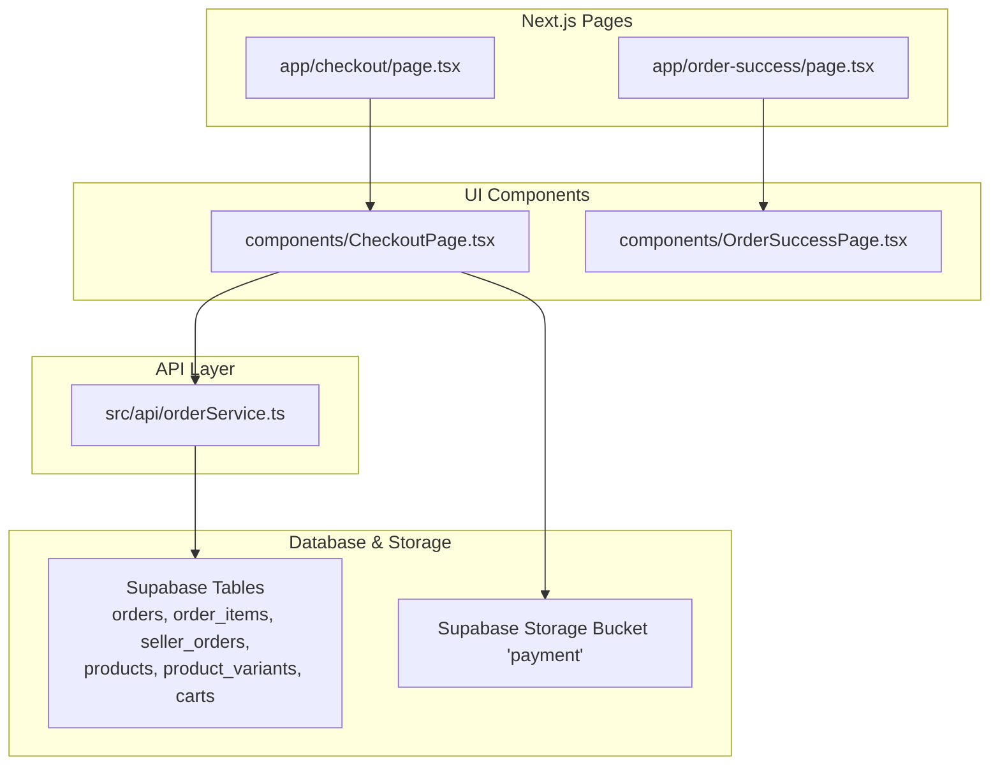
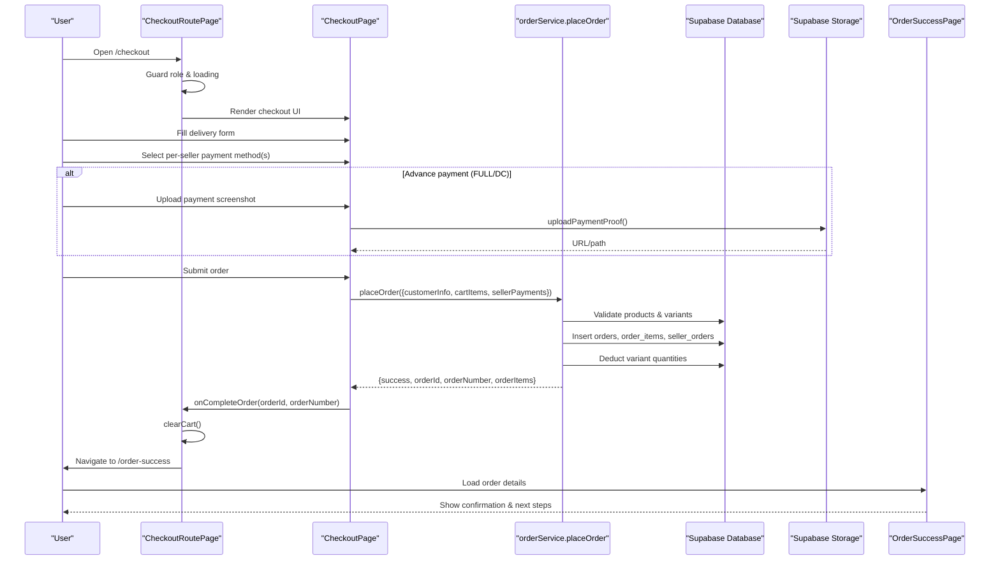
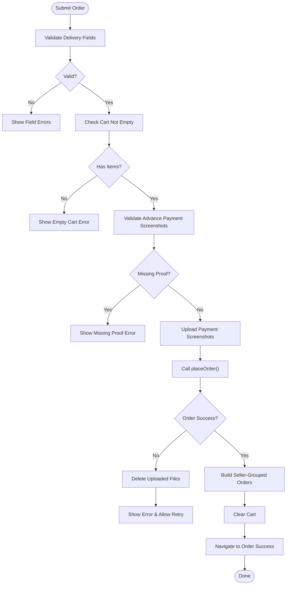
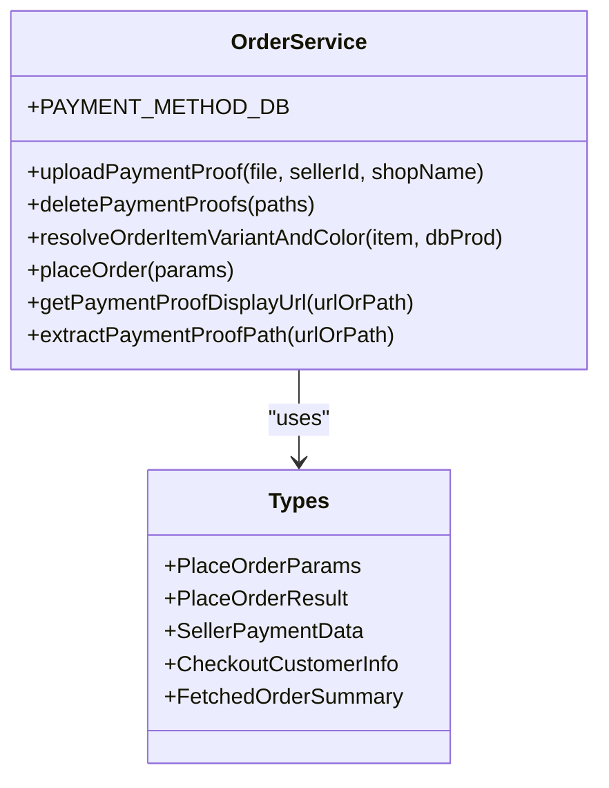
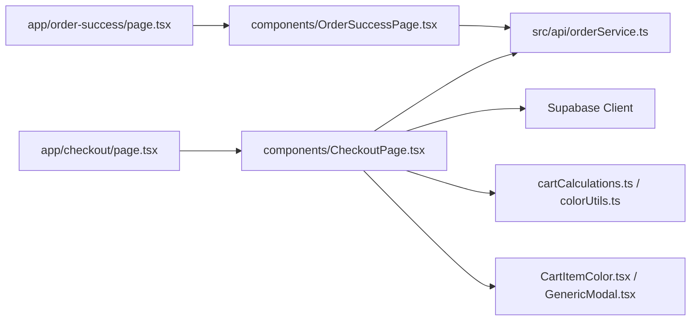

# Checkout Process

<cite>
**Referenced Files in This Document**
- [app/checkout/page.tsx](file://app/checkout/page.tsx)
- [components/CheckoutPage.tsx](file://components/CheckoutPage.tsx)
- [app/order-success/page.tsx](file://app/order-success/page.tsx)
- [components/OrderSuccessPage.tsx](file://components/OrderSuccessPage.tsx)
- [src/api/orderService.ts](file://src/api/orderService.ts)
- [supabase_checkout_migration.sql](file://supabase_checkout_migration.sql)
- [types.ts](file://types.ts)
- [components/CartItemColor.tsx](file://components/CartItemColor.tsx)
- [src/utils/cartCalculations.ts](file://src/utils/cartCalculations.ts)
- [src/utils/colorUtils.ts](file://src/utils/colorUtils.ts)
- [components/reseller/components/wallet/GenericModal.tsx](file://components/reseller/components/wallet/GenericModal.tsx)
- [components/CustomerPrivacyContent.tsx](file://components/CustomerPrivacyContent.tsx)
</cite>

## Table of Contents
1. [Introduction](#introduction)
2. [Project Structure](#project-structure)
3. [Core Components](#core-components)
4. [Architecture Overview](#architecture-overview)
5. [Detailed Component Analysis](#detailed-component-analysis)
6. [Dependency Analysis](#dependency-analysis)
7. [Performance Considerations](#performance-considerations)
8. [Troubleshooting Guide](#troubleshooting-guide)
9. [Security, PCI Compliance, and Data Privacy](#security-pci-compliance-and-data-privacy)
10. [Mobile Optimization and Accessibility](#mobile-optimization-and-accessibility)
11. [Conclusion](#conclusion)

## Introduction
This document explains the multi-step checkout process implemented in the application. It covers the checkout page architecture, step-by-step form validation, address management, per-seller payment method selection, order placement workflow with inventory reservation, payment proof handling, and order confirmation generation. It also documents the order success page, state management, error handling, retry behavior, security considerations for payment data, PCI compliance implications, privacy measures, mobile optimization, and accessibility guidance.

## Project Structure
The checkout experience is split between Next.js App Router pages and reusable React components:
- Route entry points render lightweight shell pages that handle routing, authentication guards, and navigation callbacks.
- The main checkout UI and business logic live in a single large component responsible for form state, seller grouping, payment method selection, screenshot upload, and order submission.
- Order persistence and stock reservation are handled by an API service layer that interacts with Supabase.
- The order success page fetches and displays the confirmed order summary.

**Diagram sources**
- [app/checkout/page.tsx:10-49](file://app/checkout/page.tsx#L10-L49)
- [components/CheckoutPage.tsx:68-689](file://components/CheckoutPage.tsx#L68-L689)
- [app/order-success/page.tsx:18-24](file://app/order-success/page.tsx#L18-L24)
- [components/OrderSuccessPage.tsx:20-61](file://components/OrderSuccessPage.tsx#L20-L61)
- [src/api/orderService.ts:403-759](file://src/api/orderService.ts#L403-L759)

**Section sources**
- [app/checkout/page.tsx:10-49](file://app/checkout/page.tsx#L10-L49)
- [components/CheckoutPage.tsx:68-689](file://components/CheckoutPage.tsx#L68-L689)
- [app/order-success/page.tsx:18-24](file://app/order-success/page.tsx#L18-L24)
- [components/OrderSuccessPage.tsx:20-61](file://components/OrderSuccessPage.tsx#L20-L61)
- [src/api/orderService.ts:403-759](file://src/api/orderService.ts#L403-L759)

## Core Components
- Checkout route page: Guards access, redirects sellers, clears cart on completion, and navigates to the order success page.
- Checkout page component: Manages delivery form, per-seller payment methods, payment proof uploads, calculations, validation, and order submission.
- Order success route page: Wraps the success component with suspense fallback.
- Order success component: Fetches order details by ID or order number and renders confirmation, tracking hints, and next steps.
- Order service: Validates stock, calculates prices from database records, creates orders atomically, updates inventory, and handles storage uploads for payment proofs.

Key responsibilities:
- Form validation ensures required fields are present and well-formed before submission.
- Per-seller isolation allows multi-seller carts with independent payment methods and shipping fees.
- Payment proof upload supports advance payments via bank transfer screenshots.
- Inventory reservation uses client-side stock checks and server-side RPC or direct inserts with rollback helpers.

**Section sources**
- [app/checkout/page.tsx:10-49](file://app/checkout/page.tsx#L10-L49)
- [components/CheckoutPage.tsx:68-689](file://components/CheckoutPage.tsx#L68-L689)
- [app/order-success/page.tsx:18-24](file://app/order-success/page.tsx#L18-L24)
- [components/OrderSuccessPage.tsx:20-61](file://components/OrderSuccessPage.tsx#L20-L61)
- [src/api/orderService.ts:403-759](file://src/api/orderService.ts#L403-L759)

## Architecture Overview
The checkout flow follows this sequence:
1. User reaches the checkout route.
2. Authentication guard prevents sellers from accessing checkout.
3. Delivery form is validated.
4. Per-seller payment methods are selected; advance payments require screenshot upload.
5. Screenshot files are uploaded to Supabase storage.
6. Order is placed through the API service, which validates stock, computes pricing, persists order records, and deducts inventory.
7. On success, the cart is cleared and the user is redirected to the order success page.
8. The order success page loads order details and shows confirmation, totals, shipping info, and next steps.

**Diagram sources**
- [app/checkout/page.tsx:15-49](file://app/checkout/page.tsx#L15-L49)
- [components/CheckoutPage.tsx:491-689](file://components/CheckoutPage.tsx#L491-L689)
- [src/api/orderService.ts:403-759](file://src/api/orderService.ts#L403-L759)
- [app/order-success/page.tsx:18-24](file://app/order-success/page.tsx#L18-L24)
- [components/OrderSuccessPage.tsx:32-61](file://components/OrderSuccessPage.tsx#L32-L61)

## Detailed Component Analysis

### Checkout Route Page
Responsibilities:
- Prevents seller users from accessing checkout.
- Shows a loading state while auth resolves.
- Clears the cart and navigates to the order success page after successful order placement.

Key behaviors:
- Redirects sellers to dashboard.
- Passes `onCompleteOrder` callback to the checkout component.
- Uses router to navigate to `/order-success` with query parameters.

**Section sources**
- [app/checkout/page.tsx:10-49](file://app/checkout/page.tsx#L10-L49)

### Checkout Page Component
Responsibilities:
- Auto-fills user profile data when available.
- Groups cart items by seller and fetches seller settings including COD/advance options and shipping charges.
- Maintains per-seller payment state: method and optional screenshot.
- Computes per-seller and overall totals using shared calculation utilities.
- Validates delivery form fields and enforces payment proof requirements for advance payments.
- Uploads payment screenshots to storage and cleans up on failure.
- Calls `placeOrder` with customer info, cart items, and per-seller payment data.
- Builds order summaries for the success page and triggers navigation.

Validation rules:
- Full name, email, phone, city, postal code, and street address are required with basic format checks.
- For FULL or DC payment methods, a screenshot must be attached per seller.

Error handling:
- Displays global submit errors.
- Cleans up uploaded files if order creation fails.
- Resets submitting state and provides retry opportunities.

State management:
- Local React state for form fields, field errors, submit status, modal states, and per-seller payment state.
- TanStack Query for fetching seller information.

Integration points:
- `uploadPaymentProof`, `deletePaymentProofs`, and `placeOrder` from the order service.
- `calculateCartTotals` for totals computation.
- `CartItemColor` and color utilities for cart item rendering.

**Diagram sources**
- [components/CheckoutPage.tsx:451-689](file://components/CheckoutPage.tsx#L451-L689)

**Section sources**
- [components/CheckoutPage.tsx:68-689](file://components/CheckoutPage.tsx#L68-L689)
- [src/utils/cartCalculations.ts](file://src/utils/cartCalculations.ts)
- [components/CartItemColor.tsx](file://components/CartItemColor.tsx)
- [src/utils/colorUtils.ts](file://src/utils/colorUtils.ts)

### Order Service
Responsibilities:
- Defines types for checkout payloads and results.
- Handles payment proof path extraction and display URL resolution.
- Uploads payment screenshots to the `payment` storage bucket with type and size validation.
- Resolves order item sizes and colors against product variants and colors.
- Places orders with robust stock verification, price recalculation, atomic persistence, and inventory deduction.
- Provides rollback helpers to clean partial order data on failure.

Stock reservation:
- Re-fetches latest product data including variants and colors.
- Validates product availability and stock levels.
- Deducts variant quantities and marks products as sold out when appropriate.

Pricing:
- Uses `original_retail_price` as primary price with fallback to `surplus_selling_price`.
- Aggregates per-seller subtotals and total shipping amounts.

Persistence:
- Inserts orders, order items, and seller orders.
- Updates order totals and clears purchased cart items for authenticated users.

**Diagram sources**
- [src/api/orderService.ts:1-45](file://src/api/orderService.ts#L1-L45)
- [src/api/orderService.ts:168-255](file://src/api/orderService.ts#L168-L255)
- [src/api/orderService.ts:278-395](file://src/api/orderService.ts#L278-L395)
- [src/api/orderService.ts:403-759](file://src/api/orderService.ts#L403-L759)

**Section sources**
- [src/api/orderService.ts:168-255](file://src/api/orderService.ts#L168-L255)
- [src/api/orderService.ts:278-395](file://src/api/orderService.ts#L278-L395)
- [src/api/orderService.ts:403-759](file://src/api/orderService.ts#L403-L759)

### Order Success Page
Responsibilities:
- Reads order identifier from query parameters.
- Fetches order summary by ID or order number.
- Renders confirmation banner, order number, status, ordered items, totals, shipping details, and payment method/status.
- Provides CTAs to track orders and continue shopping.

Navigation:
- Backed by the route wrapper that provides a loading fallback.

**Section sources**
- [app/order-success/page.tsx:18-24](file://app/order-success/page.tsx#L18-L24)
- [components/OrderSuccessPage.tsx:20-61](file://components/OrderSuccessPage.tsx#L20-L61)
- [components/OrderSuccessPage.tsx:63-237](file://components/OrderSuccessPage.tsx#L63-L237)

## Dependency Analysis
High-level dependencies:
- Checkout route depends on authentication context and app context for cart operations.
- Checkout component depends on:
  - Auth hook for user data.
  - Order service for uploads and order placement.
  - Supabase client for seller queries.
  - Utility functions for cart totals and color keying.
  - Shared UI components for modals and cart item rendering.
- Order success component depends on order service for fetching order details.

**Diagram sources**
- [app/checkout/page.tsx:10-49](file://app/checkout/page.tsx#L10-L49)
- [components/CheckoutPage.tsx:31-40](file://components/CheckoutPage.tsx#L31-L40)
- [components/OrderSuccessPage.tsx:18-25](file://components/OrderSuccessPage.tsx#L18-L25)

**Section sources**
- [app/checkout/page.tsx:10-49](file://app/checkout/page.tsx#L10-L49)
- [components/CheckoutPage.tsx:31-40](file://components/CheckoutPage.tsx#L31-L40)
- [components/OrderSuccessPage.tsx:18-25](file://components/OrderSuccessPage.tsx#L18-L25)

## Performance Considerations
- Seller information is fetched once per unique seller set using TanStack Query with caching to avoid repeated network calls during checkout.
- Financial calculations are memoized to prevent unnecessary recomputation.
- Payment screenshot uploads are performed only for advance payment methods and cleaned up on failure to minimize storage overhead.
- Stock checks re-fetch product data at order time to ensure accuracy and reduce race conditions.

Recommendations:
- Consider debouncing input changes for large forms if expanded.
- Preload seller settings when entering the cart to reduce checkout latency.
- Batch storage uploads where possible and provide progress feedback.

[No sources needed since this section provides general guidance]

## Troubleshooting Guide
Common issues and resolutions:
- Validation failures: Ensure all required fields meet the expected formats. The component sets field-specific error messages.
- Missing payment proof: For FULL or DC methods, attach a valid image file per seller.
- Upload failures: The service validates file type and size; ensure images are PNG/JPG/JPEG/WEBP under 10MB.
- Order placement failures: The service returns descriptive errors for stock shortages, unavailable products, or database insertions. Partial data is rolled back.
- Navigation issues: Confirm that `onCompleteOrder` clears the cart and navigates to `/order-success` with correct query parameters.

Retry mechanisms:
- Users can retry after fixing validation or missing proof issues.
- On order placement failure, uploaded files are deleted and the submit state resets.

**Section sources**
- [components/CheckoutPage.tsx:451-689](file://components/CheckoutPage.tsx#L451-L689)
- [src/api/orderService.ts:403-759](file://src/api/orderService.ts#L403-L759)

## Security, PCI Compliance, and Data Privacy
Security measures:
- Payment proof images are uploaded to a dedicated storage bucket with type and size validation.
- Display URLs are resolved securely, preferring signed URLs for private buckets and falling back to public URLs when necessary.
- Order persistence uses database constraints and server-side validations.
- Customer privacy content clarifies that full card numbers and banking passwords are not stored on platform servers; transactions are handled by secure third-party providers.

PCI compliance considerations:
- The implementation does not collect or store sensitive cardholder data directly.
- Payment processing relies on external gateways; the platform stores only non-sensitive proof artifacts and order metadata.
- Ensure storage bucket policies restrict unauthorized access and use signed URLs for sensitive assets.

Data privacy:
- Personal data such as name, email, phone, and address are used strictly for order fulfillment and communication.
- No sale or sharing of personal data to advertisers is stated in the privacy content.

**Section sources**
- [src/api/orderService.ts:168-255](file://src/api/orderService.ts#L168-L255)
- [src/api/orderService.ts:118-163](file://src/api/orderService.ts#L118-L163)
- [components/CustomerPrivacyContent.tsx:36-101](file://components/CustomerPrivacyContent.tsx#L36-L101)

## Mobile Optimization and Accessibility
Mobile optimization:
- The checkout layout adapts across screen sizes using responsive grid classes.
- Touch-friendly inputs and buttons are provided for form interactions.
- The order success page includes clear CTAs suitable for small screens.

Accessibility guidance:
- Use semantic labels and associate inputs with labels.
- Provide visible focus states and error messages near relevant fields.
- Ensure sufficient color contrast for text and alerts.
- Add ARIA attributes where dynamic content changes without full page reloads.

[No sources needed since this section provides general guidance]

## Conclusion
The checkout system implements a robust, multi-seller workflow with strong validation, per-seller payment handling, secure payment proof uploads, and reliable order persistence with inventory reservation. The order success page delivers clear confirmation and next steps. While the current design avoids storing sensitive payment data, it should continue to rely on secure third-party processors and enforce strict storage and access controls. Future enhancements may include richer error recovery flows, progress indicators for uploads, and enhanced accessibility features.

[No sources needed since this section summarizes without analyzing specific files]