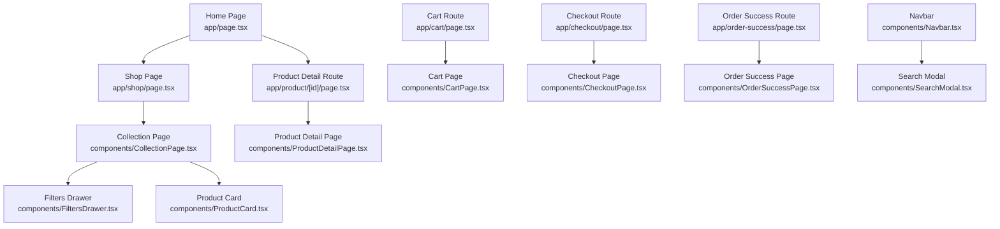
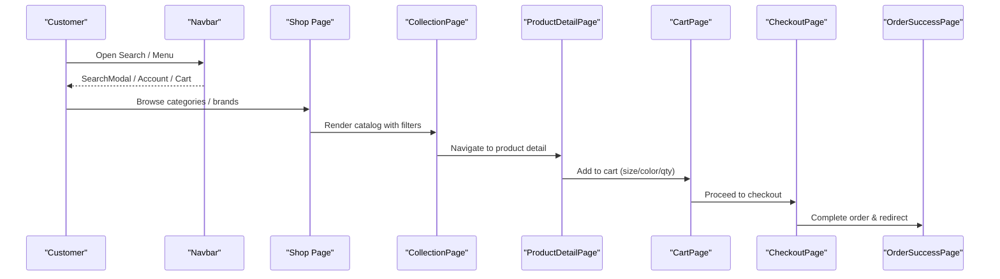
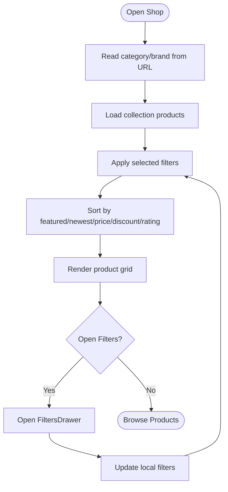
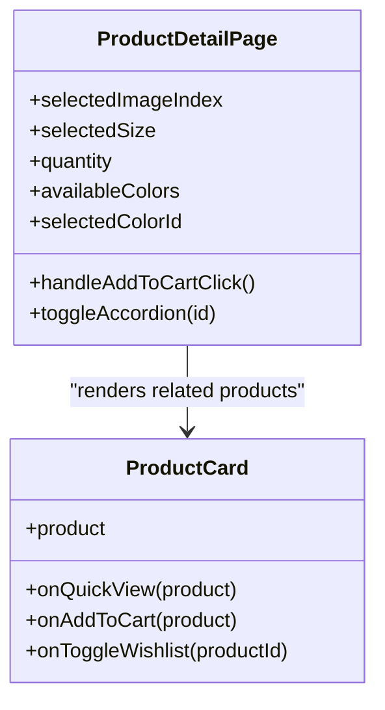
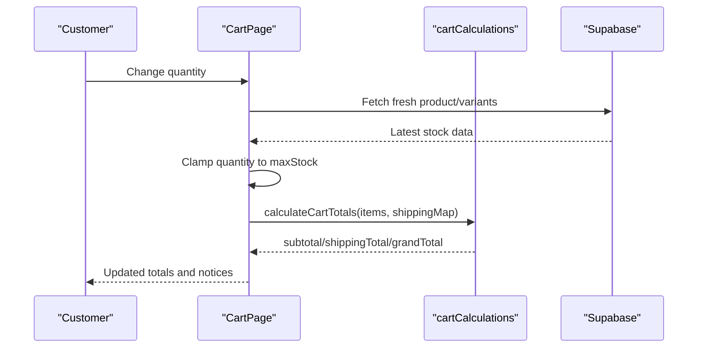
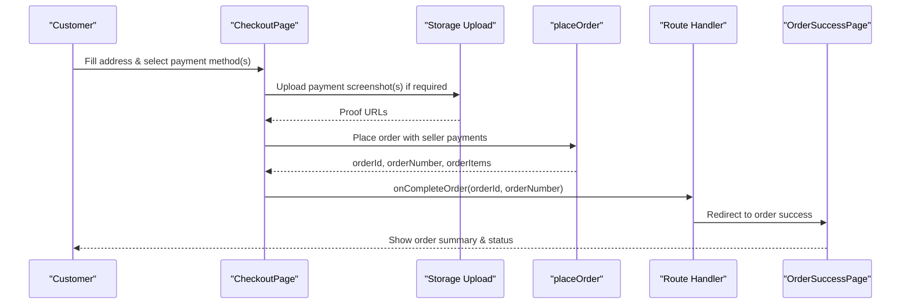
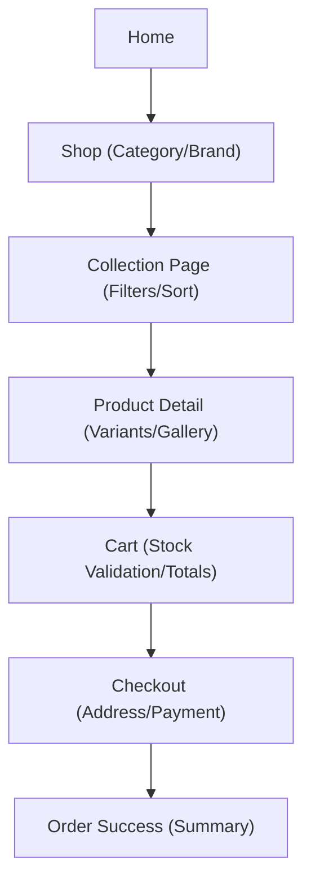
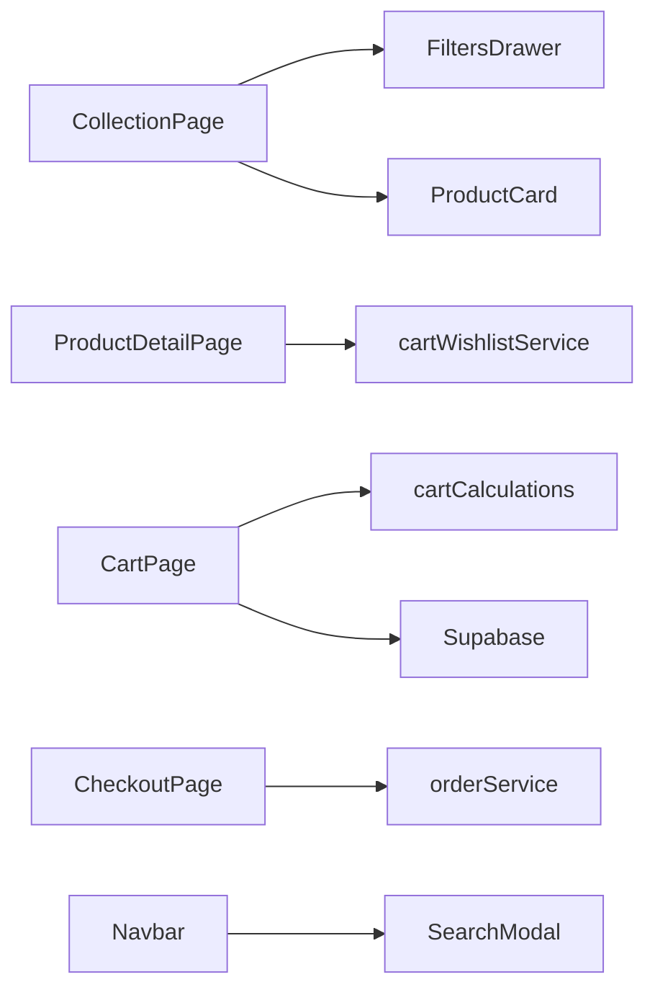

# Customer Storefront

<cite>
**Referenced Files in This Document**
- [app/page.tsx](file://app/page.tsx)
- [components/Navbar.tsx](file://components/Navbar.tsx)
- [components/ProductCard.tsx](file://components/ProductCard.tsx)
- [components/FiltersDrawer.tsx](file://components/FiltersDrawer.tsx)
- [components/SearchModal.tsx](file://components/SearchModal.tsx)
- [app/shop/page.tsx](file://app/shop/page.tsx)
- [components/CollectionPage.tsx](file://components/CollectionPage.tsx)
- [app/product/[id]/page.tsx](file://app/product/[id]/page.tsx)
- [components/ProductDetailPage.tsx](file://components/ProductDetailPage.tsx)
- [app/cart/page.tsx](file://app/cart/page.tsx)
- [components/CartPage.tsx](file://components/CartPage.tsx)
- [src/utils/cartCalculations.ts](file://src/utils/cartCalculations.ts)
- [src/api/cartWishlistService.ts](file://src/api/cartWishlistService.ts)
- [app/checkout/page.tsx](file://app/checkout/page.tsx)
- [components/CheckoutPage.tsx](file://components/CheckoutPage.tsx)
- [app/order-success/page.tsx](file://app/order-success/page.tsx)
- [components/OrderSuccessPage.tsx](file://components/OrderSuccessPage.tsx)
</cite>

## Table of Contents
1. [Introduction](#introduction)
2. [Project Structure](#project-structure)
3. [Core Components](#core-components)
4. [Architecture Overview](#architecture-overview)
5. [Detailed Component Analysis](#detailed-component-analysis)
6. [Dependency Analysis](#dependency-analysis)
7. [Performance Considerations](#performance-considerations)
8. [Troubleshooting Guide](#troubleshooting-guide)
9. [Conclusion](#conclusion)

## Introduction
This document explains the customer-facing storefront experience on Zebaish, covering product discovery (category navigation, search, and advanced filters), product detail pages with variant selection and image galleries, shopping cart management with real-time stock validation and wishlist integration, and the complete checkout flow including address management, payment options, and order confirmation. It also maps user journeys and component interactions across the storefront.

## Project Structure
The storefront is built as a Next.js application using client components for interactive UI and server-side data fetching where appropriate. Key areas:
- App routes define entry points for Home, Shop, Product Detail, Cart, Checkout, and Order Success.
- Shared UI components implement browsing, filtering, product cards, cart, and checkout experiences.
- Utilities and services handle cart calculations, wishlist/cart persistence, and API calls.

**Diagram sources**
- [app/page.tsx:17-96](file://app/page.tsx#L17-L96)
- [app/shop/page.tsx:10-62](file://app/shop/page.tsx#L10-L62)
- [components/CollectionPage.tsx:24-725](file://components/CollectionPage.tsx#L24-L725)
- [components/FiltersDrawer.tsx:49-552](file://components/FiltersDrawer.tsx#L49-L552)
- [components/ProductCard.tsx:18-274](file://components/ProductCard.tsx#L18-L274)
- [app/product/[id]/page.tsx:10-29](file://app/product/[id]/page.tsx#L10-L29)
- [components/ProductDetailPage.tsx:54-800](file://components/ProductDetailPage.tsx#L54-L800)
- [app/cart/page.tsx:8-33](file://app/cart/page.tsx#L8-L33)
- [components/CartPage.tsx:23-498](file://components/CartPage.tsx#L23-L498)
- [app/checkout/page.tsx:10-51](file://app/checkout/page.tsx#L10-L51)
- [components/CheckoutPage.tsx:68-800](file://components/CheckoutPage.tsx#L68-L800)
- [app/order-success/page.tsx:18-24](file://app/order-success/page.tsx#L18-L24)
- [components/OrderSuccessPage.tsx:20-237](file://components/OrderSuccessPage.tsx#L20-L237)
- [components/Navbar.tsx:20-186](file://components/Navbar.tsx#L20-L186)
- [components/SearchModal.tsx:12-120](file://components/SearchModal.tsx#L12-L120)

**Section sources**
- [app/page.tsx:17-96](file://app/page.tsx#L17-L96)
- [app/shop/page.tsx:10-62](file://app/shop/page.tsx#L10-L62)
- [components/CollectionPage.tsx:24-725](file://components/CollectionPage.tsx#L24-L725)
- [components/ProductDetailPage.tsx:54-800](file://components/ProductDetailPage.tsx#L54-L800)
- [components/CartPage.tsx:23-498](file://components/CartPage.tsx#L23-L498)
- [components/CheckoutPage.tsx:68-800](file://components/CheckoutPage.tsx#L68-L800)
- [components/OrderSuccessPage.tsx:20-237](file://components/OrderSuccessPage.tsx#L20-L237)

## Core Components
- Navigation and Search: Navbar provides global access to menu, search, wishlist, account, and cart; SearchModal offers quick product search with suggestions.
- Catalog Browsing: CollectionPage renders paginated products with sorting, grid layout controls, active filter chips, and opens FiltersDrawer for advanced filtering.
- Product Discovery: ProductCard shows product imagery, pricing, badges, ratings, reseller info, and quick actions (quick view, add to cart, wishlist).
- Product Details: ProductDetailPage handles image gallery, size/color variants, stock-aware quantity selection, reviews, and add-to-cart with color snapshots.
- Cart Management: CartPage validates stock against fresh DB state, adjusts quantities, computes totals per seller, supports promo codes, and proceeds to checkout.
- Checkout Flow: CheckoutPage collects delivery details, resolves seller payment methods, uploads payment proofs when required, places orders, and navigates to order success.
- Order Confirmation: OrderSuccessPage displays order summary, shipping/payment details, and CTAs to track or continue shopping.

**Section sources**
- [components/Navbar.tsx:20-186](file://components/Navbar.tsx#L20-L186)
- [components/SearchModal.tsx:12-120](file://components/SearchModal.tsx#L12-L120)
- [components/CollectionPage.tsx:24-725](file://components/CollectionPage.tsx#L24-L725)
- [components/ProductCard.tsx:18-274](file://components/ProductCard.tsx#L18-L274)
- [components/ProductDetailPage.tsx:54-800](file://components/ProductDetailPage.tsx#L54-L800)
- [components/CartPage.tsx:23-498](file://components/CartPage.tsx#L23-L498)
- [components/CheckoutPage.tsx:68-800](file://components/CheckoutPage.tsx#L68-L800)
- [components/OrderSuccessPage.tsx:20-237](file://components/OrderSuccessPage.tsx#L20-L237)

## Architecture Overview
The storefront follows a route-driven architecture with shared UI components and service utilities:
- Routes orchestrate data loading and pass props to page components.
- Page components delegate rendering to reusable components.
- Services and hooks manage data fetching, caching, and mutations.
- Utilities compute cart totals and derive seller IDs consistently.

**Diagram sources**
- [components/Navbar.tsx:20-186](file://components/Navbar.tsx#L20-L186)
- [app/shop/page.tsx:10-62](file://app/shop/page.tsx#L10-L62)
- [components/CollectionPage.tsx:24-725](file://components/CollectionPage.tsx#L24-L725)
- [app/product/[id]/page.tsx:10-29](file://app/product/[id]/page.tsx#L10-L29)
- [components/ProductDetailPage.tsx:54-800](file://components/ProductDetailPage.tsx#L54-L800)
- [app/cart/page.tsx:8-33](file://app/cart/page.tsx#L8-L33)
- [components/CartPage.tsx:23-498](file://components/CartPage.tsx#L23-L498)
- [app/checkout/page.tsx:10-51](file://app/checkout/page.tsx#L10-L51)
- [components/CheckoutPage.tsx:68-800](file://components/CheckoutPage.tsx#L68-L800)
- [app/order-success/page.tsx:18-24](file://app/order-success/page.tsx#L18-L24)
- [components/OrderSuccessPage.tsx:20-237](file://components/OrderSuccessPage.tsx#L20-L237)

## Detailed Component Analysis

### Product Browsing Experience
- Category Navigation: The home page routes users to shop with category or brand parameters. The shop page reads query params and passes them to CollectionPage.
- Search Functionality: SearchModal provides local search across titles, categories, and fabrics with popular suggestions.
- Advanced Filtering: FiltersDrawer exposes brand, fabric, price range, size, rating, and other filters; CollectionPage applies filters and sorts results, showing active filter chips.

**Diagram sources**
- [app/shop/page.tsx:10-62](file://app/shop/page.tsx#L10-L62)
- [components/CollectionPage.tsx:24-725](file://components/CollectionPage.tsx#L24-L725)
- [components/FiltersDrawer.tsx:49-552](file://components/FiltersDrawer.tsx#L49-L552)
- [components/SearchModal.tsx:12-120](file://components/SearchModal.tsx#L12-L120)

**Section sources**
- [app/page.tsx:26-59](file://app/page.tsx#L26-L59)
- [app/shop/page.tsx:10-62](file://app/shop/page.tsx#L10-L62)
- [components/CollectionPage.tsx:24-725](file://components/CollectionPage.tsx#L24-L725)
- [components/FiltersDrawer.tsx:49-552](file://components/FiltersDrawer.tsx#L49-L552)
- [components/SearchModal.tsx:12-120](file://components/SearchModal.tsx#L12-L120)

### Product Detail Pages
- Variant Selection: Size buttons show availability; Unstitched category uses “Unstitched” sizing. Color swatches are filtered by selected size and deduplicated.
- Image Gallery: Thumbnails and main stage support zoom; additional images and hover images are included.
- Pricing Display: Shows original and sale prices with discount indicators; stock-aware quantity selection clamps to available inventory.
- Reviews: Users can write reviews after authentication checks and duplicate prevention; review submission includes fallbacks for schema differences.

**Diagram sources**
- [components/ProductDetailPage.tsx:54-800](file://components/ProductDetailPage.tsx#L54-L800)
- [components/ProductCard.tsx:18-274](file://components/ProductCard.tsx#L18-L274)

**Section sources**
- [app/product/[id]/page.tsx:10-29](file://app/product/[id]/page.tsx#L10-L29)
- [components/ProductDetailPage.tsx:54-800](file://components/ProductDetailPage.tsx#L54-L800)

### Shopping Cart Management
- Real-Time Updates: CartPage fetches fresh product and variant stock, clamps quantities, and shows notices when items go out of stock or require adjustment.
- Quantity Adjustments: Stepper enforces min/max based on stock; updates propagate via context handlers.
- Wishlist Integration: Wishlist toggles persist to database; cart lines include color snapshots for accurate ordering.
- Totals Calculation: Uses shared utility to compute subtotal, per-seller shipping, and grand total; supports promo code discounts.

**Diagram sources**
- [components/CartPage.tsx:120-246](file://components/CartPage.tsx#L120-L246)
- [src/utils/cartCalculations.ts:52-86](file://src/utils/cartCalculations.ts#L52-L86)

**Section sources**
- [app/cart/page.tsx:8-33](file://app/cart/page.tsx#L8-L33)
- [components/CartPage.tsx:23-498](file://components/CartPage.tsx#L23-L498)
- [src/utils/cartCalculations.ts:1-86](file://src/utils/cartCalculations.ts#L1-L86)
- [src/api/cartWishlistService.ts:9-88](file://src/api/cartWishlistService.ts#L9-L88)

### Checkout Process
- Address Management: Form fields validate name, email, phone, city, postal code, and address; errors displayed inline.
- Payment Processing Options: Supports COD, full advance bank transfer, and advance delivery charges; requires screenshot upload for FULL/DC methods; IBAN copy helper provided.
- Order Placement: Uploads proof images, calls placeOrder with seller-specific payment data, and constructs per-seller order summaries.
- Order Confirmation: Navigates to order success page with order ID and number; success page loads order summary and displays shipping/payment details.

**Diagram sources**
- [components/CheckoutPage.tsx:491-689](file://components/CheckoutPage.tsx#L491-L689)
- [app/checkout/page.tsx:35-51](file://app/checkout/page.tsx#L35-L51)
- [components/OrderSuccessPage.tsx:32-61](file://components/OrderSuccessPage.tsx#L32-L61)

**Section sources**
- [app/checkout/page.tsx:10-51](file://app/checkout/page.tsx#L10-L51)
- [components/CheckoutPage.tsx:68-800](file://components/CheckoutPage.tsx#L68-L800)
- [app/order-success/page.tsx:18-24](file://app/order-success/page.tsx#L18-L24)
- [components/OrderSuccessPage.tsx:20-237](file://components/OrderSuccessPage.tsx#L20-L237)

### User Journey Flows and Interactions
- Discovery to Purchase:
  - Home page directs to shop with category/brand filters.
  - Shop page renders catalog with filters and sort.
  - Product card leads to product detail page.
  - Product detail allows variant selection and add-to-cart.
  - Cart validates stock and calculates totals.
  - Checkout collects address and payment details, uploads proofs, and places order.
  - Order success confirms and summarizes order.

[No sources needed since this diagram shows conceptual workflow, not actual code structure]

## Dependency Analysis
Key dependencies and relationships:
- CollectionPage depends on FiltersDrawer and ProductCard for catalog rendering and filtering.
- ProductDetailPage integrates with product queries and review flows; it composes add-to-cart with size/color/quantity.
- CartPage relies on cartCalculations for consistent totals and uses Supabase for fresh stock and seller shipping charges.
- CheckoutPage orchestrates seller payment states, file uploads, and order placement; it consumes orderService APIs.
- Navbar and SearchModal provide cross-cutting navigation and search capabilities.

**Diagram sources**
- [components/CollectionPage.tsx:24-725](file://components/CollectionPage.tsx#L24-L725)
- [components/FiltersDrawer.tsx:49-552](file://components/FiltersDrawer.tsx#L49-L552)
- [components/ProductCard.tsx:18-274](file://components/ProductCard.tsx#L18-L274)
- [components/ProductDetailPage.tsx:54-800](file://components/ProductDetailPage.tsx#L54-L800)
- [components/CartPage.tsx:23-498](file://components/CartPage.tsx#L23-L498)
- [src/utils/cartCalculations.ts:1-86](file://src/utils/cartCalculations.ts#L1-L86)
- [src/api/cartWishlistService.ts:1-223](file://src/api/cartWishlistService.ts#L1-L223)
- [components/CheckoutPage.tsx:68-800](file://components/CheckoutPage.tsx#L68-L800)
- [components/Navbar.tsx:20-186](file://components/Navbar.tsx#L20-L186)
- [components/SearchModal.tsx:12-120](file://components/SearchModal.tsx#L12-L120)

**Section sources**
- [components/CollectionPage.tsx:24-725](file://components/CollectionPage.tsx#L24-L725)
- [components/ProductDetailPage.tsx:54-800](file://components/ProductDetailPage.tsx#L54-L800)
- [components/CartPage.tsx:23-498](file://components/CartPage.tsx#L23-L498)
- [src/utils/cartCalculations.ts:1-86](file://src/utils/cartCalculations.ts#L1-L86)
- [src/api/cartWishlistService.ts:1-223](file://src/api/cartWishlistService.ts#L1-L223)
- [components/CheckoutPage.tsx:68-800](file://components/CheckoutPage.tsx#L68-L800)
- [components/Navbar.tsx:20-186](file://components/Navbar.tsx#L20-L186)
- [components/SearchModal.tsx:12-120](file://components/SearchModal.tsx#L12-L120)

## Performance Considerations
- Infinite Scroll Pagination: CollectionPage implements scroll-based pagination to load more products progressively, reducing initial payload.
- Query Caching: TanStack Query caches product and collection data with stale times to minimize network requests.
- Memoization: useMemo is used for computed values like displayProducts, wishlist sets, and totals to avoid unnecessary recalculations.
- Image Optimization: Lazy loading and decoding attributes improve perceived performance; fallback images prevent broken visuals.
- Stock Syncing: CartPage batches fresh stock checks and clamps quantities to reduce invalid orders and re-renders.

[No sources needed since this section provides general guidance]

## Troubleshooting Guide
- No Products Found: CollectionPage shows an empty state with a reset filters button; verify filter selections and try broadening criteria.
- Out-of-Stock Items: CartPage displays notices and may adjust quantities automatically; refresh the page to sync latest stock.
- Promo Code Issues: Only specific codes apply; ensure correct uppercase input and check message feedback.
- Checkout Validation Errors: Inline field errors indicate missing or invalid inputs; correct fields before submitting.
- Payment Screenshot Required: For FULL/DC methods, upload a valid screenshot; otherwise, submit will fail with a clear error.
- Order Submission Failures: On failure, uploaded proofs are cleaned up; retry after correcting issues or contacting support.

**Section sources**
- [components/CollectionPage.tsx:616-654](file://components/CollectionPage.tsx#L616-L654)
- [components/CartPage.tsx:120-246](file://components/CartPage.tsx#L120-L246)
- [components/CheckoutPage.tsx:451-525](file://components/CheckoutPage.tsx#L451-L525)
- [components/CheckoutPage.tsx:532-603](file://components/CheckoutPage.tsx#L532-L603)

## Conclusion
The Zebaish customer storefront delivers a cohesive shopping experience from discovery to purchase. It combines robust catalog browsing with advanced filtering, rich product detail pages with variant selection, reliable cart management with real-time stock validation, and a comprehensive checkout flow supporting multiple payment methods and per-seller logistics. The architecture leverages Next.js routing, shared components, and service utilities to maintain clarity, performance, and scalability.