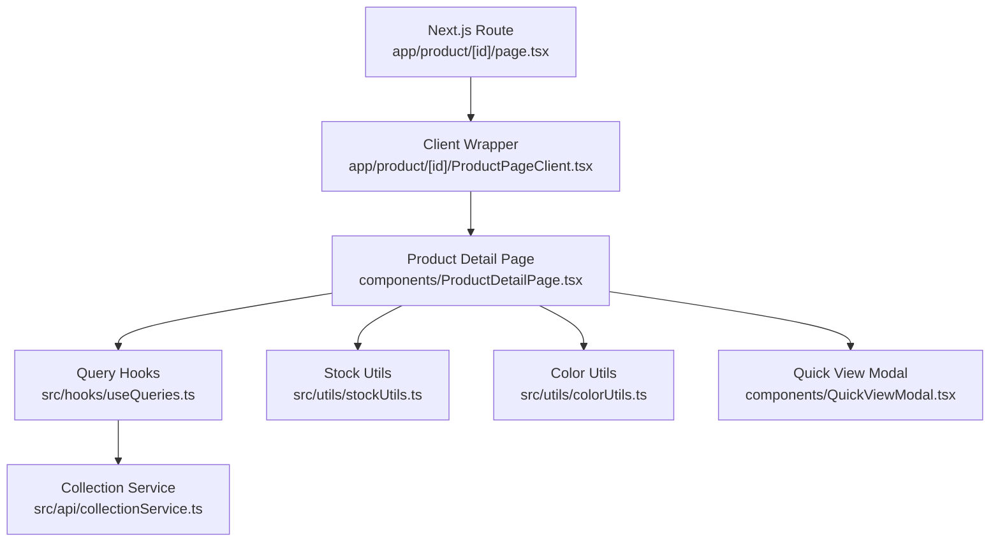
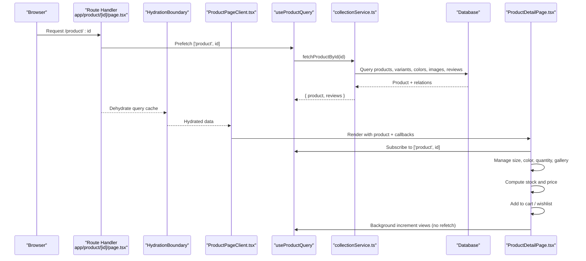
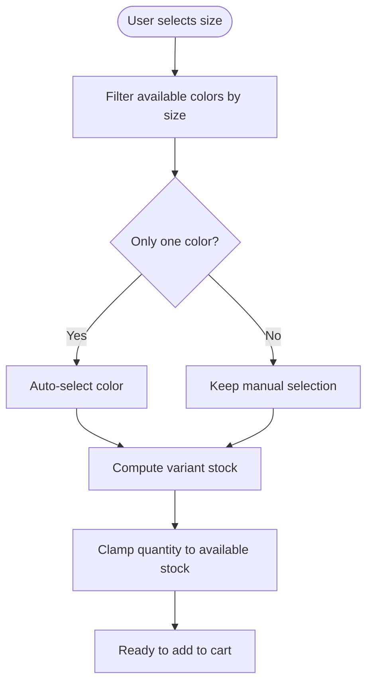
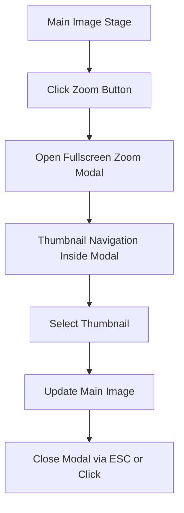
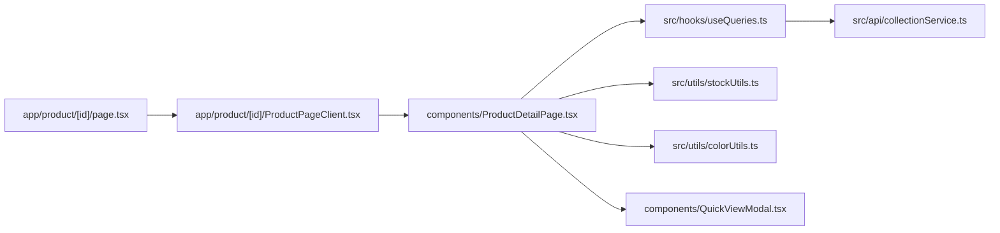

# Product Detail Pages

<cite>
**Referenced Files in This Document**   
- [app/product/[id]/page.tsx](file://app/product/[id]/page.tsx)
- [app/product/[id]/ProductPageClient.tsx](file://app/product/[id]/ProductPageClient.tsx)
- [components/ProductDetailPage.tsx](file://components/ProductDetailPage.tsx)
- [components/QuickViewModal.tsx](file://components/QuickViewModal.tsx)
- [src/hooks/useQueries.ts](file://src/hooks/useQueries.ts)
- [src/api/collectionService.ts](file://src/api/collectionService.ts)
- [src/utils/stockUtils.ts](file://src/utils/stockUtils.ts)
- [src/utils/colorUtils.ts](file://src/utils/colorUtils.ts)
</cite>

## Table of Contents
1. [Introduction](#introduction)
2. [Project Structure](#project-structure)
3. [Core Components](#core-components)
4. [Architecture Overview](#architecture-overview)
5. [Detailed Component Analysis](#detailed-component-analysis)
6. [Dependency Analysis](#dependency-analysis)
7. [Performance Considerations](#performance-considerations)
8. [Troubleshooting Guide](#troubleshooting-guide)
9. [Conclusion](#conclusion)

## Introduction
This document explains the product detail pages and related components in the application. It covers:
- Dynamic product routing using Next.js App Router
- Server-side data fetching with React Query hydration
- Variant selection for sizes, colors, and custom attributes
- Real-time stock availability and inventory-aware add-to-cart behavior
- Image gallery with thumbnails and fullscreen zoom
- Quick view modal for rapid product inspection
- Pricing display, stock checks, and cart integration
- Responsive design patterns and accessibility considerations

The goal is to make the product detail experience predictable, accessible, and performant while supporting complex variant combinations such as size and color.

## Project Structure
The product detail feature spans a server route, a client wrapper, a reusable product detail component, a quick view modal, query hooks, API services, and utility helpers.

**Diagram sources**
- [app/product/[id]/page.tsx:10-28](file://app/product/[id]/page.tsx#L10-L28)
- [app/product/[id]/ProductPageClient.tsx:17-86](file://app/product/[id]/ProductPageClient.tsx#L17-L86)
- [components/ProductDetailPage.tsx:54-72](file://components/ProductDetailPage.tsx#L54-L72)
- [src/hooks/useQueries.ts:48-55](file://src/hooks/useQueries.ts#L48-L55)
- [src/api/collectionService.ts:332-476](file://src/api/collectionService.ts#L332-L476)
- [src/utils/stockUtils.ts:7-33](file://src/utils/stockUtils.ts#L7-L33)
- [src/utils/colorUtils.ts:44-103](file://src/utils/colorUtils.ts#L44-L103)
- [components/QuickViewModal.tsx:13-32](file://components/QuickViewModal.tsx#L13-L32)

**Section sources**
- [app/product/[id]/page.tsx:10-28](file://app/product/[id]/page.tsx#L10-L28)
- [app/product/[id]/ProductPageClient.tsx:17-86](file://app/product/[id]/ProductPageClient.tsx#L17-L86)
- [components/ProductDetailPage.tsx:54-72](file://components/ProductDetailPage.tsx#L54-L72)

## Core Components
- **Server Route**: Prefetches product data on the server and hydrates React Query state for fast initial render.
- **Client Wrapper**: Subscribes to product data via hooks, handles loading/error states, and passes props to the product detail UI.
- **Product Detail Page**: Renders the full product page including gallery, variants, pricing, stock, reviews, and add-to-cart actions.
- **Quick View Modal**: Provides a lightweight product preview without navigating away from the current page.
- **Query Hooks**: Centralize product queries and mutations, including background view increments.
- **Collection Service**: Performs database queries for product details, images, variants, colors, and reviews.
- **Stock Utilities**: Compute available stock per selected variant or simple product.
- **Color Utilities**: Resolve swatch colors and generate stable cart line keys.

**Section sources**
- [app/product/[id]/page.tsx:10-28](file://app/product/[id]/page.tsx#L10-L28)
- [app/product/[id]/ProductPageClient.tsx:17-86](file://app/product/[id]/ProductPageClient.tsx#L17-L86)
- [components/ProductDetailPage.tsx:54-72](file://components/ProductDetailPage.tsx#L54-L72)
- [components/QuickViewModal.tsx:13-32](file://components/QuickViewModal.tsx#L13-L32)
- [src/hooks/useQueries.ts:48-66](file://src/hooks/useQueries.ts#L48-L66)
- [src/api/collectionService.ts:332-476](file://src/api/collectionService.ts#L332-L476)
- [src/utils/stockUtils.ts:7-33](file://src/utils/stockUtils.ts#L7-L33)
- [src/utils/colorUtils.ts:44-127](file://src/utils/colorUtils.ts#L44-L127)

## Architecture Overview
The product detail flow starts at the Next.js route, which prefetches product data and hydrates the client. The client wrapper uses a hook to subscribe to the product data and renders the product detail component. The product detail component manages local UI state (selected size, color, quantity, gallery index), computes stock and price, and integrates with cart and wishlist actions. Background view increments are performed without invalidating the product query cache.

**Diagram sources**
- [app/product/[id]/page.tsx:10-28](file://app/product/[id]/page.tsx#L10-L28)
- [app/product/[id]/ProductPageClient.tsx:17-86](file://app/product/[id]/ProductPageClient.tsx#L17-L86)
- [src/hooks/useQueries.ts:48-66](file://src/hooks/useQueries.ts#L48-L66)
- [src/api/collectionService.ts:332-476](file://src/api/collectionService.ts#L332-L476)
- [components/ProductDetailPage.tsx:54-72](file://components/ProductDetailPage.tsx#L54-L72)

## Detailed Component Analysis

### Dynamic Product Routing and Server-Side Data Fetching
- The route handler receives the dynamic `id` parameter and creates a new React Query client per request.
- It prefetches product data using `fetchProductById`, then hydrates the client with `dehydrate`.
- The client wrapper subscribes to the same query key and renders the product detail UI once hydrated.

Key behaviors:
- Server-side prefetch improves first paint performance.
- Hydration avoids an extra network round trip on the client.
- Error and missing product states are handled gracefully in the client wrapper.

**Section sources**
- [app/product/[id]/page.tsx:10-28](file://app/product/[id]/page.tsx#L10-L28)
- [app/product/[id]/ProductPageClient.tsx:17-86](file://app/product/[id]/ProductPageClient.tsx#L17-L86)
- [src/hooks/useQueries.ts:48-55](file://src/hooks/useQueries.ts#L48-L55)
- [src/api/collectionService.ts:332-476](file://src/api/collectionService.ts#L332-L476)

### Product Detail Page: Variants, Colors, and Inventory
The product detail page implements a robust variant selection system:
- Size selection supports standard sizes and special categories like Unstitched.
- Color selection is filtered by the currently selected size; if only one color remains, it is auto-selected.
- Available stock is computed per selected variant; quantity is clamped to available stock.
- Add-to-cart requires a color when multiple colors exist for the selected size.

Data flow:
- Product data includes variants, colors, and seller information.
- Stock calculation uses both variant-level quantities and fallback product-level quantity.
- Color swatches are resolved into CSS-safe colors for accurate visual representation.

**Diagram sources**
- [components/ProductDetailPage.tsx:100-214](file://components/ProductDetailPage.tsx#L100-L214)
- [components/ProductDetailPage.tsx:527-545](file://components/ProductDetailPage.tsx#L527-L545)
- [src/utils/stockUtils.ts:7-33](file://src/utils/stockUtils.ts#L7-L33)
- [src/utils/colorUtils.ts:44-103](file://src/utils/colorUtils.ts#L44-L103)

**Section sources**
- [components/ProductDetailPage.tsx:100-214](file://components/ProductDetailPage.tsx#L100-L214)
- [components/ProductDetailPage.tsx:527-545](file://components/ProductDetailPage.tsx#L527-L545)
- [src/utils/stockUtils.ts:7-33](file://src/utils/stockUtils.ts#L7-L33)
- [src/utils/colorUtils.ts:44-103](file://src/utils/colorUtils.ts#L44-L103)

### Image Gallery with Zoom and Thumbnails
The gallery displays:
- A main image stage with hover scaling.
- Thumbnail navigation for switching images.
- A fullscreen zoom modal with ESC support and thumbnail navigation inside the modal.

Accessibility and UX:
- Images use lazy loading and decoding hints.
- Zoom modal closes on Escape keypress.
- Thumbnails provide clear active state and hover feedback.

**Diagram sources**
- [components/ProductDetailPage.tsx:517-522](file://components/ProductDetailPage.tsx#L517-L522)
- [components/ProductDetailPage.tsx:587-630](file://components/ProductDetailPage.tsx#L587-L630)
- [components/ProductDetailPage.tsx:1237-1304](file://components/ProductDetailPage.tsx#L1237-L1304)

**Section sources**
- [components/ProductDetailPage.tsx:517-522](file://components/ProductDetailPage.tsx#L517-L522)
- [components/ProductDetailPage.tsx:587-630](file://components/ProductDetailPage.tsx#L587-L630)
- [components/ProductDetailPage.tsx:1237-1304](file://components/ProductDetailPage.tsx#L1237-L1304)

### Quick View Modal
The quick view modal provides:
- A compact product preview with title, price, description, fabric tag, and size selector.
- Add-to-cart and wishlist actions without navigating away.
- Simple feedback after adding to cart.

Limitations:
- Does not implement full color filtering logic present in the product detail page.
- Uses a fixed set of sizes for simplicity.

**Section sources**
- [components/QuickViewModal.tsx:13-32](file://components/QuickViewModal.tsx#L13-L32)
- [components/QuickViewModal.tsx:34-166](file://components/QuickViewModal.tsx#L34-L166)

### Pricing Calculations and Stock Availability Checks
Pricing:
- Displays original price and sale price when applicable.
- Shows discount percentage derived from original and surplus prices.

Stock:
- Computes available stock based on selected variant or product-level quantity.
- Clamps user quantity to available stock.
- Disables add-to-cart when out of stock.

Cart Integration:
- Adds product with selected size, quantity, and color snapshot.
- Integrates with global cart context via provided callback.

**Section sources**
- [components/ProductDetailPage.tsx:648-658](file://components/ProductDetailPage.tsx#L648-L658)
- [components/ProductDetailPage.tsx:527-545](file://components/ProductDetailPage.tsx#L527-L545)
- [components/ProductDetailPage.tsx:547-570](file://components/ProductDetailPage.tsx#L547-L570)
- [src/api/collectionService.ts:397-400](file://src/api/collectionService.ts#L397-L400)

### Reviews and Ratings
The product detail page includes:
- Display of existing reviews with average rating summary.
- Write review modal with authentication and duplicate-check validation.
- Local review list updates after successful submission.

Security and validation:
- Prevents sellers from reviewing their own products.
- Checks for existing reviews by user and product.
- Handles schema differences gracefully during insert.

**Section sources**
- [components/ProductDetailPage.tsx:259-338](file://components/ProductDetailPage.tsx#L259-L338)
- [components/ProductDetailPage.tsx:340-515](file://components/ProductDetailPage.tsx#L340-L515)
- [components/ProductDetailPage.tsx:1166-1232](file://components/ProductDetailPage.tsx#L1166-L1232)

### Responsive Design Patterns
The product detail page uses responsive Tailwind classes to adapt layout across screen sizes:
- Grid columns shift from single column on mobile to multi-column on desktop.
- Typography scales from small to large text sizes.
- Touch-friendly controls and spacing improve usability on smaller devices.

Examples:
- Gallery thumbnails switch from horizontal scroll on mobile to vertical sidebar on larger screens.
- Buttons and badges scale font sizes and padding.
- Review cards wrap horizontally on mobile and expand on desktop.

**Section sources**
- [components/ProductDetailPage.tsx:582-630](file://components/ProductDetailPage.tsx#L582-L630)
- [components/ProductDetailPage.tsx:847-1023](file://components/ProductDetailPage.tsx#L847-L1023)
- [components/ProductDetailPage.tsx:1166-1232](file://components/ProductDetailPage.tsx#L1166-L1232)

### Accessibility Considerations
- Color swatches use radio group semantics with `role="radiogroup"` and `aria-checked`.
- Swatch buttons include `aria-label` for screen readers.
- Focus-visible ring styles ensure keyboard navigation clarity.
- Zoom modal supports ESC key to close.
- Images include alt text and lazy loading attributes.

**Section sources**
- [components/ProductDetailPage.tsx:805-843](file://components/ProductDetailPage.tsx#L805-L843)
- [components/ProductDetailPage.tsx:245-254](file://components/ProductDetailPage.tsx#L245-L254)
- [components/ProductDetailPage.tsx:587-630](file://components/ProductDetailPage.tsx#L587-L630)

## Dependency Analysis
The product detail feature depends on several modules:

Coupling and cohesion:
- The route handler is loosely coupled to the client wrapper via props.
- The product detail page encapsulates most UI logic and state, improving cohesion.
- Query hooks centralize data fetching, reducing duplication.
- Utility functions isolate stock and color logic, making them reusable and testable.

Potential circular dependencies:
- No direct circular imports observed between these files.
- Ensure future additions avoid importing UI components into service layers.

External dependencies:
- Supabase client used by collection service for database operations.
- React Query for caching and background updates.
- Tailwind CSS for styling and responsiveness.

**Diagram sources**
- [app/product/[id]/page.tsx:10-28](file://app/product/[id]/page.tsx#L10-L28)
- [app/product/[id]/ProductPageClient.tsx:17-86](file://app/product/[id]/ProductPageClient.tsx#L17-L86)
- [components/ProductDetailPage.tsx:54-72](file://components/ProductDetailPage.tsx#L54-L72)
- [src/hooks/useQueries.ts:48-66](file://src/hooks/useQueries.ts#L48-L66)
- [src/api/collectionService.ts:332-476](file://src/api/collectionService.ts#L332-L476)
- [src/utils/stockUtils.ts:7-33](file://src/utils/stockUtils.ts#L7-L33)
- [src/utils/colorUtils.ts:44-127](file://src/utils/colorUtils.ts#L44-L127)
- [components/QuickViewModal.tsx:13-32](file://components/QuickViewModal.tsx#L13-L32)

**Section sources**
- [app/product/[id]/page.tsx:10-28](file://app/product/[id]/page.tsx#L10-L28)
- [app/product/[id]/ProductPageClient.tsx:17-86](file://app/product/[id]/ProductPageClient.tsx#L17-L86)
- [components/ProductDetailPage.tsx:54-72](file://components/ProductDetailPage.tsx#L54-L72)
- [src/hooks/useQueries.ts:48-66](file://src/hooks/useQueries.ts#L48-L66)
- [src/api/collectionService.ts:332-476](file://src/api/collectionService.ts#L332-L476)
- [src/utils/stockUtils.ts:7-33](file://src/utils/stockUtils.ts#L7-L33)
- [src/utils/colorUtils.ts:44-127](file://src/utils/colorUtils.ts#L44-L127)
- [components/QuickViewModal.tsx:13-32](file://components/QuickViewModal.tsx#L13-L32)

## Performance Considerations
- Server-side prefetch reduces time-to-first-paint by preloading product data.
- Hydration boundary prevents redundant client-side requests.
- React Query staleTime of 3 minutes balances freshness and performance.
- Background view increment mutation does not invalidate product query cache, avoiding unnecessary refetches.
- Image lazy loading and decoding hints reduce initial bundle and rendering cost.
- Thumbnail batch fetching in collection service prevents heavy base64 serialization.

Recommendations:
- Consider implementing optimistic updates for add-to-cart where appropriate.
- Debounce search or filter interactions if added to product listing pages.
- Monitor bundle size impact of icons and third-party libraries.

[No sources needed since this section provides general guidance]

## Troubleshooting Guide
Common issues and resolutions:
- Product not found:
  - Check route parameter resolution and error handling in the client wrapper.
  - Verify product exists in the database and is active.
- Missing images:
  - Ensure product images are uploaded and marked as thumbnails.
  - Fallback images are used when thumbnails are absent.
- Color swatches not displaying:
  - Validate color codes and names through the color utility resolver.
  - Confirm color records exist for the selected size.
- Out-of-stock add-to-cart:
  - Verify variant quantities and category-specific logic (Unstitched vs stitched).
  - Ensure quantity clamping respects available stock.
- Review submission errors:
  - Check authentication status and seller role constraints.
  - Handle schema differences gracefully (order_item_id, status fields).

**Section sources**
- [app/product/[id]/ProductPageClient.tsx:41-54](file://app/product/[id]/ProductPageClient.tsx#L41-L54)
- [components/ProductDetailPage.tsx:85-98](file://components/ProductDetailPage.tsx#L85-L98)
- [components/ProductDetailPage.tsx:547-570](file://components/ProductDetailPage.tsx#L547-L570)
- [components/ProductDetailPage.tsx:340-515](file://components/ProductDetailPage.tsx#L340-L515)

## Conclusion
The product detail pages combine server-side prefetching, client-side state management, and robust variant selection to deliver a high-quality shopping experience. The architecture separates concerns cleanly between routing, data fetching, UI logic, and utilities. With responsive design and accessibility features, the implementation supports diverse devices and users. Future enhancements can focus on optimistic updates, richer variant attributes, and improved error messaging.

[No sources needed since this section summarizes without analyzing specific files]