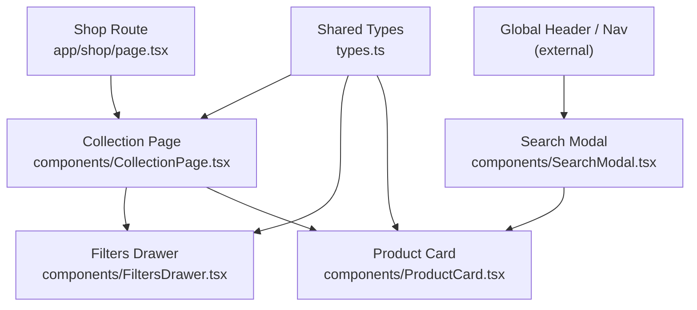
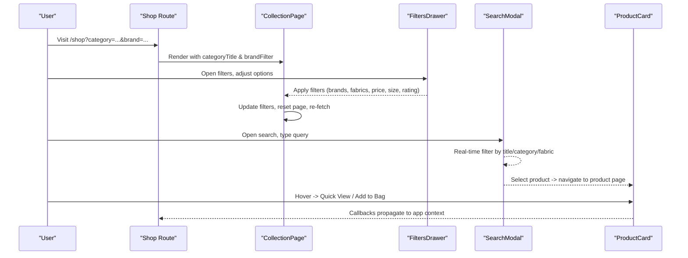
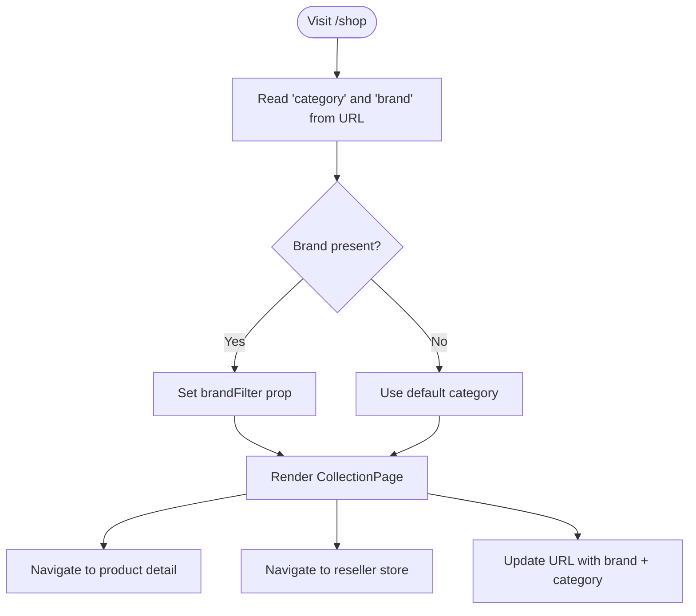
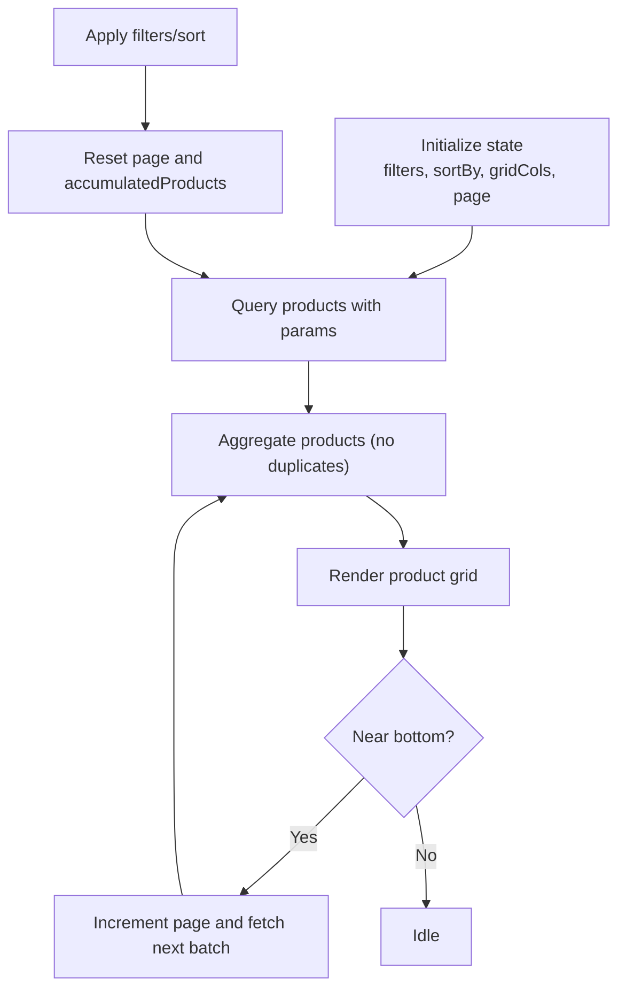
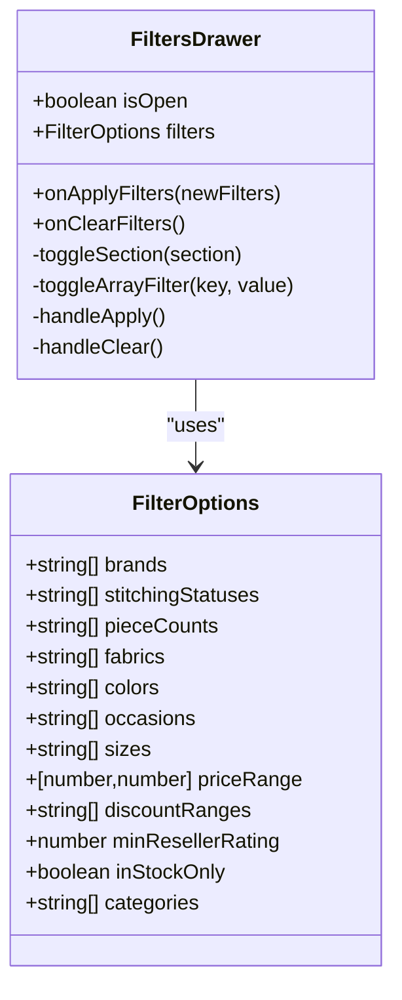
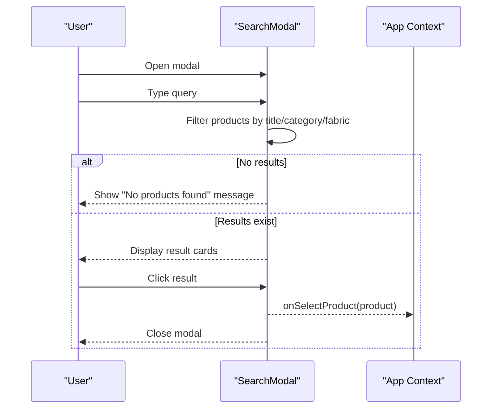
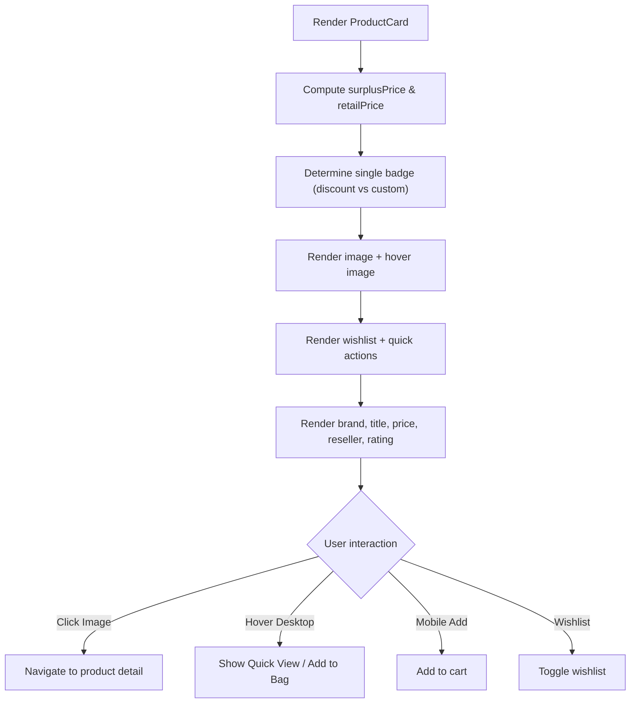
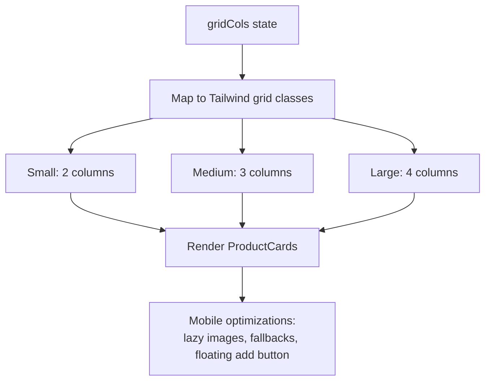
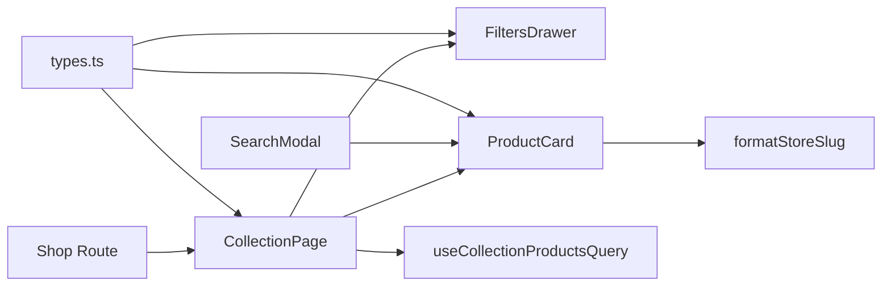

# Product Discovery

<cite>
**Referenced Files in This Document**
- [page.tsx](file://app/shop/page.tsx)
- [CollectionPage.tsx](file://components/CollectionPage.tsx)
- [FiltersDrawer.tsx](file://components/FiltersDrawer.tsx)
- [SearchModal.tsx](file://components/SearchModal.tsx)
- [ProductCard.tsx](file://components/ProductCard.tsx)
- [types.ts](file://types.ts)
</cite>

## Table of Contents
1. [Introduction](#introduction)
2. [Project Structure](#project-structure)
3. [Core Components](#core-components)
4. [Architecture Overview](#architecture-overview)
5. [Detailed Component Analysis](#detailed-component-analysis)
6. [Dependency Analysis](#dependency-analysis)
7. [Performance Considerations](#performance-considerations)
8. [Troubleshooting Guide](#troubleshooting-guide)
9. [Conclusion](#conclusion)

## Introduction
This document explains the product discovery system for the Zebaish storefront, focusing on the shop page architecture, category navigation, collection browsing, advanced filtering, search modal behavior, product card presentation, and responsive grid layout strategies. The goal is to make the implementation clear for both technical and non-technical readers while providing precise references to source files.

## Project Structure
The product discovery flow centers around a Next.js client-side shop route that composes reusable UI components:
- Shop route orchestrates URL-based category and brand selection and wires up global cart/wishlist actions.
- CollectionPage renders the product listing toolbar, filters, sorting, grid layout, and infinite scroll.
- FiltersDrawer provides an advanced filter panel with accordion sections for brands, fabrics, price range, sizes, ratings, and more.
- SearchModal offers a full-screen search experience with real-time results and popular suggestions.
- ProductCard displays product visuals, pricing, badges, quick actions, and reseller information.
- types.ts defines shared data models including Product and FilterOptions.

**Diagram sources**
- [page.tsx:10-61](file://app/shop/page.tsx#L10-L61)
- [CollectionPage.tsx:10-22](file://components/CollectionPage.tsx#L10-L22)
- [FiltersDrawer.tsx:7-14](file://components/FiltersDrawer.tsx#L7-L14)
- [SearchModal.tsx:6-10](file://components/SearchModal.tsx#L6-L10)
- [ProductCard.tsx:7-16](file://components/ProductCard.tsx#L7-L16)
- [types.ts:15-65](file://types.ts#L15-L65)
- [types.ts:226-239](file://types.ts#L226-L239)

**Section sources**
- [page.tsx:10-61](file://app/shop/page.tsx#L10-L61)
- [CollectionPage.tsx:10-22](file://components/CollectionPage.tsx#L10-L22)
- [FiltersDrawer.tsx:7-14](file://components/FiltersDrawer.tsx#L7-L14)
- [SearchModal.tsx:6-10](file://components/SearchModal.tsx#L6-L10)
- [ProductCard.tsx:7-16](file://components/ProductCard.tsx#L7-L16)
- [types.ts:15-65](file://types.ts#L15-L65)
- [types.ts:226-239](file://types.ts#L226-L239)

## Core Components
- Shop Route: Reads query parameters for category and brand, maps them into props for CollectionPage, and handles navigation to product pages and reseller stores. It also updates URL state when selecting a brand.
- CollectionPage: Manages local filter state, sorting, grid columns, active filter chips, and infinite scroll. It fetches paginated products via a query hook and aggregates results for continuous loading.
- FiltersDrawer: Provides accordion-style filter sections (brand, fabric, price range, size, rating), with apply/clear actions and local state synced to parent filters.
- SearchModal: Implements a modal overlay with a text input, real-time filtering across title/category/fabric, and popular search suggestions. Selecting a result navigates to the product detail.
- ProductCard: Renders product image(s), hover effects, discount/badge logic, quick view/add-to-cart/wishlist actions, price display, reseller link, and rating/review count.

**Section sources**
- [page.tsx:10-61](file://app/shop/page.tsx#L10-L61)
- [CollectionPage.tsx:24-101](file://components/CollectionPage.tsx#L24-L101)
- [FiltersDrawer.tsx:49-108](file://components/FiltersDrawer.tsx#L49-L108)
- [SearchModal.tsx:12-28](file://components/SearchModal.tsx#L12-L28)
- [ProductCard.tsx:18-87](file://components/ProductCard.tsx#L18-L87)

## Architecture Overview
The product discovery architecture follows a unidirectional data flow:
- User interactions (filters, sort, grid columns, search) update local state or URL params.
- CollectionPage composes these states into query parameters and triggers data fetching.
- Results are aggregated for infinite scroll and rendered as ProductCard instances.
- Global actions (quick view, add to cart, wishlist toggle) are lifted to the app context and passed down as callbacks.

**Diagram sources**
- [page.tsx:10-61](file://app/shop/page.tsx#L10-L61)
- [CollectionPage.tsx:24-101](file://components/CollectionPage.tsx#L24-L101)
- [FiltersDrawer.tsx:49-108](file://components/FiltersDrawer.tsx#L49-L108)
- [SearchModal.tsx:12-28](file://components/SearchModal.tsx#L12-L28)
- [ProductCard.tsx:18-87](file://components/ProductCard.tsx#L18-L87)

## Detailed Component Analysis

### Shop Page Architecture and Category Navigation
- Query-driven category and brand selection:
  - Reads `category` and `brand` from URL search params.
  - Defaults to a broad category if none provided.
  - Updates URL when selecting a brand, ensuring shareable links and back-button support.
- Navigation handlers:
  - Product selection routes to `/product/[id]`.
  - Reseller selection formats store slug and navigates to the reseller storefront.
  - Home navigation resets to root.

**Diagram sources**
- [page.tsx:10-47](file://app/shop/page.tsx#L10-L47)
- [page.tsx:49-61](file://app/shop/page.tsx#L49-L61)

**Section sources**
- [page.tsx:10-61](file://app/shop/page.tsx#L10-L61)

### Collection Browsing and Infinite Scroll
- State management:
  - Local state tracks accumulated products, current page, filters, sort order, and grid column count.
  - Brand filter prop syncs into local filters.
- Data fetching:
  - Uses a query hook to fetch paginated products with stale caching.
  - Aggregates new pages without duplicates for seamless infinite scroll.
- Sorting and grid:
  - Sort options include featured, newest, price ascending/descending, best discount, and most popular.
  - Grid switcher supports 2, 3, or 4 columns with responsive defaults.
- Active filters:
  - Displays removable chips for each active filter dimension.
  - Provides a “Clear All” action to reset filters.

**Diagram sources**
- [CollectionPage.tsx:24-101](file://components/CollectionPage.tsx#L24-L101)
- [CollectionPage.tsx:107-121](file://components/CollectionPage.tsx#L107-L121)
- [CollectionPage.tsx:126-131](file://components/CollectionPage.tsx#L126-L131)
- [CollectionPage.tsx:439-512](file://components/CollectionPage.tsx#L439-L512)
- [CollectionPage.tsx:657-677](file://components/CollectionPage.tsx#L657-L677)

**Section sources**
- [CollectionPage.tsx:24-101](file://components/CollectionPage.tsx#L24-L101)
- [CollectionPage.tsx:107-121](file://components/CollectionPage.tsx#L107-L121)
- [CollectionPage.tsx:126-131](file://components/CollectionPage.tsx#L126-L131)
- [CollectionPage.tsx:439-512](file://components/CollectionPage.tsx#L439-L512)
- [CollectionPage.tsx:657-677](file://components/CollectionPage.tsx#L657-L677)

### Advanced Filtering System
- Filter dimensions supported:
  - Brands: multi-select checkboxes.
  - Fabrics: multi-select checkboxes.
  - Price Range: slider controlling upper bound with formatted currency labels.
  - Size: multi-select buttons.
  - Reseller Rating: minimum star threshold selection.
  - Additional fields exist in FilterOptions (stitching statuses, piece counts, colors, occasions, discount ranges, stock availability, categories).
- Interaction model:
  - Accordion sections expand/collapse.
  - Local state mirrors parent filters until Apply is clicked.
  - Clear All resets all filter fields to defaults.
- Integration:
  - Parent component receives updated filters and recomputes queries.

**Diagram sources**
- [FiltersDrawer.tsx:7-14](file://components/FiltersDrawer.tsx#L7-L14)
- [FiltersDrawer.tsx:49-108](file://components/FiltersDrawer.tsx#L49-L108)
- [types.ts:226-239](file://types.ts#L226-L239)

**Section sources**
- [FiltersDrawer.tsx:49-108](file://components/FiltersDrawer.tsx#L49-L108)
- [types.ts:226-239](file://types.ts#L226-L239)

### Search Modal Implementation
- Behavior:
  - Full-screen modal with backdrop blur and close-on-backdrop click.
  - Auto-focused input field.
  - Real-time filtering over a combined product set based on title, category, and fabric.
  - Popular searches displayed when input is empty; clicking a suggestion populates the query.
  - Result items show thumbnail, category, title, and price; clicking selects the product and closes the modal.
- Integration:
  - Accepts onSelectProduct callback to navigate to product details.

**Diagram sources**
- [SearchModal.tsx:12-28](file://components/SearchModal.tsx#L12-L28)
- [SearchModal.tsx:30-57](file://components/SearchModal.tsx#L30-L57)
- [SearchModal.tsx:59-114](file://components/SearchModal.tsx#L59-L114)

**Section sources**
- [SearchModal.tsx:12-28](file://components/SearchModal.tsx#L12-L28)
- [SearchModal.tsx:30-57](file://components/SearchModal.tsx#L30-L57)
- [SearchModal.tsx:59-114](file://components/SearchModal.tsx#L59-L114)

### Product Card Component
- Visuals:
  - Aspect-ratio image container with optional hover image overlay.
  - Single clean badge pill showing either discount percentage or a custom badge (deduplicated to avoid overlap).
  - Wishlist button toggles state and visual indicator.
- Actions:
  - Desktop hover overlay exposes Quick View and Add to Bag.
  - Mobile floating Add to Bag icon for quick access.
  - Clicking image or title navigates to product detail unless overridden by onSelectProduct.
- Pricing and metadata:
  - Computes surplus selling price and retail price to determine discount display.
  - Shows currency-formatted prices with strikethrough for original retail when discounted.
  - Displays reseller name with clickable link to reseller store.
  - Shows average rating and review count.

**Diagram sources**
- [ProductCard.tsx:18-87](file://components/ProductCard.tsx#L18-L87)
- [ProductCard.tsx:89-195](file://components/ProductCard.tsx#L89-L195)
- [ProductCard.tsx:197-267](file://components/ProductCard.tsx#L197-L267)

**Section sources**
- [ProductCard.tsx:18-87](file://components/ProductCard.tsx#L18-L87)
- [ProductCard.tsx:89-195](file://components/ProductCard.tsx#L89-L195)
- [ProductCard.tsx:197-267](file://components/ProductCard.tsx#L197-L267)

### Responsive Grid Layout and Mobile Optimization
- Grid configuration:
  - Controlled by gridCols state with values 2, 3, or 4.
  - Tailwind classes map to responsive breakpoints:
    - 2 columns on small screens.
    - 3 columns on medium screens.
    - 4 columns on large screens.
- Toolbar responsiveness:
  - Filter button adapts sizing across breakpoints.
  - Grid switcher hidden on mobile; sort dropdown remains accessible.
- Product card optimizations:
  - Lazy loading images except for priority items.
  - Fallback placeholder image on load errors.
  - Mobile-specific floating Add to Bag button.
  - Compact typography and spacing for smaller screens.

**Diagram sources**
- [CollectionPage.tsx:38-39](file://components/CollectionPage.tsx#L38-L39)
- [CollectionPage.tsx:351-437](file://components/CollectionPage.tsx#L351-L437)
- [CollectionPage.tsx:657-677](file://components/CollectionPage.tsx#L657-L677)
- [ProductCard.tsx:96-120](file://components/ProductCard.tsx#L96-L120)
- [ProductCard.tsx:182-194](file://components/ProductCard.tsx#L182-L194)

**Section sources**
- [CollectionPage.tsx:38-39](file://components/CollectionPage.tsx#L38-L39)
- [CollectionPage.tsx:351-437](file://components/CollectionPage.tsx#L351-L437)
- [CollectionPage.tsx:657-677](file://components/CollectionPage.tsx#L657-L677)
- [ProductCard.tsx:96-120](file://components/ProductCard.tsx#L96-L120)
- [ProductCard.tsx:182-194](file://components/ProductCard.tsx#L182-L194)

## Dependency Analysis
- Component coupling:
  - Shop Route depends on CollectionPage and global app context for cart/wishlist.
  - CollectionPage depends on FiltersDrawer, ProductCard, and query hooks for data.
  - FiltersDrawer depends on FilterOptions type and provides filtered state to parent.
  - SearchModal depends on product data and invokes onSelectProduct callback.
  - ProductCard depends on Product type and seller service utilities for slug formatting.
- External integrations:
  - Query hooks fetch paginated products and manage caching.
  - Seller service utility formats store slugs for navigation.

**Diagram sources**
- [page.tsx:10-61](file://app/shop/page.tsx#L10-L61)
- [CollectionPage.tsx:1-8](file://components/CollectionPage.tsx#L1-L8)
- [FiltersDrawer.tsx:1-4](file://components/FiltersDrawer.tsx#L1-L4)
- [SearchModal.tsx:1-4](file://components/SearchModal.tsx#L1-L4)
- [ProductCard.tsx:1-5](file://components/ProductCard.tsx#L1-L5)
- [types.ts:15-65](file://types.ts#L15-L65)
- [types.ts:226-239](file://types.ts#L226-L239)

**Section sources**
- [page.tsx:10-61](file://app/shop/page.tsx#L10-L61)
- [CollectionPage.tsx:1-8](file://components/CollectionPage.tsx#L1-L8)
- [FiltersDrawer.tsx:1-4](file://components/FiltersDrawer.tsx#L1-L4)
- [SearchModal.tsx:1-4](file://components/SearchModal.tsx#L1-L4)
- [ProductCard.tsx:1-5](file://components/ProductCard.tsx#L1-L5)
- [types.ts:15-65](file://types.ts#L15-L65)
- [types.ts:226-239](file://types.ts#L226-L239)

## Performance Considerations
- Infinite scroll:
  - Accumulates products without duplicates using a Set of IDs to ensure O(1) lookup during aggregation.
  - Debounces scroll events implicitly via passive listeners and checks isLoading/isFetching flags to prevent redundant requests.
- Caching:
  - Query results use staleTime to reduce network calls and improve perceived performance.
- Rendering efficiency:
  - ProductCard uses React.memo to minimize re-renders when props do not change.
  - Wishlist lookups use a precomputed Set for O(1) membership checks.
- Image optimization:
  - Lazy loading for non-priority images and fallback placeholders reduce initial payload and improve LCP.
- Responsive design:
  - Tailwind utility classes provide efficient responsive layouts without heavy media queries.

[No sources needed since this section provides general guidance]

## Troubleshooting Guide
- Empty product listings:
  - Verify filter combinations are not too restrictive; use “Clear All” or “Reset All Filters”.
  - Check that categoryTitle and brandFilter props are correctly passed from the shop route.
- Infinite scroll not loading more:
  - Ensure hasMore flag is true and that isLoading/isFetching are not blocking further requests.
  - Confirm window scroll thresholds and event listener registration.
- Search modal not returning results:
  - Validate that product data includes title, category, and fabric fields.
  - Ensure onSelectProduct callback is wired to navigate to product detail.
- Incorrect pricing or badge display:
  - Confirm surplus_selling_price and original_retail_price fields are populated.
  - Check discountPercentage calculation and badge deduplication logic.

**Section sources**
- [CollectionPage.tsx:616-654](file://components/CollectionPage.tsx#L616-L654)
- [CollectionPage.tsx:107-121](file://components/CollectionPage.tsx#L107-L121)
- [SearchModal.tsx:21-28](file://components/SearchModal.tsx#L21-L28)
- [ProductCard.tsx:38-87](file://components/ProductCard.tsx#L38-L87)

## Conclusion
The Zebaish product discovery system combines a robust shop route, a flexible collection browsing interface, an advanced filter drawer, a real-time search modal, and a rich product card component. It leverages responsive grid layouts, infinite scroll, and efficient state management to deliver a performant and user-friendly shopping experience. By adhering to the documented patterns and leveraging the referenced components, developers can extend and maintain the discovery features effectively.

[No sources needed since this section summarizes without analyzing specific files]