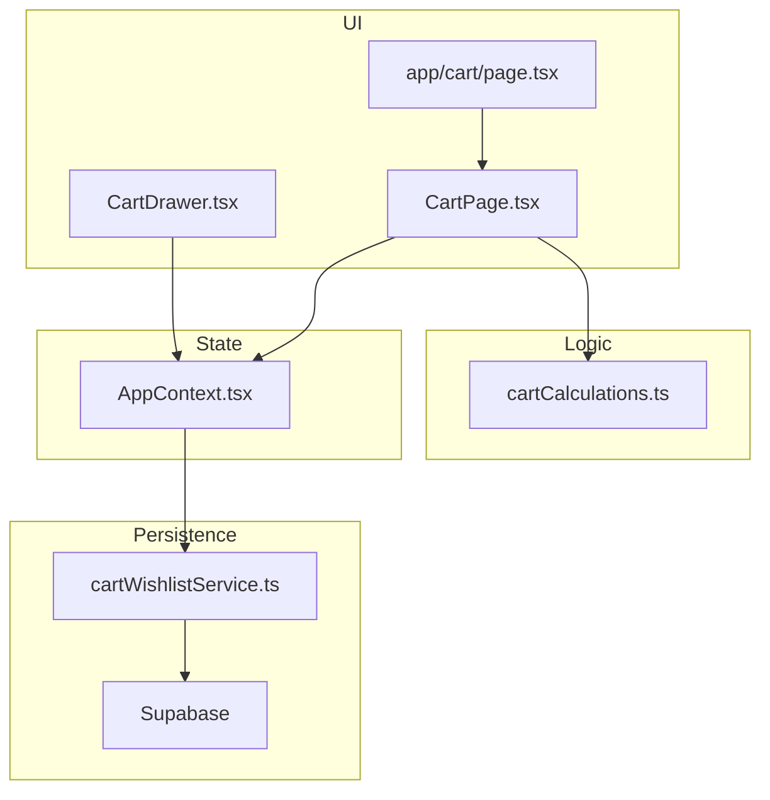
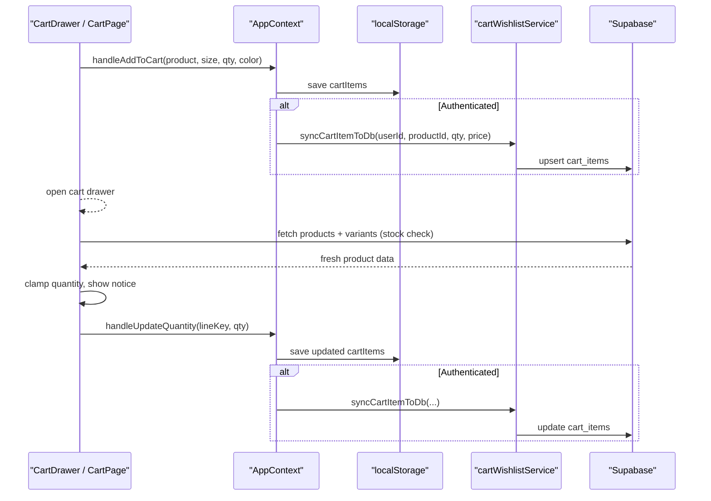
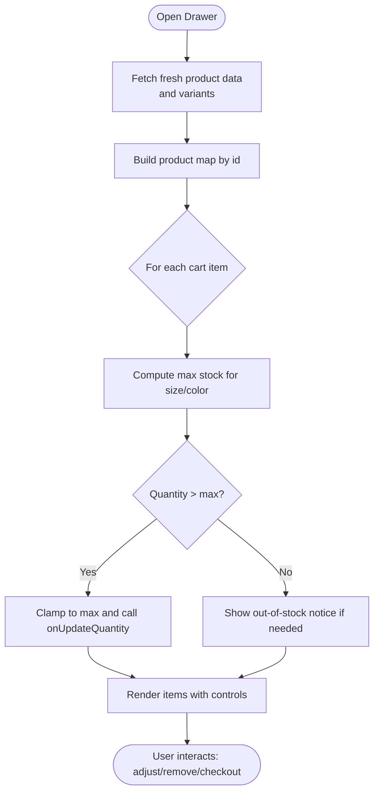
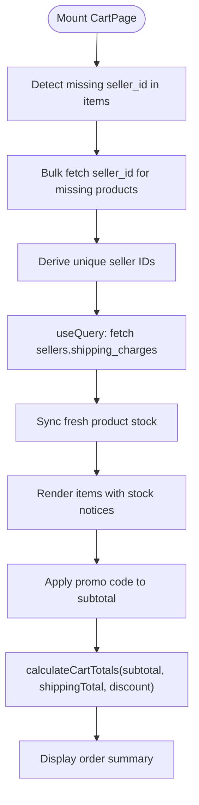
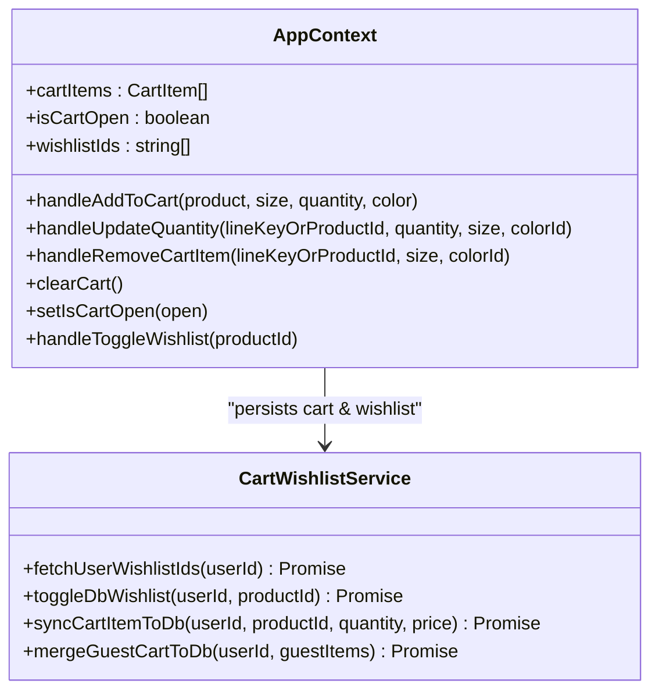
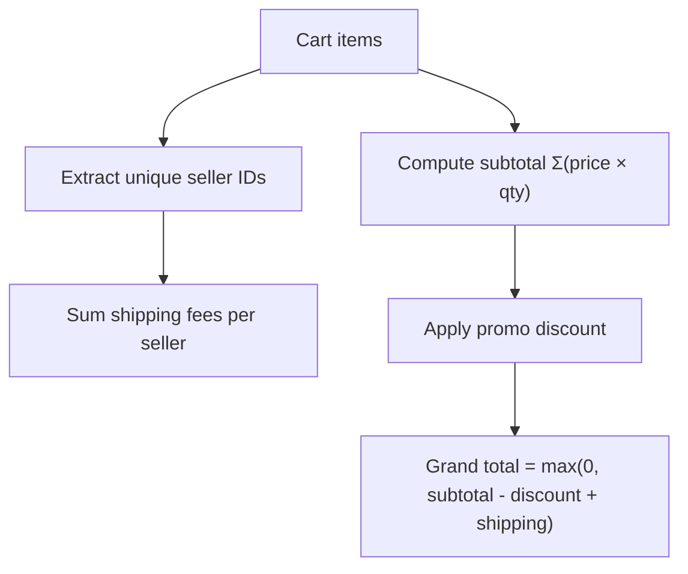
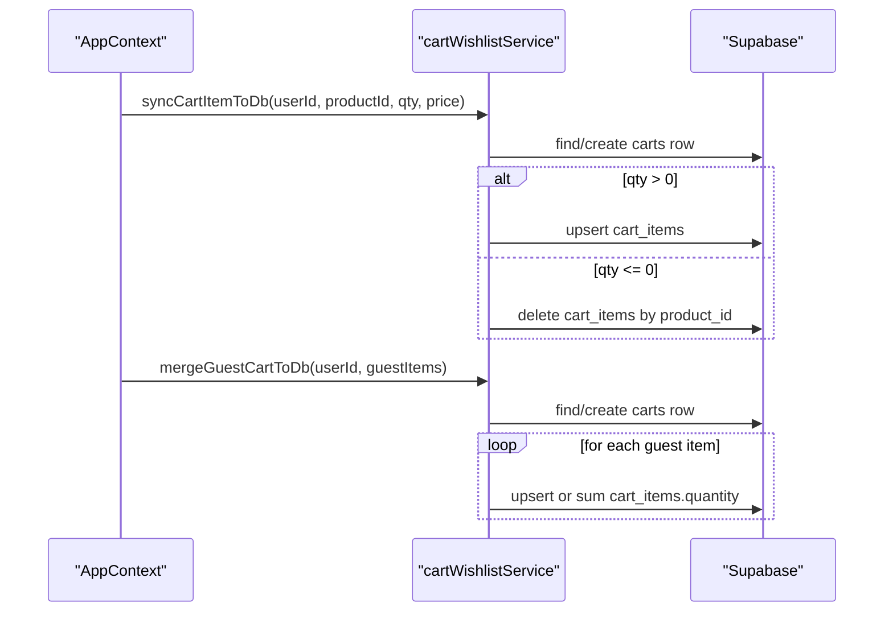
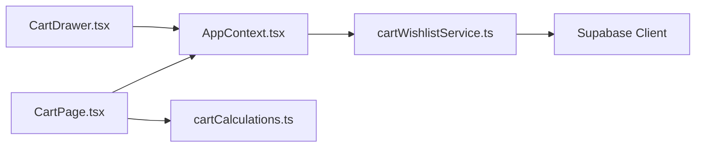

# Shopping Cart Management

<cite>
**Referenced Files in This Document**   
- [CartDrawer.tsx](file://components/CartDrawer.tsx)
- [CartPage.tsx](file://components/CartPage.tsx)
- [AppContext.tsx](file://components/context/AppContext.tsx)
- [cartWishlistService.ts](file://src/api/cartWishlistService.ts)
- [cartCalculations.ts](file://src/utils/cartCalculations.ts)
- [page.tsx](file://app/cart/page.tsx)
</cite>

## Table of Contents
1. [Introduction](#introduction)
2. [Project Structure](#project-structure)
3. [Core Components](#core-components)
4. [Architecture Overview](#architecture-overview)
5. [Detailed Component Analysis](#detailed-component-analysis)
6. [Dependency Analysis](#dependency-analysis)
7. [Performance Considerations](#performance-considerations)
8. [Troubleshooting Guide](#troubleshooting-guide)
9. [Conclusion](#conclusion)

## Introduction
This document explains the shopping cart management system, focusing on:
- The slide-out cart drawer with real-time stock validation and user feedback.
- The global cart context provider that manages state, persistence, and synchronization.
- Cart operations including adding items, adjusting quantities, removing items, and wishlist integration.
- Cart calculations for subtotal, shipping costs, discounts, and grand totals.
- The service layer that persists cart and wishlist data to Supabase.
- Mobile-responsive design patterns and performance optimizations for large carts.

## Project Structure
The cart feature spans UI components, a global context provider, utility functions, and API services:
- UI components:
  - Slide-out drawer for quick cart review and checkout actions.
  - Full-page cart view with order summary, promo codes, and seller-aware shipping.
- Global state:
  - Context provider managing cart items, wishlist state, and persistence.
- Utilities:
  - Shared calculation helpers for totals and seller aggregation.
- Services:
  - Supabase-based persistence for cart and wishlist.

**Diagram sources**
- [CartDrawer.tsx:1-349](file://components/CartDrawer.tsx#L1-L349)
- [CartPage.tsx:1-498](file://components/CartPage.tsx#L1-L498)
- [AppContext.tsx:1-367](file://components/context/AppContext.tsx#L1-L367)
- [cartCalculations.ts:1-86](file://src/utils/cartCalculations.ts#L1-L86)
- [cartWishlistService.ts:1-223](file://src/api/cartWishlistService.ts#L1-L223)
- [page.tsx:1-34](file://app/cart/page.tsx#L1-L34)

**Section sources**
- [CartDrawer.tsx:1-349](file://components/CartDrawer.tsx#L1-L349)
- [CartPage.tsx:1-498](file://components/CartPage.tsx#L1-L498)
- [AppContext.tsx:1-367](file://components/context/AppContext.tsx#L1-L367)
- [cartCalculations.ts:1-86](file://src/utils/cartCalculations.ts#L1-L86)
- [cartWishlistService.ts:1-223](file://src/api/cartWishlistService.ts#L1-L223)
- [page.tsx:1-34](file://app/cart/page.tsx#L1-L34)

## Core Components
- CartDrawer: A slide-out panel showing current cart items, allowing quantity adjustments, removals, and checkout navigation. It validates available stock against fresh database values and shows notices when quantities are adjusted or items are out of stock.
- CartPage: A full-page cart view with item list, promo code application, per-seller shipping calculation, and order summary. It also performs real-time stock validation and displays availability notices.
- AppContext: Global provider exposing cart state and actions (add, update, remove, clear), wishlist state and toggle, and persistence logic to localStorage and Supabase. It merges guest cart into DB upon login and fetches wishlist IDs for authenticated users.
- cartWishlistService: API layer for Supabase interactions to persist cart items and manage wishlist records.
- cartCalculations: Utility functions to compute subtotal, shipping total, and grand total, and to extract unique seller IDs from cart items.

**Section sources**
- [CartDrawer.tsx:1-349](file://components/CartDrawer.tsx#L1-L349)
- [CartPage.tsx:1-498](file://components/CartPage.tsx#L1-L498)
- [AppContext.tsx:1-367](file://components/context/AppContext.tsx#L1-L367)
- [cartWishlistService.ts:1-223](file://src/api/cartWishlistService.ts#L1-L223)
- [cartCalculations.ts:1-86](file://src/utils/cartCalculations.ts#L1-L86)

## Architecture Overview
The cart system follows a unidirectional data flow:
- UI components dispatch actions through the context provider.
- The provider updates local state and persists changes to localStorage and Supabase.
- Real-time stock checks query Supabase to clamp quantities and show notices.
- Shipping and totals are computed using shared utilities and cached via React Query where applicable.

**Diagram sources**
- [AppContext.tsx:165-254](file://components/context/AppContext.tsx#L165-L254)
- [cartWishlistService.ts:96-163](file://src/api/cartWishlistService.ts#L96-L163)
- [CartDrawer.tsx:29-105](file://components/CartDrawer.tsx#L29-L105)
- [CartPage.tsx:120-196](file://components/CartPage.tsx#L120-L196)

## Detailed Component Analysis

### CartDrawer: Slide-Out Interface and Real-Time Updates
Responsibilities:
- Render a slide-out panel with backdrop and close control.
- Display cart items with image, title, options, price, and stock status.
- Provide quantity controls clamped to available stock.
- Show notices when stock is insufficient or quantity was auto-adjusted.
- Compute subtotal and provide checkout and view-cart navigation.

Real-time stock validation:
- On open, fetches fresh product data including variant quantities.
- Computes max allowed stock per line and adjusts quantity if needed.
- Displays contextual notices for out-of-stock or adjusted quantities.

Mobile responsiveness:
- Uses responsive spacing and typography classes.
- Full-height drawer with scrollable content area.

**Diagram sources**
- [CartDrawer.tsx:29-105](file://components/CartDrawer.tsx#L29-L105)
- [CartDrawer.tsx:109-136](file://components/CartDrawer.tsx#L109-L136)
- [CartDrawer.tsx:138-145](file://components/CartDrawer.tsx#L138-L145)

**Section sources**
- [CartDrawer.tsx:1-349](file://components/CartDrawer.tsx#L1-L349)

### CartPage: Full Cart View, Promo Codes, and Seller-Aware Shipping
Responsibilities:
- List cart items with stock validation and notices.
- Allow quantity adjustments and item removal.
- Apply promo codes locally to reduce subtotal.
- Fetch shipping charges per seller and aggregate totals.
- Display order summary with subtotal, discount, shipping, and grand total.

Promo code handling:
- Validates a hardcoded promo code and applies a percentage discount to subtotal.
- Shows success or error messages.

Shipping and totals:
- Extracts unique seller IDs from cart items.
- Bulk-fetches seller shipping charges using React Query.
- Computes totals using shared utility function.

**Diagram sources**
- [CartPage.tsx:37-83](file://components/CartPage.tsx#L37-L83)
- [CartPage.tsx:87-118](file://components/CartPage.tsx#L87-L118)
- [CartPage.tsx:120-196](file://components/CartPage.tsx#L120-L196)
- [CartPage.tsx:243-257](file://components/CartPage.tsx#L243-L257)
- [cartCalculations.ts:52-85](file://src/utils/cartCalculations.ts#L52-L85)

**Section sources**
- [CartPage.tsx:1-498](file://components/CartPage.tsx#L1-L498)
- [cartCalculations.ts:1-86](file://src/utils/cartCalculations.ts#L1-L86)

### AppContext: Global State, Persistence, and Wishlist Integration
Responsibilities:
- Manage cart items array and expose actions: add, update, remove, clear.
- Persist cart to localStorage after hydration; load on mount with validation.
- Sync cart changes to Supabase for authenticated users.
- Merge guest cart into DB upon login.
- Manage wishlist state: fetch IDs, toggle items with optimistic updates and rollback on failure.
- Expose UI toggles for drawers/modals and toast notifications.

Data flow highlights:
- Add-to-cart merges existing lines based on product ID, size, and color.
- Update/remove routes to DB sync only when authenticated.
- Wishlist toggle performs optimistic UI update then reconciles with DB.

**Diagram sources**
- [AppContext.tsx:14-53](file://components/context/AppContext.tsx#L14-L53)
- [AppContext.tsx:84-163](file://components/context/AppContext.tsx#L84-L163)
- [AppContext.tsx:165-331](file://components/context/AppContext.tsx#L165-L331)
- [cartWishlistService.ts:9-88](file://src/api/cartWishlistService.ts#L9-L88)
- [cartWishlistService.ts:96-223](file://src/api/cartWishlistService.ts#L96-L223)

**Section sources**
- [AppContext.tsx:1-367](file://components/context/AppContext.tsx#L1-L367)
- [cartWishlistService.ts:1-223](file://src/api/cartWishlistService.ts#L1-L223)

### Cart Operations
- Adding items:
  - Merges by line key (product ID, size, color).
  - Persists to localStorage immediately.
  - If authenticated, syncs to Supabase cart_items.
- Quantity adjustments:
  - Clamps to minimum 1 and maximum available stock.
  - Updates context and persists to localStorage and Supabase.
- Item removal:
  - Removes line from state and clears from Supabase by setting quantity to 0.
- Wishlist integration:
  - Fetches wishlist IDs for authenticated users.
  - Toggles items with optimistic UI and DB reconciliation.

**Section sources**
- [AppContext.tsx:165-254](file://components/context/AppContext.tsx#L165-L254)
- [AppContext.tsx:256-331](file://components/context/AppContext.tsx#L256-L331)
- [cartWishlistService.ts:9-88](file://src/api/cartWishlistService.ts#L9-L88)
- [cartWishlistService.ts:96-223](file://src/api/cartWishlistService.ts#L96-L223)

### Cart Calculations
- Subtotal: Sum of price × quantity across all items.
- Shipping: Aggregated per unique seller present in the cart.
- Discounts: Applied to subtotal before adding shipping.
- Grand total: Max(0, subtotal - discount + shipping).

**Diagram sources**
- [cartCalculations.ts:52-85](file://src/utils/cartCalculations.ts#L52-L85)

**Section sources**
- [cartCalculations.ts:1-86](file://src/utils/cartCalculations.ts#L1-L86)

### Cart Service Layer: Supabase Persistence
- Cart persistence:
  - Upserts cart_items per product with quantity and price.
  - Deletes line when quantity is set to 0.
- Guest merge:
  - Upon login, merges local guest cart into DB cart, summing quantities for duplicates.
- Wishlist:
  - Creates or finds user’s wishlist record.
  - Adds/removes wishlist_items entries.

**Diagram sources**
- [cartWishlistService.ts:96-163](file://src/api/cartWishlistService.ts#L96-L163)
- [cartWishlistService.ts:168-223](file://src/api/cartWishlistService.ts#L168-L223)

**Section sources**
- [cartWishlistService.ts:1-223](file://src/api/cartWishlistService.ts#L1-L223)

### Mobile-Responsive Design Patterns
- CartDrawer:
  - Fixed overlay with backdrop blur and right-aligned panel.
  - Scrollable item list with compact typography and spacing.
  - Touch-friendly controls for quantity adjustment.
- CartPage:
  - Responsive grid layout switching between single-column and multi-column views.
  - Sticky order summary box on larger screens.
  - Adaptive text sizes and button layouts for mobile.

[No sources needed since this section summarizes design patterns without analyzing specific files]

## Dependency Analysis
High-level dependencies:
- UI components depend on context provider for state and actions.
- CartPage depends on cartCalculations for totals and uses React Query for shipping data.
- AppContext depends on cartWishlistService for Supabase operations.
- cartWishlistService depends on Supabase client.

**Diagram sources**
- [CartDrawer.tsx:1-349](file://components/CartDrawer.tsx#L1-L349)
- [CartPage.tsx:1-498](file://components/CartPage.tsx#L1-L498)
- [AppContext.tsx:1-367](file://components/context/AppContext.tsx#L1-L367)
- [cartCalculations.ts:1-86](file://src/utils/cartCalculations.ts#L1-L86)
- [cartWishlistService.ts:1-223](file://src/api/cartWishlistService.ts#L1-L223)

**Section sources**
- [CartDrawer.tsx:1-349](file://components/CartDrawer.tsx#L1-L349)
- [CartPage.tsx:1-498](file://components/CartPage.tsx#L1-L498)
- [AppContext.tsx:1-367](file://components/context/AppContext.tsx#L1-L367)
- [cartCalculations.ts:1-86](file://src/utils/cartCalculations.ts#L1-L86)
- [cartWishlistService.ts:1-223](file://src/api/cartWishlistService.ts#L1-L223)

## Performance Considerations
- Real-time stock validation:
  - Both drawer and page fetch fresh product data and clamp quantities to avoid overselling.
  - Notices inform users of adjustments and stockouts.
- Shipping queries:
  - CartPage uses React Query with a stable query key derived from unique seller IDs and caches results for three minutes to reduce network overhead.
- LocalStorage persistence:
  - Cart state is saved after initial hydration to prevent SSR mismatches and ensure fast re-renders.
- Optimistic wishlist updates:
  - Immediate UI feedback with rollback on failure improves perceived performance.
- Large cart considerations:
  - Avoid unnecessary re-renders by deriving totals with memoization.
  - Batch seller shipping queries instead of per-item requests.
  - Consider virtualization for very long item lists if needed.

[No sources needed since this section provides general guidance]

## Troubleshooting Guide
Common issues and resolutions:
- Quantity exceeds available stock:
  - System clamps quantity and shows a notice. Verify product variants and stock fields in the database.
- Out-of-stock items:
  - Notice indicates zero availability. Remove or wait for restock.
- Shipping charges not loading:
  - Check React Query error state and retry mechanism. Ensure sellers.shipping_charges exists.
- Wishlist toggle fails:
  - Reverts optimistic state and shows an error message. Verify Supabase policies and user authentication.
- Cart not persisting:
  - Confirm localStorage write permissions and that isCartLoaded flag is true before saving.

**Section sources**
- [CartDrawer.tsx:29-105](file://components/CartDrawer.tsx#L29-L105)
- [CartPage.tsx:87-118](file://components/CartPage.tsx#L87-L118)
- [AppContext.tsx:304-331](file://components/context/AppContext.tsx#L304-L331)

## Conclusion
The shopping cart system combines a responsive UI, robust state management, and reliable persistence:
- CartDrawer offers a streamlined experience with live stock validation.
- CartPage provides comprehensive order summaries with seller-aware shipping and promo support.
- AppContext centralizes cart and wishlist state with safe persistence and optimistic updates.
- cartWishlistService abstracts Supabase interactions for cart and wishlist.
- cartCalculations ensures accurate totals and shipping aggregation.

This architecture supports scalability, maintainability, and a smooth user experience across devices.