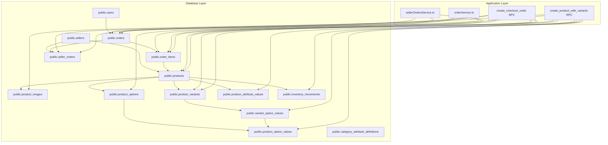
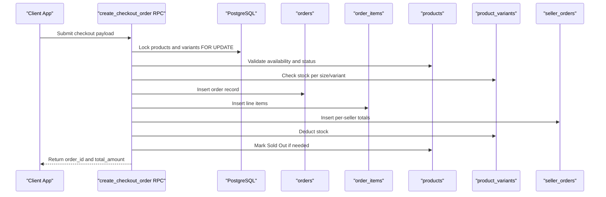
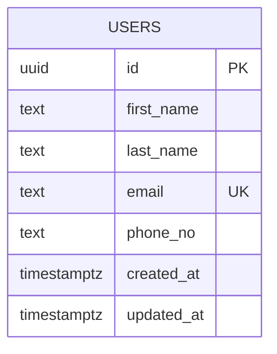
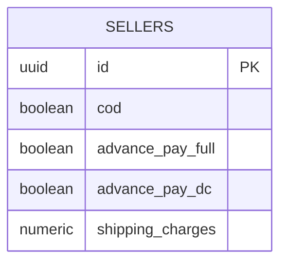
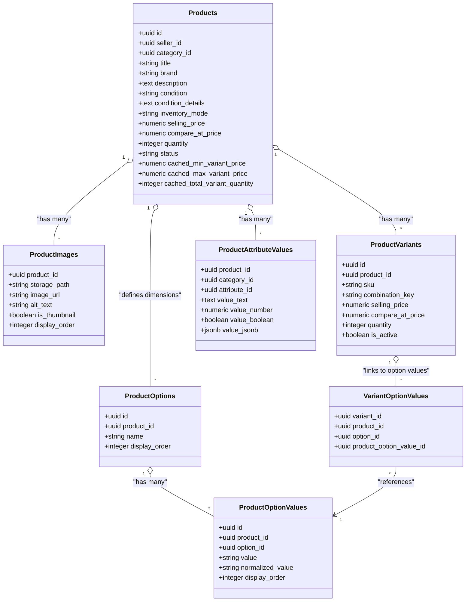
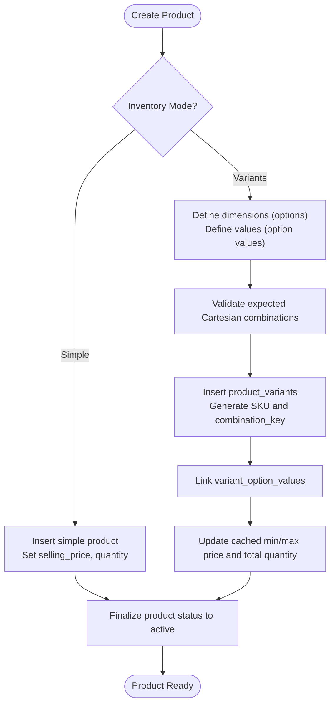
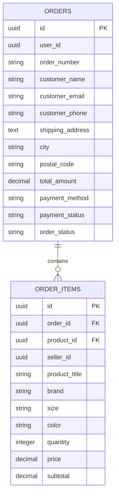
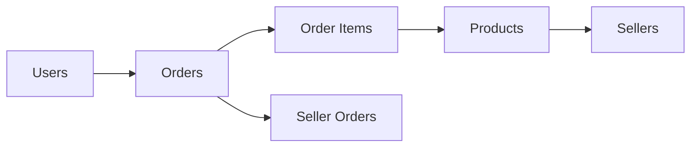
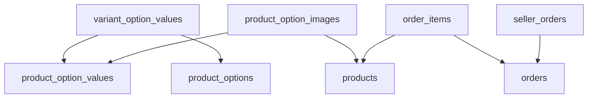
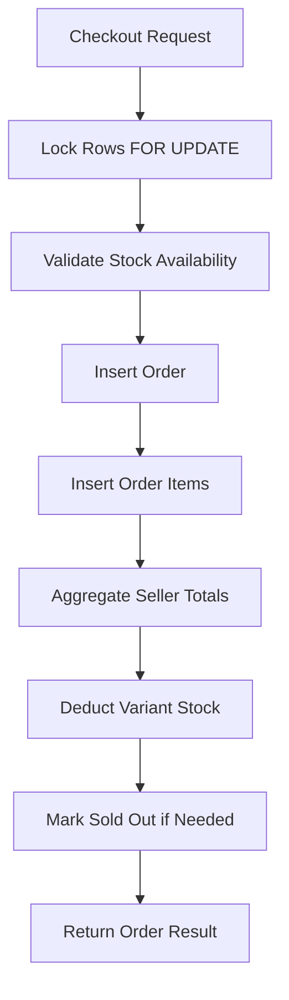

# Core Schema & Relationships

<cite>
**Referenced Files in This Document**
- [20261105_all_in_one_product_creation.sql](file://supabase/migrations/20261105_all_in_one_product_creation.sql)
- [20261106_create_users_table.sql](file://supabase/migrations/20261106_create_users_table.sql)
- [20261007_seller_shipping_payment.sql](file://supabase/migrations/20261007_seller_shipping_payment.sql)
- [supabase_checkout_migration.sql](file://supabase_checkout_migration.sql)
- [20261105_fix_variant_option_values.sql](file://supabase/migrations/20261105_fix_variant_option_values.sql)
- [20261105_product_option_images_fk.sql](file://supabase/migrations/20261105_product_option_images_fk.sql)
- [orderService.ts](file://src/api/orderService.ts)
- [sellerOrdersService.ts](file://src/api/sellerOrdersService.ts)
</cite>

## Table of Contents
1. [Introduction](#introduction)
2. [Project Structure](#project-structure)
3. [Core Components](#core-components)
4. [Architecture Overview](#architecture-overview)
5. [Detailed Component Analysis](#detailed-component-analysis)
6. [Dependency Analysis](#dependency-analysis)
7. [Performance Considerations](#performance-considerations)
8. [Troubleshooting Guide](#troubleshooting-guide)
9. [Conclusion](#conclusion)

## Introduction
This document describes the core database schema and relationships for the Zebaish platform. It focuses on the primary entities: users, products, product variants, orders, order items, sellers, and related catalog tables such as options, option values, attribute definitions, and inventory movements. It explains how multi-dimensional product variants are modeled, how customers and resellers relate to the data model, and what referential integrity rules apply. It also documents indexing strategies and performance considerations derived from the migrations and API usage patterns.

## Project Structure
The database schema is defined through Supabase PostgreSQL migrations under `supabase/migrations`, with additional checkout-related schema changes in a top-level SQL file. The frontend and services reference these tables via Supabase RPCs and relational queries.

**Diagram sources**
- [20261105_all_in_one_product_creation.sql:469-1037](file://supabase/migrations/20261105_all_in_one_product_creation.sql#L469-L1037)
- [supabase_checkout_migration.sql:13-223](file://supabase_checkout_migration.sql#L13-L223)
- [orderService.ts:527-561](file://src/api/orderService.ts#L527-L561)
- [sellerOrdersService.ts:249-296](file://src/api/sellerOrdersService.ts#L249-L296)

**Section sources**
- [20261105_all_in_one_product_creation.sql:1-1229](file://supabase/migrations/20261105_all_in_one_product_creation.sql#L1-L1229)
- [supabase_checkout_migration.sql:1-224](file://supabase_checkout_migration.sql#L1-L224)

## Core Components
This section summarizes the primary entities and their responsibilities.

- Users (customers): Customer profiles linked to authentication records.
- Sellers (resellers): Reseller accounts that own products and receive seller-specific order summaries.
- Products: Catalog entries owned by sellers, supporting simple or variant-based inventory modes.
- Product Images: Gallery images attached to products.
- Product Options and Option Values: Multi-dimensional attributes (e.g., sizes, colors).
- Product Variants: Concrete combinations of option values with per-variant pricing and stock.
- Variant Option Values: Links between variants and specific option values.
- Product Attribute Values: Category-driven attributes (text, number, boolean, select, multi-select).
- Orders: Customer-facing purchase records, optionally guest-checkout friendly.
- Order Items: Line items referencing products and capturing size/color metadata.
- Seller Orders: Per-seller aggregation of an order’s financial totals.
- Inventory Movements: Audit trail of stock changes for products and variants.

**Section sources**
- [20261106_create_users_table.sql:6-14](file://supabase/migrations/20261106_create_users_table.sql#L6-L14)
- [20261105_all_in_one_product_creation.sql:469-1037](file://supabase/migrations/20261105_all_in_one_product_creation.sql#L469-L1037)
- [supabase_checkout_migration.sql:90-179](file://supabase_checkout_migration.sql#L90-L179)

## Architecture Overview
The system uses two key RPCs to enforce business rules and maintain referential integrity:

- `create_product_with_variants`: Creates products, images, custom specs, category attributes, options, option values, variants, and inventory movements atomically. It validates dimensionality, uniqueness, image storage paths, and ensures complete Cartesian combinations.
- `create_checkout_order`: Validates stock, locks rows, inserts orders and order items, aggregates seller totals, updates variant stock, and marks products sold out when necessary.

**Diagram sources**
- [supabase_checkout_migration.sql:13-223](file://supabase_checkout_migration.sql#L13-L223)

**Section sources**
- [supabase_checkout_migration.sql:13-223](file://supabase_checkout_migration.sql#L13-L223)

## Detailed Component Analysis

### Users (Customers)
- Purpose: Store customer profile information alongside authentication identity.
- Key fields:
  - id: UUID primary key, references auth.users(id), cascading delete.
  - first_name: Required text.
  - last_name: Optional text.
  - email: Unique text.
  - phone_no: Optional text.
  - created_at, updated_at: Timestamps.
- Security: Row Level Security policies allow users to view/update/insert only their own profile.

**Diagram sources**
- [20261106_create_users_table.sql:6-14](file://supabase/migrations/20261106_create_users_table.sql#L6-L14)

**Section sources**
- [20261106_create_users_table.sql:6-39](file://supabase/migrations/20261106_create_users_table.sql#L6-L39)

### Sellers (Resellers)
- Purpose: Represent reseller accounts that list products and receive order summaries.
- Relevant fields:
  - cod, advance_pay_full, advance_pay_dc: Boolean flags controlling payment methods.
  - shipping_charges: Numeric field constrained to a valid range.
- Constraints:
  - Shipping charges must be within a defined range.
  - Advance payment flags are mutually exclusive.

**Diagram sources**
- [20261007_seller_shipping_payment.sql:6-34](file://supabase/migrations/20261007_seller_shipping_payment.sql#L6-L34)

**Section sources**
- [20261007_seller_shipping_payment.sql:1-35](file://supabase/migrations/20261007_seller_shipping_payment.sql#L1-L35)

### Products and Catalog Model
- Purpose: Define sellable items with optional multi-dimensional variants.
- Key concepts:
  - Inventory mode: Simple vs Variants.
  - Pricing: Selling price, compare-at price, cached min/max variant prices, total variant quantity.
  - Status: Draft during creation, then Active; Sold Out when all variants are depleted.
  - Attributes: Custom specifications and category-driven attribute values.
  - Images: Gallery images with storage path validation and URL isolation.

**Diagram sources**
- [20261105_all_in_one_product_creation.sql:469-1037](file://supabase/migrations/20261105_all_in_one_product_creation.sql#L469-L1037)
- [20261105_fix_variant_option_values.sql:56-69](file://supabase/migrations/20261105_fix_variant_option_values.sql#L56-L69)

**Section sources**
- [20261105_all_in_one_product_creation.sql:469-1037](file://supabase/migrations/20261105_all_in_one_product_creation.sql#L469-L1037)

#### Product Variant System
- Dimensions: Defined via product_options (e.g., Size, Color).
- Values: Each dimension has multiple product_option_values.
- Combinations: product_variants represent concrete combinations with unique combination keys.
- Linking: variant_option_values map each variant to its selected option values.
- Completeness: A trigger enforces that every variant has exactly one selection per dimension.

**Diagram sources**
- [20261105_all_in_one_product_creation.sql:717-987](file://supabase/migrations/20261105_all_in_one_product_creation.sql#L717-L987)

**Section sources**
- [20261105_all_in_one_product_creation.sql:717-987](file://supabase/migrations/20261105_all_in_one_product_creation.sql#L717-L987)
- [20261105_fix_variant_option_values.sql:84-130](file://supabase/migrations/20261105_fix_variant_option_values.sql#L84-L130)

### Orders and Order Items
- Orders:
  - user_id can be null to support guest checkout.
  - Includes postal_code and other shipping details.
  - Total amount is computed and updated after processing items.
- Order Items:
  - Reference product_id and seller_id.
  - Capture size and color metadata for display and analytics.
  - Use original_retail_price as primary price, with fallback logic.

**Diagram sources**
- [supabase_checkout_migration.sql:90-179](file://supabase_checkout_migration.sql#L90-L179)

**Section sources**
- [supabase_checkout_migration.sql:1-224](file://supabase_checkout_migration.sql#L1-L224)
- [orderService.ts:527-561](file://src/api/orderService.ts#L527-L561)

### Relationship Between Customers, Resellers, and Data Models
- Customers:
  - Represented by public.users, linked to auth.users.
  - Can place orders; user_id may be null for guest checkout.
- Resellers:
  - Represented by public.sellers.
  - Own products and receive per-order seller_totals in seller_orders.
- Data model linkage:
  - Products belong to sellers.
  - Orders contain order_items referencing products and sellers.
  - seller_orders aggregate order totals per seller.

**Diagram sources**
- [20261106_create_users_table.sql:6-14](file://supabase/migrations/20261106_create_users_table.sql#L6-L14)
- [supabase_checkout_migration.sql:90-196](file://supabase_checkout_migration.sql#L90-L196)

**Section sources**
- [20261106_create_users_table.sql:6-39](file://supabase/migrations/20261106_create_users_table.sql#L6-L39)
- [supabase_checkout_migration.sql:90-196](file://supabase_checkout_migration.sql#L90-L196)

## Dependency Analysis
Key foreign key constraints and referential integrity rules:

- Users:
  - id references auth.users(id) with cascade delete.
- Variant Option Values:
  - Composite foreign key to product_option_values (id, product_id, option_id).
  - Primary key on (variant_id, option_id).
  - Unique constraint on (variant_id, option_id).
- Product Option Images:
  - Optional hardening includes unique constraint on product_option_value_id and foreign keys to products and product_option_values.
- Orders:
  - user_id nullable for guest checkout.
- Order Items:
  - Reference product_id and seller_id; include size and color fields.

**Diagram sources**
- [20261105_fix_variant_option_values.sql:56-69](file://supabase/migrations/20261105_fix_variant_option_values.sql#L56-L69)
- [20261105_product_option_images_fk.sql:29-71](file://supabase/migrations/20261105_product_option_images_fk.sql#L29-L71)
- [supabase_checkout_migration.sql:90-179](file://supabase_checkout_migration.sql#L90-L179)

**Section sources**
- [20261105_fix_variant_option_values.sql:1-136](file://supabase/migrations/20261105_fix_variant_option_values.sql#L1-L136)
- [20261105_product_option_images_fk.sql:1-75](file://supabase/migrations/20261105_product_option_images_fk.sql#L1-L75)
- [supabase_checkout_migration.sql:1-224](file://supabase_checkout_migration.sql#L1-L224)

## Performance Considerations
- Stock locking and atomicity:
  - Checkout RPC locks products and variants using FOR UPDATE to prevent race conditions during concurrent purchases.
- Price calculation strategy:
  - Order item pricing prefers original_retail_price, falling back to surplus_selling_price, ensuring consistent totals.
- Aggregation and caching:
  - Product creation computes and caches min/max variant prices and total variant quantity to avoid repeated aggregations.
- Storage isolation:
  - Image storage paths are validated against seller and product IDs to ensure security and reduce unnecessary joins.
- Indexing:
  - An index exists on product_option_images(product_id) to optimize product gallery queries.
- Query optimization in services:
  - Seller overview avoids heavy joins with base64 images to prevent timeouts, selecting lightweight fields and nested relations where needed.

**Diagram sources**
- [supabase_checkout_migration.sql:47-179](file://supabase_checkout_migration.sql#L47-L179)

**Section sources**
- [supabase_checkout_migration.sql:47-179](file://supabase_checkout_migration.sql#L47-L179)
- [20261105_all_in_one_product_creation.sql:969-987](file://supabase/migrations/20261105_all_in_one_product_creation.sql#L969-L987)
- [20261105_product_option_images_fk.sql:69-71](file://supabase/migrations/20261105_product_option_images_fk.sql#L69-L71)
- [sellerOrdersService.ts:249-296](file://src/api/sellerOrdersService.ts#L249-L296)

## Troubleshooting Guide
Common issues and resolutions based on schema and RPC behavior:

- Variant completeness errors:
  - Ensure each variant defines exactly one selection per dimension; the trigger enforces this.
- Duplicate combinations:
  - Combination keys must be unique; duplicate rows will raise validation exceptions.
- Image storage path validation:
  - Paths must start with seller/product ID and URLs must match productImages bucket structure.
- Guest checkout failures:
  - Verify user_id is allowed to be null; ensure postal_code defaults are applied.
- Stock deduction anomalies:
  - Confirm that size mapping aligns with variant lookup logic; check normalization and case-insensitive matching.

**Section sources**
- [20261105_all_in_one_product_creation.sql:84-137](file://supabase/migrations/20261105_all_in_one_product_creation.sql#L84-L137)
- [20261105_all_in_one_product_creation.sql:445-463](file://supabase/migrations/20261105_all_in_one_product_creation.sql#L445-L463)
- [supabase_checkout_migration.sql:63-86](file://supabase_checkout_migration.sql#L63-L86)

## Conclusion
The Zebaish platform’s core schema centers around a robust product catalog with multi-dimensional variants, secure image handling, and strict referential integrity enforced via foreign keys and triggers. Orders and order items capture detailed purchasing information while supporting guest checkout. Sellers manage products and receive aggregated order summaries. The design emphasizes atomic operations, stock safety, and performance optimizations through caching and selective indexing.