# Database Design

<cite>
**Referenced Files in This Document**
- [20261106_create_users_table.sql](file://supabase/migrations/20261106_create_users_table.sql)
- [20261105_all_in_one_product_creation.sql](file://supabase/migrations/20261105_all_in_one_product_creation.sql)
- [20261105_create_product_with_variants_rpc.sql](file://supabase/migrations/20261105_create_product_with_variants_rpc.sql)
- [20261106_update_product_with_changes_rpc.sql](file://supabase/migrations/20261106_update_product_with_changes_rpc.sql)
- [supabase_checkout_migration.sql](file://supabase_checkout_migration.sql)
- [supabase_seller_orders_rpc.sql](file://supabase_seller_orders_rpc.sql)
- [supabase_seller_overview_rpc.sql](file://supabase_seller_overview_rpc.sql)
- [supabase_wallet_payout_rpc.sql](file://supabase_wallet_payout_rpc.sql)
- [20260814_rls_policies.sql](file://supabase/migrations/20260814_rls_policies.sql)
- [20261007_seller_shipping_payment.sql](file://supabase/migrations/20261007_seller_shipping_payment.sql)
</cite>

## Table of Contents
1. Introduction
2. Project Structure
3. Core Components
4. Architecture Overview
5. Detailed Component Analysis
6. Dependency Analysis
7. Performance Considerations
8. Troubleshooting Guide
9. Conclusion

## Introduction
This document describes the Zebaish platform database design, focusing on entities for users, products, orders, and resellers (sellers). It explains entity relationships, primary and foreign keys, indexes, constraints, migration strategy using SQL files, stored procedures and RPC functions for product creation, analytics calculations, and order processing, as well as data validation rules, business constraints, and performance considerations including query optimization and indexing strategies.

## Project Structure
The database schema and behavior are defined primarily through Supabase migrations and standalone SQL scripts:
- Migrations under supabase/migrations define tables, triggers, RLS policies, and RPC functions.
- Standalone SQL files at repository root implement checkout flows, seller order management, overview analytics, and wallet/payout logic.

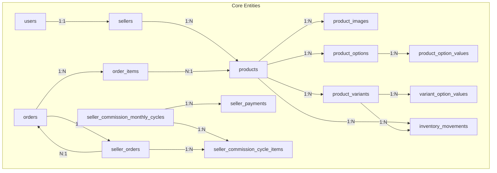

**Diagram sources**
- [20261106_create_users_table.sql:6-14](file://supabase/migrations/20261106_create_users_table.sql#L6-L14)
- [20261105_all_in_one_product_creation.sql:469-503](file://supabase/migrations/20261105_all_in_one_product_creation.sql#L469-L503)
- [20261105_all_in_one_product_creation.sql:901-940](file://supabase/migrations/20261105_all_in_one_product_creation.sql#L901-L940)
- [supabase_checkout_migration.sql:90-116](file://supabase_checkout_migration.sql#L90-L116)
- [supabase_checkout_migration.sql:135-155](file://supabase_checkout_migration.sql#L135-L155)
- [supabase_checkout_migration.sql:184-196](file://supabase_checkout_migration.sql#L184-L196)
- [supabase_wallet_payout_rpc.sql:11-33](file://supabase_wallet_payout_rpc.sql#L11-L33)
- [supabase_wallet_payout_rpc.sql:36-53](file://supabase_wallet_payout_rpc.sql#L36-L53)
- [supabase_wallet_payout_rpc.sql:56-64](file://supabase_wallet_payout_rpc.sql#L56-L64)

**Section sources**
- [20261106_create_users_table.sql:6-14](file://supabase/migrations/20261106_create_users_table.sql#L6-L14)
- [20261105_all_in_one_product_creation.sql:469-503](file://supabase/migrations/20261105_all_in_one_product_creation.sql#L469-L503)
- [supabase_checkout_migration.sql:90-116](file://supabase_checkout_migration.sql#L90-L116)
- [supabase_wallet_payout_rpc.sql:11-33](file://supabase_wallet_payout_rpc.sql#L11-L33)

## Core Components
- Users and Sellers:
  - users table links to auth.users and includes profile fields with RLS policies for self-access.
  - sellers represent resellers; shipping/payment configuration is enforced via CHECK constraints.
- Products Catalog:
  - products supports simple and variant inventory modes, with cached price/quantity aggregates.
  - product_images, product_options, product_option_values, product_variants, variant_option_values model rich catalog structure.
  - inventory_movements tracks stock changes for both simple and variant-level operations.
- Orders and Fulfillment:
  - orders support guest checkout (nullable user_id), with postal_code and size on order_items.
  - order_items store per-item pricing and seller attribution.
  - seller_orders partition orders by seller and track fulfillment status, courier details, and timestamps.
- Wallet and Payouts:
  - seller_commission_monthly_cycles, seller_payments, and seller_commission_cycle_items implement monthly commission cycles and payment tracking.

**Section sources**
- [20261106_create_users_table.sql:6-14](file://supabase/migrations/20261106_create_users_table.sql#L6-L14)
- [20261007_seller_shipping_payment.sql:6-32](file://supabase/migrations/20261007_seller_shipping_payment.sql#L6-L32)
- [20261105_all_in_one_product_creation.sql:469-503](file://supabase/migrations/20261105_all_in_one_product_creation.sql#L469-L503)
- [supabase_checkout_migration.sql:6-10](file://supabase_checkout_migration.sql#L6-L10)
- [supabase_checkout_migration.sql:90-116](file://supabase_checkout_migration.sql#L90-L116)
- [supabase_wallet_payout_rpc.sql:11-33](file://supabase_wallet_payout_rpc.sql#L11-L33)

## Architecture Overview
The system uses PostgreSQL with Row Level Security (RLS) and PostgREST RPC functions to enforce business logic and security at the database layer. Key flows include atomic product creation/update, atomic order creation with stock locking, seller order management, dashboard analytics aggregation, and wallet payout workflows.

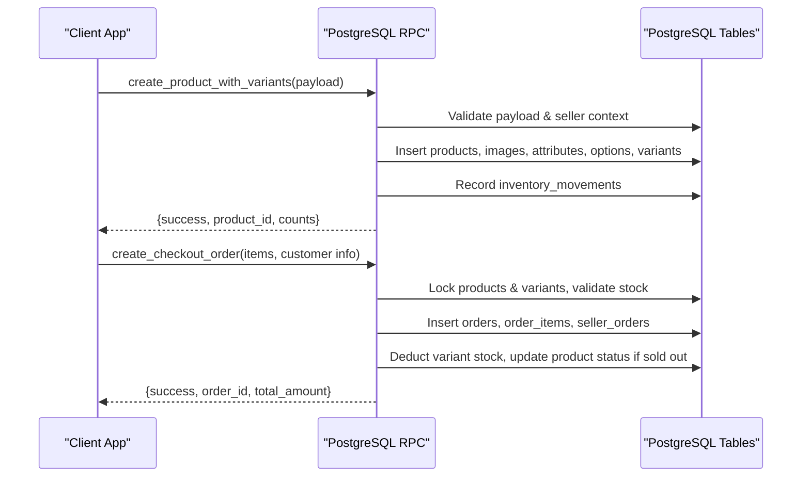

**Diagram sources**
- [20261105_all_in_one_product_creation.sql:224-503](file://supabase/migrations/20261105_all_in_one_product_creation.sql#L224-L503)
- [supabase_checkout_migration.sql:13-116](file://supabase_checkout_migration.sql#L13-L116)

**Section sources**
- [20261105_all_in_one_product_creation.sql:224-503](file://supabase/migrations/20261105_all_in_one_product_creation.sql#L224-L503)
- [supabase_checkout_migration.sql:13-116](file://supabase_checkout_migration.sql#L13-L116)

## Detailed Component Analysis

### Users and Sellers
- users:
  - Primary key id references auth.users(id) with ON DELETE CASCADE.
  - Unique email; RLS policies restrict access to own profile.
- sellers:
  - Shipping charges constrained to a valid range.
  - Mutual exclusivity constraint between advance payment flags.

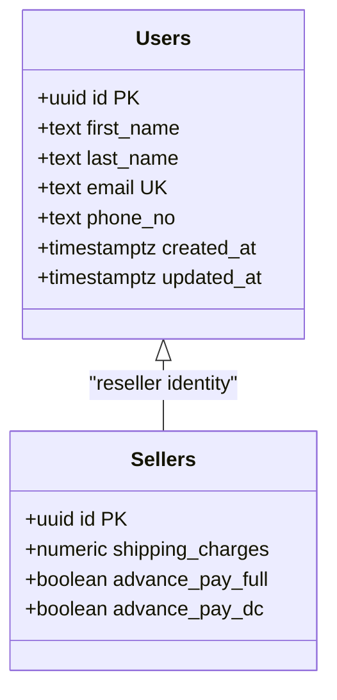

**Diagram sources**
- [20261106_create_users_table.sql:6-14](file://supabase/migrations/20261106_create_users_table.sql#L6-L14)
- [20261007_seller_shipping_payment.sql:6-32](file://supabase/migrations/20261007_seller_shipping_payment.sql#L6-L32)

**Section sources**
- [20261106_create_users_table.sql:6-14](file://supabase/migrations/20261106_create_users_table.sql#L6-L14)
- [20261007_seller_shipping_payment.sql:6-32](file://supabase/migrations/20261007_seller_shipping_payment.sql#L6-L32)

### Product Catalog Data Model
- products:
  - Supports inventory_mode 'simple' or 'variants'.
  - Cached columns for min/max variant price and total variant quantity.
- product_images:
  - Stores storage_path and image_url; thumbnail flag and display_order.
- product_options and product_option_values:
  - Dimension definitions and normalized values for variations.
- product_variants:
  - SKU generation, combination_key, selling_price, compare_at_price, quantity, is_active.
- variant_option_values:
  - Links variants to option values with composite primary key and FK integrity.

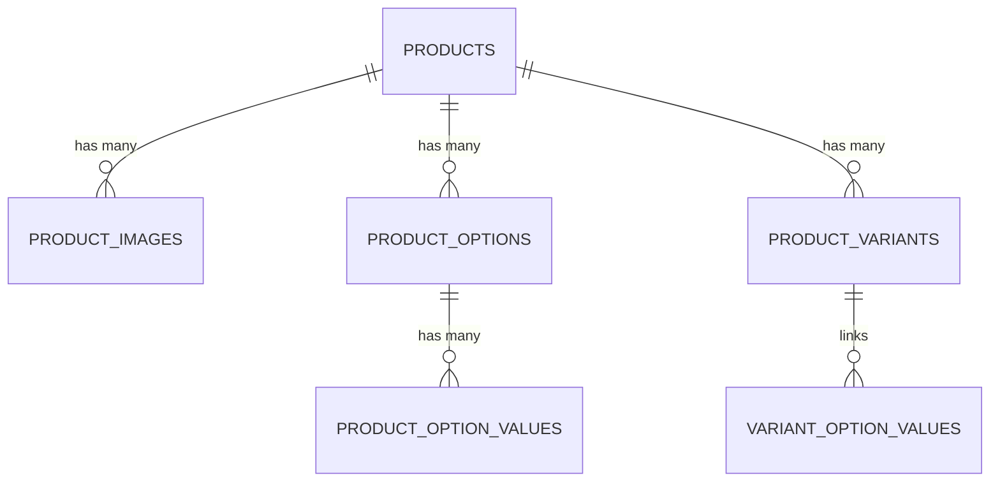

**Diagram sources**
- [20261105_all_in_one_product_creation.sql:469-503](file://supabase/migrations/20261105_all_in_one_product_creation.sql#L469-L503)
- [20261105_all_in_one_product_creation.sql:901-940](file://supabase/migrations/20261105_all_in_one_product_creation.sql#L901-L940)

**Section sources**
- [20261105_all_in_one_product_creation.sql:469-503](file://supabase/migrations/20261105_all_in_one_product_creation.sql#L469-L503)
- [20261105_all_in_one_product_creation.sql:901-940](file://supabase/migrations/20261105_all_in_one_product_creation.sql#L901-L940)

### Order Processing Data Model
- orders:
  - Nullable user_id for guest checkout; postal_code added.
- order_items:
  - size column added; stores unit price and subtotal per item.
- seller_orders:
  - Per-seller partitioning of orders with status, courier_name, tracking_number, shipped_at, delivered_at.

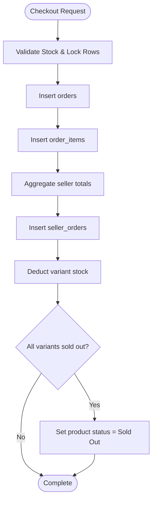

**Diagram sources**
- [supabase_checkout_migration.sql:13-116](file://supabase_checkout_migration.sql#L13-L116)
- [supabase_checkout_migration.sql:119-178](file://supabase_checkout_migration.sql#L119-L178)

**Section sources**
- [supabase_checkout_migration.sql:6-10](file://supabase_checkout_migration.sql#L6-L10)
- [supabase_checkout_migration.sql:90-116](file://supabase_checkout_migration.sql#L90-L116)
- [supabase_checkout_migration.sql:135-178](file://supabase_checkout_migration.sql#L135-L178)

### Wallet and Payout Data Model
- seller_commission_monthly_cycles:
  - Monthly cycle with gross/commission amounts, due dates, status checks.
- seller_payments:
  - Payment submissions linked to cycles, with verification metadata.
- seller_commission_cycle_items:
  - Junction linking completed orders to cycles for auditability.

```mermaid
classDiagram
class SellerCommissionMonthlyCycles {
+uuid id PK
+uuid seller_id
+int month
+int year
+numeric gross_amount
+numeric commission_percentage
+numeric commission_amount
+numeric commission_paid
+numeric commission_remaining
+text status
+timestamptz due_date
}
class SellerPayments {
+uuid id PK
+uuid seller_id
+numeric gross_amount
+numeric commission_percentage
+numeric commission_amount
+numeric net_amount
+text payment_method
+text receipt_image
+text status
+uuid commission_cycle_id FK
}
class SellerCommissionCycleItems {
+uuid id PK
+uuid cycle_id FK
+uuid seller_order_id FK
+numeric gross_amount
+numeric commission_percentage
+numeric commission_amount
}
SellerCommissionMonthlyCycles ||--o{ SellerPayments : "has many"
SellerCommissionMonthlyCycles ||--o{ SellerCommissionCycleItems : "has many"
```

**Diagram sources**
- [supabase_wallet_payout_rpc.sql:11-33](file://supabase_wallet_payout_rpc.sql#L11-L33)
- [supabase_wallet_payout_rpc.sql:36-53](file://supabase_wallet_payout_rpc.sql#L36-L53)
- [supabase_wallet_payout_rpc.sql:56-64](file://supabase_wallet_payout_rpc.sql#L56-L64)

**Section sources**
- [supabase_wallet_payout_rpc.sql:11-33](file://supabase_wallet_payout_rpc.sql#L11-L33)
- [supabase_wallet_payout_rpc.sql:36-53](file://supabase_wallet_payout_rpc.sql#L36-L53)
- [supabase_wallet_payout_rpc.sql:56-64](file://supabase_wallet_payout_rpc.sql#L56-L64)

### RPC Functions and Stored Procedures

#### Atomic Product Creation: create_product_with_variants
- Validates authentication and seller existence.
- Enforces payload constraints for simple vs variants mode.
- Validates gallery images and storage path isolation.
- Inserts core product, images, custom specs, category attribute values.
- For variants: inserts options/values, validates Cartesian combinations, creates SKUs, records inventory movements, updates cached aggregates, finalizes status to active.

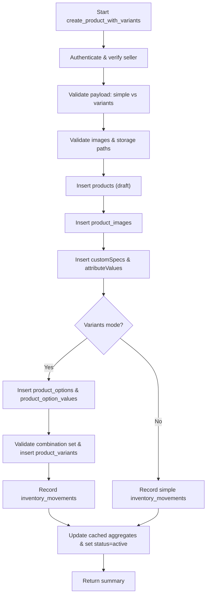

**Diagram sources**
- [20261105_all_in_one_product_creation.sql:224-503](file://supabase/migrations/20261105_all_in_one_product_creation.sql#L224-L503)
- [20261105_all_in_one_product_creation.sql:856-940](file://supabase/migrations/20261105_all_in_one_product_creation.sql#L856-L940)
- [20261105_all_in_one_product_creation.sql:969-1019](file://supabase/migrations/20261105_all_in_one_product_creation.sql#L969-L1019)

**Section sources**
- [20261105_all_in_one_product_creation.sql:224-503](file://supabase/migrations/20261105_all_in_one_product_creation.sql#L224-L503)
- [20261105_all_in_one_product_creation.sql:856-940](file://supabase/migrations/20261105_all_in_one_product_creation.sql#L856-L940)
- [20261105_all_in_one_product_creation.sql:969-1019](file://supabase/migrations/20261105_all_in_one_product_creation.sql#L969-L1019)

#### Atomic Product Edit: update_product_with_changes
- Optimistic concurrency control via expected_updated_at.
- Validates child record IDs belong to the product.
- Two-phase image reordering and insertion.
- Upserts custom specs and category attribute values.
- Variants mode: preserves historical SKU combinations, handles option/value reuse, recomputes caches, writes inventory movements for deltas and removals.
- Detects orphaned storage paths for client cleanup.

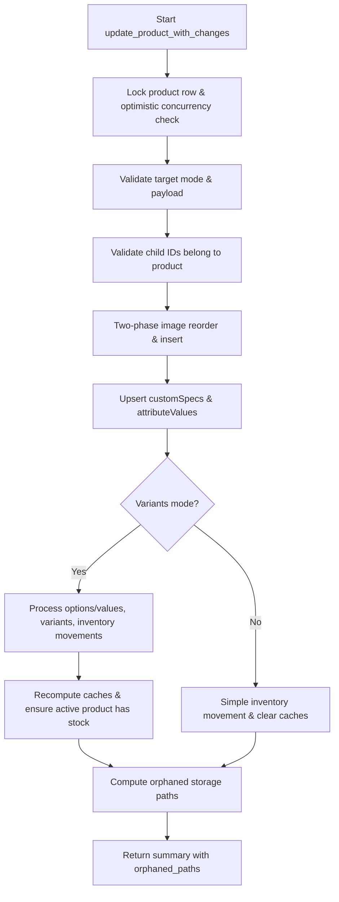

**Diagram sources**
- [20261106_update_product_with_changes_rpc.sql:28-140](file://supabase/migrations/20261106_update_product_with_changes_rpc.sql#L28-L140)
- [20261106_update_product_with_changes_rpc.sql:310-392](file://supabase/migrations/20261106_update_product_with_changes_rpc.sql#L310-L392)
- [20261106_update_product_with_changes_rpc.sql:448-536](file://supabase/migrations/20261106_update_product_with_changes_rpc.sql#L448-L536)
- [20261106_update_product_with_changes_rpc.sql:538-926](file://supabase/migrations/20261106_update_product_with_changes_rpc.sql#L538-L926)
- [20261106_update_product_with_changes_rpc.sql:963-984](file://supabase/migrations/20261106_update_product_with_changes_rpc.sql#L963-L984)

**Section sources**
- [20261106_update_product_with_changes_rpc.sql:28-140](file://supabase/migrations/20261106_update_product_with_changes_rpc.sql#L28-L140)
- [20261106_update_product_with_changes_rpc.sql:310-392](file://supabase/migrations/20261106_update_product_with_changes_rpc.sql#L310-L392)
- [20261106_update_product_with_changes_rpc.sql:448-536](file://supabase/migrations/20261106_update_product_with_changes_rpc.sql#L448-L536)
- [20261106_update_product_with_changes_rpc.sql:538-926](file://supabase/migrations/20261106_update_product_with_changes_rpc.sql#L538-L926)
- [20261106_update_product_with_changes_rpc.sql:963-984](file://supabase/migrations/20261106_update_product_with_changes_rpc.sql#L963-L984)

#### Checkout Order Creation: create_checkout_order
- Pre-checks stock and locks rows for requested items.
- Inserts orders and order_items, aggregates seller totals, inserts seller_orders.
- Deducts variant stock and updates product status to Sold Out when applicable.
- Clears cart items for logged-in users.

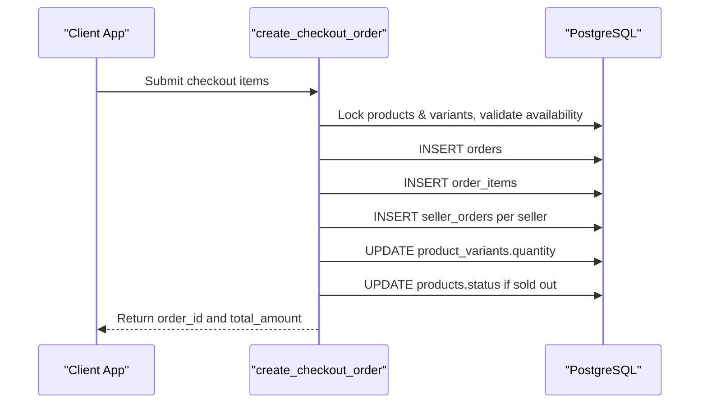

**Diagram sources**
- [supabase_checkout_migration.sql:13-116](file://supabase_checkout_migration.sql#L13-L116)
- [supabase_checkout_migration.sql:119-178](file://supabase_checkout_migration.sql#L119-L178)
- [supabase_checkout_migration.sql:184-203](file://supabase_checkout_migration.sql#L184-L203)

**Section sources**
- [supabase_checkout_migration.sql:13-116](file://supabase_checkout_migration.sql#L13-L116)
- [supabase_checkout_migration.sql:119-178](file://supabase_checkout_migration.sql#L119-L178)
- [supabase_checkout_migration.sql:184-203](file://supabase_checkout_migration.sql#L184-L203)

#### Seller Orders Management RPCs
- get_seller_orders: Single-join aggregation with pagination, search, and sorting.
- get_seller_order_detail: Full modal data joining seller_orders, orders, and order_items.
- update_seller_order_status: Validates allowed statuses, sets courier/tracking, timestamps for shipped/delivered.

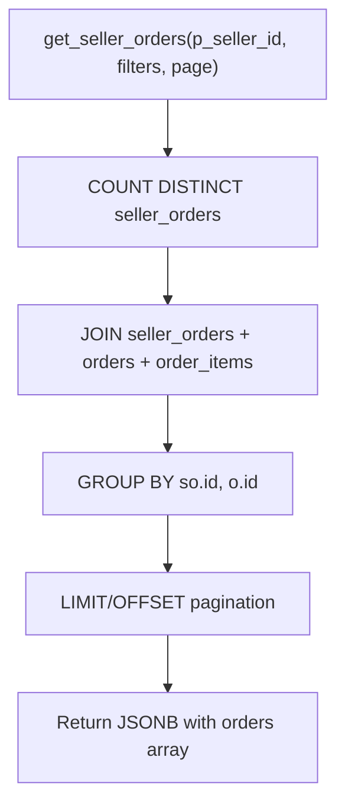

**Diagram sources**
- [supabase_seller_orders_rpc.sql:54-150](file://supabase_seller_orders_rpc.sql#L54-L150)

**Section sources**
- [supabase_seller_orders_rpc.sql:54-150](file://supabase_seller_orders_rpc.sql#L54-L150)
- [supabase_seller_orders_rpc.sql:157-236](file://supabase_seller_orders_rpc.sql#L157-L236)
- [supabase_seller_orders_rpc.sql:243-309](file://supabase_seller_orders_rpc.sql#L243-L309)

#### Seller Overview Analytics RPCs
- get_seller_overview_kpis: Fast KPI card aggregation across seller_orders, products, reviews.
- get_seller_overview_details: Graphs and recent orders using generate_series and single-join aggregations.

```mermaid
flowchart TD
KPIS["get_seller_overview_kpis(seller_id)"] --> Revenue["SUM seller_total for Shipped/Delivered"]
KPIS --> ActiveListings["COUNT products where status=Active"]
KPIS --> PendingDispatch["COUNT seller_orders where Pending/Confirmed"]
KPIS --> DeliveredOrders["COUNT seller_orders where Shipped/Delivered"]
KPIS --> Last7D["Aggregations over last 7 days"]
Details["get_seller_overview_details(seller_id)"] --> DailyTrajectory["generate_series daily revenue/orders"]
Details --> StatusBreakdown["Status breakdown last 7 days"]
Details --> TopProducts["Top 5 products sold last 7 days"]
Details --> PaymentShare["COD vs Online share"]
Details --> RecentOrders["Recent orders LIMIT 3"]
```

**Diagram sources**
- [supabase_seller_overview_rpc.sql:36-158](file://supabase_seller_overview_rpc.sql#L36-L158)
- [supabase_seller_overview_rpc.sql:166-353](file://supabase_seller_overview_rpc.sql#L166-L353)

**Section sources**
- [supabase_seller_overview_rpc.sql:36-158](file://supabase_seller_overview_rpc.sql#L36-L158)
- [supabase_seller_overview_rpc.sql:166-353](file://supabase_seller_overview_rpc.sql#L166-L353)

#### Wallet and Payout RPCs
- get_seller_wallet_kpis: Computes total sales, remaining commission, submitted/verified payments, current cycle.
- submit_seller_commission_verification: Atomic transaction creating/finding cycle, inserting payment, updating cycle status.
- get_seller_commission_history: Paginated payment history.
- get_seller_payment_detail: Detail modal with cycle summary and paginated order items.

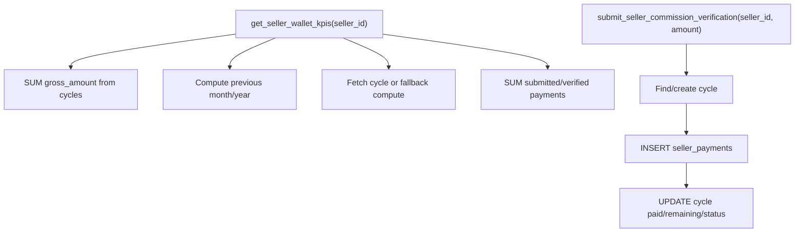

**Diagram sources**
- [supabase_wallet_payout_rpc.sql:133-253](file://supabase_wallet_payout_rpc.sql#L133-L253)
- [supabase_wallet_payout_rpc.sql:259-369](file://supabase_wallet_payout_rpc.sql#L259-L369)

**Section sources**
- [supabase_wallet_payout_rpc.sql:133-253](file://supabase_wallet_payout_rpc.sql#L133-L253)
- [supabase_wallet_payout_rpc.sql:259-369](file://supabase_wallet_payout_rpc.sql#L259-L369)
- [supabase_wallet_payout_rpc.sql:375-429](file://supabase_wallet_payout_rpc.sql#L375-L429)
- [supabase_wallet_payout_rpc.sql:435-539](file://supabase_wallet_payout_rpc.sql#L435-L539)

## Dependency Analysis
- Entity Relationships:
  - users -> sellers (identity linkage)
  - sellers -> products (ownership)
  - products -> product_images, product_options, product_option_values, product_variants, inventory_movements
  - product_variants -> variant_option_values
  - orders -> order_items, seller_orders
  - seller_orders -> seller_commission_cycle_items
  - seller_commission_monthly_cycles -> seller_payments, seller_commission_cycle_items
- Constraints and Integrity:
  - Foreign keys ensure referential integrity across related tables.
  - CHECK constraints enforce business rules (e.g., shipping charges range, mutual exclusivity of advance payment flags).
  - Composite primary keys and unique constraints maintain data consistency (e.g., variant_option_values).
- Indexing:
  - Explicit indexes exist for wallet/payout queries (cycles, payments, cycle_items).
  - Additional indexes recommended for frequent joins (e.g., orders.order_number, seller_orders.seller_id, product_variants.product_id).

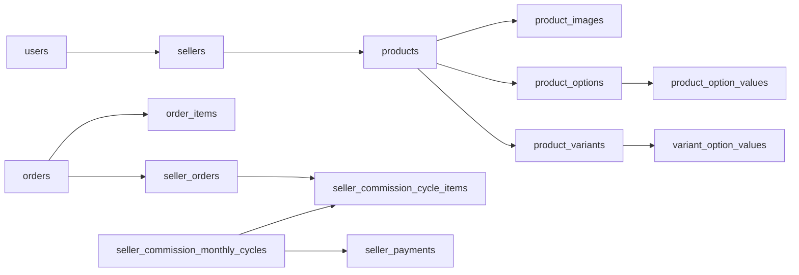

**Diagram sources**
- [supabase_wallet_payout_rpc.sql:102-105](file://supabase_wallet_payout_rpc.sql#L102-L105)
- [20261105_all_in_one_product_creation.sql:1046-1188](file://supabase/migrations/20261105_all_in_one_product_creation.sql#L1046-L1188)

**Section sources**
- [supabase_wallet_payout_rpc.sql:102-105](file://supabase_wallet_payout_rpc.sql#L102-L105)
- [20261105_all_in_one_product_creation.sql:1046-1188](file://supabase/migrations/20261105_all_in_one_product_creation.sql#L1046-L1188)

## Performance Considerations
- Query Optimization:
  - Use server-side aggregation in RPCs (e.g., get_seller_orders, get_seller_overview_kpis/details) to minimize client-side processing.
  - Leverage generate_series for consistent time-series graphs (daily revenue/orders).
  - Prefer indexed columns in WHERE clauses (e.g., seller_id, created_at, status).
- Indexing Strategies:
  - Existing indexes for wallet/payout tables improve lookup performance.
  - Recommend adding indexes on frequently filtered/joined columns:
    - orders(order_number), orders(created_at)
    - order_items(order_id, seller_id)
    - seller_orders(seller_id, status, created_at)
    - product_variants(product_id, is_active)
    - inventory_movements(product_id, variant_id)
- Concurrency Control:
  - Atomic RPCs use FOR UPDATE locks to prevent race conditions during checkout and product edits.
  - Optimistic concurrency via expected_updated_at prevents conflicting edits.
- Storage Path Isolation:
  - RPCs validate storage paths and URLs to ensure tenant isolation and security.

[No sources needed since this section provides general guidance]

## Troubleshooting Guide
- Common Validation Errors:
  - Missing or invalid payload fields in product creation/edit RPCs.
  - Duplicate dimension names or values in product options.
  - Incomplete combination sets for variants.
  - Invalid storage paths or mismatched image URLs.
- Concurrency Conflicts:
  - CONFLICT errors when editing products with stale updated_at.
  - Stock change conflicts detected via compare-and-set patterns.
- Access Denied:
  - RLS policy violations when accessing resources not owned by the authenticated user/seller.
- Inventory Issues:
  - Attempting to set active product quantity to zero.
  - Variant removal leaving residual stock without inventory movement.

**Section sources**
- [20261105_all_in_one_product_creation.sql:320-443](file://supabase/migrations/20261105_all_in_one_product_creation.sql#L320-L443)
- [20261106_update_product_with_changes_rpc.sql:118-140](file://supabase/migrations/20261106_update_product_with_changes_rpc.sql#L118-L140)
- [20261106_update_product_with_changes_rpc.sql:305-307](file://supabase/migrations/20261106_update_product_with_changes_rpc.sql#L305-L307)
- [20261106_update_product_with_changes_rpc.sql:917-919](file://supabase/migrations/20261106_update_product_with_changes_rpc.sql#L917-L919)

## Conclusion
Zebaish’s database design emphasizes strong data integrity through explicit constraints, comprehensive RLS policies, and robust RPC-driven business logic. The schema supports complex product catalogs with variants, secure order processing with stock locking, seller-centric order management, and a structured wallet/payout system. Performance is addressed via server-side aggregation, targeted indexing, and careful concurrency controls. Migration files provide a clear version-controlled evolution path for schema changes and feature rollouts.

[No sources needed since this section summarizes without analyzing specific files]