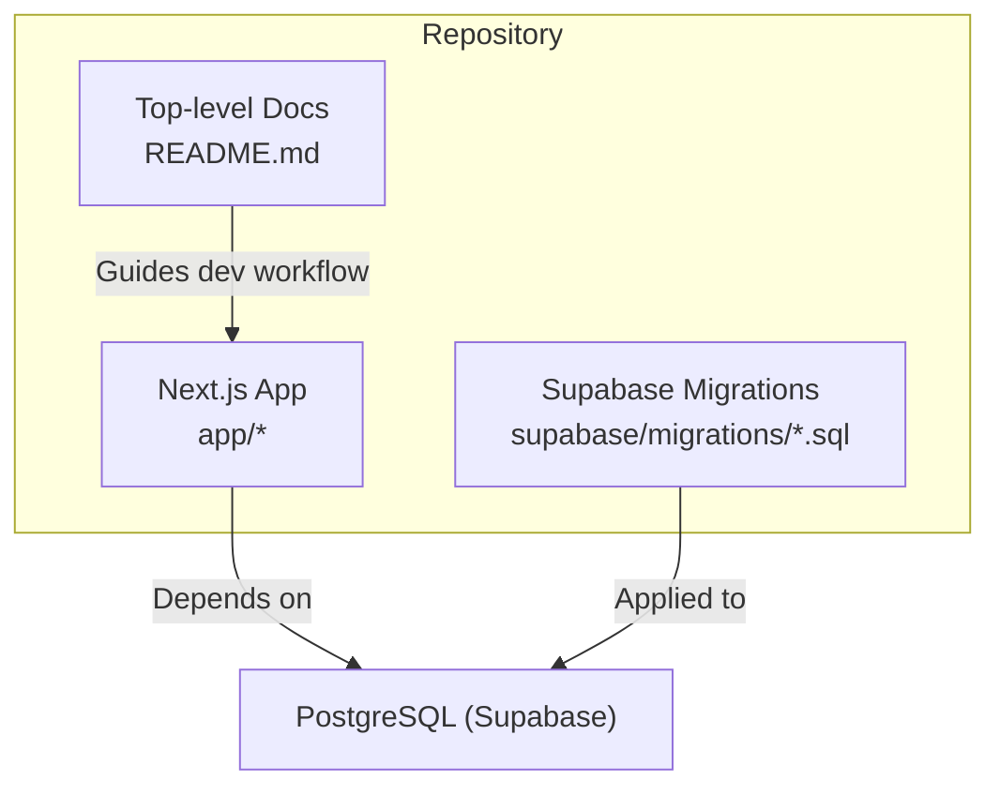
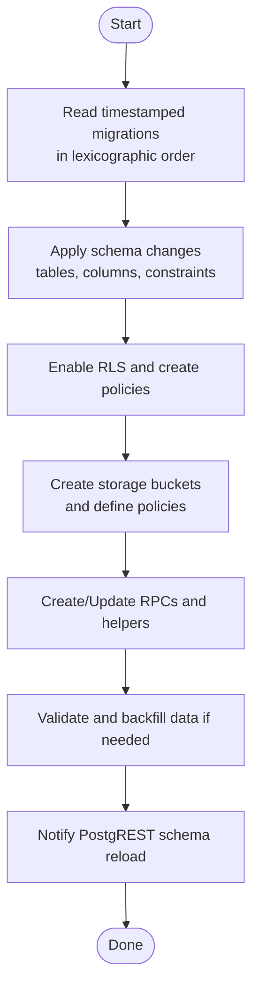
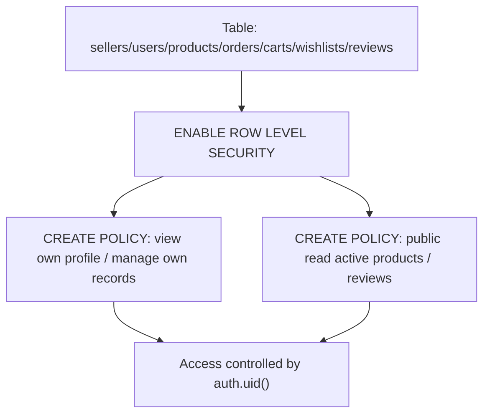
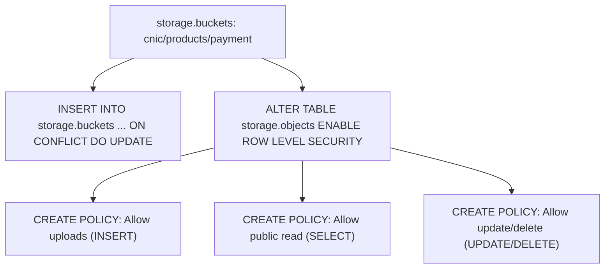
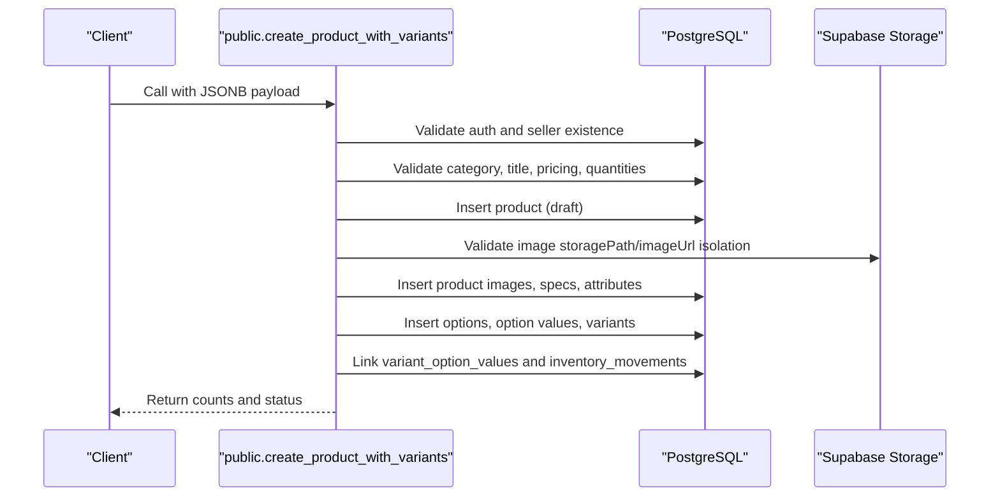
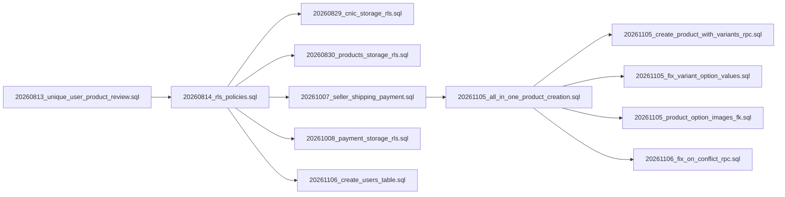

# Migration Strategy & Version Control

<cite>
**Referenced Files in This Document**
- [README.md](file://README.md)
- [20260813_unique_user_product_review.sql](file://supabase/migrations/20260813_unique_user_product_review.sql)
- [20260814_rls_policies.sql](file://supabase/migrations/20260814_rls_policies.sql)
- [20260829_cnic_storage_rls.sql](file://supabase/migrations/20260829_cnic_storage_rls.sql)
- [20260830_products_storage_rls.sql](file://supabase/migrations/20260830_products_storage_rls.sql)
- [20261007_seller_shipping_payment.sql](file://supabase/migrations/20261007_seller_shipping_payment.sql)
- [20261008_payment_storage_rls.sql](file://supabase/migrations/20261008_payment_storage_rls.sql)
- [20261105_all_in_one_product_creation.sql](file://supabase/migrations/20261105_all_in_one_product_creation.sql)
- [20261105_create_product_with_variants_rpc.sql](file://supabase/migrations/20261105_create_product_with_variants_rpc.sql)
- [20261105_fix_variant_option_values.sql](file://supabase/migrations/20261105_fix_variant_option_values.sql)
- [20261105_product_option_images_fk.sql](file://supabase/migrations/20261105_product_option_images_fk.sql)
- [20261106_create_users_table.sql](file://supabase/migrations/20261106_create_users_table.sql)
- [20261106_fix_on_conflict_rpc.sql](file://supabase/migrations/20261106_fix_on_conflict_rpc.sql)
</cite>

## Table of Contents
1. [Introduction](#introduction)
2. [Project Structure](#project-structure)
3. [Core Components](#core-components)
4. [Architecture Overview](#architecture-overview)
5. [Detailed Component Analysis](#detailed-component-analysis)
6. [Dependency Analysis](#dependency-analysis)
7. [Performance Considerations](#performance-considerations)
8. [Troubleshooting Guide](#troubleshooting-guide)
9. [Conclusion](#conclusion)

## Introduction
This document explains the database migration strategy and version control approach for the project. It covers naming conventions, chronological organization, rollback procedures, data migration patterns, security migrations (RLS policies and storage access controls), deployment process, and handling conflicts or failed migrations in production. The guidance is grounded in the actual SQL migration files under supabase/migrations and the repository’s top-level documentation.

## Project Structure
The database schema and security configuration are managed as timestamped SQL migrations under supabase/migrations. Each file represents a single, ordered change set applied to the PostgreSQL database used by Supabase. The application itself is a Next.js app; the README provides basic setup and deployment notes for the frontend, while database changes are handled via these migrations.

**Diagram sources**
- [README.md:1-37](file://README.md#L1-L37)

**Section sources**
- [README.md:1-37](file://README.md#L1-L37)

## Core Components
- Timestamped migration files: Each file starts with an ISO-like date prefix followed by a descriptive slug. Files are executed in lexicographic order, which matches chronological order due to the date prefix.
- Idempotent design: Many migrations use conditional checks (e.g., IF NOT EXISTS, DROP POLICY IF EXISTS, ON CONFLICT DO UPDATE) to ensure safe re-runs.
- Security-first: Row Level Security (RLS) is enabled per table, and storage buckets have explicit policies for read/write operations.
- Data integrity: Constraints, triggers, and RPCs enforce business rules and maintain referential integrity across product catalogs and variants.

Key migration categories:
- Schema additions and constraints
- RLS policy definitions
- Storage bucket creation and policies
- RPC functions and helper functions
- Data backfills and fixes

**Section sources**
- [20260813_unique_user_product_review.sql:1-14](file://supabase/migrations/20260813_unique_user_product_review.sql#L1-L14)
- [20260814_rls_policies.sql:1-180](file://supabase/migrations/20260814_rls_policies.sql#L1-L180)
- [20260829_cnic_storage_rls.sql:1-42](file://supabase/migrations/20260829_cnic_storage_rls.sql#L1-L42)
- [20260830_products_storage_rls.sql:1-45](file://supabase/migrations/20260830_products_storage_rls.sql#L1-L45)
- [20261007_seller_shipping_payment.sql:1-35](file://supabase/migrations/20261007_seller_shipping_payment.sql#L1-L35)
- [20261008_payment_storage_rls.sql:1-48](file://supabase/migrations/20261008_payment_storage_rls.sql#L1-L48)
- [20261105_all_in_one_product_creation.sql:1-800](file://supabase/migrations/20261105_all_in_one_product_creation.sql#L1-L800)
- [20261105_create_product_with_variants_rpc.sql:1-800](file://supabase/migrations/20261105_create_product_with_variants_rpc.sql#L1-L800)
- [20261105_fix_variant_option_values.sql:1-136](file://supabase/migrations/20261105_fix_variant_option_values.sql#L1-L136)
- [20261105_product_option_images_fk.sql:1-75](file://supabase/migrations/20261105_product_option_images_fk.sql#L1-L75)
- [20261106_create_users_table.sql:1-39](file://supabase/migrations/20261106_create_users_table.sql#L1-L39)
- [20261106_fix_on_conflict_rpc.sql:1-800](file://supabase/migrations/20261106_fix_on_conflict_rpc.sql#L1-L800)

## Architecture Overview
The migration system evolves the database schema and security posture incrementally. High-level flow:

**Diagram sources**
- [20260814_rls_policies.sql:1-180](file://supabase/migrations/20260814_rls_policies.sql#L1-L180)
- [20260829_cnic_storage_rls.sql:1-42](file://supabase/migrations/20260829_cnic_storage_rls.sql#L1-L42)
- [20260830_products_storage_rls.sql:1-45](file://supabase/migrations/20260830_products_storage_rls.sql#L1-L45)
- [20261008_payment_storage_rls.sql:1-48](file://supabase/migrations/20261008_payment_storage_rls.sql#L1-L48)
- [20261105_all_in_one_product_creation.sql:1-800](file://supabase/migrations/20261105_all_in_one_product_creation.sql#L1-L800)
- [20261106_create_users_table.sql:36-39](file://supabase/migrations/20261106_create_users_table.sql#L36-L39)

## Detailed Component Analysis

### Naming Convention and Chronological Organization
- All migration files follow the pattern YYYYMMDD_<slug>.sql.
- Lexicographic sorting ensures chronological execution order.
- Examples:
  - 20260813_unique_user_product_review.sql
  - 20260814_rls_policies.sql
  - 20261105_all_in_one_product_creation.sql

**Section sources**
- [20260813_unique_user_product_review.sql:1-14](file://supabase/migrations/20260813_unique_user_product_review.sql#L1-L14)
- [20260814_rls_policies.sql:1-180](file://supabase/migrations/20260814_rls_policies.sql#L1-L180)
- [20261105_all_in_one_product_creation.sql:1-800](file://supabase/migrations/20261105_all_in_one_product_creation.sql#L1-L800)

### Rollback Procedures
- There are no dedicated rollback scripts in the repository.
- Recommended practice:
  - Keep each migration idempotent using conditional logic (IF NOT EXISTS, DROP POLICY IF EXISTS).
  - For destructive changes, prepare a separate rollback script that reverses the specific operation.
  - Test rollbacks in non-production environments before applying to production.

[No sources needed since this section provides general guidance]

### Data Migration Patterns
- Conditional constraint addition:
  - Unique constraints added only when missing.
  - Example: unique_user_product_review adds a composite unique constraint on reviews.
- Backfills:
  - Updating existing rows to align with new schema or business rules.
  - Example: backfilling option_id from related tables during variant schema fixes.
- Safe upserts:
  - Using IF EXISTS ... UPDATE ... ELSE INSERT patterns to avoid dependency on pre-existing unique constraints.

**Section sources**
- [20260813_unique_user_product_review.sql:1-14](file://supabase/migrations/20260813_unique_user_product_review.sql#L1-L14)
- [20261105_fix_variant_option_values.sql:1-136](file://supabase/migrations/20261105_fix_variant_option_values.sql#L1-L136)
- [20261106_fix_on_conflict_rpc.sql:1-800](file://supabase/migrations/20261106_fix_on_conflict_rpc.sql#L1-L800)

### Common Migration Scenarios

#### Adding New Tables
- Creating new tables with primary keys, foreign keys, and default timestamps.
- Enabling RLS immediately after table creation and defining policies for access control.
- Notifying PostgREST to refresh schema cache.

Example reference:
- public.users table creation with RLS policies and schema reload notification.

**Section sources**
- [20261106_create_users_table.sql:1-39](file://supabase/migrations/20261106_create_users_table.sql#L1-L39)

#### Modifying Existing Schemas
- Adding columns with defaults and constraints.
- Adding CHECK constraints to enforce business rules.
- Renaming columns conditionally based on information_schema checks.

Examples:
- Adding seller shipping and payment configuration columns and constraints.
- Aligning column names and fixing foreign keys in variant_option_values.

**Section sources**
- [20261007_seller_shipping_payment.sql:1-35](file://supabase/migrations/20261007_seller_shipping_payment.sql#L1-L35)
- [20261105_fix_variant_option_values.sql:1-136](file://supabase/migrations/20261105_fix_variant_option_values.sql#L1-L136)

#### Performing Data Backfills
- Backfilling missing values derived from related tables.
- Ensuring consistency between parent and child entities.

Example reference:
- Backfilling option_id from product_option_values during variant schema correction.

**Section sources**
- [20261105_fix_variant_option_values.sql:36-41](file://supabase/migrations/20261105_fix_variant_option_values.sql#L36-L41)

### Security Migrations: RLS Policies and Storage Access Controls

#### Row Level Security (RLS) Policies
- Enabling RLS on core tables (sellers, users, products, orders, carts, wishlists, reviews).
- Defining policies for SELECT, INSERT, UPDATE, DELETE operations scoped to authenticated users and roles.
- Ensuring public read access where appropriate (e.g., active products, reviews).

**Diagram sources**
- [20260814_rls_policies.sql:1-180](file://supabase/migrations/20260814_rls_policies.sql#L1-L180)

**Section sources**
- [20260814_rls_policies.sql:1-180](file://supabase/migrations/20260814_rls_policies.sql#L1-L180)

#### Storage Bucket Policies
- Creating storage buckets (cnic, products, payment) with public access flags and allowed MIME types.
- Defining policies for INSERT, SELECT, UPDATE, DELETE operations scoped to specific buckets.
- Allowing both anonymous and authenticated users where required (e.g., payment proof uploads).

**Diagram sources**
- [20260829_cnic_storage_rls.sql:1-42](file://supabase/migrations/20260829_cnic_storage_rls.sql#L1-L42)
- [20260830_products_storage_rls.sql:1-45](file://supabase/migrations/20260830_products_storage_rls.sql#L1-L45)
- [20261008_payment_storage_rls.sql:1-48](file://supabase/migrations/20261008_payment_storage_rls.sql#L1-L48)

**Section sources**
- [20260829_cnic_storage_rls.sql:1-42](file://supabase/migrations/20260829_cnic_storage_rls.sql#L1-L42)
- [20260830_products_storage_rls.sql:1-45](file://supabase/migrations/20260830_products_storage_rls.sql#L1-L45)
- [20261008_payment_storage_rls.sql:1-48](file://supabase/migrations/20261008_payment_storage_rls.sql#L1-L48)

### RPC Functions and Helper Functions
- Atomic product creation RPC:
  - Validates payload, enforces authentication and seller verification, manages images, attributes, options, variants, and inventory movements.
  - Uses normalization helpers to standardize dimension/value names.
  - Applies strict security validation for storage paths and URLs.
- Helper functions:
  - normalize_option_name for consistent key generation.
  - validate_product_attribute_value for typed attribute validation.

**Diagram sources**
- [20261105_all_in_one_product_creation.sql:220-800](file://supabase/migrations/20261105_all_in_one_product_creation.sql#L220-L800)
- [20261105_create_product_with_variants_rpc.sql:100-800](file://supabase/migrations/20261105_create_product_with_variants_rpc.sql#L100-L800)
- [20261106_fix_on_conflict_rpc.sql:39-800](file://supabase/migrations/20261106_fix_on_conflict_rpc.sql#L39-L800)

**Section sources**
- [20261105_all_in_one_product_creation.sql:1-800](file://supabase/migrations/20261105_all_in_one_product_creation.sql#L1-L800)
- [20261105_create_product_with_variants_rpc.sql:1-800](file://supabase/migrations/20261105_create_product_with_variants_rpc.sql#L1-L800)
- [20261106_fix_on_conflict_rpc.sql:1-800](file://supabase/migrations/20261106_fix_on_conflict_rpc.sql#L1-L800)

### Deployment Process for Migrations
- Run migrations against the target Supabase PostgreSQL instance.
- Ensure migrations are idempotent to allow safe re-execution.
- After schema changes, notify PostgREST to reload its schema cache where applicable.
- Verify RLS policies and storage bucket configurations post-deployment.

Recommended steps:
1. Review migration order and dependencies.
2. Apply migrations in a staging environment first.
3. Validate RLS and storage policies.
4. Deploy to production during a maintenance window if necessary.
5. Monitor errors and verify schema cache reload.

**Section sources**
- [20261106_create_users_table.sql:36-39](file://supabase/migrations/20261106_create_users_table.sql#L36-L39)

### Handling Conflicts or Failed Migrations in Production
- Use conditional statements to prevent duplicate constraints or policies.
- Wrap schema changes in transactions (BEGIN/COMMIT) where supported.
- If a migration fails:
  - Identify the failing step (schema, RLS, storage, RPC).
  - Check for conflicting policies or constraints.
  - Apply targeted fixes (e.g., drop conflicting policies, add missing constraints).
  - Re-run the migration or apply a corrective patch migration.

Common issues and resolutions:
- “There is no unique or exclusion constraint matching the ON CONFLICT specification”:
  - Add missing unique constraints or adjust upsert logic to use IF EXISTS ... UPDATE ... ELSE INSERT.
- “StorageApiError: new row violates row-level security policy”:
  - Ensure storage bucket exists and policies allow the intended operations.

**Section sources**
- [20261106_fix_on_conflict_rpc.sql:1-800](file://supabase/migrations/20261106_fix_on_conflict_rpc.sql#L1-L800)
- [20260829_cnic_storage_rls.sql:1-42](file://supabase/migrations/20260829_cnic_storage_rls.sql#L1-L42)
- [20260830_products_storage_rls.sql:1-45](file://supabase/migrations/20260830_products_storage_rls.sql#L1-L45)
- [20261008_payment_storage_rls.sql:1-48](file://supabase/migrations/20261008_payment_storage_rls.sql#L1-L48)

## Dependency Analysis
Migration dependencies and relationships:

**Diagram sources**
- [20260813_unique_user_product_review.sql:1-14](file://supabase/migrations/20260813_unique_user_product_review.sql#L1-L14)
- [20260814_rls_policies.sql:1-180](file://supabase/migrations/20260814_rls_policies.sql#L1-L180)
- [20260829_cnic_storage_rls.sql:1-42](file://supabase/migrations/20260829_cnic_storage_rls.sql#L1-L42)
- [20260830_products_storage_rls.sql:1-45](file://supabase/migrations/20260830_products_storage_rls.sql#L1-L45)
- [20261007_seller_shipping_payment.sql:1-35](file://supabase/migrations/20261007_seller_shipping_payment.sql#L1-L35)
- [20261008_payment_storage_rls.sql:1-48](file://supabase/migrations/20261008_payment_storage_rls.sql#L1-L48)
- [20261105_all_in_one_product_creation.sql:1-800](file://supabase/migrations/20261105_all_in_one_product_creation.sql#L1-L800)
- [20261105_create_product_with_variants_rpc.sql:1-800](file://supabase/migrations/20261105_create_product_with_variants_rpc.sql#L1-L800)
- [20261105_fix_variant_option_values.sql:1-136](file://supabase/migrations/20261105_fix_variant_option_values.sql#L1-L136)
- [20261105_product_option_images_fk.sql:1-75](file://supabase/migrations/20261105_product_option_images_fk.sql#L1-L75)
- [20261106_create_users_table.sql:1-39](file://supabase/migrations/20261106_create_users_table.sql#L1-L39)
- [20261106_fix_on_conflict_rpc.sql:1-800](file://supabase/migrations/20261106_fix_on_conflict_rpc.sql#L1-L800)

**Section sources**
- [20260813_unique_user_product_review.sql:1-14](file://supabase/migrations/20260813_unique_user_product_review.sql#L1-L14)
- [20260814_rls_policies.sql:1-180](file://supabase/migrations/20260814_rls_policies.sql#L1-L180)
- [20260829_cnic_storage_rls.sql:1-42](file://supabase/migrations/20260829_cnic_storage_rls.sql#L1-L42)
- [20260830_products_storage_rls.sql:1-45](file://supabase/migrations/20260830_products_storage_rls.sql#L1-L45)
- [20261007_seller_shipping_payment.sql:1-35](file://supabase/migrations/20261007_seller_shipping_payment.sql#L1-L35)
- [20261008_payment_storage_rls.sql:1-48](file://supabase/migrations/20261008_payment_storage_rls.sql#L1-L48)
- [20261105_all_in_one_product_creation.sql:1-800](file://supabase/migrations/20261105_all_in_one_product_creation.sql#L1-L800)
- [20261105_create_product_with_variants_rpc.sql:1-800](file://supabase/migrations/20261105_create_product_with_variants_rpc.sql#L1-L800)
- [20261105_fix_variant_option_values.sql:1-136](file://supabase/migrations/20261105_fix_variant_option_values.sql#L1-L136)
- [20261105_product_option_images_fk.sql:1-75](file://supabase/migrations/20261105_product_option_images_fk.sql#L1-L75)
- [20261106_create_users_table.sql:1-39](file://supabase/migrations/20261106_create_users_table.sql#L1-L39)
- [20261106_fix_on_conflict_rpc.sql:1-800](file://supabase/migrations/20261106_fix_on_conflict_rpc.sql#L1-L800)

## Performance Considerations
- Prefer idempotent migrations to reduce re-run overhead.
- Use conditional checks to avoid unnecessary work.
- Indexes should be added judiciously; some migrations include indexes where beneficial (e.g., product_option_images product_id index).
- RPC functions perform extensive validation; ensure payloads are well-formed to minimize server-side processing.

[No sources needed since this section provides general guidance]

## Troubleshooting Guide
Common issues and resolutions:
- Missing unique constraints causing ON CONFLICT failures:
  - Add missing unique constraints or switch to IF EXISTS ... UPDATE ... ELSE INSERT patterns.
- Storage upload violations:
  - Ensure storage buckets exist and policies allow the intended operations for anon/authenticated users.
- RLS policy conflicts:
  - Drop conflicting policies before recreating them; use DROP POLICY IF EXISTS.

Actionable references:
- Fix ON CONFLICT issues in product creation RPC.
- Resolve storage RLS errors for CNIC, products, and payment buckets.

**Section sources**
- [20261106_fix_on_conflict_rpc.sql:1-800](file://supabase/migrations/20261106_fix_on_conflict_rpc.sql#L1-L800)
- [20260829_cnic_storage_rls.sql:1-42](file://supabase/migrations/20260829_cnic_storage_rls.sql#L1-L42)
- [20260830_products_storage_rls.sql:1-45](file://supabase/migrations/20260830_products_storage_rls.sql#L1-L45)
- [20261008_payment_storage_rls.sql:1-48](file://supabase/migrations/20261008_payment_storage_rls.sql#L1-L48)

## Conclusion
The project uses a robust, timestamped migration strategy with strong emphasis on idempotency, security (RLS and storage policies), and data integrity (constraints, triggers, RPCs). Migrations are organized chronologically and designed to be safely re-applied. For production deployments, follow the recommended steps to validate schema changes, RLS policies, and storage configurations, and handle conflicts using conditional logic and targeted fixes.

[No sources needed since this section summarizes without analyzing specific files]