# Stored Procedures & RPC Functions

<cite>
**Referenced Files in This Document**   
- [productService.ts](file://src/api/productService.ts)
- [sellerOverviewService.ts](file://src/api/sellerOverviewService.ts)
- [sellerWalletService.ts](file://src/api/sellerWalletService.ts)
- [orderService.ts](file://src/api/orderService.ts)
- [supabase_seller_overview_rpc.sql](file://supabase_seller_overview_rpc.sql)
- [supabase_wallet_payout_rpc.sql](file://supabase_wallet_payout_rpc.sql)
- [20261105_create_product_with_variants_rpc.sql](file://supabase/migrations/20261105_create_product_with_variants_rpc.sql)
- [supabase_seller_orders_rpc.sql](file://supabase_seller_orders_rpc.sql)
</cite>

## Table of Contents
1. [Introduction](#introduction)
2. [Project Structure](#project-structure)
3. [Core Components](#core-components)
4. [Architecture Overview](#architecture-overview)
5. [Detailed Component Analysis](#detailed-component-analysis)
6. [Dependency Analysis](#dependency-analysis)
7. [Performance Considerations](#performance-considerations)
8. [Troubleshooting Guide](#troubleshooting-guide)
9. [Conclusion](#conclusion)

## Introduction
This document explains the stored procedures and RPC functions that implement complex business logic for product creation, seller analytics, order processing, and wallet/payout tracking. It focuses on:

- The multi-variant product creation RPC with atomic transactions and storage security validation.
- Seller overview analytics RPCs for KPI cards and detailed graphs.
- Order placement workflow with stock checks, pricing, and rollback behavior.
- Wallet and payout calculation procedures for commission cycles, payment submission, and history.

It also documents input parameters, return values, error handling, performance characteristics, transaction management, data validation, and security considerations. Frontend usage is shown through Supabase client calls in TypeScript service files.

## Project Structure
The backend logic lives primarily in PostgreSQL migrations and SQL functions, while the frontend orchestrates calls through Supabase RPCs or direct PostgREST queries when RPCs are unavailable.

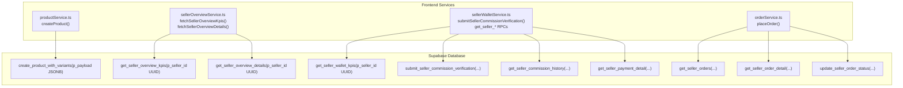

**Diagram sources**
- [productService.ts:302-707](file://src/api/productService.ts#L302-L707)
- [sellerOverviewService.ts:90-139](file://src/api/sellerOverviewService.ts#L90-L139)
- [sellerWalletService.ts:118-277](file://src/api/sellerWalletService.ts#L118-L277)
- [orderService.ts:403-760](file://src/api/orderService.ts#L403-L760)
- [20261105_create_product_with_variants_rpc.sql:104-800](file://supabase/migrations/20261105_create_product_with_variants_rpc.sql#L104-L800)
- [supabase_seller_overview_rpc.sql:36-159](file://supabase_seller_overview_rpc.sql#L36-L159)
- [supabase_seller_overview_rpc.sql:166-353](file://supabase_seller_overview_rpc.sql#L166-L353)
- [supabase_wallet_payout_rpc.sql:133-254](file://supabase_wallet_payout_rpc.sql#L133-L254)
- [supabase_wallet_payout_rpc.sql:259-370](file://supabase_wallet_payout_rpc.sql#L259-L370)
- [supabase_wallet_payout_rpc.sql:375-430](file://supabase_wallet_payout_rpc.sql#L375-L430)
- [supabase_wallet_payout_rpc.sql:435-541](file://supabase_wallet_payout_rpc.sql#L435-L541)
- [supabase_seller_orders_rpc.sql:54-151](file://supabase_seller_orders_rpc.sql#L54-L151)
- [supabase_seller_orders_rpc.sql:157-237](file://supabase_seller_orders_rpc.sql#L157-L237)
- [supabase_seller_orders_rpc.sql:243-309](file://supabase_seller_orders_rpc.sql#L243-L309)

**Section sources**
- [productService.ts:302-707](file://src/api/productService.ts#L302-L707)
- [sellerOverviewService.ts:90-139](file://src/api/sellerOverviewService.ts#L90-L139)
- [sellerWalletService.ts:118-277](file://src/api/sellerWalletService.ts#L118-L277)
- [orderService.ts:403-760](file://src/api/orderService.ts#L403-L760)
- [supabase_seller_overview_rpc.sql:36-353](file://supabase_seller_overview_rpc.sql#L36-L353)
- [supabase_wallet_payout_rpc.sql:133-541](file://supabase_wallet_payout_rpc.sql#L133-L541)
- [20261105_create_product_with_variants_rpc.sql:104-800](file://supabase/migrations/20261105_create_product_with_variants_rpc.sql#L104-L800)
- [supabase_seller_orders_rpc.sql:54-309](file://supabase_seller_orders_rpc.sql#L54-L309)

## Core Components
This section summarizes the main RPC-backed services and their responsibilities.

| Service | Primary RPCs / Functions | Purpose | Key Inputs | Key Outputs | Error Handling |
|---|---|---|---|---|---|
| Product Creation | `create_product_with_variants` | Atomic product creation with simple or multi-variant inventory, images, attributes, options, and variants | JSON payload with productId, categoryId, title, description, defect, images, customSpecs, attributeValues, options, variants | JSON result with created product metadata and counts | Validation errors raised server-side; frontend maps database errors to user-friendly messages |
| Seller Overview Analytics | `get_seller_overview_kpis`, `get_seller_overview_details` | Fast KPI card aggregation and detailed graphs/recent orders | Seller UUID | JSONB with Section 1 + Section 2 KPIs and graphs/recent orders | RLS-scoped; fallback PostgREST queries if RPC unavailable |
| Wallet & Payouts | `get_seller_wallet_kpis`, `submit_seller_commission_verification`, `get_seller_commission_history`, `get_seller_payment_detail` | Commission cycle summary, payment submission, paginated history, detail modal | Seller UUID, paid amount, receipt image, pagination params | JSONB wallet KPIs, payment submission result, paginated records, detail object | Transactional verification; RLS policies; fallback relational queries |
| Orders Management | `get_seller_orders`, `get_seller_order_detail`, `update_seller_order_status` | Paginated seller orders, order detail, status update with courier/tracking timestamps | Seller UUID, filters, search, pagination, status, courier info | JSONB order list/detail/update result | Status enum validation; access denied exceptions |

**Section sources**
- [productService.ts:302-707](file://src/api/productService.ts#L302-L707)
- [supabase_seller_overview_rpc.sql:36-353](file://supabase_seller_overview_rpc.sql#L36-L353)
- [supabase_wallet_payout_rpc.sql:133-541](file://supabase_wallet_payout_rpc.sql#L133-L541)
- [supabase_seller_orders_rpc.sql:54-309](file://supabase_seller_orders_rpc.sql#L54-L309)

## Architecture Overview
The system uses a hybrid approach:

- **RPC-first**: Most heavy computations run inside PostgreSQL functions using SECURITY DEFINER or SECURITY INVOKER.
- **Fallback PostgREST**: If an RPC is missing or fails, frontend services fall back to direct table queries with strict seller scoping.
- **Atomic Transactions**: Critical writes (product creation, commission verification) are wrapped in server-side transactions.
- **Row-Level Security**: All sensitive tables enforce RLS policies so sellers can only access their own data.

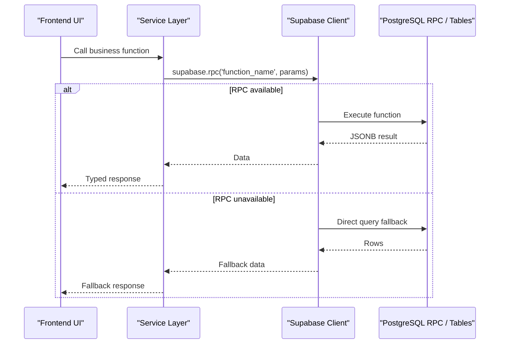

**Diagram sources**
- [productService.ts:638-707](file://src/api/productService.ts#L638-L707)
- [sellerOverviewService.ts:90-139](file://src/api/sellerOverviewService.ts#L90-L139)
- [sellerWalletService.ts:118-277](file://src/api/sellerWalletService.ts#L118-L277)
- [orderService.ts:403-760](file://src/api/orderService.ts#L403-L760)

## Detailed Component Analysis

### Product Creation RPC: Multi-Variant Atomic Transaction

#### Function Contract
- **Function Name**: `create_product_with_variants`
- **Input Parameter**: `p_payload JSONB`
- **Return Value**: JSONB containing creation results and metadata
- **Security Model**: SECURITY INVOKER; authentication and seller identity enforced via `auth.uid()`
- **Transaction Scope**: Entire insertion of product, images, attributes, options, option values, option images, and variants runs atomically

#### Input Payload Structure
The frontend constructs a payload matching this contract:

| Field | Type | Description |
|---|---|---|
| `productId` | UUID string | Client-generated unique product ID |
| `categoryId` | UUID string | Valid active child category |
| `title` | String | Trimmed product title |
| `description` | String or null | Optional product description |
| `defect` | String or null | Optional condition details |
| `images` | Array of `{storagePath, imageUrl}` | Gallery images with security-isolated paths |
| `customSpecs` | Array of `{name, value}` | Custom product specifications |
| `attributeValues` | Array of `{attributeId, value}` | Category attribute values |
| `options` | Array of `{name, values[]}` | Variation dimensions and values |
| `variants` | Array of `{values[], sellingPrice, quantity}` | Variant rows |
| `simple` | Object or null | Simple product price/compareAtPrice/quantity |

#### Processing Logic
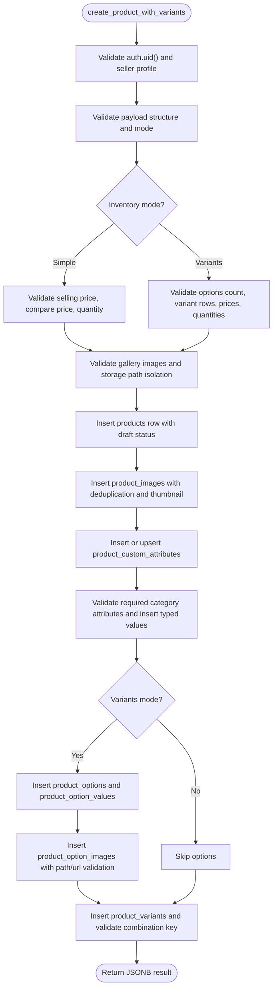

**Diagram sources**
- [20261105_create_product_with_variants_rpc.sql:202-800](file://supabase/migrations/20261105_create_product_with_variants_rpc.sql#L202-L800)

#### Frontend Usage
The frontend service performs preflight validation, image hashing/compression/concurrency uploads, payload construction, and RPC invocation:

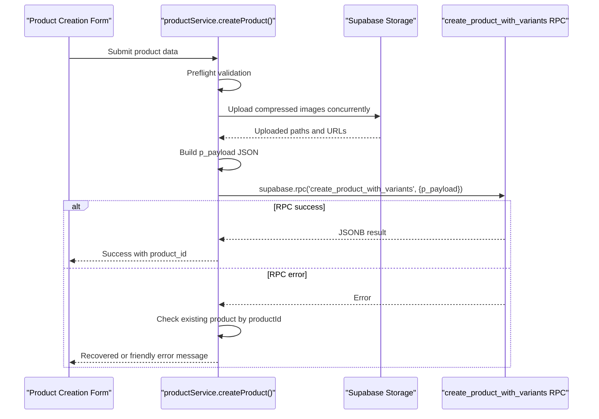

**Diagram sources**
- [productService.ts:302-707](file://src/api/productService.ts#L302-L707)
- [20261105_create_product_with_variants_rpc.sql:104-800](file://supabase/migrations/20261105_create_product_with_variants_rpc.sql#L104-L800)

#### Error Handling
- **Client-side validation**: Missing userId, invalid title length, invalid image count, invalid variation limits, invalid pricing/stock.
- **Storage errors**: Concurrency-limited uploads with cleanup of uploaded paths on failure.
- **Database errors**: Mapped to user-friendly messages including schema cache issues, constraint violations, foreign key errors, and RLS permission errors.
- **Network timeout recovery**: If RPC call fails but product exists, returns recovered success.

#### Performance Considerations
- Image deduplication by SHA-256 reduces redundant uploads.
- Concurrency limit of 3–4 upload workers prevents overwhelming storage.
- Server-side normalization and validation reduce round-trips.
- Draft product status allows intermediate state before final activation.

#### Security Considerations
- Authentication check ensures logged-in seller.
- Seller profile existence check prevents anonymous creation.
- Image storage path must start with `{sellerId}/{productId}/`.
- Image URL must match `productImages/<storage_path>`.
- Option value images have identical path/url isolation rules.

**Section sources**
- [productService.ts:302-707](file://src/api/productService.ts#L302-L707)
- [20261105_create_product_with_variants_rpc.sql:104-800](file://supabase/migrations/20261105_create_product_with_variants_rpc.sql#L104-L800)

### Seller Overview Analytics RPCs

#### get_seller_overview_kpis
- **Purpose**: Fast Phase 1 KPI aggregation for dashboard cards.
- **Input**: `p_seller_id UUID`
- **Output**: JSONB with `section1_kpis` and `section2_last_7d`
- **Metrics**:
  - Total revenue from shipped/delivered orders
  - Available payout where payment status is pending
  - Active listings count
  - Pending dispatch count
  - Delivered orders count
  - Last 7 days revenue, orders, average order value, pending fulfillment, new reviews, units sold

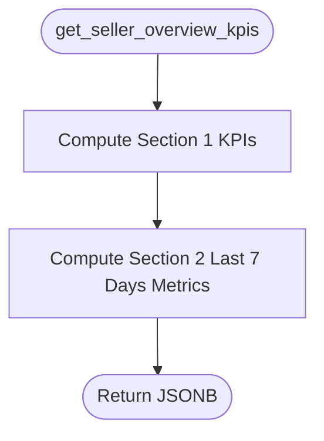

**Diagram sources**
- [supabase_seller_overview_rpc.sql:36-159](file://supabase_seller_overview_rpc.sql#L36-L159)

#### get_seller_overview_details
- **Purpose**: Phase 2 detailed analytics and recent orders.
- **Input**: `p_seller_id UUID`
- **Output**: JSONB with `graphs` and `recent_orders`
- **Graphs**:
  - Daily revenue trajectory
  - Daily order volume
  - Order status breakdown across five statuses
  - Top 5 products sold by units and revenue
  - Payment method share between COD and Online
- **Recent Orders**: Limited to 3 most recent seller orders joined with customer and item summaries

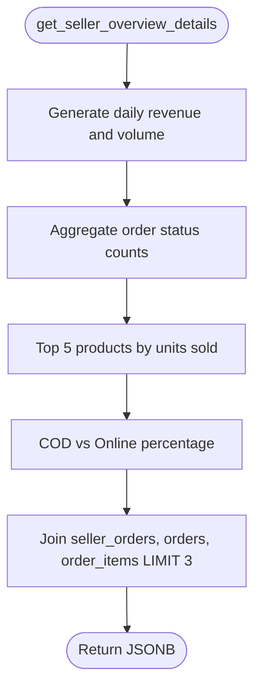

**Diagram sources**
- [supabase_seller_overview_rpc.sql:166-353](file://supabase_seller_overview_rpc.sql#L166-L353)

#### Frontend Usage
The frontend service tries RPC first and falls back to PostgREST queries:

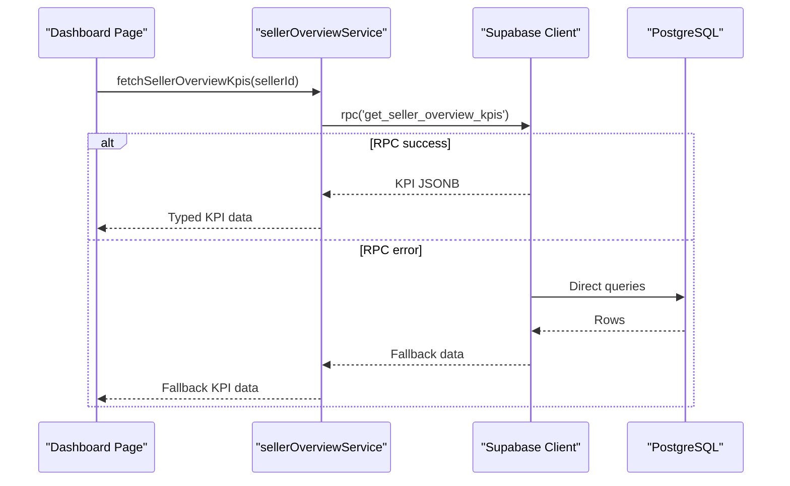

**Diagram sources**
- [sellerOverviewService.ts:90-139](file://src/api/sellerOverviewService.ts#L90-L139)
- [supabase_seller_overview_rpc.sql:36-353](file://supabase_seller_overview_rpc.sql#L36-L353)

#### Error Handling
- RPC unavailability triggers console warning and fallback.
- Fallback queries compute equivalent metrics client-side.
- RLS policies ensure sellers only see their own data.

#### Performance Considerations
- Phase 1 RPC is lightweight and fast.
- Phase 2 RPC aggregates multiple joins and generates zero-filled daily buckets.
- Fallback queries are more expensive due to multiple client-side aggregations.

**Section sources**
- [sellerOverviewService.ts:90-139](file://src/api/sellerOverviewService.ts#L90-L139)
- [supabase_seller_overview_rpc.sql:36-353](file://supabase_seller_overview_rpc.sql#L36-L353)

### Wallet and Payout Calculation Procedures

#### get_seller_wallet_kpis
- **Purpose**: Combined single-fetch wallet summary and current payable cycle.
- **Input**: `p_seller_id UUID`
- **Output**: JSONB with total sales, remaining commission, submitted payments, verified payments, total available payout, and current cycle object.
- **Cycle Resolution**:
  - If previous month/year cycle exists, use it.
  - Otherwise, compute gross from shipped/delivered orders and apply 5% commission.

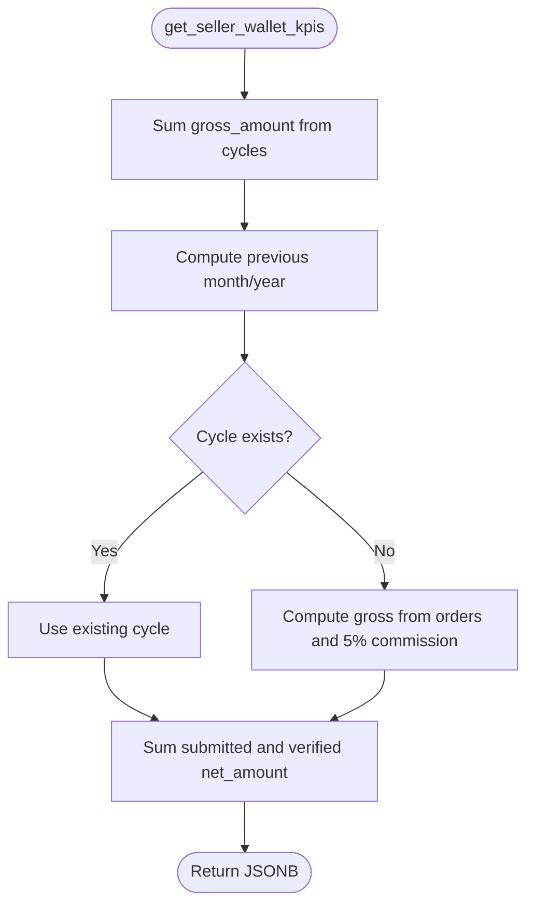

**Diagram sources**
- [supabase_wallet_payout_rpc.sql:133-254](file://supabase_wallet_payout_rpc.sql#L133-L254)

#### submit_seller_commission_verification
- **Purpose**: Atomic transaction to submit a commission payment, create cycle if needed, insert payment record, and update cycle status.
- **Inputs**:
  - `p_seller_id UUID`
  - `p_paid_amount NUMERIC`
  - `p_receipt_image TEXT`
  - `p_notes TEXT`
- **Output**: JSONB with success flag, payment ID, cycle ID, net amount, and new status.
- **Business Rules**:
  - Paid amount must be positive.
  - Previous month/year cycle is fetched fresh.
  - If cycle missing, it is created dynamically.
  - Payment inserted with status Submitted.
  - Cycle status updated to Partially Paid or Paid based on cumulative paid amount.

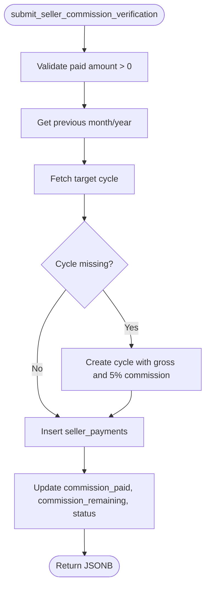

**Diagram sources**
- [supabase_wallet_payout_rpc.sql:259-370](file://supabase_wallet_payout_rpc.sql#L259-L370)

#### get_seller_commission_history
- **Purpose**: Paginated commission payment history.
- **Inputs**: `p_seller_id UUID`, `p_page INT`, `p_page_size INT`
- **Output**: JSONB with total_count, page, page_size, total_pages, has_more, records array.

#### get_seller_payment_detail
- **Purpose**: Lazy-loaded detail modal for a specific payment with cycle summary and paginated related orders.
- **Inputs**: `p_payment_id UUID`, `p_seller_id UUID`, `p_order_page INT`, `p_order_page_size INT`
- **Output**: JSONB with payment_summary, cycle_summary, orders, orders_pagination.

#### Frontend Usage
The wallet service follows the same RPC-first pattern:

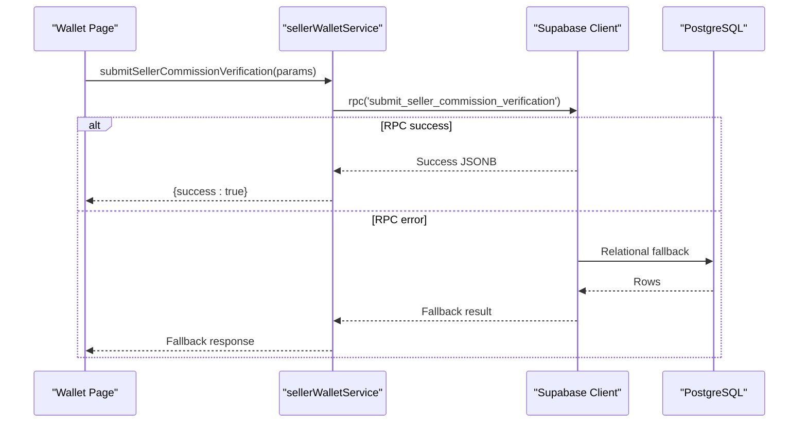

**Diagram sources**
- [sellerWalletService.ts:315-452](file://src/api/sellerWalletService.ts#L315-L452)
- [supabase_wallet_payout_rpc.sql:259-370](file://supabase_wallet_payout_rpc.sql#L259-L370)

#### Error Handling
- Invalid paid amount raises exception.
- Cycle creation fallback computes gross from orders and applies fixed 5% commission.
- Payment insertion failure throws error.
- Cycle update failure rolls back payment insertion in fallback path.
- RLS policies restrict access to seller-specific data.

#### Performance Considerations
- Single RPC for wallet KPIs reduces multiple client-side queries.
- Pagination avoids loading entire payment history.
- Detail modal loads related orders lazily.

#### Security Considerations
- SECURITY DEFINER functions execute with elevated privileges but enforce seller scoping.
- RLS policies on cycles, payments, and cycle items prevent cross-seller access.
- Receipt image path is validated and stored securely.

**Section sources**
- [sellerWalletService.ts:118-277](file://src/api/sellerWalletService.ts#L118-L277)
- [sellerWalletService.ts:315-452](file://src/api/sellerWalletService.ts#L315-L452)
- [supabase_wallet_payout_rpc.sql:133-541](file://supabase_wallet_payout_rpc.sql#L133-L541)

### Order Processing Workflow

#### placeOrder
- **Purpose**: Place an order into the database with validation, stock checks, pricing recalculation, atomic creation of orders, order_items, seller_orders, variant stock deduction, and cart cleanup.
- **Inputs**:
  - `userId` optional UUID
  - `customerInfo` with name, email, phone, city, address, postal code, payment method
  - `cartItems` array of cart entries
  - `sellerPayments` per-seller payment data
- **Output**: `PlaceOrderResult` with success flag, orderId, orderNumber, createdOrders, error, and orderItems.

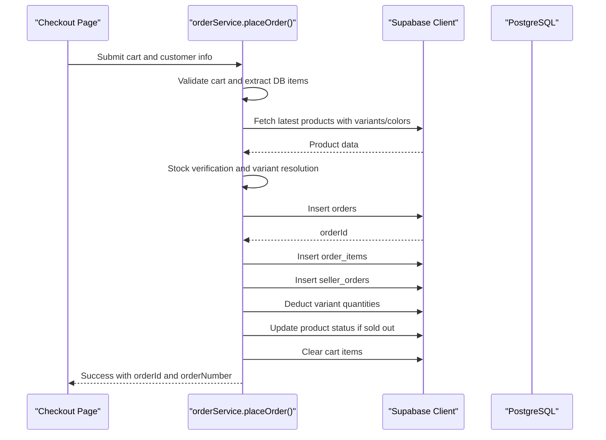

**Diagram sources**
- [orderService.ts:403-760](file://src/api/orderService.ts#L403-L760)

#### Error Handling
- Empty cart returns immediate error.
- Product not found or inactive returns descriptive error.
- Insufficient stock returns per-item stock error.
- Order/item/seller order insertion failures trigger rollback helper.
- Variant stock updates and product status changes are performed after successful inserts.

#### Performance Considerations
- Re-fetches latest product data to avoid stale stock.
- Uses Map-based lookups for efficient variant and color resolution.
- Batch inserts for order_items and seller_orders.
- Conditional cart cleanup only for authenticated users.

#### Security Considerations
- Validates UUID format for userId and product IDs.
- Enforces NOT NULL constraints by providing fallback postal codes.
- Stores payment proof URLs safely and supports signed/public URLs.

**Section sources**
- [orderService.ts:403-760](file://src/api/orderService.ts#L403-L760)

### Seller Orders Management RPCs

#### get_seller_orders
- **Purpose**: Paginated seller orders table with filtering, search, sorting, and aggregated items.
- **Inputs**: `p_seller_id UUID`, `p_status_filter TEXT`, `p_search TEXT`, `p_page INT`, `p_page_size INT`, `p_sort_by TEXT`, `p_sort_order TEXT`
- **Output**: JSONB with total_count, page, page_size, orders array.

#### get_seller_order_detail
- **Purpose**: Full order detail modal data including customer, shipping, payment, and items.
- **Inputs**: `p_seller_id UUID`, `p_order_id UUID`
- **Output**: JSONB with seller_order_id, order_id, order_number, status, totals, courier info, customer, shipping, payment, items.

#### update_seller_order_status
- **Purpose**: Inline status update with courier details and dispatch timestamps.
- **Inputs**: `p_seller_order_id UUID`, `p_seller_id UUID`, `p_new_status TEXT`, `p_courier_name TEXT`, `p_tracking_number TEXT`
- **Output**: JSONB with success, seller_order_id, status, updated_at.

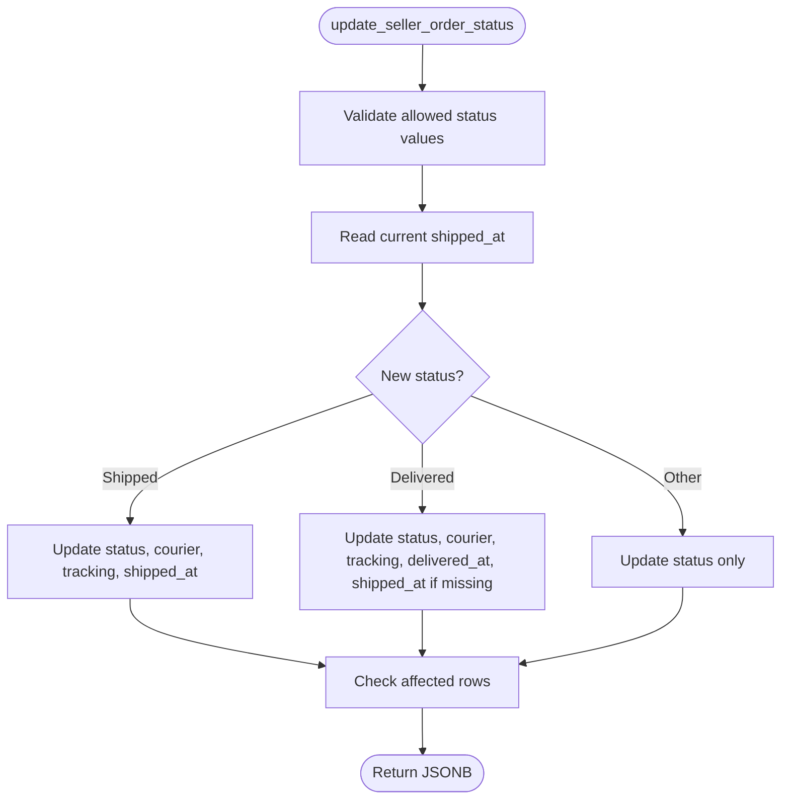

**Diagram sources**
- [supabase_seller_orders_rpc.sql:243-309](file://supabase_seller_orders_rpc.sql#L243-L309)

**Section sources**
- [supabase_seller_orders_rpc.sql:54-151](file://supabase_seller_orders_rpc.sql#L54-L151)
- [supabase_seller_orders_rpc.sql:157-237](file://supabase_seller_orders_rpc.sql#L157-L237)
- [supabase_seller_orders_rpc.sql:243-309](file://supabase_seller_orders_rpc.sql#L243-L309)

## Dependency Analysis

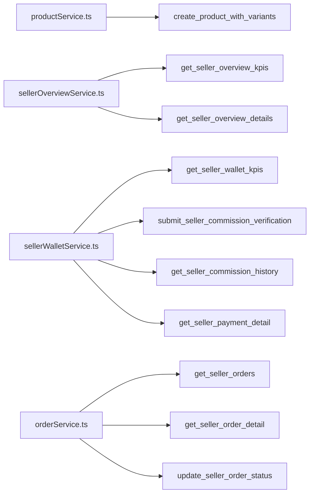

**Diagram sources**
- [productService.ts:302-707](file://src/api/productService.ts#L302-L707)
- [sellerOverviewService.ts:90-139](file://src/api/sellerOverviewService.ts#L90-L139)
- [sellerWalletService.ts:118-277](file://src/api/sellerWalletService.ts#L118-L277)
- [orderService.ts:403-760](file://src/api/orderService.ts#L403-L760)
- [supabase_seller_overview_rpc.sql:36-353](file://supabase_seller_overview_rpc.sql#L36-L353)
- [supabase_wallet_payout_rpc.sql:133-541](file://supabase_wallet_payout_rpc.sql#L133-L541)
- [supabase_seller_orders_rpc.sql:54-309](file://supabase_seller_orders_rpc.sql#L54-L309)

**Section sources**
- [productService.ts:302-707](file://src/api/productService.ts#L302-L707)
- [sellerOverviewService.ts:90-139](file://src/api/sellerOverviewService.ts#L90-L139)
- [sellerWalletService.ts:118-277](file://src/api/sellerWalletService.ts#L118-L277)
- [orderService.ts:403-760](file://src/api/orderService.ts#L403-L760)

## Performance Considerations
- Prefer RPCs for heavy aggregation to reduce client-side computation and network chatter.
- Use pagination for large datasets such as commission history and payment details.
- Cache or debounce dashboard loads where appropriate since analytics involve multiple joins.
- Avoid unnecessary re-fetches by validating inputs and using stable seller IDs.
- For product creation, concurrency-limited image uploads improve throughput without overwhelming storage.
- Indexes on seller_id, month/year, and created_at columns support efficient filtering and ordering.

[No sources needed since this section provides general guidance]

## Troubleshooting Guide

### Common RPC Errors
- **Schema cache not found**: Indicates migration scripts were not executed. Ensure relevant SQL migrations are applied in Supabase SQL editor.
- **Duplicate key or constraint violation**: Usually caused by duplicate options, values, or combinations. Normalize names and validate uniqueness.
- **Foreign key violation**: Selected category, attribute, or option references are invalid or no longer exist.
- **Permission denied / Row-level security**: User is not authenticated as the correct seller or trying to access another seller's data.

### Product Creation Issues
- **Image upload failed**: Check storage bucket permissions and file size/type limits.
- **Invalid storage path**: Ensure paths start with `{sellerId}/{productId}/` and URLs match `productImages/<path>`.
- **Incomplete variant set**: Ensure Cartesian product matches expected combinations.

### Wallet/Payout Issues
- **Invalid paid amount**: Must be positive.
- **Cycle not found**: Fallback computes gross from shipped/delivered orders and applies 5% commission.
- **Submission failed**: Check RLS policies and ensure seller_id matches authenticated user.

### Order Issues
- **Stock insufficient**: Verify variant quantities and selected options.
- **Order insertion failed**: Check NOT NULL constraints and seller order group creation.
- **Variant stock not updated**: Ensure variant IDs match and quantities are non-negative.

**Section sources**
- [productService.ts:255-292](file://src/api/productService.ts#L255-L292)
- [20261105_create_product_with_variants_rpc.sql:202-800](file://supabase/migrations/20261105_create_product_with_variants_rpc.sql#L202-L800)
- [supabase_wallet_payout_rpc.sql:259-370](file://supabase_wallet_payout_rpc.sql#L259-L370)
- [orderService.ts:403-760](file://src/api/orderService.ts#L403-L760)

## Conclusion
The system combines robust PostgreSQL RPCs with resilient frontend services to handle complex business operations. Product creation is atomic and secure, seller analytics are optimized for fast dashboard rendering, order processing enforces stock and pricing integrity, and wallet/payout workflows provide reliable commission tracking. The RPC-first design with PostgREST fallbacks ensures availability, while RLS policies and server-side validation maintain security and data correctness.

[No sources needed since this section summarizes without analyzing specific files]