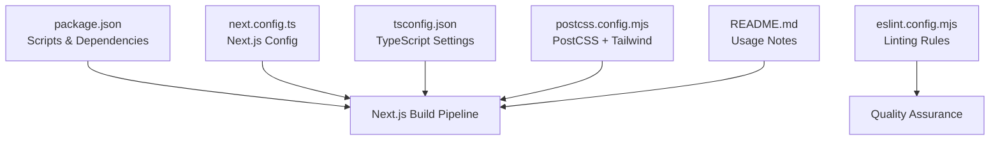
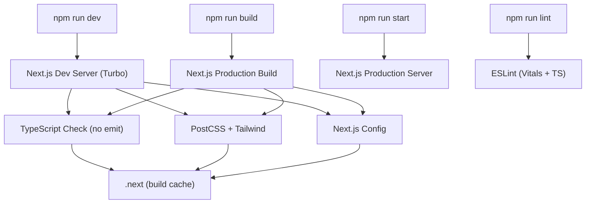
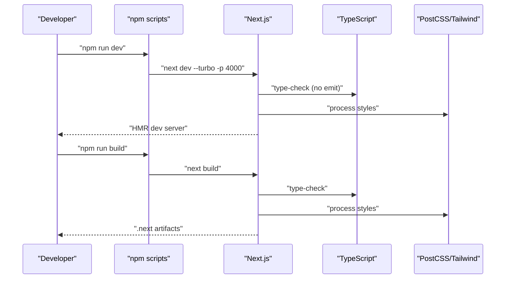
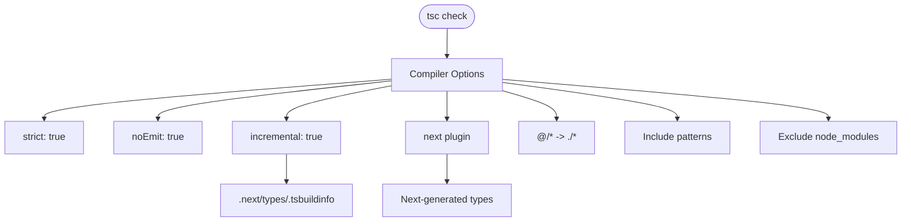
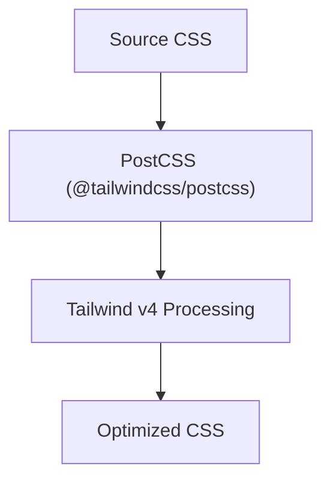
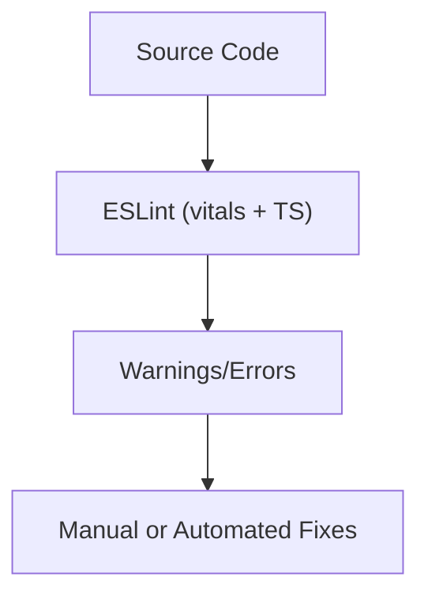
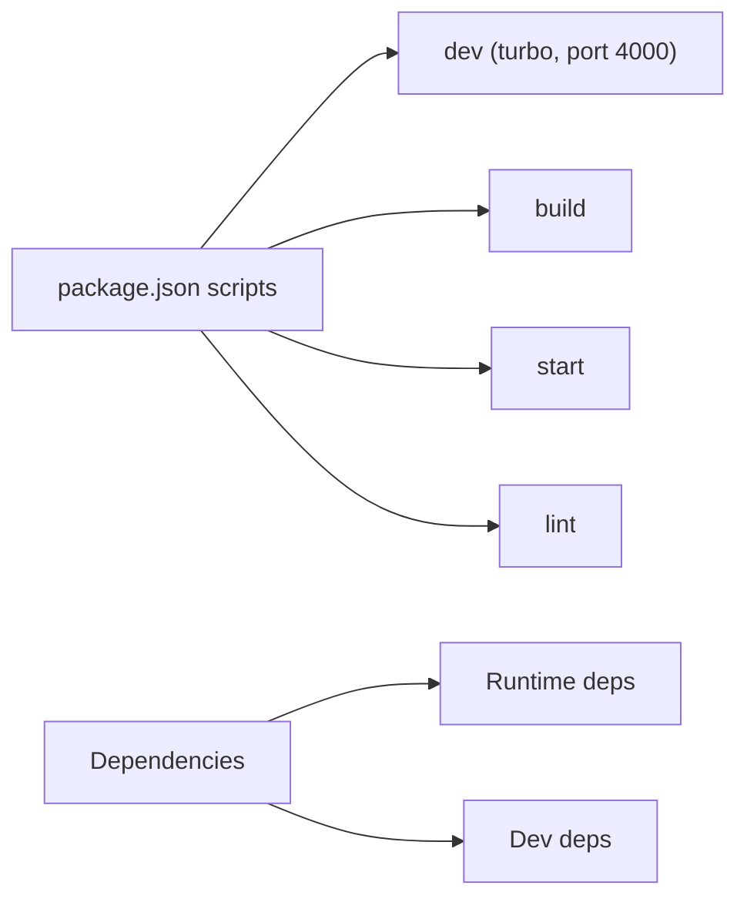
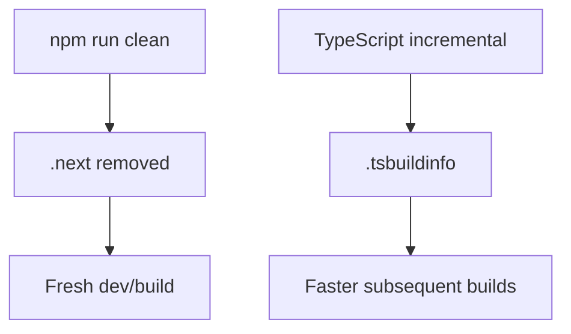
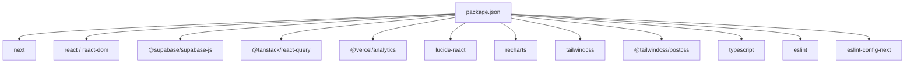

# Build Configuration

<cite>
**Referenced Files in This Document**
- [package.json](file://package.json)
- [next.config.ts](file://next.config.ts)
- [tsconfig.json](file://tsconfig.json)
- [postcss.config.mjs](file://postcss.config.mjs)
- [eslint.config.mjs](file://eslint.config.mjs)
- [README.md](file://README.md)
</cite>

## Table of Contents
1. [Introduction](#introduction)
2. [Project Structure](#project-structure)
3. [Core Components](#core-components)
4. [Architecture Overview](#architecture-overview)
5. [Detailed Component Analysis](#detailed-component-analysis)
6. [Dependency Analysis](#dependency-analysis)
7. [Performance Considerations](#performance-considerations)
8. [Troubleshooting Guide](#troubleshooting-guide)
9. [Conclusion](#conclusion)

## Introduction
This document explains the build configuration for the Zebaish platform, focusing on the Next.js build process, TypeScript compilation settings, PostCSS configuration, package scripts, dependency management, and quality assurance via ESLint. It also covers optimization strategies, environment-specific considerations, asset handling, bundle analysis techniques, caching/incremental builds, and production performance tuning.

## Project Structure
The project is a Next.js App Router application with:
- Application pages and components under app/ and components/
- API clients and hooks under src/
- Tailwind CSS v4 via @tailwindcss/postcss
- ESLint configured with next-vitals and TypeScript rules
- TypeScript compiler integrated with Next.js plugin

**Diagram sources**
- [package.json:1-34](file://package.json#L1-L34)
- [next.config.ts:1-12](file://next.config.ts#L1-L12)
- [tsconfig.json:1-35](file://tsconfig.json#L1-L35)
- [postcss.config.mjs:1-8](file://postcss.config.mjs#L1-L8)
- [eslint.config.mjs:1-19](file://eslint.config.mjs#L1-L19)
- [README.md:1-37](file://README.md#L1-L37)

**Section sources**
- [package.json:1-34](file://package.json#L1-L34)
- [README.md:1-37](file://README.md#L1-L37)

## Core Components
- Next.js build pipeline driven by next dev/build/start commands
- TypeScript compilation via tsconfig.json with Next.js plugin
- PostCSS processing with Tailwind CSS v4 through @tailwindcss/postcss
- ESLint configuration using eslint-config-next core-web-vitals and TypeScript presets
- Package scripts for development, cleaning, building, linting, and starting the server

**Section sources**
- [package.json:5-12](file://package.json#L5-L12)
- [next.config.ts:1-12](file://next.config.ts#L1-L12)
- [tsconfig.json:1-35](file://tsconfig.json#L1-L35)
- [postcss.config.mjs:1-8](file://postcss.config.mjs#L1-L8)
- [eslint.config.mjs:1-19](file://eslint.config.mjs#L1-L19)

## Architecture Overview
The build architecture integrates several tools orchestrated by Next.js:

**Diagram sources**
- [package.json:5-12](file://package.json#L5-L12)
- [next.config.ts:1-12](file://next.config.ts#L1-L12)
- [tsconfig.json:1-35](file://tsconfig.json#L1-L35)
- [postcss.config.mjs:1-8](file://postcss.config.mjs#L1-L8)
- [eslint.config.mjs:1-19](file://eslint.config.mjs#L1-L19)

## Detailed Component Analysis

### Next.js Build Process
- Development server uses Turbo mode and runs on port 4000.
- Production build invokes the standard Next.js build command.
- Production server starts from the built output.
- React Strict Mode is enabled.
- Experimental optimizePackageImports is configured for lucide-react and recharts to reduce bundle size by tree-shaking unused exports.

**Diagram sources**
- [package.json:5-12](file://package.json#L5-L12)
- [next.config.ts:3-9](file://next.config.ts#L3-L9)

**Section sources**
- [package.json:5-12](file://package.json#L5-L12)
- [next.config.ts:3-9](file://next.config.ts#L3-L9)

### TypeScript Compilation Settings
- Target: ES2017
- Libs: DOM, DOM iterable, ESNext
- Strict mode enabled; noEmit true (handled by Next.js)
- Module: esnext with bundler resolution
- JSX: react-jsx
- Incremental compilation enabled
- Next.js plugin included
- Path alias @/* mapped to root directory
- Includes generated types and .mts files; excludes node_modules

**Diagram sources**
- [tsconfig.json:1-35](file://tsconfig.json#L1-L35)

**Section sources**
- [tsconfig.json:1-35](file://tsconfig.json#L1-L35)

### PostCSS Configuration
- Uses @tailwindcss/postcss for Tailwind CSS v4 processing.
- Integrated into Next.js build pipeline automatically.

**Diagram sources**
- [postcss.config.mjs:1-8](file://postcss.config.mjs#L1-L8)

**Section sources**
- [postcss.config.mjs:1-8](file://postcss.config.mjs#L1-L8)

### ESLint Rules and Quality Assurance
- Extends next-vitals and TypeScript configs from eslint-config-next.
- Overrides default ignores to include .next, out, build, and next-env.d.ts.
- Provides consistent code quality aligned with Next.js best practices and web vitals.

**Diagram sources**
- [eslint.config.mjs:1-19](file://eslint.config.mjs#L1-L19)

**Section sources**
- [eslint.config.mjs:1-19](file://eslint.config.mjs#L1-L19)

### Package Scripts and Dependency Management
- Scripts:
  - dev: Starts Next.js dev server with Turbo and custom port 4000.
  - clean: Removes .next directory using PowerShell.
  - dev:clean: Cleans .next then starts dev server.
  - build: Runs Next.js production build.
  - start: Starts production server.
  - lint: Runs ESLint.
- Dependencies:
  - Runtime: Next.js, React 19, Supabase client, TanStack React Query, Vercel Analytics, Lucide icons, Recharts.
  - Dev: Tailwind CSS v4, @tailwindcss/postcss, TypeScript, ESLint, Next ESLint config, Node/React types.

**Diagram sources**
- [package.json:1-34](file://package.json#L1-L34)

**Section sources**
- [package.json:1-34](file://package.json#L1-L34)

### Environment-Specific Build Configurations
- Development:
  - Uses turbo mode for faster rebuilds.
  - Custom port 4000 via script argument.
- Production:
  - Standard Next.js build and start commands.
  - React Strict Mode enabled globally via Next.js config.
- Type checking:
  - Enabled during dev/build via Next.js integration with TypeScript.
- Styles:
  - Tailwind CSS v4 processed via PostCSS in both dev and prod.

**Section sources**
- [package.json:5-12](file://package.json#L5-L12)
- [next.config.ts:3-9](file://next.config.ts#L3-L9)

### Asset Optimization During Builds
- Font optimization:
  - The README indicates usage of next/font for automatic font optimization.
- Package imports optimization:
  - Experimental optimizePackageImports configured for lucide-react and recharts to improve tree-shaking and reduce bundle size.

**Section sources**
- [README.md:21-21](file://README.md#L21-L21)
- [next.config.ts:3-6](file://next.config.ts#L3-L6)

### Bundle Analysis Techniques
- Recommended approach:
  - Use webpack-bundle-analyzer with Next.js to visualize bundle composition and identify large dependencies.
- Steps:
  - Install analyzer package.
  - Configure Next.js to enable analyzer during build.
  - Run build and open the generated report.
- Focus areas:
  - Large third-party libraries (e.g., recharts).
  - Unused code paths and heavy assets.

[No sources needed since this section provides general guidance]

### Build Caching and Incremental Builds
- TypeScript incremental compilation:
  - Enabled via tsconfig.json to speed up type checks across builds.
- Next.js build cache:
  - Stored in .next; use npm run clean to clear when encountering stale state.
- Development hot reload:
  - Turbo mode improves rebuild times in dev.

**Diagram sources**
- [package.json:7-8](file://package.json#L7-L8)
- [tsconfig.json:15-15](file://tsconfig.json#L15-L15)

**Section sources**
- [package.json:7-8](file://package.json#L7-L8)
- [tsconfig.json:15-15](file://tsconfig.json#L15-L15)

### Performance Optimization for Production Builds
- Enable experimental optimizePackageImports for known heavy packages (already configured).
- Ensure unused CSS is purged by Tailwind (default behavior with v4).
- Prefer dynamic imports for heavy components if not already used.
- Monitor bundle size with analyzer and refactor where necessary.

**Section sources**
- [next.config.ts:3-6](file://next.config.ts#L3-L6)

## Dependency Analysis
The build depends on the following key modules:

**Diagram sources**
- [package.json:13-32](file://package.json#L13-L32)

**Section sources**
- [package.json:13-32](file://package.json#L13-L32)

## Performance Considerations
- Development:
  - Use npm run dev for fast iterative feedback with Turbo mode.
  - Clear .next with npm run clean when encountering inconsistent states.
- Production:
  - Leverage experimental optimizePackageImports for lucide-react and recharts.
  - Keep Tailwind CSS minimal by relying on framework-driven class usage.
  - Analyze bundle size regularly to avoid regressions.

[No sources needed since this section provides general guidance]

## Troubleshooting Guide
- Stale build artifacts:
  - Run npm run clean to remove .next and rebuild fresh.
- Port conflicts:
  - The dev script binds to port 4000; adjust if needed in the script.
- Type errors:
  - TypeScript is strict; fix reported issues before building.
- Linting failures:
  - Run npm run lint to identify issues; follow next-vitals and TypeScript rules.
- Style issues:
  - Ensure Tailwind classes are valid; PostCSS will process them via @tailwindcss/postcss.

**Section sources**
- [package.json:5-12](file://package.json#L5-L12)
- [eslint.config.mjs:1-19](file://eslint.config.mjs#L1-L19)
- [postcss.config.mjs:1-8](file://postcss.config.mjs#L1-L8)

## Conclusion
The Zebaish platform’s build system centers on Next.js with TypeScript, PostCSS/Tailwind v4, and ESLint. The configuration emphasizes developer productivity (Turbo dev server), type safety (strict TS), and production efficiency (optimizePackageImports, incremental builds). For further gains, adopt bundle analysis, dynamic imports, and continuous linting/type checks in CI pipelines.