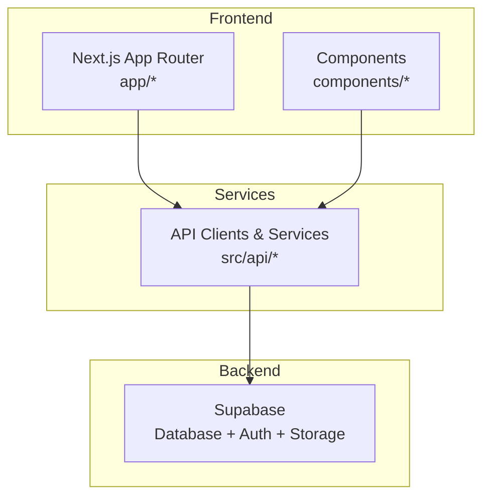
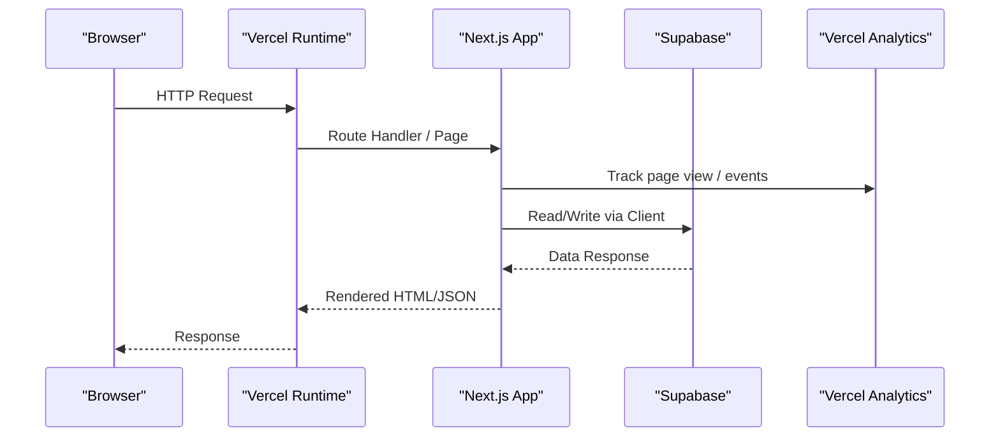
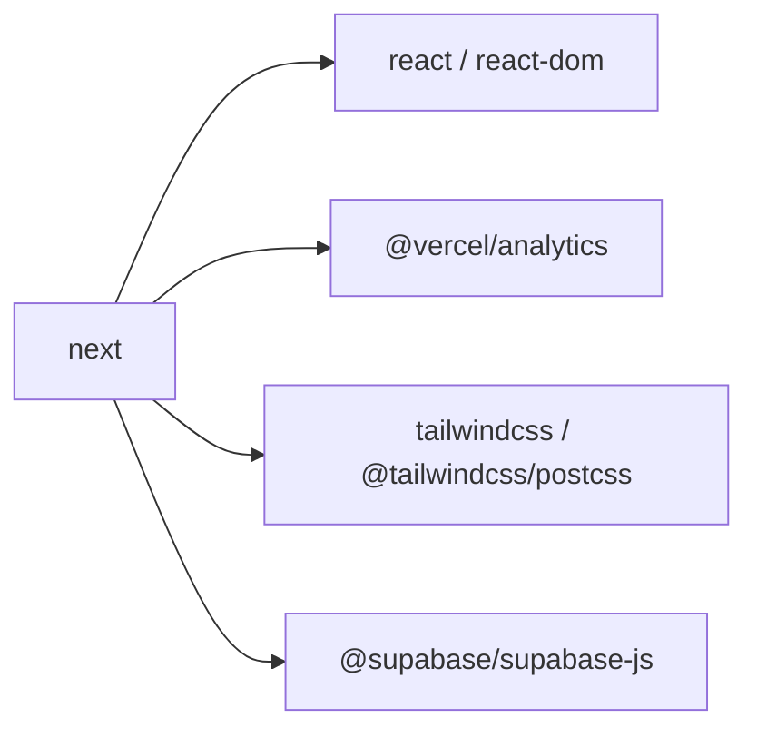

# Deployment & DevOps

<cite>
**Referenced Files in This Document**
- [README.md](file://README.md)
- [package.json](file://package.json)
- [next.config.ts](file://next.config.ts)
- [client.js](file://src/api/client.js)
- [layout.tsx](file://app/layout.tsx)
- [20261106_create_users_table.sql](file://supabase/migrations/20261106_create_users_table.sql)
</cite>

## Table of Contents
1. [Introduction](#introduction)
2. [Project Structure](#project-structure)
3. [Core Components](#core-components)
4. [Architecture Overview](#architecture-overview)
5. [Detailed Component Analysis](#detailed-component-analysis)
6. [Dependency Analysis](#dependency-analysis)
7. [Performance Considerations](#performance-considerations)
8. [Troubleshooting Guide](#troubleshooting-guide)
9. [Conclusion](#conclusion)

## Introduction
This document provides comprehensive deployment and DevOps guidance for the Zebaish platform, a Next.js application integrated with Supabase for data and authentication, and Vercel Analytics for performance monitoring. It covers build configuration, environment variable management, asset optimization, CI/CD setup, staging environments, Vercel deployment specifics, Supabase environment setup, database migrations, monitoring/analytics integration, error tracking, performance monitoring, scaling considerations, backup strategies, and disaster recovery procedures.

## Project Structure
The project is a Next.js App Router application with:
- Frontend pages and components under app/ and components/
- API clients and services under src/api/
- Database migrations under supabase/migrations/
- Build and runtime configuration via next.config.ts and package.json

**Diagram sources**
- [package.json:1-34](file://package.json#L1-L34)
- [next.config.ts:1-12](file://next.config.ts#L1-L12)
- [client.js:1-8](file://src/api/client.js#L1-L8)

**Section sources**
- [README.md:1-37](file://README.md#L1-L37)
- [package.json:1-34](file://package.json#L1-L34)

## Core Components
- Build system: Next.js with TypeScript and Tailwind CSS
- Data layer: Supabase client initialized with environment variables
- Monitoring: Vercel Analytics integrated at the root layout
- Migrations: SQL-based schema changes under supabase/migrations

Key responsibilities:
- Build and dev scripts define how to run, build, and lint the application
- Environment variables drive Supabase connectivity and analytics
- Next config enables strict mode and package import optimizations

**Section sources**
- [package.json:5-11](file://package.json#L5-L11)
- [next.config.ts:3-9](file://next.config.ts#L3-L9)
- [client.js:1-8](file://src/api/client.js#L1-L8)
- [layout.tsx:8-8](file://app/layout.tsx#L8-L8)

## Architecture Overview
The runtime architecture connects the Next.js frontend to Supabase for data and auth, with optional serverless functions (not present in this repo). Vercel hosts the frontend and can run edge/serverless functions if added later.

**Diagram sources**
- [layout.tsx:8-8](file://app/layout.tsx#L8-L8)
- [client.js:1-8](file://src/api/client.js#L1-L8)

## Detailed Component Analysis

### Build Configuration and Asset Optimization
- Next.js build pipeline uses the standard Next build command
- Strict React mode is enabled
- Package import optimization is configured for specific libraries to reduce bundle size

Recommendations:
- Keep experimental.optimizePackageImports aligned with used libraries
- Use Next.js image optimization and font loading features where applicable
- Validate that all public assets are placed under public/ and referenced correctly

**Section sources**
- [package.json:9-11](file://package.json#L9-L11)
- [next.config.ts:3-9](file://next.config.ts#L3-L9)

### Environment Variable Management
- Supabase client initialization reads NEXT_PUBLIC_SUPABASE_URL and NEXT_PUBLIC_SUPABASE_ANON_KEY
- These variables must be set in the deployment environment (e.g., Vercel environment variables)
- Ensure no dummy or placeholder values are present in production

Environment variables required:
- NEXT_PUBLIC_SUPABASE_URL
- NEXT_PUBLIC_SUPABASE_ANON_KEY

Security notes:
- Do not commit secrets into version control
- Rotate keys periodically and restrict access to production credentials

**Section sources**
- [client.js:3-6](file://src/api/client.js#L3-L6)

### Database Migration Strategy
- Migrations are SQL files under supabase/migrations/
- Example migration creates users table with RLS policies and reloads PostgREST schema cache
- Apply migrations to target environments (dev/staging/prod) using Supabase CLI or dashboard

Migration workflow:
- Author migration file
- Test locally against local Supabase instance
- Apply to staging first, validate, then apply to production
- Maintain rollback strategy by keeping prior migration versions

**Section sources**
- [20261106_create_users_table.sql:1-39](file://supabase/migrations/20261106_create_users_table.sql#L1-L39)

### Monitoring and Analytics Integration
- Vercel Analytics is integrated at the root layout via @vercel/analytics/next
- Tracks page views and user interactions without additional code changes
- Configure domain and privacy settings in Vercel dashboard

Operational tips:
- Enable anonymization if required by privacy policy
- Set up custom events for key business actions (e.g., checkout completion)

**Section sources**
- [layout.tsx:8-8](file://app/layout.tsx#L8-L8)

### Error Tracking Setup
- No dedicated error tracking library is present in dependencies
- Recommended options:
  - Sentry for JavaScript error tracking and performance monitoring
  - Vercel Error Reporting for runtime errors on Edge/Serverless Functions
- Integrate error boundary components in critical UI paths and log unhandled exceptions

Implementation outline:
- Add error tracking SDK
- Wrap top-level components with error boundaries
- Capture and report errors with contextual metadata

[No sources needed since this section provides general guidance]

### Performance Monitoring Approaches
- Leverage Vercel Analytics for front-end metrics
- Use Web Vitals and browser performance APIs to monitor core web vitals
- Consider adding APM tools (e.g., Sentry Performance, New Relic) for deeper insights

[No sources needed since this section provides general guidance]

## Dependency Analysis
External dependencies relevant to deployment and operations:
- @supabase/supabase-js: Client for Supabase
- @vercel/analytics: Analytics integration
- next: Framework runtime and build tooling
- react/react-dom: UI framework
- tailwindcss/postcss: Styling pipeline

**Diagram sources**
- [package.json:13-31](file://package.json#L13-L31)

**Section sources**
- [package.json:13-31](file://package.json#L13-L31)

## Performance Considerations
- Bundle size: Keep third-party libraries minimal; leverage tree-shaking and optimize imports
- Images: Use Next.js Image component and proper sizing/formatting
- Fonts: Prefer next/font for optimized font loading
- Caching: Utilize Next.js caching strategies and CDN caching via Vercel
- Serverless functions: If added later, keep them lightweight and idempotent

[No sources needed since this section provides general guidance]

## Troubleshooting Guide
Common issues and resolutions:
- Supabase connection failures:
  - Verify NEXT_PUBLIC_SUPABASE_URL and NEXT_PUBLIC_SUPABASE_ANON_KEY are set correctly in the deployment environment
  - Check network policies and CORS settings in Supabase dashboard
- Build failures:
  - Ensure Node.js version matches requirements
  - Clear .next directory and reinstall dependencies
- Analytics not reporting:
  - Confirm Vercel Analytics is enabled for the deployed site
  - Check browser console for blocked requests

**Section sources**
- [client.js:3-6](file://src/api/client.js#L3-L6)
- [package.json:5-11](file://package.json#L5-L11)

## Conclusion
Zebaish is a Next.js application that integrates Supabase for data and authentication and Vercel Analytics for monitoring. The build pipeline is straightforward, relying on Next.js defaults with targeted optimizations. For robust operations, ensure environment variables are securely managed, migrations are applied consistently across environments, and monitoring/error tracking are properly configured. Adopt best practices for performance, security, and reliability to scale effectively.

[No sources needed since this section summarizes without analyzing specific files]