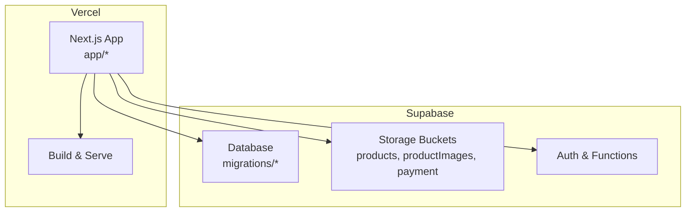
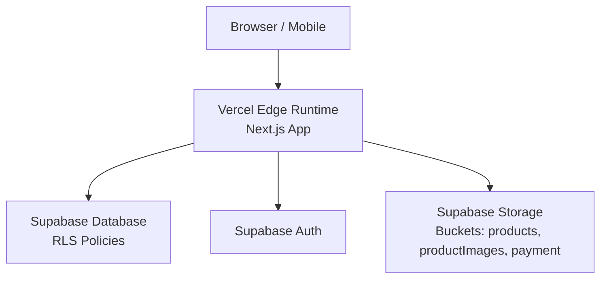
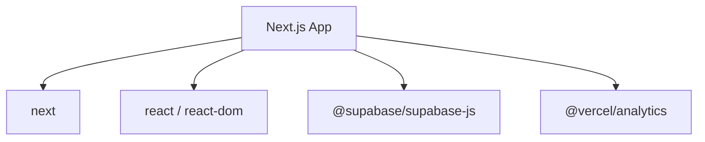

# Deployment Strategies

<cite>
**Referenced Files in This Document**
- [README.md](file://README.md)
- [package.json](file://package.json)
- [next.config.ts](file://next.config.ts)
- [client.js](file://src/api/client.js)
- [ResellerSignup.tsx](file://components/reseller/ResellerSignup.tsx)
- [resellerFgtPass.tsx](file://components/reseller/resellerFgtPass.tsx)
- [20261106_create_users_table.sql](file://supabase/migrations/20261106_create_users_table.sql)
- [20260814_rls_policies.sql](file://supabase/migrations/20260814_rls_policies.sql)
- [20260830_products_storage_rls.sql](file://supabase/migrations/20260830_products_storage_rls.sql)
- [20261008_payment_storage_rls.sql](file://supabase/migrations/20261008_payment_storage_rls.sql)
- [20261105_all_in_one_product_creation.sql](file://supabase/migrations/20261105_all_in_one_product_creation.sql)
- [productService.ts](file://src/api/productService.ts)
- [sellerProfileService.ts](file://src/api/sellerProfileService.ts)
- [orderService.ts](file://src/api/orderService.ts)
</cite>

## Table of Contents
1. [Introduction](#introduction)
2. [Project Structure](#project-structure)
3. [Core Components](#core-components)
4. [Architecture Overview](#architecture-overview)
5. [Detailed Component Analysis](#detailed-component-analysis)
6. [Dependency Analysis](#dependency-analysis)
7. [Performance Considerations](#performance-considerations)
8. [Troubleshooting Guide](#troubleshooting-guide)
9. [Conclusion](#conclusion)

## Introduction
This document provides a comprehensive deployment strategy for the Zebaish platform, focusing on Vercel deployment setup, environment variables, domain management, Supabase integration (database migrations and storage buckets), staging vs production environments, CI/CD with GitHub Actions, automated testing, deployment verification, rollback procedures, and scaling considerations including load balancing and high availability.

The project is a Next.js application that integrates with Supabase for authentication, database, and storage. It uses Vercel as the recommended hosting platform and includes multiple SQL migrations to configure database tables, Row Level Security policies, and storage bucket policies.

## Project Structure
At a high level:
- Frontend and server-side logic are implemented using Next.js App Router under app/.
- Shared services and API clients live under src/api/.
- Database schema and security policies are managed via SQL migrations under supabase/migrations/.
- Build and runtime scripts are defined in package.json.
- Next.js configuration resides in next.config.ts.

**Diagram sources**
- [package.json:5-11](file://package.json#L5-L11)
- [next.config.ts:1-12](file://next.config.ts#L1-L12)
- [client.js:1-8](file://src/api/client.js#L1-L8)

**Section sources**
- [README.md:1-37](file://README.md#L1-L37)
- [package.json:1-34](file://package.json#L1-L34)
- [next.config.ts:1-12](file://next.config.ts#L1-L12)

## Core Components
- Vercel deployment target for Next.js.
- Environment variables for Supabase client initialization.
- Supabase database migrations and RLS policies.
- Supabase storage buckets for product images and payment proofs.
- Service layer functions for storage operations and order workflows.

Key implementation points:
- The Supabase client is initialized using environment variables for URL and anon key.
- Migrations create and secure tables, enable RLS, and define storage bucket policies.
- Services upload files to specific buckets and handle fallbacks or errors gracefully.

**Section sources**
- [client.js:1-8](file://src/api/client.js#L1-L8)
- [20261106_create_users_table.sql:1-39](file://supabase/migrations/20261106_create_users_table.sql#L1-L39)
- [20260814_rls_policies.sql:1-180](file://supabase/migrations/20260814_rls_policies.sql#L1-L180)
- [20260830_products_storage_rls.sql:1-45](file://supabase/migrations/20260830_products_storage_rls.sql#L1-L45)
- [20261008_payment_storage_rls.sql:1-47](file://supabase/migrations/20261008_payment_storage_rls.sql#L1-L47)
- [20261105_all_in_one_product_creation.sql:1190-1227](file://supabase/migrations/20261105_all_in_one_product_creation.sql#L1190-L1227)
- [productService.ts:1600-1637](file://src/api/productService.ts#L1600-L1637)
- [sellerProfileService.ts:305-378](file://src/api/sellerProfileService.ts#L305-L378)
- [orderService.ts:149-237](file://src/api/orderService.ts#L149-L237)

## Architecture Overview
The deployment architecture connects the Next.js frontend hosted on Vercel with Supabase services:
- Authentication and user sessions are handled by Supabase Auth.
- Data persistence and business logic use Supabase Postgres with RLS policies.
- File assets are stored in Supabase Storage buckets with explicit policies per bucket.

**Diagram sources**
- [client.js:1-8](file://src/api/client.js#L1-L8)
- [20260814_rls_policies.sql:1-180](file://supabase/migrations/20260814_rls_policies.sql#L1-L180)
- [20260830_products_storage_rls.sql:1-45](file://supabase/migrations/20260830_products_storage_rls.sql#L1-L45)
- [20261008_payment_storage_rls.sql:1-47](file://supabase/migrations/20261008_payment_storage_rls.sql#L1-L47)

## Detailed Component Analysis

### Vercel Deployment Setup
- Use Vercel’s native Next.js integration for zero-config deployments.
- Configure build and start commands from package.json.
- Enable experimental optimizations if needed via next.config.ts.

Operational steps:
- Connect your repository to Vercel.
- Set environment variables for Supabase client initialization.
- Add custom domains and manage SSL certificates through Vercel Domains.

**Section sources**
- [README.md:32-37](file://README.md#L32-L37)
- [package.json:5-11](file://package.json#L5-L11)
- [next.config.ts:1-12](file://next.config.ts#L1-L12)

### Environment Variables Configuration
Required environment variables for Supabase client initialization:
- NEXT_PUBLIC_SUPABASE_URL
- NEXT_PUBLIC_SUPABASE_ANON_KEY

Validation checks exist in components to ensure keys are present and not dummy values.

Best practices:
- Store separate sets of variables for staging and production.
- Rotate keys periodically and restrict access to secrets.
- Avoid committing .env files; rely on Vercel environment settings.

**Section sources**
- [client.js:1-8](file://src/api/client.js#L1-L8)
- [ResellerSignup.tsx:419-421](file://components/reseller/ResellerSignup.tsx#L419-L421)
- [resellerFgtPass.tsx:52-54](file://components/reseller/resellerFgtPass.tsx#L52-L54)

### Domain Management
- Add custom domains in Vercel dashboard.
- Configure DNS records as instructed by Vercel.
- Ensure HTTPS is enabled automatically.

[No sources needed since this section provides general guidance]

### Supabase Integration During Deployment
- Initialize Supabase client using environment variables.
- Apply database migrations to set up tables and RLS policies.
- Configure storage buckets and policies for file uploads.

Migration highlights:
- Users table creation and RLS policies.
- Comprehensive RLS policies across sellers, users, products, orders, carts, wishlists, reviews.
- Storage bucket policies for products, productImages, and payment.

**Section sources**
- [client.js:1-8](file://src/api/client.js#L1-L8)
- [20261106_create_users_table.sql:1-39](file://supabase/migrations/20261106_create_users_table.sql#L1-L39)
- [20260814_rls_policies.sql:1-180](file://supabase/migrations/20260814_rls_policies.sql#L1-L180)
- [20260830_products_storage_rls.sql:1-45](file://supabase/migrations/20260830_products_storage_rls.sql#L1-L45)
- [20261008_payment_storage_rls.sql:1-47](file://supabase/migrations/20261008_payment_storage_rls.sql#L1-L47)
- [20261105_all_in_one_product_creation.sql:1190-1227](file://supabase/migrations/20261105_all_in_one_product_creation.sql#L1190-L1227)

### Database Migration Strategies
- Maintain versioned SQL migrations under supabase/migrations/.
- Apply migrations sequentially to ensure consistent schema state.
- Include RLS policies and schema cache reload notifications where applicable.

Recommended workflow:
- Run migrations locally against a development Supabase instance.
- Promote migrations to staging and then production after validation.
- Back out changes by creating inverse migrations when necessary.

**Section sources**
- [20261106_create_users_table.sql:1-39](file://supabase/migrations/20261106_create_users_table.sql#L1-L39)
- [20260814_rls_policies.sql:1-180](file://supabase/migrations/20260814_rls_policies.sql#L1-L180)

### Storage Bucket Configuration
Buckets and their intended usage:
- products: public read/write for product images.
- productImages: authenticated write, public read, seller delete.
- payment: allows guest and authenticated uploads for payment proofs, public read, and delete for cleanup.

Policy enforcement:
- Each bucket has INSERT, SELECT, UPDATE, DELETE policies tailored to roles.
- Size limits and allowed MIME types are configured per bucket.

Operational notes:
- Services attempt signed URLs first, falling back to public URLs.
- Orphaned paths may be cleaned up post-commit based on RPC responses.

**Section sources**
- [20260830_products_storage_rls.sql:1-45](file://supabase/migrations/20260830_products_storage_rls.sql#L1-L45)
- [20261105_all_in_one_product_creation.sql:1190-1227](file://supabase/migrations/20261105_all_in_one_product_creation.sql#L1190-L1227)
- [20261008_payment_storage_rls.sql:1-47](file://supabase/migrations/20261008_payment_storage_rls.sql#L1-L47)
- [productService.ts:1600-1637](file://src/api/productService.ts#L1600-L1637)
- [sellerProfileService.ts:305-378](file://src/api/sellerProfileService.ts#L305-L378)
- [orderService.ts:149-237](file://src/api/orderService.ts#L149-L237)

### Staging vs Production Environments
- Maintain separate Supabase projects for staging and production.
- Configure distinct environment variables per environment in Vercel.
- Use branch-based deployments to route traffic to appropriate environments.

Deployment pipeline recommendations:
- Main branch deploys to production.
- Feature branches deploy to preview/staging environments.
- Validate migrations and storage policies before merging.

[No sources needed since this section provides general guidance]

### Deployment Pipelines and Rollback Procedures
- Use Vercel’s automatic deployments tied to Git pushes.
- Implement pre-deploy checks (linting, type checking, tests).
- For rollbacks:
  - Revert code changes and redeploy previous commit.
  - If schema changes caused issues, apply inverse migrations or restore backups.
  - Verify storage policies remain consistent after rollbacks.

[No sources needed since this section provides general guidance]

### CI/CD Setup with GitHub Actions
Proposed pipeline stages:
- Install dependencies.
- Lint and type-check.
- Run unit and integration tests.
- Build the Next.js app.
- Deploy to Vercel (conditional on branch and environment).

Verification steps:
- Health check endpoints or smoke tests against deployed URLs.
- Validate Supabase connectivity using environment variables.
- Confirm storage bucket accessibility for sample uploads.

[No sources needed since this section provides general guidance]

### Automated Testing During Deployment
- Unit tests for service functions interacting with Supabase.
- Integration tests for storage uploads and policy enforcement.
- End-to-end tests for critical flows like checkout and order success.

[No sources needed since this section provides general guidance]

### Deployment Verification Processes
- Check environment variables presence and validity.
- Test Supabase client initialization.
- Validate RLS policies by attempting CRUD operations.
- Verify storage bucket policies by uploading and reading test files.

**Section sources**
- [client.js:1-8](file://src/api/client.js#L1-L8)
- [ResellerSignup.tsx:419-421](file://components/reseller/ResellerSignup.tsx#L419-L421)
- [resellerFgtPass.tsx:52-54](file://components/reseller/resellerFgtPass.tsx#L52-L54)

## Dependency Analysis
The application depends on:
- Next.js framework and runtime.
- Supabase JS client for database, auth, and storage.
- Vercel Analytics integration.

**Diagram sources**
- [package.json:13-21](file://package.json#L13-L21)

**Section sources**
- [package.json:1-34](file://package.json#L1-L34)

## Performance Considerations
- Leverage Vercel’s edge network for low-latency global delivery.
- Optimize bundle size via Next.js built-in optimizations.
- Use Supabase Storage CDN for asset delivery.
- Cache static assets and API responses appropriately.
- Monitor performance metrics and adjust configurations as needed.

[No sources needed since this section provides general guidance]

## Troubleshooting Guide
Common issues and resolutions:
- Missing or invalid Supabase keys:
  - Ensure NEXT_PUBLIC_SUPABASE_URL and NEXT_PUBLIC_SUPABASE_ANON_KEY are set correctly.
  - Components validate these keys and surface errors when missing or dummy.
- Storage upload failures:
  - Verify bucket policies allow the intended operation (INSERT/SELECT/DELETE).
  - Check file size and MIME type constraints.
  - Inspect service logs for upload errors and fallback behavior.
- Database function not found:
  - Ensure required migrations have been executed and schema cache reloaded.
  - Handle PGRST errors and provide actionable messages to users.

**Section sources**
- [ResellerSignup.tsx:419-421](file://components/reseller/ResellerSignup.tsx#L419-L421)
- [resellerFgtPass.tsx:52-54](file://components/reseller/resellerFgtPass.tsx#L52-L54)
- [productService.ts:1600-1637](file://src/api/productService.ts#L1600-L1637)
- [sellerProfileService.ts:305-378](file://src/api/sellerProfileService.ts#L305-L378)
- [orderService.ts:149-237](file://src/api/orderService.ts#L149-L237)

## Conclusion
This deployment strategy outlines how to reliably deploy the Zebaish platform on Vercel with robust Supabase integrations. By configuring environment variables, applying migrations, securing storage buckets, and implementing CI/CD pipelines, you can achieve scalable, secure, and maintainable deployments across staging and production environments. Continuous monitoring, testing, and clear rollback procedures ensure operational resilience and rapid recovery from issues.

[No sources needed since this section summarizes without analyzing specific files]