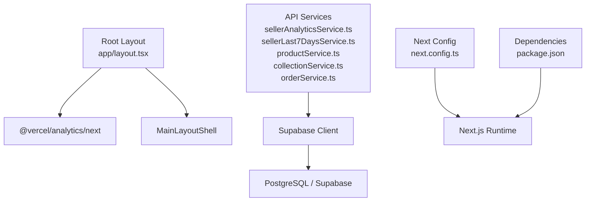
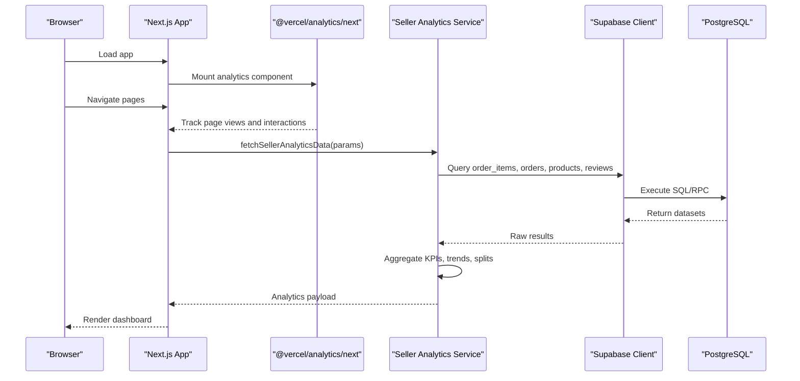
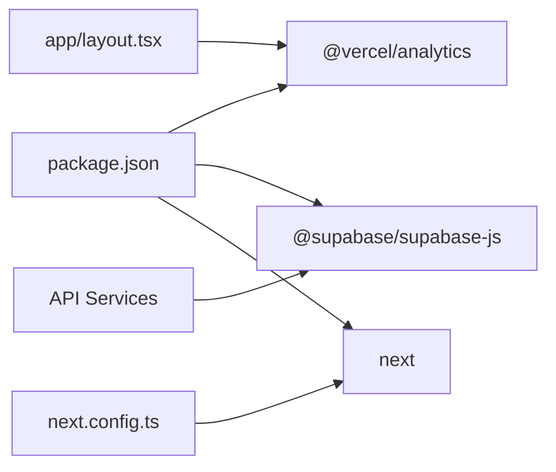

# Monitoring & Analytics

<cite>
**Referenced Files in This Document**
- [package.json](file://package.json)
- [app/layout.tsx](file://app/layout.tsx)
- [next.config.ts](file://next.config.ts)
- [src/api/sellerAnalyticsService.ts](file://src/api/sellerAnalyticsService.ts)
- [src/api/sellerLast7DaysService.ts](file://src/api/sellerLast7DaysService.ts)
- [src/api/productService.ts](file://src/api/productService.ts)
- [src/api/collectionService.ts](file://src/api/collectionService.ts)
- [src/api/orderService.ts](file://src/api/orderService.ts)
</cite>

## Table of Contents
1. [Introduction](#introduction)
2. [Project Structure](#project-structure)
3. [Core Components](#core-components)
4. [Architecture Overview](#architecture-overview)
5. [Detailed Component Analysis](#detailed-component-analysis)
6. [Dependency Analysis](#dependency-analysis)
7. [Performance Considerations](#performance-considerations)
8. [Troubleshooting Guide](#troubleshooting-guide)
9. [Conclusion](#conclusion)

## Introduction
This document defines the monitoring and analytics strategy for the Zebaish platform. It explains how to instrument error tracking, performance monitoring, user behavior tracking, application health checks, API endpoint monitoring, database query performance tracking, custom metrics collection, alerting, incident response, dashboards, log aggregation, debugging workflows, and production troubleshooting.

The repository already includes:
- Next.js application structure with Supabase client usage.
- Vercel Analytics integration at the root layout.
- Seller analytics and last-seven-days services that aggregate business KPIs from Supabase tables and RPC functions.
- Error handling patterns using console logging and fallback data.

## Project Structure
At a high level, monitoring and analytics touch these areas:
- Application shell: root layout where Vercel Analytics is mounted.
- Data layer: service files that call Supabase RPC and PostgREST endpoints.
- Configuration: Next.js configuration and package dependencies.
- UI components: seller dashboard analytics views (not analyzed here in detail).

**Diagram sources**
- [app/layout.tsx:8-43](file://app/layout.tsx#L8-L43)
- [src/api/sellerAnalyticsService.ts:1-20](file://src/api/sellerAnalyticsService.ts#L1-L20)
- [src/api/sellerLast7DaysService.ts:1-21](file://src/api/sellerLast7DaysService.ts#L1-L21)
- [src/api/productService.ts:639-640](file://src/api/productService.ts#L639-L640)
- [src/api/collectionService.ts:841-858](file://src/api/collectionService.ts#L841-L858)
- [src/api/orderService.ts:917-940](file://src/api/orderService.ts#L917-L940)
- [next.config.ts:1-12](file://next.config.ts#L1-L12)
- [package.json:13-22](file://package.json#L13-L22)

**Section sources**
- [app/layout.tsx:1-51](file://app/layout.tsx#L1-L51)
- [next.config.ts:1-12](file://next.config.ts#L1-L12)
- [package.json:1-34](file://package.json#L1-L34)

## Core Components
- Vercel Analytics integration: The root layout mounts the analytics component, enabling basic page view and interaction tracking through Vercel’s analytics pipeline.
- Seller analytics service: Aggregates revenue, orders, product counts, payment method splits, brand performance, stitching status, low-stock alerts, rating distribution, and recent reviews. It queries multiple tables and performs in-memory aggregation.
- Last seven days service: Provides daily breakdowns, summary KPIs, top products, payment method split, best/worst day, and review metrics. It prefers an atomic Supabase RPC and falls back to direct PostgREST queries.
- Product and collection services: Use Supabase RPC for product lifecycle operations and background view increments, with error handling and storage cleanup.
- Order service: Includes public order tracking with security notes and input validation.

**Section sources**
- [app/layout.tsx:8-43](file://app/layout.tsx#L8-L43)
- [src/api/sellerAnalyticsService.ts:191-567](file://src/api/sellerAnalyticsService.ts#L191-L567)
- [src/api/sellerLast7DaysService.ts:79-311](file://src/api/sellerLast7DaysService.ts#L79-L311)
- [src/api/productService.ts:639-640](file://src/api/productService.ts#L639-L640)
- [src/api/collectionService.ts:841-858](file://src/api/collectionService.ts#L841-L858)
- [src/api/orderService.ts:917-940](file://src/api/orderService.ts#L917-L940)

## Architecture Overview
The monitoring and analytics architecture integrates frontend telemetry, server-side data aggregation, and database-level performance instrumentation.

**Diagram sources**
- [app/layout.tsx:8-43](file://app/layout.tsx#L8-L43)
- [src/api/sellerAnalyticsService.ts:191-567](file://src/api/sellerAnalyticsService.ts#L191-L567)
- [src/api/sellerLast7DaysService.ts:91-114](file://src/api/sellerLast7DaysService.ts#L91-L114)

## Detailed Component Analysis

### Error Tracking Setup
Current state:
- Errors are logged via console.error and console.warn across services and components.
- No dedicated error tracking SDK (e.g., Sentry or LogRocket) is present in dependencies.

Recommended setup:
- Add an error tracking SDK dependency (for example, Sentry or LogRocket).
- Initialize the SDK in the root layout alongside Vercel Analytics.
- Wrap critical async flows with try/catch blocks and forward errors to the SDK.
- Capture unhandled promise rejections and global JavaScript errors.
- Include environment-aware configuration so telemetry is disabled in development if needed.

Integration points:
- Root layout: initialize SDK once per app load.
- API services: centralize error capture around Supabase calls.
- User-facing actions: capture checkout, order tracking, and profile updates.

Note: Replace placeholder references with your actual SDK initialization code when added.

**Section sources**
- [app/layout.tsx:8-43](file://app/layout.tsx#L8-L43)
- [src/api/sellerAnalyticsService.ts:563-566](file://src/api/sellerAnalyticsService.ts#L563-L566)
- [src/api/sellerLast7DaysService.ts:112-114](file://src/api/sellerLast7DaysService.ts#L112-L114)

### Performance Monitoring with @vercel/analytics
Current state:
- Vercel Analytics is installed and mounted in the root layout.
- This provides baseline page view and interaction tracking.

Recommendations:
- Configure Vercel project settings to enable analytics events and retention policies.
- Add custom events for key user journeys: add-to-cart, checkout start, order success, reseller dashboard navigation.
- Correlate frontend events with backend RPC calls to measure end-to-end latency.
- Use browser performance APIs to track long tasks and large layout shifts for critical paths.

**Section sources**
- [package.json:16-16](file://package.json#L16-L16)
- [app/layout.tsx:8-43](file://app/layout.tsx#L8-L43)

### User Behavior Tracking
Current state:
- Basic analytics via Vercel Analytics.
- Business analytics views for sellers showing revenue trends, city/brand splits, payment methods, ratings, and reviews.

Recommendations:
- Define event taxonomy: acquisition, activation, engagement, conversion, retention.
- Track funnel steps: landing, product detail, cart, checkout, order success.
- Segment by user role: customer vs reseller.
- Anonymize PII before sending analytics events.
- Integrate with BI tools via exported CSV or scheduled data pipelines.

**Section sources**
- [src/api/sellerAnalyticsService.ts:82-94](file://src/api/sellerAnalyticsService.ts#L82-L94)
- [src/api/sellerLast7DaysService.ts:51-65](file://src/api/sellerLast7DaysService.ts#L51-L65)

### Application Health Monitoring
Current state:
- React Strict Mode enabled in Next config.
- No explicit health check endpoints or uptime monitors defined in the repository.

Recommendations:
- Implement a lightweight health endpoint returning status of core services: Supabase connectivity, RPC availability, storage access.
- Monitor build and deployment status via CI/CD.
- Set up synthetic probes for critical routes: homepage, login, reseller dashboard, order tracking.
- Alert on increased error rates and degraded response times.

**Section sources**
- [next.config.ts:3-9](file://next.config.ts#L3-L9)

### API Endpoint Monitoring
Current state:
- Multiple Supabase RPC calls used across services: product creation/update/delete, seller overview, wallet KPIs, order details/status, last seven days, increment views.
- Public order tracking endpoint has security notes recommending infrastructure-level rate limiting.

Recommendations:
- Instrument RPC calls with timing and error metrics.
- Track success/failure rates per RPC name and parameters.
- Enforce rate limiting at the edge (Cloudflare/Nginx/Next middleware) for sensitive endpoints like order tracking.
- Observe PostgREST query complexity and result sizes.

**Section sources**
- [src/api/productService.ts:639-640](file://src/api/productService.ts#L639-L640)
- [src/api/productService.ts:1575-1576](file://src/api/productService.ts#L1575-L1576)
- [src/api/productService.ts:1695-1700](file://src/api/productService.ts#L1695-L1700)
- [src/api/collectionService.ts:841-858](file://src/api/collectionService.ts#L841-L858)
- [src/api/orderService.ts:917-940](file://src/api/orderService.ts#L917-L940)

### Database Query Performance Tracking
Current state:
- Complex aggregations performed in memory after fetching joined datasets.
- Fallback logic uses direct PostgREST queries when RPC is unavailable.
- Some services use Promise.all to parallelize independent queries.

Recommendations:
- Prefer atomic RPCs for heavy aggregations to reduce client-side processing.
- Add indexes on frequently filtered columns (seller_id, created_at, order_status, payment_method).
- Monitor slow queries and adjust schema or pagination strategies.
- Cache read-heavy analytics responses at the edge or CDN when appropriate.

**Section sources**
- [src/api/sellerAnalyticsService.ts:292-297](file://src/api/sellerAnalyticsService.ts#L292-L297)
- [src/api/sellerLast7DaysService.ts:116-145](file://src/api/sellerLast7DaysService.ts#L116-L145)

### Custom Metrics Collection
Current state:
- Business metrics are computed in services and rendered in the seller analytics UI.
- No centralized metrics export or time-series storage is present.

Recommendations:
- Emit custom metrics for:
  - RPC latency and error rates.
  - Page load and interaction timings.
  - Conversion funnels and drop-off points.
  - Inventory alerts (low stock, sold out).
  - Payment method split changes over time.
- Store metrics in a time-series database or analytics platform.
- Expose metrics via a secure internal endpoint for dashboards.

**Section sources**
- [src/api/sellerAnalyticsService.ts:331-359](file://src/api/sellerAnalyticsService.ts#L331-L359)
- [src/api/sellerLast7DaysService.ts:223-244](file://src/api/sellerLast7DaysService.ts#L223-L244)

### Alerting Systems
Current state:
- Console-based warnings and errors indicate issues during development or runtime.
- No automated alerting configured.

Recommendations:
- Route critical errors to an alerting system (PagerDuty, Opsgenie, Slack).
- Define SLOs and SLIs for latency, error rate, and throughput.
- Create alerts for:
  - RPC failures or schema cache errors.
  - Storage cleanup exceptions.
  - High cancellation rates or sudden drops in revenue.
  - Increased failed checkout attempts.

**Section sources**
- [src/api/productService.ts:654-694](file://src/api/productService.ts#L654-L694)
- [src/api/productService.ts:1600-1620](file://src/api/productService.ts#L1600-L1620)

### Incident Response Procedures
Recommended workflow:
- Detect: Automated alerts from error tracking and monitoring systems.
- Triage: Classify severity, identify affected users and endpoints.
- Contain: Rollback deployments, disable features, apply rate limits.
- Resolve: Fix root cause, validate with tests and canary releases.
- Review: Postmortem with action items and preventive measures.

Operational artifacts:
- Runbooks for common incidents: RPC missing, storage cleanup failure, high error rates.
- Escalation matrix and communication templates.
- Dashboards for real-time visibility into system health.

[No sources needed since this section provides general guidance]

### Dashboard Setup for Business Metrics
Current state:
- Seller analytics UI displays KPIs, revenue trends, city/brand splits, payment method splits, stitching status, low-stock alerts, rating distribution, and recent reviews.

Recommendations:
- Build executive dashboards for:
  - Revenue, orders, AOV, cancellation rate.
  - Payment method trends.
  - Top brands and cities.
  - Inventory health and review sentiment.
- Add drill-down capabilities and date range filters.
- Export reports for finance and operations teams.

**Section sources**
- [src/api/sellerAnalyticsService.ts:82-94](file://src/api/sellerAnalyticsService.ts#L82-L94)
- [src/api/sellerLast7DaysService.ts:51-65](file://src/api/sellerLast7DaysService.ts#L51-L65)

### User Engagement Tracking
Recommendations:
- Track session duration, feature adoption, and repeat visits.
- Measure engagement by role: customers browsing products vs resellers managing listings.
- Analyze cohort retention and churn signals.
- Combine behavioral data with business outcomes (orders, revenue).

[No sources needed since this section provides general guidance]

### System Performance Indicators
Recommendations:
- Track Time to First Byte (TTFB), Largest Contentful Paint (LCP), Cumulative Layout Shift (CLS), and Interaction to Next Paint (INP).
- Monitor RPC latency percentiles (p50, p95, p99).
- Track database query execution times and lock contention.
- Observe memory usage and garbage collection pauses.

[No sources needed since this section provides general guidance]

### Log Aggregation
Current state:
- Logs are emitted via console.log/error/warn throughout the codebase.
- No centralized log aggregator is present.

Recommendations:
- Ship logs to a centralized system (e.g., CloudWatch, Datadog, Loki).
- Standardize log levels and include correlation IDs.
- Redact sensitive information before logging.
- Retain logs according to compliance requirements.

**Section sources**
- [src/api/sellerAnalyticsService.ts:563-566](file://src/api/sellerAnalyticsService.ts#L563-L566)
- [src/api/sellerLast7DaysService.ts:112-114](file://src/api/sellerLast7DaysService.ts#L112-L114)

### Debugging Workflows
Recommendations:
- Use structured logging with context (user ID, request ID, endpoint, RPC name).
- Enable verbose logging in staging environments only.
- Reproduce issues with minimal payloads and record traces.
- Validate migrations and RPC definitions before deployment.

**Section sources**
- [src/api/productService.ts:260-274](file://src/api/productService.ts#L260-L274)
- [src/api/productService.ts:1600-1620](file://src/api/productService.ts#L1600-L1620)

### Production Troubleshooting Approaches
Common scenarios:
- RPC not found or schema cache errors: ensure migrations are executed and schema cache refreshed.
- Storage cleanup failures: verify permissions and object existence; retry non-fatal cleanup.
- High error rates on order tracking: enforce rate limiting and validate inputs.
- Slow analytics queries: optimize RPCs, add indexes, and paginate results.

**Section sources**
- [src/api/productService.ts:260-274](file://src/api/productService.ts#L260-L274)
- [src/api/productService.ts:654-694](file://src/api/productService.ts#L654-L694)
- [src/api/orderService.ts:917-940](file://src/api/orderService.ts#L917-L940)

## Dependency Analysis
Key dependencies relevant to monitoring and analytics:
- @vercel/analytics: Installed and mounted in the root layout for basic analytics.
- Supabase client: Used extensively for RPC and PostgREST queries powering analytics and operational features.
- Next.js: Provides runtime and configuration hooks for optimization and strict mode.

**Diagram sources**
- [package.json:13-22](file://package.json#L13-L22)
- [app/layout.tsx:8-43](file://app/layout.tsx#L8-L43)
- [next.config.ts:1-12](file://next.config.ts#L1-L12)

**Section sources**
- [package.json:13-22](file://package.json#L13-L22)
- [app/layout.tsx:8-43](file://app/layout.tsx#L8-L43)
- [next.config.ts:1-12](file://next.config.ts#L1-L12)

## Performance Considerations
- Prefer atomic RPCs for complex aggregations to minimize client-side processing and network round-trips.
- Parallelize independent queries using Promise.all where safe.
- Cache static or semi-static analytics data at the edge or CDN.
- Optimize images and fonts; leverage Next.js optimizations.
- Monitor bundle size and tree-shake unused dependencies.
- Use React Strict Mode to catch potential issues during development.

**Section sources**
- [src/api/sellerAnalyticsService.ts:292-297](file://src/api/sellerAnalyticsService.ts#L292-L297)
- [next.config.ts:3-9](file://next.config.ts#L3-L9)

## Troubleshooting Guide
Steps:
- Check console logs for errors and warnings.
- Verify Supabase RPC availability and migration status.
- Validate input parameters for public endpoints like order tracking.
- Inspect storage cleanup outcomes and permissions.
- Review fallback behaviors and mock data usage in demo modes.

Common indicators:
- Schema cache errors for RPC functions.
- Storage cleanup exceptions.
- Network timeouts leading to idempotency checks.
- Demo mode fallbacks when seller IDs are not UUIDs.

**Section sources**
- [src/api/productService.ts:260-274](file://src/api/productService.ts#L260-L274)
- [src/api/productService.ts:654-694](file://src/api/productService.ts#L654-L694)
- [src/api/productService.ts:1600-1620](file://src/api/productService.ts#L1600-L1620)
- [src/api/sellerLast7DaysService.ts:83-114](file://src/api/sellerLast7DaysService.ts#L83-L114)
- [src/api/orderService.ts:917-940](file://src/api/orderService.ts#L917-L940)

## Conclusion
Zebaish currently integrates Vercel Analytics and relies on Supabase for data aggregation. To mature its observability posture, the platform should adopt comprehensive error tracking, structured logging, custom metrics, alerting, and robust incident response procedures. Prioritize atomic RPCs, index optimization, and edge caching to improve performance. Establish dashboards for business and system metrics, and implement standardized debugging workflows to accelerate resolution in production.

[No sources needed since this section summarizes without analyzing specific files]