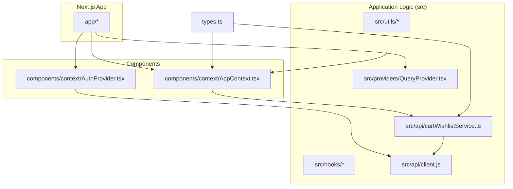
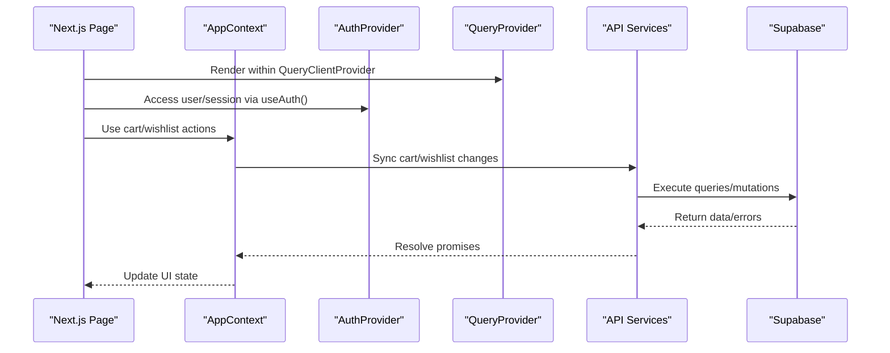
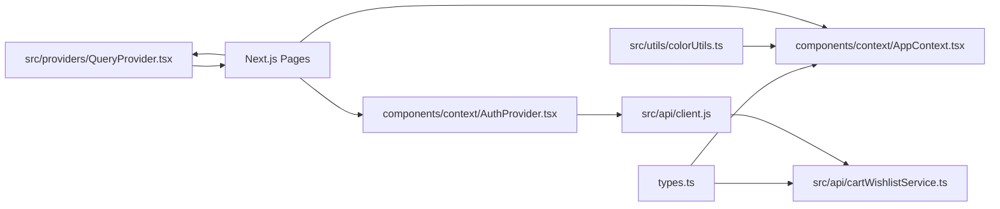

# Coding Standards & Conventions

<cite>
**Referenced Files in This Document**
- [eslint.config.mjs](file://eslint.config.mjs)
- [tsconfig.json](file://tsconfig.json)
- [package.json](file://package.json)
- [QueryProvider.tsx](file://src/providers/QueryProvider.tsx)
- [AppContext.tsx](file://components/context/AppContext.tsx)
- [AuthProvider.tsx](file://components/context/AuthProvider.tsx)
- [useAuth.ts](file://src/hooks/useAuth.ts)
- [client.js](file://src/api/client.js)
- [cartWishlistService.ts](file://src/api/cartWishlistService.ts)
- [colorUtils.ts](file://src/utils/colorUtils.ts)
- [types.ts](file://types.ts)
</cite>

## Table of Contents
1. Introduction
2. Project Structure
3. Core Components
4. Architecture Overview
5. Detailed Component Analysis
6. Dependency Analysis
7. Performance Considerations
8. Troubleshooting Guide
9. Conclusion

## Introduction
This document defines the coding standards and conventions for the Zebaish e-commerce platform. It covers ESLint configuration, TypeScript compiler settings, naming conventions, React component patterns, hook usage guidelines, state management conventions, file organization, import/export patterns, error handling, logging, commenting, and code review quality gates. The goal is to ensure consistent, maintainable, and high-quality code across the application.

## Project Structure
The project follows a Next.js App Router layout with clear separation between UI components, shared contexts, hooks, API services, utilities, and type definitions:
- app: Next.js pages and layouts
- components: React components and shared contexts
- src: Application logic including API clients, hooks, providers, and utilities
- types.ts: Shared TypeScript interfaces and types
- Configuration files: ESLint, TypeScript, package scripts

**Diagram sources**
- [AppContext.tsx:1-367](file://components/context/AppContext.tsx#L1-L367)
- [AuthProvider.tsx:1-326](file://components/context/AuthProvider.tsx#L1-L326)
- [QueryProvider.tsx:1-25](file://src/providers/QueryProvider.tsx#L1-L25)
- [client.js:1-8](file://src/api/client.js#L1-L8)
- [cartWishlistService.ts:1-223](file://src/api/cartWishlistService.ts#L1-L223)
- [colorUtils.ts:1-127](file://src/utils/colorUtils.ts#L1-L127)
- [types.ts:1-272](file://types.ts#L1-L272)

**Section sources**
- [package.json:1-34](file://package.json#L1-L34)

## Core Components
This section outlines the core building blocks and their responsibilities:
- QueryProvider: Centralizes React Query client configuration and provides global caching defaults.
- AuthProvider: Manages authentication state, user profiles, roles, and session lifecycle using Supabase.
- AppContext: Provides cart, wishlist, UI drawer/modal state, and toast notifications; persists cart to localStorage and syncs with DB when authenticated.
- API Services: Encapsulate Supabase operations for cart and wishlist.
- Utilities: Provide color resolution helpers and stable cart line key generation.
- Types: Define shared domain models used across components and services.

Key conventions observed:
- Client-only components use 'use client' directive at the top of the file.
- Contexts are wrapped with Provider components and expose typed hooks for consumption.
- API calls are centralized in service modules with explicit error handling and logging.
- Utility functions are pure and well-documented with JSDoc comments.

**Section sources**
- [QueryProvider.tsx:1-25](file://src/providers/QueryProvider.tsx#L1-L25)
- [AuthProvider.tsx:1-326](file://components/context/AuthProvider.tsx#L1-L326)
- [AppContext.tsx:1-367](file://components/context/AppContext.tsx#L1-L367)
- [cartWishlistService.ts:1-223](file://src/api/cartWishlistService.ts#L1-L223)
- [colorUtils.ts:1-127](file://src/utils/colorUtils.ts#L1-L127)
- [types.ts:1-272](file://types.ts#L1-L272)

## Architecture Overview
The application architecture integrates Next.js pages with React contexts for global state, React Query for data fetching, and Supabase for backend persistence. Authentication and authorization are handled via Supabase, while cart and wishlist states are synchronized between local storage and the database.

**Diagram sources**
- [QueryProvider.tsx:1-25](file://src/providers/QueryProvider.tsx#L1-L25)
- [AuthProvider.tsx:1-326](file://components/context/AuthProvider.tsx#L1-L326)
- [AppContext.tsx:1-367](file://components/context/AppContext.tsx#L1-L367)
- [cartWishlistService.ts:1-223](file://src/api/cartWishlistService.ts#L1-L223)
- [client.js:1-8](file://src/api/client.js#L1-L8)

## Detailed Component Analysis

### ESLint Configuration Rules
- Uses eslint-config-next/core-web-vitals and eslint-config-next/typescript for performance and TypeScript checks.
- Overrides default ignores to include build artifacts and generated types.
- Linting command is available via npm script.

Recommendations:
- Keep strict linting enabled to catch issues early.
- Extend rules as needed for team consistency.

**Section sources**
- [eslint.config.mjs:1-19](file://eslint.config.mjs#L1-L19)
- [package.json:5-12](file://package.json#L5-L12)

### TypeScript Best Practices
- Strict mode enabled for safer typing.
- Target ES2017 with modern module resolution.
- JSX configured for React 17+ automatic runtime.
- Path aliases defined for cleaner imports (@/*).

Guidelines:
- Prefer strict typing and avoid any where possible.
- Use path aliases consistently for imports.
- Leverage isolatedModules for faster builds.

**Section sources**
- [tsconfig.json:1-35](file://tsconfig.json#L1-L35)

### Naming Conventions
- Components: PascalCase filenames and component names (e.g., AppContext.tsx, AuthProvider.tsx).
- Hooks: camelCase with use prefix (e.g., useAuth.ts).
- Utilities: camelCase function names (e.g., resolveSwatchColor, getCartLineKey).
- Types: PascalCase interface names (e.g., Product, CartItem).
- Constants: UPPER_SNAKE_CASE for environment keys and constants (e.g., LOCAL_STORAGE_CART_KEY).

Examples:
- File: AppContext.tsx
- Hook: useAuth.ts
- Utility: colorUtils.ts
- Types: types.ts

**Section sources**
- [AppContext.tsx:1-367](file://components/context/AppContext.tsx#L1-L367)
- [useAuth.ts:1-13](file://src/hooks/useAuth.ts#L1-L13)
- [colorUtils.ts:1-127](file://src/utils/colorUtils.ts#L1-L127)
- [types.ts:1-272](file://types.ts#L1-L272)

### React Component Patterns
- Client Components: Use 'use client' directive at the top of files that rely on browser APIs or React state.
- Context Providers: Wrap children with Provider components and export typed hooks for safe access.
- State Management: Prefer context for global UI state (drawers, modals, toasts) and React Query for server state.

Patterns observed:
- AppContext exposes cart/wishlist operations and UI toggles.
- AuthProvider manages auth state and profile loading.
- QueryProvider configures React Query globally.

**Section sources**
- [AppContext.tsx:1-367](file://components/context/AppContext.tsx#L1-L367)
- [AuthProvider.tsx:1-326](file://components/context/AuthProvider.tsx#L1-L326)
- [QueryProvider.tsx:1-25](file://src/providers/QueryProvider.tsx#L1-L25)

### Hook Usage Guidelines
- useAuth: Typed hook that throws if used outside AuthProvider.
- Custom hooks should be colocated under src/hooks and follow the use* naming convention.
- Avoid mixing server-side and client-side logic in hooks without guards.

Best practices:
- Validate context availability and throw descriptive errors.
- Memoize expensive computations inside hooks when necessary.
- Keep hooks focused on single responsibilities.

**Section sources**
- [useAuth.ts:1-13](file://src/hooks/useAuth.ts#L1-L13)

### State Management Conventions
- Global UI state: Managed via AppContext (cart, wishlist, drawers, modals, toasts).
- Server state: Managed via React Query through QueryProvider.
- Persistence: Cart persisted to localStorage and synced to DB upon authentication.

Conventions:
- Initialize state defensively to prevent SSR hydration mismatches.
- Validate and sanitize data from localStorage before setting state.
- Synchronize optimistic updates with DB and revert on failure.

**Section sources**
- [AppContext.tsx:59-367](file://components/context/AppContext.tsx#L59-L367)
- [QueryProvider.tsx:1-25](file://src/providers/QueryProvider.tsx#L1-L25)

### File Organization and Import/Export Patterns
- Organize by feature/domain: components, contexts, hooks, api, utils, types.
- Use absolute paths with @ alias for clarity and maintainability.
- Export named functions and interfaces; prefer explicit exports over default where applicable.

Examples:
- API client exported as default from client.js.
- Service functions exported as named exports from cartWishlistService.ts.
- Utility functions exported as named exports from colorUtils.ts.

**Section sources**
- [client.js:1-8](file://src/api/client.js#L1-L8)
- [cartWishlistService.ts:1-223](file://src/api/cartWishlistService.ts#L1-L223)
- [colorUtils.ts:1-127](file://src/utils/colorUtils.ts#L1-L127)
- [tsconfig.json:21-23](file://tsconfig.json#L21-L23)

### Error Handling Patterns
- Try/catch blocks around async operations with meaningful console.error or console.warn logs.
- Graceful fallbacks for missing data or schema inconsistencies.
- Optimistic UI updates with rollback on failure (wishlist toggle).

Guidelines:
- Log contextual information to aid debugging.
- Normalize error messages for user-facing feedback.
- Handle known Supabase error codes and messages explicitly.

**Section sources**
- [AuthProvider.tsx:85-138](file://components/context/AuthProvider.tsx#L85-L138)
- [cartWishlistService.ts:9-88](file://src/api/cartWishlistService.ts#L9-L88)
- [AppContext.tsx:84-145](file://components/context/AppContext.tsx#L84-L145)

### Logging Conventions
- Use console.error for unexpected failures and console.warn for recoverable conditions.
- Include context in log messages (e.g., operation name, user ID).
- Avoid logging sensitive data.

**Section sources**
- [AuthProvider.tsx:231-246](file://components/context/AuthProvider.tsx#L231-L246)
- [cartWishlistService.ts:160-163](file://src/api/cartWishlistService.ts#L160-L163)

### Comment Standards
- Use JSDoc comments for utility functions to describe purpose, parameters, and return values.
- Inline comments for complex logic or non-obvious decisions.
- Keep comments concise and actionable.

**Section sources**
- [colorUtils.ts:40-103](file://src/utils/colorUtils.ts#L40-L103)

## Dependency Analysis
The following diagram shows key dependencies among core modules:

**Diagram sources**
- [types.ts:1-272](file://types.ts#L1-L272)
- [AppContext.tsx:1-367](file://components/context/AppContext.tsx#L1-L367)
- [cartWishlistService.ts:1-223](file://src/api/cartWishlistService.ts#L1-L223)
- [colorUtils.ts:1-127](file://src/utils/colorUtils.ts#L1-L127)
- [client.js:1-8](file://src/api/client.js#L1-L8)
- [AuthProvider.tsx:1-326](file://components/context/AuthProvider.tsx#L1-L326)
- [QueryProvider.tsx:1-25](file://src/providers/QueryProvider.tsx#L1-L25)

**Section sources**
- [package.json:13-31](file://package.json#L13-L31)

## Performance Considerations
- React Query: Configure global staleTime and refetchOnWindowFocus to balance freshness and network usage.
- LocalStorage: Persist cart data to reduce rehydration overhead and improve perceived performance.
- Strict TypeScript: Catches potential runtime issues early, reducing performance regressions.
- Minimal re-renders: Use memoization and selective state updates in contexts.

Recommendations:
- Tune React Query options per feature based on data volatility.
- Debounce frequent state updates (e.g., search inputs).
- Profile critical paths with React DevTools.

**Section sources**
- [QueryProvider.tsx:6-17](file://src/providers/QueryProvider.tsx#L6-L17)
- [AppContext.tsx:84-145](file://components/context/AppContext.tsx#L84-L145)

## Troubleshooting Guide
Common issues and resolutions:
- Hydration mismatch: Ensure initial state matches server render; validate localStorage data before setting state.
- Missing tables/functions: Handle Supabase schema cache errors gracefully and guide users to run migrations.
- Auth state not updating: Verify onAuthStateChange listener and cleanup subscriptions properly.
- Cart sync failures: Check DB constraints and normalize error messages for user feedback.

Checklist:
- Confirm environment variables are set correctly for Supabase client.
- Validate that required migrations have been executed.
- Review console logs for specific error codes and messages.

**Section sources**
- [AuthProvider.tsx:112-137](file://components/context/AuthProvider.tsx#L112-L137)
- [cartWishlistService.ts:160-163](file://src/api/cartWishlistService.ts#L160-L163)
- [client.js:1-8](file://src/api/client.js#L1-L8)

## Conclusion
Adhering to these coding standards ensures consistency, reliability, and maintainability across the Zebaish platform. By following the ESLint and TypeScript configurations, naming conventions, React patterns, and error handling strategies outlined here, teams can collaborate effectively and deliver high-quality features with confidence.