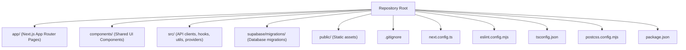
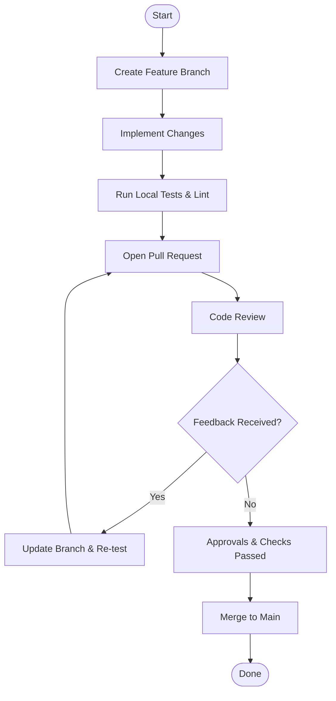
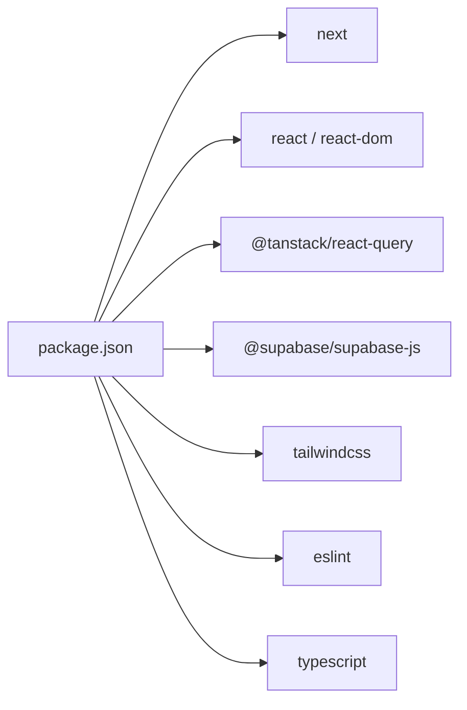

# Contribution Workflow & Git Process

<cite>
**Referenced Files in This Document**
- [README.md](file://README.md)
- [package.json](file://package.json)
- [AGENTS.md](file://AGENTS.md)
- [CLAUDE.md](file://CLAUDE.md)
- [next.config.ts](file://next.config.ts)
- [eslint.config.mjs](file://eslint.config.mjs)
- [tsconfig.json](file://tsconfig.json)
- [postcss.config.mjs](file://postcss.config.mjs)
- [.gitignore](file://.gitignore)
</cite>

## Table of Contents
1. [Introduction](#introduction)
2. [Project Structure](#project-structure)
3. [Core Components](#core-components)
4. [Architecture Overview](#architecture-overview)
5. [Detailed Component Analysis](#detailed-component-analysis)
6. [Dependency Analysis](#dependency-analysis)
7. [Performance Considerations](#performance-considerations)
8. [Troubleshooting Guide](#troubleshooting-guide)
9. [Conclusion](#conclusion)
10. [Appendices](#appendices)

## Introduction
This document defines the contribution workflow and Git process for the Zebaish platform. It covers branching strategy, commit message conventions, pull request procedures, development environment setup, local testing, deployment workflows, code review requirements, issue reporting guidelines, release and versioning strategy, changelog maintenance, conflict resolution strategies, and collaborative best practices.

Where the repository does not define a policy explicitly, this document provides recommended practices aligned with modern Next.js/TypeScript projects.

## Project Structure
The project is a Next.js application using TypeScript, Tailwind CSS, React Query, Supabase client, and ESLint. The root configuration files control build, lint, type checking, and PostCSS processing. Scripts in package.json provide development, build, start, and lint commands.

**Diagram sources**
- [package.json:1-34](file://package.json#L1-L34)
- [next.config.ts:1-200](file://next.config.ts)
- [eslint.config.mjs:1-200](file://eslint.config.mjs)
- [tsconfig.json:1-200](file://tsconfig.json)
- [postcss.config.mjs:1-200](file://postcss.config.mjs)
- [.gitignore:1-200](file://.gitignore)

**Section sources**
- [README.md:1-37](file://README.md#L1-L37)
- [package.json:1-34](file://package.json#L1-L34)

## Core Components
- Development server and scripts are defined in package.json.
- Linting is configured via eslint.config.mjs.
- TypeScript compilation is controlled by tsconfig.json.
- PostCSS/Tailwind is configured via postcss.config.mjs.
- Next.js runtime and build behavior are configured via next.config.ts.
- Agent guidance is referenced from AGENTS.md and CLAUDE.md.

Key responsibilities:
- package.json: entry points for dev/build/start/lint; dependency versions.
- eslint.config.mjs: lint rules applied to TS/JS files.
- tsconfig.json: compiler options and path mappings.
- postcss.config.mjs: Tailwind processing pipeline.
- next.config.ts: Next.js-specific configuration.
- .gitignore: excludes generated and sensitive files.

**Section sources**
- [package.json:1-34](file://package.json#L1-L34)
- [eslint.config.mjs:1-200](file://eslint.config.mjs)
- [tsconfig.json:1-200](file://tsconfig.json)
- [postcss.config.mjs:1-200](file://postcss.config.mjs)
- [next.config.ts:1-200](file://next.config.ts)
- [AGENTS.md:1-6](file://AGENTS.md#L1-L6)
- [CLAUDE.md:1-2](file://CLAUDE.md#L1-L2)

## Architecture Overview
At a high level, contributors interact with the repository through Git and GitHub. The typical flow is:
- Fork or branch off main.
- Implement changes on a feature branch.
- Run local tests and linters.
- Open a Pull Request (PR).
- Address review feedback.
- Merge after approvals and CI checks pass.

[No sources needed since this diagram shows conceptual workflow, not actual code structure]

## Detailed Component Analysis

### Git Branching Strategy
Recommended branches:
- main: stable, deployable code.
- develop: integration branch for features.
- feature/*: new features.
- bugfix/*: non-critical bug fixes.
- hotfix/*: urgent production fixes.
- release/*: pre-release preparation.

Branch naming examples:
- feature/add-checkout-flow
- bugfix/fix-cart-total
- hotfix/fix-payment-error
- release/v0.2.0

Rules:
- Keep branches small and focused.
- Rebase feature branches onto develop before merging.
- Squash merges for feature branches to keep history clean.
- Use conventional commits for clarity.

[No sources needed since this section provides general guidance]

### Commit Message Conventions
Use Conventional Commits:
- feat: new feature
- fix: bug fix
- docs: documentation changes
- style: formatting, no logic change
- refactor: code restructure without changing behavior
- test: adding or updating tests
- chore: maintenance tasks

Format:
type(scope): short description

Examples:
- feat(cart): add shipping address validation
- fix(auth): handle token refresh error
- docs(readme): update local setup instructions

[No sources needed since this section provides general guidance]

### Pull Request Process
Steps:
- Create a PR from your branch into develop (or main for hotfixes).
- Fill out the PR template with:
  - Description of changes
  - Related issues
  - Screenshots or recordings if UI changes
  - Testing steps
- Ensure all CI checks pass.
- Request reviews from at least two maintainers.
- Address all review comments.
- Update branch as needed and push changes.
- Once approved and checks pass, merge following the repository’s merge policy.

Review criteria:
- Code quality and readability
- Correctness and edge cases
- Performance impact
- Security considerations
- Test coverage where applicable
- Documentation updates

[No sources needed since this section provides general guidance]

### Development Environment Setup
Prerequisites:
- Node.js (as required by Next.js)
- npm/yarn/pnpm/bun (any supported package manager)

Setup steps:
- Install dependencies: run the install command for your package manager.
- Start the development server: use the provided script.
- Open the app in your browser at the development URL.

Notes:
- The README documents running the dev server and opening the app.
- The package.json scripts include dev, build, start, and lint.

**Section sources**
- [README.md:3-19](file://README.md#L3-L19)
- [package.json:5-11](file://package.json#L5-L11)

### Local Testing Procedures
- Lint: run the lint script to check code quality.
- Build: run the build script to ensure the app compiles.
- Start: run the start script to serve the production build locally.
- Clean: use the clean script to remove build artifacts when necessary.

Recommendations:
- Run lint and build before committing.
- Add unit/integration tests for critical flows and include them in your PR.
- Validate UI changes visually and with automated tests where possible.

**Section sources**
- [package.json:5-11](file://package.json#L5-L11)

### Deployment Workflows
- Vercel: the README recommends deploying to Vercel as the easiest option.
- CI/CD: configure GitHub Actions or another CI system to run lint, build, and tests on PRs and pushes to main/develop.
- Environments:
  - Preview environments per branch via Vercel or similar.
  - Staging for release candidates.
  - Production for final releases.

Environment variables:
- Store secrets in your CI/CD provider’s secret management.
- Avoid committing secrets; rely on .gitignore and CI variables.

**Section sources**
- [README.md:32-37](file://README.md#L32-L37)

### Code Review Requirements and Approval Processes
Requirements:
- Minimum two approvals from maintainers.
- All CI checks must pass.
- No unresolved review comments.
- Changes must be tested locally and documented if user-facing.

Approval process:
- Assign reviewers based on component ownership.
- Reviewers should validate correctness, performance, security, and UX.
- Request changes when necessary; iterate until approved.

[No sources needed since this section provides general guidance]

### Merge Criteria
- Approvals: minimum two.
- CI: all checks green.
- Conflicts: resolved and tested.
- Changelog: updated if user-facing changes.
- Version: bumped according to versioning strategy.

[No sources needed since this section provides general guidance]

### Issue Reporting Guidelines
Categories:
- Bug reports: describe steps to reproduce, expected vs actual behavior, environment details.
- Feature requests: explain the problem, proposed solution, and benefits.
- Improvements: suggest enhancements with rationale.

Template fields:
- Title
- Description
- Steps to Reproduce (for bugs)
- Expected Behavior
- Actual Behavior
- Environment (browser, OS, device)
- Screenshots/Logs (if applicable)

[No sources needed since this section provides general guidance]

### Release Process and Versioning Strategy
Versioning:
- Use Semantic Versioning (MAJOR.MINOR.PATCH).
- MAJOR: incompatible API or breaking changes.
- MINOR: backward-compatible features.
- PATCH: backward-compatible bug fixes.

Release steps:
- Create a release branch from develop.
- Finalize changelog and version bump.
- Run full test suite and build.
- Tag the release commit.
- Deploy to staging, then production.
- Announce release notes.

Changelog maintenance:
- Maintain a CHANGELOG.md file.
- Group changes by category (Features, Fixes, Breaking Changes).
- Reference related issues and PRs.

**Section sources**
- [package.json:1-10](file://package.json#L1-L10)

### Conflict Resolution Strategies
Best practices:
- Keep branches up-to-date with target branch.
- Resolve conflicts early and often.
- Test thoroughly after resolving conflicts.
- Communicate with collaborators when conflicts involve shared logic.

Tools:
- Use IDE diff tools.
- Leverage CI to catch regressions after merges.

[No sources needed since this section provides general guidance]

### Collaborative Development Best Practices
- Small, frequent commits with clear messages.
- Write tests for new features and bug fixes.
- Keep PRs focused and scoped.
- Document user-facing changes.
- Follow coding standards enforced by ESLint and TypeScript.
- Use agent guidance files to align AI-assisted contributions.

**Section sources**
- [AGENTS.md:1-6](file://AGENTS.md#L1-L6)
- [CLAUDE.md:1-2](file://CLAUDE.md#L1-L2)

## Dependency Analysis
External dependencies relevant to contributor workflows:
- Next.js: framework for pages and routing.
- React/React DOM: UI library.
- @tanstack/react-query: data fetching and caching.
- @supabase/supabase-js: database client.
- tailwindcss: styling.
- eslint: linting.
- typescript: type safety.

**Diagram sources**
- [package.json:13-32](file://package.json#L13-L32)

**Section sources**
- [package.json:13-32](file://package.json#L13-L32)

## Performance Considerations
- Prefer incremental builds and minimal bundle sizes.
- Use Next.js optimizations and lazy loading where appropriate.
- Profile critical paths during development.
- Monitor runtime performance in preview and staging environments.

[No sources needed since this section provides general guidance]

## Troubleshooting Guide
Common issues and resolutions:
- Dev server port conflicts: adjust port in scripts or environment.
- Build failures: run lint and fix reported issues; verify TypeScript errors.
- Missing dependencies: reinstall node_modules.
- Environment variables: ensure they are set in local env and CI secrets.

Relevant scripts and configs:
- dev, build, start, lint scripts in package.json.
- ESLint configuration in eslint.config.mjs.
- TypeScript config in tsconfig.json.
- PostCSS config in postcss.config.mjs.

**Section sources**
- [package.json:5-11](file://package.json#L5-L11)
- [eslint.config.mjs:1-200](file://eslint.config.mjs)
- [tsconfig.json:1-200](file://tsconfig.json)
- [postcss.config.mjs:1-200](file://postcss.config.mjs)

## Conclusion
This document establishes a clear, repeatable contribution workflow for the Zebaish platform. By following the branching strategy, commit conventions, PR process, and review criteria outlined here, contributors can collaborate effectively, maintain code quality, and ship reliable releases. Where the repository does not specify policies, these recommendations provide a solid baseline that can be adapted as the project evolves.

## Appendices

### Quick Commands
- Install dependencies: use your preferred package manager.
- Start development server: see README and package.json scripts.
- Lint code: use the lint script.
- Build production: use the build script.
- Start production server: use the start script.

**Section sources**
- [README.md:3-19](file://README.md#L3-L19)
- [package.json:5-11](file://package.json#L5-L11)