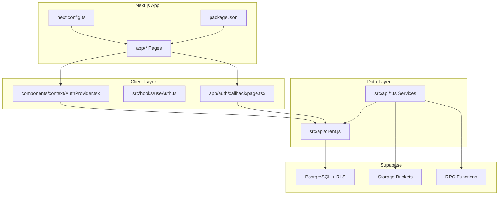
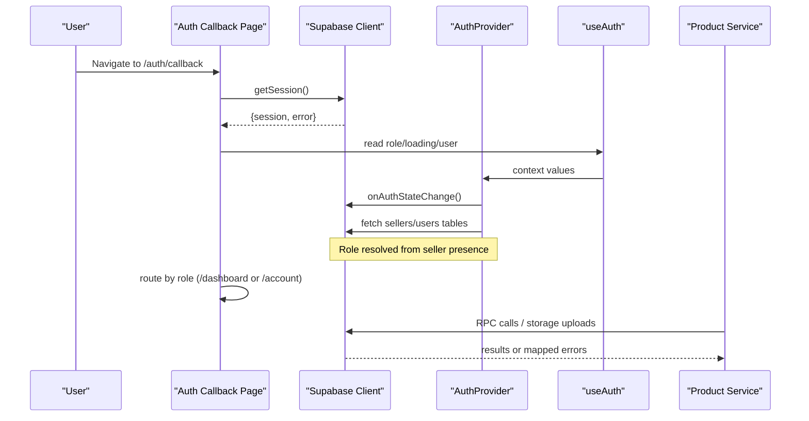
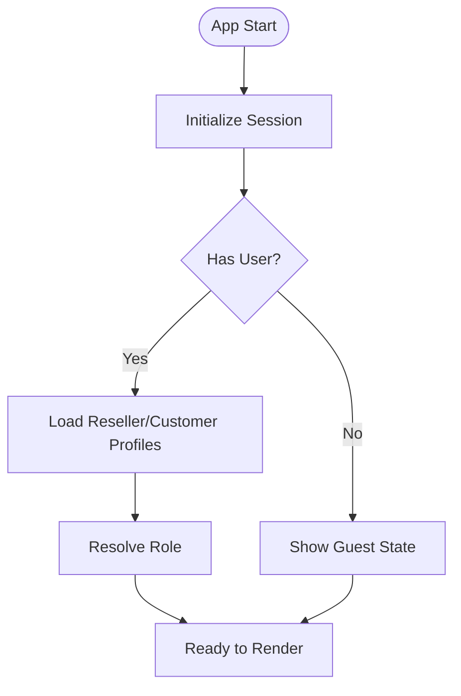
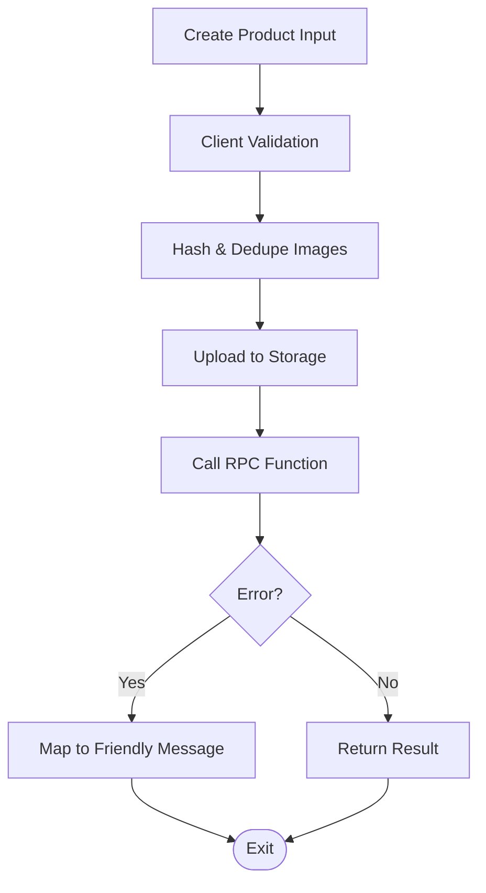
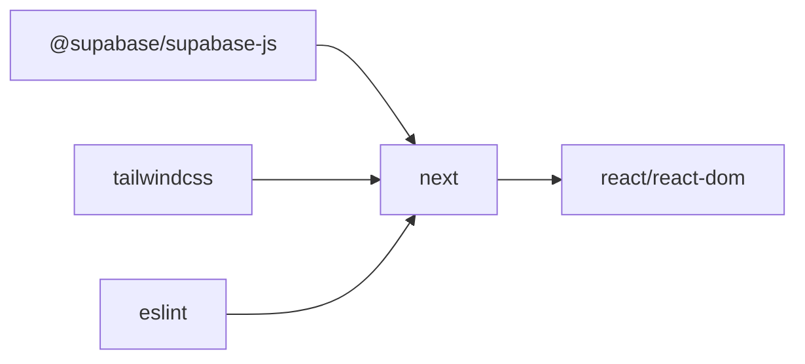

# Debugging & Troubleshooting Guide

<cite>
**Referenced Files in This Document**
- [README.md](file://README.md)
- [package.json](file://package.json)
- [next.config.ts](file://next.config.ts)
- [client.js](file://src/api/client.js)
- [AuthProvider.tsx](file://components/context/AuthProvider.tsx)
- [useAuth.ts](file://src/hooks/useAuth.ts)
- [page.tsx (auth callback)](file://app/auth/callback/page.tsx)
- [productService.ts](file://src/api/productService.ts)
- [ResellerSignup.tsx](file://components/reseller/ResellerSignup.tsx)
- [resellerFgtPass.tsx](file://components/reseller/resellerFgtPass.tsx)
</cite>

## Table of Contents
1. [Introduction](#introduction)
2. [Project Structure](#project-structure)
3. [Core Components](#core-components)
4. [Architecture Overview](#architecture-overview)
5. [Detailed Component Analysis](#detailed-component-analysis)
6. [Dependency Analysis](#dependency-analysis)
7. [Performance Considerations](#performance-considerations)
8. [Troubleshooting Guide](#troubleshooting-guide)
9. [Conclusion](#conclusion)

## Introduction
This guide provides practical debugging and troubleshooting techniques for the Zebaish platform, focusing on:
- Next.js application development and build issues
- Supabase integration (Auth, Storage, RPC functions, RLS)
- React component lifecycle and context usage
- Environment configuration, dependency conflicts, and runtime errors
- Performance profiling, memory leak detection, and bundle size optimization
- Checklists for authentication flows, payment processing, and real-time features

## Project Structure
The project is a Next.js app with:
- App Router pages under app/
- Shared UI components under components/
- API clients and services under src/api/
- React hooks under src/hooks/
- Providers and contexts under components/context/
- Supabase migrations under supabase/migrations/

**Diagram sources**
- [next.config.ts:1-12](file://next.config.ts#L1-L12)
- [package.json:1-34](file://package.json#L1-L34)
- [client.js:1-8](file://src/api/client.js#L1-L8)
- [AuthProvider.tsx:1-326](file://components/context/AuthProvider.tsx#L1-L326)
- [useAuth.ts:1-13](file://src/hooks/useAuth.ts#L1-L13)
- [page.tsx (auth callback):1-69](file://app/auth/callback/page.tsx#L1-L69)

**Section sources**
- [README.md:1-37](file://README.md#L1-L37)
- [package.json:1-34](file://package.json#L1-L34)
- [next.config.ts:1-12](file://next.config.ts#L1-L12)

## Core Components
- Supabase client initialization reads environment variables to connect to Supabase.
- AuthProvider manages session, user profiles, role resolution, and auth state changes.
- useAuth exposes auth context safely within components.
- Auth callback page validates session and routes users based on role.
- ProductService centralizes product creation logic and maps database/RPC errors to friendly messages.

Key responsibilities:
- Environment-driven Supabase connection
- Authentication lifecycle and profile loading
- Error mapping for database constraints and missing RPC functions
- Safe access to auth context via hook

**Section sources**
- [client.js:1-8](file://src/api/client.js#L1-L8)
- [AuthProvider.tsx:76-303](file://components/context/AuthProvider.tsx#L76-L303)
- [useAuth.ts:1-13](file://src/hooks/useAuth.ts#L1-L13)
- [page.tsx (auth callback):1-69](file://app/auth/callback/page.tsx#L1-L69)
- [productService.ts:250-292](file://src/api/productService.ts#L250-L292)

## Architecture Overview
End-to-end flow for authentication and data access:

**Diagram sources**
- [page.tsx (auth callback):1-69](file://app/auth/callback/page.tsx#L1-L69)
- [AuthProvider.tsx:248-303](file://components/context/AuthProvider.tsx#L248-L303)
- [client.js:1-8](file://src/api/client.js#L1-L8)
- [productService.ts:302-449](file://src/api/productService.ts#L302-L449)

## Detailed Component Analysis

### Supabase Client Initialization
- The client is created using NEXT_PUBLIC_SUPABASE_URL and NEXT_PUBLIC_SUPABASE_ANON_KEY.
- If these are missing or invalid, all Supabase operations will fail at runtime.

Common symptoms:
- Network errors when calling any Supabase endpoint
- Auth callbacks failing immediately
- Storage uploads or RPC calls throwing permission or not found errors

Resolution steps:
- Ensure .env.local contains both NEXT_PUBLIC_SUPABASE_URL and NEXT_PUBLIC_SUPABASE_ANON_KEY
- Verify that the Supabase project URL and anon key match the configured project
- Confirm that the dev server is running on port 4000 as defined in scripts

**Section sources**
- [client.js:1-8](file://src/api/client.js#L1-L8)
- [package.json:5-11](file://package.json#L5-L11)

### Authentication Flow and Context
- AuthProvider initializes session, loads reseller/customer profiles, resolves role, and listens for auth state changes.
- useAuth enforces that it is used inside an AuthProvider; otherwise, it throws an error.
- Auth callback page retrieves session, handles errors, and redirects based on role.

Common symptoms:
- “useAuth must be used within an AuthProvider”
- Redirect loops or incorrect routing after login
- Missing user profile data despite successful login

Resolution steps:
- Wrap your app with AuthProvider at the root layout
- Inspect console for OAuth callback session errors
- Validate role-based routing logic in the callback page
- Ensure sellers table exists and RLS policies allow reading current user’s row

**Diagram sources**
- [AuthProvider.tsx:248-303](file://components/context/AuthProvider.tsx#L248-L303)
- [useAuth.ts:1-13](file://src/hooks/useAuth.ts#L1-L13)
- [page.tsx (auth callback):1-69](file://app/auth/callback/page.tsx#L1-L69)

**Section sources**
- [AuthProvider.tsx:76-303](file://components/context/AuthProvider.tsx#L76-L303)
- [useAuth.ts:1-13](file://src/hooks/useAuth.ts#L1-L13)
- [page.tsx (auth callback):1-69](file://app/auth/callback/page.tsx#L1-L69)

### Product Creation and Database Error Mapping
- ProductService orchestrates validation, image hashing/compression, storage upload, and RPC invocation.
- formatDatabaseError maps Postgres codes and messages into user-friendly guidance, including missing RPC functions and constraint violations.

Common symptoms:
- Errors mentioning schema cache or missing functions like update_product_with_changes, create_product_with_variants, delete_product
- Constraint violation messages indicating duplicate keys or invalid data
- Permission denied due to Row Level Security

Resolution steps:
- Run the relevant migration scripts in Supabase SQL editor to register RPC functions
- Fix input data to satisfy constraints (e.g., valid prices, non-negative stock)
- Ensure RLS policies allow the authenticated user to perform the operation

**Diagram sources**
- [productService.ts:250-292](file://src/api/productService.ts#L250-L292)
- [productService.ts:302-449](file://src/api/productService.ts#L302-L449)

**Section sources**
- [productService.ts:250-292](file://src/api/productService.ts#L250-L292)
- [productService.ts:302-449](file://src/api/productService.ts#L302-L449)

### Environment Variables and Key Checks
- Several components guard against missing or dummy Supabase keys and surface clear messages.
- The Supabase client depends on NEXT_PUBLIC_SUPABASE_URL and NEXT_PUBLIC_SUPABASE_ANON_KEY.

Common symptoms:
- UI warnings about missing API keys
- Supabase client failing to initialize
- Auth flows blocked early

Resolution steps:
- Create .env.local with correct NEXT_PUBLIC_SUPABASE_URL and NEXT_PUBLIC_SUPABASE_ANON_KEY
- Avoid placeholder or dummy values
- Restart the dev server after updating environment variables

**Section sources**
- [client.js:1-8](file://src/api/client.js#L1-L8)
- [ResellerSignup.tsx:419-421](file://components/reseller/ResellerSignup.tsx#L419-L421)
- [resellerFgtPass.tsx:52-54](file://components/reseller/resellerFgtPass.tsx#L52-L54)

## Dependency Analysis
Key dependencies and their roles:
- next: framework and build tooling
- react/react-dom: UI runtime
- @supabase/supabase-js: client for Auth, Storage, and RPC
- @tanstack/react-query: data fetching and caching (declared but not analyzed here)
- lucide-react: icons
- recharts: charts
- tailwindcss/@tailwindcss/postcss: styling pipeline
- eslint/eslint-config-next: linting

Potential issues:
- Node version mismatch (some packages require Node >= 22)
- Conflicting versions between Next.js and React types
- Dev-only vs runtime dependencies causing unexpected behavior

Resolution steps:
- Use a supported Node.js version (>= 22 recommended per lockfile)
- Keep Next.js, React, and type packages aligned
- Clear .next and reinstall dependencies if lockfile drift occurs

**Diagram sources**
- [package.json:13-32](file://package.json#L13-L32)

**Section sources**
- [package.json:1-34](file://package.json#L1-L34)

## Performance Considerations
- Bundle size optimization:
  - next.config.ts enables optimizePackageImports for lucide-react and recharts to reduce bundle impact.
- Development performance:
  - Scripts use next dev --turbo for faster dev server startup.
- Build optimizations:
  - next build produces optimized production assets.

Recommendations:
- Monitor bundle sizes using Next.js built-in analysis or third-party tools
- Prefer tree-shakable libraries and avoid heavy imports in client components
- Use dynamic imports for large optional features

**Section sources**
- [next.config.ts:1-12](file://next.config.ts#L1-L12)
- [package.json:5-11](file://package.json#L5-L11)

## Troubleshooting Guide

### Environment Setup Issues
Symptoms:
- Dev server fails to start or Supabase calls fail immediately
- UI warns about missing API keys

Checklist:
- Create .env.local with NEXT_PUBLIC_SUPABASE_URL and NEXT_PUBLIC_SUPABASE_ANON_KEY
- Ensure values are not placeholders or dummy strings
- Confirm dev server runs on port 4000 as configured
- Restart the dev server after editing .env.local

**Section sources**
- [client.js:1-8](file://src/api/client.js#L1-L8)
- [package.json:5-11](file://package.json#L5-L11)
- [ResellerSignup.tsx:419-421](file://components/reseller/ResellerSignup.tsx#L419-L421)
- [resellerFgtPass.tsx:52-54](file://components/reseller/resellerFgtPass.tsx#L52-L54)

### Dependency Conflicts
Symptoms:
- TypeScript errors related to React types
- Runtime crashes due to incompatible package versions
- Lockfile inconsistencies

Checklist:
- Use Node.js >= 22 (as required by some dependencies)
- Align Next.js, React, and @types/react versions
- Remove node_modules and .next, then reinstall dependencies
- Verify package-lock.json integrity

**Section sources**
- [package.json:13-32](file://package.json#L13-L32)

### Build Failures
Symptoms:
- next build fails with module or config errors
- Unexpected experimental flags or plugin issues

Checklist:
- Review next.config.ts for experimental settings
- Ensure Tailwind and PostCSS configs are compatible with the installed versions
- Clean build artifacts and rebuild

**Section sources**
- [next.config.ts:1-12](file://next.config.ts#L1-L12)
- [package.json:23-32](file://package.json#L23-L32)

### Authentication Flow Problems
Symptoms:
- Redirect loops after login
- “useAuth must be used within an AuthProvider”
- Incorrect routing to dashboard or account

Checklist:
- Wrap app with AuthProvider at the root layout
- Inspect auth callback page for session retrieval and error handling
- Validate role resolution logic and routing decisions
- Ensure sellers table exists and RLS allows reading current user’s row

**Section sources**
- [AuthProvider.tsx:76-303](file://components/context/AuthProvider.tsx#L76-L303)
- [useAuth.ts:1-13](file://src/hooks/useAuth.ts#L1-L13)
- [page.tsx (auth callback):1-69](file://app/auth/callback/page.tsx#L1-L69)

### Payment Processing Issues
Symptoms:
- Checkout errors or failed payment attempts
- Inconsistent order states

Checklist:
- Validate checkout error logging paths
- Confirm payment-related RPCs and storage permissions are configured
- Test payment flows with sandbox/test credentials
- Verify idempotency and retry logic where applicable

[No sources needed since this section provides general guidance]

### Real-Time Features
Symptoms:
- Data not updating live
- Subscription leaks or stale listeners

Checklist:
- Ensure Supabase subscriptions are properly unsubscribed in cleanup
- Validate onAuthStateChange listener lifecycle
- Monitor network tab for WebSocket connections
- Add explicit unsubscribe guards in components

**Section sources**
- [AuthProvider.tsx:299-303](file://components/context/AuthProvider.tsx#L299-L303)

### Database Query Issues
Symptoms:
- Errors referencing missing RPC functions or schema cache
- Constraint violations (duplicate keys, check constraints, foreign keys)
- Permission denied due to RLS

Checklist:
- Run missing RPC migration scripts in Supabase SQL editor
- Fix input data to satisfy constraints
- Review RLS policies for sellers/users tables
- Use friendly error messages to identify the exact cause

**Section sources**
- [productService.ts:250-292](file://src/api/productService.ts#L250-L292)

### Runtime Errors and Logging
Symptoms:
- Console errors during auth, profile fetching, or data mutations
- Unhandled exceptions in components

Checklist:
- Centralize error logging in service layers
- Surface user-friendly messages for common failures
- Add try/catch around async operations and log contextual info
- Use consistent error shapes across services

**Section sources**
- [page.tsx (auth callback):1-69](file://app/auth/callback/page.tsx#L1-L69)
- [productService.ts:250-292](file://src/api/productService.ts#L250-L292)

### Performance Profiling and Memory Leak Detection
Techniques:
- Use browser DevTools Performance panel to capture timelines
- Identify long tasks and excessive re-renders
- Monitor memory snapshots to detect retained references
- Audit useEffect cleanup and subscription lifecycles

Recommendations:
- Debounce expensive operations
- Memoize derived data and stable references
- Avoid unnecessary re-renders in context consumers
- Profile bundle growth and remove unused code

[No sources needed since this section provides general guidance]

### Bundle Size Optimization
Actions:
- Leverage optimizePackageImports for icon and chart libraries
- Split large components with dynamic imports
- Analyze bundle with Next.js analytics or external tools
- Remove unused dependencies and dead code

**Section sources**
- [next.config.ts:1-12](file://next.config.ts#L1-L12)

## Conclusion
This guide consolidates debugging strategies for the Zebaish platform, covering environment setup, dependency management, authentication flows, database interactions, and performance tuning. By following the checklists and leveraging the provided diagrams and source references, you can quickly diagnose and resolve common issues while maintaining a robust and scalable application.