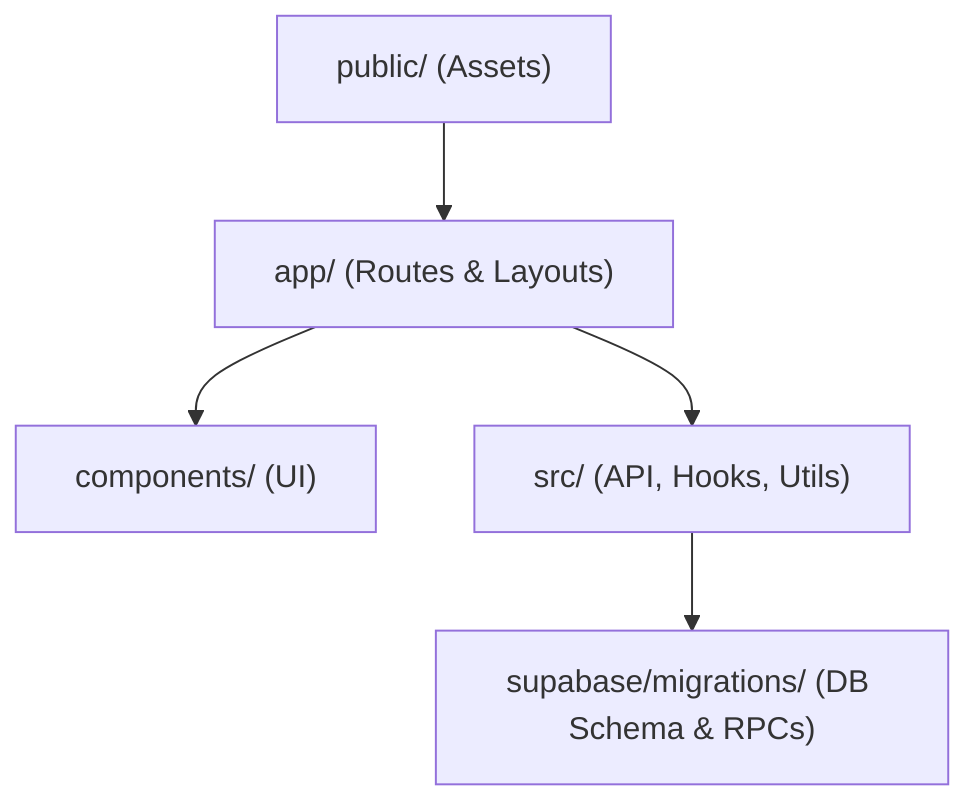
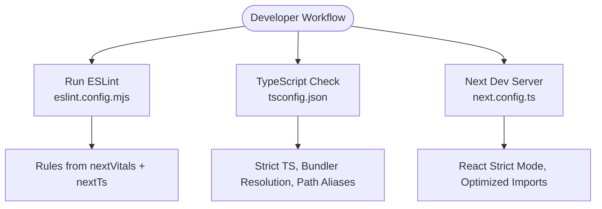
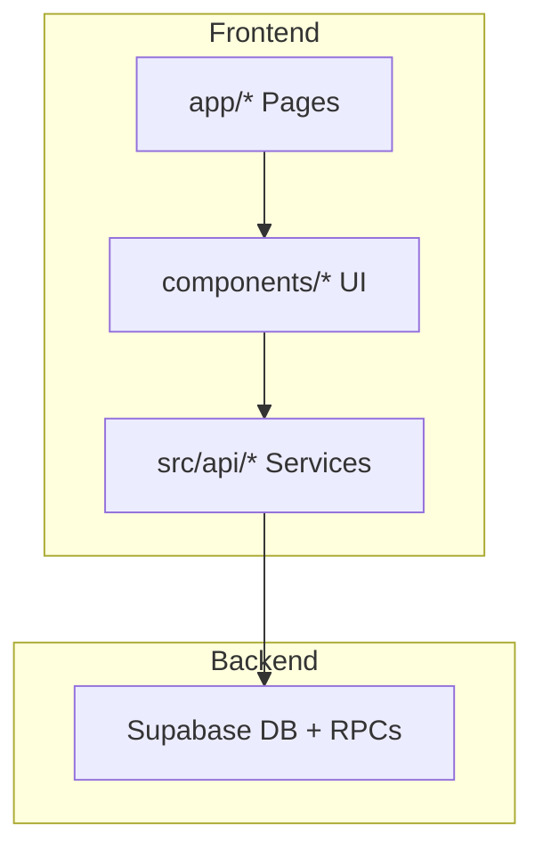
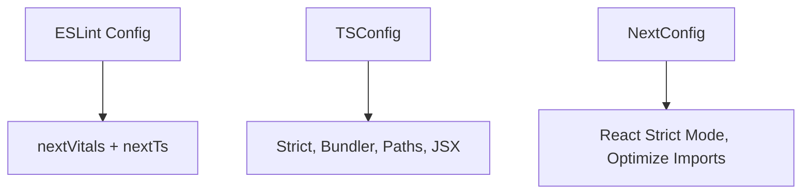
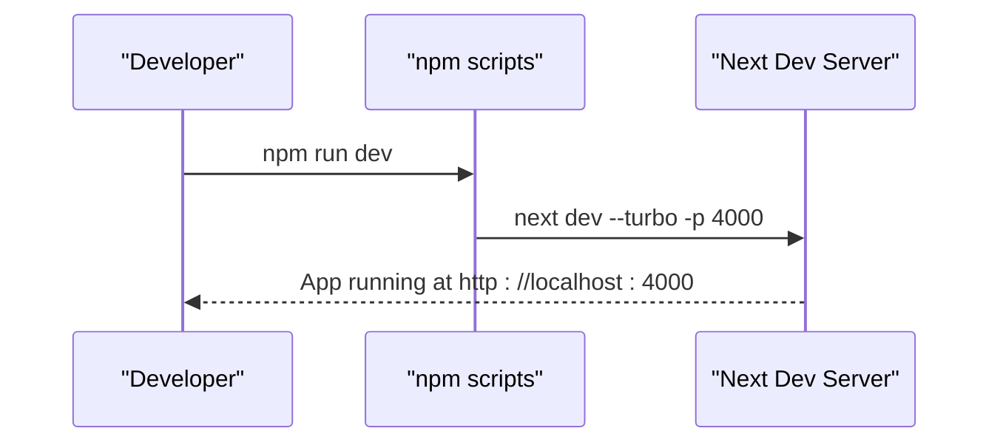
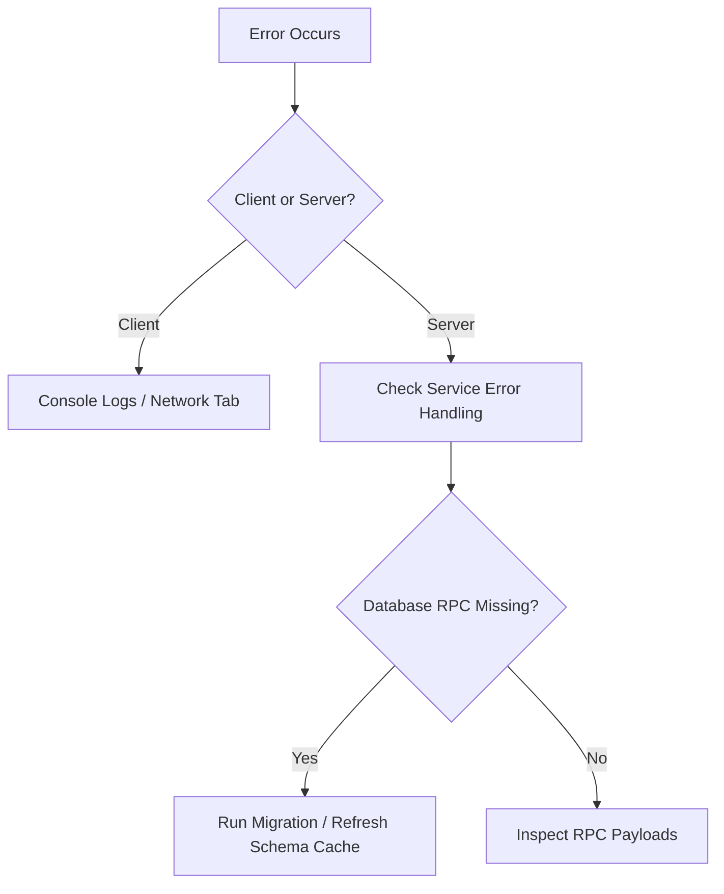
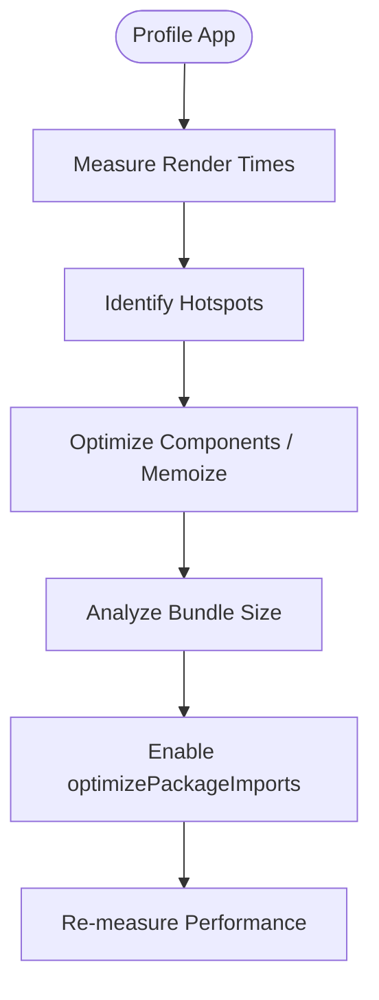
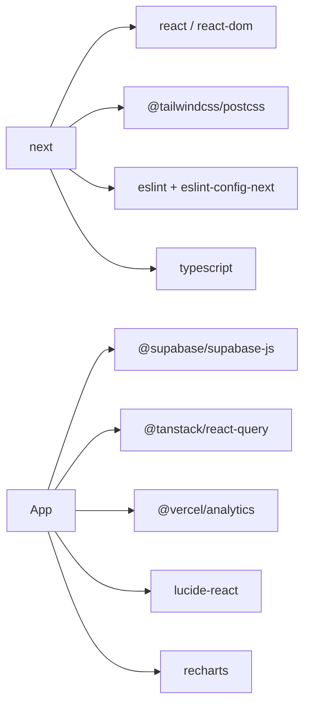
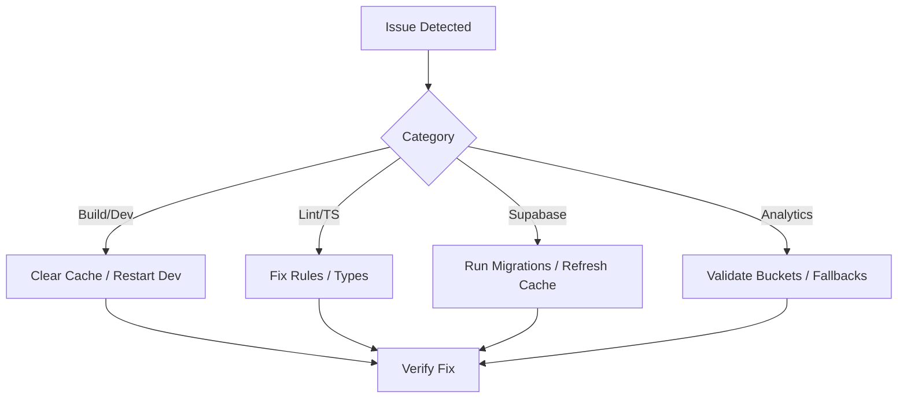

# Developer Guide

<cite>
**Referenced Files in This Document**
- [README.md](file://README.md)
- [package.json](file://package.json)
- [eslint.config.mjs](file://eslint.config.mjs)
- [tsconfig.json](file://tsconfig.json)
- [next.config.ts](file://next.config.ts)
- [AGENTS.md](file://AGENTS.md)
- [CLAUDE.md](file://CLAUDE.md)
- [src/api/productService.ts](file://src/api/productService.ts)
- [src/api/sellerAnalyticsService.ts](file://src/api/sellerAnalyticsService.ts)
- [src/api/sellerLast7DaysService.ts](file://src/api/sellerLast7DaysService.ts)
- [supabase_seller_overview_rpc.sql](file://supabase_seller_overview_rpc.sql)
</cite>

## Table of Contents
1. [Introduction](#introduction)
2. [Project Structure](#project-structure)
3. [Core Components](#core-components)
4. [Architecture Overview](#architecture-overview)
5. [Detailed Component Analysis](#detailed-component-analysis)
6. [Dependency Analysis](#dependency-analysis)
7. [Performance Considerations](#performance-considerations)
8. [Troubleshooting Guide](#troubleshooting-guide)
9. [Conclusion](#conclusion)
10. [Appendices](#appendices)

## Introduction
This Developer Guide consolidates coding standards, contribution guidelines, and the development workflow for this Next.js application. It explains ESLint configuration, TypeScript conventions, Git and pull request practices, debugging techniques, testing approaches, performance profiling methods, and troubleshooting steps for common environment and integration issues. It also outlines extension points and customization options to extend platform functionality.

## Project Structure
The project follows a Next.js App Router layout with:
- app/: Page routes and layouts
- components/: Reusable UI components
- src/: API services, hooks, providers, constants, and utilities
- supabase/migrations/: Database migrations and RPC scripts
- Public assets under public/

[No sources needed since this diagram shows conceptual structure]

**Section sources**
- [README.md:1-37](file://README.md#L1-L37)

## Core Components
Key configuration files that define the development experience:
- ESLint rules via eslint-config-next core web vitals and TypeScript presets
- TypeScript compiler settings enabling strict mode, bundler module resolution, and path aliases
- Next.js configuration enabling React Strict Mode and package import optimizations

**Diagram sources**
- [eslint.config.mjs:1-19](file://eslint.config.mjs#L1-L19)
- [tsconfig.json:1-35](file://tsconfig.json#L1-L35)
- [next.config.ts:1-12](file://next.config.ts#L1-L12)

**Section sources**
- [eslint.config.mjs:1-19](file://eslint.config.mjs#L1-L19)
- [tsconfig.json:1-35](file://tsconfig.json#L1-L35)
- [next.config.ts:1-12](file://next.config.ts#L1-L12)

## Architecture Overview
High-level architecture overview:
- Frontend pages and components render using Next.js App Router
- Data fetching is centralized in src/api services, which call Supabase RPCs and handle errors
- Analytics and dashboards use recharts for visualization
- Supabase SQL migrations and RPCs provide backend logic

[No sources needed since this diagram shows conceptual architecture]

## Detailed Component Analysis

### Coding Standards and Conventions
- ESLint
  - Uses eslint-config-next core-web-vitals and typescript presets
  - Overrides default ignores to exclude build artifacts and generated types
- TypeScript
  - Strict mode enabled
  - Module resolution set to bundler
  - Path alias @ maps to root
  - JSX runtime configured for React 19
- Next.js
  - React Strict Mode enabled
  - Experimental optimizePackageImports for lucide-react and recharts

**Diagram sources**
- [eslint.config.mjs:1-19](file://eslint.config.mjs#L1-L19)
- [tsconfig.json:1-35](file://tsconfig.json#L1-L35)
- [next.config.ts:1-12](file://next.config.ts#L1-L12)

**Section sources**
- [eslint.config.mjs:1-19](file://eslint.config.mjs#L1-L19)
- [tsconfig.json:1-35](file://tsconfig.json#L1-L35)
- [next.config.ts:1-12](file://next.config.ts#L1-L12)

### Development Workflow and Scripts
- Development server runs on port 4000 with turbo enabled
- Clean cache script removes .next before dev
- Build and start commands provided
- Lint command executes ESLint

**Diagram sources**
- [package.json:5-12](file://package.json#L5-L12)

**Section sources**
- [package.json:1-34](file://package.json#L1-L34)

### Git Workflow and Pull Requests
Recommended workflow:
- Create feature branches from main
- Commit small, focused changes with clear messages
- Open pull requests early for feedback
- Ensure lint passes and builds succeed before requesting review
- Address review comments promptly and keep PRs up to date

[No sources needed since this section provides general guidance]

### Code Review Standards
- Verify ESLint passes
- Confirm TypeScript compiles without errors
- Validate functional changes against requirements
- Prefer incremental improvements and clear diffs
- Add or update tests where applicable

[No sources needed since this section provides general guidance]

### Debugging Techniques
- Use browser developer tools to inspect network calls and console logs
- For API layer issues, check error handling and fallback behavior in service functions
- For database-related errors, validate migration execution and RPC availability

**Diagram sources**
- [src/api/productService.ts:260-274](file://src/api/productService.ts#L260-L274)

**Section sources**
- [src/api/productService.ts:260-274](file://src/api/productService.ts#L260-L274)

### Testing Approaches
- Unit test pure utility functions and data transformations
- Integration test API services by mocking Supabase client responses
- Snapshot or visual regression tests for critical UI flows
- End-to-end tests for checkout and reseller workflows

[No sources needed since this section provides general guidance]

### Performance Profiling Methods
- Use React DevTools Profiler to identify component render bottlenecks
- Monitor bundle size and lazy-load heavy libraries
- Leverage experimental optimizePackageImports for large libraries like recharts and lucide-react
- Profile analytics rendering with recharts-specific metrics

**Diagram sources**
- [next.config.ts:3-9](file://next.config.ts#L3-L9)

**Section sources**
- [next.config.ts:1-12](file://next.config.ts#L1-L12)

### Extension Points and Customization
- Add new pages under app/ following App Router conventions
- Extend UI with reusable components under components/
- Integrate new data sources via services under src/api/
- Customize analytics dashboards by modifying services and chart configurations
- Extend reseller features by adding components and context providers under components/reseller/

[No sources needed since this section provides general guidance]

### Plugin Development Patterns
- Encapsulate plugin logic in dedicated modules under src/utils or src/hooks
- Provide configuration objects consumed by services or components
- Expose typed interfaces for plugin consumers
- Register plugins through provider contexts or service factories

[No sources needed since this section provides general guidance]

## Dependency Analysis
Runtime and development dependencies include:
- Next.js, React 19, Supabase client, TanStack Query, Vercel Analytics, Lucide icons, Recharts
- Tailwind CSS v4 and PostCSS integration
- ESLint v9 with Next.js config presets
- TypeScript v5

**Diagram sources**
- [package.json:13-32](file://package.json#L13-L32)

**Section sources**
- [package.json:1-34](file://package.json#L1-L34)

## Performance Considerations
- Enable React Strict Mode during development to catch potential issues
- Use optimizePackageImports for large third-party libraries
- Prefer code splitting and route-level lazy loading
- Minimize unnecessary re-renders with memoization and stable references
- Keep analytics datasets pre-aggregated to reduce client-side computation

[No sources needed since this section provides general guidance]

## Troubleshooting Guide
Common issues and resolutions:
- Development server not starting
  - Clear .next cache and restart dev server
  - Verify Node version compatibility and dependencies installed
- ESLint errors
  - Run lint command and fix reported issues
  - Ensure eslint-config-next presets are applied
- TypeScript errors
  - Fix strict mode violations and type mismatches
  - Confirm path aliases resolve correctly
- Supabase RPC not found
  - Execute required migrations in Supabase SQL editor
  - Refresh schema cache if necessary
- Analytics data anomalies
  - Validate date range calculations and bucketing logic
  - Check fallback mock data usage when RPC fails

**Diagram sources**
- [package.json:5-12](file://package.json#L5-L12)
- [src/api/productService.ts:260-274](file://src/api/productService.ts#L260-L274)
- [src/api/sellerAnalyticsService.ts:562-566](file://src/api/sellerAnalyticsService.ts#L562-L566)
- [src/api/sellerLast7DaysService.ts:313-351](file://src/api/sellerLast7DaysService.ts#L313-L351)

**Section sources**
- [package.json:5-12](file://package.json#L5-L12)
- [src/api/productService.ts:260-274](file://src/api/productService.ts#L260-L274)
- [src/api/sellerAnalyticsService.ts:562-566](file://src/api/sellerAnalyticsService.ts#L562-L566)
- [src/api/sellerLast7DaysService.ts:313-351](file://src/api/sellerLast7DaysService.ts#L313-L351)

## Conclusion
This guide establishes consistent coding standards, a streamlined development workflow, and robust troubleshooting strategies. By adhering to ESLint and TypeScript conventions, leveraging Next.js optimizations, and following the recommended Git and review practices, contributors can maintain high code quality and accelerate feature delivery.

[No sources needed since this section summarizes without analyzing specific files]

## Appendices

### Environment Setup
- Install dependencies and start the development server on port 4000
- Refer to the project README for quickstart instructions

**Section sources**
- [README.md:1-37](file://README.md#L1-L37)

### Agent Notes
- Follow agent rules and heed deprecation notices for Next.js versions

**Section sources**
- [AGENTS.md:1-6](file://AGENTS.md#L1-L6)
- [CLAUDE.md:1-2](file://CLAUDE.md#L1-L2)

### Database and RPCs
- Ensure all migrations and RPC scripts are executed in Supabase
- Validate result structures returned by RPCs used by analytics and overview dashboards

**Section sources**
- [supabase_seller_overview_rpc.sql:339-353](file://supabase_seller_overview_rpc.sql#L339-L353)