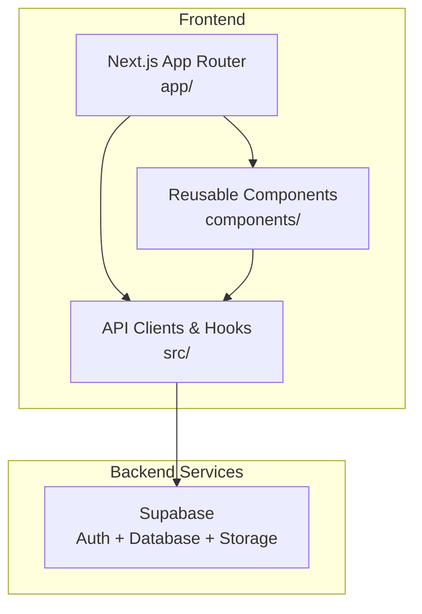
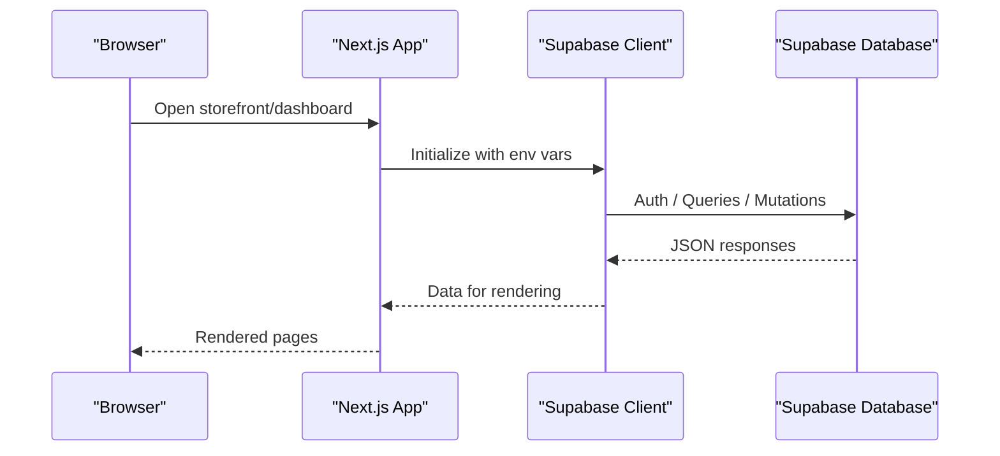
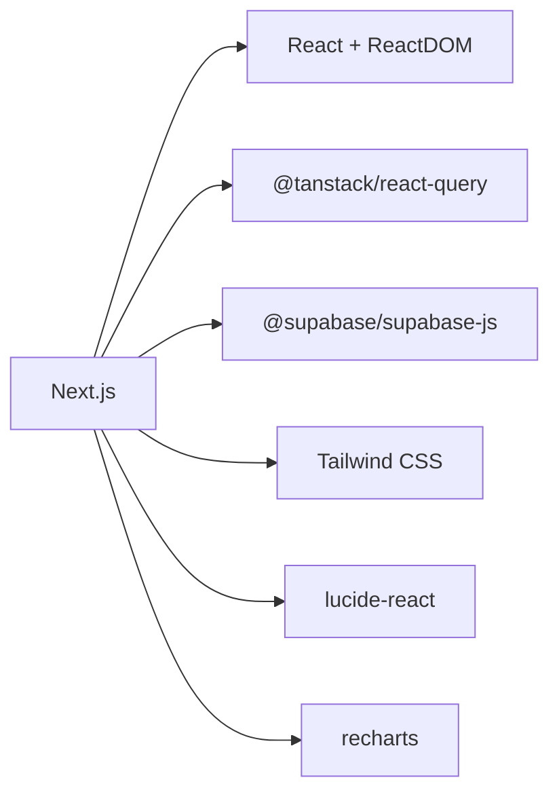

# Getting Started

<cite>
**Referenced Files in This Document**
- [README.md](file://README.md)
- [package.json](file://package.json)
- [.env](file://.env)
- [next.config.ts](file://next.config.ts)
- [app/layout.tsx](file://app/layout.tsx)
- [src/api/client.js](file://src/api/client.js)
- [supabase_checkout_migration.sql](file://supabase_checkout_migration.sql)
- [supabase_seller_overview_rpc.sql](file://supabase_seller_overview_rpc.sql)
</cite>

## Table of Contents
1. [Introduction](#introduction)
2. [Project Structure](#project-structure)
3. [Core Components](#core-components)
4. [Architecture Overview](#architecture-overview)
5. [Detailed Component Analysis](#detailed-component-analysis)
6. [Dependency Analysis](#dependency-analysis)
7. [Performance Considerations](#performance-considerations)
8. [Troubleshooting Guide](#troubleshooting-guide)
9. [Conclusion](#conclusion)

## Introduction
Zebaish is a multi-vendor marketplace that connects luxury fashion brands with customers. The platform provides:
- A storefront for browsing and purchasing designer products
- A reseller dashboard for managing listings, orders, analytics, payouts, and settings
- Secure authentication and data access via Supabase
- Server-side rendering and modern React patterns powered by Next.js

This guide helps you set up the project locally, integrate Supabase, run the development server, explore the storefront, and navigate the reseller dashboard.

## Project Structure
At a high level, the application is organized into:
- app/: Next.js App Router pages (storefront, checkout, account, reseller flows, dashboard)
- components/: Reusable UI components for storefront and reseller features
- src/: API clients, hooks, providers, utilities, and constants
- supabase/: Database migrations and RPC functions for seller analytics and checkout
- .env: Environment variables for Supabase integration
- package.json: Scripts, dependencies, and dev tooling configuration

**Diagram sources**
- [app/layout.tsx:10-18](file://app/layout.tsx#L10-L18)
- [src/api/client.js:1-8](file://src/api/client.js#L1-L8)

**Section sources**
- [README.md:1-37](file://README.md#L1-L37)
- [package.json:1-34](file://package.json#L1-L34)

## Core Components
- Storefront: Product browsing, cart, checkout, order success, account management
- Reseller Dashboard: Listings, orders, analytics, payouts, reviews, settings
- Authentication: User and reseller sign-in flows, email verification
- Data Layer: Supabase client configured via environment variables

Key runtime behaviors:
- The root layout sets site metadata and wraps the app with providers for queries, auth, and analytics.
- The Supabase client reads environment variables to connect to your Supabase project.

**Section sources**
- [app/layout.tsx:10-18](file://app/layout.tsx#L10-L18)
- [app/layout.tsx:20-49](file://app/layout.tsx#L20-L49)
- [src/api/client.js:1-8](file://src/api/client.js#L1-L8)

## Architecture Overview
The Zebaish platform uses Next.js for the frontend and Supabase for backend services (authentication, database, storage). The Supabase client is initialized using public environment variables, and database logic is encapsulated in SQL migrations and RPC functions for performance and security.

**Diagram sources**
- [src/api/client.js:1-8](file://src/api/client.js#L1-L8)
- [app/layout.tsx:20-49](file://app/layout.tsx#L20-L49)

## Detailed Component Analysis

### Installation Prerequisites
- Node.js: Install a recent LTS version compatible with Next.js 16.x and React 19.x.
- Package Manager: npm or your preferred package manager.
- Supabase Account: Create a project and obtain the URL and anon key.
- Database Migrations: Apply provided SQL migrations to set up tables, policies, and RPC functions.

Environment variables required:
- NEXT_PUBLIC_SUPABASE_URL
- NEXT_PUBLIC_SUPABASE_ANON_KEY
- NEXT_PUBLIC_SUPABASE_PUBLISHABLE_KEY

These are defined in the repository’s environment file and consumed by the Supabase client.

**Section sources**
- [.env:1-7](file://.env#L1-L7)
- [src/api/client.js:1-8](file://src/api/client.js#L1-L8)

### Local Development Setup
Steps:
1. Clone the repository and open it in your terminal.
2. Install dependencies:
   - npm install
3. Configure environment variables:
   - Ensure NEXT_PUBLIC_SUPABASE_URL and NEXT_PUBLIC_SUPABASE_ANON_KEY are set in .env.
4. Start the development server:
   - npm run dev
   - The server runs on port 4000 by default.
5. Open the storefront:
   - Visit http://localhost:4000 in your browser.

Notes:
- The dev script enables turbo mode and binds to port 4000.
- The root layout configures global styles, fonts, and providers.

**Section sources**
- [package.json:5-11](file://package.json#L5-L11)
- [app/layout.tsx:20-49](file://app/layout.tsx#L20-L49)

### Supabase Integration
To integrate Supabase:
1. Create a Supabase project and copy the project URL and anon key.
2. Update .env with:
   - NEXT_PUBLIC_SUPABASE_URL
   - NEXT_PUBLIC_SUPABASE_ANON_KEY
   - NEXT_PUBLIC_SUPABASE_PUBLISHABLE_KEY
3. Apply database migrations:
   - Run the provided SQL files in your Supabase SQL editor to create tables, policies, and RPC functions.
   - Key migrations include:
     - Checkout flow and atomic order creation
     - Seller overview analytics RPCs
4. Verify connectivity:
   - The Supabase client initializes from environment variables and can be used across the app.

Important:
- The Supabase client reads environment variables at runtime.
- Migrations define Row Level Security policies and RPC functions for secure, efficient data access.

**Section sources**
- [.env:1-7](file://.env#L1-L7)
- [src/api/client.js:1-8](file://src/api/client.js#L1-L8)
- [supabase_checkout_migration.sql:1-224](file://supabase_checkout_migration.sql#L1-L224)
- [supabase_seller_overview_rpc.sql:1-354](file://supabase_seller_overview_rpc.sql#L1-L354)

### Initial Deployment
Recommended deployment options:
- Vercel: Connect your repository, configure environment variables, and deploy.
- Other platforms: Ensure environment variables are set and build commands match Next.js defaults.

Deployment checklist:
- Set NEXT_PUBLIC_SUPABASE_URL and NEXT_PUBLIC_SUPABASE_ANON_KEY in the hosting platform’s environment settings.
- Confirm that all database migrations have been applied in Supabase.
- Build and start the app using Next.js build and start scripts.

**Section sources**
- [README.md:32-37](file://README.md#L32-L37)
- [package.json:9-11](file://package.json#L9-L11)

### Basic Usage Examples

#### Running the Development Server
- Command: npm run dev
- Port: 4000 (configured in scripts)
- Access: http://localhost:4000

What happens:
- Next.js starts in development mode with turbo enabled.
- The root layout loads global styles, fonts, and providers.

**Section sources**
- [package.json:5-11](file://package.json#L5-L11)
- [app/layout.tsx:20-49](file://app/layout.tsx#L20-L49)

#### Accessing the Storefront
- Navigate to http://localhost:4000
- Browse collections, product details, cart, and checkout flows
- Use the navigation bar and filters to discover products

Storefront behavior:
- Pages are rendered by Next.js App Router.
- Data fetching relies on the Supabase client.

**Section sources**
- [app/layout.tsx:10-18](file://app/layout.tsx#L10-L18)
- [src/api/client.js:1-8](file://src/api/client.js#L1-L8)

#### Navigating the Reseller Dashboard
- Log in as a reseller through the reseller login flow.
- From the dashboard, manage:
  - Listings and collections
  - Orders and fulfillment status
  - Analytics and performance metrics
  - Payouts and wallet details
  - Reviews and settings

Dashboard data:
- Seller overview KPIs and graphs are served by Supabase RPC functions.
- Recent orders and analytics are computed server-side for performance.

**Section sources**
- [supabase_seller_overview_rpc.sql:33-159](file://supabase_seller_overview_rpc.sql#L33-L159)
- [supabase_seller_overview_rpc.sql:166-354](file://supabase_seller_overview_rpc.sql#L166-L354)

## Dependency Analysis
The application depends on:
- Next.js for routing, SSR, and build tooling
- React and ReactDOM for UI components
- Supabase JS client for authentication and data operations
- TanStack Query for data fetching and caching
- Tailwind CSS and PostCSS for styling
- Lucide React for icons
- Recharts for analytics charts

**Diagram sources**
- [package.json:13-31](file://package.json#L13-L31)

**Section sources**
- [package.json:1-34](file://package.json#L1-L34)

## Performance Considerations
- Optimize package imports: The Next.js config optimizes specific packages like lucide-react and recharts.
- Use server-side computations: Leverage Supabase RPC functions for heavy analytics and aggregations.
- Enable strict mode: reactStrictMode is enabled for better development experience.

Recommendations:
- Keep images optimized and use appropriate formats.
- Minimize client-side state where possible; prefer server-rendered data.
- Monitor query performance and add indexes in Supabase as needed.

**Section sources**
- [next.config.ts:1-12](file://next.config.ts#L1-L12)
- [supabase_seller_overview_rpc.sql:1-354](file://supabase_seller_overview_rpc.sql#L1-L354)

## Troubleshooting Guide

Common issues and resolutions:
- Dev server not starting:
  - Ensure Node.js is installed and compatible with Next.js 16.x.
  - Verify dependencies are installed with npm install.
  - Check that the dev script targets port 4000 and there are no conflicts.
- Supabase connection errors:
  - Confirm NEXT_PUBLIC_SUPABASE_URL and NEXT_PUBLIC_SUPABASE_ANON_KEY are set correctly in .env.
  - Ensure the Supabase client reads these variables at runtime.
- Missing database tables or RPC functions:
  - Apply all provided SQL migrations in Supabase.
  - Verify Row Level Security policies are active for seller-scoped data.
- Checkout failures:
  - Ensure the atomic order creation RPC is present and stock checks pass.
  - Validate that product variants and inventory levels are correct.

Helpful references:
- Environment variables and Supabase client initialization
- Checkout migration defining atomic order creation and stock locking
- Seller overview RPCs for analytics and KPIs

**Section sources**
- [.env:1-7](file://.env#L1-L7)
- [src/api/client.js:1-8](file://src/api/client.js#L1-L8)
- [supabase_checkout_migration.sql:1-224](file://supabase_checkout_migration.sql#L1-L224)
- [supabase_seller_overview_rpc.sql:1-354](file://supabase_seller_overview_rpc.sql#L1-L354)

## Conclusion
You now have the essentials to set up Zebaish locally, connect it to Supabase, run the development server, explore the storefront, and navigate the reseller dashboard. For production, ensure environment variables are configured securely, apply all database migrations, and deploy using your preferred platform. Refer to the troubleshooting section if you encounter setup issues.