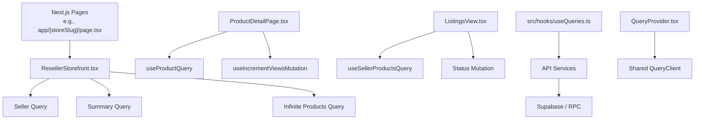
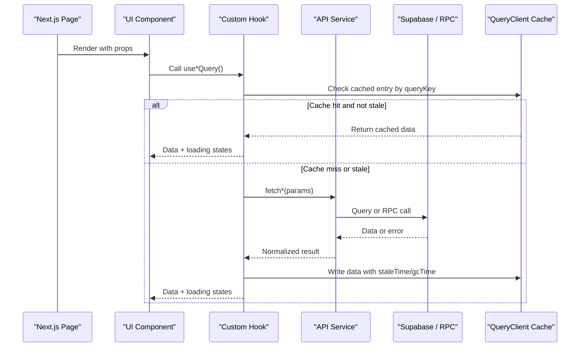
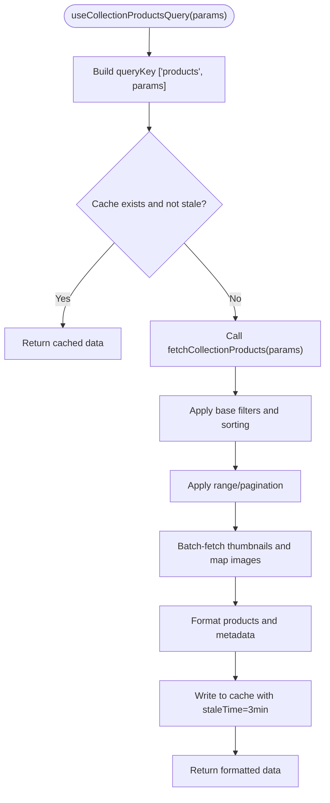
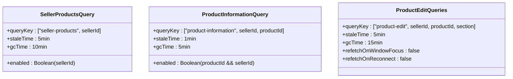
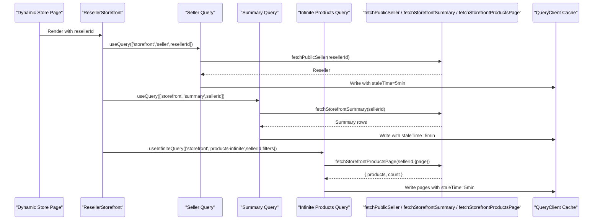
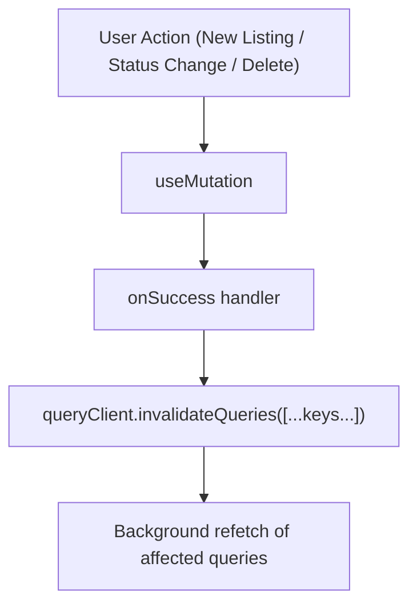
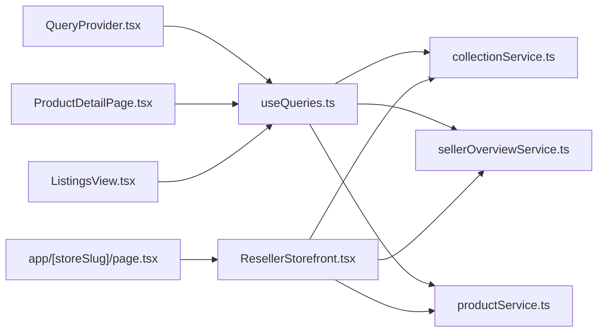

# Data Caching Strategies

<cite>
**Referenced Files in This Document**   
- [QueryProvider.tsx](file://src/providers/QueryProvider.tsx)
- [useQueries.ts](file://src/hooks/useQueries.ts)
- [useProductEditQueries.ts](file://src/hooks/useProductEditQueries.ts)
- [collectionService.ts](file://src/api/collectionService.ts)
- [sellerOverviewService.ts](file://src/api/sellerOverviewService.ts)
- [productService.ts](file://src/api/productService.ts)
- [ListingsView.tsx](file://components/reseller/components/ListingsView.tsx)
- [ResellerStorefront.tsx](file://components/ResellerStorefront.tsx)
- [ProductDetailPage.tsx](file://components/ProductDetailPage.tsx)
- [page.tsx](file://app/[storeSlug]/page.tsx)
</cite>

## Table of Contents
1. [Introduction](#introduction)
2. [Project Structure](#project-structure)
3. [Core Components](#core-components)
4. [Architecture Overview](#architecture-overview)
5. [Detailed Component Analysis](#detailed-component-analysis)
6. [Dependency Analysis](#dependency-analysis)
7. [Performance Considerations](#performance-considerations)
8. [Troubleshooting Guide](#troubleshooting-guide)
9. [Conclusion](#conclusion)

## Introduction
This document explains how data caching is implemented with React Query across the application. It covers:
- QueryProvider configuration and global cache behavior
- Cache invalidation strategies after mutations
- Stale-while-revalidate patterns for product, collection, seller, and storefront data
- Custom hooks that encapsulate query keys, stale times, garbage collection, and background refetching
- API service layer design for resilient fetching, fallbacks, and error handling
- Optimistic updates, background view increments, and memory management for large datasets
- Cache persistence options, cache warming techniques, retry strategies, and performance monitoring guidance

## Project Structure
The caching strategy is layered:
- Provider layer configures the shared QueryClient
- Hooks layer defines typed queries and mutations with explicit cache keys and stale times
- API service layer performs database calls, RPC calls, and fallback logic
- UI components consume hooks and trigger invalidations or manual refetches



**Diagram sources**
- [page.tsx:36-73](file://app/[storeSlug]/page.tsx#L36-L73)
- [ResellerStorefront.tsx:509-577](file://components/ResellerStorefront.tsx#L509-L577)
- [ProductDetailPage.tsx:68-72](file://components/ProductDetailPage.tsx#L68-L72)
- [ProductDetailPage.tsx:234-243](file://components/ProductDetailPage.tsx#L234-L243)
- [ListingsView.tsx:155-164](file://components/reseller/components/ListingsView.tsx#L155-L164)
- [ListingsView.tsx:247-277](file://components/reseller/components/ListingsView.tsx#L247-L277)
- [useQueries.ts:48-66](file://src/hooks/useQueries.ts#L48-L66)
- [useQueries.ts:94-118](file://src/hooks/useQueries.ts#L94-L118)
- [QueryProvider.tsx:6-24](file://src/providers/QueryProvider.tsx#L6-L24)

**Section sources**
- [page.tsx:36-73](file://app/[storeSlug]/page.tsx#L36-L73)
- [ResellerStorefront.tsx:509-577](file://components/ResellerStorefront.tsx#L509-L577)
- [ProductDetailPage.tsx:68-72](file://components/ProductDetailPage.tsx#L68-L72)
- [ListingsView.tsx:155-164](file://components/reseller/components/ListingsView.tsx#L155-L164)
- [QueryProvider.tsx:6-24](file://src/providers/QueryProvider.tsx#L6-L24)

## Core Components
- QueryProvider sets a global QueryClient with default query options:
  - Global staleTime of 60 seconds
  - Disabled refetchOnWindowFocus
- useQueries centralizes domain-specific hooks:
  - Product detail query with 3-minute stale time
  - Background view increment mutation without cache invalidation
  - Collection products query with 3-minute stale time
  - Seller products query with 5-minute stale time and 10-minute gcTime
  - Product information and edit queries with explicit stale and gc times
  - Dashboard overview, analytics, orders, wallet, profile, and storefront queries with 60-second stale time
  - Brand names, departments, categories, and attribute definitions with 10-minute stale time
- ResellerStorefront uses three queries:
  - Public seller profile
  - Category summary
  - Infinite product list with pagination
- ListingsView manages status changes and deletions with targeted cache invalidations

**Section sources**
- [QueryProvider.tsx:6-24](file://src/providers/QueryProvider.tsx#L6-L24)
- [useQueries.ts:48-66](file://src/hooks/useQueries.ts#L48-L66)
- [useQueries.ts:76-82](file://src/hooks/useQueries.ts#L76-L82)
- [useQueries.ts:94-118](file://src/hooks/useQueries.ts#L94-L118)
- [useQueries.ts:126-151](file://src/hooks/useQueries.ts#L126-L151)
- [useQueries.ts:159-245](file://src/hooks/useQueries.ts#L159-L245)
- [useQueries.ts:276-357](file://src/hooks/useQueries.ts#L276-L357)
- [ResellerStorefront.tsx:17-23](file://components/ResellerStorefront.tsx#L17-L23)
- [ResellerStorefront.tsx:509-577](file://components/ResellerStorefront.tsx#L509-L577)
- [ListingsView.tsx:247-277](file://components/reseller/components/ListingsView.tsx#L247-L277)

## Architecture Overview
React Query is configured once at the provider level and used throughout the app via custom hooks. The API services encapsulate all network calls, including RPC functions and PostgREST fallbacks. UI components focus on state presentation and user interactions while delegating data fetching and caching to hooks.



**Diagram sources**
- [QueryProvider.tsx:6-24](file://src/providers/QueryProvider.tsx#L6-L24)
- [useQueries.ts:48-66](file://src/hooks/useQueries.ts#L48-L66)
- [collectionService.ts:156-321](file://src/api/collectionService.ts#L156-L321)
- [sellerOverviewService.ts:90-139](file://src/api/sellerOverviewService.ts#L90-L139)

## Detailed Component Analysis

### QueryProvider Configuration
- Creates a single QueryClient instance per component tree
- Sets global defaults:
  - staleTime: 60 seconds
  - refetchOnWindowFocus: false
- Provides QueryClientProvider to children

Implications:
- All queries inherit these defaults unless overridden
- Window-focus refetch is disabled globally; components must explicitly refetch when needed

**Section sources**
- [QueryProvider.tsx:6-24](file://src/providers/QueryProvider.tsx#L6-L24)

### Product Detail Caching and Background View Increment
- useProductQuery:
  - queryKey: ['product', productId]
  - staleTime: 3 minutes
  - Fetches product details, reviews, and related data
- useIncrementViewsMutation:
  - Fire-and-forget mutation
  - No query invalidation to avoid unnecessary refetches
  - Used in ProductDetailPage to increment views in background

```mermaid
sequenceDiagram
participant PDP as "ProductDetailPage"
participant Hook as "useProductQuery"
participant Service as "fetchProductById"
participant Mut as "useIncrementViewsMutation"
participant Cache as "QueryClient Cache"
PDP->>Hook : useProductQuery(productId)
Hook->>Cache : Read by ['product', productId]
alt Missing or stale
Hook->>Service : fetchProductById(productId)
Service-->>Hook : { product, reviews }
Hook->>Cache : Write with staleTime=3min
Hook-->>PDP : Data
end
PDP->>Mut : mutate(productId)
Note over Mut : No invalidateQueries; background increment only
```

**Diagram sources**
- [useQueries.ts:48-66](file://src/hooks/useQueries.ts#L48-L66)
- [ProductDetailPage.tsx:68-72](file://components/ProductDetailPage.tsx#L68-L72)
- [ProductDetailPage.tsx:234-243](file://components/ProductDetailPage.tsx#L234-L243)
- [collectionService.ts:332-476](file://src/api/collectionService.ts#L332-L476)

**Section sources**
- [useQueries.ts:48-66](file://src/hooks/useQueries.ts#L48-L66)
- [ProductDetailPage.tsx:68-72](file://components/ProductDetailPage.tsx#L68-L72)
- [ProductDetailPage.tsx:234-243](file://components/ProductDetailPage.tsx#L234-L243)
- [collectionService.ts:332-476](file://src/api/collectionService.ts#L332-L476)

### Collection Products Caching
- useCollectionProductsQuery:
  - queryKey: ['products', params]
  - staleTime: 3 minutes
  - Uses fetchCollectionProducts which applies filters, sorting, pagination, and image mapping



**Diagram sources**
- [useQueries.ts:76-82](file://src/hooks/useQueries.ts#L76-L82)
- [collectionService.ts:156-321](file://src/api/collectionService.ts#L156-L321)

**Section sources**
- [useQueries.ts:76-82](file://src/hooks/useQueries.ts#L76-L82)
- [collectionService.ts:156-321](file://src/api/collectionService.ts#L156-L321)

### Seller Products and Edit Queries
- useSellerProductsQuery:
  - queryKey: ['seller-products', sellerId]
  - staleTime: 5 minutes
  - gcTime: 10 minutes
  - Direct Supabase query with thumbnail selection
- useProductInformationQuery:
  - queryKey: ['product-information', sellerId, productId]
  - staleTime: 1 minute
  - gcTime: 5 minutes
- useProductEditQuery and useProductEdit*Queries:
  - queryKey: ['product-edit', sellerId, productId, ...]
  - staleTime: 5 minutes
  - gcTime: 15 minutes
  - refetchOnWindowFocus: false
  - refetchOnReconnect: false



**Diagram sources**
- [useQueries.ts:94-151](file://src/hooks/useQueries.ts#L94-L151)
- [useProductEditQueries.ts:17-120](file://src/hooks/useProductEditQueries.ts#L17-L120)

**Section sources**
- [useQueries.ts:94-151](file://src/hooks/useQueries.ts#L94-L151)
- [useProductEditQueries.ts:17-120](file://src/hooks/useProductEditQueries.ts#L17-L120)

### Reseller Storefront Caching
- STOREFRONT_QUERY_OPTIONS:
  - staleTime: 5 minutes
  - gcTime: 10 minutes
  - refetchOnWindowFocus: false
  - retry: 1
- Three queries:
  - Seller profile: ['storefront', 'seller', resellerId]
  - Category summary: ['storefront', 'summary', sellerId]
  - Infinite products: ['storefront', 'products-infinite', sellerId, filters]



**Diagram sources**
- [page.tsx:36-73](file://app/[storeSlug]/page.tsx#L36-L73)
- [ResellerStorefront.tsx:17-23](file://components/ResellerStorefront.tsx#L17-L23)
- [ResellerStorefront.tsx:509-577](file://components/ResellerStorefront.tsx#L509-L577)
- [ResellerStorefront.tsx:118-180](file://components/ResellerStorefront.tsx#L118-L180)
- [ResellerStorefront.tsx:186-216](file://components/ResellerStorefront.tsx#L186-L216)
- [ResellerStorefront.tsx:223-356](file://components/ResellerStorefront.tsx#L223-L356)

**Section sources**
- [page.tsx:36-73](file://app/[storeSlug]/page.tsx#L36-L73)
- [ResellerStorefront.tsx:17-23](file://components/ResellerStorefront.tsx#L17-L23)
- [ResellerStorefront.tsx:509-577](file://components/ResellerStorefront.tsx#L509-L577)

### Cache Invalidation Strategies
- New listing mutation:
  - Invalidates ['seller-products', sellerId] and legacy key ['sellerProducts', sellerId]
- Status mutation:
  - Invalidates multiple keys:
    - ['seller-products', sellerId]
    - ['sellerProducts', sellerId]
    - ['product-information', sellerId, productId]
    - ['product-edit', sellerId, productId]
    - ['product', productId]
    - ['products']
    - ['storefront']
- Delete product:
  - Invalidates seller lists and removes specific product caches



**Diagram sources**
- [useQueries.ts:251-266](file://src/hooks/useQueries.ts#L251-L266)
- [ListingsView.tsx:247-277](file://components/reseller/components/ListingsView.tsx#L247-L277)
- [ListingsView.tsx:679-703](file://components/reseller/components/ListingsView.tsx#L679-L703)

**Section sources**
- [useQueries.ts:251-266](file://src/hooks/useQueries.ts#L251-L266)
- [ListingsView.tsx:247-277](file://components/reseller/components/ListingsView.tsx#L247-L277)
- [ListingsView.tsx:679-703](file://components/reseller/components/ListingsView.tsx#L679-L703)

### API Service Layer Caching Mechanisms
- collectionService:
  - fetchCollectionProducts: robust filtering, sorting, pagination, and image mapping
  - fetchProductById: returns product, reviews, and related data with graceful fallbacks
- sellerOverviewService:
  - fetchSellerOverviewKpis: RPC-first with PostgREST fallback
  - fetchSellerOverviewDetails: RPC-first with PostgREST fallback
- productService:
  - createProduct: atomic flow with storage upload, RPC execution, and cleanup
  - fetchProductInformation: relational query with fallback for relationship failures

Error handling patterns:
- Network errors are caught and logged
- Database errors are mapped to friendly messages where applicable
- Fallback queries ensure resilience when RPC or relationships fail

**Section sources**
- [collectionService.ts:156-321](file://src/api/collectionService.ts#L156-L321)
- [collectionService.ts:332-476](file://src/api/collectionService.ts#L332-L476)
- [sellerOverviewService.ts:90-139](file://src/api/sellerOverviewService.ts#L90-L139)
- [productService.ts:302-707](file://src/api/productService.ts#L302-L707)
- [productService.ts:759-800](file://src/api/productService.ts#L759-L800)

### Optimistic Updates and Background Refetching
- Optimistic updates:
  - Not widely used in current codebase; most mutations rely on server confirmation before updating UI
  - ListingsView shows pending state during mutation and invalidates cache on success
- Background refetching:
  - Enabled through staleTime and gcTime
  - Manual refetch available via refetch() in ListingsView
  - Infinite scroll triggers automatic background loading of next pages

Recommendations:
- For write-heavy flows, consider optimistic updates with rollback on error
- Use queryClient.setQueryData for immediate UI feedback before server confirmation

**Section sources**
- [ListingsView.tsx:247-277](file://components/reseller/components/ListingsView.tsx#L247-L277)
- [ListingsView.tsx:514-521](file://components/reseller/components/ListingsView.tsx#L514-L521)
- [ResellerStorefront.tsx:588-607](file://components/ResellerStorefront.tsx#L588-L607)

### Cache Persistence, Warming, and Memory Management
- Cache persistence:
  - Not configured in QueryProvider; cache is in-memory by default
  - To persist, integrate a storage adapter (e.g., localStorage or IndexedDB) with QueryClient
- Cache warming:
  - Preload critical data on app start using queryClient.prefetchQuery for seller profile and storefront summary
- Memory management:
  - gcTime controls how long unused cache entries remain in memory
  - Remove specific queries after destructive actions (e.g., delete product)
  - Avoid storing large payloads unnecessarily; prefer server-side pagination and selective fields

Practical steps:
- Add a persistence plugin to QueryClient
- Prefetch frequently accessed routes on navigation
- Tune staleTime and gcTime per domain (already done in hooks)
- Remove or invalidate caches after mutations to prevent stale large datasets

[No sources needed since this section provides general guidance]

### Error Handling in Cached Responses
- API services return safe defaults on errors:
  - Empty arrays or zeroed metrics when RPC fails
  - Friendly error messages for database constraints and permission issues
- UI components display error states and provide retry buttons:
  - ListingsView shows error banner with Retry action
  - ResellerStorefront displays storefront error when seller fetch fails

Best practices:
- Always handle both network and database errors
- Provide user-friendly messages and recovery actions
- Log errors for debugging while avoiding sensitive data exposure

**Section sources**
- [sellerOverviewService.ts:261-267](file://src/api/sellerOverviewService.ts#L261-L267)
- [sellerOverviewService.ts:421-439](file://src/api/sellerOverviewService.ts#L421-L439)
- [productService.ts:255-292](file://src/api/productService.ts#L255-L292)
- [ListingsView.tsx:581-595](file://components/reseller/components/ListingsView.tsx#L581-L595)
- [ResellerStorefront.tsx:783-800](file://components/ResellerStorefront.tsx#L783-L800)

### Retry Strategies and Performance Monitoring
- Retry strategies:
  - STOREFRONT_QUERY_OPTIONS sets retry: 1
  - Global retry can be configured in QueryProvider if needed
- Performance monitoring:
  - Track isLoading, isFetching, isError, and cache hit rates
  - Monitor query durations and refetch frequency
  - Use React Query Devtools to inspect cache and network activity

Recommendations:
- Enable devtools in development
- Instrument analytics for failed queries and slow endpoints
- Adjust staleTime based on data volatility and user expectations

**Section sources**
- [ResellerStorefront.tsx:17-23](file://components/ResellerStorefront.tsx#L17-L23)
- [QueryProvider.tsx:6-24](file://src/providers/QueryProvider.tsx#L6-L24)

## Dependency Analysis
The following diagram maps dependencies between providers, hooks, services, and components.



**Diagram sources**
- [QueryProvider.tsx:6-24](file://src/providers/QueryProvider.tsx#L6-L24)
- [useQueries.ts:1-28](file://src/hooks/useQueries.ts#L1-L28)
- [collectionService.ts:1-3](file://src/api/collectionService.ts#L1-L3)
- [sellerOverviewService.ts:1-1](file://src/api/sellerOverviewService.ts#L1-L1)
- [productService.ts:1-1](file://src/api/productService.ts#L1-L1)
- [ProductDetailPage.tsx:24-30](file://components/ProductDetailPage.tsx#L24-L30)
- [ListingsView.tsx:18-28](file://components/reseller/components/ListingsView.tsx#L18-L28)
- [ResellerStorefront.tsx:6-8](file://components/ResellerStorefront.tsx#L6-L8)
- [page.tsx:36-73](file://app/[storeSlug]/page.tsx#L36-L73)

**Section sources**
- [useQueries.ts:1-28](file://src/hooks/useQueries.ts#L1-L28)
- [ResellerStorefront.tsx:6-8](file://components/ResellerStorefront.tsx#L6-L8)
- [ListingsView.tsx:18-28](file://components/reseller/components/ListingsView.tsx#L18-L28)
- [ProductDetailPage.tsx:24-30](file://components/ProductDetailPage.tsx#L24-L30)

## Performance Considerations
- Prefer server-side filtering and sorting to reduce payload size
- Use selective field projections in queries
- Set appropriate staleTime and gcTime per domain
- Avoid unnecessary refetches by disabling window-focus refetch globally and enabling it selectively
- Use infinite queries for large lists
- Deduplicate image uploads and batch-fetch thumbnails
- Monitor query performance and adjust cache settings accordingly

[No sources needed since this section provides general guidance]

## Troubleshooting Guide
Common issues and resolutions:
- Stale data not refreshing:
  - Ensure invalidateQueries targets correct queryKey
  - Verify enabled flags in hooks
- Excessive refetches:
  - Check global refetchOnWindowFocus setting
  - Review staleTime values
- Large memory usage:
  - Tune gcTime
  - Remove or invalidate unused queries
- RPC failures:
  - Confirm migration scripts executed
  - Inspect fallback paths in services

Actionable checks:
- Validate queryKeys match across hooks and invalidations
- Inspect error logs in services
- Use React Query Devtools to visualize cache state

**Section sources**
- [sellerOverviewService.ts:90-139](file://src/api/sellerOverviewService.ts#L90-L139)
- [productService.ts:255-292](file://src/api/productService.ts#L255-L292)
- [ListingsView.tsx:247-277](file://components/reseller/components/ListingsView.tsx#L247-L277)

## Conclusion
The application implements a robust React Query caching strategy:
- Centralized QueryProvider configuration
- Domain-specific hooks with explicit cache keys and stale times
- Resilient API services with RPC and fallback logic
- Targeted cache invalidations after mutations
- Background refetching and infinite scrolling for performance
- Clear error handling and user-facing recovery options

To further improve:
- Add cache persistence
- Implement cache warming for critical routes
- Introduce optimistic updates for high-frequency writes
- Expand performance monitoring and analytics

[No sources needed since this section summarizes without analyzing specific files]