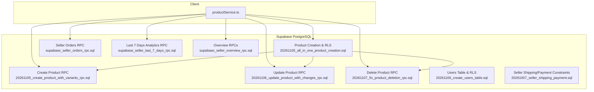
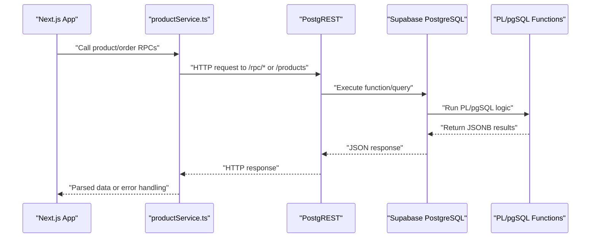
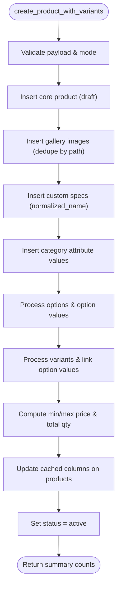
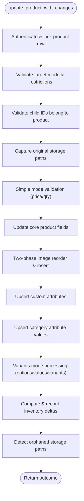
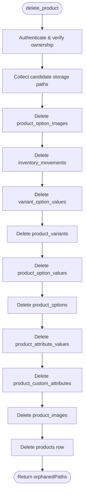
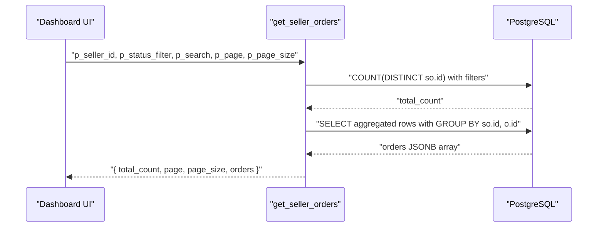
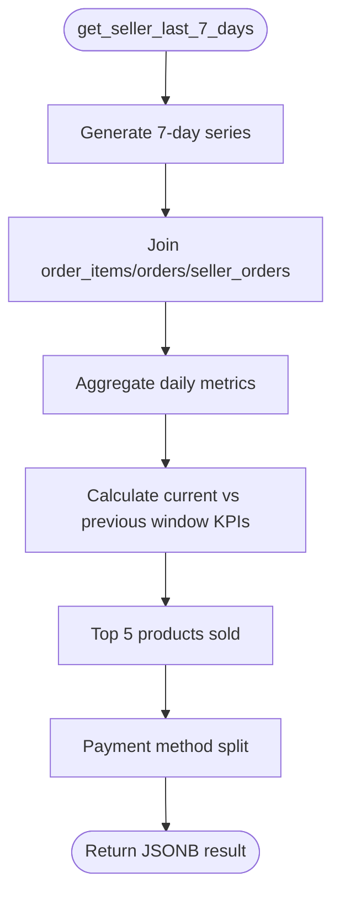
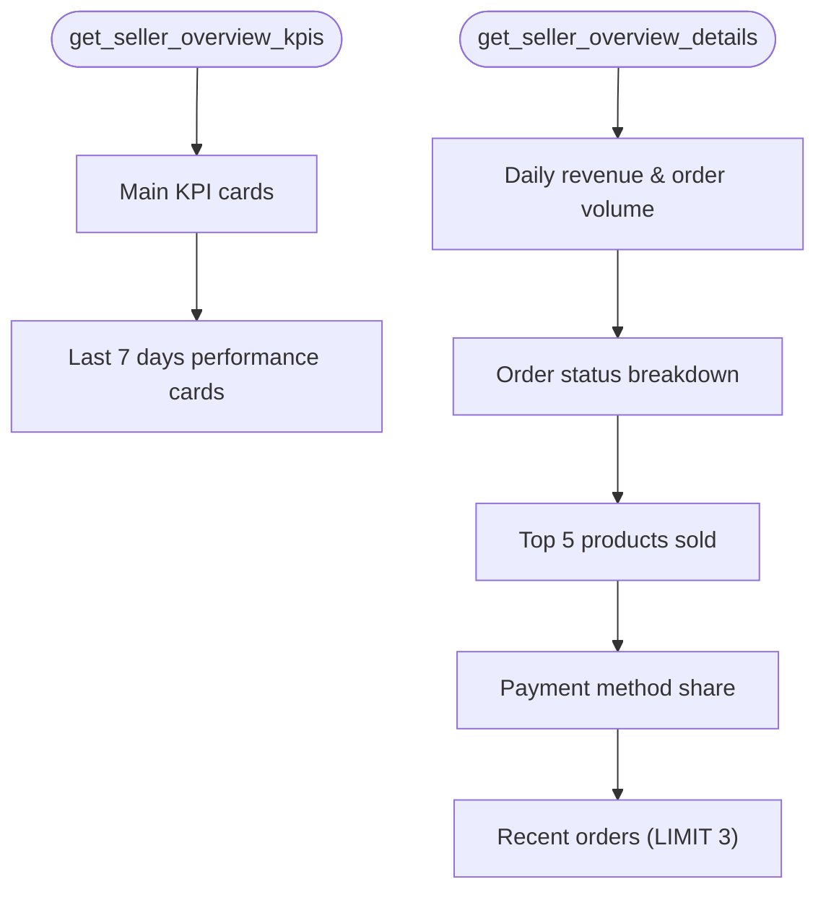
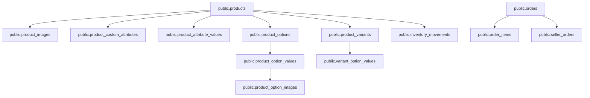

# Database Optimization

<cite>
**Referenced Files in This Document**
- [20261105_all_in_one_product_creation.sql](file://supabase/migrations/20261105_all_in_one_product_creation.sql)
- [20261105_create_product_with_variants_rpc.sql](file://supabase/migrations/20261105_create_product_with_variants_rpc.sql)
- [20261106_update_product_with_changes_rpc.sql](file://supabase/migrations/20261106_update_product_with_changes_rpc.sql)
- [20261107_fix_product_deletion_rpc.sql](file://supabase/migrations/20261107_fix_product_deletion_rpc.sql)
- [20261106_create_users_table.sql](file://supabase/migrations/20261106_create_users_table.sql)
- [20261007_seller_shipping_payment.sql](file://supabase/migrations/20261007_seller_shipping_payment.sql)
- [supabase_seller_orders_rpc.sql](file://supabase_seller_orders_rpc.sql)
- [supabase_seller_last_7_days_rpc.sql](file://supabase_seller_last_7_days_rpc.sql)
- [supabase_seller_overview_rpc.sql](file://supabase_seller_overview_rpc.sql)
- [productService.ts](file://src/api/productService.ts)
</cite>

## Table of Contents
1. [Introduction](#introduction)
2. [Project Structure](#project-structure)
3. [Core Components](#core-components)
4. [Architecture Overview](#architecture-overview)
5. [Detailed Component Analysis](#detailed-component-analysis)
6. [Dependency Analysis](#dependency-analysis)
7. [Performance Considerations](#performance-considerations)
8. [Troubleshooting Guide](#troubleshooting-guide)
9. [Conclusion](#conclusion)

## Introduction
This document explains database optimization strategies for the Supabase PostgreSQL backend used by the application. It focuses on query optimization techniques, index and constraint strategies for product searches and order queries, stored procedure (RPC) optimizations, RPC performance tuning, connection pooling considerations, query result caching, schema design improvements, foreign key relationships, constraint usage, monitoring approaches for slow queries, performance metrics, and scaling strategies for high-traffic scenarios.

The repository implements a strong server-side data layer using PostgreSQL functions and Row Level Security (RLS), with client-side services that call these functions via PostgREST. The migration scripts define tables, constraints, triggers, RLS policies, and RPCs that encapsulate complex business logic and improve both correctness and performance.

## Project Structure
The database-related code is primarily located under:
- supabase/migrations: SQL migrations defining schema, constraints, triggers, RLS policies, and RPCs
- src/api/productService.ts: Client service that calls PostgREST endpoints and RPCs, including error handling for missing RPCs or schema cache issues
- Top-level SQL files for specific RPCs and migrations related to seller analytics and orders

**Diagram sources**
- [productService.ts:829-867](file://src/api/productService.ts#L829-L867)
- [productService.ts:1648-1675](file://src/api/productService.ts#L1648-L1675)
- [20261105_all_in_one_product_creation.sql:1042-1229](file://supabase/migrations/20261105_all_in_one_product_creation.sql#L1042-L1229)
- [20261105_create_product_with_variants_rpc.sql:100-800](file://supabase/migrations/20261105_create_product_with_variants_rpc.sql#L100-L800)
- [20261106_update_product_with_changes_rpc.sql:20-800](file://supabase/migrations/20261106_update_product_with_changes_rpc.sql#L20-L800)
- [20261107_fix_product_deletion_rpc.sql:97-224](file://supabase/migrations/20261107_fix_product_deletion_rpc.sql#L97-L224)
- [supabase_seller_orders_rpc.sql:50-150](file://supabase_seller_orders_rpc.sql#L50-L150)
- [supabase_seller_last_7_days_rpc.sql:5-179](file://supabase_seller_last_7_days_rpc.sql#L5-L179)
- [supabase_seller_overview_rpc.sql:33-354](file://supabase_seller_overview_rpc.sql#L33-L354)

**Section sources**
- [productService.ts:829-867](file://src/api/productService.ts#L829-L867)
- [productService.ts:1648-1675](file://src/api/productService.ts#L1648-L1675)
- [20261105_all_in_one_product_creation.sql:1042-1229](file://supabase/migrations/20261105_all_in_one_product_creation.sql#L1042-L1229)
- [supabase_seller_orders_rpc.sql:50-150](file://supabase_seller_orders_rpc.sql#L50-L150)
- [supabase_seller_last_7_days_rpc.sql:5-179](file://supabase_seller_last_7_days_rpc.sql#L5-L179)
- [supabase_seller_overview_rpc.sql:33-354](file://supabase_seller_overview_rpc.sql#L33-L354)

## Core Components
- Product creation and variant management RPCs: Encapsulate validation, normalization, inventory movements, and RLS policy enforcement. They reduce client complexity and centralize transactional logic.
- Product update RPC: Implements change-only writes, optimistic concurrency checks, two-phase reordering, safe inventory deltas, and orphaned storage path detection.
- Product deletion RPC: Performs atomic deletions across multiple child tables in safe FK order, with trigger guards to avoid deferred constraint failures during deletions.
- Seller orders RPC: Provides paginated, filtered, and aggregated order listings with single-join aggregation and RLS policies.
- Analytics RPCs: Provide last-7-days breakdowns, KPI summaries, top products, and payment method splits using CTEs and generate_series for consistent time buckets.
- Overview RPCs: Split into Phase 1 (lightweight KPIs) and Phase 2 (graphs and recent orders) to optimize initial load times.

Key optimization patterns observed:
- Server-side aggregation and pagination within RPCs
- Use of JSONB for flexible payloads and structured responses
- RLS policies to restrict access at the row level
- Normalization helpers to standardize option names and values
- Trigger-based integrity checks with early-return guards for deletions
- Two-phase updates to prevent unique constraint collisions during reorder operations

**Section sources**
- [20261105_all_in_one_product_creation.sql:17-137](file://supabase/migrations/20261105_all_in_one_product_creation.sql#L17-L137)
- [20261105_all_in_one_product_creation.sql:220-1040](file://supabase/migrations/20261105_all_in_one_product_creation.sql#L220-L1040)
- [20261105_create_product_with_variants_rpc.sql:100-800](file://supabase/migrations/20261105_create_product_with_variants_rpc.sql#L100-L800)
- [20261106_update_product_with_changes_rpc.sql:20-800](file://supabase/migrations/20261106_update_product_with_changes_rpc.sql#L20-L800)
- [20261107_fix_product_deletion_rpc.sql:97-224](file://supabase/migrations/20261107_fix_product_deletion_rpc.sql#L97-L224)
- [supabase_seller_orders_rpc.sql:50-150](file://supabase_seller_orders_rpc.sql#L50-L150)
- [supabase_seller_last_7_days_rpc.sql:5-179](file://supabase_seller_last_7_days_rpc.sql#L5-L179)
- [supabase_seller_overview_rpc.sql:33-354](file://supabase_seller_overview_rpc.sql#L33-L354)

## Architecture Overview
The system uses PostgreSQL functions exposed via PostgREST. The client service invokes RPCs and table endpoints, while the database enforces security, validation, and performance-critical logic.

**Diagram sources**
- [productService.ts:829-867](file://src/api/productService.ts#L829-L867)
- [productService.ts:1648-1675](file://src/api/productService.ts#L1648-L1675)
- [supabase_seller_orders_rpc.sql:50-150](file://supabase_seller_orders_rpc.sql#L50-L150)
- [supabase_seller_overview_rpc.sql:33-354](file://supabase_seller_overview_rpc.sql#L33-L354)

## Detailed Component Analysis

### Product Creation and Variant Management
The product creation flow validates payload, normalizes option names, inserts core product data, images, custom attributes, category attributes, options/values, variants, and inventory movements. It also computes aggregates and updates cached columns on the product row.

Optimization highlights:
- Atomic transactional creation with strict validation
- In-memory JSONB maps for deduplication and ID lookups
- Normalized keys for stable combination mapping
- Cached min/max price and total quantity to speed up listing queries
- RLS policies ensuring sellers can only manage their own data

**Diagram sources**
- [20261105_all_in_one_product_creation.sql:220-1040](file://supabase/migrations/20261105_all_in_one_product_creation.sql#L220-L1040)
- [20261105_create_product_with_variants_rpc.sql:100-800](file://supabase/migrations/20261105_create_product_with_variants_rpc.sql#L100-L800)

**Section sources**
- [20261105_all_in_one_product_creation.sql:220-1040](file://supabase/migrations/20261105_all_in_one_product_creation.sql#L220-L1040)
- [20261105_create_product_with_variants_rpc.sql:100-800](file://supabase/migrations/20261105_create_product_with_variants_rpc.sql#L100-L800)

### Product Update with Changes
The update RPC supports change-only writes, optimistic concurrency checks, two-phase image reordering, normalized name handling, and safe inventory delta movements. It also detects orphaned storage paths for client cleanup.

Optimization highlights:
- FOR UPDATE lock on the target product row to prevent concurrent mutations
- Optimistic concurrency check against expected updated_at
- Two-phase reordering to avoid unique constraint collisions
- Upsert patterns for attributes and option values
- Inventory movement tracking for stock corrections

**Diagram sources**
- [20261106_update_product_with_changes_rpc.sql:20-800](file://supabase/migrations/20261106_update_product_with_changes_rpc.sql#L20-L800)

**Section sources**
- [20261106_update_product_with_changes_rpc.sql:20-800](file://supabase/migrations/20261106_update_product_with_changes_rpc.sql#L20-L800)

### Product Deletion with Deferred Trigger Guards
The deletion RPC ensures safe deletion across multiple child tables in dependency order and includes trigger guards to avoid deferred constraint failures when parents are deleted within the same transaction.

Optimization highlights:
- Strict FK deletion order across 10 product tables
- Early-return guards in completeness trigger to skip checks when parent rows are already deleted
- Orphaned storage path detection scoped to seller/product prefix

**Diagram sources**
- [20261107_fix_product_deletion_rpc.sql:97-224](file://supabase/migrations/20261107_fix_product_deletion_rpc.sql#L97-L224)

**Section sources**
- [20261107_fix_product_deletion_rpc.sql:97-224](file://supabase/migrations/20261107_fix_product_deletion_rpc.sql#L97-L224)

### Seller Orders RPC
Provides a paginated, filtered, and aggregated view of seller orders with RLS policies enforcing seller-scoped access.

Optimization highlights:
- Single JOIN between seller_orders, orders, and order_items
- Server-side aggregation of items per order
- Pagination with offset calculation
- Flexible status filtering and search on order_number/customer_name

**Diagram sources**
- [supabase_seller_orders_rpc.sql:50-150](file://supabase_seller_orders_rpc.sql#L50-L150)

**Section sources**
- [supabase_seller_orders_rpc.sql:50-150](file://supabase_seller_orders_rpc.sql#L50-L150)

### Last 7 Days Analytics RPC
Generates daily breakdowns, summary KPIs, top products, and payment method splits using CTEs and generate_series to ensure consistent time buckets.

Optimization highlights:
- generate_series for guaranteed day coverage
- LEFT JOINs to include zero-revenue days
- Aggregations over order_items joined with orders and seller_orders
- Separate CTEs for pending queue and reviews stats

**Diagram sources**
- [supabase_seller_last_7_days_rpc.sql:5-179](file://supabase_seller_last_7_days_rpc.sql#L5-L179)

**Section sources**
- [supabase_seller_last_7_days_rpc.sql:5-179](file://supabase_seller_last_7_days_rpc.sql#L5-L179)

### Overview RPCs (Phase 1 & Phase 2)
Splits dashboard data into lightweight KPIs (Phase 1) and heavier graph/recent orders data (Phase 2) to improve perceived performance.

Optimization highlights:
- Phase 1 returns only essential KPI cards
- Phase 2 computes daily revenue trajectory, order volume, status breakdown, top products, payment share, and recent orders
- Uses generate_series and CTEs for consistent aggregations

**Diagram sources**
- [supabase_seller_overview_rpc.sql:33-354](file://supabase_seller_overview_rpc.sql#L33-L354)

**Section sources**
- [supabase_seller_overview_rpc.sql:33-354](file://supabase_seller_overview_rpc.sql#L33-L354)

### Users Table and RLS Policies
Defines customer profiles with RLS policies allowing users to view/update their own profile.

Optimization highlights:
- Primary key references auth.users with cascade delete
- UNIQUE email constraint
- RLS policies for SELECT/UPDATE/INSERT scoped to auth.uid()

**Section sources**
- [20261106_create_users_table.sql:1-39](file://supabase/migrations/20261106_create_users_table.sql#L1-L39)

### Seller Shipping and Payment Constraints
Adds CHECK constraints to enforce valid shipping charges range and mutual exclusivity of advance payment flags.

Optimization highlights:
- Declarative constraints to prevent invalid states
- Idempotent constraint addition via DO $$ blocks

**Section sources**
- [20261007_seller_shipping_payment.sql:1-35](file://supabase/migrations/20261007_seller_shipping_payment.sql#L1-L35)

## Dependency Analysis
The product creation/update/deletion RPCs depend on multiple child tables and rely on RLS policies to enforce seller isolation. The orders and analytics RPCs depend on order_items, orders, and seller_orders.

**Diagram sources**
- [20261105_all_in_one_product_creation.sql:1042-1229](file://supabase/migrations/20261105_all_in_one_product_creation.sql#L1042-L1229)
- [supabase_seller_orders_rpc.sql:1-49](file://supabase_seller_orders_rpc.sql#L1-L49)

**Section sources**
- [20261105_all_in_one_product_creation.sql:1042-1229](file://supabase/migrations/20261105_all_in_one_product_creation.sql#L1042-L1229)
- [supabase_seller_orders_rpc.sql:1-49](file://supabase_seller_orders_rpc.sql#L1-L49)

## Performance Considerations
- Query Optimization Techniques
  - Prefer server-side aggregation and pagination within RPCs to minimize client-side processing and network overhead.
  - Use CTEs and generate_series to produce consistent time-series data without expensive client-side date calculations.
  - Avoid unnecessary joins; join only required tables and filter early in WHERE clauses.
  - Use ILIKE with leading wildcards cautiously; consider full-text search or trigram indexes if search performance becomes a bottleneck.

- Index Strategies for Product Searches and Order Queries
  - Ensure indexes exist on frequently filtered columns such as seller_id, status, created_at, and order_number.
  - For product searches involving normalized names, consider functional indexes on normalized_name and normalized_value where applicable.
  - Composite indexes on (seller_id, status) and (seller_id, created_at) can accelerate order list queries.

- Stored Procedure Optimizations
  - Keep PL/pgSQL functions focused and modular; use helper functions like normalize_option_name to reduce duplication.
  - Use INSTEAD OF triggers or SECURITY DEFINER functions to encapsulate complex write paths and enforce consistency.
  - Minimize repeated scans by using in-memory JSONB maps for lookups and deduplication within functions.

- RPC Function Performance Tuning
  - Use SECURITY DEFINER for read-heavy RPCs to leverage consistent permissions and avoid per-row RLS evaluation overhead where appropriate.
  - Return structured JSONB responses to reduce client parsing complexity.
  - Implement optimistic concurrency checks to prevent wasted work on stale edits.

- Connection Pooling
  - Leverage Supabase’s managed connection pool; ensure application-level connection reuse and avoid opening new connections per request.
  - Monitor connection saturation and adjust pool size based on workload characteristics.

- Query Result Caching
  - Cache RPC results at the application layer for read-heavy dashboards (e.g., overview KPIs).
  - Use short TTLs for analytics data to balance freshness and performance.
  - Invalidate caches on relevant mutations (product updates, order status changes).

- Schema Optimization
  - Normalize data where referential integrity is critical; denormalize selectively for performance (e.g., cached_min_variant_price).
  - Enforce constraints declaratively to offload validation from application code.
  - Use ENUM-like text fields with CHECK constraints where appropriate.

- Foreign Key Relationships and Constraint Usage
  - Define explicit foreign keys to maintain referential integrity and enable efficient joins.
  - Use ON DELETE RESTRICT where cascading deletes could cause unintended side effects.
  - Add composite unique constraints to prevent duplicate combinations (e.g., variant option selections).

**Section sources**
- [supabase_seller_orders_rpc.sql:50-150](file://supabase_seller_orders_rpc.sql#L50-L150)
- [supabase_seller_last_7_days_rpc.sql:5-179](file://supabase_seller_last_7_days_rpc.sql#L5-L179)
- [supabase_seller_overview_rpc.sql:33-354](file://supabase_seller_overview_rpc.sql#L33-L354)
- [20261105_all_in_one_product_creation.sql:220-1040](file://supabase/migrations/20261105_all_in_one_product_creation.sql#L220-L1040)
- [20261106_update_product_with_changes_rpc.sql:20-800](file://supabase/migrations/20261106_update_product_with_changes_rpc.sql#L20-L800)

## Troubleshooting Guide
- Missing RPC Function Errors
  - Symptoms: PGRST202 or messages indicating “schema cache” or “could not find the function”.
  - Resolution: Ensure the relevant migration script has been executed in the Supabase SQL editor and the schema cache has been refreshed.
  - Client-side handling: Detect missing RPC errors and provide user-friendly messages directing users to run migrations.

- Relationship or Schema Cache Issues
  - Symptoms: Errors referencing relationships or category_attribute_definitions during embedded queries.
  - Resolution: Use fallback query functions that fetch related data in parallel within the same queryFn, returning a single cached result.

- Unique or Exclusion Constraint Violations
  - Symptoms: Messages about unique or exclusion constraints or ON CONFLICT errors.
  - Resolution: Review payload uniqueness and ensure proper deduplication logic in RPCs; add or adjust constraints as needed.

**Section sources**
- [productService.ts:260-275](file://src/api/productService.ts#L260-L275)
- [productService.ts:829-867](file://src/api/productService.ts#L829-L867)
- [productService.ts:1648-1675](file://src/api/productService.ts#L1648-L1675)

## Conclusion
The Supabase PostgreSQL backend leverages well-designed RPCs, RLS policies, and constraints to deliver secure, consistent, and performant data operations. By centralizing complex logic in PL/pgSQL functions, using server-side aggregation and pagination, and employing optimistic concurrency and two-phase updates, the system achieves robustness and scalability. Monitoring slow queries, tuning indexes, and applying caching strategies will further enhance performance under high traffic. Continuous refinement of schema design and constraint usage ensures data integrity while maintaining optimal query performance.