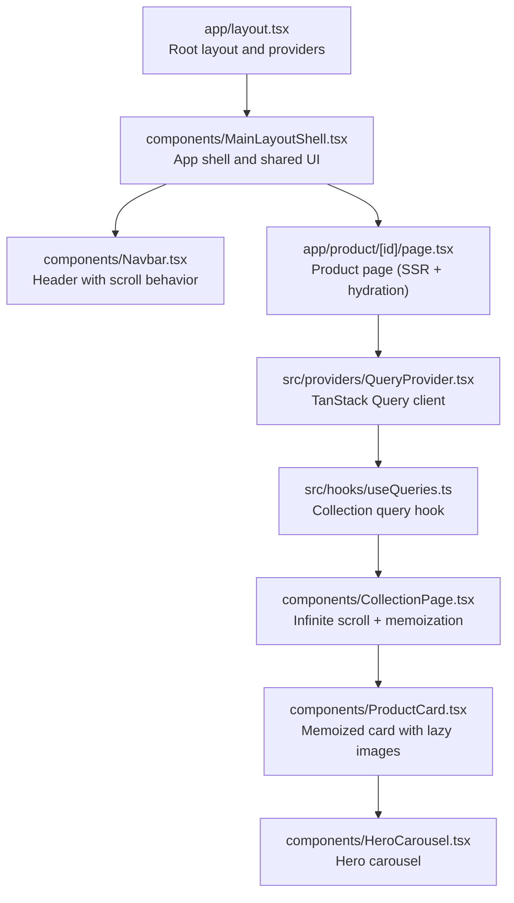
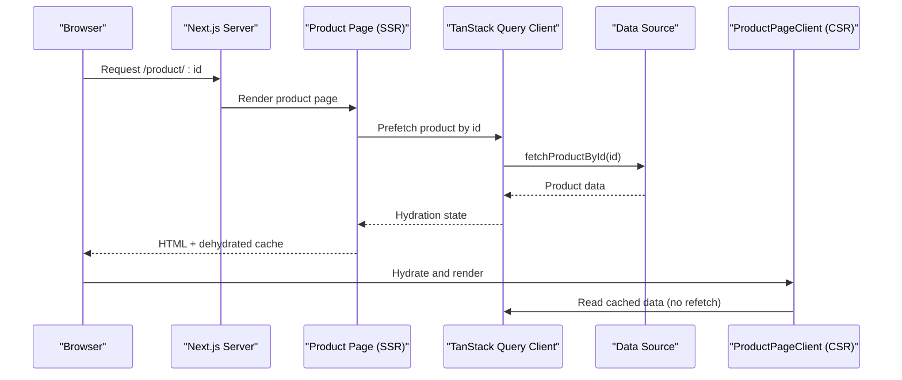
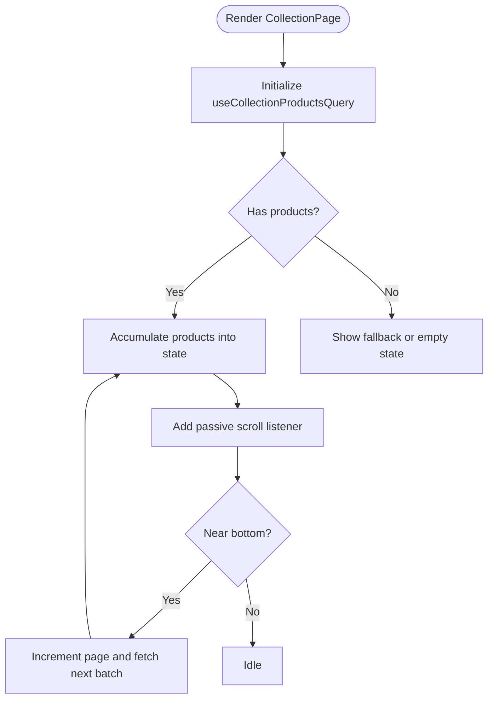
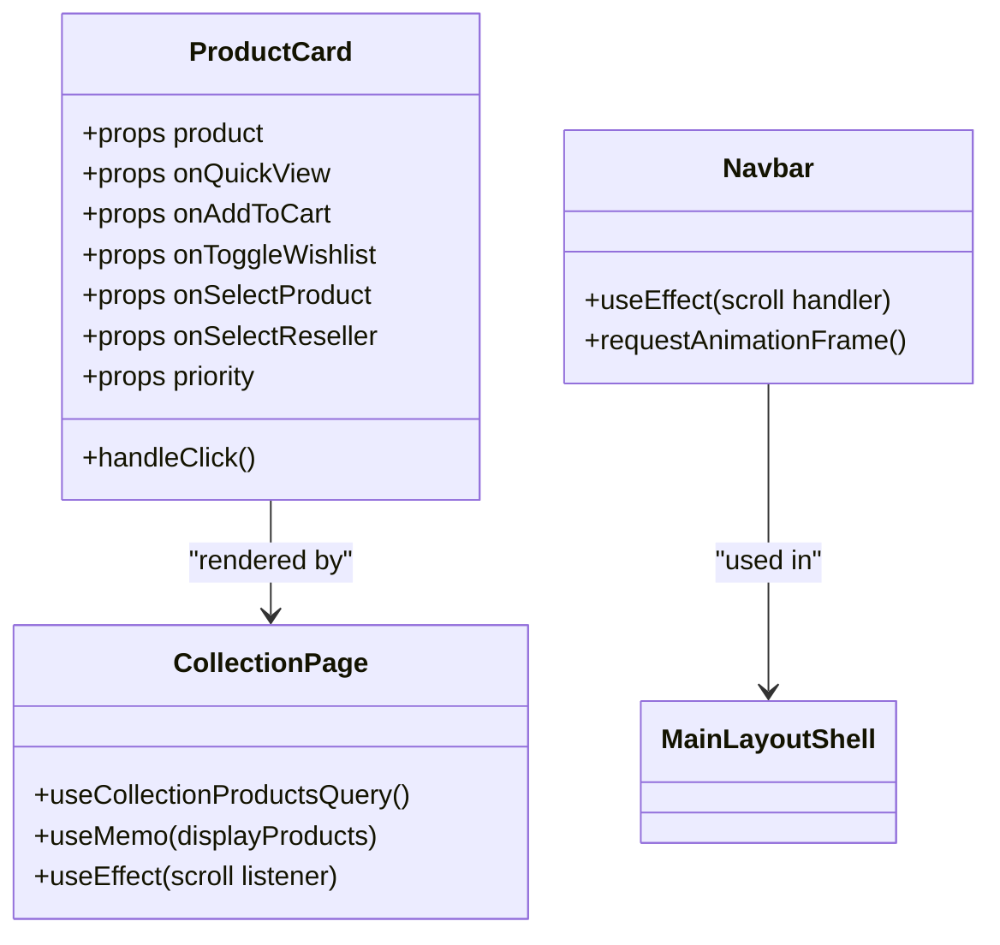
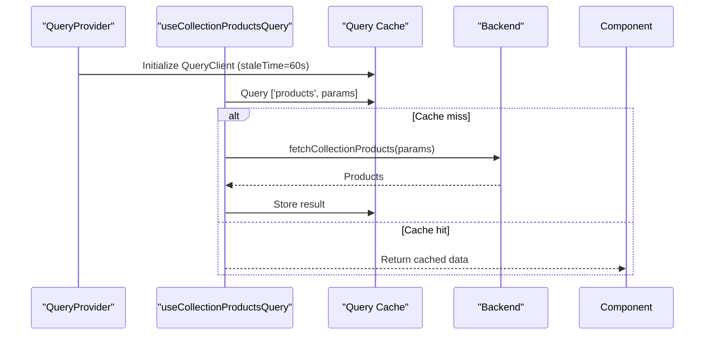
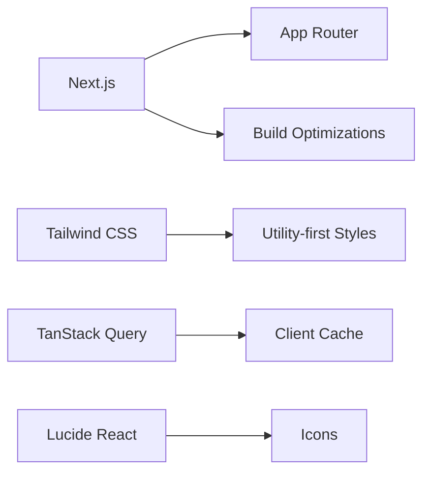

# Frontend Performance

<cite>
**Referenced Files in This Document**
- [next.config.ts](file://next.config.ts)
- [package.json](file://package.json)
- [postcss.config.mjs](file://postcss.config.mjs)
- [app/layout.tsx](file://app/layout.tsx)
- [app/globals.css](file://app/globals.css)
- [components/HeroCarousel.tsx](file://components/HeroCarousel.tsx)
- [components/ProductCard.tsx](file://components/ProductCard.tsx)
- [components/CollectionPage.tsx](file://components/CollectionPage.tsx)
- [src/providers/QueryProvider.tsx](file://src/providers/QueryProvider.tsx)
- [src/hooks/useQueries.ts](file://src/hooks/useQueries.ts)
- [app/product/[id]/page.tsx](file://app/product/[id]/page.tsx)
- [src/api/sellerProfileService.ts](file://src/api/sellerProfileService.ts)
- [src/api/productService.ts](file://src/api/productService.ts)
- [src/hooks/useObjectUrl.ts](file://src/hooks/useObjectUrl.ts)
- [components/MainLayoutShell.tsx](file://components/MainLayoutShell.tsx)
- [components/Navbar.tsx](file://components/Navbar.tsx)
</cite>

## Table of Contents
1. [Introduction](#introduction)
2. [Project Structure](#project-structure)
3. [Core Components](#core-components)
4. [Architecture Overview](#architecture-overview)
5. [Detailed Component Analysis](#detailed-component-analysis)
6. [Dependency Analysis](#dependency-analysis)
7. [Performance Considerations](#performance-considerations)
8. [Troubleshooting Guide](#troubleshooting-guide)
9. [Conclusion](#conclusion)

## Introduction
This document explains frontend performance optimization strategies implemented in the Next.js application. It covers build configuration, code splitting, bundle analysis readiness, asset and image optimization, lazy loading for key components, React rendering optimizations (memoization), CSS optimization with Tailwind CSS, client-side caching via TanStack Query, and progressive enhancement patterns. The goal is to provide a clear, actionable guide for maintaining fast load times, smooth interactions, and efficient rendering across devices.

## Project Structure
The project follows a standard Next.js App Router layout:
- Application shell and global providers are defined at the app root.
- Feature pages live under app routes.
- Reusable UI components are under components.
- Data fetching and API utilities are under src/api.
- Client state and caching are managed through TanStack Query.

**Diagram sources**
- [app/layout.tsx:1-51](file://app/layout.tsx#L1-L51)
- [components/MainLayoutShell.tsx:1-145](file://components/MainLayoutShell.tsx#L1-L145)
- [components/Navbar.tsx:1-186](file://components/Navbar.tsx#L1-L186)
- [app/product/[id]/page.tsx:1-29](file://app/product/[id]/page.tsx#L1-L29)
- [src/providers/QueryProvider.tsx:1-24](file://src/providers/QueryProvider.tsx#L1-L24)
- [src/hooks/useQueries.ts:68-86](file://src/hooks/useQueries.ts#L68-L86)
- [components/CollectionPage.tsx:79-144](file://components/CollectionPage.tsx#L79-L144)
- [components/ProductCard.tsx:1-274](file://components/ProductCard.tsx#L1-L274)
- [components/HeroCarousel.tsx:1-91](file://components/HeroCarousel.tsx#L1-L91)

**Section sources**
- [app/layout.tsx:1-51](file://app/layout.tsx#L1-L51)
- [components/MainLayoutShell.tsx:1-145](file://components/MainLayoutShell.tsx#L1-L145)

## Core Components
Key building blocks that impact performance:
- Root layout sets metadata, fonts preconnect, and provider hierarchy.
- MainLayoutShell composes top-level UI and interactive drawers/modals.
- Product page prefetches data server-side and hydrates on the client.
- CollectionPage uses TanStack Query with staleTime and infinite scroll.
- ProductCard is memoized and uses native lazy loading for images.
- HeroCarousel manages slide rotation with timers and accessibility attributes.

**Section sources**
- [app/layout.tsx:10-47](file://app/layout.tsx#L10-L47)
- [components/MainLayoutShell.tsx:13-145](file://components/MainLayoutShell.tsx#L13-L145)
- [app/product/[id]/page.tsx:10-29](file://app/product/[id]/page.tsx#L10-L29)
- [components/CollectionPage.tsx:79-144](file://components/CollectionPage.tsx#L79-L144)
- [components/ProductCard.tsx:18-106](file://components/ProductCard.tsx#L18-L106)
- [components/HeroCarousel.tsx:4-15](file://components/HeroCarousel.tsx#L4-L15)

## Architecture Overview
The runtime architecture emphasizes SSR where possible, client-side caching, and component-level optimizations.

**Diagram sources**
- [app/product/[id]/page.tsx:10-29](file://app/product/[id]/page.tsx#L10-L29)
- [src/providers/QueryProvider.tsx:6-24](file://src/providers/QueryProvider.tsx#L6-L24)

## Detailed Component Analysis

### Build Configuration and Code Splitting
- Next.js experimental optimizePackageImports is configured for lucide-react and recharts to reduce bundle size by importing only used icons and chart modules.
- reactStrictMode is enabled for safer development-time checks.
- Scripts include dev with turbo mode and a clean script to remove .next between builds.

Recommendations:
- Add bundle analysis (e.g., next-bundle-analyzer) to visualize chunk sizes and identify heavy dependencies.
- Keep third-party libraries tree-shakeable; prefer icon libraries that support selective imports.

**Section sources**
- [next.config.ts:3-9](file://next.config.ts#L3-L9)
- [package.json:5-11](file://package.json#L5-L11)

### Asset Optimization Strategies
- Fonts are preconnected and loaded via Google Fonts with multiple font families. Consider using next/font or self-hosting critical fonts to reduce FOIT/FOUT and network waterfalls.
- Icons are from lucide-react; selective imports are already optimized via package import optimization.

Optimization tips:
- Preload critical fonts and defer non-critical ones.
- Use modern image formats (WebP/AVIF) and responsive sizing.

**Section sources**
- [app/layout.tsx:27-36](file://app/layout.tsx#L27-L36)
- [next.config.ts:4-6](file://next.config.ts#L4-L6)

### Image Optimization Techniques
- ProductCard uses native  with loading="lazy" for offscreen images and decoding="async" to avoid main-thread blocking. Priority images use loading="eager".
- Error fallbacks replace broken images with a placeholder URL.
- Hover images are also lazily loaded and hidden until hover.

Best practices applied:
- Lazy loading reduces initial payload and improves LCP for above-the-fold content.
- Async decoding prevents layout shifts during decode.

Potential improvements:
- Replace raw  with Next.js Image component for automatic format selection, resizing, and caching.
- Provide explicit width/height or aspect-ratio to prevent layout shift.

**Section sources**
- [components/ProductCard.tsx:96-119](file://components/ProductCard.tsx#L96-L119)

### Lazy Loading Implementations
- HeroCarousel renders all slides but controls visibility via opacity and z-index. Consider lazy-loading offscreen slides or using IntersectionObserver to preload images when near viewport.
- CollectionPage implements infinite scroll with passive scroll listeners and threshold-based pagination.

**Diagram sources**
- [components/CollectionPage.tsx:79-144](file://components/CollectionPage.tsx#L79-L144)

**Section sources**
- [components/HeroCarousel.tsx:4-15](file://components/HeroCarousel.tsx#L4-L15)
- [components/CollectionPage.tsx:106-121](file://components/CollectionPage.tsx#L106-L121)

### React Component Optimization Patterns
- ProductCard is wrapped with React.memo to prevent unnecessary re-renders when props do not change.
- CollectionPage uses useMemo for derived data (wishlist set, display products) to minimize recomputation.
- Navbar uses requestAnimationFrame and passive event listeners for scroll handling to keep scrolling smooth.

**Diagram sources**
- [components/ProductCard.tsx:18-106](file://components/ProductCard.tsx#L18-L106)
- [components/CollectionPage.tsx:79-144](file://components/CollectionPage.tsx#L79-L144)
- [components/Navbar.tsx:34-65](file://components/Navbar.tsx#L34-L65)

**Section sources**
- [components/ProductCard.tsx:18-106](file://components/ProductCard.tsx#L18-L106)
- [components/CollectionPage.tsx:123-131](file://components/CollectionPage.tsx#L123-L131)
- [components/Navbar.tsx:34-65](file://components/Navbar.tsx#L34-L65)

### CSS Optimization with Tailwind CSS
- Tailwind v4 is configured via postcss.config.mjs with @tailwindcss/postcss.
- Global styles define theme variables and base typography, reducing custom CSS overhead.
- Utility-first approach ensures minimal unused CSS when combined with Tailwind’s purge strategy.

Recommendations:
- Ensure production builds strip unused styles (Tailwind v4 handles this automatically).
- Avoid large inline style objects; prefer utility classes for better caching and smaller bundles.

**Section sources**
- [postcss.config.mjs:1-8](file://postcss.config.mjs#L1-L8)
- [app/globals.css:1-15](file://app/globals.css#L1-L15)

### Critical CSS Extraction and Responsive Design
- Critical styles (base typography, theme variables) are included in globals.css.
- Responsive design uses Tailwind breakpoints and clamp-based fluid typography to adapt across devices without extra JS.

Considerations:
- Inline critical CSS for above-the-fold content if needed, though Tailwind typically provides sufficient optimization.
- Test CLS (Cumulative Layout Shift) with aspect-ratio containers and fixed dimensions.

**Section sources**
- [app/globals.css:17-49](file://app/globals.css#L17-L49)

### Client-Side Caching Strategies
- TanStack Query is configured with a global staleTime of 60 seconds and disabled refetchOnWindowFocus to reduce network calls.
- Collection queries use a longer staleTime (3 minutes) to improve perceived performance during browsing.
- Product page prefetches data server-side and hydrates the cache, avoiding redundant requests on first render.

**Diagram sources**
- [src/providers/QueryProvider.tsx:6-24](file://src/providers/QueryProvider.tsx#L6-L24)
- [src/hooks/useQueries.ts:68-86](file://src/hooks/useQueries.ts#L68-L86)

**Section sources**
- [src/providers/QueryProvider.tsx:6-24](file://src/providers/QueryProvider.tsx#L6-L24)
- [src/hooks/useQueries.ts:68-86](file://src/hooks/useQueries.ts#L68-L86)
- [app/product/[id]/page.tsx:10-29](file://app/product/[id]/page.tsx#L10-L29)

### Progressive Enhancement Techniques
- Interactive features like modals and drawers are conditionally rendered based on user actions, keeping initial payloads small.
- Scroll behaviors use passive listeners and requestAnimationFrame to maintain responsiveness.
- Error handling for images ensures graceful degradation with fallback placeholders.

**Section sources**
- [components/MainLayoutShell.tsx:93-141](file://components/MainLayoutShell.tsx#L93-L141)
- [components/Navbar.tsx:34-65](file://components/Navbar.tsx#L34-L65)
- [components/ProductCard.tsx:101-119](file://components/ProductCard.tsx#L101-L119)

## Dependency Analysis
The application relies on:
- Next.js for routing, SSR, and build optimizations.
- Tailwind CSS for styling and responsive design.
- TanStack Query for client-side data caching and background updates.
- Lucide React for icons, optimized via package import optimization.

**Diagram sources**
- [package.json:13-21](file://package.json#L13-L21)
- [next.config.ts:4-6](file://next.config.ts#L4-L6)
- [postcss.config.mjs:1-8](file://postcss.config.mjs#L1-L8)
- [src/providers/QueryProvider.tsx:1-24](file://src/providers/QueryProvider.tsx#L1-L24)

**Section sources**
- [package.json:13-21](file://package.json#L13-L21)
- [next.config.ts:4-6](file://next.config.ts#L4-L6)
- [postcss.config.mjs:1-8](file://postcss.config.mjs#L1-L8)

## Performance Considerations
- Bundle Size:
  - Enable bundle analysis to monitor chunk sizes and eliminate heavy dependencies.
  - Prefer selective imports for icon libraries and charts.
- Images:
  - Migrate to Next.js Image for automatic optimization, format selection, and caching.
  - Set explicit dimensions or aspect ratios to prevent layout shifts.
- Rendering:
  - Continue using React.memo for expensive components and useMemo for derived data.
  - Avoid heavy computations in render paths; move to hooks or memoized values.
- Network:
  - Tune staleTime per feature to balance freshness and performance.
  - Prefetch critical data on the server and hydrate on the client.
- CSS:
  - Rely on Tailwind’s purging and avoid large inline styles.
  - Defer non-critical fonts and preload critical ones.

[No sources needed since this section provides general guidance]

## Troubleshooting Guide
Common issues and resolutions:
- Excessive re-renders:
  - Verify components are wrapped with React.memo and props are stable.
  - Check for object/array creation inside render; move to useMemo or lift state.
- Slow scroll performance:
  - Ensure scroll handlers are passive and use requestAnimationFrame.
- Broken images:
  - Confirm onError fallbacks are present and URLs are valid.
- Over-fetching:
  - Adjust staleTime and refetch policies in QueryClient.
- Large bundles:
  - Analyze bundle and remove unused dependencies or switch to lighter alternatives.

**Section sources**
- [components/ProductCard.tsx:18-106](file://components/ProductCard.tsx#L18-L106)
- [components/Navbar.tsx:34-65](file://components/Navbar.tsx#L34-L65)
- [src/providers/QueryProvider.tsx:6-24](file://src/providers/QueryProvider.tsx#L6-L24)

## Conclusion
The application employs several effective performance strategies: server-side data prefetching with hydration, client-side caching via TanStack Query, component-level memoization, lazy loading for images, and Tailwind CSS for efficient styling. To further improve performance, adopt Next.js Image for automatic optimization, enable bundle analysis, and continue refining caching and rendering patterns based on real-world metrics.

[No sources needed since this section summarizes without analyzing specific files]