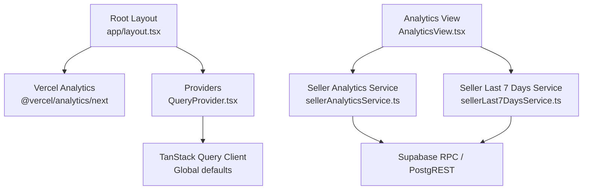
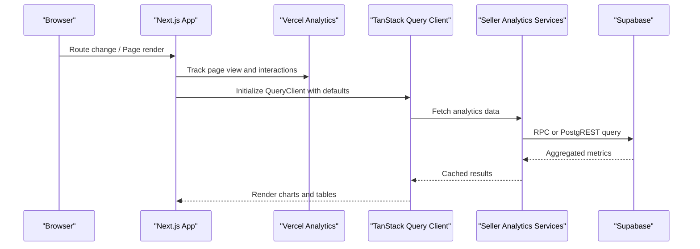
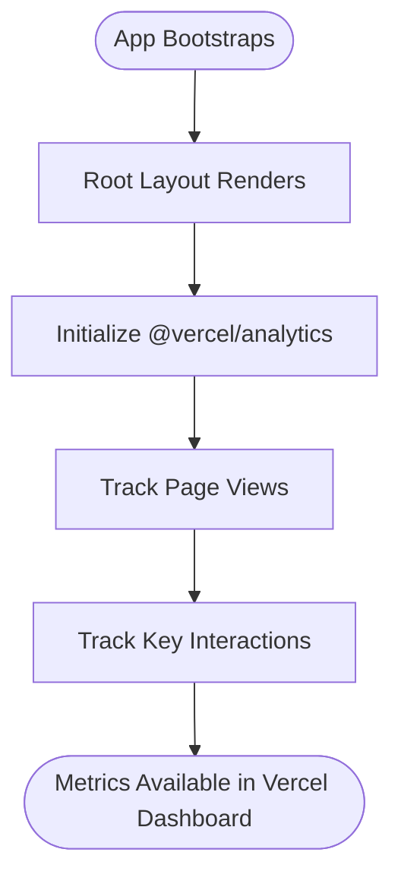
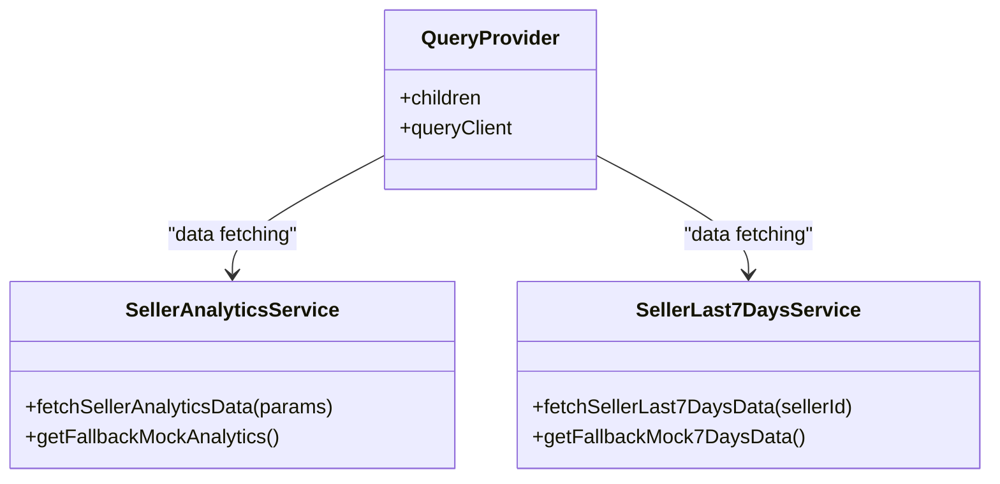
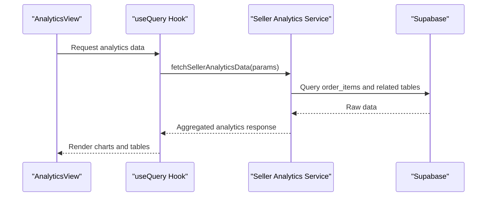
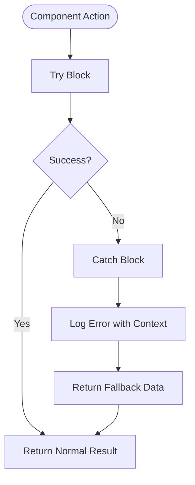
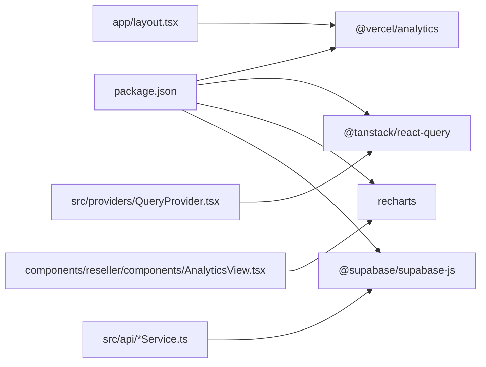

# Monitoring & Profiling

<cite>
**Referenced Files in This Document**
- [package.json](file://package.json)
- [next.config.ts](file://next.config.ts)
- [app/layout.tsx](file://app/layout.tsx)
- [src/providers/QueryProvider.tsx](file://src/providers/QueryProvider.tsx)
- [src/api/sellerAnalyticsService.ts](file://src/api/sellerAnalyticsService.ts)
- [src/api/sellerLast7DaysService.ts](file://src/api/sellerLast7DaysService.ts)
- [components/reseller/components/AnalyticsView.tsx](file://components/reseller/components/AnalyticsView.tsx)
- [components/AccountPage.tsx](file://components/AccountPage.tsx)
</cite>

## Table of Contents
1. [Introduction](#introduction)
2. [Project Structure](#project-structure)
3. [Core Components](#core-components)
4. [Architecture Overview](#architecture-overview)
5. [Detailed Component Analysis](#detailed-component-analysis)
6. [Dependency Analysis](#dependency-analysis)
7. [Performance Considerations](#performance-considerations)
8. [Troubleshooting Guide](#troubleshooting-guide)
9. [Conclusion](#conclusion)

## Introduction
This document defines a comprehensive monitoring and profiling strategy for the application, focusing on:
- Performance monitoring tools integration
- Error tracking setup
- User experience metrics collection
- React DevTools usage for component performance analysis, network request profiling, and memory leak detection
- Production monitoring with analytics services, performance budget enforcement, and alerting strategies
- Profiling techniques for rendering, data fetching, and user interactions
- Load testing approaches and performance regression detection methods

The repository already integrates Vercel Analytics at the root layout and uses TanStack Query for data fetching. The seller analytics features provide rich business metrics that can be extended to include performance and error telemetry.

## Project Structure
The project is a Next.js application with:
- App Router pages under app
- Shared components under components
- API service modules under src/api
- Providers and hooks under src/providers and src/hooks
- Configuration files including next.config.ts and package.json

**Diagram sources**
- [app/layout.tsx:8-43](file://app/layout.tsx#L8-L43)
- [src/providers/QueryProvider.tsx:6-23](file://src/providers/QueryProvider.tsx#L6-L23)
- [src/api/sellerAnalyticsService.ts:195-233](file://src/api/sellerAnalyticsService.ts#L195-L233)
- [src/api/sellerLast7DaysService.ts:83-100](file://src/api/sellerLast7DaysService.ts#L83-L100)
- [components/reseller/components/AnalyticsView.tsx:193-206](file://components/reseller/components/AnalyticsView.tsx#L193-L206)

**Section sources**
- [package.json:1-34](file://package.json#L1-L34)
- [next.config.ts:1-12](file://next.config.ts#L1-L12)
- [app/layout.tsx:1-51](file://app/layout.tsx#L1-L51)

## Core Components
- Vercel Analytics integration at the root layout enables automatic page view and interaction tracking.
- TanStack Query provider configures global caching behavior (staleTime and refetchOnWindowFocus).
- Seller analytics services fetch business KPIs from Supabase, with fallback mock data for demo mode.
- AnalyticsView renders charts and tables using Recharts and exposes CSV export functionality.

Key responsibilities:
- Application-level analytics instrumentation
- Data fetching configuration and caching
- Business metrics aggregation and visualization

**Section sources**
- [app/layout.tsx:8-43](file://app/layout.tsx#L8-L43)
- [src/providers/QueryProvider.tsx:6-23](file://src/providers/QueryProvider.tsx#L6-L23)
- [src/api/sellerAnalyticsService.ts:195-233](file://src/api/sellerAnalyticsService.ts#L195-L233)
- [components/reseller/components/AnalyticsView.tsx:193-206](file://components/reseller/components/AnalyticsView.tsx#L193-L206)

## Architecture Overview
The monitoring and profiling architecture combines client-side analytics, data-fetching observability, and UI performance analysis:

**Diagram sources**
- [app/layout.tsx:8-43](file://app/layout.tsx#L8-L43)
- [src/providers/QueryProvider.tsx:6-23](file://src/providers/QueryProvider.tsx#L6-L23)
- [src/api/sellerAnalyticsService.ts:195-233](file://src/api/sellerAnalyticsService.ts#L195-L233)
- [src/api/sellerLast7DaysService.ts:83-100](file://src/api/sellerLast7DaysService.ts#L83-L100)

## Detailed Component Analysis

### Vercel Analytics Integration
- Installed via dependency and imported into the root layout.
- Provides automatic page view and event tracking without additional code changes.
- Recommended enhancements:
  - Add custom events for key user flows (checkout, add-to-cart, review submission).
  - Segment by device type and geography for UX insights.
  - Combine with session replay tools for deeper diagnostics.

**Diagram sources**
- [app/layout.tsx:8-43](file://app/layout.tsx#L8-L43)

**Section sources**
- [package.json:16-16](file://package.json#L16-L16)
- [app/layout.tsx:8-43](file://app/layout.tsx#L8-L43)

### TanStack Query Provider and Data Fetching
- Global QueryClient sets default staleTime and disables refetchOnWindowFocus.
- Seller analytics services encapsulate complex queries and aggregations.
- Fallback logic returns mock data when not in production UUID mode.

**Diagram sources**
- [src/providers/QueryProvider.tsx:6-23](file://src/providers/QueryProvider.tsx#L6-L23)
- [src/api/sellerAnalyticsService.ts:195-233](file://src/api/sellerAnalyticsService.ts#L195-L233)
- [src/api/sellerLast7DaysService.ts:83-100](file://src/api/sellerLast7DaysService.ts#L83-L100)

**Section sources**
- [src/providers/QueryProvider.tsx:6-23](file://src/providers/QueryProvider.tsx#L6-L23)
- [src/api/sellerAnalyticsService.ts:195-233](file://src/api/sellerAnalyticsService.ts#L195-L233)
- [src/api/sellerLast7DaysService.ts:83-100](file://src/api/sellerLast7DaysService.ts#L83-L100)

### AnalyticsView Component
- Uses TanStack Query to fetch analytics data and displays charts and tables.
- Supports filtering by city and brand, and exporting reports to CSV.
- Integrates with Recharts for visualizations.

**Diagram sources**
- [components/reseller/components/AnalyticsView.tsx:193-206](file://components/reseller/components/AnalyticsView.tsx#L193-L206)
- [src/api/sellerAnalyticsService.ts:195-233](file://src/api/sellerAnalyticsService.ts#L195-L233)

**Section sources**
- [components/reseller/components/AnalyticsView.tsx:193-206](file://components/reseller/components/AnalyticsView.tsx#L193-L206)
- [src/api/sellerAnalyticsService.ts:195-233](file://src/api/sellerAnalyticsService.ts#L195-L233)

### Error Handling Patterns
- Multiple components use console.error and console.warn for error logging.
- Services catch errors and return fallback data to maintain UI stability.
- Recommendations:
  - Centralize error logging with an error tracking service (e.g., Sentry).
  - Normalize error messages and attach contextual metadata (user ID, route, timestamp).
  - Avoid exposing sensitive details in logs.

**Diagram sources**
- [src/api/sellerAnalyticsService.ts:562-566](file://src/api/sellerAnalyticsService.ts#L562-L566)
- [components/AccountPage.tsx:298-355](file://components/AccountPage.tsx#L298-L355)

**Section sources**
- [src/api/sellerAnalyticsService.ts:562-566](file://src/api/sellerAnalyticsService.ts#L562-L566)
- [components/AccountPage.tsx:298-355](file://components/AccountPage.tsx#L298-L355)

## Dependency Analysis
The monitoring stack depends on:
- @vercel/analytics for analytics instrumentation
- @tanstack/react-query for data fetching and caching
- recharts for analytics visualization
- supabase-js for database access

**Diagram sources**
- [package.json:13-21](file://package.json#L13-L21)
- [app/layout.tsx:8-43](file://app/layout.tsx#L8-L43)
- [src/providers/QueryProvider.tsx:6-23](file://src/providers/QueryProvider.tsx#L6-L23)
- [components/reseller/components/AnalyticsView.tsx:193-206](file://components/reseller/components/AnalyticsView.tsx#L193-L206)

**Section sources**
- [package.json:13-21](file://package.json#L13-L21)

## Performance Considerations
- Use React DevTools:
  - Profile component rendering to identify slow updates and unnecessary re-renders.
  - Inspect network requests to detect large payloads and slow endpoints.
  - Monitor memory snapshots to detect leaks during long sessions.
- Optimize data fetching:
  - Tune QueryClient options (staleTime, gcTime) based on data volatility.
  - Paginate or filter large datasets before rendering.
- Bundle optimization:
  - Leverage Next.js experimental optimizePackageImports for heavy libraries like lucide-react and recharts.
- Performance budgets:
  - Define budgets for bundle size, Time to Interactive, and Largest Contentful Paint.
  - Enforce budgets in CI using Lighthouse CI or Web Vitals thresholds.
- Alerting:
  - Set alerts for high error rates, latency spikes, and degraded Core Web Vitals.
  - Integrate with incident management platforms for rapid response.

[No sources needed since this section provides general guidance]

## Troubleshooting Guide
Common issues and resolutions:
- Analytics not tracking:
  - Verify @vercel/analytics is present in root layout and environment variables are configured.
- Data fetching failures:
  - Check Supabase RPC availability and permissions; ensure fallback mock data is used gracefully.
- Excessive re-renders:
  - Use React DevTools profiler to pinpoint components causing frequent updates.
- Memory growth:
  - Capture heap snapshots in Chrome DevTools; look for retained DOM nodes or event listeners.
- Slow analytics charts:
  - Reduce dataset size, enable virtualization, and debounce filters.

Operational steps:
- Centralize error logging with an error tracking service.
- Add structured logging around critical user flows.
- Instrument network timing and cache hit ratios.
- Review QueryClient configuration for optimal caching behavior.

**Section sources**
- [src/api/sellerAnalyticsService.ts:562-566](file://src/api/sellerAnalyticsService.ts#L562-L566)
- [src/providers/QueryProvider.tsx:6-23](file://src/providers/QueryProvider.tsx#L6-L23)
- [components/AccountPage.tsx:298-355](file://components/AccountPage.tsx#L298-L355)

## Conclusion
The application integrates Vercel Analytics and TanStack Query to support monitoring and data-driven dashboards. To strengthen performance and reliability:
- Expand analytics instrumentation with custom events and error tracking.
- Adopt React DevTools for continuous performance profiling.
- Establish performance budgets and CI checks.
- Implement alerting for critical metrics and errors.
- Conduct load testing and regression detection to safeguard user experience.

[No sources needed since this section summarizes without analyzing specific files]